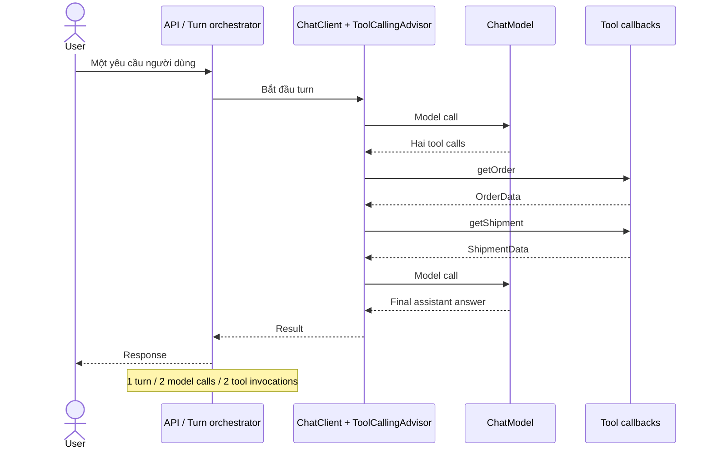

# Metric về số lượt gọi, độ trễ, lỗi và tỷ lệ hoàn tất

Khi tích hợp Spring AI Tool Calling với dịch vụ nghiệp vụ, chỉ biết rằng một HTTP request trả `200 OK` hoặc mô hình đã sinh văn bản là chưa đủ để vận hành hệ thống. Một yêu cầu có thể gọi mô hình nhiều vòng, mỗi vòng có nhiều tool call; một callback có thể trả dữ liệu, yêu cầu phê duyệt, chấp nhận một công việc chạy nền, thất bại do quyền hoặc không tìm thấy tài nguyên. Muốn biết hệ thống **đang hoạt động tốt đến đâu**, cần đo riêng số lượt gọi, độ trễ, lỗi và tỷ lệ **thực sự hoàn tất mục tiêu người dùng**.

Spring AI có Micrometer observations cho `ChatClient`, advisor, `ChatModel`, tool và nhiều thành phần khác. Các quan sát này cho biết thao tác nào chạy, tốn bao lâu, exception nào thoát ra và có thể nối trace từ request đến model/tool. Tuy nhiên, quan sát mặc định **không tự xác định** việc người dùng đã nhận được kết quả đúng nghiệp vụ, một đơn hàng đã được ghi thành công hay một job đã hoàn tất sau khi tool trả `QUEUED`. Ứng dụng cần bổ sung metric nghiệp vụ với định nghĩa và mẫu số nhất quán.

## 1. Ba tầng đo lường không được trộn lẫn

Một yêu cầu “Kiểm tra đơn và vị trí giao hàng” có thể diễn ra như sau:

1. Người dùng gửi một lượt yêu cầu (user turn).
2. `ChatClient` gọi mô hình lần đầu (model round #1).
3. Mô hình đề xuất `getOrder` và `getShipment` trong cùng phản hồi.
4. `ToolCallingManager` thực thi hai tool call.
5. Mô hình được gọi lần thứ hai (model round #2) để tổng hợp.
6. Ứng dụng trả câu trả lời cuối.

Khi đo, đây là **1 user turn, 2 model calls, 2 tool invocations** — không phải bốn “lượt hoàn tất”.



Bảng đơn vị đo:

| Đơn vị | Tên gợi ý | Khi nào tăng? | Không đồng nghĩa với |
| --- | --- | --- | --- |
| User turn | `app.ai.turns` | Mỗi lượt từ lúc tiếp nhận đến khi có outcome rõ | Số tool call |
| Model invocation | `gen_ai.client.operation` | Một lần gọi model (kể cả round trung gian) | Số lượt người dùng |
| Tool invocation | `spring.ai.tool` | Một lần callback thực thi được quan sát | Mỗi lần model chỉ *đề xuất* tool |
| Tool business outcome | `app.ai.tool.business.outcomes` | Kết quả nghiệp vụ của một attempt tool | Exception count |
| Business operation | `app.ai.operations.terminal` | Một quy trình/job đi vào trạng thái kết thúc | Lần chấp nhận job |
| Retry attempt | `app.ai.dependency.retries` | Retry dependency do ứng dụng thực hiện | Model correction retry |

Nếu dùng streaming, một stream có thể sinh nhiều chunk nhưng vẫn chỉ là **một** model invocation. Nếu model đề xuất hai tool trong một response, cần đếm hai callback attempt khi chúng thực sự được thực thi. Một tool bị từ chối trước execution (ví dụ chờ confirmation) không tự nhiên trở thành một observation thực thi thành công.

## 2. Những câu hỏi mà hệ thống giám sát phải trả lời

Trước khi thêm counter, hãy xác định quyết định vận hành cần hỗ trợ:

- Một yêu cầu trung bình dùng mấy model rounds và mấy tool calls?
- Tool nào có volume cao nhất, p95 latency cao nhất, timeout nhiều nhất?
- Có bao nhiêu lỗi validation do arguments của mô hình, bao nhiêu lỗi quyền, bao nhiêu lỗi dependency?
- Tỷ lệ yêu cầu hoàn tất mục tiêu, phải hỏi lại, chờ xác nhận, thất bại hoặc bỏ dở?
- Với job dài, bao nhiêu job đang `QUEUED/RUNNING`, mất bao lâu để đi tới `SUCCEEDED` và tỷ lệ kết thúc thành công là bao nhiêu?
- Có mô hình/tool/phiên bản nào gây regression sau khi release hoặc thay catalog?
- Tăng số lượt tool call có làm tăng chi phí và thời gian nhưng không tăng task completion không?

Để trả lời, mỗi metric phải có tên, đơn vị, event phát sinh, tập tag được phép và mẫu số rõ ràng. Không định nghĩa tỷ lệ chỉ bằng một counter có tên “success” mà không chỉ ra nó đang so với cái gì.

## 3. Spring AI 2.1 đã ghi những observation nào?

Spring AI 2.1.0 ghi các observation qua Micrometer. Khi Spring Boot có `ObservationRegistry`, metrics và tracing được cấu hình, các observation tạo timer/counter và span theo registry/exporter.

| Observation | Phạm vi đo | Tag low-cardinality quan trọng |
| --- | --- | --- |
| `spring.ai.chat.client` | Thời gian một lời gọi `ChatClient.call()` hoặc `stream()` | `spring.ai.chat.client.stream`, `spring.ai.kind` |
| `spring.ai.advisor` | Thời gian advisor; có thể bao gồm các advisor bên trong | `spring.ai.advisor.name` |
| `gen_ai.client.operation` | Thời gian từng lần gọi model; có cả model/provider | `gen_ai.operation.name`, `gen_ai.system`, `gen_ai.request.model` |
| `spring.ai.tool` | Thời gian thực thi một tool call | `spring.ai.tool.definition.name`, `spring.ai.tool.type` |
| `db.vector.client.operation` | Truy vấn/ghi vào vector store nếu dùng | `db.operation.name`, `db.system` |

Trong Spring AI 2.1, tool observation có `gen_ai.operation.name=execute_tool` và span name thường là `execute_tool <tool-name>`. API 1.0 trước đây có giá trị `framework`; không hard-code bộ lọc metric của version cũ khi triển khai dashboard mới.

Thông tin `spring.ai.tool.call.id` nằm ở **span attribute high-cardinality** để tra cứu một lời gọi, không phải tag metric. Tên tool là tag có phạm vi giới hạn theo catalog, nên thích hợp để phân nhóm; tool call ID, conversation ID, raw arguments và customer ID không nên đưa vào labels Prometheus.

### Timer của advisor có thể lồng nhau

Một timer `spring.ai.chat.client` bao gồm thời gian đi qua các advisor; timer advisor bao gồm những advisor/model/tool bên trong nó. Vì vậy, **không cộng trực tiếp thời lượng của ChatClient + advisor + model + tool** rồi gọi đó là tổng thời gian request. Các khoảng đo có thể chồng nhau. Muốn phân tích bottleneck, dùng trace tree hoặc đo những phân đoạn không chồng nhau ở application layer.

## 4. Bật Actuator, metrics và Prometheus

Ví dụ Gradle cho Spring Boot ứng dụng:

```gradle
dependencies {
    implementation "org.springframework.boot:spring-boot-starter-actuator"
    runtimeOnly "io.micrometer:micrometer-registry-prometheus"
}
```

Ví dụ `application.yml`:

```yaml
management:
  endpoints:
    web:
      exposure:
        include: health,info,prometheus
  endpoint:
    health:
      show-details: never

spring:
  ai:
    tools:
      observations:
        include-content: false
    chat:
      client:
        observations:
          log-prompt: false
          log-completion: false
      observations:
        log-prompt: false
        log-completion: false
```

Các property ghi nội dung đang tắt theo mặc định trong tài liệu Spring AI; để chúng ở `false` như một chính sách bảo mật tường minh. `/actuator/prometheus` là endpoint giám sát, không nên mở ra Internet công cộng. Giới hạn qua mạng nội bộ, authentication/network policy và scrape credentials phù hợp.

Sau khi ứng dụng phát sinh traffic, kiểm tra metric ở endpoint hoặc qua Prometheus. Nếu không thấy metric, kiểm tra dependency Actuator/registry, endpoint exposure, bean model thực sự được quan sát, và liệu đã có lời gọi nào kết thúc chưa. Một timer chưa từng được dùng có thể chưa xuất hiện; không suy luận “hệ thống không chạy” chỉ từ việc không thấy time series.

## 5. Hiểu tên meter và đơn vị

Các metric từ Spring AI dùng tên Micrometer với dấu chấm, ví dụ `spring.ai.tool`. Prometheus chuyển thành underscore và thêm suffix:

| Micrometer / Observation | Series Prometheus phổ biến | Ý nghĩa |
| --- | --- | --- |
| `spring.ai.tool` | `spring_ai_tool_seconds_count` | Số tool executions hoàn tất được ghi nhận |
| `spring.ai.tool` | `spring_ai_tool_seconds_sum` | Tổng thời gian tool executions hoàn tất, đơn vị giây |
| `spring.ai.tool` | `spring_ai_tool_seconds_max` | Thời gian lớn nhất trong cửa sổ registry |
| `gen_ai.client.operation` | `gen_ai_client_operation_seconds_count` | Số model operations hoàn tất |
| `gen_ai.client.operation` | `gen_ai_client_operation_seconds_sum` | Tổng thời gian model operations |
| `gen_ai.client.token.usage` | `gen_ai_client_token_usage_total` | Token theo provider/model và token type |

Long-task timer cho operation đang chạy có thể có series dạng `*_active_seconds_count` tùy cấu hình/phiên bản registry. Không dùng số operation đã hoàn tất để suy ra concurrency hiện tại. Tên Prometheus cụ thể có thể khác giữa Spring AI/Spring Boot/registry; luôn kiểm tra `/actuator/prometheus` thực tế trước khi chốt PromQL.

Với token usage, Spring AI có `gen_ai_token_type=input`, `output` và `total`. Khi tính tổng, dùng **hoặc** `total` **hoặc** `input+output`; cộng cả ba sẽ đếm đôi. Provider không cung cấp usage thì counter có thể thiếu dữ liệu: ghi trạng thái `usage_missing` ở metric ứng dụng nếu cần mức bao phủ, không tự coi thiếu usage bằng 0 token.

## 6. Đếm số tool calls theo đúng tầng

Không nhầm giữa số lần mô hình **đề xuất** gọi và số lần tool thực sự **chạy**.

| Tình huống | Tool proposed | Tool executed | Ghi nhận phù hợp |
| --- | ---: | ---: | --- |
| Mô hình yêu cầu một callback hợp lệ | 1 | 1 | Execution count tăng |
| Mô hình yêu cầu 3 callback cùng lượt | 3 | Tùy số đã chạy | Đếm từng callback thực thi |
| Tool chờ human confirmation | 1 | 0 ở thời điểm pause | `pending_approval`, không tăng “executed” |
| Tool bị từ chối bởi policy trước execution | 1 | 0 | `denied_before_execution` |
| Callback ném exception | 1 | 1 attempt | Execution count tăng và ghi error |
| Callback trả DTO `NOT_FOUND` | 1 | 1 | Execution thành công về kỹ thuật nhưng outcome nghiệp vụ khác |
| Người dùng hủy job trước khi worker nhận | 1 tool khởi chạy | Tool khởi chạy đã xong | Job trạng thái riêng; không tự tăng tool execution mới |

Mặc định `spring.ai.tool` là chỉ số tốt cho callback executions được quan sát. Nếu muốn biết **model proposed tool calls**, hãy thu thập ở nơi xử lý `ChatResponse`/`AssistantMessage.ToolCall`, trước `ToolCallingManager`. Không dùng một tool invocation counter để báo “model tool-selection rate” vì những lời gọi không được thực thi có thể không có observation.

Các metric gợi ý do ứng dụng định nghĩa:

- `app.ai.tool.proposals`: số lời gọi tool mô hình đề xuất (bao gồm chưa được chạy).
- `app.ai.tool.outcomes`: callback/service trả outcome nghiệp vụ, ví dụ `success`, `not_found`, `denied`, `partial`.
- `app.ai.turn.tool.calls`: histogram/distribution về số callback attempts trong một user turn.
- `app.ai.turn.model.calls`: distribution về model rounds trong user turn.
- `app.ai.tool.corrections`: số model retries nhằm sửa arguments sau validation error.

Định nghĩa rõ nguồn phát event, tránh cùng một tool được cả callback wrapper và advisor hook tăng counter hai lần.

## 7. Phân biệt bốn loại độ trễ

“Độ trễ” không chỉ có một con số:

1. **End-to-end user turn latency**: từ ứng dụng tiếp nhận yêu cầu đến khi trả lời cuối hoặc trả trạng thái `WAITING_APPROVAL`/`QUEUED`.
2. **Model latency**: thời gian từng `ChatModel.call()/stream()`, có thể cộng nhiều model rounds trong một turn.
3. **Tool execution latency**: thời gian callback chạy, bao gồm mạng, database và logic nghiệp vụ bên dưới.
4. **Business job completion latency**: thời gian từ khi nhận job đến trạng thái cuối `SUCCEEDED/FAILED/CANCELLED`; có thể kéo dài nhiều phút và không bằng HTTP response time.

Với streaming còn có:

- **TTFT (time to first token)**: từ lúc bắt đầu request đến khi người dùng nhận được token có nội dung đầu tiên.
- **Time to last token**: cho đến khi stream kết thúc.
- **Time spent waiting for tool** và time-to-first-visible-content sau tool round.

Không dùng timestamp ngay khi `.stream()` trả một `Flux` để đo tổng streaming duration; pipeline phản ứng có thể chưa được subscribe. Bắt đầu đo ở subscribe/request boundary, TTFT khi nhận token thực sự có nội dung, và kết thúc ở terminal signal (complete/error/cancel). Nếu tool response được stream/aggregate, đừng đếm mỗi chunk như một tool call.

## 8. Latency p50/p95/p99 và histogram

Average latency hữu ích nhưng có thể che tail latency. Một tool có 99 lượt chạy trong 100 ms và 1 lượt chạy 30 s có average thấp nhưng ảnh hưởng người dùng rất lớn. Theo dõi p50, p95 và p99 theo tool name/capability, kèm volume.

Muốn dùng `histogram_quantile` trong Prometheus, cần bật histogram cho timer quan tâm. Ví dụ `application.properties`:

```properties
management.metrics.distribution.percentiles-histogram.spring.ai.tool=true
management.metrics.distribution.percentiles-histogram.gen_ai.client.operation=true
management.metrics.distribution.percentiles-histogram.app.ai.turn.duration=true
```

Tính p95 của tool calls theo tên (kiểm tra đúng tên series do ứng dụng xuất):

```promql
histogram_quantile(
  0.95,
  sum by (le, spring_ai_tool_definition_name) (
    rate(spring_ai_tool_seconds_bucket[5m])
  )
)
```

Khi traffic thấp, p99 có thể không ổn định; cần hiển thị sample count, thời gian quan sát và có thể kéo dài cửa sổ. Bật histogram ở nhiều metric có hàng nghìn tag values sẽ làm tăng số time series; giới hạn label cardinality và chỉ bật bucket cho SLO quan trọng.

## 9. Định nghĩa lỗi kỹ thuật, lỗi nghiệp vụ và kết quả không đầy đủ

Một lần gọi tool “không ném exception” **không bảo đảm** người dùng nhận được kết quả mong muốn.

| Trường hợp | Technical outcome | Business outcome | Ghi metric |
| --- | --- | --- | --- |
| Callback trả dữ liệu tồn kho hợp lệ | `success` | `success` | Tool execution bình thường |
| Callback trả `NOT_FOUND` | `success` | `not_found` | Không tính vào exception error |
| Callback trả `PARTIAL` | `success` | `partial` | Theo dõi data completeness |
| `ToolExecutionExceptionProcessor` đổi validation exception thành chuỗi tool error cho model | Có thể được xem là thao tác đã xử lý, không còn uncaught exception | `invalid_arguments` | Ghi semantic outcome riêng |
| Unauthorized bị ném ra caller | `error` nếu observation thấy exception | `denied` | Security counter + technical error tùy boundary |
| Timeout dependency và caller nhận exception | `error` | `failed` | Exception timer và classified error |
| Tool trả `JobAccepted(QUEUED)` | `success` | `accepted_pending` | Không tính là job completed |
| Job chạy nền thất bại sau khi tool trả `QUEUED` | Tool call ban đầu vẫn thành công | `job_failed` | Ghi vào operation metric ở worker |

Vì Spring AI có thể chuyển exception thành tool response để mô hình sửa arguments, một số lỗi nghiệp vụ/validation **không hiện dưới tag `error!="none"`** của timer nếu ngoại lệ không thoát ra khỏi observation. Đồng thời, việc có lỗi exception không chứng minh mọi lần gọi đó gây thất bại ở cấp user turn: hệ thống có thể retry thành công.

Bởi vậy dashboard nên có ít nhất hai góc nhìn: *exception/transport error rate* và *semantic business outcome rate*.

## 10. Tỷ lệ hoàn tất cần có mẫu số nhất quán

Một chỉ số “task completion rate” phải trả lời: **mục tiêu nào**, **tập yêu cầu nào**, **cửa sổ thời gian nào**, **khi nào xem là hoàn tất**.

### 10.1 Turn completion rate

Ví dụ các outcome của một user turn:

```java
public enum TurnOutcome {
    COMPLETED,
    NEEDS_INPUT,
    WAITING_APPROVAL,
    JOB_ACCEPTED,
    PARTIAL,
    BUSINESS_FAILED,
    TECHNICAL_FAILED,
    CANCELLED,
    TIMED_OUT
}
```

Một định nghĩa vận hành có thể là:

\[
\text{Turn completion rate} =
\frac{\text{turns có outcome = COMPLETED}}
{\text{tất cả turn đã có outcome cuối của lượt xử lý}}
\]

Khi tính mẫu số, công bố rõ có bao gồm `NEEDS_INPUT`, `WAITING_APPROVAL` và `JOB_ACCEPTED` không. Một lựa chọn là coi chúng là **lượt đã được xử lý nhưng chưa hoàn tất mục tiêu**; như vậy completion rate phản ánh trải nghiệm hiện tại, không biến accepted thành succeeded.

Không dùng `HTTP 200`, `ChatResponse` có text hoặc `model finishReason=stop` làm bằng chứng duy nhất rằng mục tiêu đã xong. Cần quy tắc nghiệp vụ hoặc evaluator/feedback phù hợp. Với câu hỏi thông tin, có thể dựa trên kiểm tra response format, tool result, assertions hoặc đánh giá chất lượng riêng; phân biệt “assistant đã trả lời” với “câu trả lời đúng”.

### 10.2 Business operation completion rate

Với job chạy nền, lưu outcome ở **trạng thái terminal**:

\[
\text{Terminal job success rate} =
\frac{\text{job chuyển sang SUCCEEDED}}
{\text{job chuyển sang SUCCEEDED, FAILED hoặc CANCELLED}}
\]

Những job còn `QUEUED/RUNNING` không có trong mẫu số này. Đây là success rate của *job đã kết thúc*, không phải xác suất job mới nộp sẽ thành công. Nếu backlog tăng mạnh, terminal rate có thể vẫn cao trong khi số job tồn đọng ngày càng lớn.

Để đo trải nghiệm từ lúc bắt đầu, tạo **cohort theo thời điểm job được nhận** rồi theo dõi tỷ lệ đạt `SUCCEEDED` trong một SLA, ví dụ 15 phút. Job không kết thúc trong SLA được xem là không đạt SLA của cohort dù sau đó thành công. Không so sánh số job bắt đầu tuần này với số job kết thúc tuần này nếu pipeline tồn đọng hoặc cross-week.

### 10.3 Tool-call execution success rate

\[
\text{Tool technical success rate} =
\frac{\text{tool invocations không phát sinh uncaught error}}
{\text{tool invocations đã kết thúc}}
\]

Chỉ số này hữu ích để giám sát hạ tầng, nhưng không thay thế completion rate của người dùng hoặc nghiệp vụ. Một turn có thể gọi ba tool thành công nhưng vẫn kết thúc `NEEDS_INPUT`.

## 11. Ví dụ Micrometer: ghi metric turn ở lớp ứng dụng

Spring AI có timer cho các thành phần framework; ứng dụng cần tự đo outcome của **một lượt người dùng**. Ví dụ với Micrometer, dùng enum để giới hạn tag values:

```java
import io.micrometer.core.instrument.Counter;
import io.micrometer.core.instrument.DistributionSummary;
import io.micrometer.core.instrument.MeterRegistry;
import io.micrometer.core.instrument.Timer;
import java.time.Duration;
import java.util.Locale;

public enum WorkflowKind {
    ORDER_LOOKUP, REPORT_EXPORT, CUSTOMER_SEARCH
}

public final class AiTurnMetrics {

    private final MeterRegistry registry;

    public AiTurnMetrics(MeterRegistry registry) {
        this.registry = registry;
    }

    public void recordFinishedTurn(
            WorkflowKind workflow,
            TurnOutcome outcome,
            Duration duration,
            int modelCalls,
            int toolCalls) {

        String wf = workflow.name().toLowerCase(Locale.ROOT);
        String oc = outcome.name().toLowerCase(Locale.ROOT);

        Counter.builder("app.ai.turns")
                .description("One completed application handling of a user turn")
                .tags("workflow", wf, "outcome", oc)
                .register(registry)
                .increment();

        Timer.builder("app.ai.turn.duration")
                .description("End-to-end time of one user turn")
                .tags("workflow", wf, "outcome", oc)
                .register(registry)
                .record(duration);

        DistributionSummary.builder("app.ai.turn.model.calls")
                .baseUnit("calls")
                .tags("workflow", wf)
                .register(registry)
                .record(modelCalls);

        DistributionSummary.builder("app.ai.turn.tool.calls")
                .baseUnit("calls")
                .tags("workflow", wf)
                .register(registry)
                .record(toolCalls);
    }
}
```

Đây là metric **do ứng dụng định nghĩa**; Spring AI không tự xuất các tên `app.ai.*`. `WorkflowKind` và `TurnOutcome` có tập giá trị hữu hạn do code định nghĩa; không dùng tên người dùng, mã đơn, câu prompt hoặc ID hội thoại làm tag.

Nơi gọi recorder:

```java
long startedNanos = System.nanoTime();
TurnOutcome outcome = TurnOutcome.TECHNICAL_FAILED;
TurnExecutionStats stats = new TurnExecutionStats();

try {
    AssistantResult result = orchestrator.handle(userRequest, stats);
    outcome = classifyOutcome(result);
    return result;
}
finally {
    Duration elapsed =
            Duration.ofNanos(System.nanoTime() - startedNanos);
    aiTurnMetrics.recordFinishedTurn(
            WorkflowKind.ORDER_LOOKUP,
            outcome,
            elapsed,
            stats.modelCalls(),
            stats.toolCalls());
}
```

`TurnExecutionStats`, `AssistantResult`, `orchestrator` và `classifyOutcome` là thành phần ứng dụng cần triển khai. Đoạn ví dụ cho request đồng bộ; với streaming/reactive cần ghi ở terminal signal và bảo vệ chỉ ghi một lần. Sử dụng `System.nanoTime()` để đo duration, không lấy chênh lệch giữa hai `LocalDateTime` phụ thuộc clock.

**Quan trọng:** mẫu số tăng một lần cho mỗi lượt xử lý thật sự kết thúc, không tăng mỗi lần model chạy. Nếu có retry ở HTTP/controller do client gửi lại cùng yêu cầu, phải xác định metric `turns` đếm *request attempts* hay *unique user intents* và dùng idempotency key khi muốn đo unique intents.

## 12. Ghi outcome nghiệp vụ của tool mà không đếm trùng

Một callback có thể hoàn thành về kỹ thuật nhưng trả `NOT_FOUND`, `DENIED` hoặc `PARTIAL`. Có thể định nghĩa enum nghiệp vụ có giới hạn:

```java
public enum BusinessToolOutcome {
    SUCCESS,
    NOT_FOUND,
    INVALID_INPUT,
    DENIED,
    PARTIAL,
    DEPENDENCY_FAILED
}
```

Ghi một event ở **cùng một boundary đã chọn**, ví dụ ngay sau service trả kết quả hoặc tại wrapper xử lý lỗi được chuẩn hóa:

```java
public void recordBusinessToolOutcome(
        MeterRegistry registry,
        String toolName,
        BusinessToolOutcome outcome) {

    String allowedTool = toolCatalog.requireKnownMetricName(toolName);

    Counter.builder("app.ai.tool.business.outcomes")
            .tag("tool", allowedTool)
            .tag("outcome", outcome.name().toLowerCase(Locale.ROOT))
            .register(registry)
            .increment();
}
```

`toolCatalog.requireKnownMetricName(...)` là hàm ứng dụng: nó chỉ trả tên tool thuộc catalog có giới hạn; tool không rõ có thể ánh xạ thành `other`. Không dùng raw URL, tên file hoặc resource ID làm `tool` tag.

Nên ghi semantic outcome sau khi đã phân loại validation, authorization và error-result mapping. Nếu `ToolExecutionExceptionProcessor` biến lỗi thành tool result, hãy đặt hook ở lớp biết được code lỗi đó; chỉ nhìn vào `catch (Exception)` quanh tool method sẽ bỏ sót lỗi đã được xử lý.

Nếu tool call bị chặn **trước** callback, ví dụ approval gate, metric riêng `app.ai.tool.proposals{decision="waiting_approval"}` phù hợp hơn là giả vờ có execution outcome. Với thao tác tạo job, kết quả callback `accepted_pending` không tạo `job_succeeded`; worker mới ghi outcome khi job terminal.

## 13. Metric cho job dài và human approval

Với nghiệp vụ chạy nền, cần đo nhiều thời gian độc lập:

| Metric ứng dụng | Bắt đầu | Kết thúc |
| --- | --- | --- |
| Approval wait | `WAITING_APPROVAL` | `APPROVED/REJECTED/EXPIRED` |
| Queue wait | `QUEUED` | `RUNNING` |
| Execution duration | `RUNNING` | `SUCCEEDED/FAILED/CANCELLED` |
| End-to-end job duration | Job được nhận | Trạng thái terminal |
| Cancel acknowledgement | `CANCEL_REQUESTED` | `CANCELLED` hoặc terminal khác |

Không mở một Micrometer `Timer.Sample` trong JVM lúc nhận job rồi giữ nó ở memory hàng giờ để “đo thời gian” nếu worker có thể chạy ở tiến trình khác. Lưu timestamp bền vững trong database, và khi chuyển trạng thái terminal mới tính `Duration.between(...)`, kiểm tra giá trị không âm, rồi ghi timer.

Để tránh tăng terminal counter nhiều lần do retry/broker duplicate, chỉ ghi metric tại **một transition terminal thành công** hoặc dùng event outbox có event ID để deduplicate. Khi triển khai chính xác-khi-một-lần không khả thi giữa database và exporter, có thể tính terminal counts từ nguồn trạng thái nghiệp vụ hoặc job events đáng tin cậy và đối soát với metrics.

Ví dụ event:

```json
{
  "operationId": "op_58bc",
  "workflow": "report_export",
  "event": "TERMINAL",
  "status": "SUCCEEDED",
  "queuedAt": "2026-11-27T08:00:00Z",
  "startedAt": "2026-11-27T08:00:02Z",
  "finishedAt": "2026-11-27T08:00:14Z"
}
```

`operationId` nên nằm trong audit log/trace hoặc event store, **không** nằm trong metric label.

## 14. PromQL: số lượt gọi, lỗi và latency

Các ví dụ dưới đây dùng tên series Prometheus như tài liệu Spring AI 2.1. Kiểm tra series thực tế của ứng dụng trước khi đưa lên dashboard.

**Số tool executions mỗi giây theo tool:**

```promql
sum by (spring_ai_tool_definition_name) (
  rate(spring_ai_tool_seconds_count[5m])
)
```

**Tỷ lệ exception của tool executions:**

```promql
sum by (spring_ai_tool_definition_name) (
  rate(spring_ai_tool_seconds_count{error!="none"}[5m])
)
/
clamp_min(
  sum by (spring_ai_tool_definition_name) (
    rate(spring_ai_tool_seconds_count[5m])
  ),
  0.000001
)
```

Đây là tỷ lệ exception được observation thấy, **không** phải tỷ lệ business failures. Nên hiển thị kèm volume; ở tool rất ít traffic, đừng bật alert dựa trên một mẫu đơn lẻ.

**Số model calls mỗi phút:**

```promql
sum by (gen_ai_request_model) (
  rate(gen_ai_client_operation_seconds_count{gen_ai_operation_name="chat"}[5m])
) * 60
```

**Average model latency theo provider:**

```promql
sum by (gen_ai_system) (
  rate(gen_ai_client_operation_seconds_sum{gen_ai_operation_name="chat"}[5m])
)
/
clamp_min(
  sum by (gen_ai_system) (
    rate(gen_ai_client_operation_seconds_count{gen_ai_operation_name="chat"}[5m])
  ),
  0.000001
)
```

**p95 latency của tool:** dùng histogram như mục 8, không lấy max làm p95. Với `app.ai.turn.duration` custom timer, có thể cấu hình histogram tương tự để tính p95 end-to-end.

## 15. PromQL: tỷ lệ hoàn tất ở cấp ứng dụng

Giả sử `AiTurnMetrics` ở mục 11 ghi counter `app.ai.turns`, Prometheus xuất `app_ai_turns_total` với tag `workflow` và `outcome`.

**Turn completion rate trên các lượt đã có outcome:**

```promql
sum by (workflow) (
  increase(app_ai_turns_total{outcome="completed"}[1h])
)
/
clamp_min(
  sum by (workflow) (
    increase(app_ai_turns_total[1h])
  ),
  1
)
```

Với completion rate này, `waiting_approval` và `job_accepted` nằm ở mẫu số nhưng không nằm ở tử số. Nếu tổ chức chỉ muốn tính những turn đã đi đến một outcome terminal “hoàn tất/thất bại”, phải đổi định nghĩa và loại pending khỏi mẫu số một cách tường minh; **không âm thầm thay công thức khi báo cáo SLO**.

**Semantic tool outcome rate**, khi ứng dụng ghi `app.ai.tool.business.outcomes`:

```promql
sum by (tool) (
  increase(app_ai_tool_business_outcomes_total{outcome="success"}[1h])
)
/
clamp_min(
  sum by (tool) (
    increase(app_ai_tool_business_outcomes_total[1h])
  ),
  1
)
```

Cần kiểm tra contract của từng tool: `NOT_FOUND` đôi khi là kết quả hợp lệ đáp ứng mục tiêu “có tồn tại hay không?” và không nhất thiết tính vào failure. Có thể tách “semantic success” và “task achieved” thay vì bắt tất cả tool cùng công thức.

**Terminal job success rate** cần một counter ví dụ `app_ai_operations_terminal_total{status="succeeded|failed|cancelled"}` được worker ghi đúng một lần mỗi transition:

```promql
sum(increase(app_ai_operations_terminal_total{status="succeeded"}[24h]))
/
clamp_min(
  sum(increase(app_ai_operations_terminal_total[24h])),
  1
)
```

Nhớ rằng metric này chỉ nói về job đã kết thúc. Để đo job còn tồn đọng và SLA theo cohort, truy vấn job store hoặc xuất thêm gauge theo trạng thái, tuổi job đang chờ và histogram thời gian đến terminal.

## 16. Một dashboard thực dụng

Một dashboard cho vận hành Spring AI Tool Calling có thể bố trí:

| Khu vực | Biểu đồ | Vì sao cần |
| --- | --- | --- |
| Lưu lượng | User turns/phút; model calls/turn; tool calls/turn | Phát hiện vòng model/tool tăng bất thường |
| Độ trễ | Turn p50/p95/p99; model p95; tool p95 theo tên | Tìm bottleneck và tail latency |
| Độ ổn định | Tool exception rate; timeout; dependency error; correction retries | Phân biệt validation với lỗi hệ thống |
| Chất lượng | Turn completion; business outcome; needs-input/partial rate | Không đánh đồng HTTP success với mục tiêu đã đạt |
| Quy trình dài | Approval pending/expired; job queue depth; job age; terminal success | Phát hiện công việc bị mắc kẹt |
| Chi phí liên quan | Input/output tokens theo model và số rounds | Nhìn thấy tác động khi model gọi tool nhiều vòng |
| Triển khai | Model version, tool catalog version, release/canary | So sánh regression trước và sau cập nhật |

Sử dụng dimension có số giá trị thấp như `workflow`, `environment`, `provider`, `model`, `toolName` (từ catalog có giới hạn), `outcome` và `riskTier`. Nếu catalog có hàng nghìn tool, có thể gom các tool ít traffic vào nhóm `other` hoặc đặt giới hạn metric cardinality.

Ghi nhận các mốc deployment và catalog update trên dashboard. Nếu wrong-tool attempts hoặc invalid arguments tăng sau khi đổi description/schema, đây có thể là lỗi chọn tool chứ không phải sự cố backend.

## 17. Tracing để điều tra một lượt nhiều vòng

Metric cho biết **có vấn đề**; trace giúp biết **vấn đề nằm ở đâu**. Một trace có thể có cây span:

```text
HTTP POST /assist
└── spring.ai.chat.client
    └── spring.ai.advisor (ToolCallingAdvisor)
        ├── gen_ai.client.operation (model round #1)
        ├── spring.ai.tool (getOrder)
        │   └── HTTP client / DB / service
        ├── spring.ai.tool (getShipment)
        │   └── HTTP client / service
        └── gen_ai.client.operation (model round #2)
```

Trong Spring AI 2.1, `spring.ai.tool.call.id` có thể có trên trace để nối tool request và result; `spring.ai.tool.definition.name` là nhãn phù hợp để tìm nhóm tool. Dùng trace ID và request ID cho log correlation, nhưng không đưa chúng thành metric tags.

Với asynchronous jobs, trace ban đầu và worker có thể chạy ở hai process/thời điểm khác nhau. Mang trace context hoặc span link qua message broker/outbox khi phù hợp; không giả định một parent span HTTP còn active hàng giờ. Liên kết job event bằng `operationId` trong log/audit store (được kiểm soát quyền).

Lưu ý: context propagation của streaming/async có thể khác theo provider SDK. Cần kiểm thử trace ở production topology, không giả định mọi HTTP child span luôn gắn đúng parent chỉ vì tool observation đã xuất hiện.

## 18. Chống label cardinality và rò rỉ dữ liệu

Prometheus metric labels phải có **số tập giá trị hữu hạn, nhỏ**. Những trường không nên dùng làm metric tag:

- `conversationId`, `toolCallId`, `requestId`, `jobId` hoặc UUID bất kỳ.
- `userId`, `tenantId` tùy ý nếu có rất nhiều tenant; thay bằng nhóm tenant/tier được duyệt.
- Raw prompt, tool arguments, query string, URL/path, email, số điện thoại, mã khách hàng.
- Exception message hoặc stack trace tự do.
- Tên tool không được catalog chuẩn hóa từ bên ngoài.

Spring AI theo quy ước low-cardinality keys được thêm vào metrics/traces, còn high-cardinality keys chỉ vào traces. Tool arguments/results **không xuất mặc định** vì có thể chứa dữ liệu nhạy cảm. Cấu hình:

```properties
spring.ai.tools.observations.include-content=false
spring.ai.chat.client.observations.log-prompt=false
spring.ai.chat.client.observations.log-completion=false
spring.ai.chat.observations.log-prompt=false
spring.ai.chat.observations.log-completion=false
```

Khi debug cần dữ liệu chi tiết, ưu tiên sampling có phạm vi và redaction, kiểm soát quyền xem trace/log và retention. Không bật `include-content=true` chỉ để làm dashboard metric vì nó đưa dữ liệu người dùng/tool vào telemetry backend.

## 19. Alerting theo SLO, không theo một con số rời rạc

SLO ví dụ cần chỉnh theo nghiệp vụ, không phải cấu hình mặc định của Spring AI:

| SLO gợi ý | Điều kiện cảnh báo | Tránh báo động giả bằng |
| --- | --- | --- |
| Tool read p95 dưới 1.5 s | p95 vượt mục tiêu trong 10 phút | Yêu cầu số call tối thiểu |
| Tool technical error dưới 1% | Tỷ lệ exception tăng ổn định | Tách lỗi validation đã được xử lý |
| User turn completion ít nhất 95% | Completion giảm theo 1 giờ/cohort | Không tính `JOB_ACCEPTED` là hoàn tất |
| Job 99% đạt terminal trong 15 phút | Backlog/age tăng, SLA cohort giảm | Đọc job store, không chỉ timer callback |
| Lỗi phân quyền bất thường | `denied` tăng so với baseline | Không log raw ID hoặc raw prompt |
| Tool calls/turn tăng đột biến | Lượt model/tool lặp vượt baseline | Kiểm tra deploy và loại yêu cầu |

Để alert, kết hợp **volume threshold**, **burn rate** hoặc thời gian duy trì, và so với đường cơ sở. Một tool chỉ được dùng hai lần trong một giờ, một lần lỗi, có “error rate = 50%” nhưng chưa đủ cơ sở kết luận outage toàn hệ thống.

Đo `tool calls per turn` và `model rounds per turn` như tín hiệu runaway loop. Dùng giới hạn thực thi ở `ToolCallingManager`/orchestrator để **chặn** vòng lặp; metrics chỉ quan sát và cảnh báo, không thay thế safeguard.

## 20. Kiểm thử metric để tránh sai lệch âm thầm

Bài test cần kiểm tra đúng đơn vị đếm và boundary:

| Kịch bản | Kỳ vọng |
| --- | --- |
| Một turn gọi 2 model rounds, 3 tools | 1 turn; modelCalls=2; toolCalls=3 |
| Model trả text không cần tool | 1 turn; toolCalls=0 |
| Một reply có 2 tools nhưng một bị chặn trước execution | 2 proposals; chỉ đếm execution thực tế |
| Tool trả `NOT_FOUND` | Technical success; business outcome `not_found` |
| Exception processor đổi lỗi thành tool response | Semantic error count vẫn tăng |
| Retry cùng dependency trong một callback | Một model tool invocation; nhiều dependency attempts |
| HTTP client retry nguyên request | Request attempts tăng; unique intent chỉ tăng theo idempotency definition |
| Job trả `QUEUED` | Turn có thể `job_accepted`; job success chưa tăng |
| Broker gửi duplicate terminal event | Job terminal counter không tăng hai lần theo business event |
| Stream phát 50 chunks | Một model invocation; TTFT và terminal duration đo đúng |
| Hai request đồng thời | Counter/turn stats không trộn giữa request |
| Tool arguments chứa token | Không xuất token/PII trong metric tags hoặc trace content mặc định |

Ví dụ unit test với `SimpleMeterRegistry`:

```java
import io.micrometer.core.instrument.simple.SimpleMeterRegistry;
import org.junit.jupiter.api.Test;
import static org.assertj.core.api.Assertions.assertThat;

@Test
void shouldCountOneTurnAndThreeToolCalls() {
    try (SimpleMeterRegistry registry = new SimpleMeterRegistry()) {
        AiTurnMetrics metrics = new AiTurnMetrics(registry);

        metrics.recordFinishedTurn(
                WorkflowKind.ORDER_LOOKUP,
                TurnOutcome.COMPLETED,
                Duration.ofMillis(320),
                2,
                3);

        assertThat(registry.get("app.ai.turns")
                .tag("workflow", "order_lookup")
                .tag("outcome", "completed")
                .counter()
                .count())
                .isEqualTo(1.0);

        assertThat(registry.get("app.ai.turn.duration")
                .tag("workflow", "order_lookup")
                .tag("outcome", "completed")
                .timer()
                .count())
                .isEqualTo(1);
    }
}
```

Có thể mở rộng test để đọc `DistributionSummary`, kiểm tra `totalAmount()=3` cho `app.ai.turn.tool.calls` và `totalAmount()=2` cho `app.ai.turn.model.calls`. Với integration test Spring AI, dùng model stub và callback spy để đảm bảo số `spring.ai.tool` observations đúng, rồi kiểm tra `error` tag khi exception thoát ra. Không chạy model thật trong unit tests chỉ để xác nhận counter.

Cần một test riêng cho state transition của job: sau hai message “SUCCEEDED” trùng nhau, database chỉ có một terminal transition; số event nghiệp vụ có thể bị lặp ở broker nhưng số job hoàn tất không được nhân đôi trong nguồn thống kê chuẩn.

## 21. Checklist triển khai

- [ ] Phân biệt user turn, model round, tool proposal, tool execution, retry và business operation.
- [ ] Ghi rõ event tăng mỗi counter và mẫu số của từng tỷ lệ.
- [ ] Dùng Micrometer/Actuator để quan sát Spring AI ChatClient, advisor, model và tool.
- [ ] Kiểm tra metric names/tags thực tế trong exporter theo phiên bản đang chạy.
- [ ] Đo calls/turn, model rounds/turn, error/validation/denied/partial outcomes và completion.
- [ ] Tách technical exception rate khỏi semantic business failure rate.
- [ ] Tách response nhận job `QUEUED` khỏi job terminal `SUCCEEDED`.
- [ ] Theo dõi end-to-end turn latency, model/tool latency, job queue/processing time, TTFT và terminal stream latency.
- [ ] Bật histogram có chọn lọc cho p95/p99, tránh tăng số time series không kiểm soát.
- [ ] Sử dụng workflow/outcome/tool tags có giá trị hữu hạn; không dùng user/job/call IDs làm labels.
- [ ] Giữ tool arguments/results, prompts/completions khỏi telemetry mặc định.
- [ ] Dùng trace ID/operation ID cho điều tra chi tiết, không nhét chúng vào metric labels.
- [ ] Dùng job store/outbox/idempotency để đếm terminal transitions chính xác.
- [ ] Có dashboard nhìn đủ lưu lượng, độ trễ, lỗi, completion, backlog và chi phí token.
- [ ] Đặt SLO và alert theo traffic volume, error budget và thời gian duy trì.
- [ ] Test cả sync, streaming, multi-tool, retry, exception processor, confirmation và async jobs.
- [ ] Theo dõi metric sau mỗi lần đổi model, tool catalog hoặc approval policy.

## Tài liệu tham khảo

- [Spring AI 2.1.0 — Observability](https://docs.spring.io/spring-ai/reference/observability/index.html)
- [Spring AI — Metrics Reference (2.1-SNAPSHOT, tên series và ví dụ PromQL; kiểm tra khác biệt với 2.1.0)](https://docs.spring.io/spring-ai/reference/2.1-SNAPSHOT/observability/metrics.html)
- [Spring AI 2.1 — Tool Calling Observability](https://docs.spring.io/spring-ai/reference/api/tools.html)
- [Spring AI 2.1 — ToolCallingAdvisor lifecycle hooks](https://docs.spring.io/spring-ai/reference/api/tools/tool-calling-advisor.html)
- [Spring AI 2.1 — Upgrade Notes (tool span/tag changes)](https://docs.spring.io/spring-ai/reference/upgrade-notes.html)
- [Spring Boot — Metrics](https://docs.spring.io/spring-boot/reference/actuator/metrics.html)
- [Spring Boot — Tracing](https://docs.spring.io/spring-boot/reference/actuator/tracing.html)
- [Micrometer — Concepts: Timers](https://docs.micrometer.io/micrometer/reference/concepts/timers.html)

Một hệ thống Spring AI Tool Calling có thể có rất nhiều tool executions “thành công” về kỹ thuật nhưng vẫn không hoàn tất mục tiêu người dùng. Vì vậy, hãy dùng **Spring AI observations** để đo model/tool durations và exceptions, rồi bổ sung **application metrics** có outcome và mẫu số rõ ràng để đo tiến độ nghiệp vụ. Khi kết hợp số lượt gọi, latency, semantic errors, completion và tracing mà không làm lộ dữ liệu nhạy cảm, đội vận hành có thể tìm đúng nguyên nhân sự cố và đánh giá tác động của mỗi thay đổi.
