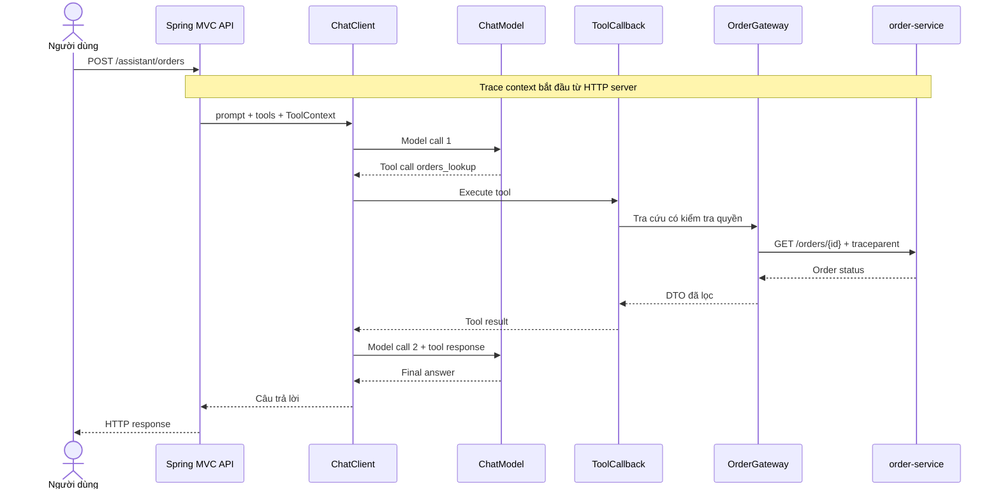
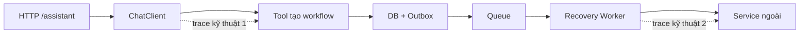

# Liên kết trace giữa ChatClient, tool callback và dịch vụ ngoài

Khi một ứng dụng Spring AI nhận câu hỏi “Đơn hàng của tôi đang ở đâu?”, `ChatClient` có thể gọi mô hình, mô hình yêu cầu chạy `orders_lookup`, callback truy vấn dịch vụ đơn hàng qua HTTP, rồi mô hình tiếp tục tạo câu trả lời. Nếu dịch vụ đơn hàng chậm hoặc trả lỗi, việc chỉ đọc log của `ChatClient` không cho biết thời gian bị tiêu tốn ở model, callback, mạng hay backend.

**Distributed tracing** liên kết các bước đó bằng **trace** gồm nhiều **span**. Spring AI phát Micrometer Observation cho các thao tác AI; Spring Boot/Micrometer Tracing tạo và xuất span; HTTP client được instrument sẽ truyền trace context đến dịch vụ ngoài. Khi triển khai nhất quán, một trace cho phép lần từ HTTP request ban đầu đến `ChatClient`, lượt gọi `ChatModel`, tool callback và HTTP request sang service nghiệp vụ.

Trace giúp điều tra hành vi thực thi; nó không thay thế audit giao dịch, phân quyền, idempotency hay trạng thái workflow. Đặc biệt, một tool response có thể chứa thông tin khách hàng và bí mật nghiệp vụ: mục tiêu là **quan sát thời gian, lỗi và quan hệ giữa các bước**, không phải sao chép toàn bộ prompt hoặc tool arguments vào hệ thống tracing.

## Hiểu trace, span, observation và correlation ID

| Khái niệm | Ý nghĩa | Ví dụ trong Spring AI |
| --- | --- | --- |
| **Trace** | Tập hợp các span của một luồng xử lý có quan hệ nhân quả | HTTP request → model → tool → inventory service. |
| **Span** | Đơn vị công việc có thời điểm bắt đầu/kết thúc, trạng thái, thuộc tính và quan hệ cha-con | `spring.ai.tool` cho một lần chạy tool. |
| **Trace ID** | Mã định danh dùng chung cho các span thuộc cùng trace | Một chuỗi hex được truyền qua `traceparent`. |
| **Span ID** | Mã định danh của một span cụ thể trong trace | Span của HTTP client có ID khác span của tool. |
| **Observation** | API Micrometer thống nhất để đo thời gian, gắn metadata và phát metric/trace | `Observation.createNotStarted("business.orders.lookup", registry)`. |
| **Correlation/request ID** | Mã nghiệp vụ hoặc request do ứng dụng quản lý | `requestId`, `workflowId`, `orderWorkflowId`. |
| **Conversation/session ID** | Định danh lịch sử hội thoại qua nhiều request | `conversationId` hoặc `sessionId`. |
| **Tool call ID** | Định danh lời yêu cầu gọi tool trong một phản hồi mô hình | `spring.ai.tool.call.id` khi provider cung cấp. |

`traceId` có vòng đời theo trace kỹ thuật; `conversationId` có thể kéo dài nhiều HTTP request; `workflowId` có thể tồn tại qua nhiều ngày và restart. **Không dùng một trong ba làm vật thay thế cho hai mã còn lại.** Một cuộc hội thoại gồm nhiều lượt thường có nhiều trace. Một workflow chạy nền sau khi HTTP request kết thúc cũng có thể tạo trace mới được liên kết bằng `workflowId` và event metadata.

Một span có quan hệ parent-child khi context được truyền đúng qua điểm chuyển tiếp. Nếu một request gọi mô hình hai lần, các lần gọi đó là các span khác nhau nhưng có thể thuộc cùng trace. Khi callback chạy đồng thời, các span nhánh có thể trùng thời gian; không suy ra thứ tự gọi tool chỉ từ vị trí của chúng trong trace viewer.

## Trace mong đợi của một lượt tool calling

Ví dụ request `POST /assistant/orders` dẫn đến một lần tra cứu từ service ngoài:

```text
HTTP POST /assistant/orders                      [server span]
└── spring.ai.chat.client                        [ChatClient]
    └── spring.ai.advisor / ToolCallingAdvisor   [vòng tool calling]
        ├── gen_ai.client.operation              [model iteration 1]
        ├── spring.ai.tool                       [execute_tool orders_lookup]
        │   └── business.orders.lookup           [custom observation]
        │       └── HTTP GET order-service       [client span]
        │           └── GET /orders/{id}         [server span phía order-service]
        └── gen_ai.client.operation              [model iteration 2]
```

Sơ đồ là **hình minh họa**: tên hiển thị chính xác và quan hệ lồng nhau thay đổi theo phiên bản Spring AI, provider, cách gọi đồng bộ/streaming và việc các advisor có được instrument hay không. Điều phải xác minh là các span liên quan có cùng trace ID khi luồng đồng bộ thực sự truyền context, tool span được gắn đúng tên và HTTP client/server spans thể hiện ranh giới mạng.



## Các observation Spring AI cung cấp sẵn

Spring AI instrument các thành phần chính bằng Micrometer. Với Spring AI 2.x, các observation quan trọng cho chuỗi tool calling gồm:

| Observation name | Công việc được đo | Thuộc tính tiêu biểu |
| --- | --- | --- |
| `spring.ai.chat.client` | Toàn bộ thao tác `ChatClient.call()` hoặc `stream()` | `spring.ai.kind=chat_client`, danh sách advisor/tool names. |
| `spring.ai.advisor` | Một lượt thực thi advisor | `spring.ai.advisor.name`, `spring.ai.advisor.order`. |
| `gen_ai.client.operation` | Gọi `ChatModel` đến provider | `gen_ai.system`, `gen_ai.request.model`, `gen_ai.response.model`, usage tokens. |
| `spring.ai.tool` | Thời gian thực thi tool call | `gen_ai.operation.name=execute_tool`, `spring.ai.tool.definition.name`, `spring.ai.tool.call.id`. |
| HTTP client/server observation | Gọi service qua network | HTTP method, URI template, status code và network error. |

Trong tool observation, tên công cụ là thuộc tính low cardinality `spring.ai.tool.definition.name`; tool call ID là high cardinality `spring.ai.tool.call.id`. Spring AI 2.x đặt tên span tool theo dạng `execute_tool <tool-name>`; khi nâng từ 1.x, chú ý tên span cũ `tool_call <tool-name>` và thay đổi `gen_ai.operation.name`. Đừng viết dashboard/alert chỉ dựa vào một tên span mà không kiểm tra version thực tế.

Metric `gen_ai.client.token.usage` đo token của một lần gọi model khi provider trả usage. Metric token và thời gian tool có mục tiêu khác nhau: tool chậm không nhất thiết làm token tăng, và mô hình gọi nhiều lượt có thể khiến tổng thời gian cao dù mỗi tool rất nhanh.

**Spring AI không tự đo mọi method trong service nghiệp vụ.** Các observation built-in giúp nhận biết lần gọi model/tool; muốn thấy pha kiểm tra quyền, truy vấn dữ liệu, gọi partner API hoặc xử lý payload, ứng dụng có thể thêm observation ở ranh giới nghiệp vụ phù hợp.

## Chọn phiên bản Spring Boot và đường xuất trace

Spring AI sử dụng Micrometer Observation; việc một observation trở thành span và được gửi đến backend cần tracer/exporter đúng phiên bản Spring Boot. Ví dụ dưới đây minh họa **Spring Boot 3.5.x + OpenTelemetry + OTLP**. Hãy dùng dependency management từ Spring Boot BOM và phiên bản Spring AI tương thích, tránh hard-code version của từng Micrometer/OpenTelemetry library.

### Maven dependencies cho Spring Boot 3.5.x

```xml
<dependencies>
    <dependency>
        <groupId>org.springframework.boot</groupId>
        <artifactId>spring-boot-starter-actuator</artifactId>
    </dependency>
    <dependency>
        <groupId>io.micrometer</groupId>
        <artifactId>micrometer-tracing-bridge-otel</artifactId>
    </dependency>
    <dependency>
        <groupId>io.opentelemetry</groupId>
        <artifactId>opentelemetry-exporter-otlp</artifactId>
    </dependency>
</dependencies>
```

Ứng dụng vẫn cần starter Spring AI/model provider và web starter của chính nó; ví dụ chỉ liệt kê phần bổ sung để tracing hoạt động.

### application.yml cho Boot 3.5.x

```yaml
spring:
  application:
    name: spring-ai-order-assistant
  ai:
    chat:
      client:
        observations:
          log-prompt: false
          log-completion: false
      observations:
        log-prompt: false
        log-completion: false
        include-error-logging: false
    tools:
      observations:
        include-content: false

management:
  tracing:
    sampling:
      probability: 1.0  # Chỉ dùng 100% khi thử nghiệm; giảm trong production
  otlp:
    tracing:
      endpoint: ${OTLP_TRACES_ENDPOINT:http://localhost:4318/v1/traces}
```

Các property `spring.ai.*.observations` ở trên thuộc nhóm cấu hình Spring AI. Mặc định prompt/completion và tool arguments/results không được xuất để giảm nguy cơ lộ PII. Bài học chủ động đặt `false` để làm rõ chính sách.

Với **Spring Boot 4.x**, cơ chế dependency và property của OTLP tracing thay đổi: tài liệu Boot 4.2 nêu starter `org.springframework.boot:spring-boot-starter-opentelemetry` và nhóm `management.opentelemetry.tracing.export.otlp.*`. Không copy nguyên cấu hình OTLP của Boot 3.5 sang Boot 4.2 mà không đối chiếu. API `ObservationRegistry` và ý tưởng gắn context qua HTTP client vẫn giữ nguyên.

Khi dùng backend như Tempo, Jaeger hoặc một OpenTelemetry Collector, `OTLP_TRACES_ENDPOINT` phải trỏ đến đúng endpoint nhận trace; một endpoint nhận metrics hoặc HTTP UI thường không nhận dữ liệu traces. Xác minh collector đang chạy và có khả năng export đến kho truy vấn trace.

## Khởi tạo ChatClient để không làm mất observability

Trong ứng dụng Spring Boot, nên inject `ChatClient.Builder` đã được auto-configure. Builder này được Spring AI thiết lập observation registry và customizers của ứng dụng.

```java
import org.springframework.ai.chat.client.ChatClient;
import org.springframework.context.annotation.Bean;
import org.springframework.context.annotation.Configuration;

@Configuration
public class AssistantChatConfiguration {

    @Bean
    ChatClient orderChatClient(ChatClient.Builder builder) {
        return builder.build();
    }
}
```

Nếu thay bằng `ChatClient.create(chatModel)` hoặc `ChatClient.builder(chatModel)` trong ứng dụng dùng auto-configuration, bạn có thể bỏ qua cấu hình quan sát/các `ChatClientBuilderCustomizer` đã đăng ký. Khi phải cấu hình nhiều `ChatModel` thủ công, dùng `ChatClientBuilderConfigurer` hoặc overload `ChatClient.builder(chatModel, observationRegistry, ..., toolCallingAdvisorBuilder)` tương ứng với phiên bản dự án.

Một lưu ý quan trọng từ API 2.x: nếu tự truyền một `ToolCallingAdvisor.Builder` có `ToolCallingManager` riêng, registry của `ChatClient` không nhất thiết tự được áp dụng cho manager tùy chỉnh đó. Hãy cấu hình `ObservationRegistry` trong manager theo builder của phiên bản đang dùng; nếu không, `spring.ai.chat.client` có thể xuất hiện nhưng `spring.ai.tool` lại vắng mặt.

Với Spring AI 1.x, tool execution loop nằm trong `ChatModel`; từ Spring AI 2.x, `ToolCallingAdvisor` điều phối tool loop trong advisor chain. Kiến trúc khác nhau làm vị trí của một số spans và advisor iteration khác nhau; hãy kiểm tra theo BOM của dự án.

## Ví dụ end-to-end: tool gọi dịch vụ đơn hàng

Giả sử ứng dụng có `order-service` triển khai REST API và yêu cầu đã được xác thực ở controller. Mục tiêu là thấy span riêng của thao tác nghiệp vụ cùng HTTP client/server spans trong cùng trace.

### 1. Đăng ký HTTP client có tracing

Spring Boot tự gắn instrumentation và trace propagation vào `RestClient.Builder` hoặc `WebClient.Builder` được auto-configure. Vì vậy, hãy inject builder đã được Boot cấu hình:

```java
import org.springframework.beans.factory.annotation.Value;
import org.springframework.context.annotation.Bean;
import org.springframework.context.annotation.Configuration;
import org.springframework.web.client.RestClient;

@Configuration
class OrderHttpClientConfiguration {

    @Bean
    RestClient orderServiceRestClient(
            RestClient.Builder builder,
            @Value("${partners.order-service.base-url}") String baseUrl) {
        return builder.baseUrl(baseUrl).build();
    }
}
```

```yaml
partners:
  order-service:
    base-url: ${ORDER_SERVICE_URL:http://localhost:8090}
```

Nếu gọi `RestClient.create(...)`, tự `new RestTemplate()` hoặc dùng một SDK HTTP không được instrument, trace context có thể không được gửi tự động. Khi cần dùng một HTTP client khác, kiểm tra cách instrument client đó và test header `traceparent` thay vì giả định nó đã được truyền.

### 2. Tool callback chỉ nhận arguments nghiệp vụ

```java
import org.springframework.ai.chat.model.ToolContext;
import org.springframework.ai.tool.annotation.Tool;
import org.springframework.ai.tool.annotation.ToolParam;
import org.springframework.stereotype.Component;

@Component
public class OrderLookupTools {

    private final OrderLookupService orderLookupService;

    public OrderLookupTools(OrderLookupService orderLookupService) {
        this.orderLookupService = orderLookupService;
    }

    @Tool(name = "orders_lookup", description = "Tra cứu trạng thái đơn hàng có quyền truy cập")
    public OrderStatus lookup(
            @ToolParam(description = "Mã tham chiếu đơn hàng") String orderReference,
            ToolContext toolContext) {

        Object rawTenant = toolContext.getContext().get("tenantId");
        if (!(rawTenant instanceof String tenantId) || tenantId.isBlank()) {
            throw new IllegalStateException("Thiếu tenant đã xác thực");
        }
        return this.orderLookupService.findAuthorized(tenantId, orderReference);
    }
}
```

`tenantId` lấy từ `ToolContext` do ứng dụng tạo từ principal, không nằm trong JSON arguments do model đề xuất. Spring AI có thể tạo span `spring.ai.tool` cho lần gọi `orders_lookup`; callback giữ nguyên trace context nếu nó thực thi trong context hiện tại.

### 3. Service tạo observation nghiệp vụ rồi gọi HTTP

```java
import io.micrometer.observation.Observation;
import io.micrometer.observation.ObservationRegistry;
import org.springframework.beans.factory.annotation.Qualifier;
import org.springframework.stereotype.Service;
import org.springframework.web.client.RestClient;

@Service
public class OrderLookupService {

    private final RestClient orderServiceRestClient;
    private final ObservationRegistry observationRegistry;
    private final TenantAccessPolicy tenantAccessPolicy;

    public OrderLookupService(
            @Qualifier("orderServiceRestClient") RestClient orderServiceRestClient,
            ObservationRegistry observationRegistry,
            TenantAccessPolicy tenantAccessPolicy) {
        this.orderServiceRestClient = orderServiceRestClient;
        this.observationRegistry = observationRegistry;
        this.tenantAccessPolicy = tenantAccessPolicy;
    }

    public OrderStatus findAuthorized(String tenantId, String orderReference) {
        return Observation.createNotStarted("business.orders.lookup", this.observationRegistry)
                .lowCardinalityKeyValue("dependency", "order-service")
                .lowCardinalityKeyValue("operation", "lookup")
                .observe(() -> {
                    this.tenantAccessPolicy.assertCanRead(tenantId, orderReference);

                    return this.orderServiceRestClient.get()
                            .uri("/orders/{reference}", orderReference)
                            .retrieve()
                            .body(OrderStatus.class);
                });
    }
}
```

`OrderStatus` và `TenantAccessPolicy` là các kiểu nghiệp vụ do ứng dụng định nghĩa. Endpoint service ngoài phải xác thực quyền service-to-service và kiểm tra phạm vi tài nguyên; việc callback đã kiểm tra một lần ở ứng dụng không biến kết nối mạng thành đáng tin tự động.

`business.orders.lookup` là observation tùy chỉnh bao quanh **phần logic service**, trong khi `spring.ai.tool` do Spring AI đo thời gian thực thi callback. Khi `RestClient` được instrument, HTTP client span là con trong phạm vi observation đang hoạt động. Không cần tự tạo thêm span cùng tên `spring.ai.tool` quanh callback vì dễ khiến trace có hai span mô tả một thao tác.

Nếu service ngoài không phản hồi, trace thường cho thấy `spring.ai.tool` kéo dài; span HTTP chỉ ra URL template, mã trạng thái hoặc transport error; custom observation giúp phân biệt thời gian xử lý nghiệp vụ với thời gian model suy luận.

### 4. Điều phối ChatClient trong HTTP request đã xác thực

```java
import java.util.Map;
import org.springframework.ai.chat.client.ChatClient;
import org.springframework.stereotype.Service;

@Service
public class OrderAssistantService {

    private final ChatClient chatClient;
    private final OrderLookupTools orderTools;

    public OrderAssistantService(ChatClient chatClient, OrderLookupTools orderTools) {
        this.chatClient = chatClient;
        this.orderTools = orderTools;
    }

    public String answer(String message, String authenticatedTenantId) {
        return this.chatClient.prompt()
                .user(message)
                .tools(this.orderTools)
                .toolContext(Map.of("tenantId", authenticatedTenantId))
                .call()
                .content();
    }
}
```

Ví dụ giả định HTTP controller đã xác thực và lấy `authenticatedTenantId` từ principal đáng tin. Nếu có nhiều bean `ChatClient`, phải inject đúng bean bằng `@Qualifier`. Một request có thể không cần tool; khi đó trace chỉ có các span model, không có `spring.ai.tool`.

Khi provider yêu cầu nhiều tool calls trong một response, mỗi lần thực thi callback có thể tạo một tool span riêng. Nếu các callback được chạy song song, trace context cần được chuyển đến từng executor/thread để các span vẫn cùng trace, thay vì tạo nhiều root traces không liên quan.

## Trace đi qua HTTP bằng cách nào?

Khi service được instrument, HTTP client tạo span cho outbound request và inject trace context vào HTTP headers. Theo chuẩn W3C Trace Context, header thường gặp là:

```http
traceparent: 00-4bf92f3577b34da6a3ce929d0e0e4736-00f067aa0ba902b7-01
```

Trong chuỗi trên, phần 32 ký tự hex là trace ID, phần 16 ký tự tiếp theo là parent span ID và byte cuối biểu diễn trace flags. Mỗi hop tạo span mới với span ID riêng nhưng vẫn dùng trace ID của yêu cầu gốc nếu context được truyền đúng.

Phía `order-service` cần instrument HTTP server và chấp nhận trace context từ caller. Nó trích xuất context từ headers, tạo server span con và tiếp tục truyền context nếu gọi database/HTTP service khác. Chỉ quan sát phía client có thể cho biết request đã gửi đi, nhưng không hiển thị các span nội bộ của service đích nếu service đó không phát trace đến backend truy vấn tương ứng.

Không cần tự thêm `traceparent` bằng `.header(...)` khi dùng HTTP client được Boot instrument đúng cách. Nếu tự xây header từ `Tracer.currentSpan()` nhưng không tạo một client span hợp lệ, bạn có thể làm sai quan hệ parent-child. Hãy ưu tiên instrumentation của HTTP client, chỉ cấu hình propagator thủ công khi thực sự dùng transport mà framework chưa hỗ trợ.

### Điều kiện để trace được liên kết qua mạng

1. Ứng dụng gọi đã bật Micrometer Tracing và có exporter.
2. `RestClient`/`WebClient`/SDK thực tế có client instrumentation và được tạo qua builder cấu hình phù hợp.
3. Service đích có server instrumentation và trích xuất cùng định dạng propagation, ví dụ W3C `traceparent`.
4. Proxy hoặc API gateway không loại bỏ các propagation headers cần thiết.
5. Các span được export đến backend có thể truy vấn cùng nhau hoặc có khả năng liên kết theo trace ID.
6. Sampling policy không loại bỏ phần trace đang cần kiểm chứng.

Nếu service đích dùng tracer khác, cần đảm bảo propagator tương thích. Việc hai hệ thống đều dùng OpenTelemetry không tự bảo đảm chúng đang sử dụng cùng định dạng header hoặc cùng nơi xuất trace.

## Dùng trace ID để tìm log liên quan

Spring Boot với Micrometer Tracing thường bổ sung `traceId` và `spanId` vào MDC trong phạm vi có tracing context. Khi log xuất hiện trong tool callback hoặc service, chúng có thể dùng cùng trace ID để truy tìm bản ghi của một request.

```java
import org.slf4j.Logger;
import org.slf4j.LoggerFactory;
import org.springframework.stereotype.Service;

@Service
public class OrderAuditLogger {

    private static final Logger log = LoggerFactory.getLogger(OrderAuditLogger.class);

    public void recordToolOutcome(String toolName, String outcome) {
        log.info("Tool completed: tool={}, outcome={}", toolName, outcome);
    }
}
```

Khi `recordToolOutcome(...)` được gọi trong active trace, log formatter của Spring Boot có thể thêm correlation ID như `[traceId-spanId]`. Ứng dụng không cần tự ghi prompt hoặc tool arguments để nối log với trace.

Nếu cần lấy trace ID phục vụ chẩn đoán ở một API nội bộ, có thể dùng `io.micrometer.tracing.Tracer`:

```java
import io.micrometer.tracing.Span;
import io.micrometer.tracing.Tracer;

Span current = tracer.currentSpan();
String traceId = current == null ? "none" : current.context().traceId();
```

`tracer` là bean được inject. Giá trị `none` có thể xuất hiện trong code chạy ngoài trace hoặc khi context bị mất; không dùng nó làm correlation ID bền vững. Trace ID là metadata kỹ thuật và **không phải credential**; đồng thời, nên hạn chế trả trace ID trực tiếp trong output cho người dùng nếu nó có thể tiết lộ cấu trúc hệ thống hoặc giúp truy vấn log nội bộ không được kiểm soát.

### Một log nên chứa thông tin gì?

| Trường | Nên dùng | Cần tránh |
| --- | --- | --- |
| `traceId`, `spanId` | Liên kết log và span | Gắn làm low-cardinality metric label. |
| Tên tool | `orders_lookup`, `inventory_check` | Thêm ID khách hàng hoặc tên tenant vào tên tool. |
| `outcome` | `success`, `timeout`, `permission_denied` | Raw exception chứa token, SQL hoặc PII. |
| `durationMs` | Theo dõi latency | Dùng làm nhãn metric có vô hạn giá trị. |
| `workflowId`, `requestId` | Mã tham chiếu phục vụ audit/correlation | Sao chép cả conversation history vào log. |
| Endpoint service | Service alias hoặc URI template | URL đầy đủ chứa query PII hoặc access token. |

Hãy thống nhất mã kết quả lỗi giữa service, callback và HTTP gateway. Nếu provider trả lỗi 503, log nên phân biệt lỗi remote API với lỗi model/provider và lỗi `@Tool` validation.

## Liên kết trace khi có nhiều lần gọi mô hình

Với Spring AI 2.x, `ToolCallingAdvisor` lặp lại model call cho đến khi có final response hoặc điều kiện dừng. Một request có thể phát nhiều span `gen_ai.client.operation` và nhiều span `spring.ai.tool`.

| Sự kiện | Ý nghĩa khi đọc trace |
| --- | --- |
| `ChatClient` span kéo dài | Tổng thời gian request, bao gồm model và tool loop. |
| Model iteration 1 | Thời gian model quyết định gọi công cụ; có thể có token usage. |
| Tool span 1 | Thời gian callback thực thi, gồm service logic và HTTP calls. |
| Model iteration 2 | Thời gian model đọc kết quả tool và có thể đề xuất bước tiếp. |
| Tool span 2 | Công cụ khác được chạy hoặc cùng công cụ được chạy lại. |
| Final model iteration | Model tạo câu trả lời cuối cùng. |

Không suy ra “mô hình chậm” chỉ từ `ChatClient` span dài. Hãy so thời gian của các model spans với tool spans, và với HTTP client spans bên trong tool. Một request mất 8 giây có thể gồm 1 giây model đầu, 6 giây dịch vụ ngoài và 1 giây model cuối.

Để biết một lần model call thuộc lượt nào của tool loop, dùng thời gian, quan hệ span và tên tool, kết hợp metadata có sẵn. Nếu cần số iteration cụ thể, có thể thêm advisor hoặc custom orchestrator ghi metadata, nhưng phải nhớ advisor nằm **trong** `ToolCallingAdvisor` sẽ chạy nhiều lần. Không tạo span hai lần cho cùng một model call chỉ vì thêm advisor theo dõi.

`spring.ai.tool.call.id` là định danh tool call từ mô hình; nó hữu ích để ghép một yêu cầu với kết quả và debug một lượt. Nó có thể thay đổi khi model được gọi lại, nên không dùng làm idempotency key cho nghiệp vụ thanh toán/hủy đơn hoặc làm workflow ID.

## Không đánh đồng tracing với error handling

Một tool có thể trả kết quả lỗi dưới dạng chuỗi qua `ToolExecutionExceptionProcessor`; mô hình sau đó vẫn trả HTTP 200 với lời giải thích cho người dùng. Trong tình huống đó:

- `spring.ai.tool` cho phép biết callback đã thất bại hoặc bị từ chối theo metadata/exception thực tế.
- HTTP client span có thể cho thấy `5xx` hoặc timeout của dịch vụ ngoài.
- `ChatClient` span cuối vẫn có thể hoàn tất thành công về mặt HTTP/model.
- Audit nghiệp vụ phải ghi rõ thao tác thành công hay thất bại, không lấy riêng HTTP 200 làm kết luận.

Nếu converter của tool bắt exception và trả về payload `{"status":"error"}` như một kết quả bình thường, hệ thống tracing không tự biết đó là lỗi nghiệp vụ. Có thể ghi outcome bằng low-cardinality tag hoặc structured event đã lọc ở service. Không ném exception giả chỉ để tạo span màu đỏ; hãy phản ánh đúng trạng thái kỹ thuật và nghiệp vụ.

Ví dụ đo một bước có ngoại lệ và lưu mã lỗi an toàn:

```java
public OrderStatus lookupWithObservation(String ref) {
    Observation observation = Observation.createNotStarted(
            "business.order.remote_lookup", observationRegistry)
            .lowCardinalityKeyValue("dependency", "order-service");

    observation.start();
    try (Observation.Scope ignored = observation.openScope()) {
        OrderStatus result = orderGateway.lookup(ref);
        observation.lowCardinalityKeyValue("outcome", "success");
        return result;
    }
    catch (RemoteOrderTimeoutException ex) {
        observation.lowCardinalityKeyValue("outcome", "timeout");
        observation.error(ex);
        throw ex;
    }
    finally {
        observation.stop();
    }
}
```

Đoạn code giả định `orderGateway` và `observationRegistry` là dependencies của service, `RemoteOrderTimeoutException` là loại exception ứng dụng tự định nghĩa. Mã kết quả `success`/`timeout` được đặt trước khi `stop()` để quan sát có cùng nhãn. Với lỗi không thuộc `RemoteOrderTimeoutException`, mã minh họa sẽ ném tiếp lỗi nhưng không gắn outcome; trong ứng dụng thực tế có thể bắt thêm lỗi đã phân loại hoặc dùng handler chung. `Observation.observe(...)` đơn giản hơn khi không cần phân loại exception riêng.

## Giữ trace context qua @Async và Executor

Một lý do phổ biến khiến tool span hoặc HTTP call thành **root trace mới** là thread thay đổi. Observation đang hoạt động thường được lưu trong thread-local; khi callback chuyển sang `@Async`, `CompletableFuture`, pool tự tạo hoặc công việc song song, context không tự lan truyền đến mọi thread.

Với Spring Boot 3.5, có thể đăng ký `ContextPropagatingTaskDecorator` cho executor Spring:

```java
import org.springframework.context.annotation.Bean;
import org.springframework.context.annotation.Configuration;
import org.springframework.core.task.support.ContextPropagatingTaskDecorator;

@Configuration(proxyBeanMethods = false)
class AsyncTraceConfiguration {

    @Bean
    ContextPropagatingTaskDecorator contextPropagatingTaskDecorator() {
        return new ContextPropagatingTaskDecorator();
    }
}
```

Decorator phải được dùng bởi executor thực sự chạy task. Nếu ứng dụng cấu hình executor riêng, hãy gắn decorator vào executor đó; việc chỉ khai báo một bean mà executor custom không sử dụng sẽ không bảo đảm propagation.

Spring Boot 4.2 có thêm tùy chọn `spring.task.execution.propagate-context: true` cho `AsyncTaskExecutor` được auto-configure. Không áp dụng tùy chọn 4.2 cho dự án 3.5 mà chưa kiểm tra hỗ trợ. Đối với executor ngoài Spring hoặc thư viện tự quản lý thread, có thể dùng Micrometer Context Propagation `ContextSnapshot`/decorator phù hợp; phải bảo đảm scope được đóng sau khi task hoàn tất.

Nếu callback khởi chạy việc nền kéo dài hơn HTTP request, context capture giúp liên kết về mặt nhân quả trong khoảng thời gian sống của request, nhưng không thay thế cơ chế durable queue/recovery. Khi việc nền chạy sau restart, không thể phục hồi thread-local observation cũ; cần trace cho lần thực thi mới và mã nghiệp vụ bền vững để liên kết.

### Với Reactor và streaming

Với `WebClient` và `ChatClient.stream()`, các bước xử lý có thể chạy trên nhiều thread. Spring Boot có property:

```yaml
spring:
  reactor:
    context-propagation: auto
```

Chế độ tự động cho Reactor giúp chuyển observation context giữa Reactor `Context` và thread-local khi operator chuyển thread. Hãy kiểm tra quyền hạn, timeout và kết quả khi stream bị cancel giữa chừng; span đang chạy phải được đóng đúng cách, tránh rò rỉ context sang subscriber khác.

Không đọc `Tracer.currentSpan()` một lần lúc xây dựng `Flux` rồi giả định nó luôn là span của subscriber khi thực thi. Trong reactive pipeline, phần lớn công việc chạy lúc subscribe, trên thread khác. Nếu viết instrumentation riêng, dùng Reactor context và cơ chế context propagation của Micrometer ở thời điểm thực thi.

Tài liệu Spring AI 2.1 ghi nhận một trường hợp đặc thù: với OpenAI streaming, HTTP span ở tầng SDK có thể được phát nhưng không nằm dưới chat-model span do SDK chuyển sang `ForkJoinPool.commonPool()` mà không giữ observation context. Vì vậy, khi thấy span HTTP tách khỏi cây ChatModel, hãy kiểm tra provider/SDK và path đồng bộ/streaming trước khi kết luận mọi tool tracing bị hỏng. Với synchronous calls và Anthropic streaming, tài liệu mô tả parent-child nesting được duy trì đúng hơn.

## Kết nối MCP tool từ xa

Trong Spring AI, công cụ từ MCP server cũng được đưa về `ToolCallback`. Ứng dụng thường thấy một tool observation khi callback chạy. Tuy nhiên, **span của callback trong tiến trình Spring AI không đồng nghĩa mọi hoạt động trong MCP server đã được nối trace**.

| Kết nối MCP | Có thể quan sát | Điều cần kiểm tra để có distributed trace |
| --- | --- | --- |
| MCP qua Streamable HTTP | Tool callback và request HTTP đến MCP server, nếu transport được instrument | HTTP client phải inject W3C context và server phải extract, rồi export spans. |
| MCP qua SSE/HTTP legacy | Kết nối/HTTP calls theo khả năng instrumentation | Tracing context có thể khác giữa kênh request và kênh stream; test từng transport. |
| MCP qua STDIO | Tool span ở ứng dụng và log của process MCP | Không có `traceparent` HTTP tự nhiên; cần cơ chế truyền context được hai đầu hỗ trợ. |
| MCP server gọi tiếp business API | Remote tool result hoặc span server | MCP server cần tracing riêng và tự truyền context đến downstream HTTP client. |

Nếu transport MCP sử dụng thư viện HTTP riêng, `RestClient.Builder` của ứng dụng chưa chắc instrument được thư viện đó. Hãy kiểm tra HTTP spans thật hoặc cấu hình instrumentation cho MCP client/SDK theo phiên bản. Không truyền toàn bộ trace context dưới dạng model tool arguments hay nhét token vào ToolContext chỉ để làm trace liên kết.

Khi cần đối soát giữa MCP client và server chưa thể truyền W3C context, có thể dùng một `requestId`/`workflowId` được xác minh và gửi qua metadata/hợp đồng đã được hai phía thống nhất. Nhãn tương quan này giúp tìm hai trace riêng, nhưng **không biến chúng thành một parent-child trace**. Không nhầm correlation bằng log với trace propagation ở transport.

## Workflow nền, message queue và restart

Một yêu cầu AI có thể tạo workflow xử lý lâu hơn HTTP request. API nhận workflow, ghi database/outbox, sau đó worker nhận message và thực thi tool/service ở thời điểm khác.



Trong trường hợp này, `workflowId` là khóa bền vững nối các lần xử lý. Nếu broker và consumer hỗ trợ propagation, có thể truyền W3C context trong message headers để tạo quan hệ nhân quả. Khi công việc chạy sau nhiều giờ, hoặc qua nhiều lần retry/restart, nên cân nhắc tạo trace mới và sử dụng **span link** hoặc business correlation ID thay vì kéo dài một trace khổng lồ xuyên nhiều lần thực thi.

Lưu `traceId` gần nhất trong audit hoặc event metadata nếu chính sách bảo mật cho phép, nhưng không lưu nó như nguồn sự thật của trạng thái workflow. Khi process chết, worker phải đọc operation ledger để biết bước nào đã hoàn tất, chứ không phát lại mọi tool call chỉ vì trace trước kết thúc bất thường.

## Phân biệt cardinality của attributes và metrics

Micrometer Observation phân biệt **low cardinality** và **high cardinality**. Low-cardinality keys có thể trở thành metric labels; nếu dùng user ID, tenant ID, order ID hoặc trace ID ở đây, số chuỗi thời gian sẽ tăng rất nhanh.

| Thông tin | Nơi phù hợp | Lý do |
| --- | --- | --- |
| Tên tool ổn định | Low-cardinality (`spring.ai.tool.definition.name`) | Tập tên tool có giới hạn khi registry quản lý tốt. |
| Loại kết quả | Low-cardinality `outcome=success/timeout/denied` | Ít giá trị, hữu ích để thống kê lỗi. |
| Tên dependency | Low-cardinality `dependency=order-service` | Tập service cố định, phù hợp tổng hợp metric. |
| `traceId`, `spanId` | Log/tracing metadata | Giá trị mới trên mỗi trace/span, không nên dùng làm metric tag. |
| Tool call ID / workflow ID | High-cardinality trace attribute hoặc audit, có kiểm soát | Hữu ích để tìm một lần thực thi, không phù hợp metric labels. |
| Prompt, tool arguments, tool result | Không xuất theo mặc định | Chứa PII, secret và có thể rất dài. |
| Raw exception message | Không xuất trực tiếp nếu chưa lọc | Có thể chứa URL, SQL, ID người dùng hoặc credential. |

Không nhất thiết gắn `workflowId` vào mọi span. Nếu cần tìm một trace theo workflow, cân nhắc gắn một thuộc tính đã pseudonymize vào span nghiệp vụ chính và giữ mapping trong audit store có phân quyền. Đối với metrics, chỉ dùng các nhãn có tập giá trị nhỏ và ổn định.

## Bảo vệ dữ liệu khi xuất trace

Spring AI đặt các nội dung nhạy cảm ở chế độ tắt theo mặc định. Các khóa đặc biệt cần rà soát:

```properties
spring.ai.chat.client.observations.log-prompt=false
spring.ai.chat.client.observations.log-completion=false
spring.ai.chat.observations.log-prompt=false
spring.ai.chat.observations.log-completion=false
spring.ai.chat.observations.include-error-logging=false
spring.ai.tools.observations.include-content=false
```

Không bật `spring.ai.tools.observations.include-content=true` trên production chỉ để xem input/output tool, vì arguments hoặc result có thể mang địa chỉ, thông tin tài chính, số điện thoại hoặc token. Nếu cần điều tra một lần thực thi, hãy ghi một bản audit đã lọc và có quyền truy cập riêng, không đưa toàn bộ dữ liệu nghiệp vụ vào tracing backend.

Traces cũng có vòng đời riêng: cấu hình sampling, access control, encryption và retention tại collector/backend. Một span có HTTP URL đầy đủ chứa ID hoặc query string nhạy cảm vẫn có thể rò dữ liệu dù Spring AI không export prompt; dùng URI template và hạn chế PII trong URL/query string. Không thêm header `Authorization`, Cookie hoặc raw ToolContext làm span attributes.

Nếu tracing context phải đi ra dịch vụ không tin cậy hoặc endpoint được mô hình đề xuất, ứng dụng cần allowlist endpoint và áp dụng chính sách propagation rõ ràng. Việc có một trace đẹp không được phép vượt quy tắc phân quyền hoặc rò rỉ thông tin qua HTTP headers.

## Sampling, hiệu năng và chi phí lưu trữ

Trong môi trường phát triển, cấu hình `management.tracing.sampling.probability: 1.0` giúp quan sát mọi request và xác minh parent-child spans. Trong production, sampling 100% có thể tăng chi phí collector, storage và khối lượng dữ liệu gửi ra ngoài.

Lựa chọn thông thường:

- Head sampling ở tỷ lệ phù hợp lưu lượng, ví dụ 0.1 (10%) cho tracing nền.
- Giữ metrics riêng cho tổng số tool calls, lỗi và latency vì sampling có thể làm mất một phần trace.
- Nếu backend hỗ trợ, cân nhắc tail sampling ở collector để giữ các trace có lỗi hoặc độ trễ bất thường.
- Khi điều tra, dùng môi trường test hoặc cơ chế sampling có kiểm soát thay vì bật log prompt/arguments trên toàn production.
- Giám sát bản thân exporter: collector unavailable, buffer drop hoặc cấu hình endpoint sai sẽ khiến request nghiệp vụ vẫn chạy nhưng không có trace để xem.

Không tính số request hay tỷ lệ lỗi production chỉ bằng số trace đã xuất khi sampling nhỏ hơn 100%. Dùng Micrometer metrics, audit hoặc hệ thống đo có thiết kế phù hợp cho số liệu vận hành.

## Kiểm thử trace end-to-end

Một test tracing tốt xác minh **quan hệ giữa các span**, không chỉ kiểm tra HTTP 200 hoặc có một `traceId` xuất hiện trong log. Dùng model giả trả tool call xác định, dịch vụ HTTP giả và một tracer/exporter in-memory hoặc collector thử nghiệm để lấy span.

Các điều kiện chuẩn bị:

1. Spring Boot test context có Micrometer Tracing bridge/exporter hoặc reporter test phù hợp.
2. Sampling là 100% trong test.
3. `ChatClient` được tạo từ auto-configured builder.
4. `RestClient`/`WebClient` được tạo từ auto-configured builder.
5. Model giả sinh một tool call `orders_lookup` rồi trả final answer.
6. Fake `order-service` ghi nhận HTTP headers và trả JSON hợp lệ.

### Các bằng chứng cần thu thập

| Kiểm tra | Kết quả mong đợi |
| --- | --- |
| Root HTTP server span | Có span của `POST /assistant/orders` hoặc route tương đương. |
| `ChatClient` observation | Có `spring.ai.chat.client`, cùng trace ID với HTTP request. |
| ChatModel spans | Có model call trước và sau tool (nếu model giả tạo hai iterations). |
| Tool span | Có `spring.ai.tool`, `spring.ai.tool.definition.name=orders_lookup`. |
| Custom observation | Có `business.orders.lookup` trong phạm vi tool. |
| HTTP client span | Có request đến `order-service`, method/status phù hợp. |
| Header propagation | Fake server nhận `traceparent` hợp lệ và trace ID khớp. |
| Downstream server span | Khi downstream instrument, span server dùng cùng trace ID và có quan hệ cha-con hợp lệ. |
| Error path | HTTP 503 hoặc timeout được ghi nhận ở span đúng; xử lý lỗi nghiệp vụ không bị coi nhầm là lỗi model. |
| Nội dung nhạy cảm | Không có API key, PII, full prompt, tool arguments/result trong span attributes khi tắt content. |

Một test có thể kiểm tra `traceparent` nhận được từ HTTP client theo mẫu:

```java
String traceparent = recordedRequest.getHeader("traceparent");

assertThat(traceparent)
        .matches("^00-[0-9a-f]{32}-[0-9a-f]{16}-[0-9a-f]{2}$");
```

`recordedRequest` ở đây là request bắt được từ fake HTTP server; đây chỉ là một assertion minh họa. Test đầy đủ cần so trace ID trong header với trace ID của các span đã export, vì đúng định dạng header chưa chứng minh trace đã được nối chính xác.

### Kiểm thử context propagation bất đồng bộ

Gọi callback có `@Async` hoặc executor riêng từ một active trace; xác minh span tạo trong task vẫn có trace ID ban đầu. Sau đó thử bỏ decorator để đảm bảo test có thể phát hiện span tách khỏi cây. Đối với Reactor, đặt `spring.reactor.context-propagation=auto`, dùng `.stream()` và kiểm tra span không mất parent sau khi `publishOn`/`subscribeOn` chuyển thread.

### Kiểm thử MCP và queue

Với MCP HTTP, đo `spring.ai.tool` trước, rồi kiểm tra MCP client request có `traceparent` và MCP server tạo span cùng trace nếu transport hỗ trợ. Với MCP STDIO, test tính tương quan bằng metadata đã được hai đầu thống nhất và chấp nhận rằng không có HTTP propagation mặc định.

Với workflow qua queue, gửi `workflowId` và trace metadata theo chính sách, cho consumer chạy muộn rồi xác minh tạo trace mới có thể truy ngược đến workflow. Không coi hai lần xử lý sau retry là “trùng trace” chỉ vì có cùng workflow ID.

## Chẩn đoán khi trace bị đứt hoặc thiếu span

| Hiện tượng | Nguyên nhân có thể | Cách kiểm tra và sửa |
| --- | --- | --- |
| Có HTTP server span nhưng không thấy `spring.ai.chat.client` | Tạo `ChatClient` bỏ qua auto-configured builder hoặc thiếu observation registry | Inject `ChatClient.Builder`; nếu custom builder, truyền registry và customizers phù hợp. |
| Có ChatClient span nhưng không có `spring.ai.tool` | Model không gọi tool, tool execution không bật, custom manager không gắn registry hoặc callback chạy ngoài manager | Kiểm tra tool call thực tế, manager và đường execution. |
| Có tool span nhưng không thấy HTTP client span | `RestClient.create()`/client tự tạo, SDK khác chưa được instrument | Dùng Boot-managed builder hoặc instrument SDK thực tế. |
| HTTP client span là trace mới | Mất observation context trước HTTP call | Kiểm tra thread hop, Reactor context và decorator. |
| Downstream span thuộc trace khác | `traceparent` không được gửi/nhận hoặc propagator không tương thích | Bắt HTTP headers, so trace ID, kiểm tra gateway và server config. |
| Không có trace trong Jaeger/Tempo dù logs có traceId | Sampling tắt, exporter lỗi hoặc collector/backend không nhận | Kiểm tra sampler, endpoint/port, exporter logs và collector. |
| Tool span có tên cũ `tool_call ...` | Dùng Spring AI 1.x hoặc dashboard vẫn lọc theo naming cũ | Kiểm tra version, cập nhật query/dashboard theo phiên bản. |
| OpenAI streaming HTTP span không lồng trong model span | SDK chuyển thread làm rơi context ở một path streaming | Đối chiếu tài liệu provider/SDK; kiểm tra model/tool spans độc lập. |
| Không nhìn thấy tool arguments/result | `include-content=false` mặc định | Đây là hành vi bảo mật đúng; dùng audit đã lọc nếu cần. |
| Mọi span có tên đúng nhưng tổng latency sai | Nhiều nhánh chạy đồng thời hoặc các span có thời gian chồng nhau | Phân tích critical path, không cộng cơ học duration của các span con. |
| Logs thiếu traceId | Code chạy ngoài scope, MDC không được propagate hoặc logging pattern bị thay đổi | Kiểm tra active span, MDC format, @Async/Reactor propagation. |

## Quy trình triển khai theo từng bước

1. Khóa Spring AI BOM và Spring Boot version; xác định tool loop nằm trong `ChatModel` (1.x) hay `ToolCallingAdvisor` (2.x).
2. Bật Spring Boot Actuator, Micrometer Tracing bridge và exporter phù hợp; cấu hình collector/sampling.
3. Tạo `ChatClient` từ auto-configured `ChatClient.Builder`; bảo đảm tool manager dùng cùng `ObservationRegistry`.
4. Gắn local/MCP tools theo quyền request; kiểm tra có observation `spring.ai.tool` khi model gọi tool.
5. Tạo custom observation ở điểm nghiệp vụ có ý nghĩa, ví dụ `business.orders.lookup`, tránh ghi trùng span framework.
6. Dùng Boot-managed `RestClient.Builder`/`WebClient.Builder` cho outbound HTTP, xác minh `traceparent` ở service đích.
7. Bật context propagation cho `@Async`, executor và Reactor khi ứng dụng thực sự dùng các luồng này.
8. Ghi log với traceId/spanId cùng outcome đã lọc; giữ conversation ID/workflow ID cho correlation nghiệp vụ bền vững.
9. Giữ prompt, completion, tool arguments và tool result ngoài trace theo mặc định; kiểm soát cardinality, retention và access.
10. Kiểm thử trace tree, cross-service propagation, error path, async/MCP/queue và chi phí sampling trước khi vận hành.

Khi trace được nối đúng, nhóm phát triển có thể trả lời các câu hỏi cụ thể: request chậm vì model hay dịch vụ nghiệp vụ, tool nào được gọi, timeout xảy ra ở đâu và log nào thuộc cùng lần thực thi. Spring AI cung cấp observation cho lớp AI; Spring Boot và Micrometer nối chúng với HTTP spans; ứng dụng bổ sung observation nghiệp vụ và bảo đảm context không bị mất ở các ranh giới thread, process hoặc message queue.

## Tài liệu tham khảo

- [Spring AI 2.1 — Observability](https://docs.spring.io/spring-ai/reference/observability/)
- [Spring AI 1.0 — Observability và khác biệt thuộc tính](https://docs.spring.io/spring-ai/reference/1.0/observability/index.html)
- [Spring AI 2.1 — Tool Calling](https://docs.spring.io/spring-ai/reference/api/tools.html)
- [Spring AI 2.1 — ChatClient và cấu hình Builder](https://docs.spring.io/spring-ai/reference/api/chatclient.html)
- [Spring AI 2.1 — Upgrade Notes về tên span tool calling](https://docs.spring.io/spring-ai/reference/upgrade-notes.html)
- [Spring Boot 3.5 — Tracing với Micrometer/OTLP](https://docs.spring.io/spring-boot/3.5/reference/actuator/tracing.html)
- [Spring Boot 3.5 — Observability và Context Propagation](https://docs.spring.io/spring-boot/3.5/reference/actuator/observability.html)
- [Spring Boot 4.2 — Tracing và OpenTelemetry Starter](https://docs.spring.io/spring-boot/reference/actuator/tracing.html)
- [Spring Boot 4.2 — Observability, @Async và Reactor](https://docs.spring.io/spring-boot/reference/actuator/observability.html)
- [Micrometer Observation — API và lifecycle](https://docs.micrometer.io/micrometer/reference/observation/introduction.html)
- [Micrometer Tracing — Creating custom observations](https://docs.micrometer.io/tracing/reference/configuring.html)
- [W3C Trace Context](https://www.w3.org/TR/trace-context/)
