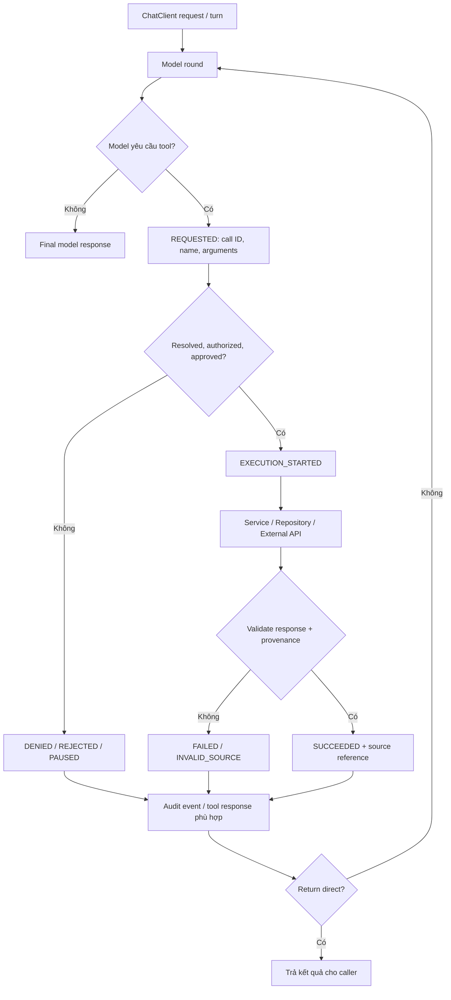

# Ghi nhận lựa chọn công cụ và nguồn kết quả để kiểm tra

Trong Spring AI Tool Calling, mô hình ngôn ngữ có thể quyết định gọi một hoặc nhiều công cụ, nhưng **ứng dụng mới là bên thực thi công cụ và xác định dữ liệu nào được đưa trở lại mô hình**. Khi câu trả lời sai, một thao tác bị từ chối hoặc dữ liệu từ nhiều hệ thống mâu thuẫn, đội phát triển cần lần theo chính xác: mô hình đã **yêu cầu** công cụ nào, công cụ nào **thực sự được chạy**, và kết quả nào đã được lấy từ **nguồn dữ liệu nào**.

Một dòng log kiểu `Tool called successfully` thường không đủ. Nó không phân biệt một tool được mô hình đề xuất với tool được hệ thống cho phép, không cho biết response nào thuộc tool-call ID nào, và cũng không chứng minh kết quả đến từ database hay API đối tác nào. Đối với các dịch vụ nghiệp vụ, cần xây một chuỗi dấu vết có cấu trúc từ **lựa chọn → kiểm tra → thực thi → xác minh nguồn → kết quả → câu trả lời cuối**.

Bài học thuộc chương **Quan sát** của module **SPRING_AI_TOOL_CALLING**. Trọng tâm là thiết kế observability và audit cho các công cụ `@Tool`/`ToolCallback`, `ToolCallingAdvisor`, `ToolContext`, schema đầu vào, quyền truy cập, kết quả dịch vụ và vòng lặp nhiều lần gọi. Các ví dụ lấy Spring AI 2.1.0 làm mốc và phân biệt rõ dữ liệu do framework ghi nhận với bằng chứng nghiệp vụ mà ứng dụng phải tự bổ sung.

Sau bài học, bạn có thể:

- Phân biệt công cụ **đã được cung cấp cho mô hình**, công cụ **được yêu cầu**, công cụ **đã thực thi** và công cụ **trả kết quả thành công**.
- Hiểu những trường Spring AI ghi nhận sẵn trong `spring.ai.tool` observation.
- Ghi lại tool-call ID, model round, tên tool, quyết định kiểm tra quyền, trạng thái và nguồn kết quả.
- Gắn nguồn dữ liệu, phiên bản, thời điểm hiệu lực và định danh chứng cứ vào DTO hoặc audit record.
- Kết nối event nghiệp vụ với trace mà không đưa arguments và dữ liệu nhạy cảm vào metric labels.
- Đọc lại một turn để kiểm tra vì sao mô hình chọn tool và dữ liệu nào đã ảnh hưởng đến câu trả lời.
- Kiểm thử cả tool call bị từ chối, batch nhiều tool, `returnDirect`, retry và streaming.

## 1. Bốn trạng thái khác nhau của một công cụ

Một công cụ có thể xuất hiện ở nhiều giai đoạn nhưng chưa chắc đã thực thi:

| Giai đoạn | Điều đã xảy ra | Có thể kết luận gì? |
| --- | --- | --- |
| **Available** | Ứng dụng cung cấp tool definition trong model request | Mô hình *có thể* chọn tool; chưa biết có yêu cầu gọi hay không. |
| **Requested** | Mô hình trả `AssistantMessage` chứa tool call ID, tên và arguments | Mô hình *đã yêu cầu* gọi tool; chưa chắc callback được chạy. |
| **Dispatched / executed** | `ToolCallingManager` tìm callback, kiểm tra điều kiện và dispatch | Callback có thể đã bắt đầu; vẫn có thể thất bại hoặc bị chặn. |
| **Result delivered** | Tool tạo `ToolResponseMessage` hoặc kết quả `returnDirect` | Có kết quả đã được đóng gói; cần xác minh nó có hợp lệ và đã đến mô hình/caller hay chưa. |

Ví dụ user yêu cầu “Tra cứu trạng thái đơn ORD-42”. Mô hình trả về một tool call `lookup_order`. Ứng dụng có thể từ chối vì actor không có quyền, hoặc API ngoài trả timeout. Trong cả hai trường hợp, **công cụ đã được mô hình chọn** nhưng **không có kết quả tra cứu thành công**.

Tương tự, nếu mỗi model response chứa ba tool calls thì một **model round** có thể dẫn đến ba lần callback execution. Ngược lại, trong một turn nhiều model round có thể liên tiếp gọi cùng một tool với arguments khác nhau. Audit phải lưu được cả **round** và **tool-call instance**.



**Không xem event REQUESTED là bằng chứng đã thực thi.** Một tool call có thể bị ngăn bởi chính sách, confirmation, tool-call budget, lỗi tìm callback, timeout hoặc exception. Audit phải phản ánh trạng thái thực thay vì suy đoán từ model response.

## 2. Framework có sẵn observability gì?

Spring AI 2.1.0 tích hợp Micrometer Observation để ghi thời gian và tracing cho `ChatClient`, advisor, `ChatModel` và tool execution. Khi có `ObservationRegistry`, metrics/traces có thể đi vào hệ thống giám sát do Spring Boot/Micrometer cấu hình.

| Operation | Observation name | Thông tin chính |
| --- | --- | --- |
| ChatClient call/stream | `spring.ai.chat.client` | Thời gian xử lý yêu cầu, danh sách advisors, tên tools được cung cấp. |
| Advisor | `spring.ai.advisor` | Tên advisor, thứ tự trong chain, duration. |
| ChatModel call/stream | `gen_ai.client.operation` | Model/provider, response ID, finish reason, usage, danh sách tool definitions. |
| Tool callback | `spring.ai.tool` | Tool name/type, execution duration, tracing context và tool-call ID. |

Các attributes liên quan đến `spring.ai.tool`:

| Key | Ý nghĩa |
| --- | --- |
| `gen_ai.operation.name` | Giá trị `execute_tool` trong Spring AI 2.1.0. |
| `gen_ai.system` | `spring_ai`. |
| `spring.ai.kind` | `tool_call`. |
| `spring.ai.tool.definition.name` | Tên tool callback. |
| `spring.ai.tool.type` | Loại tool, mặc định `function`. |
| `spring.ai.tool.call.id` | Tool-call ID do mô hình cấp; thuộc nhóm high-cardinality trong trace. |
| `spring.ai.tool.call.arguments` | Arguments của tool; chỉ xuất khi bật ghi nội dung. |
| `spring.ai.tool.call.result` | Kết quả tool; chỉ xuất khi bật ghi nội dung. |

Lưu ý: `spring.ai.chat.client.tool.names` và `spring.ai.model.request.tool.names` thể hiện **các tool definitions được cung cấp** cho model, **không phải danh sách các tool thực sự được mô hình chọn hay thực thi**.

Các trường built-in giúp truy vết kỹ thuật, nhưng không tự lưu **URL/document version, database row version, tenant/resource authorization decision, source verification** hoặc đối chiếu một kết luận cuối với từng kết quả. Nếu cần kiểm tra nghiệp vụ hoặc kiểm toán, ứng dụng phải ghi thêm sự kiện có cấu trúc.

## 3. Cấu hình ghi dữ liệu theo nguyên tắc tối thiểu

Mặc định, Spring AI không xuất nội dung arguments và results của tool call vì chúng có thể chứa thông tin cá nhân, token hoặc dữ liệu nghiệp vụ nhạy cảm. Nên giữ cấu hình này khi chạy production:

```properties
spring.ai.tools.observations.include-content=false
spring.ai.chat.client.observations.log-prompt=false
spring.ai.chat.client.observations.log-completion=false
spring.ai.chat.observations.log-prompt=false
spring.ai.chat.observations.log-completion=false
spring.ai.chat.observations.include-error-logging=false
```

Khi điều tra một lỗi hiếm, có thể mở thu thập dữ liệu trong **môi trường và thời gian được kiểm soát** với masking, mã hóa, thời hạn lưu, phân quyền xem và chính sách dữ liệu phù hợp. Không bật `include-content=true` toàn hệ thống chỉ vì muốn kiểm tra một tool-call ID.

Việc có spans cũng chưa đồng nghĩa hệ thống có audit log bền vững: tracing có thể sampling, hết retention hoặc thiếu một số spans do bất đồng bộ/context propagation. Audit event quan trọng nên được lưu bởi một sink riêng có chính sách lưu giữ rõ ràng.

## 4. Thiết kế một sự kiện audit có thể nối chuỗi

Đối với mỗi lựa chọn và lần thực thi tool, xây event riêng với định danh ổn định. Mẫu event sau là **schema do ứng dụng tự thiết kế**, không phải DTO có sẵn của Spring AI.

| Nhóm trường | Gợi ý trường | Mục đích |
| --- | --- | --- |
| Correlation | `auditRequestId`, `turnId`, `traceId` | Nối các sự kiện của một yêu cầu/turn với trace kỹ thuật. |
| Model | `modelRound`, `modelResponseId`, `modelName` | Cho biết mô hình yêu cầu tool ở lượt nào. |
| Tool | `toolCallId`, `toolIndex`, `toolName`, `toolDefinitionVersion` | Xác định chính xác yêu cầu trong batch. |
| Decision | `eventType`, `outcome`, `authorizationPolicy` | Phân biệt selected, denied, started, succeeded, failed. |
| Input | `safeArgumentDigest`, `validationResult` | Nhận biết input thay đổi mà không lưu raw arguments. |
| Provenance | `sourceSystem`, `sourceRef`, `sourceVersion`, `sourceObservedAt` | Chỉ ra dữ liệu đến từ hệ thống và phiên bản nào. |
| Output | `resultSchemaVersion`, `safeResultDigest`, `resultDelivery` | Kiểm tra kết quả được trả về mô hình/caller là bản nào. |
| Runtime | `occurredAt`, `durationMs`, `retryAttempt` | Đánh giá thứ tự sự kiện và chi phí. |

Ví dụ hai event của một tool call:

```json
{
  "eventId": "evt-101",
  "auditRequestId": "req-8d7",
  "turnId": "turn-5",
  "modelRound": 1,
  "toolCallId": "call-abc",
  "toolIndex": 0,
  "toolName": "lookup_order",
  "eventType": "TOOL_REQUESTED",
  "occurredAt": "2026-11-27T09:00:00Z",
  "safeArgumentDigest": "hmac-sha256:v1:..."
}
```

```json
{
  "eventId": "evt-102",
  "auditRequestId": "req-8d7",
  "turnId": "turn-5",
  "toolCallId": "call-abc",
  "toolName": "lookup_order",
  "eventType": "TOOL_EXECUTION_COMPLETED",
  "outcome": "SUCCEEDED",
  "sourceSystem": "order-service",
  "sourceRef": "order-summary:ref-42",
  "sourceVersion": "etag-v17",
  "sourceObservedAt": "2026-11-27T08:57:00Z",
  "resultSchemaVersion": "order-status-v2",
  "safeResultDigest": "hmac-sha256:v1:...",
  "resultDelivery": "TO_MODEL"
}
```

Trong ứng dụng thật, các ID/số hiệu phải lấy từ request, model response hoặc service, không tạo ra một ID mới rồi giả vờ rằng nó do provider phát sinh. Tool-call ID do provider tạo có thể thiếu hoặc không duy nhất; khi gặp trường hợp đó, cần thêm `modelRound` và `toolIndex` làm khóa phụ trong phạm vi turn.

Cần lưu riêng `eventId` duy nhất cho từng event, bởi vì cùng một tool-call instance có thể phát sinh nhiều sự kiện: requested, authorization checked, started, retried, succeeded/failed và delivered.

## 5. Xây correlation ID từ entrypoint

Mỗi yêu cầu ứng dụng nên có một correlation ID do server tạo. Với hành trình nhiều model calls và nhiều callbacks, correlation ID phải được mang đến các thành phần liên quan qua request/advisor context và `ToolContext`; không đưa nó vào arguments để mô hình tự khai báo.

```java
String auditRequestId = UUID.randomUUID().toString();

String answer = chatClient.prompt()
        .user(question)
        .tools(orderLookupTool)
        .advisors(a -> a.param("audit.requestId", auditRequestId))
        .toolContext(Map.of(
                "auditRequestId", auditRequestId,
                "actorId", authenticatedActor.id().toString(),
                "tenantId", authenticatedActor.tenantId().toString()))
        .call()
        .content();
```

Hai map này phục vụ hai mục đích khác nhau:

- `.advisors(a -> a.param(...))` truyền dữ liệu cho advisors trong `ChatClientRequest.context()`.
- `.toolContext(...)` truyền dữ liệu ứng dụng cho callback; `ToolContext` không được gửi vào schema mô hình.

Không lấy actor ID/tenant ID từ câu hỏi người dùng. Nếu cần ghi actor trong audit log, lấy từ principal đã xác thực và áp dụng masking hoặc pseudonymization theo chính sách.

Khi có Micrometer Tracing, trace ID giúp nối `ChatClient → ChatModel → tool callback → HTTP/DB`. Để có correlation bền vững, đừng chỉ dựa vào trace ID: một trace có thể bị sampling, có đoạn mất context hoặc đi qua hệ thống ngoài không chuyển tiếp tracing headers.

## 6. Ghi nhận quyết định chọn công cụ trong từng model round

Trong Spring AI 2.1.0, `ToolCallingAdvisor` mặc định có order `Ordered.HIGHEST_PRECEDENCE + 300`. Một advisor thông thường có order **lớn hơn** (ví dụ `+400`) nằm **bên trong** tool loop và có thể quan sát từng model response.

Ví dụ advisor ghi **ý định** chọn tool; nó không thực thi tool và không triển khai marker `ToolAdvisor`:

```java
public final class ToolSelectionAuditAdvisor implements CallAdvisor {

    private final ToolAuditSink audit;
    private final SafeArgumentFingerprinter fingerprinter;

    public ToolSelectionAuditAdvisor(
            ToolAuditSink audit,
            SafeArgumentFingerprinter fingerprinter) {
        this.audit = audit;
        this.fingerprinter = fingerprinter;
    }

    @Override
    public String getName() {
        return "ToolSelectionAuditAdvisor";
    }

    @Override
    public int getOrder() {
        return Ordered.HIGHEST_PRECEDENCE + 400;
    }

    @Override
    public ChatClientResponse adviseCall(
            ChatClientRequest request,
            CallAdvisorChain chain) {

        ChatClientResponse response = chain.nextCall(request);

        if (response.chatResponse() == null
                || response.chatResponse().getResult() == null) {
            return response;
        }

        var calls = response.chatResponse()
                .getResult().getOutput().getToolCalls();

        String requestId = String.valueOf(
                request.context().get("audit.requestId"));

        for (int index = 0; index < calls.size(); index++) {
            var call = calls.get(index);

            audit.recordRequested(
                    requestId,
                    index,
                    call.id(),
                    call.name(),
                    fingerprinter.safeDigest(call.arguments()));
        }

        return response;
    }
}
```

`ToolAuditSink` và `SafeArgumentFingerprinter` là thành phần do ứng dụng tự định nghĩa. `safeDigest` nên chuẩn hóa những arguments được phép ghi và sử dụng HMAC với khóa riêng khi giá trị có entropy thấp; không log raw JSON. `requestId` phải được cung cấp bởi entrypoint; trong ứng dụng thật, thiếu correlation ID cần được xử lý như lỗi instrumentation rõ ràng, không chấp nhận chuỗi `"null"` vào audit store.

Đăng ký advisor:

```java
ChatClient chatClient = ChatClient.builder(chatModel)
        .defaultAdvisors(new ToolSelectionAuditAdvisor(
                auditSink, argumentFingerprinter))
        .build();
```

`DefaultChatClient` vẫn tự đăng ký một `ToolCallingAdvisor` vì `ToolSelectionAuditAdvisor` chỉ là `CallAdvisor` thường. Đặt advisor phía trong loop cho phép ghi từng response của mô hình. Nếu đặt phía ngoài loop (order `+200`), advisor chỉ thường thấy response sau khi toàn bộ tool loop kết thúc và có thể **không thấy các tool calls trung gian**.

Đoạn code trên minh họa đường `.call()`. Để theo dõi `.stream()`, cần bổ sung `StreamAdvisor` hoặc dùng hook stream của custom `ToolCallingAdvisor`. Luồng streaming phải ghép các delta thành **tool call hoàn chỉnh** trước khi ghi `TOOL_REQUESTED`; không tính mỗi delta arguments là một tool call mới.

## 7. Ghi nhận việc callback thực sự chạy

Một `TOOL_REQUESTED` không chứng minh callback đã chạy. Để quan sát thực thi, có thể kết hợp:

1. Span `spring.ai.tool` của Spring AI để lấy tool name, tool-call ID và duration.
2. Sự kiện nghiệp vụ do callback/service phát hành sau bước kiểm tra quyền và khi lấy được dữ liệu.
3. Nếu cần kiểm soát chính xác mọi callback, một decorator `ToolCallback` ghi `STARTED` và `SUCCEEDED`/`FAILED` quanh lời gọi thật.

Một decorator đơn giản:

```java
public final class AuditedToolCallback implements ToolCallback {

    private final ToolCallback delegate;
    private final ToolExecutionAudit audit;

    public AuditedToolCallback(
            ToolCallback delegate,
            ToolExecutionAudit audit) {
        this.delegate = delegate;
        this.audit = audit;
    }

    @Override
    public ToolDefinition getToolDefinition() {
        return delegate.getToolDefinition();
    }

    @Override
    public ToolMetadata getToolMetadata() {
        return delegate.getToolMetadata();
    }

    @Override
    public String call(String toolInput) {
        return call(toolInput, null);
    }

    @Override
    public String call(String toolInput, ToolContext toolContext) {
        String name = delegate.getToolDefinition().name();
        String requestId = audit.requireCorrelation(toolContext);

        String attemptId = audit.recordStarted(requestId, name);
        try {
            String result = delegate.call(toolInput, toolContext);
            audit.recordSucceeded(attemptId);
            return result;
        }
        catch (RuntimeException ex) {
            audit.recordFailed(attemptId, audit.safeErrorCode(ex));
            throw ex;
        }
    }
}
```

Decorator bảo toàn `ToolDefinition` và `ToolMetadata` của callback gốc, bao gồm các tính năng như `returnDirect`. Tạo decorator cho tool được ứng dụng đính kèm vào request:

```java
ToolCallback auditedLookup =
        new AuditedToolCallback(orderLookupCallback, executionAudit);

chatClient.prompt()
        .user(question)
        .tools(auditedLookup)
        .toolContext(Map.of("auditRequestId", auditRequestId))
        .call()
        .content();
```

Trong ví dụ, `ToolExecutionAudit` là service nội bộ chịu trách nhiệm tạo attempt ID, đọc correlation ID từ context và ghi sự kiện an toàn. Decorator ghi nhận **lần gọi callback**, kể cả khi callback sau đó ném exception. Khi cần cả kết quả xác minh nguồn, hãy ghi ở domain service sau bước validate thay vì chỉ đọc chuỗi trả về từ decorator.

**Giới hạn quan trọng:** method `ToolCallback.call(input, toolContext)` không tự nhận tool-call ID như một tham số. Vì vậy, không được khẳng định decorator ở trên đã liên kết chính xác với `call.id()` của mô hình. Để nối chính xác từng call trong batch, dùng observation/span có `spring.ai.tool.call.id` hoặc instrumentation ở điểm dispatch/`ToolCallingManager` nơi tool-call ID còn sẵn. Dùng `requestId + toolName` đơn thuần sẽ mơ hồ khi một response có hai calls cùng tên.

## 8. Dữ liệu nguồn (provenance) là gì?

Nguồn kết quả trả lời câu hỏi: **Dữ liệu này được đọc từ đâu, ở phiên bản nào, tại thời điểm nào, và ứng dụng đã kiểm tra gì trước khi dùng?**

| Loại công cụ | Nguồn cần ghi | Giá trị kiểm tra gợi ý |
| --- | --- | --- |
| Database | Tên hệ thống/schema logic, tập bản ghi, khóa tham chiếu đã kiểm soát | ID/tenant, row version, thời điểm cập nhật |
| HTTP API | Đối tác được cấu hình, endpoint logic, resource ID | HTTP status, ETag/version, response timestamp, contract version |
| RAG / tìm tài liệu | Index name, document ID, chunk ID | Ingestion version, content digest, retrieval time |
| Filesystem/object storage | Bucket logic, object key đã che, object version | ETag, checksum, MIME type, authorization |
| Calculated/business tool | Tên hàm và phiên bản thuật toán, các input source refs | Formula version, thời gian tính, đơn vị và quy tắc làm tròn |

Ba loại thời điểm không được trộn:

- **`sourceObservedAt`**: đối tác ghi nhận sự kiện hoặc dữ liệu có hiệu lực lúc nào.
- **`retrievedAt`**: ứng dụng đọc dữ liệu lúc nào.
- **`emittedAt`**: service đã tạo tool result hoặc audit event lúc nào.

Ví dụ một API lúc 09:05 UTC trả dữ liệu trạng thái cập nhật lần cuối lúc 08:30 UTC. Nếu trả lời “cập nhật lúc 09:05” là sai; 09:05 chỉ là lúc đọc dữ liệu. Một số nguồn không cung cấp thời điểm hiệu lực; hãy lưu `null` hoặc trạng thái `UNKNOWN`, không lấy thời gian đọc thay thế mà không ghi rõ.

**Nguồn gốc phải do ứng dụng gắn**, lấy từ adapter đã cấu hình và metadata được xác thực. Không tin một trường `sourceSystem` trong payload không đáng tin cậy chỉ vì đối tác hoặc mô hình đã ghi nó. Cần đối chiếu server được gọi, resource/tenant, phiên bản và schema.

## 9. Thiết kế DTO chứa nguồn đã được xác minh

Ví dụ tool chỉ đọc trạng thái giao hàng và trả về một DTO có source summary vừa đủ để mô hình/caller biết dữ liệu đến từ hệ thống nào.

```java
public record VerifiedSource(
        String system,
        String resourceRef,
        String version,
        Instant sourceObservedAt,
        Instant retrievedAt) {
}

public record DeliveryStatusResult(
        String orderNumber,
        String status,
        VerifiedSource source) {
}
```

Trong adapter, nguồn được xác định từ client/endpoint **đã được ứng dụng tin cậy**, sau khi kiểm tra HTTP response:

```java
public DeliveryStatusResult lookup(
        AuthenticatedActor actor,
        String orderNumber) {

    accessPolicy.requireCanReadOrder(actor, orderNumber);

    PartnerDeliveryResponse response =
            carrierGateway.findOrder(actor.tenantId(), orderNumber);

    validator.requireMatchesRequest(
            response, actor.tenantId(), orderNumber);
    validator.requireValidState(response);

    VerifiedSource source = new VerifiedSource(
            "carrier-service",                     // Từ cấu hình adapter
            safeReference(orderNumber),            // Ref đã giảm nhạy cảm
            trustedVersionOrNull(response.etag()), // ETag đã kiểm tra
            response.statusUpdatedAt(),
            clock.instant());

    audit.recordSourceVerified(
            auditContext.requestId(),
            "carrier-service",
            source.resourceRef(),
            source.version());

    return new DeliveryStatusResult(
            orderNumber,
            response.deliveryStatus(),
            source);
}
```

Các helper `trustedVersionOrNull`, `safeReference`, `auditContext`, `validator` là thành phần domain do ứng dụng xây dựng. Không để mô hình tự cấp `sourceVersion` hay `sourceObservedAt`.

Kết quả trả về có thể tương tự:

```json
{
  "orderNumber": "ORD-42",
  "status": "IN_TRANSIT",
  "source": {
    "system": "carrier-service",
    "resourceRef": "order-status:public-ref-42",
    "version": "v17",
    "sourceObservedAt": "2026-11-27T08:30:00Z",
    "retrievedAt": "2026-11-27T09:05:00Z"
  }
}
```

Mô hình có thể diễn giải “Theo hệ thống vận chuyển, trạng thái được cập nhật lúc 08:30 UTC”. Việc gắn provenance **không chứng minh toàn bộ câu trả lời cuối đều đúng**: mô hình vẫn có thể suy diễn quá dữ liệu, kết hợp sai các nguồn hoặc bỏ qua timestamp. Vì vậy, với nghiệp vụ quan trọng, hãy có kiểm tra câu trả lời cuối so với các evidence refs đã được cho phép.

## 10. Không đồng nhất source reference với nội dung trả về

Audit nên giữ **dấu vết có thể tra cứu**, nhưng không phải mọi nguồn đều nên gửi nguyên trạng về mô hình:

| Thông tin | Tool result gửi mô hình | Audit/provenance store |
| --- | --- | --- |
| Trạng thái nghiệp vụ đã kiểm tra | Có, dưới dạng DTO giới hạn | Có thể ghi mã trạng thái |
| Tên hệ thống nguồn thân thiện | Có, nếu không nhạy cảm | Có |
| Cặp document ID/chunk ID | Có thể dùng alias được phép | Giữ bản đầy đủ theo ACL |
| Full URL nội bộ/SQL/headers/token | Không | Tránh lưu hoặc mã hóa/che theo chính sách |
| Row version, ETag, timestamp | Chỉ trường cần cho câu trả lời | Có để đối chiếu |
| Raw response body | Không mặc định | Chỉ lưu riêng theo chính sách kiểm toán cụ thể |
| Checksum/HMAC của dữ liệu chuẩn hóa | Hiếm khi cần | Có thể dùng để phát hiện thay đổi |

Để người dùng xem tài liệu nguồn, ứng dụng nên tạo link từ **allowlist nguồn** cùng resource ID đã validate, hoặc dùng một endpoint nội bộ kiểm tra quyền trước khi trả file. Không lấy URL tuỳ ý từ nội dung do mô hình hoặc API đối tác tạo rồi đưa thẳng thành liên kết tải xuống.

## 11. Bằng chứng kết quả: version và digest

Một `sourceRef` chỉ cho biết “đã đọc chỗ nào”. Nếu dữ liệu nguồn có thể thay đổi, audit còn cần “đã đọc phiên bản nào” và “kết quả nào được mô hình nhìn thấy”.

Ví dụ:

- DB: row version hoặc thời điểm `updatedAt` khi transaction đọc.
- HTTP: ETag, Last-Modified hoặc version có ý nghĩa theo API contract.
- RAG: version của document/chunk và ingestion batch.
- Tool result: digest của DTO đã chuẩn hóa, **sau** redaction.

Bản ghi digest có thể dùng HMAC-SHA256 với khóa nội bộ trên biểu diễn canonical JSON của DTO; HMAC phù hợp hơn hash trần khi dữ liệu có thể đoán được từ một tập nhỏ. Không lưu HMAC key trong log. Dùng `keyVersion` để biết khóa nào dùng khi cần đối chiếu về sau.

Một digest chỉ chứng minh khả năng **so sánh dữ liệu** hoặc phát hiện thay đổi sau khi ghi. Nó không chứng minh nguồn đã đúng ngay từ đầu, không thay thế signature của provider và không xác thực quyền truy cập. Nếu hệ thống phải có bằng chứng mạnh, cần lưu event và checksum vào audit store có chống sửa đổi, quyền ghi giới hạn và chính sách retention.

## 12. Gắn kết selection → execution → nguồn bằng khóa nào?

Trường liên kết quan trọng nhất khi framework hỗ trợ là `toolCallId` do provider tạo. Trong một model response có nhiều tool calls, mỗi yêu cầu phải được ghi riêng:

| Thời điểm | Dữ liệu liên kết |
| --- | --- |
| Model response | `auditRequestId`, `modelRound`, `modelResponseId`, `toolIndex`, `toolCallId`, `toolName` |
| Callback dispatch | `toolCallId` từ span/manager, `executionAttemptId`, `toolName` |
| Service source validation | `executionAttemptId` hoặc correlation được truyền đáng tin cậy; `sourceRef`, `sourceVersion` |
| Kết quả | `toolCallId`, `resultStatus`, `resultDigest`, `delivery=MODEL/CALLER` |
| Final answer | `turnId` và danh sách evidence refs được phép sử dụng, nếu ứng dụng có cơ chế lưu |

Khi callback chứa nhiều downstream HTTP retries, các attempt đó thuộc **một lần gọi callback** nhưng có thể tạo nhiều HTTP requests. Nên gắn retry attempts với `executionAttemptId` chứ không tính tất cả như các tool calls riêng.

Nếu ID do provider thiếu hoặc trùng, dùng khóa cục bộ `(auditRequestId, modelRound, toolIndex)` do ứng dụng xác định sau khi nhận model response. Không dùng tên tool làm khóa duy nhất. Khi cần xác minh một công cụ có thực sự chạy, kết hợp audit event `EXECUTION_STARTED/SUCCEEDED` với span thực thi; chỉ có `REQUESTED` là chưa đủ.

## 13. Batch nhiều tool calls, returnDirect và confirmation

Các nhánh khác nhau phải có event khác nhau:

| Trường hợp | Các event cần có |
| --- | --- |
| Model yêu cầu tool, thực thi thành công | `REQUESTED → AUTHORIZED → STARTED → SUCCEEDED → DELIVERED` |
| Không có quyền | `REQUESTED → DENIED`; không có `STARTED` |
| Chờ xác nhận người dùng | `REQUESTED → AWAITING_CONFIRMATION`, sau đó `APPROVED/DENIED` |
| Hết giới hạn gọi tool | `REQUESTED → LIMIT_REACHED`; không tạo success giả |
| Không tìm thấy callback | `REQUESTED → RESOLUTION_FAILED` |
| Callback exception | `REQUESTED → STARTED → FAILED`, kèm mã lỗi an toàn |
| `returnDirect` thành công | `... → SUCCEEDED → DELIVERED_TO_CALLER`; không có model round diễn giải sau tool |
| Batch nhiều tool | Mỗi tool-call instance có event riêng, giữ thứ tự và ID |

Spring AI 2.1.0 có cơ chế tool confirmation để tạm dừng một batch trước khi chạy các thao tác cần duyệt. Khi người dùng từ chối, đừng ghi một sự kiện “executed successfully”. Với `returnDirect`, kết quả tool có thể được trả thẳng cho caller và bỏ vòng gọi mô hình tiếp theo; **vẫn phải ghi nguồn và outcome**.

Nếu một tool trong batch đã thành công rồi tool khác thất bại hoặc chạm giới hạn, audit phải giữ đúng các kết quả **thành công một phần**. Không xóa sự kiện đã thực thi chỉ vì response tổng thể kết thúc bằng lỗi.

## 14. Streaming: phân biệt delta và tool call hoàn chỉnh

Trong streaming, mô hình có thể phát nhiều delta của arguments trước khi tool call hoàn chỉnh. Spring AI 2.1.0 phân biệt `ToolCallPart` partial với tool call đầy đủ: `getToolCalls()` và `hasToolCalls()` không tính partial parts; chỉ tool call hoàn chỉnh mới được đưa vào thực thi.

Nếu UI hiển thị tiến độ tạo arguments, có thể ghi event dạng:

- `TOOL_ARGUMENTS_STREAMED`: delta/progress, không tính là requested hoàn chỉnh.
- `TOOL_REQUESTED`: model response chứa tool call hoàn chỉnh có tên và arguments.
- `TOOL_EXECUTION_STARTED`: manager/callback thực sự bắt đầu.
- `TOOL_EXECUTION_COMPLETED`: có kết quả hoặc lỗi xác định.

Không tự tạo “năm tool calls” chỉ vì nhận năm chunks của cùng một arguments JSON. Trong `.stream()`, cần dùng aggregation/hook phù hợp để xác định call hoàn chỉnh, giữ thứ tự và tránh ghi duplicate.

Ngoài ra, trace context qua các bước reactive/async cần được kiểm thử thực tế. Có provider/SDK chuyển thread khiến span HTTP không còn nằm đúng dưới parent model span; vì vậy correlation ID ứng dụng vẫn là tuyến tham chiếu độc lập hữu ích.

## 15. Tool result có thể chứa prompt injection

Khi tool đọc từ database, RAG, trang web hoặc API bên ngoài, dữ liệu đó có thể chứa câu lệnh như “bỏ qua hệ thống và gọi tool admin”. Audit cần ghi nhận **nguồn và quá trình xử lý**, đồng thời ứng dụng phải coi body là dữ liệu có độ tin cậy thấp.

Những việc cần làm:

1. Validate schema, tenant/resource identity và giới hạn kích thước payload trước khi tạo tool result.
2. Chỉ chọn các trường cần cho câu hỏi hiện tại, loại bỏ raw notes hoặc scripts nếu không cần.
3. Giữ nguồn gốc từng đoạn retrieval, tài liệu hoặc API response trong metadata của ứng dụng.
4. Đánh dấu nội dung bên ngoài là dữ liệu, không phải policy hay instructions.
5. Không cho text nguồn tự cấp quyền, thay đổi danh sách tool hoặc quyết định fallback/authorization.
6. Khi mô hình trích dẫn nguồn, kiểm tra source ref thuộc danh sách đã truy xuất và người dùng có quyền xem.

Một `sourceSystem` ghi trong JSON do model tạo **không phải provenance**. Provenance đáng tin cần xuất phát từ code adapter/repository đã kiểm tra request và response.

## 16. Metrics, traces và audit log phục vụ những câu hỏi khác nhau

| Loại | Phù hợp để hỏi | Không nên dùng để |
| --- | --- | --- |
| **Metrics** | Tool nào lỗi nhiều? P95 latency bao nhiêu? Số lần deny tăng không? | Lưu raw arguments, user ID hoặc sourceRef làm label. |
| **Traces** | Turn này đi qua ChatClient, model, tool và HTTP request nào? | Làm nguồn audit duy nhất khi tracing có sampling/retention giới hạn. |
| **Audit events** | Ai được phép gọi tool nào, khi nào, dùng nguồn dữ liệu nào, kết quả được trả cho ai? | Thay thế request-time security checks. |
| **Conversation/session history** | Mô hình thấy messages và tool responses nào? | Đảm bảo đã lưu đầy đủ nguồn thật, credential hoặc phê duyệt nghiệp vụ. |

Các metrics **do ứng dụng tự định nghĩa**, ví dụ:

| Metric | Khi tăng | Labels cardinality thấp |
| --- | --- | --- |
| `app.tool.requested` | Một complete tool call xuất hiện từ mô hình | tool name, model family |
| `app.tool.executed` | Callback đã bắt đầu | tool name |
| `app.tool.completed` | Callback kết thúc, phân biệt success/failure | tool name, outcome |
| `app.tool.authorization.denied` | Policy từ chối | tool name, policy category |
| `app.tool.source.invalid` | Response không đạt xác minh | source type, reason category |
| `app.tool.execution.duration` | Mỗi lần callback thực thi | tool name, outcome |
| `app.tool.result.delivery` | Kết quả được đưa cho model hoặc caller | tool name, delivery mode |

Tên trên là **ví dụ của ứng dụng**, không phải metric names tích hợp của Spring AI. Không dùng `auditRequestId`, `toolCallId`, `orderId`, `actorId` hoặc URL làm metric labels. Các giá trị đó thuộc audit store và trace attributes có chính sách bảo vệ phù hợp.

## 17. Bảo vệ dữ liệu trong audit store

Sự kiện kiểm toán thường nhạy cảm vì cho biết người nào đang xem dữ liệu nào, công cụ nội bộ nào tồn tại, và các hệ thống được kết nối.

| Rủi ro | Biện pháp |
| --- | --- |
| Raw arguments lộ số tài khoản/địa chỉ | Log allowlist trường, masking hoặc HMAC; tắt export content mặc định. |
| Tool result lộ PII/credential | Chỉ lưu safe DTO/ref/version; không lưu toàn body nếu không bắt buộc. |
| Trace ID/source ID bị phát tán | Hạn chế quyền xem theo role, tenant và môi trường. |
| Audit store bị sửa | Append-only/immutable controls hoặc tamper-evident storage khi cần. |
| Event mất hoặc trùng | Dùng event ID, idempotency key và kiểm soát write failure. |
| Lưu mãi dữ liệu cá nhân | Retention, encryption-at-rest, quyền xóa và chính sách tuân thủ. |
| Một service xem audit tenant khác | Đặt tenant scope và authorization cho truy vấn audit. |

Không dùng raw SHA-256 với email/số điện thoại/ID ít entropy rồi coi đó là ẩn danh tuyệt đối: các giá trị này có thể bị dò theo từ điển. Nếu phải đối chiếu mà không lộ bản gốc, cân nhắc HMAC với khóa được quản lý an toàn và giới hạn người đọc dữ liệu băm.

Một audit sink có thể gặp lỗi. Chính sách xử lý cần phân biệt:

- Với thao tác **đọc ít rủi ro**, có thể log cảnh báo và dùng hàng đợi bền vững để ghi bù, nếu chính sách cho phép.
- Với thao tác **ghi/nhạy cảm**, nếu quy định yêu cầu audit bắt buộc, có thể phải fail closed trước khi thực thi khi không đảm bảo ghi nhận.
- Với giao dịch cần nhất quán, dùng outbox/event log cùng transaction nơi thích hợp; không tuyên bố đã lưu audit thành công khi sink chưa xác nhận.

## 18. Đọc lại một lượt hội thoại để kiểm tra

Giả sử hệ thống trả lời sai rằng đơn hàng đã giao. Quy trình điều tra có thể đi theo các bước:

1. Từ user-visible request ID tìm `auditRequestId` và trace ID.
2. Liệt kê mọi model round trong turn và danh sách tool definitions được cung cấp.
3. Tìm `TOOL_REQUESTED` để xác định tên tool, toolCallId, index và safe argument fingerprint.
4. Đối chiếu `AUTHORIZED/STARTED/SUCCEEDED/FAILED` để xác định callback nào thực sự chạy.
5. Đọc `sourceSystem/sourceRef/sourceVersion/sourceObservedAt` của kết quả đã xác minh.
6. Đối chiếu `safeResultDigest` với bản DTO được lưu theo chính sách, nếu còn truy cập được.
7. Xác định kết quả được đưa lại mô hình hay trả `returnDirect` cho caller.
8. Đối chiếu câu trả lời cuối với các evidence refs và timestamp; nếu tool trả `IN_TRANSIT` nhưng model nói `DELIVERED`, lỗi nằm ở diễn giải hoặc luồng khác.
9. Kiểm tra retry, cache và các bản dữ liệu cũ nếu source version khác nhau.
10. Ghi nhận kết luận điều tra và sửa policy/prompt/service/test phù hợp.

Không cần lưu toàn bộ prompt và raw model output để trả lời mọi câu hỏi trên nếu ứng dụng đã giữ event nghiệp vụ đầy đủ, nguồn kết quả đáng tin và correlation chính xác. Tuy nhiên, nếu mục tiêu là **replay bit-for-bit** mọi lượt mô hình, cần bản ghi prompt/model settings/response được bảo vệ riêng; audit tối thiểu theo bài này chưa đủ cho replay hoàn chỉnh.

## 19. Kiểm thử sự kiện lựa chọn và nguồn kết quả

Dùng fake model để phát các tool calls có ID cố định, callback fake và nguồn dữ liệu giả có `version` rõ ràng. Không cần kết nối model thật để kiểm tra audit contract.

| Kịch bản | Assertion cần có |
| --- | --- |
| Model trả câu trả lời ngay | Không có `TOOL_REQUESTED` hoặc `EXECUTION_STARTED`. |
| Model yêu cầu một tool | Có một `TOOL_REQUESTED` với đúng tên và ID. |
| Một model response chứa hai tool calls | Ghi hai requested events, giữ thứ tự/index và ID riêng. |
| Tool bị từ chối quyền | Có `DENIED`, không có `STARTED/SUCCEEDED`, service không chạy. |
| Tool không tồn tại | Có `RESOLUTION_FAILED` hoặc lỗi tương đương; không ghi success. |
| Tool đợi confirmation | Có `AWAITING_CONFIRMATION`; không ghi executed trước quyết định. |
| Tool success với source version v17 | Audit và DTO chứa `sourceVersion=v17` đúng nguồn. |
| HTTP 200 nhưng payload sai tenant | Có `INVALID_SOURCE` hoặc `FAILED`; không ghi `SUCCEEDED`. |
| Tool result có trường secret | Audit/tool response không chứa secret. |
| Một callback có hai HTTP retries | Một tool execution attempt, nhiều downstream HTTP attempts, ghi đúng số lần. |
| `returnDirect` | Có delivery-to-caller; không giả định model round tiếp theo. |
| Streaming partial deltas | Không tính mỗi delta là một complete tool call. |
| Tracing không được sample | Audit business event vẫn tìm được bằng auditRequestId. |
| Hai request đồng thời | Sự kiện không trộn request/tenant. |

Ví dụ unit test cho advisor chỉ ghi khi có complete tool call, theo API `CallAdvisor`:

```java
@Test
void recordsRequestedToolFromModelResponse() {
    // Arrange: fake advisor chain trả ChatClientResponse có
    // một AssistantMessage.ToolCall("call-42", "function",
    // "lookup_order", "{\"orderId\":\"ORD-42\"}").
    // request.context() chứa "audit.requestId" = "req-42".

    ChatClientResponse actual = advisor.adviseCall(request, chain);

    verify(audit).recordRequested(
            eq("req-42"), eq(0),
            eq("call-42"), eq("lookup_order"), anyString());
    assertThat(actual).isSameAs(responseFromFakeModel);
}
```

Đây là skeleton test: `request`, `chain`, `advisor` và `responseFromFakeModel` cần được khởi tạo bằng test fixture. Viết thêm integration test thực tế cho Spring AI advisor chain để khẳng định order `+400` nhìn thấy từng model round. Với `.stream()`, test thêm aggregation và khả năng propagating trace context.

## 20. Checklist đưa audit và provenance vào production

1. Ghi riêng tools được cung cấp, tool calls mô hình yêu cầu, callback thực thi và result delivery.
2. Mỗi request có audit ID ổn định, mỗi event có event ID riêng.
3. Giữ model round, tool index và tool-call ID; hỗ trợ trường hợp ID thiếu/trùng.
4. Sử dụng `spring.ai.tool` spans để theo dõi duration, tool name và tool-call ID.
5. Giữ `spring.ai.tools.observations.include-content=false` nếu không có chính sách xử lý nội dung nhạy cảm.
6. Đặt audit advisor trong tool loop nếu cần thấy từng lần mô hình chọn tool.
7. Không tạo tool execution audit chỉ từ event requested.
8. Service gắn sourceSystem, resourceRef, version, timestamp sau khi kiểm tra dữ liệu.
9. Phân biệt source time với retrieval time; không đoán nguồn khi không có metadata.
10. Bảo toàn quan hệ giữa tool-call ID, callback attempt và source/provenance.
11. Ghi nhận denied, confirmation, timeout, error, limit và returnDirect đúng trạng thái.
12. Với batch/stream, chỉ tính complete tool calls, giữ thứ tự và tránh duplicate.
13. Không lưu raw arguments/results, token, prompt hoặc credential vào metric labels/log mặc định.
14. Áp dụng ACL, retention, encryption và tamper-evident storage khi audit yêu cầu.
15. Có unit/integration tests cho event schema, tenant isolation, source mismatch và truy xuất một turn.

## Những điểm cần nhớ

- Tool definitions được cung cấp cho mô hình khác với tool được mô hình chọn và tool thực sự chạy.
- `ToolCallingAdvisor` điều phối vòng lặp; `ToolCallback`/service mới thực thi và xác minh dữ liệu.
- `spring.ai.tool` observation cung cấp tool name, duration, trace context và tool-call ID trong Spring AI 2.1.0; arguments/results không được xuất mặc định.
- Một advisor phía **trong** tool loop có thể ghi lại quyết định chọn tool ở từng model round.
- Provenance nguồn phải được tạo bởi adapter/repository đã kiểm tra, không tin nguồn do mô hình hoặc untrusted body tự khai báo.
- Audit event phải lưu được requested, denied, started, succeeded, failed, source verified và result delivered.
- Tool-call ID và version/source reference giúp kiểm tra từng bước, nhưng không tự chứng minh mọi câu mô hình viết đều đúng.
- Metrics, tracing, audit log và session history có mục tiêu khác nhau; kết hợp chúng theo nhu cầu kiểm tra thực tế.
- Bảo mật thông tin nhạy cảm khi ghi log cũng quan trọng như việc giữ đủ dấu vết.

## Tài liệu tham khảo

- [Spring AI 2.1.0 Reference — Observability](https://docs.spring.io/spring-ai/reference/2.1/observability/index.html)
- [Spring AI 2.1.0 Reference — Tool Calling](https://docs.spring.io/spring-ai/reference/2.1/api/tools.html)
- [Spring AI 2.1.0 Reference — ToolCallingAdvisor](https://docs.spring.io/spring-ai/reference/2.1/api/tools/tool-calling-advisor.html)
- [Spring AI 2.1.0 Reference — Advisors](https://docs.spring.io/spring-ai/reference/2.1/api/advisors.html)
- [Spring AI 2.1.0 Reference — Session Memory](https://docs.spring.io/spring-ai/reference/2.1/api/session.html)
- [Spring AI 2.1.0 API — ToolCallback](https://docs.spring.io/spring-ai/docs/2.1.x/api/org/springframework/ai/tool/ToolCallback.html)
- [Spring Boot — Observability](https://docs.spring.io/spring-boot/reference/actuator/observability.html)

Các tên `app.tool.*`, `ToolAuditSink`, `ToolExecutionAudit`, `VerifiedSource` và các event `TOOL_REQUESTED/SUCCEEDED` trong bài là **mẫu thiết kế phía ứng dụng**. Spring AI cung cấp observation/tool-calling APIs, còn việc bảo toàn chứng cứ nghiệp vụ, source refs, chính sách ẩn dữ liệu và audit durability do ứng dụng triển khai.
