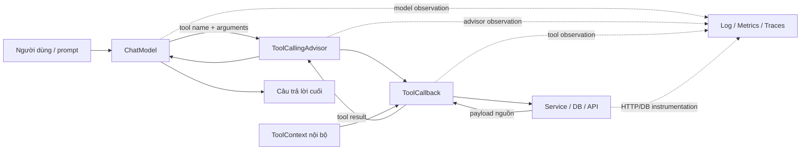

# Che đối số, kết quả và dữ liệu nhạy cảm trong log hoặc span

Trong Spring AI Tool Calling, mô hình ngôn ngữ có thể đề nghị gọi `@Tool` hoặc `ToolCallback` với arguments là dữ liệu do mô hình tạo. Ứng dụng thực thi callback, có thể đọc `ToolContext` chứa danh tính và phạm vi truy cập, sau đó trả kết quả về mô hình hoặc trực tiếp cho caller. Những dữ liệu đi qua vòng lặp này có thể gồm mã khách hàng, email, địa chỉ, hồ sơ thanh toán, kết quả truy vấn dữ liệu, access token hoặc nội dung do bên thứ ba cung cấp.

Nếu ứng dụng ghi toàn bộ arguments, `ToolContext`, tool result hay exception vào log hoặc tracing span, hệ thống quan sát có thể trở thành một bản sao ngoài ý muốn của dữ liệu nhạy cảm. Bản sao ấy có thể được gửi đến log aggregator, APM vendor hoặc monitoring dashboard, tồn tại lâu hơn dữ liệu nghiệp vụ gốc và được nhiều người vận hành truy cập hơn. Vì thế, **observability cần giúp kiểm tra quá trình thực thi mà không mặc định thu thập nội dung nghiệp vụ**.

Bài học này thuộc chương **Quan sát** của module **SPRING_AI_TOOL_CALLING**. Trọng tâm là cấu hình an toàn trên Spring AI 2.1.0, lựa chọn các trường được phép ghi, che dữ liệu trong log/span/audit event, chống rò rỉ qua lỗi và bộ thu thập bên ngoài, và kiểm thử để phát hiện đường rò rỉ trước production.

Sau bài học, bạn có thể:

- Nhận diện dữ liệu nhạy cảm trong tool arguments, results, `ToolContext`, prompt, completion và exception.
- Hiểu những trường Spring AI ghi vào observation theo mặc định, những trường chỉ được ghi khi bật tùy chọn.
- Cấu hình `spring.ai.tools.observations.include-content=false` và các tùy chọn log prompt/completion.
- Phân biệt che nội dung với che metadata: tên tool, description, JSON Schema và tool-call ID vẫn có thể xuất hiện.
- Thiết kế log có cấu trúc với **allowlist trường an toàn**, không log nguyên DTO hay JSON arguments.
- Sử dụng `ToolCallback` decorator hoặc `SimpleLoggerAdvisor` đã giới hạn dữ liệu.
- Giữ metric labels có cardinality thấp và audit event đủ để kiểm tra quyền mà không lộ bí mật.
- Kiểm thử để canary secret/PII không lọt vào logs, spans, MDC, HTTP trace và error events.

## 1. Dữ liệu nhạy cảm có thể xuất hiện ở đâu?

Một vòng gọi công cụ thường có các bước: mô hình tạo tool call → `ToolCallingAdvisor` chuyển cho `ToolCallingManager` → callback nhận arguments và context → service gọi DB/API → callback trả output → mô hình diễn giải hoặc `returnDirect` trả caller. Mỗi bước có thể phát sinh log hoặc span.



| Vị trí | Dữ liệu dễ bị ghi nhầm | Rủi ro |
| --- | --- | --- |
| Prompt/user messages | Câu hỏi, email, số điện thoại, thông tin cá nhân | Lộ nội dung hội thoại |
| Tool-call arguments | `customerId`, `address`, `paymentReference`, `query` | Lộ input nghiệp vụ hoặc dữ liệu do model tạo |
| Tool result | JSON record, mô tả y tế/tài chính, kết quả RAG, link nội bộ | Lộ dữ liệu nguồn ngoài phạm vi mục đích |
| `ToolContext` | Actor/tenant, role, session, credential handle, đôi khi token | Lộ dữ liệu xác thực và nội bộ |
| Tool definition | Tên tool, description, JSON Schema, ví dụ values | Tiết lộ topology nghiệp vụ, tên field, internal API |
| Exceptions | Request URL, remote error body, headers, stack trace | Tiết lộ token, hostname nội bộ, payload lỗi |
| HTTP/DB instrumentation | URL, query parameters, SQL, bind values, request/response body | Lộ dữ liệu dù tool span đã tắt content |
| MDC/baggage | User ID, tenant ID, conversation ID, correlation ID | Dữ liệu được copy vào mọi log/span con |

Một giá trị **không nằm trong prompt gửi mô hình** vẫn có thể bị lộ qua log. Ví dụ `ToolContext` được Spring AI truyền nội bộ cho callback mà không xuất hiện trong input schema gửi mô hình, nhưng lệnh `log.debug("{}", toolContext)` của ứng dụng vẫn có thể ghi toàn bộ map.

## 2. Phân loại dữ liệu trước khi quyết định ghi

Không phải mọi thông tin đều có cùng mức nhạy cảm. Hãy thiết kế classification theo từng loại field.

| Loại | Ví dụ | Chính sách quan sát mặc định |
| --- | --- | --- |
| Secret/credential | Password, bearer token, API key, refresh token, private key | **Không ghi** vào log/span/metric/audit text |
| Dữ liệu cá nhân | Email, số điện thoại, địa chỉ, ngày sinh, nội dung trao đổi | Không ghi nguyên văn; cân nhắc token hóa hoặc không lưu |
| Business-sensitive | Giá hợp đồng, số tiền, mã giao dịch, tình trạng đơn hàng | Chỉ ghi mã outcome/nhóm trạng thái khi có nhu cầu |
| Identifier nội bộ | Actor ID, tenant ID, order ID, conversation ID | Tránh metric label; trong audit kiểm soát ACL/retention |
| Metadata kỹ thuật an toàn | Tên tool allowlist, outcome code, thời gian chạy, lỗi theo nhóm | Có thể ghi ở log và metric sau khi kiểm tra cardinality |
| Trace correlation | Server-generated request ID, trace/span ID | Log/trace có giới hạn quyền; không dùng làm metric label |

Các giá trị tưởng như “không bí mật” vẫn có thể nhạy cảm khi kết hợp với nhau. Ví dụ tên tool `get_credit_limit` cùng thời điểm, actor ID và outcome có thể suy ra hoạt động tài chính. Vì vậy, classification là quyết định nghiệp vụ, không chỉ bài toán phát hiện chuỗi giống token.

## 3. Các tùy chọn mặc định an toàn trong Spring AI 2.1.0

Spring AI tạo Micrometer observations cho `ChatClient`, `ChatModel`, advisor và tool calling. Tool execution observations mang tên `spring.ai.tool`, đo thời gian và truyền tracing context khi có tracer.

**Theo tài liệu Spring AI 2.1.0**, arguments và results của tool **không được xuất ra span attributes theo mặc định**. Property điều khiển việc này là:

```properties
# Mặc định là false; khai báo tường minh để bảo vệ cấu hình production.
spring.ai.tools.observations.include-content=false
```

Các tùy chọn thu thập nội dung prompt/completion cũng nên giữ tắt:

```properties
spring.ai.chat.client.observations.log-prompt=false
spring.ai.chat.client.observations.log-completion=false

spring.ai.chat.observations.log-prompt=false
spring.ai.chat.observations.log-completion=false
spring.ai.chat.observations.include-error-logging=false

spring.ai.vectorstore.observations.log-query-response=false
```

| Property | Nội dung nó ảnh hưởng | Mặc định trong tài liệu 2.1.0 |
| --- | --- | --- |
| `spring.ai.tools.observations.include-content` | Tool-call arguments và result trong observations | `false` |
| `spring.ai.chat.client.observations.log-prompt` | Nội dung prompt ở ChatClient | `false` |
| `spring.ai.chat.client.observations.log-completion` | Nội dung completion ở ChatClient | `false` |
| `spring.ai.chat.observations.log-prompt` | Nội dung prompt ở ChatModel | `false` |
| `spring.ai.chat.observations.log-completion` | Nội dung completion ở ChatModel | `false` |
| `spring.ai.chat.observations.include-error-logging` | Ghi lỗi trong chat observations theo cơ chế Spring AI | `false` |
| `spring.ai.vectorstore.observations.log-query-response` | Nội dung response từ vector store query | `false` |

Các property trên chỉ điều khiển **đường instrumentation liên quan của Spring AI**. Chúng không tự tắt log do callback/service tự viết, HTTP wiretap, logging của thư viện SDK, exporter do bên thứ ba cài, log của proxy hoặc dữ liệu đã lưu vào một audit store khác. Cũng không đồng nghĩa dữ liệu không được gửi đến mô hình; **tool result vẫn có thể được đưa vào context của model theo luồng tool calling bình thường**.

## 4. include-content=false vẫn không bảo vệ mọi metadata

Một nhầm lẫn phổ biến là nghĩ rằng đặt `include-content=false` sẽ che toàn bộ tool observation. Thực tế, Spring AI vẫn có thể đưa metadata về tool vào span.

Theo bảng attribute của `spring.ai.tool`:

| Attribute | Nội dung | Trạng thái |
| --- | --- | --- |
| `gen_ai.operation.name` | `execute_tool` | Có thể ghi bình thường |
| `spring.ai.tool.definition.name` | Tên công cụ | Low-cardinality |
| `spring.ai.tool.type` | Loại tool, ví dụ `function` | Low-cardinality |
| `spring.ai.tool.definition.description` | Mô tả công cụ | High-cardinality trace |
| `spring.ai.tool.definition.schema` | JSON Schema tham số | High-cardinality trace |
| `spring.ai.tool.call.id` | ID tool call do mô hình cấp | High-cardinality trace |
| `spring.ai.tool.call.arguments` | Arguments thực tế | **Chỉ khi bật content** |
| `spring.ai.tool.call.result` | Kết quả thực thi | **Chỉ khi bật content** |

**Hệ quả:** không đặt token, endpoint bí mật, dữ liệu khách hàng thật, ví dụ số tài khoản hoặc dữ liệu cá nhân vào `@Tool(description=...)`, `@ToolParam(description=...)`, tên trường schema hoặc sample values. Những trường này vốn được dùng để mô tả tool cho mô hình và có thể xuất hiện trong tracing metadata ngay cả khi không ghi arguments/results.

Tên tool cũng cần được xem xét. Tên tĩnh `lookup_order` thường hợp lý; tên động chứa tenant/email hoặc mã tài khoản như `lookup_order_user_123456` không phù hợp với metrics và spans. Nếu metadata nghiệp vụ thật sự nhạy cảm, cần xem lại cấu trúc tool definition hoặc chính sách filter/exporter trước khi triển khai.

## 5. Nguyên tắc: ghi theo allowlist, không dump object rồi che sau

Chiến lược an toàn nhất là **không đưa dữ liệu không cần thiết vào sự kiện quan sát**. Chỉ tạo event từ các field được cho phép.

Ví dụ **không nên làm**:

```java
// Không an toàn: có thể chứa PII, token và dữ liệu chưa được xác minh.
log.debug("Tool arguments: {}", toolInput);
log.debug("Tool context: {}", toolContext);
log.info("Tool result: {}", result);
log.error("Tool failed, raw arguments = " + toolInput, exception);
```

Cũng không nên gọi:

```java
log.debug("Tool callback = {}", callback);
log.debug("Chat response = {}", chatResponse);
log.info("Tool input DTO: {}", inputRecord);
```

`toString()` của DTO, record, exception hoặc object lồng nhau có thể tự in ra mọi trường. Nếu một field được bổ sung về sau, log dump có thể bắt đầu rò rỉ mà không cần ai sửa code logging.

Thay bằng event từ trường có chủ đích:

```text
tool_execution tool=lookup_order outcome=success duration_ms=37
tool_execution tool=lookup_order outcome=denied duration_ms=2
tool_execution tool=lookup_order outcome=timeout duration_ms=2000
```

Event này giúp theo dõi hành vi và độ trễ mà không cho thấy order ID, email, token hoặc kết quả tra cứu. Chỉ log nhóm lỗi và mã trạng thái đã chuẩn hóa, không log raw exception message chứa dữ liệu đối tác.

Một bảng mapping tối thiểu:

| Dữ liệu gốc | Field có thể ghi |
| --- | --- |
| Full arguments JSON | `input_validation=passed/failed` hoặc `input_present=true` |
| Order ID | Không ghi, hoặc audit ref được pseudonymize theo policy |
| Email người dùng | Không ghi |
| Full tool result JSON | `outcome=success`, `result_type=order_summary` |
| Token/key | Không ghi, không hash để “debug” |
| Exception gốc | `error_code=DOWNSTREAM_TIMEOUT` |
| Duration | `duration_ms` hoặc histogram timer |
| Nguồn ngoài | `source_type=database/partner_api` nếu đủ an toàn |

Chỉ dùng regex làm tuyến phòng thủ phụ. Regex dễ bỏ sót field lồng nhau, arrays, JSON escape, base64, URL-encoded values, nhiều ngôn ngữ và format mới. **Allowlist từ schema đã hiểu** đáng tin cậy hơn việc serialize toàn bộ object rồi tìm chuỗi cần che.

## 6. Ví dụ ToolCallback decorator chỉ log trạng thái an toàn

Với tool programmatic hoặc tool đã chuyển từ `@Tool` sang `ToolCallback`, có thể bọc callback trong một decorator để ghi outcome và duration. Decorator không cần đọc hoặc xuất `toolInput` và `ToolContext`.

```java
public final class PrivacySafeToolCallback implements ToolCallback {

    private static final Logger log =
            LoggerFactory.getLogger(PrivacySafeToolCallback.class);

    private static final Set<String> ALLOWED_TOOL_NAMES = Set.of(
            "lookup_order",
            "get_shipping_status"
    );

    private final ToolCallback delegate;
    private final String safeToolName;

    public PrivacySafeToolCallback(ToolCallback delegate) {
        this.delegate = Objects.requireNonNull(delegate);

        String name = delegate.getToolDefinition().name();
        if (!ALLOWED_TOOL_NAMES.contains(name)) {
            throw new IllegalArgumentException(
                    "Tool name is not approved for logging");
        }
        this.safeToolName = name;
    }

    @Override
    public ToolDefinition getToolDefinition() {
        return delegate.getToolDefinition();
    }

    @Override
    public ToolMetadata getToolMetadata() {
        return delegate.getToolMetadata();
    }

    @Override
    public String call(String toolInput) {
        return record(() -> delegate.call(toolInput));
    }

    @Override
    public String call(String toolInput, ToolContext context) {
        return record(() -> delegate.call(toolInput, context));
    }

    private String record(Supplier<String> operation) {
        long started = System.nanoTime();
        String outcome = "success";

        try {
            return operation.get();
        }
        catch (RuntimeException exception) {
            outcome = "failure";
            throw exception;
        }
        finally {
            long elapsedMillis =
                    TimeUnit.NANOSECONDS.toMillis(
                            System.nanoTime() - started);

            log.info(
                    "ai_tool_execution tool={} outcome={} duration_ms={}",
                    safeToolName, outcome, elapsedMillis);
        }
    }
}
```

Sử dụng:

```java
ToolCallback safeTool =
        new PrivacySafeToolCallback(orderLookupCallback);

String answer = chatClient.prompt()
        .user(question)
        .tools(safeTool)
        .toolContext(Map.of(
                "actorId", authenticatedActor.id().toString(),
                "tenantId", authenticatedActor.tenantId().toString()))
        .call()
        .content();
```

Decorator giữ `ToolDefinition`, `ToolMetadata` và chức năng callback gốc, bao gồm `returnDirect`. Nó không ghi input, output hay map context. Giá trị `safeToolName` được kiểm tra qua allowlist tĩnh để tránh tên tool động gây lộ dữ liệu hoặc tạo cardinality lớn.

Đây là ví dụ ghi log trạng thái cơ bản, **không phải audit đầy đủ**. Với tool bị từ chối trước khi callback được dispatch, decorator sẽ không thấy event; các quyết định authorization cần được ghi bởi policy layer. Nếu callback trả error result bình thường thay vì ném exception, đoạn `outcome=success` chỉ có nghĩa callback kết thúc không ném lỗi; cần domain outcome riêng nếu muốn phân biệt `NOT_FOUND` hoặc `ACCESS_DENIED`.

## 7. Khi dùng @Tool: che tại application service và adapter

Một method được chú thích `@Tool` có thể gọi service nhận dữ liệu nhạy cảm. Không nên trông chờ người viết mọi method nhớ che log thủ công; hãy chuẩn hóa logging ở lớp adapter/service.

Ví dụ:

```java
@Component
public class OrderTools {

    private final OrderQueryService queryService;

    public OrderTools(OrderQueryService queryService) {
        this.queryService = queryService;
    }

    @Tool(
        name = "lookup_order",
        description = "Tra cứu tóm tắt đơn hàng trong phạm vi người dùng hiện tại."
    )
    public OrderSummary lookupOrder(
            @ToolParam(description = "Mã đơn hàng cần tra cứu")
            String orderId,
            ToolContext toolContext) {

        // Giá trị này do server tạo, không thuộc schema gửi mô hình.
        String tenantId = requireTrustedTenant(toolContext);

        // Domain service kiểm tra quyền actor/tenant/resource.
        return queryService.findAuthorizedSummary(
                tenantId, orderId);
    }
}
```

`OrderSummary` nên chỉ chứa các trường cần gửi cho mô hình. Trong `OrderQueryService`, log theo outcome:

```java
long started = System.nanoTime();

try {
    OrderSummary summary = repositoryQueryAndAuthorize();
    safeEventLogger.toolCompleted("lookup_order", "success", started);
    return summary;
}
catch (AccessDeniedException exception) {
    safeEventLogger.toolCompleted("lookup_order", "denied", started);
    throw exception;
}
```

`repositoryQueryAndAuthorize()` và `safeEventLogger` là helper giả định do ứng dụng định nghĩa. Khi logging nằm gần service, vẫn phải xác minh **trước** khi đưa dữ liệu vào model result; việc không log PII không thay thế phân quyền hoặc lọc output.

Quan trọng: nếu tool result chứa dữ liệu cá nhân nhưng ứng dụng gửi nó về mô hình theo yêu cầu đã được cho phép, việc `include-content=false` chỉ ngăn **xuất dữ liệu ra observation backend**, không ngăn dữ liệu đi đến model provider. Data minimization, xác thực quyền, cấu hình data retention của provider và chính sách sử dụng AI vẫn là trách nhiệm riêng.

## 8. SimpleLoggerAdvisor: tiện debug nhưng có thể làm lộ nội dung

Spring AI cung cấp `SimpleLoggerAdvisor` để ghi request và response của `ChatClient`. Khi gắn advisor này và bật mức log tương ứng, ứng dụng có thể xuất nguyên prompt, completion hoặc context ra log tùy hàm formatter.

Trong production, ưu tiên không cài advisor này khi không cần. Nếu cần quan sát vòng lặp mà không ghi nội dung, chỉ tạo **safe projection**:

```java
SimpleLoggerAdvisor safeLogger = new SimpleLoggerAdvisor(
        request -> "chat_client_request=received",
        response -> "chat_client_response=completed",
        Ordered.HIGHEST_PRECEDENCE + 400);

ChatClient chatClient = ChatClient.builder(chatModel)
        .defaultAdvisors(safeLogger)
        .build();
```

Ví dụ trên cố ý không gọi `request.prompt().getUserMessage()`, không serialize `response` và không đọc `request.context()`. Nó chỉ ghi một thông điệp sự kiện cố định, nên bảo mật tốt hơn dump đối tượng. Nếu cần trạng thái tool chi tiết, dùng decorator/callback domain ở phần trước.

`SimpleLoggerAdvisor` là một advisor thông thường; với `ToolCallingAdvisor` order mặc định `HIGHEST_PRECEDENCE + 300`, order `+400` đưa nó **vào trong tool loop**. Đừng thay order mà chưa kiểm tra số lần log sẽ phát sinh qua nhiều model rounds.

Bật `logging.level.org.springframework.ai.chat.client.advisor=DEBUG` để thấy log của advisor có thể hữu ích trong debug, nhưng không nên bật DEBUG diện rộng cho `org.springframework.ai` hay HTTP SDK trong production nếu chưa kiểm tra dữ liệu được ghi. `DEBUG` của framework/custom code là **đường xuất dữ liệu độc lập** với property `spring.ai.tools.observations.include-content`.

## 9. Log có cấu trúc và chống log injection

Dù một trường được phép ghi, dữ liệu do người dùng hoặc dịch vụ ngoài cung cấp có thể chứa ký tự xuống dòng, `\r`, `\n`, control characters hoặc delimiter nhằm tạo log giả.

Ví dụ payload không tin cậy:

```text
ORD-42
ERROR SecurityAudit actor=admin outcome=allowed
```

Nếu nối chuỗi đó trực tiếp vào text log, người đọc có thể nhầm một phần input thành một sự kiện hệ thống. Dùng parameterized logging `log.info("id={}", value)` giúp tránh lỗi xây chuỗi không cần thiết, nhưng **không tự loại CR/LF** trong `value`.

Đối với trường bắt buộc phải xuất:

- Chỉ chấp nhận giá trị sau khi validate theo kiểu và format được phép.
- Escape `\r`, `\n`, tab và control characters; hoặc dùng structured JSON logging có encoder đúng.
- Giới hạn chiều dài và bỏ/cắt field quá lớn.
- Không dùng raw JSON từ bên thứ ba làm event template.
- Kiểm soát ký tự trong error code, event name và tool name bằng enum/allowlist.
- Thực hiện encoding phù hợp với định dạng log, không coi replace vài ký tự là biện pháp duy nhất.

Ví dụ logger chỉ nhận enum outcome:

```java
public enum SafeOutcome {
    SUCCESS, DENIED, INVALID_ARGUMENT, TIMEOUT, DOWNSTREAM_ERROR
}

public void logToolOutcome(String safeToolName, SafeOutcome outcome) {
    if (!SAFE_NAMES.contains(safeToolName)) {
        throw new IllegalArgumentException("Unknown tool log category");
    }

    log.info("tool={} outcome={}", safeToolName, outcome.name());
}
```

Khi yêu cầu điều tra cần input đầy đủ, tách nó ra một kho chứng cứ riêng với quyền truy cập và thời hạn lưu được duyệt, thay vì chuyển nó thành log ứng dụng chung.

## 10. Span attributes: không gắn raw input và output

Micrometer Observation giúp đo duration và liên kết trace. Một custom span không cần chứa mọi arguments để hữu ích.

**Không nên**:

```java
Observation current = observationRegistry.getCurrentObservation();

if (current != null) {
    current.highCardinalityKeyValue("tool.arguments", rawToolArguments);
    current.highCardinalityKeyValue("tool.result", rawToolResult);
    current.highCardinalityKeyValue("customer.email", customerEmail);
}
```

Nên dùng những giá trị đã được chuẩn hóa:

```java
Observation current = observationRegistry.getCurrentObservation();

if (current != null) {
    current.lowCardinalityKeyValue("app.tool.outcome", "success");
    current.lowCardinalityKeyValue("app.tool.category", "read");
}
```

Ở đây `app.tool.*` là **custom keys của ứng dụng**, không phải các attribute built-in của Spring AI. `lowCardinalityKeyValue` chỉ phù hợp với tập giá trị giới hạn và đã được duyệt; không đưa user ID, order ID, email, conversation ID hoặc full URL vào low-cardinality attributes vì chúng có thể trở thành metric labels và làm tăng số chuỗi thời gian.

`highCardinalityKeyValue` có thể không xuất vào metrics theo semantics Micrometer nhưng **vẫn có thể đi vào trace exporter**. High cardinality không đồng nghĩa an toàn hoặc được mã hóa. Dữ liệu nhạy cảm không nên được ghi vào cả hai loại attributes nếu không có chính sách xử lý cụ thể.

## 11. Cần ghi tool-call ID hay trace ID không?

ID giúp nối các sự kiện trong một turn, nhưng nó cũng là dữ liệu có thể theo dõi hoạt động của người dùng. Phân biệt:

| ID | Nơi có thể sử dụng | Không nên sử dụng |
| --- | --- | --- |
| Server-generated request ID | Log có ACL; trace; audit event | Metric label có cardinality cao |
| `spring.ai.tool.call.id` | Trace / audit để nối callback với model request | Raw public logs hoặc metric label không kiểm soát |
| Conversation/session ID | Session store có ACL, audit được quản trị | Log đại trà và dashboards public |
| Tenant/actor ID | Authorization/audit store có bảo vệ | Low-cardinality metric labels hoặc error message gửi model |
| HMAC pseudonym | Audit khi cần đối chiếu có kiểm soát | Xem như dữ liệu đã hoàn toàn ẩn danh |

Nếu một ID ít entropy, việc hash bằng SHA-256 trần có thể bị dò theo từ điển. Nếu bắt buộc phải so sánh nhiều sự kiện cùng người dùng mà không ghi ID gốc, cân nhắc **HMAC với khóa bí mật** và key version theo chính sách. Trong trường hợp không cần correlation ở cấp người dùng, tốt nhất là không thu thập trường đó.

## 12. ToolContext và MDC: hai bề mặt dễ quên

`ToolContext` dành cho dữ liệu ứng dụng không đưa vào schema gửi mô hình, chẳng hạn danh tính actor, tenant hoặc credential handle. Nội dung này vẫn có thể xuất hiện nếu code tùy chỉnh log toàn bộ map.

**Không làm**:

```java
log.debug("Context={}", toolContext.getContext());
log.debug("Authentication={}", authentication);
MDC.put("tenant_id", tenantId);
MDC.put("access_token", accessToken);
```

**Nên dùng correlation ID không chứa PII**:

```java
String requestId = requestIdGenerator.newId();

try (MDC.MDCCloseable scope =
        MDC.putCloseable("request_id", requestId)) {

    log.info("tool_request_received outcome=accepted");
    executeAuthorizedRequest();
}
```

`executeAuthorizedRequest()` là hàm ứng dụng. `MDC.putCloseable` giúp xóa field khỏi MDC sau khi rời scope. Tuy nhiên, trong môi trường async/reactive, `ThreadLocal` MDC **không tự bảo đảm truyền context đúng** khi code chuyển thread. Cần dùng cơ chế context propagation tương ứng và kiểm thử việc cleanup để không trộn request/tenant.

OpenTelemetry baggage cũng cần được xem như vùng dữ liệu có thể truyền sang downstream services. Không đặt access token, personal data hoặc nội dung arguments vào baggage. Trace ID cho correlation không cần mang theo PII.

## 13. Audit event: đủ kiểm tra nhưng không lưu raw payload

Nếu hệ thống cần chứng minh tool được cho phép hoặc bị từ chối, audit event nên chứa **kết luận nghiệp vụ** thay vì bản sao của prompt, arguments hoặc result.

Ví dụ:

```json
{
  "eventType": "TOOL_EXECUTION",
  "requestRef": "req-6b1",
  "toolName": "lookup_order",
  "outcome": "DENIED",
  "policyCode": "ORDER_READ_NOT_ALLOWED",
  "resultType": null,
  "durationMs": 4,
  "occurredAt": "2026-11-27T09:30:00Z"
}
```

Các trường an toàn tương đối có thể gồm:

- Event type, tool name đã duyệt, outcome enum và error category.
- Timestamp, duration và server-generated request reference.
- Policy decision code, scope của thao tác dạng category.
- Nguồn dữ liệu ở mức logic (`database`, `partner_api`) khi không làm lộ dữ liệu.
- Result schema version hoặc HMAC digest khi thật sự cần xác minh sau này.

Không mặc định lưu email, arguments JSON, full result, tenant names, token, SQL, URL chứa query hoặc nội dung exception. Nếu yêu cầu kiểm toán bắt buộc phải lưu định danh tài nguyên, lưu vào audit store riêng được mã hóa với ACL/retention và không tự xuất lên logs, spans hoặc metrics.

Audit sink có thể được thiết kế append-only/tamper-evident khi chính sách yêu cầu. Đừng suy ra Spring AI `spring.ai.tool` span là **bản ghi kiểm toán bền vững**; trace có thể bị sampling, mất dữ liệu hoặc hết hạn lưu.

## 14. Các đường rò rỉ không bị tắt bởi Spring AI observation properties

Ngay cả khi đã giữ `include-content=false` và tắt log prompt/completion, có thể vẫn còn đường ghi nội dung từ lớp khác.

| Đường rò rỉ | Ví dụ | Cách kiểm soát |
| --- | --- | --- |
| Custom `log.debug` | In `toolInput` hoặc `ToolContext` | Bỏ raw logging; thay bằng safe event |
| `SimpleLoggerAdvisor` | Formatter serialize prompt/response | Không cài hoặc dùng formatter allowlist |
| Exception stack/message | WebClient exception có URL hoặc response body | Map exception sang error code trước khi log/export |
| HTTP wiretap/client debug | Headers/body, Authorization | Tắt capture body/headers nhạy cảm; cấu hình sanitizer |
| ORM/JDBC logging | SQL bind values hoặc query text nhạy cảm | Không bật bind parameter logging ở production |
| APM/OTel agent | Auto-capture request body, query, exception attributes | Rà soát collector/exporter/agent config và sampling |
| Reverse proxy/API gateway | URL query string và HTTP body | Mask URL query; hạn chế access logs và retention |
| Error reporting SDK | Breadcrumbs, context maps, local variables | Scrub fields và giới hạn data capture |
| Event bus hoặc audit DB | Serialize nguyên tool result | Định nghĩa event schema an toàn, ACL và TTL |
| Test snapshot | Raw HTTP/model fixtures chứa dữ liệu thật | Dùng dữ liệu tổng hợp, không commit secrets |

Một hệ thống có thể thu thập dữ liệu **trước** khi exporter filter được áp dụng. Vì thế không nên chỉ dựa vào regex/filter ở collector làm lớp bảo vệ duy nhất. Hãy bỏ hoặc che dữ liệu ngay tại nguồn và kiểm tra pipeline từ ứng dụng đến nơi lưu trữ cuối.

## 15. Xử lý lỗi mà không làm lộ thông tin

Spring AI chuyển lỗi trong quá trình thực thi callback qua `ToolExecutionExceptionProcessor`. Nội dung exception có thể được ném về caller hoặc trở thành tool error response tùy processor và cấu hình. Ngoài tool execution, thư viện HTTP/DB cũng có thể đưa URL, SQL hoặc response body vào exception message.

**Không log**:

```java
catch (Exception exception) {
    log.error("Failed to call tool with input=" + rawInput, exception);
    throw exception;
}
```

Ưu tiên phân loại lỗi thành mã hữu hạn:

```java
public enum SafeErrorCode {
    ACCESS_DENIED,
    INVALID_ARGUMENT,
    DOWNSTREAM_TIMEOUT,
    DOWNSTREAM_UNAVAILABLE,
    INVALID_PROVIDER_RESPONSE,
    INTERNAL_ERROR
}
```

```java
catch (PartnerTimeoutException exception) {
    safeAudit.recordFailure("lookup_order", SafeErrorCode.DOWNSTREAM_TIMEOUT);

    throw new SafeToolExecutionException(
            "Dịch vụ dữ liệu tạm thời không phản hồi.");
}
```

`SafeToolExecutionException` là loại exception ứng dụng tự định nghĩa với message ngắn đã làm sạch. Không gắn nguyên body/token của đối tác vào message hoặc `cause.toString()` rồi để nó tự động đi đến span error attributes.

Trong log bảo mật cao, có thể cần giữ diagnostic chi tiết ở sink riêng, được mã hóa và có ACL nghiêm ngặt. Đây là quyết định pháp lý/nghiệp vụ độc lập; **không dùng một mức DEBUG chung** để thu thập mọi exception chỉ vì muốn điều tra dễ hơn.

## 16. Streaming, returnDirect và nhiều lần gọi tool

Trong một turn, mô hình có thể tạo nhiều model rounds, và một response có thể chứa nhiều tool calls. Streaming có thể phát từng phần của arguments trước khi hoàn chỉnh.

Để tránh rò rỉ và ghi thừa:

- Đừng log từng chunk của tool arguments; chunks chưa đầy đủ có thể chứa một phần dữ liệu nhạy cảm.
- Chỉ ghi tên tool allowlist và outcome sau khi một tool call hoàn chỉnh được tạo; cần phân biệt nó với partial deltas.
- Với batch nhiều tool, không nối arguments/results của tất cả call vào một log tổng hợp.
- Khi `returnDirect=true`, caller nhận tool output trực tiếp; công cụ vẫn cần lọc kết quả trước khi trả. Việc bỏ lượt model sau tool **không làm payload an toàn hơn**.
- Khi cần confirmation, log trạng thái `AWAITING_CONFIRMATION` hoặc `APPROVED/DENIED`, không serialize toàn bộ thông tin xác nhận chứa dữ liệu cá nhân.
- Nếu tool call vượt giới hạn, ghi `LIMIT_REACHED` mà không lưu raw arguments của những lời gọi còn lại.

Ngay cả khi một model provider từ chối hoặc cắt ngắn response, những phần đã được streaming có thể vẫn được thu thập bởi custom instrumentation. Hãy kiểm tra cả đường lỗi và cancellation của stream, không chỉ đường thành công.

## 17. Metrics không phải nơi chứa ID hoặc raw result

Một event có thể chuyển thành metrics để đếm số lần tool lỗi hoặc đo latency:

```java
meterRegistry.counter(
        "app.tool.executions",
        "tool", "lookup_order",
        "outcome", "success"
).increment();
```

Đây là **metric do ứng dụng tự đặt**, không phải metric built-in của Spring AI. `tool` và `outcome` ở ví dụ là các tập giá trị nhỏ, được allowlist trước.

**Không làm**:

```java
meterRegistry.counter(
        "app.tool.executions",
        "email", customerEmail,
        "order_id", orderId,
        "tool_result", resultJson
).increment();
```

Metric label có cardinality cao có thể tạo lượng lớn time series, làm tăng chi phí và khiến dữ liệu nhạy cảm nằm trong hệ thống monitoring. Trace attributes high-cardinality cũng không phải nơi an toàn mặc định; chúng chỉ không xuất vào metrics theo phân loại Micrometer, nhưng vẫn đi vào tracing backend.

Một bộ metric gợi ý:

| Metric | Labels hợp lý |
| --- | --- |
| `app.tool.executions` | `tool=lookup_order`, `outcome=success/failure` |
| `app.tool.authorization.denied` | `tool=lookup_order`, `policy_category=resource` |
| `app.tool.external.timeout` | `tool=lookup_order`, `source_category=partner_api` |
| `app.tool.invalid_result` | `tool=lookup_order`, `reason=invalid_schema` |

Nếu tool names đến từ provider/MCP hoặc tenant động, map chúng sang category hoặc allowlist trước khi tạo labels. Không sử dụng tên raw làm label nếu nó có thể thay đổi không giới hạn.

## 18. Kiểm thử bằng canary data

Một chính sách redaction chỉ đáng tin khi kiểm thử các đường xuất dữ liệu thực tế: application logs, traces đã được exporter nhận, audit store và error events.

Dùng **canary tổng hợp**, không dùng token hoặc PII thật. Ví dụ:

```text
TEST_SECRET_CANARY_4e9d
TEST_EMAIL_CANARY@example.test
TEST_TOKEN_CANARY_57ac
```

Đưa canary vào các vị trí khác nhau:

1. Tool arguments JSON (kể cả nested object và array).
2. `ToolContext` map do server tạo.
3. Tool result DTO và raw response của API giả.
4. Exception message hoặc HTTP error body của fake downstream.
5. Prompt/completion của fake model.
6. JSON Schema/tool description trong bộ kiểm thử riêng.

Chạy test có log collector và in-memory tracing exporter. Sau khi hoàn tất cả nhánh thành công và nhánh lỗi, tìm tất cả chuỗi canary trong dữ liệu đã xuất. Chỉ kiểm tra `Logback ListAppender` mà không kiểm tra tracing exporter chưa đủ.

Ví dụ skeleton JUnit kiểm thử log summary:

```java
@Test
void doesNotLogSensitiveToolInputOrResult() {
    String canary = "TEST_SECRET_CANARY_4e9d";

    ToolCallback delegate =
            fakeCallbackReturning("result=" + canary);

    ToolCallback safe =
            new PrivacySafeToolCallback(delegate);

    safe.call("{\"secret\":\"" + canary + "\"}");

    String exportedLogs = collectLogMessagesForTest();

    assertThat(exportedLogs).contains("tool=lookup_order");
    assertThat(exportedLogs).contains("outcome=success");
    assertThat(exportedLogs).doesNotContain(canary);
    assertThat(exportedLogs).doesNotContain("\"secret\"");
}
```

`fakeCallbackReturning(...)` và `collectLogMessagesForTest()` là fixtures do ứng dụng xây dựng. Test cần bảo đảm fake callback có tên `lookup_order` nằm trong allowlist. Các assertions khác:

| Kịch bản | Kết quả mong đợi |
| --- | --- |
| `include-content=false` | Span `spring.ai.tool` không có raw arguments/result |
| Prompt/completion logging tắt | Spring AI observation path không xuất raw prompt/completion |
| Custom callback ghi outcome | Log có tool/outcome/duration, không có canary |
| Nested JSON chứa token | Không trường nào của raw JSON vào log/span |
| `ToolContext` chứa token test | Không log map context |
| Exception chứa secret canary | Error event không chứa message gốc |
| HTTP 500 có body nhạy cảm | Không bật wiretap/body logging; exporter không có canary |
| Source text chứa CRLF injection | Không tạo log record giả |
| Meter tags | Không chứa order ID, user ID hoặc raw result |
| Streaming partial chunks | Canary không xuất qua debug chunk logging |
| `returnDirect` | Payload không được tự động log chỉ vì trả cho caller |
| Remote tool name động | Bị từ chối hoặc map sang category an toàn |

Cần kiểm tra cả metrics, traces, logs của ứng dụng và audit events nếu mục tiêu là không ghi PII ở mọi nơi. Đừng kết luận toàn hệ thống an toàn chỉ vì kiểm thử một lớp decorator đã pass.

## 19. Quy trình chẩn đoán sự cố mà vẫn bảo vệ dữ liệu

Khi cần phân tích một tool call thất bại trên production:

1. Tìm bằng server-generated request ID hoặc trace ID, không tìm bằng email hoặc token.
2. Xem tool name đã duyệt, outcome code, duration, nguồn gọi và nhóm lỗi.
3. Kiểm tra authorization decision và tool-call budget qua audit events đã chuẩn hóa.
4. So sánh kết quả đã xác minh bằng source version/ref được cấp phép nếu cần.
5. Nếu thiếu thông tin, tái hiện lỗi bằng dữ liệu tổng hợp hoặc môi trường sandbox.
6. Chỉ thu raw payload cho một case theo quy trình chấp thuận riêng, với ACL/TTL/encryption.
7. Tắt debug capture sau điều tra; xác minh dữ liệu cũ được xóa theo retention.
8. Kiểm thử lại đường log/span sau khi sửa lỗi để tránh tái phát.

Không để mỗi developer tự bật `DEBUG` toàn cục hoặc `include-content=true` trên production như một bước điều tra mặc định. Hãy có quy trình điều tra phân quyền, giới hạn thời gian, nguồn dữ liệu và quyền xuất dữ liệu rõ ràng.

## 20. Checklist bảo vệ log và span

- [ ] `spring.ai.tools.observations.include-content=false`.
- [ ] `ChatClient` và `ChatModel` prompt/completion logging tắt khi không có phê duyệt.
- [ ] Không đặt dữ liệu thật/secret vào tool name, description, schema hoặc examples.
- [ ] Không log nguyên `toolInput`, `ToolContext`, result DTO, prompt hay response.
- [ ] Không in `Exception#getMessage()` hoặc stack trace có payload không tin cậy vào sink chung.
- [ ] Custom logs chỉ có trường allowlist, outcome code, duration và correlation an toàn.
- [ ] Không có actor ID/tenant ID/order ID/email/token trong metric labels.
- [ ] Trace attributes high-cardinality vẫn được xét như dữ liệu có thể bị lộ.
- [ ] MDC và baggage không chứa secret/PII; cleanup và async propagation được kiểm thử.
- [ ] HTTP wiretap, JDBC bind logging, SDK/APM agent và proxy access logs đã được rà soát.
- [ ] Log encoder xử lý CRLF/control chars; không nhận raw untrusted event names.
- [ ] Audit events dùng schema riêng, ACL, encryption, retention phù hợp.
- [ ] Test canary chạy cho success, error, timeout, streaming, batch và `returnDirect`.
- [ ] Có quy trình debug hạn chế, không bật content capture toàn hệ thống.
- [ ] Tool/service vẫn thực hiện authorization và data minimization trước khi đưa kết quả vào model.

## Những điểm cần nhớ

- **Che dữ liệu tại nguồn** tốt hơn serialize cả object rồi cố xóa secret bằng regex.
- Spring AI 2.1.0 mặc định không export tool arguments/results ra spans; hãy giữ `spring.ai.tools.observations.include-content=false`.
- Property này không che mọi metadata: tên tool, description, JSON Schema và tool-call ID vẫn có thể nằm trong tracing.
- `ToolContext` không gửi cho mô hình nhưng vẫn có nguy cơ bị lộ qua log nếu ứng dụng tự dump object.
- `SimpleLoggerAdvisor` và custom `DEBUG` logging là đường rò rỉ riêng; cấu hình observability không thay thế việc kiểm tra chúng.
- Metric labels phải có tập giá trị nhỏ và đã được duyệt; IDs/PII không nên làm labels.
- Exceptions, HTTP wiretap, SDK agents, MDC và audit sink cần chính sách che dữ liệu riêng.
- Canary tests phải kiểm tra **cả log lẫn span/exporter**, không chỉ formatter.
- Không ghi dữ liệu nhạy cảm trong log cũng không có nghĩa model/provider không nhận tool result; kiểm soát data access và data minimization vẫn là trách nhiệm của ứng dụng.

## Tài liệu tham khảo

- [Spring AI 2.1.0 Reference — Observability](https://docs.spring.io/spring-ai/reference/2.1/observability/index.html)
- [Spring AI 2.1.0 Reference — Tool Calling](https://docs.spring.io/spring-ai/reference/2.1/api/tools.html)
- [Spring AI 2.1.0 Reference — ChatClient và SimpleLoggerAdvisor](https://docs.spring.io/spring-ai/reference/2.1/api/chatclient.html)
- [Spring AI API — ToolCallback](https://docs.spring.io/spring-ai/docs/2.1.x/api/org/springframework/ai/tool/ToolCallback.html)
- [Spring Boot — Observability](https://docs.spring.io/spring-boot/reference/actuator/observability.html)
- [OWASP — Logging Cheat Sheet](https://cheatsheetseries.owasp.org/cheatsheets/Logging_Cheat_Sheet.html)
- [OpenTelemetry — Generative AI Semantic Conventions](https://opentelemetry.io/docs/specs/semconv/gen-ai/)

Các property nêu trong bài dựa trên Spring AI 2.1.0. Mỗi SDK, exporter và nhà cung cấp observability có thể có cơ chế tự thu thập riêng; vì vậy cần kiểm thử đường xuất dữ liệu hoàn chỉnh theo dependency và môi trường đang chạy. Các class `PrivacySafeToolCallback`, `SafeToolExecutionException`, `safeAudit` và metric `app.tool.*` là ví dụ thiết kế ứng dụng, không phải tính năng tự cấu hình của Spring AI.
