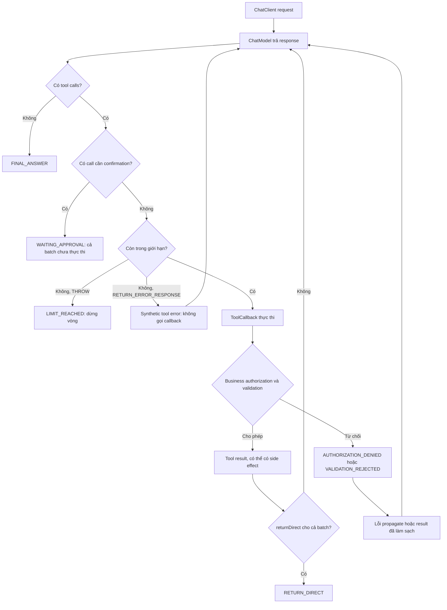

# Quan sát vòng lặp bị dừng, giới hạn vượt mức và hành động bị từ chối

Khi dùng Spring AI tool calling, một lần gọi `ChatClient` có thể dẫn đến nhiều lần gọi mô hình và nhiều lần thực thi công cụ. Vòng lặp có thể kết thúc bình thường, trả kết quả trực tiếp, **tạm dừng** vì cần xác nhận, **bị giới hạn** vì tool được gọi quá nhiều, hoặc thất bại trước khi có câu trả lời. Một tool call cũng có thể bị **từ chối** theo quyết định của người dùng hoặc chính sách phân quyền.

Những tình huống này rất dễ bị trộn lẫn trong telemetry. Ví dụ, một response không có nội dung không nhất thiết là lỗi: đó có thể là reply đang chờ phê duyệt. Một tool call bị chặn do quá giới hạn không có nghĩa callback đã chạy. Ngược lại, khi một batch đã thực thi vài tool rồi mới vượt giới hạn, **một phần tác động nghiệp vụ có thể đã xảy ra**.

Trong module `SPRING_AI_TOOL_CALLING`, mô hình chỉ đề xuất gọi công cụ bằng tên và arguments; `ToolCallingManager` điều phối, `ToolCallback` chạy mã Java và business service kiểm tra quyền. Việc quan sát phải phản ánh **đúng điểm thực thi và đúng trạng thái nghiệp vụ**, thay vì chỉ nhìn vào văn bản mô hình trả về.

## 1. Mục tiêu quan sát

Sau khi hoàn thành bài học, bạn cần phân biệt và đo được:

1. Vòng lặp đã **hoàn tất**, **tạm dừng**, **bị chặn**, **lỗi** hay **bị hủy**.
2. Mô hình đã **đề xuất bao nhiêu tool calls**, nhưng callback thực tế **được gọi bao nhiêu lần**.
3. Hạn mức bị vượt là **per-tool** hay **total per turn**; ứng dụng đã **dừng** hay **trả lỗi cho mô hình để tiếp tục**.
4. Hành động bị từ chối do **người duyệt**, **authorization policy**, **validation**, hay **giới hạn gọi tool**.
5. Batch có thể đã thực thi được những thao tác nào trước khi dừng và cần đối soát tác động ra sao.
6. Những trường telemetry nào đủ để chẩn đoán sự cố mà không đưa prompt, arguments, kết quả hay dữ liệu cá nhân vào nhật ký.

Quan sát chỉ cho biết **điều đã xảy ra**. Nó không tự thực thi authorization, confirmation, idempotency, rollback hay recovery.

## 2. Mô hình vòng lặp và những điểm có thể dừng

`ToolCallingAdvisor` được tự đăng ký trong `ChatClient` của Spring AI 2.x, trừ khi ứng dụng đã thay bằng một `ToolAdvisor` khác hoặc chủ động opt out. Advisor gửi định nghĩa tool cho mô hình, nhận `ChatResponse`, giao tool calls cho `ToolCallingManager`, đưa tool results vào history rồi gọi mô hình lần tiếp theo.



Sơ đồ biểu diễn **các nhánh khái niệm**. Trong implementation, lỗi business có thể được exception processor chuyển thành tool response hoặc ném lên caller; nếu ném exception, nó **không quay lại mô hình theo nhánh trên**. Với batch gồm nhiều tool, một tool có thể đã hoàn tất trước khi tool khác gây lỗi hoặc chạm hạn mức.

## 3. Định nghĩa trạng thái để không nhầm lẫn

Spring AI cung cấp các response, metadata và exception cụ thể. Để vận hành thống nhất, ứng dụng nên bổ sung một **taxonomy trạng thái riêng**:

| Trạng thái ứng dụng | Ý nghĩa | Callback đã chạy? | Bước tiếp theo |
|---|---|---|---|
| `FINAL_ANSWER` | Mô hình trả câu trả lời không còn tool calls | Có thể đã chạy ở các vòng trước | Trả kết quả cho caller |
| `RETURN_DIRECT` | Tool result được trả thẳng, không gọi model thêm | Có | Trả result đúng contract |
| `WAITING_APPROVAL` | Assistant reply chứa call cần duyệt; loop tạm dừng | Chưa call nào trong **batch đang chờ** chạy | Lưu paused reply và chờ quyết định |
| `APPROVAL_DENIED` | Người duyệt từ chối một tool call | Call bị deny không chạy | Ghi quyết định, đưa thông điệp deny vào history |
| `AUTHORIZATION_DENIED` | Service/policy từ chối thực thi tài nguyên | Có thể callback đã được dispatch nhưng side effect bị ngăn | Ghi security event; không tự retry |
| `LIMIT_REACHED` | Vượt giới hạn gọi tool với behavior `THROW` | Call vượt limit không chạy; call trước có thể đã chạy | Dừng và kiểm tra partial results |
| `LIMIT_SKIPPED` | Vượt limit với `RETURN_ERROR_RESPONSE` | Call vượt limit bị bỏ qua | Model nhận lỗi và có thể tiếp tục |
| `TOOL_EXECUTION_FAILED` | Callback/service thất bại | Có thể đã bắt đầu; tác động chưa chắc chưa xảy ra | Theo error/retry/idempotency policy |
| `CANCELLED` | Caller hủy subscription/request | Tùy thời điểm hủy | Dọn tài nguyên và đối soát tác động |
| `TIMED_OUT` | Vượt deadline của request hoặc tool | Không rõ nếu callback đã gửi lệnh ra ngoài | Đối soát theo operation ID |

Đây là **mã trạng thái gợi ý của ứng dụng**, không phải enum mặc định có sẵn trong Spring AI. Trạng thái của một turn và trạng thái của một tool call là hai tầng khác nhau: một turn có thể `WAITING_APPROVAL` trong khi những tool ở vòng trước đã chạy thành công.

## 4. Phân biệt đề xuất, dispatch và side effect

Không dùng một counter `tool.calls` để diễn tả mọi chuyện. Nên tách:

| Sự kiện | Điểm thu thập | Có chứng minh business effect? |
|---|---|---|
| `tool_requested` | Assistant response có `getToolCalls()` | Không |
| `tool_awaiting_approval` | Confirmation metadata báo paused reply | Không |
| `tool_dispatched` | Manager/callback bắt đầu chạy | Chưa |
| `tool_authorization_denied` | Authorization tại service từ chối | Không; nếu thực thi đúng fail-closed |
| `tool_execution_succeeded` | Callback trả kết quả | Chưa chắc giao dịch ngoài đã được đối soát hoàn toàn |
| `business_operation_committed` | Operation ledger/transaction ghi nhận thành công | Có, theo hợp đồng business |
| `tool_limit_exceeded` | Manager chặn call vì hạn mức | Call bị chặn không chạy |
| `tool_response_emitted` | Tool result được đưa vào history | Không chứng minh callback mới chạy: response có thể là deny/synthetic error |

Một công cụ ghi `sendInvoice` có thể tạo side effect rồi mạng timeout trước khi trả kết quả. Vì vậy `TOOL_EXECUTION_FAILED` không tự chứng minh `business_operation_committed=false`. Với workflow ghi dữ liệu, **operation ledger** và mã giao dịch của hệ thống đích là nguồn đối soát.

## 5. Micrometer observations do Spring AI cung cấp

Spring AI sử dụng Micrometer Observation để đo hoạt động của `ChatClient`, `ChatModel` và tool:

| Observation/metric | Phạm vi | Ví dụ thông tin |
|---|---|---|
| `spring.ai.chat.client` | Một invocation `ChatClient.call()` hoặc `.stream()` | Thời gian toàn request và trace context |
| `gen_ai.client.operation` | Lần gọi model | Model, provider, token usage, finish reason |
| `spring.ai.tool` | Việc thực thi tool trong interaction | Tool name, duration, tool call ID, metadata |
| `gen_ai.client.token.usage` | Metric token usage | Input/output tokens theo model operation |

`spring.ai.tool` có những attribute như `gen_ai.operation.name=execute_tool`, `spring.ai.kind=tool_call`, `spring.ai.tool.definition.name`, `spring.ai.tool.type` và `spring.ai.tool.call.id`. Các metadata định nghĩa có thể có description và input schema.

**Điểm mấu chốt:** một tool call bị **deny trước khi callback chạy**, một call **bị chặn bởi hạn mức** hoặc một loop **đang chờ confirmation** có thể không tạo ra span thực thi tool tương ứng. Không dùng số span `spring.ai.tool` để kết luận mọi lời gọi được mô hình đề xuất đã chạy, và cũng không dùng việc thiếu span làm bằng chứng tuyệt đối rằng chưa có tác động: sampling, exporter, lỗi process hoặc đường instrumentation riêng đều có thể khiến span không được quan sát.

Hãy bổ sung audit/metric **ở đúng nhánh quyết định** để nhận diện `WAITING_APPROVAL`, `LIMIT_REACHED` và `APPROVAL_DENIED`.

## 6. Cấu hình observability an toàn

Trong production, ưu tiên giữ phần nội dung hội thoại, tool input và tool output **không được xuất** vào telemetry:

```yaml
spring:
  ai:
    chat:
      observations:
        log-prompt: false
        log-completion: false
        include-error-logging: false
    tools:
      observations:
        include-content: false
```

Các lựa chọn trên có default là `false` trong tài liệu Spring AI. Nếu bật `spring.ai.tools.observations.include-content=true`, tool arguments và result có thể xuất thành span attributes. Nếu bật log prompt/completion, nội dung người dùng, tool result và dữ liệu bí mật có thể đi vào nhật ký.

Ngay cả khi tắt content, **tool name, description, input schema hoặc ID trong trace** vẫn có thể tiết lộ cấu trúc hệ thống hoặc danh tính tài nguyên. Không đính email, số thẻ, user ID hay JSON arguments làm metric tags. Với log truy vết, ưu tiên correlation ID ngẫu nhiên, hash hoặc token hóa ID khi phù hợp.

## 7. Giới hạn tool calls: per-tool và toàn turn

`DefaultToolCallingManager` của Spring AI 2.1 có cơ chế giới hạn số lần gọi công cụ trong một turn:

| Giới hạn | Mặc định | Ý nghĩa |
|---|---:|---|
| `maxCallsPerTool` | 40 | Tối đa số lần gọi một tool name trong turn |
| `maxTotalToolCalls` | 150 | Tổng số tool calls trong turn |
| `maxCallsPerTool("tool", n)` | Không override | Có thể đặt giới hạn riêng cho tool cụ thể |
| `excludeToolFromLimit("name")` | Không loại trừ | Bỏ giới hạn per-tool của công cụ đó, nhưng vẫn tính tổng |
| `onLimitExceeded` | `THROW` | Chọn dừng hẳn hoặc trả synthetic error response |

Ví dụ cấu hình programmatic:

```java
ToolCallingManager manager = ToolCallingManager.builder()
        .maxCallsPerTool(8)
        .maxCallsPerTool("searchProducts", 15)
        .maxTotalToolCalls(30)
        .onLimitExceeded(ToolCallLimitBehavior.THROW)
        .build();

ToolCallingAdvisor advisor = ToolCallingAdvisor.builder()
        .toolCallingManager(manager)
        .build();

ChatClient client = ChatClient.builder(chatModel)
        .defaultAdvisors(advisor)
        .build();
```

Đừng đặt số giới hạn chỉ theo khả năng của model; cần xét độ trễ, ngân sách token, chi phí API và rủi ro tích lũy tác động nghiệp vụ. Những công cụ ghi dữ liệu có thể cần quota riêng thấp hơn rất nhiều, do service/policy của ứng dụng áp dụng.

## 8. Cấu hình hạn mức bằng Spring Boot properties

Khi sử dụng Spring Boot auto-configuration, có thể đặt limits bằng properties:

```yaml
spring:
  ai:
    tools:
      limits:
        max-calls-per-tool-default: 8
        max-calls-per-tool:
          searchProducts: 15
          cancelOrder: 2
        max-total-tool-calls: 30
        on-limit-exceeded: THROW
```

Giá trị `-1` có thể vô hiệu hóa một giới hạn cụ thể. Với hệ thống nghiệp vụ, tránh vô hiệu hóa toàn bộ giới hạn mà không có giới hạn thay thế ở application layer.

Giới hạn của manager được tính **theo turn**, dựa trên những `ToolResponseMessage` từ `UserMessage` gần nhất trong prompt; không phải bộ đếm global nằm trong singleton manager. Các vòng của cùng turn phải giữ đủ lịch sử để manager đếm đúng. Khi resume confirmation bằng prompt thiếu vòng trước, những call trước có thể không còn được tính trong lượt resume đó.

Không coi `maxTotalToolCalls` là quota theo user/ngày, tenant/tháng hay ngân sách tiền. Những quota bền vững phải được lưu và kiểm soát ở service riêng.

## 9. Khi vượt giới hạn với THROW

`ToolCallLimitBehavior.THROW` là hành vi mặc định. Khi giới hạn bị vượt:

1. `DefaultToolCallingManager` tạo `ToolCallLimitExceededException`.
2. Exception chứa tên tool liên quan (có thể `null` nếu vượt giới hạn tổng), hạn mức và phần `ToolExecutionResult` đã hoàn thành trong batch hiện tại.
3. Trên đường tự động, `ToolCallingAdvisor` bắt exception và trả **một generation cuối** phản ánh vi phạm giới hạn.
4. Finish reason là `ToolCallLimitExceededException.FINISH_REASON`.
5. Những tool responses đã thành công trong batch được giữ ở metadata `METADATA_PARTIAL_TOOL_RESPONSES`, không biến mất chỉ vì call tiếp theo bị chặn.

Điểm thứ năm đặc biệt quan trọng: **dừng vòng không có nghĩa rollback các tool đã thực thi trước đó**. Nếu tool đầu tiên đã hủy một giao dịch, rồi tool thứ hai vượt giới hạn, hệ thống cần ghi nhận transaction đã hủy thay vì báo rằng toàn bộ batch chưa chạy.

Ứng dụng nên phân loại final response dựa trên finish reason và metadata, không dựa trên việc chuỗi `.content()` có hay không. Thông điệp hiển thị cho người dùng cần nói rõ có kết quả từng phần nếu điều đó ảnh hưởng đến nghiệp vụ.

## 10. Khi vượt giới hạn với RETURN_ERROR_RESPONSE

Với:

```java
ToolCallingManager manager = ToolCallingManager.builder()
        .maxCallsPerTool(5)
        .maxTotalToolCalls(20)
        .onLimitExceeded(ToolCallLimitBehavior.RETURN_ERROR_RESPONSE)
        .build();
```

manager **không gọi callback vượt limit**. Nó tạo một `ToolResponse` tổng hợp chứa thông báo giới hạn, để mô hình biết công cụ đã bị chặn và có thể tiếp tục hội thoại.

Sự khác biệt với `THROW`:

| | `THROW` | `RETURN_ERROR_RESPONSE` |
|---|---|---|
 Callback vượt limit | Không chạy | Không chạy |
 Điều phối tự động | Advisor kết thúc bằng finish reason đặc biệt | Model nhận tool result lỗi và có thể tiếp tục |
 Cách quan sát | Final response/finish reason + metadata partial | Tool response synthetic + sự kiện limit do ứng dụng ghi |
 Rủi ro | Có thể có side effect từ call trước trong batch | Model có thể lặp lại nỗ lực, làm tăng token/cost |
 Manual `ToolCallingManager` | Caller nhận `ToolCallLimitExceededException` | Caller nhận `ToolExecutionResult` chứa error response |

Với đường **manual orchestration**, không có `ToolCallingAdvisor` để đổi exception thành generation cuối. Caller cần bắt `ToolCallLimitExceededException` khi dùng `THROW` và xử lý state/partial results rõ ràng.

Nếu dùng `RETURN_ERROR_RESPONSE`, phải giới hạn số vòng model hoặc deadline tổng để mô hình không liên tục thử lại những call đã vượt giới hạn.

## 11. Cách nhận biết limit trong ChatResponse

Đối với đường `ChatClient` tự động dùng `THROW`, Spring AI cung cấp `ToolCallLimitExceededException.FINISH_REASON`. Ứng dụng có thể kiểm tra finish reason trên generation:

```java
ChatResponse response = chatClient.prompt()
        .user(question)
        .tools(tools)
        .call()
        .chatResponse();

String finishReason = response.getResult().getMetadata().getFinishReason();

if (ToolCallLimitExceededException.FINISH_REASON.equals(finishReason)) {
    loopTelemetry.recordLimitReached("tool_limit", "stop");

    // Đọc metadata partial tool responses theo API/version đang sử dụng.
    // Không kết luận rằng mọi callback của batch đều chưa chạy.
}
```

`loopTelemetry` là thành phần ứng dụng minh họa. Không ghi raw `ChatResponse` vào log, vì nó có thể chứa tool arguments, kết quả và nội dung người dùng. Với streaming, kiểm tra response cuối/finish reason sau khi đã tổng hợp đúng dữ liệu từ stream; không tự diễn giải một fragment chưa hoàn chỉnh như final response.

## 12. Quan sát confirmation pause

Tool Call Confirmation có từ Spring AI 2.1. Một tool được khai báo `@Tool(requiresConfirmation = true)` hoặc được `ToolCallConfirmationPolicy` chọn sẽ cần quyết định của người có quyền.

Điểm đáng chú ý là **nếu bất kỳ tool call nào trong assistant reply cần xác nhận, manager tạm dừng cả reply trước khi thực thi bất kỳ call nào của reply đó**. `ToolCallingAdvisor` nhận `ToolCallConfirmationRequiredException`, ngừng vòng và trả paused `ChatResponse` cùng metadata chứa keys chờ duyệt.

Không phân loại paused reply là lỗi mô hình chỉ vì text rỗng. Trên đường blocking:

```java
ChatResponse reply = chatClient.prompt()
        .user("Đặt vé cho chuyến bay VN204")
        .tools(bookingTools)
        .call()
        .chatResponse();

List<String> pendingKeys = ToolCallDecisions.awaitingDecision(reply);

if (!pendingKeys.isEmpty()) {
    loopTelemetry.recordApprovalPending(pendingKeys.size());
    approvalStore.savePausedReply(reply, authenticatedActorId);
    // Phản hồi 202 Accepted hoặc trạng thái WAITING_APPROVAL cho API client.
}
```

`approvalStore` và `loopTelemetry` là abstraction của ứng dụng. Lưu paused reply vào server-side storage không cho client sửa, nhưng **đừng log toàn bộ paused reply** vào telemetry.

## 13. Streaming pause: không chỉ nhìn aggregated response

Với `.stream().chatResponse()`, thông tin `awaitingDecision` được gắn vào **chunk cuối** của paused reply. Tài liệu Spring AI lưu ý: aggregated response có thể không giữ keys chờ duyệt.

Ví dụ ý tưởng:

```java
List<ChatResponse> chunks = chatClient.prompt()
        .user(question)
        .tools(bookingTools)
        .stream()
        .chatResponse()
        .collectList()
        .block();

if (!chunks.isEmpty()) {
    ChatResponse last = chunks.get(chunks.size() - 1);
    List<String> awaiting = ToolCallDecisions.awaitingDecision(last);
    if (!awaiting.isEmpty()) {
        loopTelemetry.recordApprovalPending(awaiting.size());
    }
}
```

Đây là ví dụ minh họa detection; production nên giữ reactive pipeline thay vì `collectList().block()` trong event loop. Có thể dùng `doOnNext` để nhận metadata chunk cuối, `doOnError` cho lỗi và `doFinally` cho complete/cancel. Đừng đánh đồng `.stream().content()` kết thúc với tool loop đã hoàn thành: streaming content thường không có text khi đang chờ duyệt.

## 14. Quan sát hành động bị người duyệt từ chối

Khi resume một reply đã tạm dừng, ứng dụng gửi **một quyết định cho mỗi tool call trong reply**:

```java
ToolCallDecisions decisions = ToolCallDecisions.of(
        ToolCallDecision.allow("call_1"),
        ToolCallDecision.deny(
                "call_2",
                "Người dùng không đồng ý gửi thông báo."));

ToolExecutionResult result = toolCallingManager.executeToolCalls(
        originalPrompt,
        serverStoredPausedReply,
        decisions);
```

Call bị `deny` **không chạy callback**. Manager tạo tool result chứa denial message, để mô hình có thể biết hành động không được thực hiện. Call được allow có thể chạy; batch có thể gồm cả kết quả được thực thi và kết quả từ chối.

Điểm thu thập audit đúng nhất là **application approval handler**, khi nó xác thực người duyệt và quyết định được lưu bền vững:

```java
approvalEvents.record(
        approvalId,
        sanitizedToolName,
        ApprovalOutcome.DENIED,
        "USER_DECLINED");
```

Không suy ra `APPROVAL_DENIED` chỉ từ việc callback không có observation: callback cũng không chạy khi timeout, limit, chưa được dispatch hoặc hệ thống bị lỗi trước execution.

Thông điệp deny được gửi lại mô hình như tool input; Spring AI không tự sanitize nó. Không ghi lời giải thích chứa thông tin nhạy cảm hoặc nội dung không đáng tin vào denial result.

## 15. Approval bị từ chối khác authorization bị từ chối

Hai sự kiện cần mã khác nhau:

| | `APPROVAL_DENIED` | `AUTHORIZATION_DENIED` |
|---|---|---|
 Người/chính sách từ chối | Approver hoặc workflow approval | Authorization policy ở callback/service |
 Thời điểm | Trước khi chạy call bị deny trong resume | Khi xử lý business action tại runtime |
 Callback call bị từ chối | Không được dispatch | Có thể đã bắt đầu callback trước khi policy ném lỗi |
 Gợi ý mã reason | `USER_DECLINED`, `EXPIRED` | `TENANT_MISMATCH`, `INSUFFICIENT_PERMISSION` |
 Khả năng retry | Cần approval mới theo hợp đồng | Không tự retry để thử vượt quyền |
 Audit | Approval ID, actor quyết định, tool key | Actor, resource scope, permission, policy version |

Ví dụ `@Tool` có kiểm tra quyền:

```java
@Tool(description = "Hủy đơn hàng được người dùng cho phép.",
      requiresConfirmation = true)
public CancellationReceipt cancelOrder(
        String orderId,
        ToolContext context) {

    AuthenticatedActor actor = actorResolver.fromTrustedToolContext(context);
    orderAuthorization.requireCanCancel(actor, orderId);
    return orderService.cancelWithIdempotency(actor, orderId);
}
```

Các service/DTO minh họa là của ứng dụng. `requiresConfirmation` không thay thế `orderAuthorization.requireCanCancel(...)`. Quyền có thể bị thu hồi giữa lúc người dùng bấm duyệt và khi callback chạy, nên authorization phải được kiểm tra lại ở business service.

## 16. Runtime exception có thể được gửi lại model

Spring AI dùng `ToolExecutionExceptionProcessor` để quyết định lỗi của callback được chuyển thành tool result hay ném lên caller. Theo behavior mặc định:

- Với `RuntimeException` đã được đóng gói đúng vào `ToolExecutionException`, thông điệp có thể được đưa về model.
- Checked exception và `Error` được propagate.
- `spring.ai.tools.throw-exception-on-error=true` yêu cầu ném lỗi lên caller.

Điều này ảnh hưởng telemetry: nếu `AccessDeniedException` hoặc lỗi business khác bị chuyển thành một tool result, HTTP request vẫn có thể trả `200` và model vẫn nói chuyện tiếp. **Không chỉ dựa vào HTTP status hoặc final answer** để phát hiện authorization denial.

Nên có một security audit event phát tại nơi policy quyết định từ chối, không phụ thuộc việc exception processor trả lỗi về model hay không. Với lỗi quyền quan trọng, cân nhắc allowlist `rethrowExceptions` hoặc processor tùy chỉnh để bảo đảm ứng dụng phân biệt lỗi quyền với lỗi có thể phục hồi.

## 17. Tạm dừng không phải bị từ chối

Những trạng thái này cần tách rõ:

| Trạng thái | Ý nghĩa | Có nên ghi `denied`? |
|---|---|---|
 `WAITING_APPROVAL` | Chưa có quyết định | Không |
 `APPROVED` | Đã cho phép nhưng có thể chưa chạy | Không |
 `APPROVAL_DENIED` | Người có quyền chọn deny | Có |
 `EXPIRED` | Hết hạn chờ duyệt | Không nên gộp vào user denial |
 `ABANDONED_PAUSE` | Người dùng gửi turn mới, bỏ pause cũ | Không phải bằng chứng user đã chủ động deny |
 `AUTHORIZATION_DENIED` | Service từ chối vì không đủ quyền | Có, nhưng reason khác approval denial |

Với Session Memory trong Spring AI 2.1, `SessionTurnAdvisor` có thể ghi thông điệp trung lập kiểu `No result was recorded for this tool call.` để đóng open tool call của turn cũ, giữ history hợp lệ. Nó **không** có nghĩa callback chắc chắn chưa chạy; có thể callback đã tạo side effect rồi process chết trước khi ghi tool response.

Nếu workflow cần audit người dùng từ chối, hãy ghi quyết định `deny` tường minh khi người đó từ chối và trước khi chấp nhận turn mới. Khi turn mới đã được chấp nhận, không resume paused reply cũ.

## 18. Quan sát vòng lặp kết thúc trực tiếp

Một tool có `returnDirect=true` có thể yêu cầu trả kết quả trực tiếp cho caller thay vì gửi về model để model viết lại. `ToolCallingAdvisor` kết thúc vòng sau khi manager trả result direct, nếu điều kiện `returnDirect` của batch được thỏa mãn.

Trạng thái gợi ý là `RETURN_DIRECT`, không phải `LOOP_ABORTED` hay `LIMIT_REACHED`. Nếu model không đưa thêm final assistant text, đó là chủ đích của contract.

Khi một reply chứa nhiều tool calls, `returnDirect` chỉ có hiệu lực nếu tất cả call trong batch đều có metadata `returnDirect=true`. Với confirmation, một call bị deny sẽ khiến manager trả kết quả về model thay vì direct theo hợp đồng.

## 19. Quan sát cuối vòng qua advisor

Trong Spring AI, có thể đặt observer advisor **bên trong** `ToolCallingAdvisor` bằng order lớn hơn `ToolCallingAdvisor.DEFAULT_ORDER` để nhìn từng model iteration, hoặc đặt một observer **bên ngoài** để nhìn response cuối của toàn turn.

```java
public final class LoopTurnObserver implements CallAdvisor {

    private final LoopTelemetry telemetry;

    public LoopTurnObserver(LoopTelemetry telemetry) {
        this.telemetry = telemetry;
    }

    @Override
    public String getName() {
        return "loop-turn-observer";
    }

    @Override
    public int getOrder() {
        // Thấp hơn tool loop order (+300) để quan sát toàn turn.
        return Ordered.HIGHEST_PRECEDENCE + 250;
    }

    @Override
    public ChatClientResponse adviseCall(
            ChatClientRequest request,
            CallAdvisorChain chain) {
        try {
            ChatClientResponse response = chain.nextCall(request);
            ChatResponse chatResponse = response.chatResponse();
            if (chatResponse != null) {
                telemetry.classifyFinalResponse(chatResponse);
            }
            return response;
        }
        catch (RuntimeException ex) {
            telemetry.recordLoopFailure(ex.getClass().getSimpleName());
            throw ex;
        }
    }
}
```

Đây là observer của ứng dụng; `LoopTelemetry` phải tự đọc finish reason và confirmation metadata, đồng thời phát sự kiện đã làm sạch. Không dùng `response.chatResponse().getResult().getOutput().getText()` để đoán nguyên nhân stop. Observer thông thường **không** implement `ToolAdvisor` và không gọi `ToolCallingManager`, tránh chạy tool hai lần.

Đối với streaming, triển khai `StreamAdvisor` tương ứng với `Flux.doOnNext/doOnError/doFinally`. `doFinally` giúp nhận biết `CANCEL` nhưng không đảm bảo callback đã rollback; chỉ là lifecycle signal của reactive subscription.

## 20. Phân biệt observer ở trong và ngoài vòng lặp

| Vị trí | Order ví dụ | Quan sát được | Không tự chứng minh |
|---|---:|---|---|
 Ngoài vòng `ToolCallingAdvisor` | `HIGHEST_PRECEDENCE + 250` | Final response, duration của turn, finish reason/paused reply | Số callback thực thi |
 Trong vòng | `HIGHEST_PRECEDENCE + 400` | Mỗi model request/response, tool call intents, partial stream chunks | Tool call đã commit nghiệp vụ |
 Bên trong `ToolCallback` | Không phải advisor order | Dispatch, thời gian callback, exception | Tình trạng transaction ngoài nếu response bị mất |
 Business service/operation ledger | Theo transaction và idempotency | Commit, authorization denial, operation state | Mô hình đã dùng bao nhiêu lượt |

Sử dụng nhiều điểm đo giúp phân biệt một turn có `2` model iterations, `3` tool requests, `2` callbacks được dispatch và `1` business mutation commit.

## 21. Thiết kế event schema cho audit

Nên có event dạng structured data. Ví dụ:

```json
{
  "eventType": "TOOL_CALL_REJECTED",
  "outcome": "APPROVAL_DENIED",
  "reasonCode": "USER_DECLINED",
  "toolName": "sendInvoice",
  "requestTraceId": "trace-9ab3",
  "approvalRef": "opaque-approval-reference",
  "loopIteration": 2,
  "executed": false,
  "occurredAt": "2026-11-27T12:00:00Z"
}
```

Các giá trị trên **chỉ là dữ liệu giả lập**, không phải định dạng sự kiện bắt buộc của Spring AI. Tránh thêm raw `arguments`, `responseData`, prompt, stack trace hoặc danh tính cá nhân vào event.

Một schema đủ dùng thường gồm:

- `eventType`, `outcome`, `reasonCode` từ allowlist cố định.
- `toolName` chuẩn hóa, `toolCallId` hoặc reference đã làm sạch ở trace (không làm metric tags).
- `requestTraceId`, `conversationRef` và `approvalRef` do server quản lý.
- `loopIteration`, `requestedToolCount`, `executedToolCount`, `limitType`, `configuredLimit`.
- `operationRef` và `businessEffectStatus` nếu tool có tác động ghi.
- `durationMs` và `occurredAt`.

Nếu một call bị từ chối vì permission, `reasonCode=INSUFFICIENT_PERMISSION` tốt hơn việc đưa chi tiết quyền, tên người dùng hoặc dữ liệu tài nguyên vào log.

## 22. Low-cardinality metrics và high-cardinality traces

Micrometer metrics không phù hợp với mọi giá trị:

| Trường | Nên dùng làm metric tag? | Giải thích |
|---|---|---|
 `eventType` | Có | Tập giá trị hữu hạn |
 `outcome` | Có | `SUCCESS`, `DENIED`, `LIMIT`, `FAILED`... |
 `toolName` | Có điều kiện | Catalog hữu hạn; cần kiểm soát số lượng tên từ MCP/tool động |
 `limitType` | Có | `PER_TOOL`, `TOTAL` |
 `reasonCode` | Có, qua allowlist | Không cho message tự do |
 `requestId` | Không | Cardinality tăng theo mỗi request |
 `toolCallId` | Không | Cardinality rất cao |
 `actorId`, `tenantId` | Không, nếu không có thiết kế aggregation riêng | Có thể lộ danh tính và tạo nổ cardinality |
 `arguments`, `responseData` | Không | Nội dung nhạy cảm, kích thước không giới hạn |

Ví dụ counter của ứng dụng:

```java
public final class LoopTelemetry {

    private final MeterRegistry registry;

    public LoopTelemetry(MeterRegistry registry) {
        this.registry = registry;
    }

    public void recordOutcome(String outcome, String reasonCode) {
        registry.counter(
                "app.ai.tool.loop.outcomes",
                "outcome", requireKnownOutcome(outcome),
                "reason", requireKnownReason(reasonCode))
            .increment();
    }
}
```

`requireKnownOutcome` và `requireKnownReason` là helper do ứng dụng tự triển khai để chỉ chấp nhận các giá trị từ tập enum cố định. Không lấy tag trực tiếp từ text do mô hình tạo, lỗi của JDBC hay message của người dùng.

## 23. Tránh ghi hai lần một sự kiện

Cùng một tình huống có thể đi qua nhiều điểm instrumentation:

- Manager phát hiện vượt limit.
- Advisor tạo final generation có finish reason `ToolCallLimitExceededException.FINISH_REASON`.
- Outer advisor phân loại final response.
- Controller thấy final response và tăng counter.

Nếu cả bốn nơi đều tăng `limit_reached_total`, dashboard có thể báo bốn lần vượt giới hạn cho một lần. Hãy phân vai:

1. **Manager/policy boundary** ghi event quyết định `TOOL_CALL_LIMIT_REJECTED` theo từng tool call bị chặn.
2. **Outer turn observer** ghi `LOOP_STOPPED_BY_LIMIT` một lần cho mỗi turn.
3. **Business service** ghi `OPERATION_COMMITTED` theo operation ID; không tăng lại do callback retry.

Trong hệ thống có retry, muốn bảo đảm audit exactly-once hoặc at-least-once có dedupe, thêm `eventId` ổn định và unique constraint ở audit store. Phân biệt số **attempt** và số **business commits** để không che giấu lỗi orchestration.

## 24. Alert nào thực sự hữu ích?

Một dashboard tốt không chỉ đếm lỗi. Nó nên giúp tìm ra “vì sao không có kết quả” và “có tác động nào đã xảy ra không”.

| Metric / Alert | Điều kiện gợi ý | Hành động vận hành |
|---|---|---|
 `tool_limit_reached_rate` | Tăng đột biến theo tool/workflow | Kiểm tra prompt, tool result, loop logic, budget |
 `approval_pending_age` | Pause tồn tại quá thời hạn duyệt | Nhắc người duyệt hoặc đóng pause theo policy |
 `approval_denied_rate` | Nhiều hành động bị người dùng từ chối | Kiểm tra UI preview, mô tả tác động, chất lượng tool selection |
 `authorization_denied_rate` | Spike theo tool hoặc tenant (aggregate an toàn) | Điều tra policy drift, abuse, truy cập trái quyền |
 `tool_error_response_rate` | Runtime errors được model nhìn thấy tăng | Kiểm tra service contract, validation và provider |
 `unknown_outcome_count` | Có thao tác ghi không rõ đã commit hay chưa | Đối soát provider, idempotency ledger |
 `loop_cancel_rate` | Nhiều streaming request bị hủy | Kiểm tra UX/network/deadline, trạng thái tool còn chạy |
 `partial_batch_effects` | Vượt limit sau một số tool thành công | Kiểm tra business consistency và audit receipts |

Đặt threshold dựa trên baseline thật, không mặc định mọi `APPROVAL_DENIED` là sự cố bảo mật. Người dùng từ chối một hành động có thể là tín hiệu hệ thống confirmation đang hoạt động đúng.

## 25. Kiểm thử từng tình huống

Một bộ integration test có fake model và fake callbacks nên đo cả **response**, **telemetry** và **tác động nghiệp vụ**:

| Kịch bản | Response / metadata | Telemetry cần ghi | Callback/side effect |
|---|---|---|---|
 Không có tool call | Final answer | `FINAL_ANSWER` | Không chạy |
 Một tool đọc rồi final | Final answer | `tool_requested`, `tool_executed` | Một callback |
 Tool có `returnDirect` | Tool result direct | `RETURN_DIRECT` | Một callback, không gọi model thêm |
 Tool cần confirmation | Paused reply, awaiting keys | `WAITING_APPROVAL` | Chưa chạy call nào của paused batch |
 Người dùng deny | Denial tool response | `APPROVAL_DENIED` | Denied callback không chạy |
 Service từ chối quyền | Error/exception theo processor | `AUTHORIZATION_DENIED` | Không mutation |
 Vượt per-tool limit / THROW | Special finish reason | `LIMIT_REACHED` + `PER_TOOL` | Call bị chặn không chạy |
 Vượt total limit / THROW | Special finish reason | `LIMIT_REACHED` + `TOTAL` | Call bị chặn không chạy |
 Vượt limit / RETURN_ERROR_RESPONSE | Synthetic tool result | `LIMIT_SKIPPED`, model có thể tiếp tục | Call bị chặn không chạy |
 Hai call, call đầu thành công, call sau vượt limit | Final response + partial metadata | Limit + partial effect event | Chỉ call đầu thực thi |
 Manual manager với THROW | Exception tới caller | `LIMIT_REACHED` ở caller | Có thể có partial effects |
 Streaming cancel | Reactive CANCEL | `CANCELLED` | Kiểm tra operation state độc lập |
 Callback ghi rồi timeout | Không có success response đáng tin | `UNKNOWN_OUTCOME` | Đối soát bằng operation ID |
 Replay paused reply hai lần | Framework không tự dedupe | `DUPLICATE_RESUME` từ approval store | Operation ledger chặn tác động thứ hai |

Mỗi test nên assert **số lần callback được gọi**, không chỉ text cuối của assistant. Khi thử limit với manager tính count từ history, tạo prompt có `ToolResponseMessage` phù hợp thay vì chỉ lặp lại gọi method không cập nhật history.

## 26. Ví dụ kiểm thử confirmation và denial

Đoạn pseudocode sau tách phát hiện pause khỏi việc thực thi callback:

```java
@Test
void pausedToolCallIsNotExecutedBeforeApproval() {
    ChatResponse reply = fakeChatClientCallThatRequestsBooking();

    assertThat(ToolCallDecisions.awaitingDecision(reply)).isNotEmpty();
    verify(bookingService, never()).book(any());
    verify(loopTelemetry).recordApprovalPending(anyInt());
}

@Test
void deniedDecisionNeverInvokesTheDeniedTool() {
    ToolCallDecisions decisions = ToolCallDecisions.of(
            ToolCallDecision.deny("call_booking", "Người dùng không đồng ý."));

    toolCallingManager.executeToolCalls(
            originalPrompt, storedPausedReply, decisions);

    verify(bookingService, never()).book(any());
    verify(approvalEvents).recordDenied(eq("call_booking"), anyString());
}
```

Các helper `fakeChatClientCallThatRequestsBooking()`, `approvalEvents`, `storedPausedReply` và `originalPrompt` là test fixtures minh họa của ứng dụng; đoạn mã không phải một test class hoàn chỉnh. Nếu reply có nhiều tool calls, `ToolCallDecisions` phải cung cấp một quyết định cho **mọi** call, kể cả call không được đánh dấu cần confirmation.

## 27. Kiểm thử limit và partial batch

Ví dụ strategy test nên dùng callback spy:

```java
ToolCallingManager manager = ToolCallingManager.builder()
        .maxCallsPerTool(1)
        .maxTotalToolCalls(2)
        .onLimitExceeded(ToolCallLimitBehavior.THROW)
        .build();

// Fake model trả batch có nhiều tool calls vượt budget.
// Một callback hợp lệ có thể chạy trước khi call sau vượt giới hạn.
// Kiểm tra:
// - finish reason của ChatClient khi dùng ToolCallingAdvisor.
// - partial ToolExecutionResult trong limit exception/metadata.
// - số callback đã chạy và số business operations đã commit.
// - call vượt limit chưa bao giờ được dispatch.
```

Để kiểm thử `RETURN_ERROR_RESPONSE`, cấu hình cùng limits nhưng đổi behavior và xác minh tool bị chặn tạo response lỗi thay vì exception; model có thể vẫn sinh lượt tiếp theo. Tách giới hạn calls khỏi giới hạn số vòng/deadline để phát hiện loop lặp không kiểm soát.

## 28. Kịch bản vận hành: hủy đơn bị giới hạn sau khi xem trạng thái

Giả sử người dùng yêu cầu kiểm tra rồi hủy đơn `ORD-2048`:

1. Model yêu cầu `getOrderStatus`: callback đọc trả trạng thái, observation `spring.ai.tool` có một execution.
2. Model yêu cầu `previewCancellation`: callback chỉ đọc trả phí hoàn.
3. Model đề xuất `cancelOrder`: tool cần confirmation; loop tạm dừng, **chưa hủy**.
4. Người duyệt allow, app claim `operationId`; callback re-check quyền và trạng thái.
5. Nếu `cancelOrder` được thực thi thành công, operation ledger ghi receipt và audit `BUSINESS_OPERATION_COMMITTED`.
6. Nếu một tool khác của batch vượt limit ngay sau đó, response cuối có thể mang limit finish reason cùng partial tool responses.

**Không báo “hủy không thành công” chỉ vì turn kết thúc bởi limit**. Phải kiểm tra operation ledger xem `cancelOrder` đã thực hiện hay chưa. Ngược lại, một yêu cầu `cancelOrder` bị deny phải được ghi riêng `APPROVAL_DENIED`, không có biên nhận mutation.

Ví dụ này minh họa lý do cần ít nhất ba nguồn dữ liệu: **model/advisor telemetry**, **manager/approval events** và **business operation ledger**.

## 29. Những lỗi quan sát thường gặp

| Sai lầm | Hậu quả | Điều chỉnh |
|---|---|---|
 Đếm `AssistantMessage.ToolCall` như tool đã chạy | Phóng đại số tác động | Tách requested/dispatched/committed |
 Dùng `.content()` để biết có pause hay không | Bỏ sót trạng thái chờ duyệt | Kiểm tra `ToolCallDecisions.awaitingDecision(response)` |
 Dùng `HTTP 200` làm bằng chứng mọi tool thành công | Runtime tool error có thể được đưa về model | Ghi domain outcome ở callback/service |
 Coi `RETURN_ERROR_RESPONSE` là exception | Bỏ sót các call bị skip nhưng model vẫn chạy | Ghi limit decision hoặc kiểm tra synthetic result |
 Coi `THROW` như rollback batch | Bỏ sót partial side effects | Đọc partial metadata, đối soát operation ledger |
 Gộp `WAITING_APPROVAL` và `APPROVAL_DENIED` | Audit báo người dùng từ chối khi chưa quyết định | Dùng state riêng, ghi deny khi có quyết định |
 Coi absence của tool span là không có tác động | Sampling/exporter có thể mất dữ liệu | Kết hợp ledger và audit bền vững |
 Lấy exception message làm metric tag | Lộ dữ liệu, cardinality cao | Dùng `reasonCode` từ allowlist |
 Log raw tool arguments/results | Lộ dữ liệu nội bộ, PII, secrets | Mặc định tắt content, chỉ ghi metadata |
 Retry thao tác ghi sau timeout không đối soát | Mutation có thể lặp | Idempotency và reconciliation |
 Dùng callback counter trong singleton advisor không đồng bộ | Sai số giữa request | Counter thread-safe, scope theo turn |
 Chỉ test một tool call | Không phát hiện partial batch behavior | Test batch + limit + deny + cancel |

## 30. Checklist triển khai

- Mỗi turn có outcome rõ ràng: final, direct, paused, limited, failed, cancelled hoặc timed out.
- Tách sự kiện model requested, manager dispatched, callback finished và business committed.
- Không suy ra business side effect chỉ từ output text hoặc tool observation.
- Limit `maxCallsPerTool`, `maxTotalToolCalls` và `onLimitExceeded` có giá trị phù hợp workload.
- Phân biệt `THROW` (finish reason + partial metadata) và `RETURN_ERROR_RESPONSE` (synthetic tool result).
- Với manual manager, caller bắt `ToolCallLimitExceededException` và lưu trạng thái đúng.
- Khi confirmation pause, lưu reply nguyên bản phía server và báo `WAITING_APPROVAL`.
- Ghi `APPROVAL_DENIED` tại approval handler, không đoán từ callback không chạy.
- Authorization denial được ghi tại service/policy, có reason code an toàn.
- Nếu đã xảy ra mutation trước khi dừng, có operation ID và receipt để đối soát.
- Không log raw prompt, completion, tool input/output hoặc secret trong telemetry.
- Metric tags có cardinality giới hạn; trace/correlation IDs không làm metric tags.
- Observer advisor không gọi lại manager và không tạo double execution.
- Streaming ghi được complete/error/cancel và không suy luận sai từ partial deltas.
- Unit/integration tests bao phủ pause, deny, limits, partial results và crash window.

## 31. Tài liệu tham khảo

- [Spring AI 2.1 — Tool Calling](https://docs.spring.io/spring-ai/reference/api/tools.html): vòng tool calling, `ToolCallingManager`, giới hạn `THROW`/`RETURN_ERROR_RESPONSE`, metadata partial results và exception handling.
- [Spring AI 2.1 — Tool Call Confirmation](https://docs.spring.io/spring-ai/reference/api/tools/tool-call-confirmation.html): paused reply, `ToolCallDecisions.awaitingDecision`, allow/deny, resume, streaming last chunk và replay warning.
- [Spring AI 2.1 — ToolCallingAdvisor](https://docs.spring.io/spring-ai/reference/api/tools/tool-calling-advisor.html): vòng advisor, custom observer bên trong loop, returnDirect và pause handling.
- [Spring AI 2.1 — Observability](https://docs.spring.io/spring-ai/reference/observability/index.html): `spring.ai.chat.client`, `gen_ai.client.operation`, `spring.ai.tool`, thuộc tính span, token metrics và cấu hình tránh xuất dữ liệu nhạy cảm.
- [Spring AI 2.1 — Session ChatClient Integration](https://docs.spring.io/spring-ai/reference/api/session/chat-client.html): `SessionTurnAdvisor`, open tool calls, unanswered tool result và session concurrency.

**Kết luận:** quan sát một vòng tool calling không chỉ là đếm số lần callback chạy. Cần biết **vì sao vòng dừng**, **call nào bị chặn**, **ai từ chối hành động**, **kết quả nào đã được ghi**, và **liệu đã có tác động nghiệp vụ trước khi dừng hay chưa**. Spring AI cung cấp finish reason, confirmation metadata, exception, hạn mức và Micrometer observations; ứng dụng cần bổ sung event schema, audit bền vững và operation ledger để có bức tranh đúng mà vẫn bảo vệ dữ liệu.
