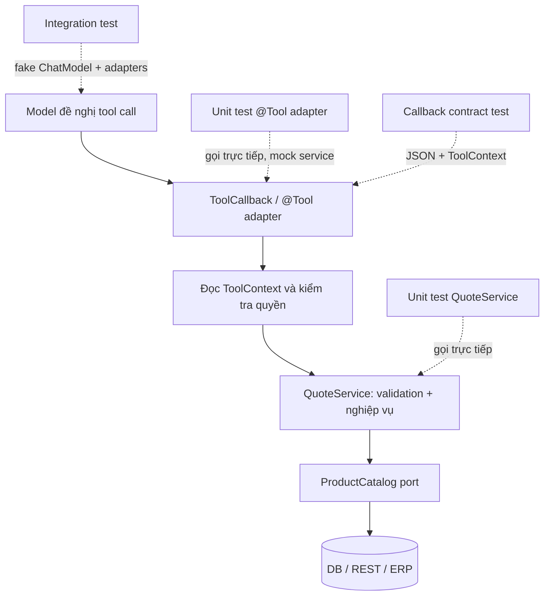
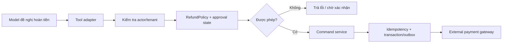

# Unit test logic công cụ tách khỏi mô hình

Trong Spring AI, mô hình ngôn ngữ (LLM) có thể **đề nghị** gọi công cụ, nhưng ứng dụng Java mới là nơi thực thi công cụ và chịu trách nhiệm về dữ liệu, phân quyền, lỗi và tác động nghiệp vụ. Một phương thức được gắn `@Tool` không vì thế mà phải gọi OpenAI, Ollama hoặc một provider khác mới kiểm thử được. Phần logic trong phương thức, service phía dưới và phần lớn hợp đồng của `ToolCallback` đều có thể kiểm thử **cục bộ, xác định và không cần mô hình**.

Bài thuộc chương **Kiểm thử** của module `SPRING_AI_TOOL_CALLING`. Mục tiêu là thiết kế và viết unit test cho tool có `@Tool`, `FunctionToolCallback` hoặc `ToolCallback`; xác minh đầu vào, đầu ra, `ToolContext`, kiểm tra quyền, quy tắc nghiệp vụ và nhánh lỗi mà **không phụ thuộc vào câu trả lời không xác định của LLM**. Những bài toán như mô hình có chọn đúng tool hay không, advisor điều phối nhiều vòng ra sao hoặc provider có trả schema đúng không sẽ được kiểm thử ở cấp tích hợp/e2e riêng.

## 1. Vì sao nên kiểm thử logic tool độc lập với mô hình?

Giả sử người dùng hỏi: “Báo giá ba sản phẩm SKU-17 theo bảng giá của công ty tôi”. Mô hình có thể sinh yêu cầu:

```json
{
  "name": "calculateQuote",
  "arguments": {
    "sku": "SKU-17",
    "quantity": 3
  }
}
```

Phần **chọn tên tool và tạo arguments** thuộc hành vi mô hình. Còn quy tắc “số lượng từ 1 đến 50”, giá của đúng tenant, tiền tệ và phép tính tổng tiền là **logic Java do ứng dụng sở hữu**. Một unit test đúng phải cung cấp sẵn `QuoteRequest("SKU-17", 3)` rồi kiểm tra phép tính mà không chờ model tự tạo request.

| Tiêu chí | Unit test logic tool | Test dựa vào LLM thật |
| --- | --- | --- |
| Đầu vào | Cố định do test tạo | Do model suy luận, có thể thay đổi |
| Mạng/API key | Không cần | Thường cần |
| Tốc độ | Nhanh, chạy trong CI thường xuyên | Chậm hơn, có quota/rate limit |
| Kết quả | Có thể assert chính xác bằng Java | Thường cần kiểm tra ngữ nghĩa |
| Nguyên nhân lỗi | Dễ khoanh vùng service/callback | Có thể do prompt, model, network, tool loop |
| Phạm vi | Logic, validation, authorization, output contract | Lựa chọn tool, sinh arguments, multi-round, groundedness |

**Quy tắc:** chỉ chạy unit test vào phần mình kiểm soát; dùng mock/fake cho dependency bên ngoài. Không gọi `chatClient.prompt().call()` hoặc `ChatModel.call(...)` chỉ để biết một service nhân số lượng với đơn giá có đúng không.

## 2. Ba lớp cần tách khi viết tool



Phân tách theo nguyên tắc dependency hướng vào trong:

1. **Core/service nghiệp vụ:** nhận kiểu Java rõ ràng, validate và tính kết quả; không phụ thuộc `ChatClient` hay cách model sinh JSON.
2. **Tool adapter:** khai báo `@Tool` hoặc dựng `FunctionToolCallback`; lấy actor từ `ToolContext` đáng tin cậy; gọi service; chuẩn hóa lỗi/kết quả cho model.
3. **Orchestration:** `ChatClient`, `ToolCallingAdvisor`, `ToolCallingManager`, memory và vòng gọi model. Để riêng khỏi unit test thuần túy.

Ưu điểm của cấu trúc này: cùng một `QuoteService` có thể phục vụ REST API, batch job và AI tool mà chỉ cần một bộ unit test nghiệp vụ; tool adapter có bộ test mỏng cho security context và contract.

## 3. Ví dụ miền nghiệp vụ tự chứa: tính báo giá

Dùng Java record và interface để biểu diễn yêu cầu, kết quả và cổng lấy giá:

```java
import java.math.BigDecimal;
import java.util.Optional;

public record QuoteRequest(String sku, int quantity) { }

public record Price(BigDecimal unitPrice, String currency) { }

public record QuoteResult(
        String sku,
        int quantity,
        BigDecimal unitPrice,
        BigDecimal total,
        String currency) { }

public interface ProductCatalog {
    Optional<Price> findSellablePrice(String tenantId, String sku);
}
```

Các kiểu `public record` và `public interface` ở trên được minh họa chung cho dễ đọc; trong dự án Java, đặt mỗi top-level `public` type vào file `.java` cùng tên. Nếu gom vào một file thử nghiệm, chỉ để một top-level type `public`.

Service chỉ dùng Java và interface, không gọi model:

```java
import java.math.BigDecimal;

public final class QuoteService {

    private final ProductCatalog catalog;

    public QuoteService(ProductCatalog catalog) {
        this.catalog = catalog;
    }

    public QuoteResult calculate(String tenantId, QuoteRequest request) {
        if (tenantId == null || tenantId.isBlank()) {
            throw new SecurityException("Thiếu tenant đã xác thực");
        }
        if (request == null || request.sku() == null
                || request.sku().isBlank()) {
            throw new IllegalArgumentException("SKU không hợp lệ");
        }
        if (request.quantity() < 1 || request.quantity() > 50) {
            throw new IllegalArgumentException("Số lượng phải từ 1 đến 50");
        }

        Price price = catalog.findSellablePrice(tenantId, request.sku())
                .orElseThrow(() -> new ProductUnavailableException(
                        "Sản phẩm không thể báo giá"));

        if (price.unitPrice() == null || price.unitPrice().signum() < 0
                || price.currency() == null || price.currency().isBlank()) {
            throw new IllegalStateException("Dữ liệu giá nội bộ không hợp lệ");
        }

        BigDecimal total = price.unitPrice()
                .multiply(BigDecimal.valueOf(request.quantity()));

        return new QuoteResult(
                request.sku(), request.quantity(),
                price.unitPrice(), total, price.currency());
    }
}
```

`ProductUnavailableException` là một exception nghiệp vụ do ứng dụng định nghĩa, ví dụ:

```java
public final class ProductUnavailableException extends RuntimeException {
    public ProductUnavailableException(String message) {
        super(message);
    }
}
```

Ví dụ đơn giản này cố ý **chưa** chứa giảm giá, thuế, làm tròn hoặc tỷ giá. Khi thêm các quy tắc đó, viết unit test độc lập cho từng quy tắc và quy ước đơn vị tiền. Dùng `BigDecimal` cho giá tiền; không chuyển qua `double` rồi so sánh bằng sai số ngẫu nhiên.

## 4. Unit test happy path bằng JUnit 5 + Mockito + AssertJ

Các dependency test thường dùng:

```xml
<!-- Trong ứng dụng Spring Boot -->
<dependency>
    <groupId>org.springframework.boot</groupId>
    <artifactId>spring-boot-starter-test</artifactId>
    <scope>test</scope>
</dependency>
```

Starter này thông thường cung cấp JUnit Jupiter, Mockito và AssertJ qua dependency management của Spring Boot. Nếu dự án không dùng Spring Boot, thêm các test libraries tương ứng và chọn version thống nhất.

```java
import static org.assertj.core.api.Assertions.assertThat;
import static org.mockito.Mockito.verify;
import static org.mockito.Mockito.when;

import java.math.BigDecimal;
import java.util.Optional;

import org.junit.jupiter.api.BeforeEach;
import org.junit.jupiter.api.Test;
import org.mockito.Mock;
import org.mockito.MockitoAnnotations;

class QuoteServiceTest {

    @Mock
    private ProductCatalog catalog;

    private AutoCloseable mocks;
    private QuoteService service;

    @BeforeEach
    void setUp() {
        mocks = MockitoAnnotations.openMocks(this);
        service = new QuoteService(catalog);
    }

    @org.junit.jupiter.api.AfterEach
    void tearDown() throws Exception {
        mocks.close();
    }

    @Test
    void calculatesTotalUsingPriceOfAuthenticatedTenant() {
        when(catalog.findSellablePrice("tenant-a", "SKU-17"))
                .thenReturn(Optional.of(
                        new Price(new BigDecimal("125000"), "VND")));

        QuoteResult result = service.calculate(
                "tenant-a", new QuoteRequest("SKU-17", 3));

        assertThat(result.sku()).isEqualTo("SKU-17");
        assertThat(result.quantity()).isEqualTo(3);
        assertThat(result.total()).isEqualByComparingTo("375000");
        assertThat(result.currency()).isEqualTo("VND");

        verify(catalog).findSellablePrice("tenant-a", "SKU-17");
    }
}
```

Trong cùng class có thể thay `MockitoAnnotations.openMocks` bằng `@ExtendWith(MockitoExtension.class)`; không cần kết hợp cả hai. Test trên không có `@SpringBootTest`, không tải Spring context, không khởi tạo `ChatClient` và không gọi provider LLM. Nó kiểm tra chính xác cả **kết quả tính toán** lẫn **tenant được truyền xuống repository**.

## 5. Kiểm thử dữ liệu biên và đường thất bại

Một unit test chỉ có happy path không chứng minh tool đủ an toàn. Đặc biệt, dữ liệu do model sinh là **untrusted input**; tool phải validate ngay cả khi JSON Schema đã mô tả tham số hợp lệ.

### Parameterized test cho số lượng

```java
import static org.assertj.core.api.Assertions.assertThatThrownBy;
import static org.mockito.Mockito.verifyNoInteractions;

import org.junit.jupiter.params.ParameterizedTest;
import org.junit.jupiter.params.provider.ValueSource;

@ParameterizedTest
@ValueSource(ints = {-10, -1, 0, 51, 1000})
void rejectsQuantityOutsideAllowedRange(int quantity) {
    QuoteRequest request = new QuoteRequest("SKU-17", quantity);

    assertThatThrownBy(() -> service.calculate("tenant-a", request))
            .isInstanceOf(IllegalArgumentException.class)
            .hasMessageContaining("Số lượng");

    verifyNoInteractions(catalog);
}
```

Trong ví dụ, phương thức nằm trong class test ở mục 4 và dùng field `service`/`catalog` được setup cho mỗi test. Không để test truyền input sai mà service vẫn truy vấn DB hoặc gọi API trước khi báo validation error.

### Thiếu tenant phải bị từ chối trước I/O

```java
@Test
void rejectsMissingTenantBeforeCatalogLookup() {
    assertThatThrownBy(() ->
            service.calculate("", new QuoteRequest("SKU-17", 1)))
        .isInstanceOf(SecurityException.class);

    verifyNoInteractions(catalog);
}
```

### Không tìm thấy sản phẩm và dữ liệu giá lỗi

```java
@Test
void failsForUnavailableProduct() {
    when(catalog.findSellablePrice("tenant-a", "SKU-404"))
            .thenReturn(Optional.empty());

    assertThatThrownBy(() ->
            service.calculate("tenant-a", new QuoteRequest("SKU-404", 1)))
        .isInstanceOf(ProductUnavailableException.class);

    verify(catalog).findSellablePrice("tenant-a", "SKU-404");
}

@Test
void rejectsNegativePriceFromDependency() {
    when(catalog.findSellablePrice("tenant-a", "SKU-17"))
            .thenReturn(Optional.of(
                    new Price(new BigDecimal("-1"), "VND")));

    assertThatThrownBy(() ->
            service.calculate("tenant-a", new QuoteRequest("SKU-17", 1)))
        .isInstanceOf(IllegalStateException.class);
}
```

Các tình huống nên bổ sung: request `null`, SKU trống/chuỗi trắng, số lượng 1 và 50, dữ liệu đơn giá `null`, đơn vị tiền không hợp lệ, nhiều tenant có cùng SKU nhưng giá khác nhau. Test cần xác định rõ hợp đồng: `IllegalArgumentException` là lỗi request, `ProductUnavailableException` là tình huống nghiệp vụ, `IllegalStateException` là dữ liệu hệ thống bất thường.

## 6. Tách @Tool adapter khỏi nghiệp vụ và kiểm thử trực tiếp

Một method gắn `@Tool` vẫn là phương thức Java bình thường. Nó có thể được gọi trực tiếp trong unit test mà không đi qua ChatClient. Đặt validation và quy tắc tính toán chính trong service, để adapter chỉ làm ba việc: lấy dữ liệu model truyền, xác minh context đáng tin cậy, chuyển sang service.

```java
import org.springframework.ai.chat.model.ToolContext;
import org.springframework.ai.tool.annotation.Tool;
import org.springframework.ai.tool.annotation.ToolParam;

public record AuthenticatedActor(String userId, String tenantId) { }

public final class QuoteTools {

    private final QuoteService quoteService;

    public QuoteTools(QuoteService quoteService) {
        this.quoteService = quoteService;
    }

    @Tool(
            name = "calculateQuote",
            description = "Tính báo giá đọc-only theo bảng giá của người dùng đã xác thực")
    public QuoteResult calculateQuote(
            @ToolParam(description = "SKU và số lượng cần báo giá")
            QuoteRequest request,
            ToolContext toolContext) {

        if (toolContext == null) {
            throw new SecurityException("Thiếu tool context");
        }

        Object value = toolContext.getContext().get("actor");
        if (!(value instanceof AuthenticatedActor actor)
                || actor.tenantId() == null
                || actor.tenantId().isBlank()) {
            throw new SecurityException("Không có danh tính đã xác thực");
        }

        return quoteService.calculate(actor.tenantId(), request);
    }
}
```

`ToolContext` được ứng dụng truyền cho tool tại thời điểm thực thi. Nó không nên lấy danh tính từ JSON arguments do mô hình tự sinh. Spring AI có constructor `new ToolContext(Map<String,Object>)`, thuận tiện để tạo một context tin cậy trong test.

### Test adapter với mock service

```java
import static org.assertj.core.api.Assertions.assertThat;
import static org.assertj.core.api.Assertions.assertThatThrownBy;
import static org.mockito.Mockito.*;

import java.math.BigDecimal;
import java.util.Map;
import org.junit.jupiter.api.Test;
import org.springframework.ai.chat.model.ToolContext;

class QuoteToolsTest {

    private final QuoteService service = mock(QuoteService.class);
    private final QuoteTools tools = new QuoteTools(service);

    @Test
    void obtainsTenantFromToolContextNotFromModelArguments() {
        QuoteRequest request = new QuoteRequest("SKU-17", 2);
        QuoteResult expected = new QuoteResult(
                "SKU-17", 2, new BigDecimal("1000"),
                new BigDecimal("2000"), "VND");
        ToolContext context = new ToolContext(Map.of(
                "actor", new AuthenticatedActor("user-1", "tenant-a")));

        when(service.calculate("tenant-a", request))
                .thenReturn(expected);

        QuoteResult actual = tools.calculateQuote(request, context);

        assertThat(actual).isEqualTo(expected);
        verify(service).calculate("tenant-a", request);
        verifyNoMoreInteractions(service);
    }

    @Test
    void rejectsMissingActorWithoutCallingBusinessService() {
        ToolContext context = new ToolContext(Map.of());

        assertThatThrownBy(() ->
                tools.calculateQuote(new QuoteRequest("SKU-17", 2), context))
            .isInstanceOf(SecurityException.class);

        verifyNoInteractions(service);
    }

    @Test
    void rejectsNullContextWithoutCallingBusinessService() {
        assertThatThrownBy(() ->
                tools.calculateQuote(new QuoteRequest("SKU-17", 1), null))
            .isInstanceOf(SecurityException.class);

        verifyNoInteractions(service);
    }
}
```

Đây là **unit test adapter**, khác với test `QuoteService`: service được mock nên các phép tính không chạy. Vì thế các assertion đúng trọng tâm là actor/tenant, số lần gọi collaborator, dữ liệu chuyển tiếp và từ chối khi thiếu quyền. Ngược lại, test service phải dùng port fake/mock và kiểm tra logic thật.

### Vì sao phải test cả ranh giới quyền?

Một actor thuộc tenant A có thể đưa SKU hoặc order ID của tenant B vào arguments. Adapter chỉ truyền tenant A xuống service; service/repository vẫn phải lọc dữ liệu theo quyền bản ghi. Test adapter chứng minh model **không thể đổi tenant bằng cách tự thêm một field**; test service/repository và integration test tiếp theo chứng minh ranh giới tài nguyên thật sự được áp dụng.

## 7. Kiểm thử FunctionToolCallback mà không gọi ChatModel

Đôi khi tool được khai báo bằng lambda hoặc method reference, chẳng hạn `FunctionToolCallback<I,O>`. Spring AI cung cấp builder nhận một `Function` hoặc `BiFunction<I,ToolContext,O>`; callback thực hiện ba bước: đọc JSON input thành kiểu `I`, gọi function và chuyển kiểu `O` thành chuỗi trả cho model.

Có thể kiểm thử **toàn bộ hợp đồng adapter này** bằng cách gọi `ToolCallback.call(json, context)` trực tiếp. Không cần model tự phát tool call.

```java
import org.springframework.ai.chat.model.ToolContext;
import org.springframework.ai.tool.ToolCallback;
import org.springframework.ai.tool.function.FunctionToolCallback;

ToolCallback callback = FunctionToolCallback.builder(
        "calculateQuote",
        (QuoteRequest request, ToolContext context) ->
                quoteTools.calculateQuote(request, context))
    .description("Tính báo giá cho SKU theo tenant đã xác thực")
    .inputType(QuoteRequest.class)
    .build();
```

Một contract test thực sự gọi JSON:

```java
import static org.assertj.core.api.Assertions.assertThat;
import static org.mockito.Mockito.*;

import java.math.BigDecimal;
import java.util.Map;
import com.fasterxml.jackson.databind.JsonNode;
import com.fasterxml.jackson.databind.ObjectMapper;
import org.junit.jupiter.api.Test;
import org.springframework.ai.chat.model.ToolContext;
import org.springframework.ai.tool.ToolCallback;
import org.springframework.ai.tool.function.FunctionToolCallback;

class QuoteCallbackTest {

    private final ObjectMapper json = new ObjectMapper();
    private final QuoteService service = mock(QuoteService.class);
    private final QuoteTools tools = new QuoteTools(service);

    private ToolCallback callback() {
        return FunctionToolCallback.builder(
                    "calculateQuote",
                    (QuoteRequest input, ToolContext context) ->
                            tools.calculateQuote(input, context))
                .description("Tính báo giá cho SKU")
                .inputType(QuoteRequest.class)
                .build();
    }

    @Test
    void deserializesJsonAndSerializesResult() throws Exception {
        QuoteRequest input = new QuoteRequest("SKU-17", 2);
        when(service.calculate("tenant-a", input)).thenReturn(
                new QuoteResult("SKU-17", 2, new BigDecimal("125000"),
                        new BigDecimal("250000"), "VND"));

        ToolContext context = new ToolContext(Map.of(
                "actor", new AuthenticatedActor("user-1", "tenant-a")));

        String result = callback().call(
                "{\"sku\":\"SKU-17\",\"quantity\":2}", context);
        JsonNode node = json.readTree(result);

        assertThat(node.path("sku").asText()).isEqualTo("SKU-17");
        assertThat(node.path("total").decimalValue())
                .isEqualByComparingTo("250000");
        assertThat(node.path("currency").asText()).isEqualTo("VND");
        verify(service).calculate("tenant-a", input);
    }
}
```

Test này đi qua parser và result converter thật của Spring AI nhưng chỉ dùng **mock business service**. Nó không dùng `ChatClient`, `ChatModel`, provider key hoặc mạng. Với DTO JSON phức tạp, nên assert bằng `JsonNode`/object mapping thay vì so sánh toàn bộ chuỗi JSON vì khoảng trắng, thứ tự field hoặc format số có thể khác giữa serializer versions.

## 8. Kiểm tra input schema, tool name và output contract

`ToolDefinition` là hợp đồng mà model nhìn thấy: `name()`, `description()` và `inputSchema()`. Contract test giúp phát hiện việc refactor tên record hoặc thay annotation làm model không còn biết field đúng.

```java
import static org.assertj.core.api.Assertions.assertThat;
import com.fasterxml.jackson.databind.JsonNode;

@Test
void publishesExpectedToolDefinition() throws Exception {
    ToolCallback tool = callback();

    assertThat(tool.getToolDefinition().name())
            .isEqualTo("calculateQuote");
    assertThat(tool.getToolDefinition().description())
            .contains("báo giá");

    JsonNode schema = json.readTree(
            tool.getToolDefinition().inputSchema());

    assertThat(schema.path("type").asText()).isEqualTo("object");
    assertThat(schema.path("properties").has("sku")).isTrue();
    assertThat(schema.path("properties").has("quantity")).isTrue();
}
```

Ví dụ được đặt trong class `QuoteCallbackTest` ở mục 7. Với một method có hai tham số Java, schema có thể khác schema cho một DTO `QuoteRequest`, dù tên tool giống nhau; hãy kiểm thử chính **API adapter đang công bố**. Đừng assert toàn chuỗi schema theo byte nếu chỉ quan tâm tên field, required/optional và type.

Nếu một field là tùy chọn, có thể dùng `@ToolParam(required = false)` trong method tool. Unit/contract test nên kiểm tra nó không bị đưa sai vào danh sách `required`; ngoài ra phải kiểm thử runtime với trường bị bỏ qua và giá trị `null`. JSON Schema chỉ hướng dẫn model tạo arguments, **không thay thế validation/authorization ở backend**.

### Thay đổi schema phải có chủ đích

Ví dụ đổi `quantity` từ `int` sang `String` làm JSON Schema thay đổi và có thể khiến prompt/tool examples cũ không còn hợp lệ. Duy trì một bộ fixture JSON phiên bản hóa theo contract quan trọng (bắt buộc, optional, enum, thời gian, tiền tệ) và test chúng trước khi phát hành. Những kiểm thử tương thích schema thường thuộc nhóm **contract tests**, không phải kiểm thử hành vi chọn tool của LLM.

## 9. MethodToolCallback cũng có thể test trực tiếp

Khi dùng method tool theo cách lập trình, Spring AI tạo `MethodToolCallback` từ phương thức Java. Thử nghiệm callback cũng không cần `ChatClient`:

```java
import java.lang.reflect.Method;
import java.util.Map;

import org.springframework.ai.chat.model.ToolContext;
import org.springframework.ai.tool.ToolCallback;
import org.springframework.ai.tool.definition.ToolDefinitions;
import org.springframework.ai.tool.method.MethodToolCallback;

QuoteTools tools = new QuoteTools(quoteService);
Method method = QuoteTools.class.getMethod(
        "calculateQuote", QuoteRequest.class, ToolContext.class);

ToolCallback callback = MethodToolCallback.builder()
        .toolDefinition(ToolDefinitions.builder(method).build())
        .toolMethod(method)
        .toolObject(tools)
        .build();

String result = callback.call(
        "{\"request\":{\"sku\":\"SKU-17\",\"quantity\":2}}",
        new ToolContext(Map.of(
                "actor", new AuthenticatedActor("user-1", "tenant-a"))));
```

Đây là mẫu **minh họa contract**: JSON cho method tool ở ví dụ có wrapper parameter tên `request`, trong khi `FunctionToolCallback` với `inputType(QuoteRequest.class)` nhận JSON `sku`/`quantity` ở cấp gốc. Để tránh nhầm, test phải kiểm tra schema thực sự của `callback.getToolDefinition().inputSchema()` rồi tạo fixture JSON phù hợp với schema đó; cách generator đặt tên tham số chịu ảnh hưởng metadata khi biên dịch/annotation.

Nếu một method đã có `@Tool`, cũng có thể chuyển các tool objects thành callbacks qua utility `ToolCallbacks.from(...)` (được Spring AI dùng khi đăng ký POJO vào ChatClient). Dù xây theo cách nào, hãy kiểm tra **đúng entry point mà ứng dụng sẽ công bố**; gọi Java method trực tiếp và gọi callback JSON là hai mức test khác nhau.

**Giới hạn kiểm thử:** test trực tiếp callback chứng minh JSON → Java arguments → service → JSON result trong một invocation. Nó không chứng minh model sẽ chọn tool đúng hoặc `ToolCallingAdvisor` sẽ duy trì history đúng qua nhiều vòng; đó là việc của integration tests.

## 10. Malformed JSON, unknown field và null cần test như đầu vào không tin cậy

Model có thể sinh JSON sai, thiếu trường, sai kiểu hoặc giá trị nằm ngoài ràng buộc. Một tool an toàn cần trả lỗi có kiểm soát mà không truy vấn dữ liệu hoặc tạo side effect trước validation.

| Tình huống đầu vào | Test cần làm rõ |
| --- | --- |
| `{"sku":"SKU-17","quantity":2}` | DTO được parse và service nhận đúng dữ liệu |
| `{"sku":"","quantity":2}` | Validation ở service từ chối, không gọi catalog |
| `{"sku":"SKU-17","quantity":0}` | Quantity rule từ chối |
| Thiếu `quantity` | Với primitive `int`, một số cách parse có thể cho giá trị mặc định 0; service vẫn phải từ chối |
| `"quantity":"abc"` | Deserialization thất bại, business service chưa chạy |
| JSON cắt cụt hoặc không hợp lệ | Callback báo lỗi, không để model-facing response chứa parser stack trace |
| `null`/thiếu `sku` | Không truy vấn catalog với SKU rỗng |
| Field như `"tenantId":"tenant-b"` | Không sử dụng tenant do model thêm để truy cập dữ liệu |
| Extra field không biết | Xác định rõ policy reject hay ignore và test theo parser đã cấu hình |

Ví dụ test malformed JSON cho callback ở mục 7:

```java
@Test
void invalidJsonDoesNotCallBusinessService() {
    ToolContext context = new ToolContext(Map.of(
            "actor", new AuthenticatedActor("user-1", "tenant-a")));

    assertThatThrownBy(() ->
            callback().call("{\"sku\":\"SKU-17\",\"quantity\":", context))
        .isInstanceOf(RuntimeException.class);

    verifyNoInteractions(service);
}
```

Test này chỉ khẳng định contract tổng quát ở cấp callback: lỗi JSON bị từ chối trước khi gọi service. Loại exception chính xác có thể là wrapper `ToolExecutionException` tùy callback/phiên bản; nếu ứng dụng dựa vào error code cụ thể thì nên test thêm `ToolExecutionExceptionProcessor` đã cấu hình thay vì bắt test phải khớp mọi message của Jackson.

**Không nhầm tính hợp lệ của JSON Schema với validation server-side.** Schema dùng để hướng dẫn model tạo arguments và có thể được kiểm tra trước dispatch, nhưng các rule phụ thuộc tenant, resource ownership, quotas hoặc giá trị hiện tại vẫn phải thực thi trong service.

## 11. Test đường lỗi riêng với ToolExecutionExceptionProcessor

Trong Spring AI, khi callback thực thi thất bại, `ToolExecutionException` được đưa tới `ToolExecutionExceptionProcessor`. Processor có thể trả về một chuỗi làm tool response hoặc ném exception lên caller. Khi test logic service, nên assert exception nghiệp vụ trực tiếp; khi test policy tạo thông báo cho model, test processor **riêng**.

Một processor ứng dụng minh họa:

```java
import org.springframework.ai.tool.execution.ToolExecutionException;
import org.springframework.ai.tool.execution.ToolExecutionExceptionProcessor;

public final class SafeToolErrorProcessor
        implements ToolExecutionExceptionProcessor {

    @Override
    public String process(ToolExecutionException exception) {
        if (exception.getCause() instanceof ProductUnavailableException) {
            return "{\"code\":\"PRODUCT_UNAVAILABLE\","
                    + "\"message\":\"Không thể báo giá sản phẩm này.\"}";
        }
        return "{\"code\":\"INTERNAL_ERROR\","
                + "\"message\":\"Không thể hoàn tất yêu cầu.\"}";
    }
}
```

Test không cần manager hoặc mô hình:

```java
import static org.assertj.core.api.Assertions.assertThat;
import org.junit.jupiter.api.Test;
import org.springframework.ai.tool.definition.ToolDefinition;
import org.springframework.ai.tool.execution.ToolExecutionException;

class SafeToolErrorProcessorTest {

    private final SafeToolErrorProcessor processor =
            new SafeToolErrorProcessor();

    private final ToolDefinition definition = ToolDefinition.builder()
            .name("calculateQuote")
            .description("Tính báo giá")
            .inputSchema("{\"type\":\"object\"}")
            .build();

    @Test
    void convertsBusinessErrorToStableCode() {
        var failure = new ToolExecutionException(
                definition, new ProductUnavailableException("hidden details"));

        String result = processor.process(failure);

        assertThat(result).contains("PRODUCT_UNAVAILABLE");
        assertThat(result).doesNotContain("hidden details");
    }

    @Test
    void hidesUnexpectedCauseMessage() {
        var failure = new ToolExecutionException(
                definition, new IllegalStateException(
                        "db.internal:5432 password=secret"));

        String result = processor.process(failure);

        assertThat(result).contains("INTERNAL_ERROR");
        assertThat(result).doesNotContain("db.internal", "password=secret");
    }
}
```

Processor trên chỉ là ví dụ truyền thông báo an toàn. Trong hệ thống thật, một số exception như authorization, lỗi hệ thống nghiêm trọng hoặc lỗi không phù hợp gửi về model phải được **ném lại** thay vì trả string. Cấu hình mặc định của Spring AI có thể chuyển `RuntimeException.getMessage()` về model; muốn bảo vệ dữ liệu nội bộ, nên có processor an toàn và test cả hai lựa chọn **return vs throw**.

Lưu ý unit test processor không chứng minh `DefaultToolCallingManager` đã thực sự gọi processor. Kiểm thử tương tác giữa callback, manager và conversation history thuộc cấp component/integration.

## 12. Test tool có side effect: không nhầm “được gọi” với “đã cam kết”

Một tool đọc như `calculateQuote` thường có thể unit test an toàn bằng mock catalog. Tool ghi như `cancelOrder`, `refundOrder` hoặc `sendEmail` phải được thiết kế sao cho test không gửi tiền, không xóa bản ghi và không phát email thật.

Ví dụ luồng:



Trong unit test, mock `RefundPolicy`, `ApprovalStore`, `RefundCommandPort` để kiểm tra:

- Không call `RefundCommandPort` khi thiếu quyền, hết hạn xác nhận, dữ liệu sai hoặc amount vượt hạn mức.
- Sau một phê duyệt hợp lệ, command được gọi với đúng actor, order ID và amount đã được lưu ở server, không từ field model tự đặt.
- Exception từ command được phân loại đúng; không báo success khi external service timeout.
- Retry cùng action ID phải đi qua idempotency policy; unit test kiểm tra service sử dụng key đúng.

Ví dụ assertion:

```java
@Test
void doesNotIssueRefundWhenApprovalIsMissing() {
    when(approvalStore.find("draft-1")).thenReturn(Optional.empty());

    assertThatThrownBy(() ->
            refundActionService.execute("draft-1", authenticatedActor))
        .isInstanceOf(ApprovalRequiredException.class);

    verifyNoInteractions(refundCommandPort);
}
```

`RefundActionService`, `ApprovalStore`, `RefundCommandPort`, `ApprovalRequiredException` và `authenticatedActor` là fixture/domain API minh họa, không phải lớp Spring AI cung cấp. Bài test này kiểm tra **đường từ chối**; nó không tự chứng minh atomicity của cơ chế idempotency, locking hoặc exactly-once khi hai request chạy đồng thời.

Những thuộc tính như unique constraint của idempotency key, optimistic locking, transaction outbox và phản hồi khi gateway đã commit nhưng response bị mất phải được kiểm chứng bằng integration/concurrency tests với cơ sở dữ liệu và fake server kiểm soát được. **Không dùng mock để chứng minh transaction của database đã thật sự rollback.**

## 13. Làm chủ thời gian, ID và dữ liệu ngẫu nhiên

Unit test phải tạo cùng đầu ra mỗi lần chạy. Những phần sau làm test flaky nếu truy cập trực tiếp nguồn không kiểm soát:

| Nguồn bất định | Cách tách khỏi logic |
| --- | --- |
| `Instant.now()`, `LocalDate.now()` | Inject `Clock` |
| `UUID.randomUUID()` | Inject interface `IdGenerator` |
| Random values | Inject `RandomGenerator` hoặc fixed seed |
| Thời gian chờ mạng | Mock/fake gateway, không gọi mạng |
| Timezone/locale của máy chạy CI | Chỉ định `ZoneId` và `Locale` |
| Tỷ giá hoặc giá sản phẩm hiện hành | Fake `ExchangeRatePort` / `ProductCatalog` |
| Cache thật/DB global | Dùng in-memory fake có state reset theo mỗi test |

Ví dụ policy quy định đơn hàng còn quyền đổi trong 30 ngày kể từ lúc giao:

```java
import java.time.Clock;
import java.time.Instant;
import java.time.temporal.ChronoUnit;

public final class ReturnWindowPolicy {

    private final Clock clock;

    public ReturnWindowPolicy(Clock clock) {
        this.clock = clock;
    }

    public boolean canRequestReturn(Instant deliveredAt) {
        if (deliveredAt == null) {
            return false;
        }
        Instant deadline = deliveredAt.plus(30, ChronoUnit.DAYS);
        return !Instant.now(clock).isAfter(deadline);
    }
}
```

Test hoàn toàn ổn định:

```java
import java.time.Clock;
import java.time.Instant;
import java.time.ZoneOffset;

@Test
void acceptsReturnExactlyAtDeadlineAndRejectsAfterIt() {
    Instant now = Instant.parse("2026-11-27T00:00:00Z");
    Clock clock = Clock.fixed(now, ZoneOffset.UTC);
    ReturnWindowPolicy policy = new ReturnWindowPolicy(clock);

    Instant exactlyThirtyDaysAgo = Instant.parse("2026-10-28T00:00:00Z");
    Instant thirtyDaysAndOneSecondAgo =
            Instant.parse("2026-10-27T23:59:59Z");

    assertThat(policy.canRequestReturn(exactlyThirtyDaysAgo)).isTrue();
    assertThat(policy.canRequestReturn(thirtyDaysAndOneSecondAgo)).isFalse();
}
```

Ví dụ này định nghĩa **30 × 24 giờ** bằng `ChronoUnit.DAYS` trên `Instant`; nếu nghiệp vụ quy định 30 ngày lịch tại múi giờ Việt Nam, cách tính cần dùng `LocalDate`/`ZoneId.of("Asia/Ho_Chi_Minh")` và test cả ngày biên. Không thay đổi ngầm định nghĩa thời gian chỉ để test dễ viết.

## 14. Chọn fake, stub, mock hay spy?

Không phải dependency nào cũng cần Mockito. Một số trường hợp fake in-memory giúp test dễ hiểu và ít phụ thuộc chi tiết triển khai hơn.

| Test double | Ví dụ | Khi phù hợp |
| --- | --- | --- |
| Stub | `catalog.findSellablePrice(...)` trả giá cố định | Cần dựng dữ liệu đầu vào cho một nhánh |
| Mock | `verify(refundCommandPort, never()).refund(...)` | Cần chứng minh collaborator đã/không được gọi |
| Fake | `InMemoryProductCatalog` dùng `Map` theo tenant/SKU | Nhiều case truy vấn dữ liệu, không cần DB thật |
| Spy | Theo dõi một object thật | Chỉ khi bắt buộc; dễ khiến test phụ thuộc implementation |
| Contract fixture | JSON tool arguments + expected schema | Kiểm tra compatibility của adapter |

Ví dụ fake thuần Java:

```java
import java.util.HashMap;
import java.util.Map;
import java.util.Optional;

final class InMemoryProductCatalog implements ProductCatalog {

    private final Map<String, Price> rows = new HashMap<>();

    void put(String tenantId, String sku, Price price) {
        rows.put(tenantId + ":" + sku, price);
    }

    @Override
    public Optional<Price> findSellablePrice(String tenantId, String sku) {
        return Optional.ofNullable(rows.get(tenantId + ":" + sku));
    }
}
```

Test cách ly tenant với fake:

```java
@Test
void usesSeparatePricesForSameSkuInDifferentTenants() {
    var catalog = new InMemoryProductCatalog();
    catalog.put("tenant-a", "SKU-17", new Price(
            new BigDecimal("100"), "VND"));
    catalog.put("tenant-b", "SKU-17", new Price(
            new BigDecimal("300"), "VND"));
    var service = new QuoteService(catalog);

    QuoteResult forA = service.calculate(
            "tenant-a", new QuoteRequest("SKU-17", 2));
    QuoteResult forB = service.calculate(
            "tenant-b", new QuoteRequest("SKU-17", 2));

    assertThat(forA.total()).isEqualByComparingTo("200");
    assertThat(forB.total()).isEqualByComparingTo("600");
}
```

Fake này không thay thế kiểm thử SQL row-level security hoặc cách query thật lọc tenant. Nó chỉ chứng minh service nhận tenant và tính toán trên dữ liệu mà port cung cấp. Nếu cần chứng minh DB chặn cross-tenant ở cấp truy vấn, phải chạy repository integration test.

## 15. Không khởi động toàn bộ Spring context cho unit test

Một unit test logic tool thường không cần:

- `@SpringBootTest` hoặc `@WebFluxTest`.
- Bean `ChatClient`/`ChatModel`.
- API key, model name hoặc token quota.
- Vector database, MCP server, JPA database hoặc Docker.
- Prompt template thật và lời giải ngôn ngữ tự nhiên.

Chỉ cần tạo object Java bằng constructor và cung cấp test doubles ở các ports. Nếu method dùng `@Tool` hoặc `@ToolParam`, annotation không ngăn nó được gọi trực tiếp như Java method.

### Những trường hợp cần Spring test context

Không phải mọi thứ đều nên unit test. Ví dụ khi cần chắc chắn Spring Boot đã wiring đúng `ToolCallbackProvider`, Spring Security filter chain có tác dụng, `@Transactional` thực sự hoạt động hoặc configuration properties bind đúng, hãy dùng integration/slice test có phạm vi phù hợp.

Test dịch vụ nghiệp vụ thuần Java trả lời câu hỏi: **“Luật tính giá này đúng không?”**. Callback contract test trả lời: **“JSON tool input có được chuyển sang đúng Java method và output có đúng schema không?”**. Một integration test với fake model trả lời: **“ToolCallingManager và advisor có dispatch kết quả qua nhiều vòng đúng không?”**. Một e2e test với provider thật mới kiểm tra: **“Mô hình có chọn tool và arguments như mong đợi trong prompt cụ thể không?”**.

## 16. Khi nào cần fake ChatModel và khi nào không?

Test với fake hoặc mock `ChatModel` là bước tiếp theo, **không phải điều kiện của unit test tool logic**. Một fake model có thể phát một `AssistantMessage` chứa tool call cố định, sau đó trả lời ở vòng tiếp; test xác minh `ToolCallingAdvisor` tạo `ToolResponseMessage` đúng ID, gọi callback một lần và chuyển history về model.

```text
Unit: QuoteService.calculate(...)             -> không có Spring AI model
Unit: QuoteTools.calculateQuote(...)           -> không có ChatClient
Contract: ToolCallback.call(json, context)     -> có Spring AI adapter, không có model
Component: Fake ChatModel + ToolCallingAdvisor -> kiểm tra dispatch/history
Integration: JDBC/HTTP/MCP test service        -> kiểm tra dependency thật hoặc fake server
E2E: Provider LLM thật + ChatClient            -> kiểm tra model chọn tool/prompt
```

Trong Spring AI 2.x, `ChatClient` dùng `ToolCallingAdvisor` để điều phối tool loop; `ChatModel.call(...)` trực tiếp chỉ trả raw response có tool calls và không tự chạy callback. Đừng tạo một test dùng `ChatModel` rồi kết luận callback chạy nhờ model; cần kiểm tra chính xác API entry point và người chịu trách nhiệm thực thi.

Với fake model, có thể kiểm tra mỗi bước **deterministically** bằng các câu trả lời mô phỏng, không cần model live. Tuy nhiên, đó là test cho **orchestration**, không nên dùng thay mọi unit test của nghiệp vụ.

## 17. Ma trận kiểm thử tối thiểu cho một tool an toàn

| Nhóm | Tình huống | Assertion chính | Cấp test |
| --- | --- | --- | --- |
| Happy path | SKU hợp lệ, giá thuộc tenant, quantity 2 | Tổng đúng, currency đúng | Service unit |
| Giá trị biên | Quantity 1, 50; 0, 51 | Biên được chấp nhận/từ chối đúng | Service unit |
| Null/missing | SKU rỗng, request null | Dừng trước port I/O | Service unit |
| Quyền | ToolContext thiếu actor | Từ chối, service không được gọi | Adapter unit |
| Tenant | Actor A truy vấn SKU chung | Chỉ truy cập qua tenant A | Adapter/service unit |
| Dữ liệu lỗi | Giá âm, sản phẩm không có | Đúng error type/code | Service unit |
| JSON | JSON sai cấu trúc | Callback không gọi service | Callback contract |
| Schema | Đổi tên field hoặc required flag | Schema test phát hiện drift | Callback contract |
| Serialization | Output record | JSON result chứa giá trị chính xác | Callback contract |
| Error processor | Exception chứa thông tin nội bộ | Response an toàn, không rò secrets | Processor unit |
| Side effect | Chưa approved | Không gọi command port | Service unit |
| Idempotency | Retry cùng action | Không thực hiện lại | Unit + integration |
| Concurrency | Hai approve cùng lúc | Chỉ một transaction/command hợp lệ | Integration |
| History | Batch nhiều tool calls | IDs và thứ tự results đúng | Fake-model component |
| Prompt/tool choice | Model sinh đúng tool | Chất lượng qua bộ dataset | E2E/evaluation |

Không cần triển khai mọi nhánh trong một class 1.000 dòng. Chia theo đơn vị chịu trách nhiệm như `QuoteServiceTest`, `QuoteToolsTest`, `QuoteCallbackTest`, `SafeToolErrorProcessorTest` và những component/integration tests riêng. Như vậy khi một test fail, có thể tìm đúng tầng cần sửa.

## 18. Những sai lầm thường làm unit test tool kém giá trị

| Sai lầm | Vấn đề | Cách sửa |
| --- | --- | --- |
| Chạy LLM thật để kiểm tra phép tính | Chậm, flaky và không khoanh vùng lỗi | Test service trực tiếp với input cố định |
| Mock luôn chính service cần kiểm thử | Không còn logic thật nào chạy | Mock dependency port, không mock SUT |
| Chỉ kiểm tra `assertNotNull(result)` | Không phát hiện sai tổng tiền/tenant | Assert field/giá trị/hành vi collaborator |
| Assert cả JSON raw theo thứ tự trường | Dễ fail vô nghĩa do serialization | Parse JSON thành `JsonNode`/DTO |
| Tin JSON Schema đã bảo vệ nghiệp vụ | Schema chỉ mô tả đầu vào, không biết quyền | Validate tại service/transaction |
| Lấy tenant từ request của model | Có thể truy vấn sai tài khoản | Lấy từ `ToolContext` đã xác thực |
| Gọi API live ngay trong unit test | Phụ thuộc mạng/quota/secrets | Mock/fake gateway; integration test riêng |
| Dùng `LocalDate.now()`/random không cố định | Fail theo thời gian/múi giờ | Inject `Clock`/ID generator |
| Assert message của Jackson/driver | Dễ thay khi nâng version | Test error code và an toàn thông báo |
| Dùng mock để “chứng minh” transaction | Mock không tạo transaction thật | Integration test database |
| Không test side-effect negative path | Tool có thể thực thi khi chưa có quyền | `verifyNoInteractions(commandPort)` |
| Khởi động Spring context cho mọi case | CI nặng, khó debug | Java unit test với constructor injection |

## 19. Quy trình thêm một tool mới vào CI

1. Xác định DTO và quy tắc nghiệp vụ mà không phụ thuộc LLM.
2. Tách repository, HTTP/MCP clients, clock và side-effect gateway thành interfaces/ports.
3. Viết unit tests cho happy path, edge cases, lỗi nghiệp vụ và permission boundary.
4. Tạo `@Tool` hoặc `FunctionToolCallback` như adapter mỏng; test trực tiếp với context thật do test tạo.
5. Thêm contract test cho `ToolDefinition` (name, description, input schema) và `call(json, ToolContext)`.
6. Test exception mapping để model chỉ nhận thông báo an toàn.
7. Với tool ghi, test deny/approval/idempotency ở service và dành transaction/concurrency cho integration test.
8. Ở bước kế tiếp, dùng fake model để xác minh dispatch và history; chỉ sau đó chạy evaluation trên LLM thật nếu cần.
9. Duy trì fixture có version khi schema hoặc mã lỗi thay đổi.
10. Chạy unit suite trong CI cho mọi thay đổi code; tách test phụ thuộc mạng/LLM ở pipeline phù hợp.

**Kết luận:** mô hình chỉ đề nghị thực hiện một hành động; phần tính toán, quyền truy cập và side effect phải thuộc hệ thống Java. Vì vậy, unit test chất lượng nhất cho một tool là bài test **không cần mô hình**: đưa input rõ ràng vào service/adapter, kiểm tra output và các tương tác, xác minh đầu vào sai bị từ chối và không có thao tác ngoài ý muốn. Khi đã bảo đảm lớp này đúng, nhóm phát triển mới dùng fake model, integration test và LLM evaluation để kiểm tra chất lượng điều phối nhiều vòng của Spring AI.

## Tài liệu tham khảo

- [Spring AI 2.1 — Tool Calling: định nghĩa, JSON schema, context và errors](https://docs.spring.io/spring-ai/reference/api/tools.html)
- [Spring AI 2.1 — ChatModel Tool Calling và manual tool loop](https://docs.spring.io/spring-ai/reference/api/tools/chatmodel-tool-calling.html)
- [Spring AI — ToolCallback API](https://docs.spring.io/spring-ai/docs/2.1.x/api/org/springframework/ai/tool/ToolCallback.html)
- [Spring AI — MethodToolCallback API](https://docs.spring.io/spring-ai/docs/2.1.x/api/org/springframework/ai/tool/method/MethodToolCallback.html)
- [Spring AI — FunctionToolCallback API](https://docs.spring.io/spring-ai/docs/2.1.x/api/org/springframework/ai/tool/function/FunctionToolCallback.html)
- [Spring AI — ToolContext API](https://docs.spring.io/spring-ai/docs/2.1.0-M1/api/org/springframework/ai/chat/model/ToolContext.html)
- [JUnit 5 — User Guide](https://junit.org/junit5/docs/current/user-guide/)
- [Mockito — Reference](https://site.mockito.org/)
- [AssertJ — Fluent assertions](https://assertj.github.io/doc/)
