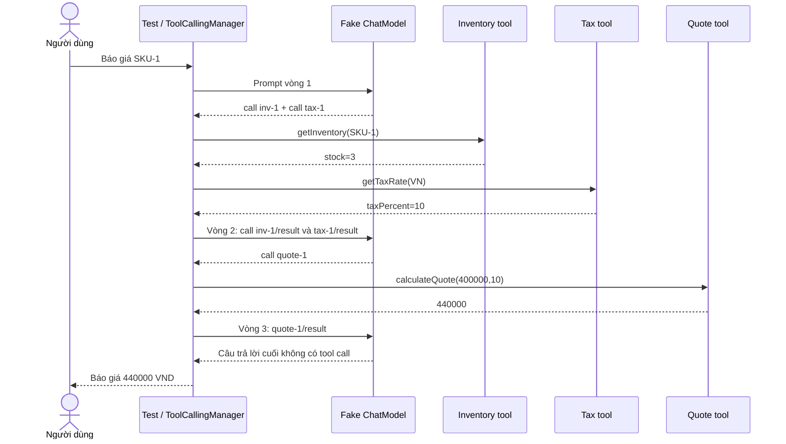

# Kiểm thử chuỗi nhiều vòng và nhiều tool call trong cùng phản hồi

Một lời gọi `ChatClient.call()` nhìn bên ngoài có vẻ đơn giản: người dùng hỏi, trợ lý trả lời. Nhưng ở bên trong, Spring AI có thể gọi mô hình nhiều lần. Trong mỗi phản hồi, mô hình có thể đề xuất **nhiều tool call đồng thời về mặt giao thức**, ứng dụng thực thi tất cả rồi gửi kết quả của từng call trở lại mô hình. Nếu chỉ kiểm thử câu trả lời cuối, chúng ta có thể bỏ sót lỗi rất nghiêm trọng: một tool bị gọi hai lần, kết quả gắn nhầm ID, lịch sử thiếu một trong hai kết quả, hoặc một vòng gọi tiếp theo không nhận được dữ liệu của vòng trước.

Bài này hướng dẫn kiểm thử deterministic cho module `SPRING_AI_TOOL_CALLING` bằng JUnit 5, Mockito và các API Spring AI 2.1.0: `@Tool`, `ToolCallback`, `ToolCallingChatOptions`, `ToolCallingManager`, `ToolExecutionResult`, `ChatModel` và `ChatClient`. Trọng tâm là **nhiều vòng model–tool** và **nhiều tool call trong một `AssistantMessage`**. Ví dụ không cần API key hay kết nối mô hình thật; mỗi vòng model được kịch bản hóa để kiểm tra chính xác những gì xảy ra.

## Mục tiêu và ranh giới của kiểm thử

Trong Spring AI 2.1.0, `ChatModel.call(prompt)` trả phản hồi **thô** của mô hình và không tự chạy callback. `ChatClient` có `ToolCallingAdvisor` quản lý vòng lặp; `ToolCallingManager` tìm callback, thực thi và tạo `ToolExecutionResult`. Vì vậy cần kiểm thử ít nhất ba lớp:

| Lớp | Cần chứng minh | Cách kiểm thử |
|---|---|---|
| Tool/service | Arguments được parse, validate, kiểm tra quyền và xử lý đúng | Unit test phương thức, callback, service |
| Tool execution | Một phản hồi chứa N tool call tạo đúng N tool result với ID/name tương ứng | Dùng `ToolCallingManager` thật, callback giả/đơn giản |
| Toàn vòng hội thoại | Model được gọi lại với lịch sử đầy đủ, có thể có nhiều vòng và kết thúc đúng lúc | Fake/mock `ChatModel` trả các phản hồi định trước; kiểm tra prompt của từng vòng |

Không nên dùng cùng một kiểm thử để vừa kiểm tra chất lượng hiểu ngôn ngữ của mô hình thật, vừa kiểm tra logic thực thi trong Java. Khi provider chạy thật, mô hình có thể đổi cách diễn đạt, thứ tự hay số tool call khiến test flaky. Integration test đối với provider thật là lớp bổ sung, không thay thế bộ test deterministic chạy trong CI.

## Bất biến phải kiểm tra qua mỗi vòng

Một vòng có tool call phải tuân thủ:

1. `AssistantMessage.ToolCall` có `id`, `name` và `arguments`.
2. Mỗi tool call được thực thi theo đúng callback đang được phép trong request.
3. `ToolResponseMessage.ToolResponse` giữ lại `id` và `name` của call tương ứng.
4. Không làm mất hoặc trộn JSON arguments giữa nhiều call trong cùng phản hồi.
5. Khi batch hoàn tất, lịch sử được bổ sung **assistant message chứa các tool calls trước**, **tool response message chứa kết quả sau**.
6. `ToolExecutionResult.conversationHistory()` được đưa nguyên vẹn vào prompt kế tiếp; không biến tool result thành một `UserMessage` mới.
7. Vòng dừng khi `ChatResponse.hasToolCalls()` là false, hoặc khi điều kiện dừng được phép như `returnDirect`, confirmation hoặc giới hạn tool call xảy ra.
8. Không có side effect nào bị thực thi trùng vì gọi manager hoặc advisor hai lần.

Với một phản hồi chứa nhiều tool call, **“nhiều” không nhất thiết là “thực thi song song”**. API công khai không hứa manager chạy song song; `DefaultToolCallingManager` hiện thực thi từng call theo thứ tự. Test nên tập trung vào tính đúng của ID, dữ liệu, số lần gọi và kết quả, không viết assertion về concurrency nếu chưa có custom orchestrator.

## Kịch bản kiểm thử xuyên ba lượt mô hình

Cho yêu cầu: “Kiểm tra tồn kho và thuế rồi báo giá cho SKU-1”.



Lưu ý vòng 1 chứa **hai** tool call trong cùng một assistant response. Đến vòng 2, mô hình chỉ được đề xuất `calculateQuote` sau khi đã “nhìn thấy” đúng cả hai kết quả của vòng 1. Vòng 3 phải nhận đủ lịch sử của hai vòng tool trước và trả phản hồi cuối không còn lời gọi công cụ.

| Vòng model | Phản hồi của mô hình | Callback thực thi | Message mới phải xuất hiện trong prompt kế tiếp |
|---|---|---|---|
| 1 | `inv-1: getInventory`, `tax-1: getTaxRate` | 2 callback | Assistant có 2 calls + ToolResponseMessage có 2 responses |
| 2 | `quote-1: calculateQuote` | 1 callback | Assistant có 1 call + ToolResponseMessage có 1 response |
| 3 | Văn bản cuối | Không | Không có vòng 4 |

Test phải kiểm tra cả **số lần gọi model**, **số lần gọi từng callback** và **đúng call ID trên từng result**. Chỉ kiểm tra câu cuối có chứa “440000” chưa đủ.

## Tạo fixtures ChatResponse có tool call chính xác

Để không phụ thuộc provider, tạo `ChatResponse` từ `AssistantMessage` và `Generation`. Spring AI 2.1.0 cung cấp record:

```java
new AssistantMessage.ToolCall(
        "inv-1", "function", "getInventory",
        "{\"sku\":\"SKU-1\"}");
```

Thứ tự record fields là `(id, type, name, arguments)`. Không đặt nhầm `type` với `name`. Tool call ID phải khác nhau ngay cả khi cùng một tên tool được gọi nhiều lần trong batch.

Các helper dùng lại trong test:

```java
private static AssistantMessage.ToolCall call(
        String id, String name, String jsonArguments) {
    return new AssistantMessage.ToolCall(
            id, "function", name, jsonArguments);
}

private static ChatResponse toolReply(
        AssistantMessage.ToolCall... calls) {
    AssistantMessage output = AssistantMessage.builder()
            .toolCalls(List.of(calls))
            .build();
    return new ChatResponse(List.of(new Generation(output)));
}

private static ChatResponse textReply(String text) {
    return new ChatResponse(List.of(
            new Generation(new AssistantMessage(text))));
}
```

`ChatResponse.hasToolCalls()` dựa trên các tool calls hoàn chỉnh trong `AssistantMessage`; các `ToolCallPart` partial dùng cho streaming không được tính. Khi dựng fixture nhiều call, nên đặt cả hai vào **một** `AssistantMessage`, không tạo hai `ChatResponse` rồi tưởng rằng đó là một batch.

## Callback thật nhưng backend giả

Có thể tạo object Java có `@Tool` để manager chạy chính logic chuyển arguments thành invocation. Dùng counter để xác minh không gọi thừa:

```java
public static final class PricingTools {

    final AtomicInteger inventoryCalls = new AtomicInteger();
    final AtomicInteger taxCalls = new AtomicInteger();
    final AtomicInteger quoteCalls = new AtomicInteger();

    @Tool(description = "Kiểm tra tồn kho theo SKU")
    public String getInventory(
            @ToolParam(description = "Mã SKU") String sku) {
        inventoryCalls.incrementAndGet();
        if (!"SKU-1".equals(sku)) {
            throw new IllegalArgumentException("SKU không hợp lệ");
        }
        return "stock=3";
    }

    @Tool(description = "Tra thuế theo mã quốc gia")
    public String getTaxRate(
            @ToolParam(description = "Quốc gia") String country) {
        taxCalls.incrementAndGet();
        return "taxPercent=10";
    }

    @Tool(description = "Tính báo giá theo đơn vị tiền tệ nhỏ nhất")
    public long calculateQuote(
            @ToolParam(description = "Giá gốc") long priceMinor,
            @ToolParam(description = "Phần trăm thuế") int taxPercent) {
        quoteCalls.incrementAndGet();
        return priceMinor + priceMinor * taxPercent / 100;
    }
}
```

Chuyển các phương thức này thành callbacks:

```java
PricingTools tools = new PricingTools();
ToolCallback[] callbacks = ToolCallbacks.from(tools);

ToolCallingChatOptions options = ToolCallingChatOptions.builder()
        .toolCallbacks(callbacks)
        .build();

ToolCallingManager manager = ToolCallingManager.builder().build();
```

Không cần chạy Spring container, provider HTTP hoặc database để test vòng cơ bản. Các callback Java là thật, nhưng nghiệp vụ ở dạng deterministic. Với production tool thật, mock hoặc fake chính **service phía sau callback** để không ghi dữ liệu/đặt hàng/gửi tiền trong test.

## Kiểm tra một cặp tool call/result theo ID

Spring AI trả danh sách `Message` trong `ToolExecutionResult.conversationHistory()`. Mỗi `ToolResponseMessage` chứa các `ToolResponse` tương ứng với tool calls của **một vòng**:

```java
static List<ToolResponseMessage> toolMessages(Prompt prompt) {
    return prompt.getInstructions().stream()
            .filter(ToolResponseMessage.class::isInstance)
            .map(ToolResponseMessage.class::cast)
            .toList();
}

static void assertBatch(
        ToolResponseMessage toolMessage,
        String... expectedCallIds) {

    assertThat(toolMessage.getResponses())
            .extracting(ToolResponseMessage.ToolResponse::id)
            .containsExactly(expectedCallIds);
}
```

Kiểm tra ID là cần thiết nhưng chưa đủ: cũng kiểm tra `ToolResponse.name()` và dữ liệu `responseData()`. Hai công cụ khác nhau có thể trả cùng text như `"ok"`, khiến test chỉ kiểm tra nội dung không phát hiện việc gắn nhầm response.

Một số provider có thể yêu cầu thứ tự tool results đúng thứ tự call ban đầu. `DefaultToolCallingManager` dựng kết quả theo danh sách call; với custom manager có concurrency, cần giữ **thứ tự hiển thị phản hồi** theo thứ tự gốc ngay cả khi future hoàn thành khác nhau.

## Test đầy đủ: ba vòng, hai tool call trong phản hồi đầu

Ví dụ JUnit 5 dưới đây kết hợp các helper và `PricingTools` ở trên. `ChatModel` là mock Mockito trả lời theo một kịch bản cố định; `ToolCallingManager` và `ToolCallback` là thật. Không cần nhà cung cấp LLM. Những kiểm tra trong mỗi nhánh `thenAnswer` giúp bắt lỗi **tại vòng model nhận dữ liệu**, không chờ đến khi có câu trả lời cuối:

```java
@Test
void threeRoundsWithTwoCallsInTheSameFirstReply() {
    PricingTools tools = new PricingTools();
    ToolCallingChatOptions options = ToolCallingChatOptions.builder()
            .toolCallbacks(ToolCallbacks.from(tools))
            .build();

    ToolCallingManager manager = ToolCallingManager.builder().build();
    ChatModel model = mock(ChatModel.class);
    AtomicInteger modelRounds = new AtomicInteger();

    when(model.call(any(Prompt.class))).thenAnswer(invocation -> {
        Prompt received = invocation.getArgument(0);
        int round = modelRounds.incrementAndGet();

        if (round == 1) {
            // CÙNG MỘT AssistantMessage có HAI tool calls.
            assertThat(toolMessages(received)).isEmpty();
            return toolReply(
                    call("inv-1", "getInventory",
                            "{\"sku\":\"SKU-1\"}"),
                    call("tax-1", "getTaxRate",
                            "{\"country\":\"VN\"}"));
        }

        if (round == 2) {
            // Model phải nhìn thấy đủ hai tool results trước khi tính giá.
            List<Message> history = received.getInstructions();
            List<ToolResponseMessage> results = toolMessages(received);
            assertThat(results).hasSize(1);

            ToolResponseMessage firstBatch = results.get(0);
            assertBatch(firstBatch, "inv-1", "tax-1");
            assertThat(firstBatch.getResponses())
                    .extracting(ToolResponseMessage.ToolResponse::name)
                    .containsExactly("getInventory", "getTaxRate");
            assertThat(firstBatch.getResponses().get(0).responseData())
                    .contains("stock=3");
            assertThat(firstBatch.getResponses().get(1).responseData())
                    .contains("taxPercent=10");

            int lastIndex = history.indexOf(firstBatch);
            assertThat(lastIndex).isGreaterThan(0);
            assertThat(history.get(lastIndex - 1))
                    .isInstanceOf(AssistantMessage.class);
            AssistantMessage originalRequest =
                    (AssistantMessage) history.get(lastIndex - 1);
            assertThat(originalRequest.getToolCalls())
                    .extracting(AssistantMessage.ToolCall::id)
                    .containsExactly("inv-1", "tax-1");

            return toolReply(
                    call("quote-1", "calculateQuote",
                            "{\"priceMinor\":400000,\"taxPercent\":10}"));
        }

        if (round == 3) {
            // Model nhận kết quả của CẢ HAI vòng tool trước đó.
            List<ToolResponseMessage> results = toolMessages(received);
            assertThat(results).hasSize(2);
            assertBatch(results.get(0), "inv-1", "tax-1");
            assertBatch(results.get(1), "quote-1");
            assertThat(results.get(1).getResponses().get(0).responseData())
                    .contains("440000");
            return textReply("Báo giá 440000 VND.");
        }

        throw new AssertionError("Model bị gọi quá số vòng dự kiến: "
                + round);
    });

    Prompt prompt = new Prompt("Tính báo giá cho SKU-1", options);
    ChatResponse response = model.call(prompt);
    int toolRounds = 0;

    while (response.hasToolCalls()) {
        assertThat(++toolRounds).isLessThanOrEqualTo(2);

        ToolExecutionResult execution =
                manager.executeToolCalls(prompt, response);
        assertThat(execution.returnDirect()).isFalse();

        prompt = new Prompt(execution.conversationHistory(), options);
        response = model.call(prompt);
    }

    assertThat(response.getResult().getOutput().getText())
            .isEqualTo("Báo giá 440000 VND.");
    assertThat(toolRounds).isEqualTo(2);
    assertThat(modelRounds.get()).isEqualTo(3);
    assertThat(tools.inventoryCalls.get()).isEqualTo(1);
    assertThat(tools.taxCalls.get()).isEqualTo(1);
    assertThat(tools.quoteCalls.get()).isEqualTo(1);
    verify(model, times(3)).call(any(Prompt.class));
}
```

Các import thường dùng trong test gồm `org.junit.jupiter.api.Test`, `org.mockito.Mockito.*`, `org.mockito.ArgumentMatchers.any`, `org.assertj.core.api.Assertions.assertThat`, `org.springframework.ai.chat.messages.*`, `org.springframework.ai.chat.model.*`, `org.springframework.ai.chat.prompt.Prompt`, `org.springframework.ai.model.tool.*`, `org.springframework.ai.tool.ToolCallbacks`, `org.springframework.ai.tool.annotation.Tool`, `org.springframework.ai.tool.annotation.ToolParam` cùng `java.util.List` và `java.util.concurrent.atomic.AtomicInteger`.

Để demo gọn, test chạy bằng vòng thủ công ngay trong phương thức kiểm thử. Ứng dụng production nên đóng gói vòng đó thành service và test service bằng fake model/callback. Không viết lại `ToolCallingManager` trong test; dùng implementation thật để kiểm tra việc ánh xạ arguments, chọn callback và tạo tool response.

### Vì sao test này có giá trị hơn chỉ so sánh câu trả lời?

- Phản hồi round 1 chỉ được tạo **một lần** và chứa cả `inv-1` và `tax-1`.
- Cả hai callback phải được gọi đúng một lần với arguments chính xác.
- Round 2 phải nhận một `ToolResponseMessage` có **hai** response, không phải mất một hoặc gộp ID.
- Assistant message chứa yêu cầu gọi tool phải đứng trước tool response trong lịch sử.
- Round 3 phải giữ tiếp cả hai kết quả của round 1 và kết quả `quote-1` ở round 2.
- Sau phản hồi text của round 3 không có vòng 4 và không có callback nào bị gọi thêm.

Với lỗi “quên thêm một kết quả”, assertion ở round 2 sẽ fail ngay. Với lỗi “lặp vòng”, nhánh cuối ném `AssertionError` thay vì treo test. Với lỗi “gọi nhầm tool”, counter và ID/name assertions sẽ fail.

## Test ChatClient: xác minh ToolCallingAdvisor tự điều phối

Test thủ công ở trên chứng minh `ToolCallingManager` và logic quản lý history. Để kiểm tra `ChatClient` dùng `ToolCallingAdvisor` tự đăng ký, nên có test bổ sung theo đúng API mà controller sử dụng.

Một test khung:

```java
@Test
void chatClientRunsMultipleRoundsAutomatically() {
    PricingTools tools = new PricingTools();
    ChatModel model = mock(ChatModel.class);

    when(model.call(any(Prompt.class))).thenReturn(
            toolReply(
                    call("inv-1", "getInventory",
                            "{\"sku\":\"SKU-1\"}"),
                    call("tax-1", "getTaxRate",
                            "{\"country\":\"VN\"}")),
            toolReply(call("quote-1", "calculateQuote",
                    "{\"priceMinor\":400000,\"taxPercent\":10}")),
            textReply("Báo giá 440000 VND."));

    ChatClient client = ChatClient.builder(model).build();
    String answer = client.prompt()
            .user("Tính báo giá SKU-1")
            .tools(tools)
            .call()
            .content();

    assertThat(answer).isEqualTo("Báo giá 440000 VND.");
    assertThat(tools.inventoryCalls.get()).isEqualTo(1);
    assertThat(tools.taxCalls.get()).isEqualTo(1);
    assertThat(tools.quoteCalls.get()).isEqualTo(1);
    verify(model, times(3)).call(any(Prompt.class));
}
```

Ở Spring AI 2.1.0, `ChatClient` tự gắn `ToolCallingAdvisor`; `ChatModel` mock trả về phản hồi thô và advisor phải thực hiện callback thật. Nếu test trên trả lời cuối nhưng không đụng callback, hãy kiểm tra advisor có bị tắt qua `AdvisorParams.toolCallingAdvisorAutoRegister(false)` hoặc property `spring.ai.chat.client.tool-calling.enabled=false` không.

Nên mở rộng test này bằng `ArgumentCaptor<Prompt>` để kiểm tra prompt mà model nhận ở lần thứ hai, thứ ba. Khi dùng memory advisor, cần phân biệt lịch sử quản lý bên trong `ToolCallingAdvisor` với lịch sử bên ngoài, tránh assert một số message cố định không còn đúng sau khi framework thêm system/session messages.

## Nhiều tool call trong cùng phản hồi: kiểm tra theo ID, không chỉ tên

Đôi khi cùng một tool được gọi hai lần với đối số khác nhau. Ví dụ mô hình hỏi tồn kho cả `SKU-1` và `SKU-2`:

```text
AssistantMessage:
    call-a -> getInventory({"sku":"SKU-1"})
    call-b -> getInventory({"sku":"SKU-2"})

ToolResponseMessage:
    call-a -> stock(SKU-1)=3
    call-b -> stock(SKU-2)=0
```

Không được dùng tool name làm key duy nhất; hai call cùng tên nhưng khác ID. Để test chính xác, service giả nên trả lại SKU trong kết quả, không chỉ `"ok"`. Kiểm tra map:

```java
Map<String, String> byCallId = resultMessage.getResponses().stream()
        .collect(Collectors.toMap(
                ToolResponseMessage.ToolResponse::id,
                ToolResponseMessage.ToolResponse::responseData));

assertThat(byCallId).containsOnlyKeys("call-a", "call-b");
assertThat(byCallId.get("call-a")).contains("SKU-1");
assertThat(byCallId.get("call-b")).contains("SKU-2");
```

`resultMessage` là `ToolResponseMessage` của batch. Một test tốt còn kiểm tra ID không trùng, đúng tên tool, không mất metadata cần thiết và `AssistantMessage.getToolCalls()` có cùng thứ tự. Với callback bất đồng bộ tùy chỉnh, có thể chủ động cho `call-b` hoàn thành trước `call-a` rồi xác minh response vẫn được gắn đúng ID và trả theo thứ tự giao thức.

## Những câu hỏi test cần trả lời về số vòng

Đếm rõ hai đại lượng:

- **Model rounds:** số lần gọi `ChatModel.call` hoặc số stream response hoàn chỉnh.
- **Tool calls:** tổng số `AssistantMessage.ToolCall` yêu cầu thực thi trong các rounds.

Ví dụ kịch bản ở trên có **3 model rounds và 3 tool calls** nhưng chỉ **2 tool-execution rounds**. Nếu chỉ đếm callback để suy ra số model rounds thì dễ báo sai.

Một response có thể chứa 0, 1 hoặc nhiều tool calls. Trong mỗi round, manager chỉ nên chạy một lần cho response hoàn chỉnh. Khi mô hình đã trả text cuối cùng, không còn lý do gọi manager.

Tổng số tool calls của một turn phải tuân giới hạn manager (mặc định 40 lần mỗi tool, 150 tổng). Đây là giới hạn **theo số call**, không phải giới hạn số vòng model. Ứng dụng còn cần `maxModelRounds`/deadline riêng nếu muốn bảo vệ một chuỗi nhiều model rounds nhưng ít hoặc không có tool call.

## Kiểm thử returnDirect với nhiều tool cùng lúc

`returnDirect` chỉ được bật cho toàn bộ `ToolExecutionResult` nếu **tất cả** tool được thực thi trong batch đều có `ToolMetadata.returnDirect = true`. Việc một call có cờ này không đủ để dừng vòng khi một call khác còn cần kết quả được đưa về mô hình.

| Batch | Kỳ vọng `returnDirect()` | Kỳ vọng gọi model tiếp |
|---|---|---|
| Một tool thường, direct=false | false | Có |
| Một tool direct=true | true | Không |
| Hai tool đều direct=true | true | Không |
| Một direct=true, một direct=false | false | Có |
| Hai tool, một bị deny khi confirmation | false | Thường tiếp tục để model biết call bị từ chối |

Ví dụ cấu hình callback dạng programmatic:

```java
ToolMetadata directMetadata = ToolMetadata.builder()
        .returnDirect(true)
        .build();

ToolCallback directLookup = FunctionToolCallback
        .builder("lookupCachedReport", reportService::lookup)
        .description("Lấy báo cáo đã xử lý sẵn")
        .inputType(ReportRequest.class)
        .toolMetadata(directMetadata)
        .build();
```

`ReportRequest` và `reportService` là thành phần minh họa. Test tạo hai callback có metadata tương ứng, dựng response chứa cả hai call rồi gọi manager:

```java
ToolExecutionResult execution =
        manager.executeToolCalls(prompt, toolReply(
                call("d-1", "lookupCachedReport", "{\"id\":\"R1\"}"),
                call("d-2", "lookupOrder", "{\"orderId\":\"ORD-1\"}")));

assertThat(execution.returnDirect()).isFalse();
```

Test riêng trường hợp cả hai callback đều direct phải assert `true` và không có lần gọi model thứ hai. Khi return direct, dùng `ToolExecutionResult.buildGenerations(execution)` nếu cần dựng response gửi caller; đừng giả định có một assistant text response cuối do model tạo.

## Kiểm thử confirmation: toàn batch tạm dừng

Với một phản hồi có cả tool đọc thông thường và tool nhạy cảm yêu cầu xác nhận, Spring AI 2.1.0 thực hiện **preflight cả batch**. Nếu một call cần duyệt mà chưa có quyết định, `ToolCallingManager` ném `ToolCallConfirmationRequiredException` trước khi chạy bất kỳ callback nào.

Ví dụ mô hình yêu cầu:

```text
AssistantMessage
  call-read: lookupOrder({"orderId":"ORD-2048"})
  call-write: cancelOrder({"orderId":"ORD-2048"})
```

Test phải chứng minh:

1. Khi gọi `executeToolCalls(prompt, response)` lần đầu, exception báo cần confirmation xuất hiện.
2. Counter của cả tool đọc **và** tool ghi vẫn bằng 0.
3. Khi resume, phải có một `ToolCallDecision` cho **mỗi** call trong response, không chỉ call bị policy gắn cờ.
4. Nếu người duyệt deny `call-write`, callback ghi không được chạy và tool response vẫn chứa kết quả từ chối tương ứng với call ID.
5. Nếu người duyệt allow call ghi, authorization và trạng thái tài nguyên vẫn phải được service kiểm tra lại.

Một ví dụ test khung:

```java
ChatResponse pending = toolReply(
        call("call-read", "lookupOrder",
                "{\"orderId\":\"ORD-2048\"}"),
        call("call-write", "cancelOrder",
                "{\"orderId\":\"ORD-2048\"}"));

assertThatThrownBy(() -> manager.executeToolCalls(prompt, pending))
        .isInstanceOf(ToolCallConfirmationRequiredException.class);

assertThat(readCount.get()).isZero();
assertThat(writeCount.get()).isZero();

ToolCallDecisions decisions = ToolCallDecisions.of(
        ToolCallDecision.allow("call-read"),
        ToolCallDecision.deny("call-write", "Người dùng không chấp thuận."));

ToolExecutionResult resumed =
        manager.executeToolCalls(prompt, pending, decisions);

assertThat(readCount.get()).isEqualTo(1);
assertThat(writeCount.get()).isZero();
```

Ví dụ giả định callback `cancelOrder` được cấu hình `requiresConfirmation=true`, `manager` hỗ trợ confirmation và `prompt` có đủ callback đang được phép. Trong ứng dụng thật, decisions phải được xây từ paused reply đã lưu **phía server**, sau khi kiểm tra principal, tenant, phiên bản tài nguyên và expiry. Không lấy arguments mới từ client để thay thế lời gọi người dùng đã duyệt.

Đối với `ChatClient`, test tương tự phải đọc `ChatResponse` đầy đủ thay vì chỉ đọc `.content()`: paused reply có tool calls và metadata khóa chờ. Với streaming, metadata chờ quyết định nằm ở chunk cuối. Dùng `ToolCallDecisions.awaitingDecision(response)` và `toolCallKeys(assistant)` để kiểm tra keys, bao gồm fallback `#index` khi ID thiếu hoặc trùng.

## Kiểm thử exception trong một batch nhiều tool

Một batch gồm nhiều callback có thể thất bại ở một bước:

```text
getInventory -> thành công
getTaxRate   -> lỗi timeout / validation
calculateQuote -> chưa được yêu cầu
```

Trong Spring AI, `ToolExecutionExceptionProcessor` quyết định exception được chuyển thành chuỗi lỗi gửi mô hình hay được ném lên caller.

| Chính sách | Điều cần assert |
|---|---|
| Processor trả lỗi an toàn | `ToolResponseMessage` có tool result chứa mã lỗi cho call thất bại; model có thể chọn bước phục hồi |
| Processor ném lỗi | Vòng dừng; caller nhận exception; không tự thêm vòng model |
| Lỗi phân quyền | Không rò chi tiết quyền/tenant; service từ chối |
| Lỗi JSON/schema | Callback không chạm downstream khi arguments không hợp lệ |
| Timeout sau thao tác ghi | Không retry mù; service dùng idempotency và reconciliation |

**Batch không mặc nhiên atomic.** Nếu manager đã thực thi call đầu tiên rồi call thứ hai thất bại, side effect của call đầu có thể đã xảy ra. Test không được giả định cả batch rollback khi có exception. Với tool ghi, dùng một service giả có idempotency key và state store để kiểm tra một lệnh không thực thi hai lần.

Khi muốn thử chính sách gửi lỗi về model, dùng `ToolExecutionExceptionProcessor` tùy chỉnh hoặc cấu hình `spring.ai.tools.throw-exception-on-error=false` với exception đã được kiểm soát nội dung. Không assert message nội bộ như SQL/stack trace được chuyển nguyên văn về mô hình. Với lỗi authn/authz hoặc hạ tầng nghiêm trọng, test đường exception ném lên ứng dụng.

### Test callback không được gọi sau validation failure

Ví dụ giả lập backend:

```java
@Test
void malformedArgumentsDoNotReachBackend() {
    CustomerService service = mock(CustomerService.class);
    CustomerTools tools = new CustomerTools(service);
    ToolCallingChatOptions options = ToolCallingChatOptions.builder()
            .toolCallbacks(ToolCallbacks.from(tools))
            .build();

    ChatResponse invalid = toolReply(
            call("bad-1", "lookupCustomer",
                    "{\"customerId\":")); // JSON chưa hoàn chỉnh

    Prompt prompt = new Prompt("Tra cứu khách", options);

    assertThatThrownBy(() ->
            manager.executeToolCalls(prompt, invalid))
            .isInstanceOf(RuntimeException.class);

    verifyNoInteractions(service);
}
```

Test minh họa giả định chính sách exception của `manager` được cấu hình **throw**, và `CustomerTools` chỉ gọi service sau khi parse/validate JSON. Nếu processor được cấu hình trả lỗi về model, `executeToolCalls(...)` có thể trả một error tool response thay vì ném. Khi đó hãy assert nội dung lỗi an toàn và vẫn `verifyNoInteractions(service)`. Không viết một test cứng một loại exception cho mọi cấu hình manager.

## Kiểm thử giới hạn số lần gọi và vòng lặp lặp lại

`DefaultToolCallingManager` giới hạn mặc định 40 lần mỗi tool và 150 lần tổng trong một turn. Có thể đặt ngưỡng nhỏ để test nhanh:

```java
ToolCallingManager limitedManager = ToolCallingManager.builder()
        .maxCallsPerTool(1)
        .maxTotalToolCalls(2)
        .onLimitExceeded(ToolCallLimitBehavior.THROW)
        .build();
```

Ví dụ hai call cùng tên trong **một** assistant message:

```java
ChatResponse sameToolTwice = toolReply(
        call("inv-1", "getInventory", "{\"sku\":\"SKU-1\"}"),
        call("inv-2", "getInventory", "{\"sku\":\"SKU-2\"}"));
```

Với per-tool limit = 1, manager có thể thực thi call đầu rồi ném `ToolCallLimitExceededException` khi đến call thứ hai. Test cần kiểm tra `inventoryCalls == 1` và xem metadata partial tool responses theo hợp đồng exception nếu áp dụng; không tự giả định cả batch chưa chạy.

Với `ToolCallLimitBehavior.RETURN_ERROR_RESPONSE`, manager bỏ qua call vượt giới hạn và tạo error tool response thay vì ném. Test cần kiểm tra error result gắn với đúng call ID và model có thể nhận thông tin đã vượt giới hạn. Đừng cấu hình manager mặc định rồi kỳ vọng nó tự dừng sau 2 call.

Giới hạn theo tên tool không tự nhận diện việc mô hình gọi lặp **cùng arguments**. Nếu ứng dụng có repetition guard dựa trên fingerprint `tool name + canonical JSON arguments`, hãy test guard riêng: hai lần cùng arguments nhưng khác tool-call ID vẫn được coi là lặp; hai lời gọi khác cursor/page không bị chặn nhầm.

## Kiểm thử streaming nhiều phần arguments

Với `ChatModel.stream(...)`, provider có thể phát tên, ID và JSON arguments qua nhiều `ToolCallPart` **partial**. Spring AI 2.1.0 không xem partial là tool call có thể thực thi: `AssistantMessage.getToolCalls()` và `hasToolCalls()` bỏ qua partial. `MessageAggregator` cũng bỏ qua partial; adapter sẽ phát `ToolCallPart` hoàn chỉnh ở cùng index để tool loop sử dụng.

Chuỗi chunk cần mô phỏng:

```text
chunk 1: partial call_A / getInventory / {"sku":
chunk 2: partial call_B / getTaxRate   / {"country":
chunk 3: partial call_A / getInventory / "SKU-1"}
chunk 4: partial call_B / getTaxRate   / "VN"}
chunk 5: complete call_A / getInventory / {"sku":"SKU-1"}
chunk 6: complete call_B / getTaxRate   / {"country":"VN"}
```

Các phần có thể xen kẽ nên test phải bảo đảm arguments của call_A không bị nối vào call_B. Với custom adapter, key tập hợp trạng thái theo response ID và content-block index; không dùng một `StringBuilder` chung cho toàn stream.

Một fixture test có thể phát các `ChatResponse` chunks đã đánh dấu partial/complete rồi tổng hợp:

```java
AtomicReference<ChatResponse> aggregate = new AtomicReference<>();

Flux<ChatResponse> chunks = Flux.just(
        partialChunkA1, partialChunkB1,
        partialChunkA2, partialChunkB2,
        completeChunkA, completeChunkB);

new MessageAggregator().aggregate(chunks, aggregate::set).blockLast();

ChatResponse complete = aggregate.get();
assertThat(complete).isNotNull();
assertThat(complete.hasToolCalls()).isTrue();
assertThat(complete.getResult().getOutput().getToolCalls())
        .extracting(AssistantMessage.ToolCall::id)
        .containsExactly("call_A", "call_B");
```

`partialChunkA1`…`completeChunkB` là fixture do test factory của adapter tạo ra, có `ToolCallPart` và streaming attributes/index đúng theo API Spring AI 2.1.0. Không phải các biến Spring AI tự cung cấp. Code trên minh họa **điểm kiểm tra sau aggregation**; để kiểm tra streaming thật, còn cần test việc tạo các parts ở adapter tương ứng.

Sau aggregation mới gọi `manager.executeToolCalls(prompt, complete)` và assert mỗi callback chạy đúng một lần. Test thứ hai chỉ phát partial chunks, không phát complete parts: callback phải không được thực thi. Test thứ ba cố ý hủy stream giữa chừng: không được gọi service bằng JSON đang dang dở.

Không dùng `.stream().content()` để kiểm tra tool-call argument deltas, vì đó không phải text content. Sử dụng `.stream().chatResponse()` hoặc `ChatModel.stream(...)` và quan sát `MessagePart`/`ToolCallPart`. Nếu viết test reactive, có thể dùng Reactor `StepVerifier` để assert thứ tự completion và cancellation. Với test blocking, `.blockLast()` chấp nhận được; không block trực tiếp Reactor event-loop của ứng dụng WebFlux.

## Kiểm thử ToolContext và quyền trong nhiều vòng

Khi model gọi công cụ ở vòng thứ ba, thông tin người dùng, tenant và request ID phải vẫn nhất quán với request ban đầu. `ToolContext` được ứng dụng cấp, không phải JSON do mô hình sinh. Tạo options có context:

```java
ToolCallingChatOptions options = ToolCallingChatOptions.builder()
        .toolCallbacks(ToolCallbacks.from(customerTools))
        .toolContext(Map.of(
                "tenantId", "tenant-A",
                "userId", "user-101",
                "requestId", "req-42"))
        .build();
```

Một tool có thể đọc context:

```java
@Tool(description = "Tra cứu đơn hàng theo mã")
public OrderSummary lookupOrder(
        String orderId,
        ToolContext toolContext) {
    String tenantId = (String) toolContext.getContext().get("tenantId");
    return orderService.findVisibleOrder(tenantId, orderId);
}
```

Test cần tạo tool call có arguments cố ý chứa thêm `"tenantId":"tenant-B"` hoặc `"userId":"admin"` và chứng minh service vẫn nhận `tenant-A`/`user-101` từ `ToolContext` đáng tin. Chỉ bỏ qua field lạ nếu JSON schema/deserializer đã được cấu hình rõ; tốt hơn là từ chối arguments chứa field không cho phép. Authorization trên bản ghi vẫn phải được kiểm tra ở service.

Các biến thể đáng kiểm tra:

- Hai user/tenant gửi request đồng thời không dùng chung mutable `ToolContext`.
- Lịch sử của user A không được đưa vào prompt của user B.
- Callback cùng tên không đồng nghĩa cùng quyền với tenant khác.
- Một tool cần `requiresConfirmation` được kiểm tra trước khi chạy và xác nhận gắn đúng tenant/phiên.
- Khi quyền bị thu hồi giữa hai vòng, callback ở vòng sau phải từ chối dù tool definition vẫn đang nằm trong lịch sử.

Đừng chỉ assert tên tool và arguments; cần kiểm tra **đúng principal/tenant tại thời điểm execution**. Đây là một phần của contract tool calling an toàn.

## Kiểm thử lịch sử khi dùng MemoryAdvisor

Đường tự điều phối trong ví dụ sử dụng `ToolExecutionResult.conversationHistory()`. Khi thêm `ChatClient` và memory, test cần xem ai đang quản lý lịch sử:

- `ToolCallingAdvisor` mặc định giữ transcript của từng round trong một lượt.
- Memory advisor **bên ngoài** vòng thường chỉ thấy user message và câu trả lời cuối.
- Memory advisor **bên trong** vòng có thể nhìn thấy assistant tool-call messages và tool responses.
- Spring AI 2.1.0 khuyến nghị Session Memory để lưu đầy đủ các message của tool calling và compaction theo turn; `MessageChatMemoryAdvisor`/`ChatMemory` cũ đã deprecated.

Kiểm thử một conversation có hai user turns, mỗi turn có nhiều tool rounds. Sau khi reload session, model phải thấy đúng các message đã lưu (hoặc summary turn nếu đã compaction), không có `ToolResponseMessage` mồ côi và không bị nhân đôi các tool calls.

Ví dụ một transcript hợp lệ:

```text
UserMessage U1
AssistantMessage A1 [inv-1, tax-1]
ToolResponseMessage T1 [inv-1, tax-1]
AssistantMessage A2 [quote-1]
ToolResponseMessage T2 [quote-1]
AssistantMessage A3 "Báo giá 440000 VND"
UserMessage U2 "Chi tiết vận chuyển?"
AssistantMessage A4 [...]
```

Đơn vị cắt lịch sử an toàn là **turn**: từ `UserMessage` mở đầu tới trước `UserMessage` kế tiếp. Khi test giới hạn context, cố ý cho điểm cắt rơi giữa `A1` và `T1` để chứng minh cơ chế memory giữ hoặc bỏ cả turn, không giữ tool result đơn lẻ.

Với repository cũ có thể lọc bỏ tool calls/results, test round-trip lưu/đọc là bắt buộc; chỉ tăng `maxMessages` không giúp khôi phục những message mà repository không lưu.

## Kiểm thử thứ tự và tình huống đồng thời

Một phản hồi nhiều tool call là một **batch logic**, không nhất thiết là lời hứa chạy song song từ Spring AI. Nếu custom manager có `CompletableFuture`, test phải chủ động đảo thứ tự hoàn thành:

```text
Assistant requests:
  call_A -> getInventory(SKU-1)
  call_B -> getTaxRate(VN)

Execution completion:
  call_B done at 15 ms
  call_A done at 60 ms

Tool responses provided to model:
  call_A -> correct result A
  call_B -> correct result B
```

Test dùng `CountDownLatch`, `CyclicBarrier` hoặc fake downstream delay có kiểm soát, không dựa vào `Thread.sleep(...)` rồi hy vọng thread scheduler chạy theo một thứ tự nào đó. Để tránh flaky, dùng completion signals xác định và timeout ngắn đủ cho môi trường CI.

Nếu hai tool phụ thuộc dữ liệu (ví dụ `getOrder` phải trả SKU trước khi `getInventory` được gọi), chúng không thể tùy tiện chạy song song chỉ vì nằm trong một `ChatResponse`. Test dependency planner tách riêng: tool cần kết quả bước trước chỉ được chạy ở wave kế tiếp. Không gán thứ tự nghiệp vụ dựa đơn thuần vào vị trí trong danh sách tool calls do mô hình tạo.

## Không phụ thuộc provider trong CI

Một suite kiểm thử tool calling đáng tin nên chia thành nhiều tầng:

| Nhóm | Mục đích | Có gọi provider thật? |
|---|---|---|
| Unit/contract | Parse/schema, ToolContext, callback, error handling, idempotency | Không |
| Deterministic loop integration | Mock/fake ChatModel, manager thật, callbacks thật/service giả, transcript nhiều vòng | Không |
| Adapter streaming contract | Fake các partial/complete message parts theo provider adapter | Không hoặc dùng test fixtures |
| Live smoke test | Kiểm tra model có chọn tool và provider vẫn tương thích API | Có, tách khỏi CI chính hoặc chạy theo lịch |

Trong live smoke test, **đừng assert y nguyên lời văn hoặc số tool calls** do model tạo. Nên kiểm tra điều kiện bất biến: callback nào được thực thi, dữ liệu có đúng không, có đủ IDs không, token/time budgets và không có thao tác ngoài quyền.

Mock/fake phải đủ gần hợp đồng provider thực tế. Ví dụ, nếu provider yêu cầu thứ tự assistant tool calls → tool results → next assistant, test fixture không được bỏ `AssistantMessage` để chỉ giữ các tool result dạng text. Nếu adapter có streaming, test cả partial và complete parts, không chỉ tạo sẵn một `ChatResponse` cuối.

## Quan sát trace và metrics trong kiểm thử

Với mỗi model round và tool call, nên có các dữ liệu quan sát:

| Tín hiệu | Ý nghĩa |
|---|---|
| `conversationId` / `requestId` | Liên kết các round thuộc cùng lượt |
| `modelRoundIndex` | Số lần model được gọi |
| `toolCallId` | Kết nối assistant call với tool result |
| `toolName` | Tool được yêu cầu và thực thi |
| `toolExecutionStatus` | Thành công, từ chối, timeout, error |
| `duration` | Thời gian mỗi tool |
| `modelUsage` | Token từng round và tổng lượt |
| `stopReason` | Final text, returnDirect, confirmation, limit hoặc error |

Spring AI có Micrometer observation tên `spring.ai.tool`. Không cần ghi raw JSON arguments hay toàn bộ prompt để kiểm tra các bất biến. Nếu debug test, dùng dữ liệu giả không nhạy cảm và các ID nhất quán; production logs phải tránh token, PII và bí mật.

Với `ToolCallingAdvisor`, một advisor **bên trong vòng** (order lớn hơn `ToolCallingAdvisor.DEFAULT_ORDER`) quan sát từng model round; advisor **bên ngoài** chỉ thấy tổng thể request/final response. Test số lần observer chạy giúp phát hiện việc đặt sai thứ tự, dẫn tới mất metric hoặc ghi nhiều lần.

## Ma trận regression test tối thiểu

| Ca kiểm thử | Invariant bắt buộc | Kết quả mẫu |
|---|---|---|
| Không có tool | Model trả final text, callback 0 lần | 1 model round |
| Một tool trong một vòng | 1 assistant call, 1 tool result ID đúng | 2 model rounds |
| Hai tool trong cùng một response | Cùng `AssistantMessage`, đủ 2 responses | Không mất call nào |
| Ba tool trong một response | Đúng 3 IDs, tên, arguments, kết quả | Không trộn kết quả |
| Cùng tên tool, khác ID | Kết quả phân biệt theo ID | Không dùng name làm key duy nhất |
| Hai vòng tool liên tiếp | Cả hai batch nằm trong prompt tiếp theo | Transcript không bị mất |
| Model trả text kết thúc | Không gọi tool hay model thêm | Không có vòng dư |
| Một direct và một non-direct | `returnDirect=false` | Model nhận cả kết quả |
| Tất cả direct | `returnDirect=true` | Không thêm model round |
| Batch cần confirmation | Chưa tool nào thực thi trước decision | Preflight batch |
| Deny một call | Call bị deny không chạy; đúng tool result | Không vượt quyền |
| Missing decisions trong batch | Resume từ chối trước thực thi | Không partial approve |
| Một tool lỗi | Processor theo đúng chính sách | Không lộ stack trace |
| Vượt per-tool limit | Không gọi vượt ngưỡng | Xử lý partial result đúng |
| Vượt total limit | Dừng hoặc error response theo cấu hình | Không runaway |
| JSON arguments lỗi | Downstream không được gọi | Fail closed |
| Tool không được cấp | Manager từ chối resolution | Không dùng global fallback |
| Tenant/user giả trong args | ToolContext đáng tin, service validate | Không cross-tenant |
| Streaming chỉ partial | Không callback nào chạy | Chưa có complete call |
| Streaming nhiều call xen kẽ | Không ghép nhầm fragments | Đúng từng call ID |
| Stream cancel trước complete | Không thực thi tool chưa hoàn tất | An toàn |
| Memory compaction | Không tách assistant tool call và result | Lịch sử hợp lệ |
| Hai request đồng thời | Counter/context không bị rò | Isolated |
| Retry thao tác ghi | Idempotency ngăn side effect lặp | Một giao dịch duy nhất |

Không phải dự án nào cũng cần một test case cho mọi ô ngay trong một class. Chia theo cấp độ: unit tests cho callback/schema, manager tests cho batch và policy, ChatClient tests cho nhiều rounds/advisor, memory/streaming tests cho persistence và adapter.

## Những sai lầm phổ biến

**Sai lầm 1 — Mock luôn ToolCallingManager.** Nếu trả `ToolExecutionResult` tự dựng mà không kiểm tra callback thật, test chỉ chứng minh vòng lặp đã chạy, không chứng minh Spring AI parse arguments, resolve callback và tạo tool response đúng. Với mục tiêu này, dùng manager thật và fake backend.

**Sai lầm 2 — Hai mock responses đại diện cho hai tool cùng lượt.** Nếu mô hình có thể trả hai tool calls trong một response, hãy tạo **một** `AssistantMessage` chứa hai `ToolCall`; hai lần `thenReturn(toolReply(...))` là hai model rounds khác nhau.

**Sai lầm 3 — Chỉ kiểm tra final answer.** Một fake model có thể trả lời text dù prompt thiếu tool results. Test cần assert ngay tại round 2/3 rằng transcript chứa đủ call IDs và dữ liệu.

**Sai lầm 4 — Assert manager chạy song song mặc định.** Nhiều tool call trong batch không tạo hợp đồng concurrency. Chỉ test overlap khi ứng dụng có custom concurrent orchestrator.

**Sai lầm 5 — Dùng tool name để ghép result.** Hai call cùng tên nhưng khác ID phải có hai kết quả riêng. Key chính là call ID hoặc cơ chế nhận diện được provider quy định, không phải tên callback.

**Sai lầm 6 — Dựa vào provider thật cho các assertion cố định.** Model có thể thay số vòng hoặc cách gọi công cụ. Dùng fake deterministic trong CI và live smoke test tách biệt.

**Sai lầm 7 — Vòng test không có giới hạn.** Nếu kịch bản mock trả mãi tool call, test có thể treo. Dùng `maxModelRounds` hoặc ném `AssertionError` khi xuất hiện vòng không dự kiến.

**Sai lầm 8 — Gọi callback từ streaming delta.** JSON từng mảnh có thể chưa hoàn chỉnh. Chỉ thực thi sau complete `ToolCallPart` và response đã aggregate.

**Sai lầm 9 — Bỏ qua side effect khi một call trong batch fail.** Batch không có transaction phân tán mặc định. Một callback có thể đã ghi dữ liệu; test cần xem xét partial execution, retry và idempotency.

**Sai lầm 10 — Để dữ liệu test có quyền production.** Không dùng credential thật, record khách hàng thật hay tool chuyển tiền production. Dùng fake service, test database cô lập và principal/tenant giả.

## Checklist trước khi đưa test vào CI

1. Tạo fixture `AssistantMessage.ToolCall` với ID, type, name và JSON arguments rõ ràng.
2. Có ít nhất một test **một assistant response chứa từ hai tool calls trở lên**.
3. Có ít nhất một test **từ hai vòng tool execution trở lên** rồi mới có final response.
4. Dùng callback thật với fake service/counters; không chỉ mock manager.
5. Kiểm tra ID, name, arguments, dữ liệu tool result và thứ tự trong `conversationHistory()`.
6. Assert prompt vòng sau nhận đủ tool calls và results của các vòng trước.
7. Assert số lần gọi `ChatModel` và từng callback đúng dự kiến.
8. Test returnDirect của batch trộn direct/non-direct và all-direct.
9. Test confirmation dừng cả batch trước execution, resume theo từng call key.
10. Test lỗi callback, JSON không hợp lệ, giới hạn per-tool/tổng, retry và idempotency.
11. Test streaming partial/complete, nhiều calls xen kẽ và cancellation.
12. Test ToolContext/principal/tenant không bị trộn giữa hai request.
13. Test memory/session không làm mất cặp assistant call/result.
14. Đặt timeout, max rounds và dữ liệu fake để suite không flaky.
15. Tách smoke test provider thật khỏi test logic deterministic.

## Kết luận

Kiểm thử tool calling không chỉ là xem mô hình có trả lời đúng hay không. Một bộ test đáng tin phải dựng được `ChatResponse` chứa nhiều tool calls cùng lúc, thực thi qua `ToolCallingManager`, giữ đúng ID và kết quả của từng callback, rồi xác minh các model rounds tiếp theo nhận đủ lịch sử. Spring AI 2.1.0 cho phép tạo fixtures `AssistantMessage.ToolCall`, `ChatResponse` và `Generation` trực tiếp; kết hợp mock `ChatModel` với callback thật giúp kiểm tra vòng lặp mà không cần mạng hoặc API key. Sau khi đường cơ bản ổn định, mở rộng sang returnDirect, confirmation, limits, exception processing, streaming và Session Memory. Nhờ vậy, lỗi mất dữ liệu, chạy trùng tool hoặc thực thi sai quyền được phát hiện trước khi tích hợp với dịch vụ nghiệp vụ thật.

## Tài liệu tham khảo

- [Spring AI 2.1.0 — ChatModel Tool Calling](https://docs.spring.io/spring-ai/reference/api/tools/chatmodel-tool-calling.html) — tool callbacks, vòng thủ công, `ToolExecutionResult.conversationHistory()`, returnDirect và streaming aggregation.
- [Spring AI 2.1.0 — Tool Calling](https://docs.spring.io/spring-ai/reference/api/tools.html) — `ToolCallingAdvisor`, multiple tool calls, call limits, streaming `ToolCallPart` và xử lý lỗi.
- [Spring AI 2.1.x — AssistantMessage.ToolCall API](https://docs.spring.io/spring-ai/docs/2.1.x/api/org/springframework/ai/chat/messages/AssistantMessage.ToolCall.html) — constructor `(id,type,name,arguments)`.
- [Spring AI 2.1.x — AssistantMessage.Builder API](https://docs.spring.io/spring-ai/docs/2.1.x/api/org/springframework/ai/chat/messages/AssistantMessage.Builder.html) — `toolCalls(List)` và ordered message parts.
- [Spring AI 2.1.x — ToolResponseMessage API](https://docs.spring.io/spring-ai/docs/2.1.x/api/org/springframework/ai/chat/messages/ToolResponseMessage.html) — `getResponses()`, `ToolResponse(id,name,responseData)`.
- [Spring AI 2.1.x — ChatResponse API](https://docs.spring.io/spring-ai/docs/2.1.x/api/org/springframework/ai/chat/model/ChatResponse.html) — constructors, `getResult()`, `hasToolCalls()`.
- [Spring AI 2.1.x — ToolCallingManager API](https://docs.spring.io/spring-ai/docs/2.1.x/api/org/springframework/ai/model/tool/ToolCallingManager.html) — `executeToolCalls` và xác nhận.
- [Spring AI 2.1.x — ToolExecutionResult API](https://docs.spring.io/spring-ai/docs/2.1.x/api/org/springframework/ai/model/tool/ToolExecutionResult.html) — `conversationHistory()`, `returnDirect()` và `buildGenerations()`.
- [Spring AI 2.1.0 — Tool Call Confirmation](https://docs.spring.io/spring-ai/reference/api/tools/tool-call-confirmation.html) — preflight cả batch, `ToolCallDecisions` và resume.
