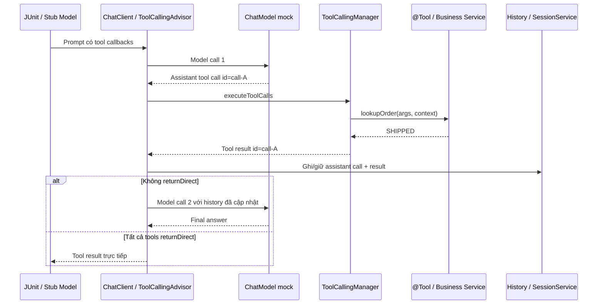

# Kiểm thử

## Kiểm thử tool call ID, lịch sử hội thoại và returnDirect

Một bài kiểm thử tool calling không chỉ cần xác nhận mô hình tạo ra câu trả lời hợp lý. Nó còn phải chứng minh **đúng công cụ đã được thực thi, mỗi kết quả khớp với yêu cầu đã tạo ra nó, lịch sử được nối theo đúng giao thức và vòng lặp dừng đúng khi công cụ cấu hình `returnDirect`**.

Trong module `SPRING_AI_TOOL_CALLING`, mô hình tạo `AssistantMessage.ToolCall` gồm ID, tên công cụ và JSON arguments. Ứng dụng Spring AI tìm `ToolCallback`, gọi `@Tool`/service với `ToolContext`, rồi tạo `ToolResponseMessage`. Với Spring AI **2.1.0**, `ChatClient` tự sử dụng `ToolCallingAdvisor` để gọi tiếp mô hình; `ChatModel` dùng trực tiếp **không tự chạy tool**. Điều này cho phép kiểm thử rõ từng tầng bằng JUnit 5, AssertJ, Mockito và stub model có thứ tự phản hồi cố định.

Bài tập trung vào ba nhóm bất biến: **ID tương quan**, **conversation history** và **returnDirect**. Ngoài nhánh thành công, bài trình bày batch nhiều tool, direct/mixed batch, memory nhiều turn, streaming partial arguments, lỗi/giới hạn và kiểm thử chống chạy trùng side effect.

### 1. Trước hết phải phân biệt các loại ID

| ID | Ai tạo/cấp? | Mục đích | Bất biến cần kiểm thử |
| --- | --- | --- | --- |
| `toolCallId`, ví dụ `call-A` | Model/provider khi phát tool call | Ghép tool request với tool response | `ToolResponse.id() == ToolCall.id()` |
| `toolName` | `ToolDefinition` của ứng dụng | Phân giải callback | Tên response khớp tool đã chạy; ID khác tên |
| `conversationId`/`sessionId` | Ứng dụng/session service | Chọn vùng history | Không trộn giữa session và tenant |
| `requestId`/`traceId` | Gateway/ứng dụng/tracing | Quan sát một request | Không dùng thay tool call ID |
| `operationId`/idempotency key | Business service | Nhận diện thao tác có side effect | Retry không tạo giao dịch trùng |

**Tool call ID không phải conversation ID.** Hai lời gọi `lookupOrder` trong một batch có thể **cùng tên** nhưng **khác ID**. Một session cũng có thể thực hiện nhiều lượt và nhiều tool calls khác ID. Việc chỉ so tên tool hoặc chỉ so thứ tự trong danh sách không đủ để bảo đảm kết quả được ghép đúng.

Trong Spring AI 2.1:

```java
AssistantMessage.ToolCall call =
    new AssistantMessage.ToolCall(
        "call-A", "function", "lookupOrder", "{\"orderId\":\"ORD-2048\"}");

ToolResponseMessage.ToolResponse response =
    new ToolResponseMessage.ToolResponse(
        "call-A", "lookupOrder", "{\"status\":\"SHIPPED\"}");

assertThat(response.id()).isEqualTo(call.id());
assertThat(response.name()).isEqualTo(call.name());
```

`ToolResponseMessage.ToolResponse` là record có ba trường `id`, `name`, `responseData`. `ToolResponseMessage.getResponses()` trả phần text của kết quả; nếu dùng message parts mới trong 2.1, `getResults()` trả các `ToolResultPart`, có thể chứa media/error flag ngoài text. Đừng chỉ assert `getText()` rồi bỏ qua ID.

### 2. Luồng kiểm thử theo từng tầng



Một bộ test đáng tin nên chia theo cấp độ:

| Cấp độ | Đơn vị được thử | Không cần kiểm thử tại đây |
| --- | --- | --- |
| Unit | Hàm kiểm tra call/result IDs và thứ tự message | Mô hình thật |
| Component | `ToolCallingManager.executeToolCalls` với callbacks giả | HTTP API/LLM thật |
| Advisor/ChatClient integration | Stub `ChatModel` phát tool call rồi final text | Kết nối provider thật |
| Session integration | `SessionAdvisors` + in-memory/JDBC session repository | LLM thật |
| Contract | Provider/MCP endpoint thực hoặc mock server | Nội dung hội thoại tự do, khó tái lập |
| E2E smoke | Một workflow thật trên môi trường kiểm thử | Không dùng làm bằng chứng duy nhất cho mọi nhánh |

**Nguyên tắc:** kiểm thử giao thức và quyền thực thi bằng dữ liệu cố định. Không dựa vào prompt kiểu “hãy gọi tool này” gửi LLM thật rồi hy vọng nó luôn chọn đúng.

### 3. Các bất biến cần kiểm chứng trước khi viết test

Một tool request có thể chứa nhiều tool calls. Kết quả thực thi phải thỏa:

1. Mỗi yêu cầu hợp lệ cần được ghép với một `ToolResponse` có **đúng ID**, đúng tool name.
2. Trong mỗi batch, không được coi hai call cùng tên là cùng một call.
3. `AssistantMessage` mang tool calls phải nằm **trước** `ToolResponseMessage` trả kết quả cho các calls đó.
4. Mỗi tool result đi vào lượt gọi mô hình tiếp theo trong **cùng conversation/session**.
5. `ToolExecutionResult.conversationHistory()` đã chứa các message gốc, assistant tool request và tool response; không append nó vào history cũ lần nữa.
6. Với `returnDirect=false`, tool result đi về mô hình để mô hình tạo câu trả lời cuối.
7. Với `returnDirect=true`, nếu **mọi tool trong cùng response** đều direct, vòng dừng sau execution và **không gọi model thêm**.
8. `returnDirect` chỉ ảnh hưởng đường đi của **result**, không bỏ qua việc thực thi hoặc bảo đảm rollback.
9. Khi còn confirmation hoặc chạm limit, chỉ đánh dấu `SUCCEEDED` cho callback đã thực sự chạy.

Các invariants là **yêu cầu kiểm thử ở ranh giới ứng dụng**. Không phải mọi loại ID bất thường đều được framework tự từ chối: với model/provider giả phát ID trùng, nên có test validation cho adapter/orchestrator do bạn kiểm soát, không mặc định `DefaultToolCallingManager` sẽ phát hiện tất cả trường hợp đó.

### 4. Dựng một fixture không phụ thuộc LLM thật

Ta dùng hai công cụ: tra cứu bình thường và trả thẳng kết quả. Chúng chỉ trả string để dễ kiểm tra lịch sử và số lần thực thi.

```java
static final class OrderTools {

    final AtomicInteger readCount = new AtomicInteger();
    final AtomicInteger directCount = new AtomicInteger();

    @Tool(description = "Tra cứu trạng thái đơn hàng")
    public String lookupOrder(
            @ToolParam(description = "Mã đơn hàng") String orderId) {
        readCount.incrementAndGet();
        return "STATUS:" + orderId + ":SHIPPED";
    }

    @Tool(
        description = "Trả dữ liệu báo cáo trực tiếp, không cần mô hình diễn giải",
        returnDirect = true)
    public String exportSnapshot(
            @ToolParam(description = "Mã báo cáo") String reportId) {
        directCount.incrementAndGet();
        return "SNAPSHOT:" + reportId;
    }
}
```

Tạo response của model với ID và tool calls **cố định**:

```java
static ChatResponse modelRequests(AssistantMessage.ToolCall... calls) {
    AssistantMessage assistant = AssistantMessage.builder()
        .content("")
        .toolCalls(List.of(calls))
        .build();

    return new ChatResponse(List.of(new Generation(assistant)));
}

static AssistantMessage.ToolCall call(
        String id, String name, String jsonArguments) {
    return new AssistantMessage.ToolCall(
        id, "function", name, jsonArguments);
}

static ChatResponse modelAnswers(String text) {
    return new ChatResponse(List.of(
        new Generation(AssistantMessage.builder().content(text).build())));
}
```

Các helper được khai báo `static` trong test class, dùng `AssistantMessage.ToolCall` và `Generation` theo API Spring AI 2.1. Không dùng ID sinh ngẫu nhiên để test trở nên deterministic. Khi muốn kiểm thử provider format, bổ sung fixture riêng cho responses thực tế đã được rút gọn và loại bỏ dữ liệu nhạy cảm.

### 5. Unit test một tool call ID bằng `ToolCallingManager`

Đường low-level cho phép kiểm tra manager mà không cần advisor hoặc model thật:

```java
@Test
void toolResponseKeepsOriginalCallId() {
    OrderTools tools = new OrderTools();

    ToolCallingChatOptions options = ToolCallingChatOptions.builder()
        .toolCallbacks(ToolCallbacks.from(tools))
        .build();

    Prompt prompt = new Prompt(
        List.of(new UserMessage("Tra cứu ORD-2048")), options);

    ChatResponse modelResponse = modelRequests(
        call("call-A", "lookupOrder", "{\"orderId\":\"ORD-2048\"}"));

    ToolCallingManager manager = ToolCallingManager.builder().build();
    ToolExecutionResult result =
        manager.executeToolCalls(prompt, modelResponse);

    List<Message> history = result.conversationHistory();
    assertThat(history).hasSize(3);
    assertThat(history.get(0)).isInstanceOf(UserMessage.class);
    assertThat(history.get(1)).isInstanceOf(AssistantMessage.class);
    assertThat(history.get(2)).isInstanceOf(ToolResponseMessage.class);

    AssistantMessage request = (AssistantMessage) history.get(1);
    ToolResponseMessage reply = (ToolResponseMessage) history.get(2);

    assertThat(request.getToolCalls()).hasSize(1);
    assertThat(request.getToolCalls().get(0).id()).isEqualTo("call-A");

    assertThat(reply.getResponses()).hasSize(1);
    assertThat(reply.getResponses().get(0).id()).isEqualTo("call-A");
    assertThat(reply.getResponses().get(0).name()).isEqualTo("lookupOrder");
    assertThat(reply.getResponses().get(0).responseData())
        .contains("ORD-2048", "SHIPPED");

    assertThat(result.returnDirect()).isFalse();
    assertThat(tools.readCount.get()).isEqualTo(1);
}
```

Đây là test trực tiếp cho `ToolCallingManager`, không phải cho `ChatClient`. Nó kiểm tra ID, cấu trúc history và đúng một lần chạy callback. Với result converter mặc định, string có thể được biểu diễn như một chuỗi JSON; vì vậy assert phần nội dung cần thiết thay vì cố định từng dấu ngoặc kép.

Nếu muốn kiểm thử `ToolContext` cùng lúc, truyền dữ liệu scope qua `ToolCallingChatOptions.builder().toolContext(Map.of(...))` và cho method `@Tool` nhận `ToolContext`, sau đó assert service được gọi với tenant/user đã xác thực.

### 6. Hai lời gọi cùng tên phải giữ hai ID riêng biệt

Một response có thể yêu cầu cùng tool hai lần để xử lý hai đơn hàng khác nhau:

```java
@Test
void sameToolCalledTwiceKeepsTwoDifferentResponseIds() {
    OrderTools tools = new OrderTools();
    ToolCallingChatOptions options = ToolCallingChatOptions.builder()
        .toolCallbacks(ToolCallbacks.from(tools))
        .build();

    Prompt prompt = new Prompt(
        List.of(new UserMessage("So sánh hai đơn hàng")), options);

    ChatResponse batch = modelRequests(
        call("call-A", "lookupOrder", "{\"orderId\":\"ORD-2048\"}"),
        call("call-B", "lookupOrder", "{\"orderId\":\"ORD-2049\"}"));

    ToolExecutionResult result =
        ToolCallingManager.builder().build().executeToolCalls(prompt, batch);

    ToolResponseMessage toolMessage =
        (ToolResponseMessage) result.conversationHistory().get(2);

    assertThat(toolMessage.getResponses())
        .extracting(ToolResponseMessage.ToolResponse::id)
        .containsExactlyInAnyOrder("call-A", "call-B");

    assertThat(toolMessage.getResponses())
        .extracting(ToolResponseMessage.ToolResponse::name)
        .containsOnly("lookupOrder");

    assertThat(tools.readCount.get()).isEqualTo(2);
}
```

Trọng tâm không phải tool names mà là **ID của từng request**. `getResponses()` có thể chứa nhiều responses trong cùng một `ToolResponseMessage`; đừng giả định một call luôn tương ứng một Java message riêng.

Khi xây custom parallel manager hoặc kết nối MCP server, responses có thể về không cùng thứ tự bắt đầu. Kiểm tra tập ID thay vì dựa vào index 0–1 nếu protocol/adapter không cam kết thứ tự. Nếu cần phát lại theo thứ tự model yêu cầu, sắp xếp có chủ đích theo vị trí tool calls gốc mà không làm đổi ID.

### 7. Kiểm tra tính toàn vẹn call/result bằng một helper độc lập

Không phải mọi response lỗi đều gây exception ngay lúc đọc, đặc biệt khi bạn tự viết adapter, custom manager hoặc replay history từ database. Một helper kiểm tra giao thức nên đối chiếu tập IDs, sự duy nhất của IDs và tên tool:

```java
static void assertCoveredExactly(
        AssistantMessage requested,
        ToolResponseMessage answered) {

    List<AssistantMessage.ToolCall> calls = requested.getToolCalls();
    List<ToolResponseMessage.ToolResponse> replies =
        answered.getResponses();

    List<String> callIds = calls.stream()
        .map(AssistantMessage.ToolCall::id)
        .toList();

    List<String> responseIds = replies.stream()
        .map(ToolResponseMessage.ToolResponse::id)
        .toList();

    assertThat(new HashSet<>(callIds)).hasSize(callIds.size());
    assertThat(new HashSet<>(responseIds)).hasSize(responseIds.size());
    assertThat(responseIds)
        .containsExactlyInAnyOrderElementsOf(callIds);

    Map<String, String> nameById = calls.stream().collect(
        Collectors.toMap(
            AssistantMessage.ToolCall::id,
            AssistantMessage.ToolCall::name));

    for (ToolResponseMessage.ToolResponse reply : replies) {
        assertThat(reply.name()).isEqualTo(nameById.get(reply.id()));
    }
}
```

Sử dụng trong unit test:

```java
AssistantMessage request =
    (AssistantMessage) result.conversationHistory().get(1);
ToolResponseMessage response =
    (ToolResponseMessage) result.conversationHistory().get(2);

assertCoveredExactly(request, response);
```

Một số test âm tính cần bổ sung riêng:

| Fixture lỗi | Assertion mong muốn ở lớp validator/adapter |
| --- | --- |
| Tool request có hai call cùng `id` | Bị từ chối trước execution hoặc flagged là protocol error |
| Tool result dùng ID không tồn tại | Bị từ chối; không gắn vào session |
| ID khớp nhưng name khác | Bị đánh dấu không nhất quán |
| Thiếu result cho một call | Không gửi transcript đó như history hoàn chỉnh |
| Hai result cùng ID | Bị từ chối hoặc điều tra duplicate attempt |
| Result có call ID thuộc session khác | Không cho ghi/nạp qua session boundary |

Không khẳng định mặc định Spring AI sẽ ném exception cho mọi fixture âm tính: một số kiểm tra nằm ở provider protocol hoặc read guard của Session Memory, còn một số phải do **custom integration** của ứng dụng áp đặt.

### 8. Kiểm thử thứ tự của `conversationHistory()`

Một lịch sử bình thường sau một tool call có dạng:

```text
0 UserMessage: "Tra cứu ORD-2048"
1 AssistantMessage: toolCalls=[{id=call-A,name=lookupOrder,args=...}]
2 ToolResponseMessage: responses=[{id=call-A,name=lookupOrder,data=...}]
```

Sau khi model nhận kết quả và tạo final answer, transcript đầy đủ có thể có thêm:

```text
3 AssistantMessage: "Đơn hàng đã được vận chuyển."
```

**Bất biến về thứ tự:**
- `UserMessage` gốc không bị mất khi thực thi tool.
- `AssistantMessage` có tool call xuất hiện trước `ToolResponseMessage`.
- Khi model được gọi lại, prompt chứa cả hai message trung gian.
- Final assistant answer là message **mới**, không phải tool response bị đổi role thành assistant.
- Nếu model yêu cầu tiếp một tool khác, cặp call/result mới được nối **sau** cặp trước.

Đối với `ToolExecutionResult.conversationHistory()` do manager tạo ra, đừng lấy mảng rồi nối thêm vào mảng gốc:

```java
// Sai: result.conversationHistory() đã chứa history của prompt.
List<Message> next = new ArrayList<>(prompt.getInstructions());
next.addAll(result.conversationHistory()); // Lặp lại UserMessage và các lượt cũ.

// Đúng:
Prompt nextPrompt =
    new Prompt(result.conversationHistory(), prompt.getOptions());
```

Trong unit test, có thể bắt lỗi ghép trùng bằng cách đếm `UserMessage` của lượt hiện tại, số `AssistantMessage` có cùng call ID và số `ToolResponse` có cùng ID trong prompt tiếp theo.

### 9. Manual loop: dùng history được trả về, không tự tạo response

Spring AI 2.1 vẫn hỗ trợ caller trực tiếp quản lý `ChatModel`:

```java
ToolCallingManager manager = ToolCallingManager.builder().build();

ToolCallback[] callbacks = ToolCallbacks.from(new OrderTools());
ChatOptions options = ToolCallingChatOptions.builder()
    .toolCallbacks(callbacks)
    .build();

Prompt prompt = new Prompt(
    List.of(new UserMessage("Tra cứu ORD-2048")),
    options);

ChatResponse response = chatModel.call(prompt);

while (response.hasToolCalls()) {
    ToolExecutionResult executed =
        manager.executeToolCalls(prompt, response);

    if (executed.returnDirect()) {
        // Đã thực thi tool; không gọi model thêm.
        return executed.conversationHistory().stream()
            .filter(ToolResponseMessage.class::isInstance)
            .map(ToolResponseMessage.class::cast)
            .flatMap(m -> m.getResponses().stream())
            .map(ToolResponseMessage.ToolResponse::responseData)
            .collect(Collectors.joining("\n"));
    }

    prompt = new Prompt(executed.conversationHistory(), options);
    response = chatModel.call(prompt);
}

return response.getResult().getOutput().getText();
```

Đoạn minh họa trả một chuỗi văn bản ở cả hai nhánh. Với kết quả direct gồm nhiều tool hoặc có media/multipart, nên chuẩn hóa kiểu kết quả của workflow, chẳng hạn `ToolTurnOutcome` chứa `kind`, `messages` và `displayText`, thay vì chỉ nối `responseData` thành text. Dù trả loại nào, **không gọi model thêm** sau nhánh direct.

Nếu bạn dùng `ChatClient` và muốn tự gọi manager, tắt `ToolCallingAdvisor` cho **mọi iteration** bằng `AdvisorParams.toolCallingAdvisorAutoRegister(false)`. Nếu không, một vòng tự động có thể chạy trước cả vòng thủ công của ứng dụng. Khi muốn xem nội dung từng lượt model mà không làm lại vòng, hãy dùng observer advisor bên trong loop.

### 10. `returnDirect=false`: phải gửi tool response về model

Công cụ mặc định không bật `returnDirect`. Sau khi manager thực thi, kiểm tra `result.returnDirect() == false`; ứng dụng phải tiếp tục model round nếu đang ở manual mode.

```java
@Test
void ordinaryToolMustContinueToAnotherModelRound() {
    OrderTools tools = new OrderTools();

    ChatModel model = mock(ChatModel.class);
    when(model.call(any(Prompt.class))).thenReturn(
        modelRequests(
            call("call-A", "lookupOrder", "{\"orderId\":\"ORD-2048\"}")),
        modelAnswers("Đơn hàng đã gửi đi."));

    ChatClient client = ChatClient.builder(model).build();
    String answer = client.prompt()
        .user("Kiểm tra ORD-2048")
        .tools(tools)
        .call()
        .content();

    assertThat(answer).contains("Đơn hàng đã gửi đi");
    assertThat(tools.readCount.get()).isEqualTo(1);
    verify(model, times(2)).call(any(Prompt.class));
}
```

Bằng cách stub hai model responses, test chứng minh vòng chạy đúng hai lần: một lần hỏi model chọn tool, một lần gửi kết quả tool trở lại để model diễn giải. Nếu thực thi callback thành công mà final answer lỗi nội dung, cần tách lỗi mô hình với lỗi service; không retry side effect chỉ để viết lại câu trả lời.

### 11. `returnDirect=true`: test dừng loop khi chỉ có một tool

Với `@Tool(returnDirect = true)`, tool vẫn chạy đầy đủ; khác biệt chỉ là model **không nhận** kết quả để diễn giải tiếp.

```java
@Test
void directToolStopsAfterOneModelRound() {
    OrderTools tools = new OrderTools();

    ChatModel model = mock(ChatModel.class);
    when(model.call(any(Prompt.class))).thenReturn(
        modelRequests(
            call("call-D", "exportSnapshot", "{\"reportId\":\"R-42\"}")));

    ChatClient client = ChatClient.builder(model).build();
    String directAnswer = client.prompt()
        .user("Xuất báo cáo R-42")
        .tools(tools)
        .call()
        .content();

    assertThat(directAnswer).contains("SNAPSHOT:R-42");
    assertThat(tools.directCount.get()).isEqualTo(1);
    assertThat(tools.readCount.get()).isZero();
    verify(model, times(1)).call(any(Prompt.class));
}
```

Assert `verify(model, times(1))` là quan trọng hơn việc chỉ so text. Nếu vòng lặp gọi model lần hai, `returnDirect` không được tôn trọng.

Đối với callback trả object, `ToolCallResultConverter` thường dùng Jackson để tạo chuỗi. Hãy assert trên nội dung hoặc parse JSON thành DTO; đừng gắn chặt test với một khoảng trắng, thứ tự JSON fields hay dấu quote không quan trọng.

### 12. Mixed batch: một tool direct, một tool thường

Quy tắc Spring AI: **trong cùng một response, `returnDirect` chỉ có hiệu lực nếu tất cả các tool calls đều có flag đó**. Một tool thường đủ khiến cả batch được gửi về model.

```java
@Test
void mixedBatchContinuesToModel() {
    OrderTools tools = new OrderTools();
    ToolCallingChatOptions options = ToolCallingChatOptions.builder()
        .toolCallbacks(ToolCallbacks.from(tools))
        .build();

    Prompt prompt = new Prompt(
        List.of(new UserMessage("Đọc đơn hàng và xuất snapshot")),
        options);

    ChatResponse batch = modelRequests(
        call("call-A", "lookupOrder", "{\"orderId\":\"ORD-2048\"}"),
        call("call-D", "exportSnapshot", "{\"reportId\":\"R-42\"}"));

    ToolExecutionResult result =
        ToolCallingManager.builder().build()
            .executeToolCalls(prompt, batch);

    assertThat(result.returnDirect()).isFalse();
    assertThat(tools.readCount.get()).isEqualTo(1);
    assertThat(tools.directCount.get()).isEqualTo(1);

    ToolResponseMessage message = (ToolResponseMessage)
        result.conversationHistory().get(2);

    assertThat(message.getResponses())
        .extracting(ToolResponseMessage.ToolResponse::id)
        .containsExactlyInAnyOrder("call-A", "call-D");
}
```

Test này **không** được mong đợi `exportSnapshot` trả riêng cho caller còn `lookupOrder` gửi model. Trong một batch trộn direct/non-direct, `result.returnDirect()` là false và manager đưa cả tool results vào history để lượt model tiếp theo sử dụng.

Nếu ứng dụng cần route từng tool call theo chính sách khác nhau, phải thiết kế orchestration custom cùng hợp đồng ghép ID, không suy diễn từ boolean của từng callback rồi tạo hai luồng kết quả song song.

### 13. All-direct batch: tất cả tool đều trực tiếp

Để kiểm tra quy tắc “all”, dùng hai tool được đánh dấu direct, nhưng mỗi call vẫn phải có ID riêng:

```java
static final class DirectTools {
    final AtomicInteger calls = new AtomicInteger();

    @Tool(description = "Trả bản tóm tắt trực tiếp", returnDirect = true)
    public String quickSummary(String id) {
        calls.incrementAndGet();
        return "SUMMARY:" + id;
    }

    @Tool(description = "Trả mã xác nhận trực tiếp", returnDirect = true)
    public String confirmationCode(String id) {
        calls.incrementAndGet();
        return "CONFIRM:" + id;
    }
}

@Test
void allDirectBatchReturnsWithoutAnotherModelCall() {
    DirectTools tools = new DirectTools();

    ToolCallingChatOptions options = ToolCallingChatOptions.builder()
        .toolCallbacks(ToolCallbacks.from(tools))
        .build();

    Prompt prompt = new Prompt(
        List.of(new UserMessage("Lấy hai kết quả")),
        options);

    ChatResponse response = modelRequests(
        call("call-D1", "quickSummary", "{\"id\":\"A\"}"),
        call("call-D2", "confirmationCode", "{\"id\":\"B\"}"));

    ToolExecutionResult result =
        ToolCallingManager.builder().build()
            .executeToolCalls(prompt, response);

    assertThat(result.returnDirect()).isTrue();
    assertThat(tools.calls.get()).isEqualTo(2);

    ToolResponseMessage toolReplies = (ToolResponseMessage)
        result.conversationHistory().get(2);

    assertThat(toolReplies.getResponses())
        .extracting(ToolResponseMessage.ToolResponse::id)
        .containsExactlyInAnyOrder("call-D1", "call-D2");
}
```

Unit test của manager mới xác minh cờ và ID. Một test `ChatClient` bổ sung phải assert `verify(model, times(1)).call(...)` để chứng minh advisor không gọi model tiếp. Khi nhiều tool đều direct, `ChatResponse` trả caller có thể chứa nhiều `Generation` (mỗi tool response một generation); không chỉ đọc `.content()` đầu tiên rồi giả định đó là toàn bộ kết quả batch.

### 14. Kiểm thử metadata của kết quả direct

Đường `ToolCallingAdvisor` chuyển `ToolExecutionResult` thành các `Generation` cho caller. Spring AI có:

- `ToolExecutionResult.buildGenerations(result)` để xây các generation từ kết quả công cụ.
- Các metadata key như `ToolExecutionResult.METADATA_TOOL_ID` và `METADATA_TOOL_NAME` nhằm liên kết generation với tool call.
- `ToolExecutionResult.FINISH_REASON` để phân biệt kết thúc do tool output với phản hồi bình thường, tùy cấu trúc metadata của release.

Ví dụ test không cần một LLM thật:

```java
List<Generation> generations =
    ToolExecutionResult.buildGenerations(result);

assertThat(generations).hasSize(2);
assertThat(generations)
    .extracting(g -> g.getOutput().getText())
    .anySatisfy(text -> assertThat(text).contains("SUMMARY:A"))
    .anySatisfy(text -> assertThat(text).contains("CONFIRM:B"));
```

Đoạn code trên dùng `result` từ test all-direct batch. Nếu cần assert metadata ID, đọc `Generation.getMetadata()` và so `METADATA_TOOL_ID` theo Javadoc đúng version; tránh tự đặt tên metadata key bằng một literal vì format có thể khác nhau. Khi kết quả là media/multipart từ API 2.1, `getText()` không diễn tả hết payload; cần kiểm tra `MessagePart` tương ứng.

### 15. Bắt prompt của model round thứ hai

Số lần gọi model là một assertion cần thiết, nhưng quan trọng hơn là **prompt sau khi tool chạy phải có cặp call/result khớp ID**. Dùng `ArgumentCaptor<Prompt>`:

```java
@Test
void nextModelRoundReceivesMatchingToolResponse() {
    OrderTools tools = new OrderTools();
    ChatModel model = mock(ChatModel.class);

    when(model.call(any(Prompt.class))).thenReturn(
        modelRequests(
            call("call-A", "lookupOrder", "{\"orderId\":\"ORD-2048\"}")),
        modelAnswers("Kết quả đã được xác minh."));

    ChatClient client = ChatClient.builder(model).build();
    client.prompt().user("Kiểm tra ORD-2048")
        .tools(tools).call().content();

    ArgumentCaptor<Prompt> captor = ArgumentCaptor.forClass(Prompt.class);
    verify(model, times(2)).call(captor.capture());

    List<Message> messages =
        captor.getAllValues().get(1).getInstructions();

    AssistantMessage request = messages.stream()
        .filter(AssistantMessage.class::isInstance)
        .map(AssistantMessage.class::cast)
        .filter(m -> !m.getToolCalls().isEmpty())
        .findFirst().orElseThrow();

    ToolResponseMessage result = messages.stream()
        .filter(ToolResponseMessage.class::isInstance)
        .map(ToolResponseMessage.class::cast)
        .findFirst().orElseThrow();

    assertCoveredExactly(request, result);
}
```

Với memory advisor, lịch sử có thể được nạp/merge theo chính sách, nên tránh assert tất cả metadata hoặc thứ tự system message quá chặt. Tuy nhiên, phải assert request đang kiểm tra không lặp lại cùng tool response hai lần và không thiếu user message của lượt hiện tại.

### 16. Session Memory phải lưu tool result khi `returnDirect`

Spring AI 2.1 dùng `SessionAdvisors`, gồm:
- `SessionMemoryAdvisor` **bên trong** loop, lưu từng model round.
- `SessionTurnAdvisor` **bên ngoài** loop, lưu các kết quả tool khi vòng kết thúc sớm (như `returnDirect`), rồi thực hiện compaction theo chính sách.

Dùng repository in-memory cho integration test:

```java
@Test
void sessionStoresDirectToolResultWithoutFinalModelRound() {
    SessionService sessions = DefaultSessionService.builder()
        .sessionRepository(InMemorySessionRepository.builder().build())
        .build();

    OrderTools tools = new OrderTools();
    ChatModel model = mock(ChatModel.class);

    when(model.call(any(Prompt.class))).thenReturn(
        modelRequests(
            call("call-D", "exportSnapshot", "{\"reportId\":\"R-42\"}")));

    ChatClient client = ChatClient.builder(model)
        .defaultAdvisors(SessionAdvisors.builder(sessions).build())
        .build();

    String sessionId = "s-test-direct-01";
    client.prompt().user("Xuất snapshot R-42")
        .tools(tools)
        .advisors(SessionAdvisors.session(sessionId))
        .call().content();

    List<Message> stored = sessions.getMessages(sessionId);

    List<AssistantMessage> requests = stored.stream()
        .filter(AssistantMessage.class::isInstance)
        .map(AssistantMessage.class::cast)
        .filter(m -> !m.getToolCalls().isEmpty())
        .toList();

    List<ToolResponseMessage> replies = stored.stream()
        .filter(ToolResponseMessage.class::isInstance)
        .map(ToolResponseMessage.class::cast)
        .toList();

    assertThat(requests).hasSize(1);
    assertThat(replies).hasSize(1);
    assertCoveredExactly(requests.get(0), replies.get(0));

    assertThat(tools.directCount.get()).isEqualTo(1);
    verify(model, times(1)).call(any(Prompt.class));
}
```

`getMessages(sessionId)` trả **toàn bộ log**; `getActiveMessages(sessionId)` trả active view dùng cho prompt. Khi có compaction/filter, hai danh sách có thể khác nhau. Đừng kết luận “tool result không được lưu” chỉ vì một event đã bị ẩn khỏi active view.

### 17. Test cấu hình thiếu advisor và khác biệt legacy memory

| Cấu hình | Lưu các model rounds | Lưu direct tool result | Nhận xét |
| --- | --- | --- | --- |
| Chỉ `SessionMemoryAdvisor` | Có | **Không đủ** | Không nhận đoạn kết sau direct, không compaction |
| Chỉ `SessionTurnAdvisor` | Không | Không đủ | Không lưu history các model rounds bình thường |
| Cả hai qua `SessionAdvisors` | Có | Có | Hướng dùng cho Spring AI 2.1 |
| Legacy `MessageChatMemoryAdvisor` ngoài loop (order +200) | User/final answer | Không có full tool transcript | Tùy repository, đã deprecated |

Một test âm tính có thể cấu hình `SessionMemoryAdvisor` đơn lẻ, thực hiện direct call và chứng minh thiếu result. Sau đó test cấu hình đủ cặp `SessionAdvisors` để thấy cả tool request lẫn result. Đây là phép kiểm tra **persistence**, khác với việc `ChatClient.content()` trả chuỗi đúng.

Legacy `ChatMemory` trong Spring AI 2.0/2.1 không nhất thiết ghi `ToolResponseMessage`. JDBC ChatMemory repository cũ không thích hợp nếu cần lưu đầy đủ lịch sử tool. Với 2.1, dùng Session Memory/JDBC Session Repository cho full transcript và window theo turn boundary.

### 18. Cùng session phải giữ history, khác session không được trộn

Bài test đa lượt cần:
1. Session A: model yêu cầu `call-A`, ứng dụng chạy tool, model trả final answer.
2. Lượt sau trên A: prompt phải chứa result của `call-A`, đúng ID/name.
3. Session B: cùng model/client nhưng session ID khác; prompt không chứa `call-A`.
4. Người dùng B cố resume session A: application boundary từ chối trước khi gọi model/tool.

Ví dụ kiểm tra repository:

```java
String sessionA = "session-tenantA-user1";
String sessionB = "session-tenantB-user2";

// client được gắn đầy đủ SessionAdvisors; mỗi request có ID riêng.
client.prompt().user("Tra cứu A")
    .advisors(SessionAdvisors.session(sessionA))
    .tools(tools).call();

client.prompt().user("Tra cứu B")
    .advisors(SessionAdvisors.session(sessionB))
    .tools(tools).call();

assertThat(sessions.getMessages(sessionB))
    .noneMatch(m -> m instanceof ToolResponseMessage reply
        && reply.getResponses().stream()
            .anyMatch(r -> "call-A".equals(r.id())));
```

ID là khóa chọn history, **không phải bằng chứng quyền**. Kiểm thử tenant cần tạo identity từ security context và gọi qua service/controller có authorization; `SessionAdvisors.session(sessionId)` không tự kiểm tra owner và có thể tạo session mới nếu ID chưa tồn tại. Không nhận ID từ client rồi truyền thẳng vào advisor trong một ứng dụng đa tenant.

### 19. Streaming: partial arguments chưa phải tool call

Spring AI 2.1 có thể nhận `ToolCallPart` với arguments đi từng chunk. Một mảnh `{"order` chưa phải JSON hoàn chỉnh. `AssistantMessage.getToolCalls()` và `ChatResponse.hasToolCalls()` bỏ qua partial parts, nên `ToolCallingManager` không được chạy từ dữ liệu chưa hoàn tất.

Tách hai loại test:

- **Progress/UI:** các partial `ToolCallPart` được hiển thị hoặc ghép cho preview, nhưng callback chưa chạy; không ghi partial thành `ToolResponseMessage`.
- **Complete tool call:** sau chunk hoàn chỉnh, manager gọi callback đúng một lần, tạo result cùng ID và model tiếp tục.

Một test streaming cơ bản với model stub deterministic:

```java
@Test
void streamingLoopRunsToolOnceAndProducesFinalAnswer() {
    OrderTools tools = new OrderTools();
    ChatModel model = mock(ChatModel.class);

    when(model.stream(any(Prompt.class))).thenReturn(
        Flux.just(modelRequests(
            call("call-A", "lookupOrder", "{\"orderId\":\"ORD-2048\"}"))),
        Flux.just(modelAnswers("Đơn hàng đã vận chuyển.")));

    ChatClient client = ChatClient.builder(model).build();

    StepVerifier.create(
            client.prompt()
                .user("Tra cứu ORD-2048")
                .tools(tools)
                .stream()
                .content()
                .collectList())
        .assertNext(chunks -> assertThat(String.join("", chunks))
            .contains("Đơn hàng đã vận chuyển"))
        .verifyComplete();

    verify(model, times(2)).stream(any(Prompt.class));
    assertThat(tools.readCount.get()).isEqualTo(1);
}
```

Test này phát **complete tool call trong một chunk**; nó không kiểm thử partial provider deltas. Muốn kiểm thử partial thật, cần tạo `ToolCallPart` và đánh dấu `StreamingParts.isPartial(part)` theo API 2.1, assert `hasToolCalls() == false` cho các chunk đó và chỉ cho phép thực thi sau complete call. Không giả định mọi provider phát cùng hình dạng chunk.

Trong đường user-controlled streaming, dùng `ChatClientMessageAggregator.aggregateChatClientResponse(...)` để tổng hợp **một model iteration**, rồi mới gọi `executeToolCalls`. Không gọi manager trong `doOnNext` của từng delta.

### 20. Call-limit giữa batch phải bảo toàn kết quả trước khi vượt hạn mức

Call limits và `returnDirect` là hai cơ chế độc lập. Khi manager giới hạn số lần gọi, tool đầu của một batch có thể đã chạy xong trước khi tool thứ hai bị chặn.

Ví dụ đặt tổng hạn mức bằng 1:

```java
@Test
void limitExceptionKeepsAlreadyExecutedToolResponse() {
    OrderTools tools = new OrderTools();
    ToolCallingChatOptions options = ToolCallingChatOptions.builder()
        .toolCallbacks(ToolCallbacks.from(tools))
        .build();

    Prompt prompt = new Prompt(
        List.of(new UserMessage("Kiểm tra hai đơn hàng")), options);

    ChatResponse batch = modelRequests(
        call("call-A", "lookupOrder", "{\"orderId\":\"ORD-2048\"}"),
        call("call-B", "lookupOrder", "{\"orderId\":\"ORD-2049\"}"));

    ToolCallingManager manager = ToolCallingManager.builder()
        .maxTotalToolCalls(1)
        .onLimitExceeded(ToolCallLimitBehavior.THROW)
        .build();

    assertThatThrownBy(() -> manager.executeToolCalls(prompt, batch))
        .isInstanceOfSatisfying(
            ToolCallLimitExceededException.class, ex -> {
                List<Message> partial =
                    ex.getPartialToolExecutionResult()
                        .conversationHistory();

                List<String> responseIds = partial.stream()
                    .filter(ToolResponseMessage.class::isInstance)
                    .map(ToolResponseMessage.class::cast)
                    .flatMap(m -> m.getResponses().stream())
                    .map(ToolResponseMessage.ToolResponse::id)
                    .toList();

                assertThat(responseIds).contains("call-A");
            });

    assertThat(tools.readCount.get()).isEqualTo(1);
}
```

`ToolCallLimitExceededException` chứa kết quả partial và một synthesized error cho call vượt hạn mức. `ToolCallingAdvisor` đổi limit breach thành một `Generation` duy nhất mang finish reason `ToolCallLimitExceededException.FINISH_REASON`; các kết quả thành công trước đó được gắn ở metadata `METADATA_PARTIAL_TOOL_RESPONSES`. Không đọc chỉ một dòng text rồi kết luận toàn batch đều thất bại hoặc đã rollback.

Với `ToolCallLimitBehavior.RETURN_ERROR_RESPONSE`, manager có thể đưa một tool error response cho call bị bỏ qua và tiếp tục vòng. Test cần phân biệt `SUCCEEDED`, `SKIPPED_LIMIT` và `NOT_STARTED`; không dùng `returnDirect` như một tín hiệu duy nhất để xác định trạng thái nghiệp vụ.

### 21. Confirmation: không phát result trước khi được cho phép

Khi một tool cần human confirmation, `ToolCallingManager` có thể báo `ToolCallConfirmationRequiredException`; `ToolCallingAdvisor` dừng vòng **trước khi chạy bất kỳ tool call nào trong reply đó**.

Bộ test cần assert:

1. Model đã phát tool call IDs hợp lệ.
2. Response metadata chứa `ToolCallDecisions.AWAITING_DECISION_METADATA_KEY` và danh sách call IDs/keys đang chờ.
3. Callback chưa thực thi; `verifyNoInteractions(service)` hoặc counter bằng 0.
4. Khi caller cho phép, ứng dụng tiếp tục **đúng cặp call/result ID**, không tạo một call khác rồi gọi service không kiểm soát.
5. Khi caller từ chối, có result từ chối phù hợp, không có side effect.
6. Không cho một session/tenant khác duyệt kết quả của phiên đang chờ.

Nếu người dùng bỏ dở pause rồi gửi yêu cầu mới, Session Turn Advisor có thể đóng open calls bằng thông báo “No result was recorded for this tool call.” Đây là thông tin về **log**, không chứng minh remote tool chưa chạy. Đừng chạy lại side effect chỉ vì thấy thông báo đó.

### 22. Kiểm thử idempotency khác kiểm thử tool call ID

Tool-call ID chủ yếu phục vụ **ghép message**. Khi model retry hoặc tạo request mới cho cùng thao tác, provider có thể phát một ID mới. Vì vậy, dùng tool-call ID làm idempotency key duy nhất là không đủ.

Ví dụ nghiệp vụ tạo một giao dịch:

```java
@Tool(description = "Tạo hóa đơn với idempotency key được server cấp")
public Receipt createInvoice(
        @ToolParam(description = "Mã khách hàng") String customerId,
        ToolContext toolContext) {

    String tenant = requireTrustedContext(toolContext, "tenantId");
    String operationId = requireTrustedContext(
        toolContext, "operationId");

    return invoiceService.createOnce(tenant, customerId, operationId);
}
```

`operationId` phải được server cấp và ghi bền vững; không tin khóa do mô hình tự nghĩ ra. Một test quan trọng:

```java
@Test
void repeatedSemanticOperationWithNewCallIdIsNotDuplicated() {
    String operationId = "op-test-42";

    Receipt first = invoiceService.createOnce(
        "tenant-a", "customer-7", operationId);
    Receipt second = invoiceService.createOnce(
        "tenant-a", "customer-7", operationId);

    assertThat(second.invoiceId()).isEqualTo(first.invoiceId());
    verify(invoiceRepository, times(1)).insertInvoice(any());
}
```

Đây là test khung của **service nghiệp vụ**. Với side effect thật, phải kiểm tra transaction/unique constraint hoặc operation ledger. Nếu timeout xảy ra sau commit nhưng trước khi tool response đến, trạng thái thực thi có thể là `UNKNOWN`; kiểm tra qua operation ID, không giả định retry một tool call khác sẽ an toàn.

### 23. Kiểm thử lịch sử chống lẫn tenant và hội thoại đồng thời

Một `ChatClient` dùng chung giữa nhiều request không được lưu history vào field singleton. Với Session Memory:

- Session A và B phải có ID khác nhau và không có các `ToolResponse.id()` của nhau.
- Tenant B biết ID A vẫn bị từ chối ở API boundary (IDOR/BOLA).
- Hai lượt trên **cùng session** không được chạy đồng thời mà không có queue/lock/version check.
- Với `SessionService.appendEvents(sessionId, events, expectedVersion)`, test xung đột phiên bản phải không làm mất message đã commit.
- Với MCP/REST tool, callback phải dùng `ToolContext` của request hiện tại, không mang tenant/user từ request trước.

Tình huống race đáng thử:

```text
Session A: iteration 1 tạo tool call id=call-X
Request B cùng session: bắt đầu trước khi call-X có result
Session A: tool result call-X đến muộn
```

Nếu ứng dụng cho phép hai lượt xen kẽ, Session Turn Advisor có thể đánh dấu call-X là chưa có kết quả khi request B bắt đầu; kết quả thật của A có thể trở thành đáp án thứ hai cho cùng call. Đây là lý do **serialize per-session turns**, không chỉ trông cậy vào kiểm tra ID lúc cuối.

### 24. Bảng test matrix cho CI

| Nhóm | Input | Assertion thiết yếu |
| --- | --- | --- |
| Một tool thường | `call-A`, `returnDirect=false` | Một callback, ID khớp, hai model rounds |
| Một tool direct | `call-D`, `returnDirect=true` | Một callback, một model round, caller nhận tool result |
| Cùng tên hai lần | `call-A`/`call-B` cùng `lookupOrder` | Hai response IDs riêng, callback chạy hai lần |
| Mixed batch | Một direct, một thường | `result.returnDirect() == false`, tiếp tục model |
| All-direct batch | Hai tools direct | `result.returnDirect() == true`, không gọi model vòng sau |
| Lịch sử thủ công | Có result từ manager | Không nhân đôi user/assistant/tool messages |
| Model prompt thứ hai | Lượt sau execution | Đầy đủ cặp assistant call/result đúng ID |
| Session Memory | Direct tool, không final model call | `SessionTurnAdvisor` vẫn ghi tool result |
| Memory cấu hình thiếu | Chỉ `SessionMemoryAdvisor` | Phát hiện thiếu direct result |
| Multi-turn | Session A lượt 1 → lượt 2 | History cũ được nạp đúng |
| Cross-tenant | Session A bị user B dùng | Bị từ chối trước model/tool |
| Streaming | Partial deltas rồi complete | Không execute partial, chỉ chạy một lần |
| Confirmation | Tool cần xác nhận | Không chạy trước quyết định; ID nhất quán |
| Tool limit | Batch có call vượt quota | Giữ response thành công và lỗi giới hạn |
| Timeout/side effect | Remote commit rồi timeout | `UNKNOWN`, retry theo idempotency |
| Concurrent turns | Hai lượt cùng session | Tuần tự hóa hoặc fail/retry theo version |
| Adapter protocol | ID thiếu/trùng/sai name | Validation/ngăn persist history lỗi |

Test failure nên assert cả **số lần callback được gọi**, **số lần model được gọi**, **call IDs**, **message roles/order**, **session ID** và **trạng thái nghiệp vụ**, thay vì chỉ assert câu trả lời text.

### 25. Checklist trước khi chấp nhận một bộ test tool calling

1. Mock/stub mô hình có phản hồi deterministic thay vì dựa vào khả năng chọn tool của LLM thật.
2. Dựng helper tạo `AssistantMessage.ToolCall` với ID cố định và tool name rõ ràng.
3. Kiểm tra cặp `call.id()`/`response.id()` và `name()`; xử lý cả nhiều call cùng tên.
4. Kiểm tra `conversationHistory()` chứa original prompt, assistant tool request và tool response theo thứ tự.
5. Không append history trả về vào history cũ; tránh duplicate.
6. Phân biệt `returnDirect=false` và `true` bằng số lần gọi model, không chỉ text.
7. Thử cả batch chỉ direct và batch trộn direct/non-direct.
8. Với direct results, kiểm tra nhiều generations/metadata hoặc kết quả batch tương ứng.
9. Với Session Memory, assert cả event log đầy đủ và active view khi phù hợp.
10. Kiểm tra direct tool result được `SessionTurnAdvisor` lưu dù không có final model round.
11. Bảo đảm partial streaming arguments không kích hoạt execution.
12. Bảo toàn kết quả hoàn tất khi confirmation/limits/timeout làm vòng dừng.
13. Kiểm tra scope tenant/session, `ToolContext`, quyền và idempotency của tool có side effect.
14. Test cạnh tranh trên một session để tránh interleaving và orphan result.
15. Phân tầng unit/component/integration/E2E; không để E2E duy nhất chứng minh contract.

### Kết luận

Kiểm thử tool calling tốt phải xác nhận **đúng công cụ, đúng ID, đúng lịch sử, đúng đường kết thúc**. Trong Spring AI 2.1, `ToolCallingManager` là nơi dễ thử ID và `ToolExecutionResult` ở cấp component; `ChatClient`/`ToolCallingAdvisor` chứng minh vòng model tiếp tục hoặc dừng theo `returnDirect`; `SessionAdvisors` kiểm chứng lịch sử qua nhiều turn, kể cả khi tool direct trả thẳng cho caller. Khi thêm MCP, streaming, tenant và side effect, hãy mở rộng test cho timeout, quyền truy cập, idempotency và tính toàn vẹn cặp request/result.

### Tài liệu tham khảo

- [Spring AI 2.1 — Tool Calling](https://docs.spring.io/spring-ai/reference/api/tools.html)
- [Spring AI 2.1 — ToolCallingAdvisor](https://docs.spring.io/spring-ai/reference/api/tools/tool-calling-advisor.html)
- [Spring AI 2.1 — ChatModel Tool Calling, manual loop](https://docs.spring.io/spring-ai/reference/api/tools/chatmodel-tool-calling.html)
- [Spring AI 2.1 — Session Memory](https://docs.spring.io/spring-ai/reference/api/session.html)
- [Spring AI 2.1 — Session ChatClient Integration](https://docs.spring.io/spring-ai/reference/api/session/chat-client.html)
- [Spring AI 2.1 — Session Concepts](https://docs.spring.io/spring-ai/reference/api/session/concepts.html)
- [Spring AI 2.1 API — AssistantMessage.ToolCall](https://docs.spring.io/spring-ai/docs/2.1.x/api/org/springframework/ai/chat/messages/AssistantMessage.ToolCall.html)
- [Spring AI 2.1 API — ToolResponseMessage.ToolResponse](https://docs.spring.io/spring-ai/docs/2.1.x/api/org/springframework/ai/chat/messages/ToolResponseMessage.ToolResponse.html)
- [Spring AI 2.1 API — ToolExecutionResult](https://docs.spring.io/spring-ai/docs/2.1.x/api/org/springframework/ai/model/tool/ToolExecutionResult.html)
- [Spring AI 2.1 API — ToolCallLimitExceededException](https://docs.spring.io/spring-ai/docs/2.1.x/api/org/springframework/ai/model/tool/ToolCallLimitExceededException.html)

Các snippet dùng JUnit 5/AssertJ/Mockito và một số fixture do ứng dụng tự định nghĩa. Tùy dependency Spring AI thực tế, hãy đối chiếu imports, cách tạo mock model/provider và metadata về tool results. Bài này cung cấp bộ tiêu chí và ví dụ kiểm thử, không thay thế việc chạy test bằng build của dự án.

