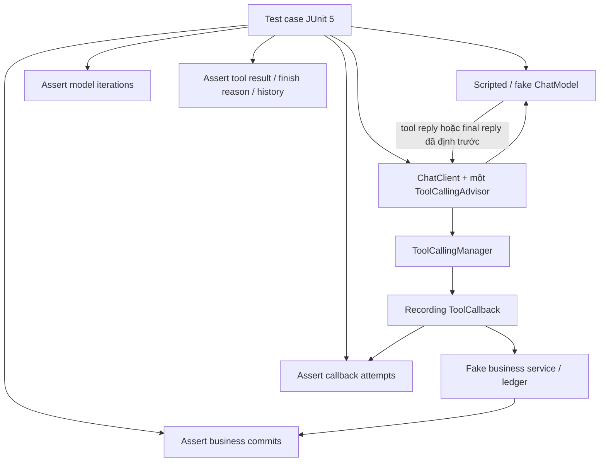
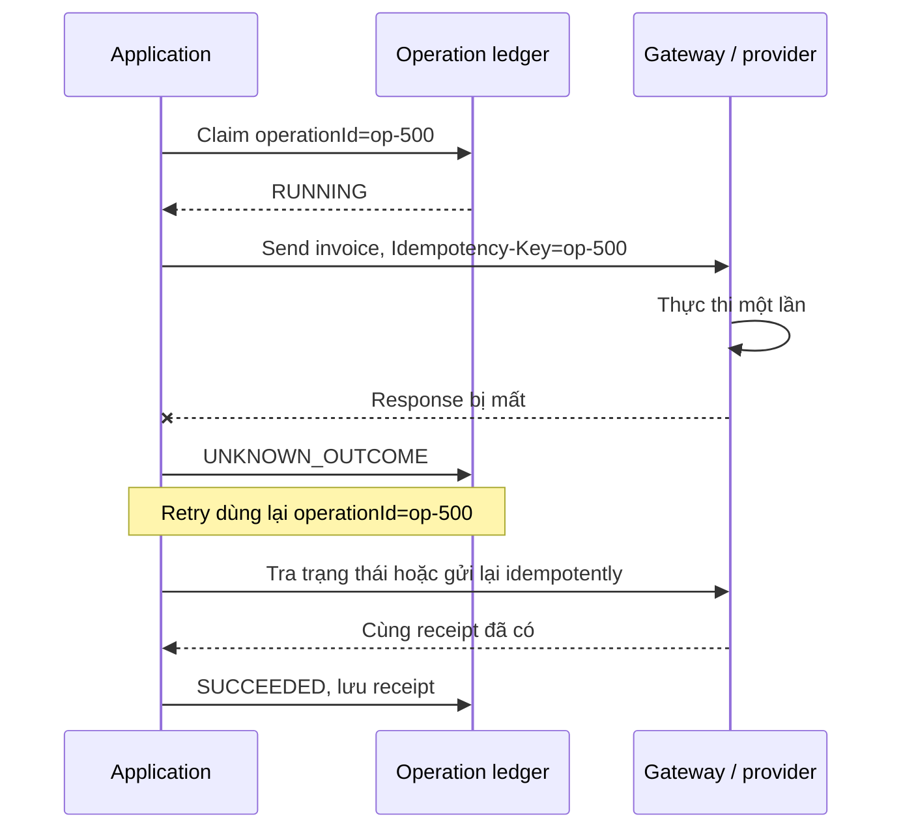

# Kiểm thử lỗi, retry, hạn mức và điều kiện dừng

Một hệ thống dùng Spring AI tool calling có thể hoạt động bình thường khi mô hình gọi một công cụ rồi trả câu trả lời cuối, nhưng thất bại khi công cụ ném exception, model gọi lặp, request bị timeout hoặc một hành động đã tạo tác động nghiệp vụ trước khi ứng dụng kịp lưu kết quả. Kiểm thử những trường hợp này quan trọng hơn việc chỉ xác minh câu trả lời của mô hình “nghe có vẻ đúng”.

Trong module `SPRING_AI_TOOL_CALLING`, mô hình tạo yêu cầu gọi công cụ; `ToolCallingAdvisor` hoặc mã điều phối thủ công quyết định thực thi qua `ToolCallingManager`, và `ToolCallback` mới gọi dịch vụ nghiệp vụ. Vì vậy một bộ kiểm thử tốt cần kiểm chứng ba điều độc lập: **phản hồi hội thoại**, **số lần callback thực thi**, và **trạng thái nghiệp vụ thực sự đã thay đổi**.

Bài học sử dụng các hợp đồng Spring AI **2.1.0**, JUnit 5, AssertJ và Mockito để thiết kế test xác định được kết quả. Các đối tượng như `OrderService`, `OperationLedger`, `ScriptedChatModel` trong ví dụ là test double/abstraction do ứng dụng tự xây dựng; chúng không phải tất cả đều là API có sẵn của Spring AI.

## 1. Điều gì cần được kiểm thử?

Đừng gộp tất cả thành một phép thử `assertThat(answer).contains(...)`. Hãy phân chia:

| Lớp kiểm thử | Đối tượng | Câu hỏi |
|---|---|---|
| Unit: hợp đồng callback | `@Tool`, `ToolCallback`, validation, converter | Tool nhận arguments đúng, trả DTO đúng, không lộ dữ liệu? |
| Unit: xử lý exception | `ToolExecutionExceptionProcessor` | Runtime, checked, `Error`, allowlist có đi đúng nhánh? |
| Component: manager | `ToolCallingManager` và callback giả | Tool có được dispatch, bị chặn, bị deny, trả direct hay ném exception? |
| Integration: vòng ChatClient | Fake `ChatModel` + `ToolCallingAdvisor` | Vòng model → tool → model có dừng đúng lúc? |
| Integration: orchestration thủ công | `ChatModel`, `ToolCallingManager` và history | Có giữ đúng tool responses, returnDirect, giới hạn và opt-out không? |
| Business integration | Repository, service, transaction/outbox | Một hành động có xảy ra đúng một lần khi retry/replay? |
| Resilience/e2e có kiểm soát | Gateway giả, timeout, concurrency, cancellation | Sau lỗi không rõ kết quả, ứng dụng có đối soát thay vì ghi lặp? |

Các lớp này có thể dùng chung một tập tình huống, nhưng **không nên phụ thuộc vào model thật** để tạo thứ tự tool calls cho unit/integration test deterministic. Provider thật có thể thay cách diễn đạt, tên tool, finish reason hoặc độ trễ giữa các lần chạy.

## 2. Ma trận hành vi tối thiểu

| Tình huống | Phản hồi mong đợi | Callback thực tế | Tác động nghiệp vụ |
|---|---|---:|---|
| Model không yêu cầu tool | Trả final answer | 0 | 0 |
| Model yêu cầu một tool đọc | Tool result rồi final answer | 1 | 0 mutation |
| Runtime exception, mặc định | Error string chuyển về model | 1 | Theo trạng thái service |
| Checked exception ở callback | Lỗi propagate tới caller | 1 attempt | Không tự retry |
| `Error` trong callback | Không được coi là business error thành công | Tùy điểm lỗi | Không nuốt lỗi |
| `alwaysThrow=true` | Runtime exception propagate | 1 attempt | Không tự retry |
| Runtime exception nằm trong allowlist | Cause được unwrap/rethrow | 1 attempt | Không tự retry |
| Vượt per-tool limit, `THROW` | Dừng với finish reason đặc biệt trên advisor | Call bị chặn = 0 | Partial effects có thể tồn tại |
| Vượt total limit, `THROW` | Dừng và giữ partial results | Call bị chặn = 0 | Đối soát call trước |
| Vượt limit, `RETURN_ERROR_RESPONSE` | Tool response tổng hợp, model có thể tiếp tục | Call bị chặn = 0 | Không có effect mới từ call bị chặn |
| Tool cần xác nhận | Paused reply + awaiting keys | 0 cho batch đang chờ | 0 cho batch đó |
| Quyết định `deny` | Denial tool result | 0 cho call bị deny | 0 cho call bị deny |
| `returnDirect=true` | Kết quả tool trả thẳng caller | 1 | Tùy tool |
| Timeout sau khi ghi thành công | Kết quả chưa xác định, cần đối soát | Có thể >1 attempt | Chỉ 1 commit khi idempotent |
| Streaming partial arguments | Chỉ hiển thị progress | 0 trước khi call hoàn chỉnh | 0 |

Khi ghi báo cáo test, nên có **requestedCalls**, **executedCalls**, **committedOperations** và **modelIterations**. Không suy ra số callback từ số `ToolCall` model đề xuất.

## 3. Sơ đồ tổ chức test deterministic



Một `ScriptedChatModel` có thể nhận danh sách phản hồi cần phát lần lượt: tool call → tool result → final answer. Test không quan tâm mô hình sẽ “nghĩ” gì, chỉ quan tâm application xử lý **phản hồi đã biết** như thế nào.

Nếu có một test nhỏ dùng model/provider thật, hãy đặt nó vào smoke/e2e suite riêng và dùng assertion theo hợp đồng, không yêu cầu câu trả lời văn bản giống từng ký tự. Với test timeout, tránh gọi API ngoài thật: dùng fake clock, `CountDownLatch`, stub HTTP server hoặc một `CompletableFuture` được điều khiển.

## 4. Dựng response giả có tool call

Spring AI 2.1 biểu diễn yêu cầu tool của model bằng `AssistantMessage.ToolCall` gồm `id`, `type`, `name`, `arguments`. `ChatResponse` chứa các `Generation`.

```java
static ChatResponse toolReply(
        String id, String name, String jsonArguments) {

    AssistantMessage assistant = AssistantMessage.builder()
            .content("")
            .toolCalls(List.of(new AssistantMessage.ToolCall(
                    id, "function", name, jsonArguments)))
            .build();

    return new ChatResponse(List.of(new Generation(assistant)));
}

static ChatResponse finalReply(String text) {
    return new ChatResponse(List.of(
            new Generation(new AssistantMessage(text))));
}
```

Sử dụng `ObjectMapper.writeValueAsString(Map.of(...))` để tạo chuỗi arguments hợp lệ, tránh tự ghép JSON. Khi fake model trả hai tool calls trong cùng assistant message, tạo một `AssistantMessage` với danh sách hai `ToolCall` thay vì hai response rời.

Ví dụ chuẩn bị fake model bằng Mockito:

```java
ChatModel fakeModel = mock(ChatModel.class);
String argsJson = objectMapper.writeValueAsString(
        Map.of("orderId", "ORD-2048"));

when(fakeModel.call(any(Prompt.class))).thenReturn(
        toolReply("call_001", "getOrderStatus", argsJson),
        finalReply("Đơn hàng đang được giao."));

ChatClient client = ChatClient.builder(fakeModel).build();
```

Trong test thật, fake/model stub có thể cần triển khai thêm các phương thức `getDefaultOptions()` hoặc metadata tùy interface/phiên bản. Một adapter fake riêng thường ổn định hơn mock sâu vào nội bộ `ChatModel`. Không dùng snapshot text của provider để tái dựng tool call thiếu ID hay sai JSON.

## 5. Tool thử nghiệm có bộ đếm riêng

Một `@Tool` đơn giản có thể đo số lần **callback được gọi** mà không động chạm cơ sở dữ liệu:

```java
public final class RecordingOrderTools {

    private final AtomicInteger attempts = new AtomicInteger();

    @Tool(
            name = "getOrderStatus",
            description = "Tra cứu trạng thái đơn hàng, chỉ đọc dữ liệu.")
    public String getOrderStatus(
            @ToolParam(description = "Mã đơn hàng") String orderId) {
        attempts.incrementAndGet();
        return "SHIPPED";
    }

    public int attemptCount() {
        return attempts.get();
    }
}
```

Ví dụ integration test dạng chuẩn:

```java
RecordingOrderTools tools = new RecordingOrderTools();
ChatClient client = ChatClient.builder(fakeModel).build();

String answer = client.prompt()
        .user("Trạng thái ORD-2048?")
        .tools(tools)
        .call()
        .content();

assertThat(tools.attemptCount()).isEqualTo(1);
assertThat(answer).contains("Đơn hàng");
verify(fakeModel, times(2)).call(any(Prompt.class));
```

Test này có ý nghĩa khi `fakeModel` phát đúng chuỗi `toolReply` rồi `finalReply` đã định trước. Đếm lượt `ChatModel.call` bảo đảm advisor đã tái gọi model với tool result; đếm `attemptCount` bảo đảm callback không chạy hai lần.

## 6. Kiểm thử tool result và history, không chỉ text cuối

Trường hợp nhiều tool calls có thể ghép nhầm kết quả khi chạy đồng thời hoặc khi tự xây manual loop. Test nên kiểm tra:

- Mỗi `ToolResponseMessage.ToolResponse.id()` tương ứng đúng `AssistantMessage.ToolCall.id()`.
- `ToolResponse.name()` giữ tên callback được gọi.
- `responseData()` đúng kết quả của **chính arguments** của call đó.
- History chứa assistant tool calls trước tool responses và đủ cặp theo protocol.
- Retry hoặc replay history không tự chạy lại callback đã hoàn thành.

```java
List<ToolResponseMessage.ToolResponse> responses =
        toolResponseMessage.getResponses();

assertThat(responses)
        .extracting(ToolResponseMessage.ToolResponse::id)
        .containsExactly("call_a1", "call_b2");
```

Ở đây `toolResponseMessage` là kết quả từ manager/fake workflow test. Với callback cùng tên nhưng khác arguments, **không** ghép theo tên tool hoặc theo thứ tự future hoàn tất; dùng tool call ID và original index.

## 7. Kiểm thử RuntimeException theo processor mặc định

Spring AI đưa lỗi thực thi callback vào `ToolExecutionException` để `ToolExecutionExceptionProcessor` quyết định trả thông điệp cho model hay propagate. Khi `alwaysThrow=false` (mặc định), cause thuộc `RuntimeException` có thể được chuyển thành tool result.

```java
@Test
void runtimeErrorIsReturnedAsMessageByDefault() {
    ToolDefinition definition = mock(ToolDefinition.class);
    ToolExecutionException error = new ToolExecutionException(
            definition,
            new IllegalArgumentException("Mã đơn không hợp lệ."));

    ToolExecutionExceptionProcessor processor =
            new DefaultToolExecutionExceptionProcessor(false);

    assertThat(processor.process(error))
            .isEqualTo("Mã đơn không hợp lệ.");
}
```

Unit test này kiểm tra **exception policy**, chưa kiểm tra manager hay model. Integration test cần thêm một callback chủ động ném runtime exception và fake model trả final answer sau khi nhận tool error message. Khi đó kiểm tra callback chỉ chạy một lần, lượt model tiếp theo có error result, và người dùng không nhận stack trace hoặc dữ liệu nhạy cảm.

Không nhầm “runtime exception được gửi về model” với “Spring AI tự retry callback”. Model **có thể quyết định tạo tool call mới**, nhưng processor chỉ đổi lỗi thành chuỗi theo policy; không cung cấp retry tự động cho side effect.

## 8. Checked exception và Error có nhánh kiểm thử riêng

Với default processor, checked exception như `IOException` và `Error` được propagate thay vì biến thành tool result. Vì `ToolExecutionException` vốn là runtime wrapper, test phải nhìn vào **cause**:

```java
@ParameterizedTest
@MethodSource("nonRecoverableCauses")
void checkedExceptionAndErrorArePropagated(Throwable cause) {
    ToolDefinition definition = mock(ToolDefinition.class);
    ToolExecutionException wrapped =
            new ToolExecutionException(definition, cause);
    ToolExecutionExceptionProcessor processor =
            new DefaultToolExecutionExceptionProcessor(false);

    assertThatThrownBy(() -> processor.process(wrapped))
            .isInstanceOf(ToolExecutionException.class)
            .hasCauseInstanceOf(cause.getClass());
}

static Stream<Arguments> nonRecoverableCauses() {
    return Stream.of(
            Arguments.of(new IOException("storage unavailable")),
            Arguments.of(new AssertionError("simulated fatal failure")));
}
```

Chỉ dùng `AssertionError` giả lập để kiểm tra nhánh `Error`; đừng cố tạo `OutOfMemoryError` thật trong test thông thường. Nếu một custom `ToolCallback` tự ném lỗi thô thay vì bọc `ToolExecutionException`, manager có thể không đi qua processor; test phải bắt đúng exception ở ranh giới caller và sửa callback cho đúng hợp đồng.

## 9. Kiểm thử alwaysThrow và allowlist

Cần có hai phép thử tách biệt:

```java
@Test
void alwaysThrowPropagatesRuntimeCause() {
    ToolExecutionExceptionProcessor processor =
            new DefaultToolExecutionExceptionProcessor(true);

    ToolExecutionException wrapped = new ToolExecutionException(
            mock(ToolDefinition.class),
            new IllegalStateException("workflow conflict"));

    assertThatThrownBy(() -> processor.process(wrapped))
            .isInstanceOf(ToolExecutionException.class)
            .hasCauseInstanceOf(IllegalStateException.class);
}
```

```java
final class StopWorkflowException extends RuntimeException {
    StopWorkflowException(String message) {
        super(message);
    }
}

@Test
void allowlistedRuntimeCauseIsRethrown() {
    ToolExecutionExceptionProcessor processor =
            DefaultToolExecutionExceptionProcessor.builder()
                    .alwaysThrow(false)
                    .rethrowExceptions(List.of(StopWorkflowException.class))
                    .build();

    ToolExecutionException wrapped = new ToolExecutionException(
            mock(ToolDefinition.class),
            new StopWorkflowException("Stop this workflow"));

    assertThatThrownBy(() -> processor.process(wrapped))
            .isInstanceOf(StopWorkflowException.class);
}
```

Allowlist `rethrowExceptions` chỉ nhận `RuntimeException` classes. Nếu callback bọc exception bảo mật trong một runtime wrapper khác, phép thử cần xác minh **cause trực tiếp** mà processor thực sự nhận; không giả định allowlist tự tìm sâu toàn bộ cause chain.

## 10. Lỗi trước và sau callback không phải mọi thứ đều qua processor

Một test suite đầy đủ phải phân biệt nguồn lỗi:

| Điểm xảy ra lỗi | Ví dụ | Điểm assert |
|---|---|---|
 Model/provider | HTTP 429, timeout, provider 5xx | Caller/ChatModel retry policy; callback chưa được dispatch nếu model chưa trả tool call |
 Tool resolution | Tên callback không được đăng ký | Manager/resolver error; không cho tự lookup tool ngoài scope |
 Argument conversion | Arguments sai JSON/schema | Callback wrapper hoặc manager theo vị trí lỗi; không tạo side effect |
 Business authorization | Actor không sở hữu orderId | Service từ chối và log security event |
 Tool callback | IOException, runtime domain error | `ToolExecutionException` + processor |
 Result conversion | Jackson không serialize được DTO | Lỗi serialization; không trả success giả |
 Caller/API response | HTTP client disconnect sau side effect | Operation ledger/reconciliation |

Không cấu hình `spring.ai.tools.throw-exception-on-error` rồi kỳ vọng mọi lỗi network, schema và provider sẽ tự đi qua `ToolExecutionExceptionProcessor`. Test phải assert đúng **lớp sở hữu lỗi**.

## 11. Retry tồn tại ở nhiều tầng

Từ “retry” có ít nhất năm ý nghĩa:

| Tầng retry | Điều lặp lại | Rủi ro đối với tool ghi |
|---|---|---|
 Provider/client model retry | Gửi lại một yêu cầu model do 429/network error | Model có thể phát tool call mới; không nhất thiết callback đã chạy |
 Model-generated retry | Mô hình nhận tool error rồi đề xuất lại tool | Có thể lặp business command, thậm chí dùng tool call ID mới |
 Application loop retry | Code gọi `executeToolCalls` hai lần với cùng response | Chạy lại callback nếu không có dedupe |
 Business service retry | HTTP/DB call đến hệ thống đích được gọi lại | Có thể trùng side effect khi outcome chưa rõ |
 API/queue retry | Người dùng hoặc queue gửi lại cả request | Có thể phát sinh thêm một model response và tool call mới |

Với tool chỉ đọc, retry có giới hạn sau timeout thường ít rủi ro mutation nhưng vẫn có chi phí, rate limiting và quyền. Với tool ghi, phải có operation ID **do server tạo**, idempotency key ở nơi commit và trạng thái `UNKNOWN_OUTCOME` để đối soát khi không rõ giao dịch đã hoàn tất hay chưa.

Spring AI tool loop không bảo đảm exactly-once cho hành động nghiệp vụ. Test retry phải đo **attempt count** và **business effect count** riêng.

## 12. Test retry không dựa vào Thread.sleep

Để test nhanh và ổn định, nên điều khiển số lần lỗi bằng counter hoặc fake gateway:

```java
final class FlakyOrderLookup {
    private final AtomicInteger attempts = new AtomicInteger();

    String fetch(String orderId) {
        if (attempts.incrementAndGet() < 3) {
            throw new TransientDependencyException("temporary failure");
        }
        return "SHIPPED";
    }

    int attempts() {
        return attempts.get();
    }
}
```

Gọi class trên từ **retry policy có kiểm soát của ứng dụng**, không mặc định mong `ToolCallingManager` tự gọi lại:

```java
FlakyOrderLookup gateway = new FlakyOrderLookup();
String status = boundedRetry.execute(() -> gateway.fetch("ORD-2048"));

assertThat(status).isEqualTo("SHIPPED");
assertThat(gateway.attempts()).isEqualTo(3);
```

`boundedRetry` là adapter ứng dụng cho resilience library hoặc code retry với ngân sách tối đa, backoff và deadline. Test cần thêm trường hợp lần nào cũng lỗi: policy phải dừng sau N attempts, không lặp vô hạn hoặc che lỗi thành success.

Với Reactor, sử dụng `StepVerifier` và virtual time nếu cần kiểm tra backoff. Không cần `Thread.sleep(1000)` cho từng lần chạy test.

## 13. Retry sau timeout chưa biết kết quả: kiểm thử quan trọng nhất của tool ghi

Tình huống nguy hiểm:

1. Model gọi `sendInvoice(invoiceId)`.
2. Callback gửi request đến nhà cung cấp; nhà cung cấp **đã gửi hóa đơn**.
3. Response của nhà cung cấp bị mất nên caller nhận timeout.
4. Caller retry hoặc model tạo tool call mới.
5. Nếu không có idempotency, hóa đơn bị gửi lần hai.



Test cần tạo fake gateway có thể hoàn tất side effect rồi ném timeout. Khẳng định:

- Caller không trả “chưa gửi” chỉ vì thiếu response.
- Retry giữ cùng `operationId` và cùng payload hash.
- Gateway/ledger chỉ ghi **một** effect nghiệp vụ, dù callback được thử lại.
- Nếu provider không hỗ trợ idempotency, chuyển sang đối soát thay vì khẳng định exactly-once.
- Một intent mới của người dùng được cấp operation ID mới, không bị nhầm với retry cũ.

## 14. Test concurrent retry bằng barrier/latch

Một kịch bản khác là hai request HTTP cùng nhận approval hoặc message queue giao lại cùng công việc. Đừng kiểm tra bằng cách chạy hai thread rồi hy vọng race condition xảy ra. Dùng `CountDownLatch` hoặc barrier để điều khiển đúng thời điểm:

```java
CountDownLatch ready = new CountDownLatch(2);
CountDownLatch release = new CountDownLatch(1);

Callable<InvoiceResult> job = () -> {
    ready.countDown();
    release.await();
    return invoiceService.sendOnce("op-500", "INV-2048");
};

Future<InvoiceResult> first = pool.submit(job);
Future<InvoiceResult> second = pool.submit(job);

assertThat(ready.await(2, TimeUnit.SECONDS)).isTrue();
release.countDown();

// Thu kết quả theo contract: một SUCCEEDED, một REPLAYED hoặc cùng receipt.
// Không yêu cầu cả hai thread đều gọi external gateway.
```

Trong test thực tế phải đóng executor bằng `finally`/`shutdownNow` và đặt timeout cho `Future.get`. Với transaction/database, unique constraint hoặc compare-and-set mới bảo vệ claim; một `synchronized` trong một JVM không đủ khi chạy nhiều instance.

Assert kết quả ở kho nghiệp vụ sau hai requests, ví dụ `committedOperations == 1`, `uniqueReceipts == 1`, `providerCharges == 1`.

## 15. Cấu hình hạn mức tool calls để test

Spring AI 2.1 đặt giới hạn mặc định trên `DefaultToolCallingManager`: tối đa **40 calls cho một tên tool** và **150 calls trong một turn**. Trong test, nên đặt giá trị nhỏ để chạm ngưỡng bằng một vài phản hồi giả, không phát hàng trăm requests.

```java
ToolCallingManager manager = ToolCallingManager.builder()
        .maxCallsPerTool(1)
        .maxTotalToolCalls(2)
        .onLimitExceeded(ToolCallLimitBehavior.THROW)
        .build();

ToolCallingAdvisor advisor = ToolCallingAdvisor.builder()
        .toolCallingManager(manager)
        .build();
```

Nếu dùng Spring Boot auto-configuration, có thể kiểm thử binding của properties bằng một cấu hình riêng:

```yaml
spring:
  ai:
    tools:
      limits:
        max-calls-per-tool-default: 1
        max-calls-per-tool:
          findOrder: 2
        max-total-tool-calls: 3
        on-limit-exceeded: THROW
```

`excludeToolFromLimit(name)` chỉ miễn **giới hạn per-tool**, không miễn giới hạn tổng. `-1` có thể vô hiệu hóa một hạn mức qua property; đừng đặt vô hạn trong test loop không có deadline, vì có thể tạo test treo.

## 16. Manager đếm theo turn, không theo instance

Giới hạn được tính lại từ history của `Prompt`: Spring AI đếm `ToolResponseMessage` kể từ `UserMessage` gần nhất, chứ không giữ counter toàn cục trong singleton manager.

Các case quan trọng:

| History | Kỳ vọng |
|---|---|
 Turn mới, chưa có tool response | Counter bắt đầu lại |
 Turn hiện tại đã gọi `findOrder` một lần | Lần kế tiếp chịu per-tool limit |
 Turn hiện tại có calls của nhiều tool | Total counter tính chung |
 History chứa tool calls của turn cũ trước `UserMessage` mới | Không cộng vào turn mới |
 Prompt resume bị cắt mất lịch sử tool của turn đang chạy | Có nguy cơ đếm thiếu |
 Tool được miễn per-tool limit | Vẫn tham gia tổng số calls |

Vì vậy, không viết test kiểu gọi manager hai lần trên cùng **prompt cũ không cập nhật history** rồi yêu cầu lần thứ hai nhất định vượt limit. Để kiểm thử qua nhiều vòng, hãy lấy `ToolExecutionResult.conversationHistory()` của vòng trước và dựng `Prompt` tiếp theo đúng contract.

Nếu ứng dụng dùng memory/Session Memory, test phải đảm bảo một turn có đầy đủ assistant tool calls và tool responses. Một repository làm mất `ToolResponseMessage` có thể khiến bộ đếm, prompt validity và hành vi model khác dự kiến.

## 17. Kiểm thử THROW trực tiếp trên ToolCallingManager

Khi `onLimitExceeded(THROW)`, manager ném `ToolCallLimitExceededException`. Exception có `getToolName()`, `getLimit()` và `getPartialToolExecutionResult()` để ứng dụng biết tool nào bị chặn và batch đã làm được gì.

Ví dụ test một batch **hai lần gọi cùng tên** khi per-tool limit là 1:

```java
RecordingOrderTools tools = new RecordingOrderTools();
ToolCallback[] callbacks = ToolCallbacks.from(tools);

ChatOptions options = ToolCallingChatOptions.builder()
        .toolCallbacks(callbacks)
        .build();

Prompt prompt = new Prompt("Kiểm tra hai đơn hàng", options);
ChatResponse twoCalls = batchReply(
        call("call_a1", "getOrderStatus", orderArgs("ORD-2048")),
        call("call_b2", "getOrderStatus", orderArgs("ORD-2049")));

ToolCallingManager manager = ToolCallingManager.builder()
        .maxCallsPerTool(1)
        .maxTotalToolCalls(4)
        .onLimitExceeded(ToolCallLimitBehavior.THROW)
        .build();

assertThatThrownBy(() -> manager.executeToolCalls(prompt, twoCalls))
        .isInstanceOfSatisfying(
                ToolCallLimitExceededException.class,
                ex -> {
                    assertThat(ex.getToolName()).isEqualTo("getOrderStatus");
                    assertThat(ex.getLimit()).isEqualTo(1);
                    assertThat(ex.getPartialToolExecutionResult()).isNotNull();
                });

assertThat(tools.attemptCount()).isEqualTo(1);
```

`batchReply`, `call` và `orderArgs` là fixture builder của test, không phải method của Spring AI. `orderArgs` nên sử dụng Jackson để tạo JSON cho đúng input schema. Bài test cần kiểm tra thêm danh sách kết quả thành công và error response của call bị chặn bên trong `getPartialToolExecutionResult()`; không chỉ bắt exception rồi bỏ qua partial state.

## 18. Kiểm thử THROW trên đường ChatClient khác đường manual

Với `ToolCallingAdvisor` tự động, exception vượt limit được advisor bắt và chuyển thành **final generation**. Finish reason là `ToolCallLimitExceededException.FINISH_REASON`; những tool thành công trước đó được giữ trong metadata `METADATA_PARTIAL_TOOL_RESPONSES`.

```java
ChatClient client = ChatClient.builder(fakeModel)
        .defaultAdvisors(ToolCallingAdvisor.builder()
                .toolCallingManager(manager)
                .build())
        .build();

ChatResponse response = client.prompt()
        .user("Thử chạy công cụ nhiều lần")
        .tools(tools)
        .call()
        .chatResponse();

assertThat(response.getResult().getMetadata().getFinishReason())
        .isEqualTo(ToolCallLimitExceededException.FINISH_REASON);
```

Test dùng fake model trả batch vượt limit được xác định trước. Với `ChatModel` trực tiếp hoặc user-controlled loop, **caller** gọi `ToolCallingManager.executeToolCalls(...)` và tự bắt exception; không có advisor tự chuyển thành generation cuối.

Không kiểm tra `.content()` chứa một câu lỗi cụ thể vì thông điệp có thể thay đổi theo phiên bản. Ưu tiên finish reason, tool call ID, limit và partial tool results.

## 19. Kiểm thử RETURN_ERROR_RESPONSE

Chế độ `ToolCallLimitBehavior.RETURN_ERROR_RESPONSE` **không chạy callback vượt hạn mức**. Thay vào đó manager tạo một `ToolResponseMessage.ToolResponse` tổng hợp để mô hình biết call đã bị từ chối vì limit.

```java
ToolCallingManager manager = ToolCallingManager.builder()
        .maxCallsPerTool(1)
        .maxTotalToolCalls(5)
        .onLimitExceeded(ToolCallLimitBehavior.RETURN_ERROR_RESPONSE)
        .build();

ToolExecutionResult result = manager.executeToolCalls(
        prompt, twoCalls);

assertThat(tools.attemptCount()).isEqualTo(1);
assertThat(result.conversationHistory())
        .anyMatch(ToolResponseMessage.class::isInstance);
```

Tiếp tục parse `ToolResponseMessage.getResponses()` trong fixture và xác minh có đúng hai tool response: một kết quả callback thật, một synthetic error gắn với call ID vượt limit. Đừng chỉ đếm message, vì cả hai tool responses có thể nằm trong **cùng một `ToolResponseMessage`**.

Với advisor tự động, `RETURN_ERROR_RESPONSE` khiến model có thể được gọi tiếp. Test phải có final reply trong script và một deadline/budget rõ ràng; một model liên tục gọi tool đã bị chặn có thể làm vòng lặp tiếp tục sinh token và phí.

## 20. Kiểm thử partial batch, không giả định rollback

Một reply có ba tool calls, trong đó hai callback đầu có thể chạy rồi callback thứ ba vượt giới hạn. Manager ném exception có partial `ToolExecutionResult`, nhưng **không rollback những tác động đã tạo ra trước đó**.

| Call trong batch | Kết quả | Cần assert |
|---|---|---|
 `call_1` – `getOrder` | Thành công | Tool response đúng ID |
 `call_2` – `reserveInventory` | Đã tạo reservation | Operation ledger ghi một reservation |
 `call_3` – `reserveInventory` | Vượt per-tool limit | Callback thứ ba không được gọi |

Nếu test chỉ assert `ToolCallLimitExceededException` mà không kiểm tra ledger, nó có thể bỏ qua trạng thái kho đã thay đổi. Test phục hồi phải biết operation nào **đã commit**, operation nào **chưa bắt đầu**, và liệu có trường hợp `UNKNOWN_OUTCOME` không.

Tương tự, nếu callback thứ hai ném exception sau khi gọi dịch vụ ngoài, không được khẳng định toàn batch “chưa làm gì”. Dùng receipt, transaction state và idempotency key để đối soát thay vì đọc thông điệp của model.

## 21. Kiểm thử các điều kiện dừng bình thường

Không phải mọi lần vòng lặp kết thúc đều là lỗi. Cần test:

| Điều kiện | Đường chạy | Assertion chính |
|---|---|---|
 Response đầu không có tool calls | Model trả final answer | Một lần gọi model, không callback |
 Có tool call rồi final answer | Tool loop tự động | Hai lần gọi model, callback một lần |
 Tool có `returnDirect=true` | Manager trả tool result trực tiếp | Callback chạy, **không** gọi model thêm |
 Batch toàn tool `returnDirect=true` | Dừng sau batch | Không model iteration tiếp |
 Batch trộn direct và non-direct | Model vẫn nhận tool results | Không dừng direct chỉ vì một tool |
 Manager gặp confirmation | Tạm dừng trước khi chạy batch | Không gọi callback nào của reply đang chờ |
 Limit `THROW` | Kết thúc cưỡng bức | Finish reason limit và partial results |
 Provider timeout | Thất bại ở model layer | Lỗi/timeout tới boundary, không gọi callback nếu chưa có tool response |

Để kiểm thử `returnDirect`:

```java
public final class DirectTools {

    private final AtomicInteger count = new AtomicInteger();

    @Tool(description = "Trả mã tham chiếu trực tiếp.",
          returnDirect = true)
    public String getReference(String orderId) {
        count.incrementAndGet();
        return "REF-2048";
    }
}
```

Fake model chỉ phát một tool call `getReference`. Sau `.call()`, assert `count==1`, model call count `==1` và nội dung direct result theo contract. Nếu code vẫn đòi model trả thêm `finalReply`, test sẽ phát hiện sai điều kiện dừng.

## 22. Confirmation: dừng để chờ quyết định không phải lỗi

Từ Spring AI 2.1, `@Tool(requiresConfirmation=true)` yêu cầu người có quyền duyệt trước khi tool thực thi. Nếu **một** call trong assistant reply cần xác nhận thì **toàn bộ reply tạm dừng trước khi bất kỳ call nào trong reply chạy**.

```java
public final class ApprovalTools {
    private final AtomicInteger bookingCount = new AtomicInteger();

    @Tool(description = "Đặt vé và tạo giao dịch.",
          requiresConfirmation = true)
    public String bookFlight(String flightNumber) {
        bookingCount.incrementAndGet();
        return "BOOKED";
    }

    int bookings() {
        return bookingCount.get();
    }
}
```

```java
ChatResponse paused = client.prompt()
        .user("Đặt chuyến bay VN204")
        .tools(approvalTools)
        .call()
        .chatResponse();

assertThat(ToolCallDecisions.awaitingDecision(paused)).isNotEmpty();
assertThat(approvalTools.bookings()).isZero();
```

Đừng so sánh `.content()` với chuỗi rỗng để phát hiện confirmation: paused reply thường không có text. Trong streaming, awaiting keys nằm ở **chunk cuối**; aggregated response có thể không giữ keys. Test streaming phải kiểm tra chunk cuối và chỉ cho callback chạy khi đã nhận quyết định hợp lệ.

## 23. Kiểm thử deny, allow, quyết định không hợp lệ và replay

Khi ứng dụng resume:

```java
ToolCallDecisions decisions = ToolCallDecisions.of(
        ToolCallDecision.deny(
                "call_booking",
                "Người dùng không đồng ý đặt vé."));

ToolExecutionResult denied = manager.executeToolCalls(
        originalPrompt, serverStoredPausedReply, decisions);

assertThat(approvalTools.bookings()).isZero();
```

`originalPrompt` và `serverStoredPausedReply` được lấy từ test fixture **không cho client sửa**. Deny tạo tool result mô tả từ chối chứ không gọi callback. Khi allow, callback chạy; application phải xác thực approver và kiểm tra quyền tại service.

Cần thêm test:

- Assistant reply có nhiều calls thì decisions phải bao phủ **tất cả** calls.
- Key không nằm trong paused reply bị từ chối.
- Reply có tool call ID thiếu/trùng thì dùng `ToolCallDecisions.toolCallKeys(assistantMessage)`, kiểm tra key theo vị trí `#0`, `#1` nhưng giữ reply gốc khi resume.
- Người dùng deny một call không làm `bookings` tăng.
- Hai requests resume cùng approval chỉ **một** request claim được approval, nếu app có trạng thái bền vững.
- Gọi lại chính `manager.executeToolCalls(prompt, reply, decisions)` bằng cùng allow decision **có thể chạy tool lần hai**; framework không tự dedupe.

Đây là ranh giới giữa **kiểm thử Spring AI** và **kiểm thử idempotency của ứng dụng**. Bài test manager có thể chứng minh duplicate callback attempts; bài test service phải chứng minh cùng `operationId` không tạo duplicate business effects.

## 24. Đường ChatClient tự động và đường ChatModel thủ công cần test riêng

Trong Spring AI 2.x:

- `ChatClient` thường có `ToolCallingAdvisor` tự điều phối vòng model/tool.
- `ChatModel.call(prompt)` trả **raw ChatResponse**, không tự thực thi callback.
- Khi dùng `ChatClient` để tự chạy vòng thủ công, phải tắt auto-registration ở **mọi request** của vòng đó.

```java
ChatResponse raw = chatClient.prompt()
        .user(question)
        .tools(tools)
        .advisors(AdvisorParams.toolCallingAdvisorAutoRegister(false))
        .call()
        .chatResponse();

assertThat(raw.hasToolCalls()).isTrue();
assertThat(recordingTools.attemptCount()).isZero();
```

Sau đó application mới gọi `manager.executeToolCalls(prompt, raw)`, lấy `conversationHistory()` và gọi model vòng tiếp theo với opt-out giữ nguyên.

Test chống double execution: nếu application chủ ý sở hữu manual loop, **không** đăng ký thêm một custom tool advisor đang tự chạy manager. Spring AI 2.1 dùng marker `ToolAdvisor` và invariant một tool advisor trong chain, nhưng không thể ngăn code ứng dụng gọi manager lần nữa trên cùng raw response. Kiểm tra số callback attempts để phát hiện lỗi đó.

## 25. Streaming: partial arguments không được dispatch

Một số provider gửi tool arguments theo nhiều `ToolCallPart` delta khi streaming. Mảnh arguments riêng lẻ thường chưa phải JSON hợp lệ và **không phải một tool call hoàn chỉnh**. Spring AI dùng `StreamingParts.isPartial(part)` để đánh dấu partial; `AssistantMessage.getToolCalls()` và `hasToolCalls()` bỏ qua các part đó, nên manager không thực thi chúng.

Test streaming nên mô phỏng:

1. Chunk 1 chứa partial ID/name.
2. Chunk 2 chứa một phần arguments.
3. Chunk 3 chứa phần arguments còn lại.
4. Chunk cuối chứa assistant tool call hoàn chỉnh.
5. Callback chỉ chạy sau khi đã có tool call hoàn chỉnh.

Trước chunk cuối, assert `attemptCount == 0`. Sau chunk cuối, assert đúng một lần thực thi, đúng arguments và đúng tool call ID.

Đối với `.stream().content()`, các delta tool arguments không có text, nên không kỳ vọng nó hiển thị tiến trình. Test muốn quan sát tool call parts phải dùng `.stream().chatResponse()`.

## 26. Streaming cancellation và timeout

Một subscriber có thể hủy stream khi tool đã bắt đầu chạy. Tín hiệu Reactor `CANCEL` không có nghĩa tác động bên ngoài đã bị rollback.

Dùng `StepVerifier`, `TestPublisher`, `VirtualTimeScheduler` hoặc fake `Flux` tùy tình huống:

```java
StepVerifier.create(streamUnderTest)
        .thenCancel()
        .verify();
```

Sau cancellation, kiểm tra:

- Stream kết thúc với tín hiệu cancel, không phát final answer giả.
- Không còn dispatch thêm callback **sau khi cancel** nếu contract cho phép dừng.
- Callback đã gửi request ra hệ thống đích được đối soát bằng operation ID.
- Những resource thuộc request được dọn hoặc được quản lý bởi service lifecycle.
- Tool result/assistant message chưa hoàn chỉnh không bị ghi vào conversation history như một lượt thành công.

Với timeout, test có hai nhánh: **trước** khi callback được dispatch (no mutation), và **sau** khi side effect hoàn tất nhưng response bị mất (unknown outcome). Không gộp cả hai thành “retry một lần là được”.

## 27. Fake đồng hồ, deadline và test tránh treo

Một bộ test giới hạn vòng không nên phụ thuộc tốc độ của máy CI:

- Dùng fake clock/virtual time để đo backoff và timeout.
- Có giới hạn tối đa số model calls trong scripted fake; nếu hết script mà vẫn gọi, ném lỗi test rõ ràng.
- Đặt `timeout` cho `Future.get`, `CountDownLatch.await` và `StepVerifier.verify`.
- Không ngủ ngẫu nhiên rồi khẳng định thứ tự concurrent callback.
- Với tool ghi, không gọi thật email gateway, payment gateway hoặc hệ thống production.
- Test reset counters, session IDs, operation IDs và kho dữ liệu giữa mỗi test.

Ví dụ fake có budget:

```java
final class ModelScript {
    private final Deque<ChatResponse> responses;

    ModelScript(List<ChatResponse> responses) {
        this.responses = new ArrayDeque<>(responses);
    }

    synchronized ChatResponse next() {
        if (responses.isEmpty()) {
            throw new AssertionError("Unexpected extra ChatModel call");
        }
        return responses.removeFirst();
    }
}
```

Khi fake hết responses, test thất bại ngay thay vì bị treo. Có thể dùng `when(fakeModel.call(any(Prompt.class))).thenAnswer(invocation -> script.next())` để nối vào Mockito.

## 28. Quan sát và bảo mật trong test

Đừng chỉ kiểm thử behavior mà quên thông tin rò rỉ qua log/telemetry. Tool error message, stack trace và partial result có thể chứa dữ liệu nhạy cảm.

Test nên xác minh:

| Dữ liệu | Chính sách cần kiểm tra |
|---|---|
 Prompt và model completion | Không xuất nguyên văn ở production nếu không được cho phép |
 Tool arguments và result | Không log toàn bộ dữ liệu cá nhân, token hay bí mật |
 Throwable / stack trace | Giữ ở server log được bảo vệ; không đưa vào tool response |
 Metric labels | Chỉ dùng tập outcome/reason cố định, tránh tool call ID hoặc user ID |
 Approval deny message | Được làm sạch trước khi đưa thành tool result cho model |
 Operation ID | Được lưu trong ledger/audit, không do model tạo |

Ví dụ một integration test có thể gửi fake `orderId` chứa token giả, rồi kiểm tra sink log/trace giả không chứa token đó. Không dùng secret thật trong test. Với Spring AI, `spring.ai.tools.observations.include-content` mặc định tắt; test có thể xác minh cấu hình production giữ `false`.

## 29. Danh sách test tiêu biểu cho CI

| Nhóm | Test | Điều phải quan sát |
|---|---|---|
 Happy path | Một tool đọc rồi final | 2 model iterations, 1 callback |
 No-tool | Final ngay ở lượt đầu | 1 model iteration, 0 callback |
 Validation | JSON sai schema | Không side effect, lỗi rõ |
 Runtime error | Default processor | Error string về model, không retry ngầm |
 Checked error | `IOException` cause | Propagate |
 Fatal error | `AssertionError` cause | Không convert thành business success |
 Error policy | `alwaysThrow=true` | Runtime propagate |
 Allowlist | Runtime type đã chọn | Cause được unwrap/rethrow |
 Model retry | Model tạo cùng tool lần nữa | Có idempotency bảo vệ mutation |
 Gateway retry | Timeout sau commit | 1 business effect |
 Parallel retry | Hai request cùng operation ID | 1 atomic claim hoặc 1 commit |
 Per-tool limit | Một tool gọi vượt ngưỡng | Call vượt limit không chạy |
 Total limit | Nhiều tool vượt tổng | Call vượt limit không chạy |
 Limit THROW | ChatClient path | Special finish reason, partial results |
 Limit THROW | Manual manager path | Exception chứa partial `ToolExecutionResult` |
 Limit RETURN_ERROR_RESPONSE | Synthetic tool response | Không dispatch call bị chặn |
 Return direct | `returnDirect=true` | Không gọi model thêm |
 Mixed direct batch | Direct + non-direct | Model tiếp tục theo contract |
 Confirmation | Pause reply | Chưa callback nào trong batch |
 Approval denied | Deny decision | Denied callback 0 calls |
 Duplicate resume | Cùng paused reply/decisions | Operation ledger chặn duplicate effect |
 Manual mode | Opt-out advisor ở mỗi request | Không double execution |
 Streaming partial | Nhiều fragments | Không dispatch từ partial |
 Streaming cancel | Subscriber cancel | Cleanup + đối soát side effect |
 Security | Không có quyền | Không mutation, không lộ dữ liệu |

Đừng chỉ có một test E2E khổng lồ chạy mọi trường hợp. Chia các test ngắn theo boundary để khi CI fail biết lỗi ở model fake, manager policy, callback, gateway hay database.

## 30. Những lỗi kiểm thử phổ biến

| Sai lầm | Hậu quả | Cách sửa |
|---|---|---|
 Dùng model thật cho mọi unit test | Kết quả chập chờn, chậm, tốn phí | Fake/script model cho contract tests |
 Chỉ assert câu trả lời text | Bỏ qua callback chạy trùng | Đếm callback attempts và business commits |
 Chỉ gọi manager lặp với prompt cũ | Không tái hiện per-turn limit | Dựng history với `ToolExecutionResult.conversationHistory()` |
 Coi HTTP 200 là tool success | Error result có thể được model diễn giải | Assert outcome tại service/processor |
 Coi `ToolExecutionException` luôn runtime cause | Checked/`Error` bị nhầm | Assert `getCause()` |
 Dùng `Thread.sleep` để tạo race | Flaky test | Latch, barrier, fake time |
 Test retry mà không có unique operation ID | Không phát hiện double side effect | Ledger/idempotency test |
 Chỉ bắt limit exception | Bỏ qua partial batch results | Assert partial result và ledger |
 Nhầm paused reply với final answer | Callback có thể chưa chạy | Kiểm tra `ToolCallDecisions.awaitingDecision` |
 Stream partial đã gọi callback | Chạy arguments chưa hoàn chỉnh | Chờ tool call hoàn chỉnh |
 Test batch cùng tool nhưng không gắn call IDs | Kết quả có thể ghép sai | Assert ID/name/responseData |
 Đăng ký cả auto advisor và manual manager | Callback bị thực thi hai lần | Chọn một loop owner |

## 31. Checklist trước khi merge

- Đã cố định version Spring AI dùng trong test và ghi rõ khác biệt 1.x/2.x.
- Unit test bao phủ runtime, checked exception, `Error`, `alwaysThrow` và `rethrowExceptions`.
- Test có callback spy/counter và business operation ledger, không chỉ assert final text.
- Test manager có per-tool limit, total limit, `THROW` và `RETURN_ERROR_RESPONSE`.
- Test khẳng định call bị chặn không dispatch và partial batch có thể đã commit.
- Test đếm limits từ history của turn hiện tại và reset khi có `UserMessage` mới.
- Test dừng bình thường, `returnDirect`, confirmation pause, deny, error và streaming cancel.
- Nếu tự điều phối, test opt-out auto advisor ở mọi lượt của `ChatClient`.
- Retry test giữ operation ID qua timeout/replay và kiểm tra một business effect.
- Concurrency test dùng barrier/latch, timeout và transaction/unique constraint.
- Không dùng dữ liệu production, provider credential thật hoặc sleep dài trong unit test.
- Test telemetry/log không lộ arguments, tool results, token, PII hoặc stack trace.
- CI tách unit/component/integration/e2e và có báo cáo rõ test failure boundary.

## 32. Tài liệu tham khảo

- [Spring AI 2.1 — Tool Calling](https://docs.spring.io/spring-ai/reference/api/tools.html): vòng tool calling, `ToolCallingManager`, exception processor, giới hạn theo tool/turn và hai behavior khi vượt ngưỡng.
- [Spring AI 2.1 — Tool Call Confirmation](https://docs.spring.io/spring-ai/reference/api/tools/tool-call-confirmation.html): `requiresConfirmation`, pause toàn batch, `ToolCallDecisions`, deny/allow và replay warning.
- [Spring AI 2.1 — ToolCallingAdvisor](https://docs.spring.io/spring-ai/reference/api/tools/tool-calling-advisor.html): auto loop, hook, opt-out và sự khác biệt đường tự động/thủ công.
- [Spring AI 2.1 — ChatModel Tool Calling](https://docs.spring.io/spring-ai/reference/api/tools/chatmodel-tool-calling.html): vòng thực thi thủ công và `ToolExecutionResult.conversationHistory()`.
- [ToolCallLimitExceededException API](https://docs.spring.io/spring-ai/docs/2.1.x/api/org/springframework/ai/model/tool/ToolCallLimitExceededException.html): `getLimit()`, `getToolName()`, partial result và `FINISH_REASON`.
- [DefaultToolExecutionExceptionProcessor API](https://docs.spring.io/spring-ai/docs/2.1.x/api/org/springframework/ai/tool/execution/DefaultToolExecutionExceptionProcessor.html): xử lý lỗi và `alwaysThrow`.
- [Spring AI 2.1 — Observability](https://docs.spring.io/spring-ai/reference/observability/index.html): các observations cho tool và cách tránh xuất nội dung nhạy cảm.

**Kết luận:** kiểm thử lỗi, retry, hạn mức và điều kiện dừng phải đo được **mô hình yêu cầu gì**, **manager cho phép chạy gì**, **callback chạy bao nhiêu lần**, **business operation đã commit bao nhiêu lần** và **vì sao vòng lặp kết thúc**. Khi fake model deterministic kết hợp với exception processor tests, limit/history tests và idempotency tests, ứng dụng có thể phát hiện lỗi điều phối trước khi chúng trở thành email gửi trùng, đơn hàng hủy nhầm hoặc giao dịch không thể đối soát.

