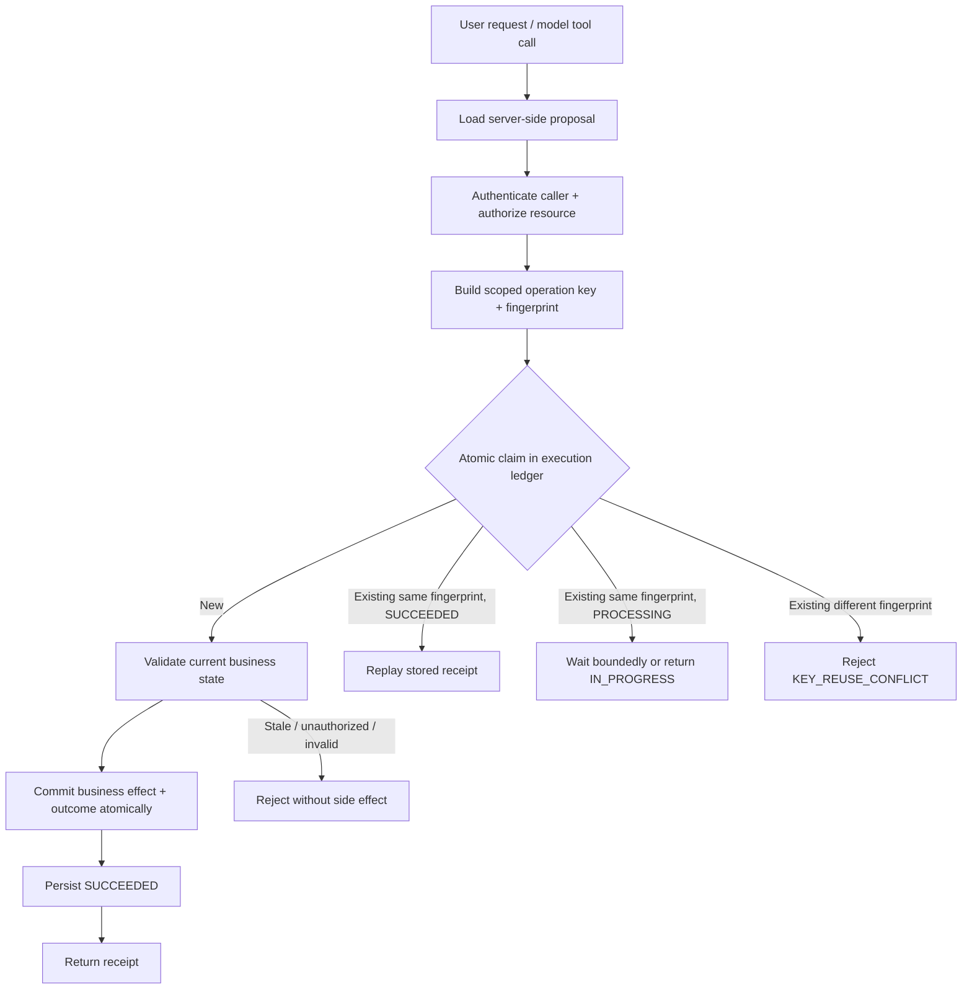
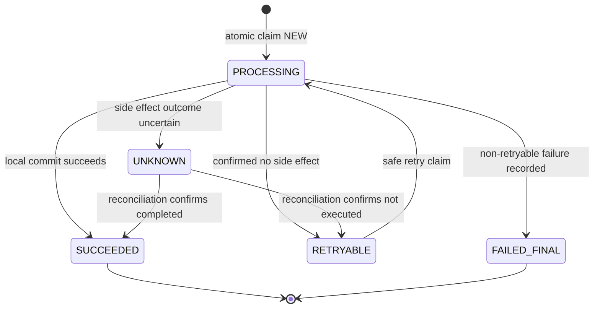

# Kiểm thử hành động lũy đẳng khi nhận yêu cầu trùng

Trong ứng dụng dùng Spring AI tool calling, mô hình có thể yêu cầu một công cụ thực hiện hành động như hoàn tiền, đăng ký khóa học, gửi email hoặc tạo đơn hàng. Một yêu cầu được thực thi thành công không có nghĩa caller chắc chắn nhận được phản hồi: kết nối có thể đứt, worker có thể khởi động lại hoặc người dùng nhấn “Xác nhận” lần nữa. Mô hình cũng có thể đề xuất lại cùng hành động ở một lượt tiếp theo vì nó không nhìn thấy kết quả cũ.

Nếu mỗi lần gọi `ToolCallback` đều tạo thêm một giao dịch, cùng một ý định có thể gây **nhiều side effect**: hoàn tiền hai lần, đăng ký học trùng, gửi hai email hoặc tạo hai thanh toán. Vì thế, khả năng **lũy đẳng** (*idempotency*) cần được thiết kế ở service và kiểm thử ở nhiều mức, không dựa vào lời nhắc “chỉ gọi công cụ một lần”.

Trong phạm vi module **SPRING_AI_TOOL_CALLING**, mô hình chỉ yêu cầu gọi công cụ qua `@Tool`, `ToolCallback` và input schema; **ứng dụng chịu trách nhiệm thực thi, xác thực quyền, xử lý lỗi và bảo vệ side effect**. `ToolContext` có thể chuyển danh tính và định danh workflow do backend tạo, nhưng không tự chống trùng. Bài học này xây dựng chiến lược kiểm thử từ lời gọi trùng tuần tự cho tới race condition, timeout sau commit, replay của confirmation và tác động tới dịch vụ ngoài.

Sau bài học, bạn có thể:

- Phân biệt **lệnh được gọi lặp**, **nghiệp vụ được thực hiện một lần** và **kết quả được trả lại nhất quán**.
- Nhận diện các nguồn duplicate trong client, mạng, hàng đợi, model loop và human approval.
- Xây dựng idempotency key có scope, ổn định qua retry nhưng khác nhau giữa hai ý định độc lập.
- Kiểm tra request fingerprint để chặn tái sử dụng một key cho hai lệnh khác nhau.
- Dùng unique constraint, transaction, state transition và execution ledger chống thực thi đồng thời.
- Xử lý side effect ở hệ thống ngoài bằng idempotency downstream, outbox và reconciliation.
- Viết unit test, integration test với database thật và concurrency test có thể tái lập.
- Kiểm thử trường hợp crash tại các điểm khác nhau, stale proposal và quyền bị thu hồi.

## 1. Lũy đẳng là gì?

Một phép toán `f` được gọi là lũy đẳng nếu áp dụng nó thêm một lần không làm thay đổi trạng thái so với sau lần áp dụng đầu tiên:

```text
f(f(state, operation), operation) = f(state, operation)
```

Trong ứng dụng nghiệp vụ, ta thường mong muốn:

- **Cùng ý định và cùng idempotency key**: tạo tối đa **một tác động nghiệp vụ được chấp nhận**.
- **Retry sau khi thành công**: không chạy lại side effect; trả kết quả đã ghi nhận hoặc tham chiếu đến kết quả đó.
- **Cùng key nhưng arguments khác**: từ chối bằng lỗi conflict; không dùng lặng lẽ kết quả của lệnh cũ.
- **Một ý định mới**: dùng key mới để cho phép thực hiện hành động mới, dù nội dung trùng lặp.

Ví dụ: “Gửi email nhắc học phí cho người A” có thể được phép gửi lần thứ hai **nếu người dùng chủ ý tạo một lệnh gửi mới**. Hệ thống không được suy ra mọi email giống nhau đều là duplicate. Ranh giới cần bảo vệ là **định danh của hành động nghiệp vụ**, không đơn thuần là nội dung giống nhau.

**Điểm kiểm thử:** một `ToolCallback` có thể được *invoke* ba lần, nhưng database chỉ tạo một bản ghi thanh toán và external gateway chỉ nhận một thao tác có hiệu lực. Đếm số lần gọi method không phải là thước đo duy nhất.

## 2. Những nguồn tạo ra yêu cầu trùng

| Nguồn | Điều gì xảy ra? | Rủi ro |
|---|---|---|
| Người dùng nhấn nút hai lần | Hai HTTP requests gửi cùng proposal | Tạo hai hành động nếu không có atomic claim |
| Client retry khi timeout | Server đã commit nhưng response mất | Thực hiện lại hành động vốn đã thành công |
| Gateway/load balancer retry | Request bị gửi lại cho instance khác | Lock trong một JVM không ngăn được |
| Message queue giao nhận lại | Consumer thấy cùng event nhiều lần | Side effect trùng sau crash hoặc visibility timeout |
| Mô hình gọi lại tool | Model không thấy hoặc không hiểu tool response | Callback bị gọi lần nữa ở vòng mới |
| Model tạo nhiều tool call | Hai call trỏ tới cùng proposal trong một assistant reply | Hai lần thực thi trong cùng batch |
| Human approval replay | Cùng paused reply và decision được resume hai lần | Công cụ được chạy lại |
| Worker restart/failover | Job mới lấy lại công việc cũ | Gửi lại lệnh tới dịch vụ bên ngoài |
| Retry ở nhiều tầng | HTTP, service và workflow đều tự retry | Số lần thực hiện có thể nhân lên |

Đừng kỳ vọng `parallelToolCalls` của model giải quyết tính trùng lặp. Nó liên quan tới khả năng mô hình phát nhiều tool call trong một response, không phải cơ chế đồng bộ giao dịch hoặc idempotency của hệ thống nghiệp vụ.

## 3. Phân biệt idempotent operation và idempotent transport

Một HTTP request bị gửi lại không phải lúc nào cũng là một **ý định nghiệp vụ mới**. Mỗi tầng có thể có ID riêng:

| ID | Mục đích | Có phù hợp làm idempotency key duy nhất? |
|---|---|---|
| HTTP request ID | Tương quan một lần truyền | Không nếu retry tạo request ID mới |
| Conversation ID | Nhóm nhiều lượt hội thoại | Không: quá rộng, nhiều hành động cùng conversation |
| Model tool-call ID | Ghép tool request với response | Không đủ: model có thể tạo ID mới khi đề xuất lại |
| Workflow ID | Nhóm tiến trình dài | Có thể quá rộng nếu workflow có nhiều side effect |
| Proposal ID | Định danh hành động cụ thể đã được server lưu | Thường phù hợp khi một proposal chỉ thực hiện một lần |
| Business operation ID | Định danh một ý định thực thi bất biến | Phù hợp nhất khi scope rõ ràng |

Để chống trùng hiệu quả, **ứng dụng sinh operation ID** lúc tạo ý định và lưu nó bền vững. Khi retry, dùng lại ID đó. Nếu muốn thực hiện hành động thứ hai, tạo operation ID mới, kể cả khi số tiền, người nhận và nội dung giống nhau.

`ToolCall.id()` do model/provider tạo có ích cho lịch sử hội thoại, nhưng một model response được sinh lại có thể dùng ID khác cho cùng ý định. Vì vậy không được xem ID của tool call là khóa duy nhất cho side effect tài chính.

## 4. Một quy trình lũy đẳng an toàn



Hình trên mô tả **đường ghi dữ liệu trong một transaction local**. Nếu side effect là gọi ngân hàng hoặc email service, không thể đưa transaction database và API ngoài vào cùng một ACID transaction thông thường. Ta cần biến thể có state, downstream idempotency key và bước đối soát (ở phần sau).

Có hai ranh giới quan trọng:

1. **Kiểm tra đúng ý định:** cùng key nhưng payload khác phải bị từ chối.
2. **Kiểm tra đồng thời:** hai request cùng key không được cùng vượt qua bước “chưa chạy” rồi thực hiện side effect.

Một câu lệnh `SELECT` để kiểm tra trùng, sau đó mới `INSERT` mà không có unique constraint hoặc lock **không đủ an toàn** trước race condition.

## 5. Tạo khóa theo phạm vi nghiệp vụ

Một idempotency key nên có scope rõ ràng:

```text
tenantId + actionType + businessOperationId
```

Ví dụ:

```text
tenant-08 / payments_execute_refund / proposal-rf-173
```

Nếu hệ thống hỗ trợ nhiều tenant, đừng để key `proposal-rf-173` của tenant A đè lên record tenant B. Với một đề xuất có nhiều side effect riêng, thêm `actionStepId` hoặc `effectType` để phân biệt mỗi bước.

```java
public record ActionIdentity(
        String tenantId,
        String actionType,
        String operationId
) {
    public ActionIdentity {
        if (tenantId == null || tenantId.isBlank()
                || actionType == null || actionType.isBlank()
                || operationId == null || operationId.isBlank()) {
            throw new IllegalArgumentException("Missing action identity");
        }
    }
}
```

Các ID trong ví dụ phải được lấy từ **proposal/operation đã lưu server-side và caller đã xác thực**, không lấy từ câu lệnh “hãy đặt key X” do mô hình tự tạo.

**Sai:** tạo UUID mới **mỗi lần retry**. Khi đó request lặp luôn có key khác và hệ thống không phát hiện trùng.

**Cũng sai:** dùng duy nhất `userId` hoặc `conversationId` làm key. Những khóa này có thể chặn nhầm các hành động hợp lệ tiếp theo của cùng người dùng.

## 6. Gắn key với fingerprint của payload

Cùng một key nhưng đổi nội dung là một hành động khác, không nên xem là retry.

Ví dụ:

```json
{
  "operationId": "proposal-rf-173",
  "paymentId": "PAY-77",
  "amount": "250000.00",
  "currency": "VND",
  "reason": "DUPLICATE_CHARGE"
}
```

Nếu request kế tiếp giữ `operationId` nhưng đổi `amount` thành `500000.00`, hệ thống phải báo `IDEMPOTENCY_KEY_REUSED` hoặc HTTP `409 Conflict` theo hợp đồng API.

Có thể lưu fingerprint như SHA-256 của **dạng canonical** của command:

```text
fingerprint = SHA-256(
  canonicalJson({actionType, paymentId, amount, currency, reason})
)
```

Cần xác định rõ quy tắc canonicalization:

- Sắp xếp key của object nếu thứ tự field không mang nghĩa.
- Chuẩn hóa định dạng tiền tệ và `BigDecimal` theo quy định (ví dụ hai chữ số thập phân); không để `250000.0` và `250000.00` bị coi khác khi nghiệp vụ xem chúng tương đương.
- Với danh sách có thứ tự nghiệp vụ, **giữ thứ tự**; chỉ sort nếu tập hợp thực sự không có thứ tự.
- Không hash những metadata biến đổi theo retry như timestamp nhận request hoặc trace ID.
- Đưa tất cả trường ảnh hưởng side effect vào fingerprint, kể cả scope/resource/version nếu phù hợp.

Fingerprint giúp **so khớp request**, không phải bằng chứng authorization. Cần kiểm tra quyền riêng, kể cả khi trả kết quả đã hoàn tất từ ledger. Không log payload thô hoặc fingerprint kèm thông tin nhạy cảm một cách không cần thiết.

## 7. Dùng execution ledger làm nguồn sự thật

Một execution ledger ghi **trạng thái hành động** thay vì chỉ giữ một Boolean `alreadyProcessed`.

| Trường | Mục đích |
|---|---|
| `tenant_id`, `action_type`, `idempotency_key` | Khóa duy nhất theo phạm vi |
| `request_fingerprint` | Phát hiện cùng key nhưng thay arguments |
| `status` | `PROCESSING`, `SUCCEEDED`, `RETRYABLE`, `UNKNOWN` hoặc `FAILED_FINAL` |
| `result_json` hoặc `receipt_id` | Trả lại kết quả đã thực thi |
| `external_operation_id` | Đối soát với downstream service |
| `created_at`, `updated_at` | Theo dõi vòng đời |
| `lease_owner`, `lease_until` | Thu hồi tác vụ kẹt một cách có kiểm soát |
| `expires_at` | Chính sách lưu trữ/dọn dẹp key |
| `last_error_code` | Chẩn đoán mà không lưu stack trace/secret |

Các trạng thái là **hợp đồng do ứng dụng thiết kế**, không phải enum mặc định trong Spring AI.



**Không** tự chuyển từ `UNKNOWN` sang `RETRYABLE` chỉ vì request đã timeout. Downstream có thể đã commit rồi làm mất response.

## 8. Cưỡng chế duy nhất ở database

Với PostgreSQL, có thể dùng unique constraint hoặc composite primary key:

```sql
CREATE TABLE tool_action_ledger (
    tenant_id            text NOT NULL,
    action_type          text NOT NULL,
    idempotency_key      text NOT NULL,
    request_fingerprint  char(64) NOT NULL,
    status               text NOT NULL,
    result_json          jsonb,
    external_operation_id text,
    lease_until          timestamptz,
    created_at           timestamptz NOT NULL DEFAULT CURRENT_TIMESTAMP,
    updated_at           timestamptz NOT NULL DEFAULT CURRENT_TIMESTAMP,
    PRIMARY KEY (tenant_id, action_type, idempotency_key)
);
```

Một phiên thực thi thử giành quyền claim:

```sql
INSERT INTO tool_action_ledger (
    tenant_id, action_type, idempotency_key,
    request_fingerprint, status
) VALUES (
    :tenantId, :actionType, :operationId,
    :fingerprint, 'PROCESSING'
)
ON CONFLICT (tenant_id, action_type, idempotency_key)
DO NOTHING;
```

Ứng dụng kiểm tra số dòng được thêm:

- **1 dòng:** đây là lần claim đầu tiên; có thể thực hiện nhánh nghiệp vụ của transaction.
- **0 dòng:** đã tồn tại một key cùng scope; đọc bản ghi hiện có, kiểm tra fingerprint và trạng thái rồi quyết định replay/conflict/in-progress.

Unique constraint là cơ chế đồng bộ xuyên nhiều instance. `synchronized` hoặc `ConcurrentHashMap` trong một JVM không thể thay thế nó nếu có nhiều pod, retry ở worker khác hoặc ứng dụng restart.

## 9. Cùng transaction cho claim, side effect local và receipt

Nếu side effect chỉ là thay đổi dữ liệu trong **cùng database**, một thiết kế mạnh là thực hiện claim, cập nhật nghiệp vụ và ghi receipt trong **một transaction**.

Ví dụ service minh họa sử dụng `JdbcTemplate` và một `ProposalRepository` của ứng dụng:

```java
@Service
public class EnrollmentExecutionService {

    private final JdbcTemplate jdbc;
    private final ProposalRepository proposals;
    private final ActionLedgerReader ledger;
    private final ObjectMapper json;
    private final EnrollmentAuthorization authorization;

    // Constructor inject các dependency ở trên.

    @Transactional(isolation = Isolation.READ_COMMITTED)
    public EnrollmentReceipt execute(
            String proposalId, CallerContext caller) {

        EnrollmentProposal proposal = proposals
            .findByIdAndTenantId(proposalId, caller.tenantId())
            .orElseThrow(ProposalNotVisibleException::new);

        authorization.requireCanExecute(caller, proposal);

        String action = "enrollments_execute_change";
        String key = proposal.operationId();
        String fingerprint = proposal.commandFingerprint();

        int claimed = jdbc.update("""
            INSERT INTO tool_action_ledger (
                tenant_id, action_type, idempotency_key,
                request_fingerprint, status
            ) VALUES (?, ?, ?, ?, 'PROCESSING')
            ON CONFLICT (tenant_id, action_type, idempotency_key)
            DO NOTHING
            """,
            caller.tenantId(), action, key, fingerprint);

        if (claimed == 0) {
            ActionRecord existing = ledger.require(
                caller.tenantId(), action, key);

            if (!fingerprint.equals(existing.requestFingerprint())) {
                throw new IdempotencyConflictException();
            }

            if (existing.status() == ActionStatus.SUCCEEDED) {
                return json.readValue(
                    existing.resultJson(), EnrollmentReceipt.class);
            }

            throw new ActionAlreadyProcessingException(key);
        }

        if (proposal.status() != ProposalStatus.APPROVED
                || proposal.isExpired()) {
            throw new StaleProposalException();
        }

        int updated = jdbc.update("""
            UPDATE enrollment
               SET class_id = ?, version = version + 1
             WHERE id = ?
               AND tenant_id = ?
               AND version = ?
               AND status = 'ACTIVE'
            """,
            proposal.targetClassId(),
            proposal.enrollmentId(),
            caller.tenantId(),
            proposal.expectedVersion());

        if (updated != 1) {
            throw new StaleProposalException();
        }

        EnrollmentReceipt receipt = new EnrollmentReceipt(
            key, proposal.enrollmentId(), proposal.targetClassId());

        jdbc.update("""
            UPDATE tool_action_ledger
               SET status = 'SUCCEEDED',
                   result_json = CAST(? AS jsonb),
                   updated_at = CURRENT_TIMESTAMP
             WHERE tenant_id = ?
               AND action_type = ?
               AND idempotency_key = ?
            """,
            json.writeValueAsString(receipt),
            caller.tenantId(), action, key);

        return receipt;
    }
}
```

**Đây là mã thiết kế minh họa**, giả định `ProposalRepository`/`ActionLedgerReader`/domain exceptions do ứng dụng xây dựng. Trên dự án thật phải xử lý các checked exceptions của Jackson hoặc dùng helper serialize có hợp đồng rõ ràng. Ngoài ra phải ghi trạng thái proposal `EXECUTED` trong cùng transaction và ràng buộc số dòng update/receipt đúng như chính sách.

Điểm cốt lõi: nếu bước cập nhật nghiệp vụ thất bại bằng **runtime exception** thì transaction rollback cả claim. Nếu thành công, ledger và bản ghi đăng ký học cùng commit. Với PostgreSQL, request khác tranh cùng unique key sẽ phải chờ xử lý xung đột; theo `READ COMMITTED`, sau commit nó có thể đọc receipt và trả lại thay vì chạy side effect lần hai.

Không bắt exception bên trong transaction rồi trả `SUCCESS`. Spring mặc định rollback cho `RuntimeException`/`Error`; nếu domain exception là checked exception, cần cấu hình rollback rule phù hợp. Tránh self-invocation làm `@Transactional` bị bỏ qua Spring proxy.

## 10. Một phiên bị trùng đang `PROCESSING` thì trả gì?

Không phải lúc nào lần gọi trùng cũng nên chờ vô hạn. Có các chính sách hợp lệ:

| Tình huống | Cách trả có thể chọn | Yêu cầu |
|---|---|---|
| Request đầu đã thành công | Trả receipt cũ | Phải so fingerprint và kiểm tra quyền |
| Request đầu vẫn chạy | `IN_PROGRESS` / HTTP `202`, kèm operation reference | Có API tra cứu trạng thái |
| Request đầu đang chạy, thời gian chờ ngắn | Chờ boundedly rồi replay receipt | Deadline rõ ràng; không giữ thread vô hạn |
| Cùng key nhưng payload khác | `409 Conflict` | Không thực hiện side effect thứ hai |
| Hành động bị từ chối nghiệp vụ | Trả trạng thái cuối đã lưu | Định nghĩa `FAILED_FINAL`/`REJECTED` rõ ràng |
| Kết quả downstream chưa xác định | `UNKNOWN` / `PENDING_RECONCILIATION` | Không gửi lệnh mới mù quáng |

Nếu dùng transaction local trong phần trước, bản ghi `PROCESSING` có thể chưa thấy từ transaction khác cho tới commit. Với workflow dài hoặc gọi mạng, nên **tách claim bền vững khỏi thực thi** và có lease/outbox rõ ràng; khi đó duplicate có thể thấy `PROCESSING` và nhận `202`. Hai mô hình này không được trộn lẫn tùy tiện.

## 11. Tách execution ledger khỏi `ToolCallback`

Một callback nên mỏng: lấy proposal ID và caller rồi chuyển cho service chịu trách nhiệm lũy đẳng.

```java
@Component
public class EnrollmentTools {

    private final EnrollmentExecutionService execution;

    public EnrollmentTools(EnrollmentExecutionService execution) {
        this.execution = execution;
    }

    @Tool(
        name = "enrollments_execute_change",
        description = "Áp dụng đề xuất đổi lớp đã được phê duyệt; "
            + "mỗi proposal chỉ có một hiệu lực nghiệp vụ.",
        requiresConfirmation = true
    )
    public EnrollmentReceipt executeChange(
            @ToolParam(description = "Mã proposal do server tạo")
            String proposalId,
            ToolContext toolContext) {

        CallerContext caller = (CallerContext)
            toolContext.getContext().get("caller");

        if (caller == null) {
            throw new AccessDeniedException("Missing trusted caller context");
        }

        return execution.execute(proposalId, caller);
    }
}
```

`requiresConfirmation` chỉ yêu cầu phê duyệt trước khi thực thi. **Nó không tự cung cấp idempotency**. Nếu một approval bị gửi hai lần, callback có thể được gọi hai lần; execution service mới là nơi ngăn duplicate side effect.

Nếu nhận `proposalId` trực tiếp từ model, vẫn phải tải proposal từ server, kiểm tra owner/tenant/approver, trạng thái và nội dung đã được người dùng xác nhận. Không dùng `idempotencyKey` do model tùy ý đặt để vượt qua policy hoặc “đổi key” sau lần gọi đầu.

## 12. Lặp lại một tool call khác với ý định nghiệp vụ mới

Hãy phân biệt bốn trường hợp:

| Tình huống | Cùng key? | Hành động nên có hiệu lực? |
|---|---|---|
| Model gửi lại cùng proposal trong vòng sau | Có | Không lặp side effect |
| User nhấn xác nhận lại một proposal | Có | Không lặp side effect |
| User tạo proposal **mới** cho hành động giống hệt | Không | Có thể có, tùy policy nghiệp vụ |
| Hai tool call khác nhau trong một batch nhưng cùng proposal | Có | Một hiệu lực; response nhất quán cho từng call |

Đừng dùng `ToolCall.id()` làm operation key duy nhất. Hai model responses có thể có ID khác nhau nhưng cùng chỉ tới proposal cũ. Cũng không được gộp hai proposal mới độc lập chỉ vì input JSON giống nhau.

Một cách đặt key cho nhiều bước trong cùng workflow:

```text
tenant / workflowId / actionStepId
```

Ví dụ `send_invoice_email` và `charge_payment` phải có key khác nhau; retry mỗi bước giữ nguyên key của bước đó.

## 13. Mô hình có thể gửi nhiều tool call trong cùng response

Giả sử response của mô hình gồm:

```json
[
  {"id":"call-1","name":"enrollments_execute_change",
   "arguments":"{\"proposalId\":\"P-42\"}"},
  {"id":"call-2","name":"enrollments_execute_change",
   "arguments":"{\"proposalId\":\"P-42\"}"}
]
```

Hai ID khác nhau nhưng đều là yêu cầu thực hiện **cùng một proposal P-42**. Nếu hệ thống kiểm tra trùng theo `toolCallId`, nó không nhận ra điều đó. Nếu service dùng `P-42` làm business operation ID và có unique constraint, chỉ một thao tác được commit.

Spring AI `ToolCallingManager` vẫn cần tạo **hai tool response** tương ứng `call-1` và `call-2` để giữ lịch sử tool request/response hợp lệ. Không tự gộp hoặc làm mất một tool result; việc gộp chỉ diễn ra ở **business effect**, không phải bằng cách xóa một message khỏi giao thức hội thoại.

## 14. Replay sau `ToolCallConfirmation`

Spring AI **2.1.0** cho phép `@Tool(requiresConfirmation = true)` và `ToolCallingManager.executeToolCalls(prompt, reply, decisions)`. Khi một response cần phê duyệt, manager pause trước khi chạy các call trong response đó.

**Giới hạn phải kiểm thử:** framework không tự chống replay của paused reply. Nếu ứng dụng gọi `executeToolCalls` hai lần với cùng reply và quyết định `ALLOW`, callback có thể thực sự chạy **hai lần**.

Thiết kế application layer cần:

1. Lưu paused reply ở server cùng `workflowId`/`proposalId` và trạng thái `PENDING_APPROVAL`.
2. Khi duyệt, xác thực approver và từng tool call; không nhận paused reply từ browser.
3. Ghi một quyết định `APPROVED` với compare-and-set hoặc transaction, gắn với reply/operation ID.
4. Đảm bảo execution service lũy đẳng ngay cả khi bước resume bị gọi lặp.
5. Khi retry, trả trạng thái hoặc receipt đã lưu, không chạy lại side effect.
6. Nếu denied, cũng lưu trạng thái resolved để không biến một deny đã hoàn tất thành allow trong lần gọi lại.

`ToolCallDecisions.toolCallKeys(...)` dùng tool call ID khi ID có mặt và duy nhất; nếu provider không có ID hoặc có ID trùng, có thể dùng khóa vị trí `#0`, `#1`. Những khóa đó giúp **ánh xạ quyết định tới các call trong reply**, không phải định danh bền vững cho side effect sau restart.

## 15. Không tin solely vào trạng thái hội thoại

Memory hoặc conversation history giúp mô hình biết công cụ đã được gọi, nhưng lịch sử **không phải hàng rào transaction**:

- Model có thể không thấy một tool result vì kết nối đứt hoặc turn bị compact.
- Model có thể chủ động gọi lại vì chưa chắc kết quả.
- Một request mới có thể chạy trên instance chưa đọc history mới nhất.
- History có thể bị replay hoặc lấy lại ở một thời điểm cũ.

Giữ idempotency trong domain service/database, độc lập với việc model có “nhớ” lệnh trước đó hay không. Khi nhận duplicate, response vẫn phải có định dạng hợp lệ cho `ToolResponseMessage` của lần gọi hiện tại.

Với hành động chỉ đọc, chạy lại thường an toàn về side effect nhưng vẫn có thể tốn chi phí. Có thể cache theo user/tenant/scope và TTL phù hợp; không cần ghi execution ledger cho mọi truy vấn đọc.

## 16. Giao dịch local và tác động tới hệ thống ngoài

Với thay đổi chỉ trong **một database**, ta có thể commit ledger và dữ liệu nghiệp vụ trong cùng transaction. Nhưng khi callback gọi API bên ngoài (ngân hàng, email provider, hệ thống học phí), `@Transactional` local không thể rollback hành động đã xảy ra bên ngoài.

Ví dụ:

```text
1. Local DB claim: PROCESSING
2. Gửi lệnh hoàn tiền tới payment gateway
3. Gateway đã commit hoàn tiền
4. Connection timeout, ứng dụng không nhận response
5. Worker restart rồi thử gửi lệnh lần nữa
```

Ở bước 4, kết quả thật là **UNKNOWN**, không phải `FAILED` một cách chắc chắn. Retry bằng một key khác có thể hoàn tiền hai lần.

Để bảo vệ, dùng **cùng downstream idempotency key** và API tra cứu theo operation ID nếu provider hỗ trợ. Nếu provider không hỗ trợ, cần reconciliation theo transaction reference, hoặc một quy trình vận hành để xử lý trạng thái không chắc chắn trước khi thực hiện lại.

## 17. Outbox và inbox cho xử lý không đồng bộ

Với hệ thống gửi sự kiện hoặc worker:

```mermaid
sequenceDiagram
    autonumber
    participant API as Tool Callback
    participant DB as Local DB
    participant W as Outbox Worker
    participant EXT as External Service
    API->>DB: Commit proposal state + outbox event atomically
    DB-->>API: Accepted + operation ID
    W->>DB: Claim undelivered outbox event
    W->>EXT: Execute with stable operation key
    EXT-->>W: Outcome or timeout
    W->>DB: Persist receipt or UNKNOWN
    Note over W,EXT: Redelivery may happen; downstream must deduplicate
```

**Outbox** bảo đảm việc ghi trạng thái local và ghi một ý định gửi message nằm trong cùng transaction. **Inbox** hoặc dedup ledger ở consumer dùng unique message/business operation key để ngăn xử lý trùng khi broker giao lại.

Một worker có thể gửi lại vì không nhận ACK. Vì vậy outbox **không tự mang lại exactly-once side effect** nếu downstream không có cơ chế idempotent. Kiểm thử phải bao gồm redelivery và timeout sau khi downstream đã thực hiện.

## 18. Lease và khả năng tiếp quản sau crash

Với hành động lâu, một worker có thể claim `PROCESSING` rồi chết. Nếu không có cơ chế phục hồi, operation kẹt mãi. Nếu worker khác lập tức chạy lại, có thể side effect đầu đã xảy ra.

Thiết kế thường có:

- `lease_owner` và `lease_until` để biểu diễn ai được phép xử lý trong khoảng thời gian nào.
- `attempt` hoặc **fencing token** tăng đơn điệu khi chuyển chủ sở hữu, nếu hệ thống đích hỗ trợ từ chối worker cũ.
- Kiểm tra trạng thái external operation trước khi reclaim một task có kết quả không chắc chắn.
- Phân biệt `RETRYABLE` đã xác minh **chưa** tạo hiệu lực với `UNKNOWN` cần đối soát.

**Lease hết hạn không chứng minh side effect chưa xảy ra.** Đó chỉ là tín hiệu worker cũ không còn giữ quyền độc quyền theo chính sách lease. Cần downstream idempotency hoặc reconciliation trước khi gửi lại lệnh.

## 19. Transaction và rollback phải được kiểm thử đúng

Có hai kiểu lỗi phải phân biệt:

**Lỗi trước commit local.** Ví dụ vi phạm version của enrollment, service ném `StaleProposalException` chưa tạo side effect ngoài. Transaction rollback, gồm cả ledger claim. Có thể báo proposal stale; không được cố commit payload cũ.

**Lỗi sau commit nhưng trước trả response.** Transaction đã thành công. Retry cùng key phải đọc ledger `SUCCEEDED` và replay receipt; không chạy lại ghi dữ liệu.

Trong Spring Framework, `@Transactional` mặc định rollback cho unchecked `RuntimeException` và `Error`; checked exception cần rollback rule phù hợp. Không dùng một `@Transactional` bọc cả cuộc gọi model, thời gian người dùng phê duyệt và external HTTP request; transaction nên ngắn quanh thay đổi local cần tính nguyên tử.

## 20. Thiết kế API phản hồi cho duplicate

Một API thực thi có thể quy định:

| Kết quả | HTTP minh họa | Ý nghĩa |
|---|---|---|
| Thực hiện thành công lần đầu | `200` hoặc `201` | Trả receipt mới |
| Retry trùng đã thành công | `200` và receipt đã lưu | Không thực thi lại |
| Lệnh đang được xử lý | `202 Accepted` | Cho phép tra cứu theo operation ID |
| Cùng key nhưng fingerprint khác | `409 Conflict` | Từ chối sử dụng key cho lệnh khác |
| Caller không có quyền | `403` hoặc `404` theo policy | Không tiết lộ kết quả của người khác |
| Proposal đã hết hạn hoặc version cũ | `409` / `412` tùy API | Cần tạo proposal mới |
| Downstream chưa xác định kết quả | `202` với trạng thái `UNKNOWN` | Chờ reconciliation, không tạo lệnh mới |

Đây là ví dụ thiết kế HTTP API của ứng dụng, **không phải** status code Spring AI tự gán cho tool result. Trong hội thoại tool calling, callback có thể trả một DTO tương ứng để mô hình diễn giải:

```json
{
  "status": "SUCCEEDED",
  "operationId": "proposal-rf-173",
  "receiptId": "refund-r-282",
  "alreadyProcessed": true,
  "message": "Hành động đã được thực hiện trước đó; không thực hiện lại."
}
```

`alreadyProcessed` chỉ giúp caller hiểu retry đã nhận kết quả cũ; nó không phải điều kiện để service quyết định có được chạy side effect hay không. Không để model tự đặt field này trong arguments.

## 21. Phương pháp kiểm thử: ba tầng

| Tầng | Mục tiêu | Công cụ kiểm thử phù hợp |
|---|---|---|
| **Unit test** | Phân nhánh key/fingerprint/status, quyền, business rule | JUnit 5, AssertJ, Mockito, fake clock |
| **Integration test với DB** | Unique constraint, transaction, rollback, race, idempotency receipt | Spring Boot Test, JDBC/JPA, Testcontainers PostgreSQL |
| **End-to-end tool calling** | Model tạo call, callback chạy, replay reply/confirmation và tool response chính xác | Fake `ChatModel`, `ToolCallingManager`, callback stub, test application context |

Chỉ test bằng Mockito rằng `paymentGateway.charge()` được gọi một lần **không chứng minh** hai transaction trên hai instance cùng tranh khóa sẽ an toàn. Concurrency và unique constraint cần integration test với database thực sự tương thích production.

Ngược lại, một DB integration test cũng không chứng minh history của Spring AI giữ đủ tool response ID khi có hai duplicate calls. Cần kiểm thử giao thức hội thoại riêng.

## 22. Test 1 — Cùng key, cùng payload, hai lần tuần tự

Lần thứ nhất tạo receipt, lần thứ hai trả cùng receipt và database chỉ có một hiệu lực.

```java
@Test
void duplicateSequentialRequestReturnsSameReceipt() {
    CallerContext caller = testCaller("tenant-a", "user-1");
    EnrollmentProposal proposal = approvedProposal("P-104");

    EnrollmentReceipt first =
        executionService.execute(proposal.id(), caller);

    EnrollmentReceipt second =
        executionService.execute(proposal.id(), caller);

    assertThat(second.operationId()).isEqualTo(first.operationId());
    assertThat(second.enrollmentId()).isEqualTo(first.enrollmentId());

    assertThat(enrollmentRepository.countChangeByOperationId(
        proposal.operationId())).isEqualTo(1);

    assertThat(ledgerRepository.countByBusinessKey(
        "tenant-a", "enrollments_execute_change",
        proposal.operationId())).isEqualTo(1);
}
```

Đây là khung integration test với các fixtures/repository của ứng dụng. Nếu domain không tạo bảng `change` riêng, assert version/chuyển trạng thái hoặc transaction record thực tế. Không chỉ assert hai response có cùng text; phải kiểm tra side effect đã commit.

**Một bổ sung quan trọng:** nếu người dùng bị thu hồi quyền sau lần thực thi đầu, request retry không được tự động đọc receipt có dữ liệu nhạy cảm. Kiểm tra quyền trước khi replay hoặc trả một trạng thái đã được redact theo policy.

## 23. Test 2 — Cùng key nhưng payload khác

Khi key bị dùng lại cho command khác, không được trả receipt cũ như thể nó tương ứng với command mới:

```java
@Test
void rejectsSameKeyWithDifferentFingerprint() {
    ActionIdentity identity = new ActionIdentity(
        "tenant-a", "payments_execute_refund", "refund-op-9");

    actionExecutor.execute(identity,
        fingerprintOf("PAY-77", "250000.00"), commandFor(250000));

    assertThatThrownBy(() ->
        actionExecutor.execute(identity,
            fingerprintOf("PAY-77", "500000.00"), commandFor(500000))
    ).isInstanceOf(IdempotencyConflictException.class);

    assertThat(refundRepository.countByOperationId("refund-op-9"))
        .isEqualTo(1);
}
```

`actionExecutor`, `fingerprintOf` và `commandFor` là fixtures/abstractions của ứng dụng, không phải API Spring AI. Test này phải đi vào đường xử lý trùng **trước** khi gọi downstream lần hai.

## 24. Test 3 — Nhiều request đồng thời

Dùng nhiều thread và **database thực** để ép các request tranh cùng một unique key:

```java
@Test
void concurrentDuplicatesCommitOnlyOneBusinessEffect()
        throws Exception {

    int callers = 12;
    ExecutorService pool = Executors.newFixedThreadPool(callers);
    CountDownLatch start = new CountDownLatch(1);

    try {
        List<Future<EnrollmentReceipt>> attempts = new ArrayList<>();
        for (int i = 0; i < callers; i++) {
            attempts.add(pool.submit(() -> {
                start.await();
                return executionService.execute("P-104", testCaller());
            }));
        }

        start.countDown();

        Set<String> receiptIds = new HashSet<>();
        for (Future<EnrollmentReceipt> attempt : attempts) {
            EnrollmentReceipt receipt =
                attempt.get(10, TimeUnit.SECONDS);
            receiptIds.add(receipt.operationId());
        }

        assertThat(receiptIds).containsExactly("operation-P-104");
        assertThat(ledgerRepository.countSuccessful("operation-P-104"))
            .isEqualTo(1);
        assertThat(enrollmentRepository.countCommittedChanges("P-104"))
            .isEqualTo(1);
    }
    finally {
        pool.shutdownNow();
    }
}
```

Ví dụ giả định đường local-transaction chọn chính sách **chờ conflict commit rồi replay receipt**. Nếu implementation trả `IN_PROGRESS` thay vì chờ, sửa phần kiểm tra: các request được phép trả `IN_PROGRESS`, rồi poll đến `SUCCEEDED` bằng cùng key; assertion cốt lõi vẫn là **đúng một hiệu lực**.

Để test có ý nghĩa:

- Không bọc toàn bộ test method bằng transaction chung khiến mỗi worker nhìn một snapshot sai.
- Mỗi thread phải gọi service qua Spring proxy để `@Transactional` thực sự áp dụng.
- Dùng barrier/latch ở vị trí **sau khi claim và trước khi commit** để cưỡng bức overlap, không dựa hoàn toàn vào timing ngẫu nhiên.
- Chạy lặp test nhiều lần hoặc dùng fault injection nếu cần bắt race hiếm.
- Không dùng `Thread.sleep(...)` như bằng chứng chắc chắn rằng hai transaction đã giao nhau.

## 25. Test 4 — Timeout sau commit trước khi trả kết quả

Đây là trường hợp kiểm thử quan trọng nhất vì client không biết request đầu đã thành công.

Kịch bản:

```text
1. Client gửi operation-P-104.
2. Server commit thay đổi lớp + ledger SUCCEEDED.
3. Test proxy cắt kết nối hoặc ném lỗi trước khi response tới client.
4. Client retry cùng operation-P-104.
5. Server đọc ledger, trả receipt cũ.
6. Assert chỉ một thay đổi lớp được commit.
```

Với integration test, đặt fault hook **sau commit nhưng trước response serialization** ở HTTP/application boundary. Đừng ném exception bên trong transaction rồi gọi đó là “timeout sau commit”: exception trong transaction có thể làm rollback, và test sẽ kiểm tra một tình huống khác.

Nếu domain có payment gateway, sau khi nhận timeout cần kiểm tra trạng thái downstream theo operation ID. Một stub luôn trả timeout **trước** khi xử lý giao dịch không đủ để kiểm tra trường hợp gateway đã commit nhưng client mất response.

## 26. Test 5 — Crash, restart và replay hàng đợi

Một hệ thống nhiều instance phải tồn tại qua restart:

- Claim được lưu bền vững; worker A chết khi `PROCESSING`.
- Worker B nhìn ledger và lease, không tự chạy lại nếu kết quả external chưa rõ.
- Outbox event được giao lại sau khi worker đã gửi thành công nhưng chưa ACK.
- Consumer deduplicate theo business operation ID.
- Nếu downstream đã commit, reconciliation chuyển ledger sang `SUCCEEDED` mà không gửi lại một hành động với key mới.

Có thể dùng Testcontainers để khởi động lại application context hoặc worker trong test; database/outbox phải tồn tại xuyên qua vòng đời worker. Với external mock server, giữ trạng thái nhận key/operation giữa các lần ứng dụng restart.

Kết quả mong đợi là **một effect** hoặc trạng thái `UNKNOWN` đang được đối soát, không phải tự suy ra `FAILED` rồi phát lệnh mới.

## 27. Test 6 — Replay quyết định xác nhận Spring AI

Test phải tái tạo đúng flow:

1. Fake model trả `ChatResponse` chứa `ToolCall` tới công cụ `requiresConfirmation=true`.
2. `ToolCallingManager` pause và báo yêu cầu quyết định; assert callback **chưa chạy**.
3. Ứng dụng lưu paused reply phía server.
4. Approver được xác thực và lưu quyết định `ALLOW`.
5. Gọi `executeToolCalls(prompt, savedReply, decisions)`.
6. Mô phỏng client gửi lại cùng approval hoặc worker resume lần hai.
7. Assert execution ledger có một `SUCCEEDED` và side effect chỉ commit một lần.

Ví dụ test tầng nghiệp vụ:

```java
@Test
void reusingApprovedProposalDoesNotRepeatSideEffect() {
    PausedReply paused = pausedReplyStore.require("pause-104");

    ToolCallDecisions decisions = ToolCallDecisions.of(
        ToolCallDecision.allow("call-104")
    );

    resumeService.resume(paused, decisions, approver);
    resumeService.resume(paused, decisions, approver); // duplicate replay

    assertThat(operationLedger.countSucceeded("operation-P-104"))
        .isEqualTo(1);
    assertThat(enrollmentRepository.countCommittedChanges("P-104"))
        .isEqualTo(1);
}
```

`resumeService` và `PausedReply` là các thành phần do ứng dụng xây dựng. Một implementation có thể từ chối lần resume thứ hai ngay ở workflow state machine; đó cũng là kết quả đúng. Tuy nhiên, **vẫn phải** giữ idempotency ở service vì có thể có đường gọi trực tiếp khác bỏ qua resume guard.

Đừng nhận `ChatResponse` hoặc arguments do browser gửi lại làm nguồn sự thật. Người dùng có thể sửa công cụ hoặc payload; ứng dụng cần lấy paused reply từ server storage.

## 28. Test 7 — Hai tool call trùng trong cùng assistant response

Fake model có thể tạo hai call cùng proposal nhưng tool call ID khác nhau:

```text
ToolCall(id=call-1, name=enrollments_execute_change, proposal=P-104)
ToolCall(id=call-2, name=enrollments_execute_change, proposal=P-104)
```

Test xác nhận:

- Hai `ToolResponse` đều được tạo, với `id` tương ứng `call-1` và `call-2`.
- Cùng business operation `P-104` chỉ commit một lần.
- Response thứ hai biểu diễn kết quả đã xử lý hoặc trạng thái in-progress, không tạo side effect mới.
- Nếu cả hai call cùng nằm trong batch có confirmation, không có call nào chạy trước khi quyết định được cung cấp.

Không “fix” test bằng cách bỏ result của call thứ hai khỏi history. Việc đó có thể phá giao thức tool request/response mà model provider yêu cầu.

## 29. Test 8 — Quyền, tenant và thay đổi trạng thái

Idempotency không tạo ra quyền cho request mới. Một key tồn tại không có nghĩa bất kỳ caller nào biết key cũng được xem receipt hoặc gọi lại hành động.

Kiểm thử:

| Trường hợp | Kết quả |
|---|---|
| Cùng operation ID ở tenant A và B | Tách scope; không dùng nhầm receipt |
| User khác trong cùng tenant đoán được key | Không xem kết quả nếu không có quyền trên resource |
| Caller bị thu hồi quyền sau lần đầu | Lần retry không được lộ receipt trái quyền |
| Proposal bị sửa sau phê duyệt | Fingerprint/digest không khớp; từ chối |
| Resource đổi version trước commit | Stale/conflict, không ghi và không coi là duplicate success |
| Cùng key, cùng payload nhưng action type khác | Hai namespace độc lập theo policy |
| Key hợp lệ nhưng không thuộc caller | Không claim hoặc replay trái quyền |

Khi retry trên operation đã `SUCCEEDED`, một implementation có thể trả receipt đã lưu; vẫn cần kiểm tra dữ liệu nào được phép trả cho caller hiện tại. Có thể trả mã trạng thái tối giản thay vì thông tin nhạy cảm nếu quyền đã đổi.

## 30. Test 9 — TTL, hết hạn key và dọn dẹp ledger

Nếu xóa execution ledger quá sớm, một yêu cầu cũ có thể đến lại sau khi key không còn tồn tại. Hệ thống sẽ coi nó là hành động mới và tạo side effect trùng.

Hãy xác định retention theo nghiệp vụ:

- Thời gian tối đa client/gateway có thể retry.
- Thời gian message queue có thể redeliver.
- Thời gian pause/resume và workflow recovery.
- Quy định đối soát, chargeback, audit và lưu hồ sơ tài chính.
- Khả năng downstream còn nhận diện idempotency key.

Không có TTL chung phù hợp cho mọi hành động. Với nghiệp vụ tài chính, có thể cần giữ định danh operation/receipt lâu hơn thời gian cache response. Nếu phải dọn payload nhạy cảm, giữ một tombstone hoặc business operation reference đủ ngăn duplicate được xác định trong giới hạn retention đã công bố.

Test nên mô phỏng clock thay vì chờ thời gian thực. Sau khi “hết hạn”, xác minh hệ thống từ chối key cũ, yêu cầu tạo operation mới hoặc vẫn nhận diện đã thực thi theo policy; không vô tình chạy lại side effect.

## 31. Test 10 — Lỗi phân loại và retry policy

Không phải lỗi nào cũng được retry:

| Trạng thái | Retry? | Điều kiện |
|---|---|---|
| Validation error | Không | Sửa payload, cần operation phù hợp |
| Không đủ quyền | Không | Authorization phải được kiểm tra lại |
| Proposal stale | Không tự retry lệnh cũ | Tạo proposal mới và xác nhận lại |
| Database transaction rollback trước commit | Có thể | Cùng key, có giới hạn và kiểm tra trạng thái |
| Deadlock/serialization failure | Có thể | Retry bounded với toàn bộ transaction, cùng key |
| HTTP timeout từ external service | Không mù quáng | Query status / same downstream idempotency key |
| Đã `SUCCEEDED` | Không chạy lại | Replay result |
| `PROCESSING` đang có worker | Không chạy thêm | Chờ bounded hoặc trả `IN_PROGRESS` |
| `UNKNOWN` | Không cho tới khi đối soát | Chờ reconciliation |

Không cho model tự quyết định số lần retry hoặc tạo key mới cho một lần thử. Áp dụng retry ở **một tầng có trách nhiệm rõ ràng** để tránh nested retries giữa HTTP client, callback, advisor và job queue.

## 32. Quan sát và kiểm thử số lần thực thi thật

Một dashboard idempotency có thể theo dõi:

| Metric/event | Ý nghĩa |
|---|---|
| `tool.invocations` | Số lần callback được gọi |
| `business.operation.committed` | Số side effect thực sự được commit |
| `idempotency.duplicate_detected` | Số request cùng key bị nhận diện là duplicate |
| `idempotency.key_conflict` | Cùng key, khác fingerprint |
| `idempotency.in_progress` | Các lần gọi tới operation đang chạy |
| `idempotency.reconciled` | Số operation `UNKNOWN` được đối soát |
| `business.operation.failed` | Lỗi nghiệp vụ/kỹ thuật phân loại |

Có thể ghi `operationId` hoặc `requestId` ở audit log/trace có phân quyền, nhưng **không** dùng các ID cá biệt đó làm label metric có cardinality cao. Dùng action type, workflow và outcome (tập hữu hạn) cho metrics.

Khi test, so sánh **invocation count** với **committed count**. Một test có thể chứng minh `tool.invocations = 5` và `business.operation.committed = 1` — đó là tín hiệu cơ chế chống trùng hoạt động. Tuy nhiên việc ghi metrics phải phản ánh kết quả commit đáng tin cậy; một counter tăng **trước** commit có thể đếm cả giao dịch rollback.

## 33. Bộ ma trận kiểm thử tối thiểu

| # | Tình huống | Assertion quan trọng |
|---|---|---|
| 1 | Một request hợp lệ | Một receipt, một effect |
| 2 | Retry tuần tự cùng key/payload | Cùng receipt, effect không tăng |
| 3 | Cùng key khác payload | Conflict, effect không tăng |
| 4 | 10–20 request đồng thời | Một winner; các request khác replay/pending |
| 5 | Timeout trước commit | Không có effect; retry an toàn nếu policy cho phép |
| 6 | Timeout sau commit | Retry replay result, không chạy lại |
| 7 | Worker crash sau claim | Lease/recovery không gây double effect |
| 8 | Broker redelivery | Consumer inbox dedup |
| 9 | Model tool call lặp với ID mới | Business key cũ vẫn dedup |
| 10 | Hai tool call cùng proposal một response | Hai tool results, một effect |
| 11 | Confirmation ALLOW bị replay | Không thực thi hai lần |
| 12 | Confirmation DENY bị replay | Không sinh side effect |
| 13 | Key của tenant khác | Không đọc/ghi chéo tenant |
| 14 | Quyền caller bị thu hồi | Không lộ receipt/không thực thi trái quyền |
| 15 | Expired proposal | Không tái dùng approval cũ |
| 16 | Ledger retention/TTL | Không vô tình xử lý lại operation cũ |
| 17 | External API timeout sau xử lý | Reconcile hoặc dùng downstream key ổn định |
| 18 | Nested retry nhiều tầng | Giới hạn tổng attempt, effect vẫn một |
| 19 | DB rollback/serialization failure | Retry transaction có kiểm soát, cùng key |
| 20 | App restart với cùng operation | Ledger bền vững và kết quả nhất quán |

**Tiêu chí pass**: không chỉ “test không ném exception”, mà phải chứng minh state cuối, số effect, đúng receipt, đúng quyền, đúng tool response và hành vi recovery.

## 34. Những lỗi triển khai thường gặp

| Sai lầm | Hậu quả | Cách khắc phục |
|---|---|---|
| Dùng `toolCallId` như business key | Model sinh ID mới rồi lệnh chạy lại | Dùng proposal/business operation ID server-side |
| Tạo UUID mới trên mỗi retry | Mọi retry được coi là lệnh mới | Giữ key từ ý định gốc |
| `SELECT` rồi `INSERT` không unique | Hai thread đều thấy “chưa tồn tại” | Unique constraint + atomic claim |
| Lock trong JVM | Không chặn request trên instance khác | Ledger bền vững ở DB |
| Ghi `SUCCEEDED` trước side effect | Có thể trả thành công dù chưa thực hiện | Commit outcome gắn với effect |
| Không lưu fingerprint | Cùng key bị đổi số tiền | So canonical payload, reject conflict |
| Cho phép key từ model tự tạo | Prompt injection tạo key mới dễ dàng | Server sở hữu operation identity |
| Xem timeout là failed chắc chắn | Double charge/refund/email | UNKNOWN + reconcile |
| Dùng `@Transactional` bao API ngoài | Rollback DB không rollback remote effect | Downstream key/outbox/saga |
| Chỉ test Mockito `times(1)` | Không phát hiện race giữa hai transaction | Integration test DB thật + concurrent calls |
| Dọn ledger quá sớm | Old retry trở thành new operation | Retention/tombstone theo nghiệp vụ |
| Replay cached receipt không kiểm tra quyền | Lộ thông tin sau thu hồi quyền | Reauthorize trước replay |
| Duplicate tool call không tạo tool response | Hỏng conversation history | Một result cho mỗi tool-call ID |

## 35. Checklist khi áp dụng vào Spring AI

- Xác định **một ý định nghiệp vụ** tương ứng với **một operation ID** do server tạo.
- Truyền `CallerContext` qua `ToolContext`, không giao model tự đặt identity hoặc idempotency key.
- Tách `@Tool` adapter khỏi service có transaction/ledger.
- Định nghĩa scope `tenant + action + operationId`.
- Canonicalize command và lưu fingerprint; reject cùng key khác payload.
- Dùng unique constraint/atomic claim xuyên nhiều instance.
- Với local DB effect, commit claim, domain update và receipt trong cùng transaction.
- Với external effect, dùng downstream idempotency key, outbox/inbox và reconciliation.
- Có state machine cho `PROCESSING`, `SUCCEEDED`, `UNKNOWN`, `RETRYABLE` và `FAILED_FINAL`.
- Kiểm tra quyền trước khi chạy **và** trước khi replay kết quả nhạy cảm.
- Với `requiresConfirmation`, lưu paused reply server-side và chống replay ở application/service.
- Không dùng tool-call ID hoặc conversation ID làm khóa duy nhất cho mọi hành động.
- Retry cùng key và có giới hạn; không để model tự tạo lệnh mới khi một hiệu lực chưa rõ.
- Test tuần tự, cạnh tranh, timeout sau commit, restart, duplicate batch và approval replay.
- Assert side effect ở database/downstream, không chỉ số lần gọi method hoặc câu trả lời cuối.
- Đo duplicate detection và committed effects mà không đưa operation ID vào metric labels.

## 36. Ghi nhớ

- **Lũy đẳng không có nghĩa callback chỉ được gọi một lần**; nó nghĩa là cùng ý định được retry mà không tạo thêm hiệu lực nghiệp vụ.
- Spring AI tạo và thực thi tool calls nhưng **không tự bảo đảm** idempotency cho tool nghiệp vụ.
- `ToolCall.id()` giúp ghép request/response, không phải luôn là business operation ID bền vững.
- `@Tool(requiresConfirmation = true)` là cổng phê duyệt, không tự chống replay của quyết định `ALLOW`.
- Sử dụng key có scope, fingerprint, durable ledger và unique constraint để chống duplicate tuần tự/đồng thời.
- `@Transactional` bảo vệ thay đổi local, không tự rollback external HTTP side effect.
- Timeout sau commit là trường hợp phải test; outcome có thể **chưa rõ**, không phải chắc chắn thất bại.
- Một yêu cầu trùng có thể cần tool response riêng dù chỉ có một business effect.
- Test phải quan sát **effect thực**, receipt, quyền và recovery, không chỉ call count.

Khi viết tool có khả năng thay đổi dữ liệu, hãy coi duplicate là tình huống bình thường của một hệ thống phân tán. Thiết kế operation identity, trạng thái thực thi và transaction trước; sau đó cố tình tạo retry, race, crash và replay trong test. Nếu mọi đường đều giữ **một hiệu lực được phép cho cùng một ý định**, assistant mới có thể tích hợp hành động nghiệp vụ một cách an toàn dù mô hình hoặc hạ tầng lặp lại lời gọi.

## Tài liệu tham khảo

- [Spring AI 2.1.0 — Tool Calling](https://docs.spring.io/spring-ai/reference/api/tools.html)
- [Spring AI 2.1.0 — Tool Call Confirmation và giới hạn chống replay](https://docs.spring.io/spring-ai/reference/api/tools/tool-call-confirmation.html)
- [Spring Framework — Declarative Transaction Management](https://docs.spring.io/spring-framework/reference/data-access/transaction/declarative.html)
- [Spring Framework — Rollback Rules](https://docs.spring.io/spring-framework/reference/data-access/transaction/declarative/rolling-back.html)
- [PostgreSQL — INSERT và ON CONFLICT](https://www.postgresql.org/docs/current/sql-insert.html)
- [OWASP API Security — Unrestricted Access to Sensitive Business Flows](https://owasp.org/API-Security/editions/2023/en/0xa6-unrestricted-access-to-sensitive-business-flows/)
