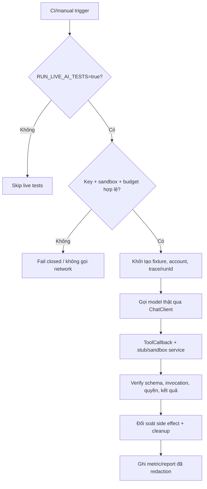

# Kiểm thử tích hợp có kiểm soát với mô hình và dịch vụ thật

Một bài kiểm thử Spring AI Tool Calling có thể chạy hoàn hảo với mock model nhưng vẫn thất bại khi kết nối với mô hình thật: mô hình không gọi tool, chọn nhầm tên tool, tạo JSON arguments sai, gọi nhiều lần hoặc diễn đạt kết quả không đúng kỳ vọng. Ngược lại, một bài kiểm thử gọi provider thật nhưng để tool tác động lên database production là quá rủi ro. Vì vậy, cần xây dựng **kiểm thử tích hợp có kiểm soát**: chỉ dùng mô hình thật ở những bài cần kiểm tra hành vi của mô hình; chỉ chạm dịch vụ thật trong sandbox có giới hạn; và luôn xác minh side effect qua nguồn nghiệp vụ độc lập.

Trong Spring AI, `@Tool` hoặc `ToolCallback` mô tả cách ứng dụng thực thi một hành động, còn `ChatClient`/`ChatModel` gửi tool definitions cho mô hình. Mô hình đề xuất tên tool và JSON arguments; `ToolCallingAdvisor` cùng `ToolCallingManager` điều phối callback khi ứng dụng cho phép. Kết quả cuối không phải bằng chứng duy nhất rằng tool đã chạy hoặc ghi dữ liệu thành công. **Test phải quan sát cả tool selection, arguments, thực thi thật, quyền truy cập, kết quả nghiệp vụ và câu trả lời cuối.**

Bài này tập trung vào việc đánh giá tích hợp Spring AI Tool Calling với **mô hình và dịch vụ thật** mà vẫn bảo vệ dữ liệu, chi phí, quyền truy cập, tính ổn định của CI và trạng thái bên ngoài. Không có yêu cầu nào trong bài đòi chạy live test trong môi trường học tập hiện tại; các ví dụ là thiết kế để triển khai trong dự án khi có môi trường sandbox được cấp phép.

## 1. Kiểm thử “tích hợp thật” nghĩa là gì?

Câu “đã test với model thật” chỉ mô tả một phần. Cần chỉ rõ những thành phần nào được kết nối thực sự:

| Tầng | Mô hình | Tool callback/service | Mục tiêu | Chạy khi nào |
| --- | --- | --- | --- | --- |
| L0 — Unit/contract | Fake hoặc không dùng model | Mock/fake | Kiểm tra schema, policy, input/output, exception, idempotency | Mỗi commit |
| L1 — Local integration | Fake `ChatModel` hoặc scripted model | Spring context + database/container giả lập | Kiểm tra wiring, advisor loop, callback resolution, persistence | Mỗi PR |
| L2 — Live-model controlled | **Provider/model thật** | Fixture in-memory, local stub, WireMock/Testcontainers | Kiểm tra tool selection, arguments, nhiều vòng, diễn đạt kết quả | CI được cấp quyền / theo lịch |
| L3 — Live-model + service sandbox | **Provider/model thật** | **Sandbox thật** của API/DB/queue được cô lập | Kiểm tra hợp đồng và hành vi cross-system | Sau thay đổi tích hợp, trước release |
| L4 — Staging end-to-end | Model thật | Staging giống production, dữ liệu tổng hợp | Đánh giá luồng nghiệp vụ, approval, authz, vận hành | Release gate/canary có kiểm soát |

Đừng đòi mọi PR đều chạy L3/L4. Lớp càng thật càng chậm, đắt, có thể gặp rate-limit hoặc lỗi tạm thời. Unit/contract tests phải chịu trách nhiệm xác minh các quy tắc bảo mật và nghiệp vụ mang tính xác định; live tests tìm lỗi tương tác phát sinh do mô hình/provider và cách lắp ghép hệ thống.

Ví dụ: L0 kiểm tra `cancelOrder` từ chối tenant khác. L2 kiểm tra mô hình có chọn `getOrderStatus` thay vì `cancelOrder` khi chỉ được hỏi trạng thái. L3 kiểm tra adapter thật với sandbox của hệ thống đơn hàng, gồm HTTP status, authentication, serialization, timeout và trạng thái commit.

## 2. Xác định câu hỏi thử nghiệm trước khi kết nối provider

Một test có mục tiêu tốt phải nói rõ đang xác minh điều gì và thành phần nào làm bằng chứng:

| Câu hỏi | Bằng chứng đáng tin | Không nên dùng làm bằng chứng duy nhất |
| --- | --- | --- |
| Mô hình có đề xuất đúng tool? | Tool-call name trong raw reply hoặc callback spy | Câu trả lời cuối nghe có vẻ đúng |
| Arguments có đúng schema? | JSON được parse/validate và callback nhận được | Mô hình “nói rằng” đã truyền đúng |
| Tool đã thực thi? | Invocation counter/event/audit của service | Model text “tôi đã gọi tool” |
| Đọc đúng dữ liệu? | Fixture hoặc sandbox database độc lập | Văn bản do model tạo |
| Có ghi side effect đúng một lần? | Ledger/idempotency record, transaction/outbox | HTTP 200 hoặc tool output `SUCCESS` không đối soát |
| Có từ chối truy cập vượt quyền? | Policy decision và không có downstream invocation | Model nói “không được phép” |
| Có dừng ở approval gate? | Paused `ChatResponse`, callback chưa chạy | Response text rỗng |
| Có chịu được lỗi provider? | Retry/timeout/error path đã được giới hạn | Test đợi không giới hạn tới khi “may mắn” thành công |
| Người dùng có nhận đúng kết quả? | Assertion trên dữ kiện nghiệp vụ/format/evaluator | Exact string snapshot cố định |

Một test có thể PASS ở tầng tool selection nhưng FAIL ở tầng business outcome. Hãy ghi các outcome riêng thay vì một boolean “AI OK”.

## 3. Các cổng an toàn bắt buộc cho live tests

Trước khi có bất kỳ network request nào tới model/provider hoặc service sandbox, cần kiểm tra:

- **Explicit opt-in:** chỉ chạy khi biến môi trường `RUN_LIVE_AI_TESTS=true` và job/tag được chọn.
- **Credential phù hợp:** API key lấy từ CI secret store, phạm vi sandbox, không commit vào repository/log hoặc test report.
- **Cô lập endpoint:** provider/model được cho phép, service URL trỏ sandbox; xác minh fail-closed nếu URL trỏ production.
- **Giới hạn chi phí và lưu lượng:** max cases, max attempts, max model rounds/tool calls, tokens, request timeout, concurrency và tổng ngân sách.
- **Dữ liệu tổng hợp:** dùng ID và tên giả, không dùng khách hàng/số thẻ thật; chính sách bảo mật của provider phải cho phép gửi dữ liệu thử nghiệm.
- **Quyền tối thiểu:** test principal chỉ có quyền trên tenant sandbox, không có tool quản trị production.
- **Cleanup/compensation:** từng test ghi dữ liệu phải có resource namespace, idempotency key và phương án dọn dẹp/đối soát.
- **Quan sát an toàn:** log run ID, model/version, tool name, outcome, chi phí; che prompt/arguments chứa thông tin nhạy cảm.
- **Kill switch:** có thể dừng suite ngay khi thấy sai môi trường, vượt chi phí hoặc external side effect bất thường.

Không “tự động chuyển sang production nếu sandbox không khả dụng”. Test phải FAIL/SKIP có giải thích thay vì gọi hệ thống thật ngoài phạm vi dự kiến.

## 4. Cấu hình JUnit: tách live test khỏi unit test

Với JUnit Jupiter có thể dùng `@Tag` và `@EnabledIfEnvironmentVariable`:

~~~java
import org.junit.jupiter.api.Tag;
import org.junit.jupiter.api.condition.EnabledIfEnvironmentVariable;
import org.springframework.boot.test.context.SpringBootTest;
import org.springframework.test.context.ActiveProfiles;

@Tag("live-ai")
@EnabledIfEnvironmentVariable(
        named = "RUN_LIVE_AI_TESTS",
        matches = "true")
@SpringBootTest(webEnvironment = SpringBootTest.WebEnvironment.NONE)
@ActiveProfiles("ai-live-test")
class LiveToolCallingIT {
    // Các bài test yêu cầu provider/model thật.
}
~~~

`@EnabledIfEnvironmentVariable` chỉ là một cổng tại JUnit. **Không đủ để bảo vệ production** nếu test profile bị cấu hình sai hoặc lớp khác gọi network lúc Spring context khởi tạo. Bổ sung validate trong cấu hình của app/test harness: endpoint phải thuộc allowlist sandbox, API key có tên/role dành cho test, tiền tố resource và tenant phải đúng.

Ví dụ property ứng dụng *do dự án định nghĩa*, không phải Spring AI built-in:

~~~yaml
app:
  ai-live-test:
    enabled: false
    allowed-sandbox-hosts:
      - sandbox.orders.example.test
    max-test-cases: 20
    max-total-usd: 2.00
    max-model-calls-per-case: 4
    max-tool-calls-per-case: 3
    deadline-per-case: 15s
~~~

Các giá trị là ví dụ, phải điều chỉnh theo provider và SLA thực. Không nhầm `app.ai-live-test.*` với property mà Spring AI tự thi hành. Để có hiệu lực, ứng dụng phải tự viết validator/budget guard và chặn request khi vượt giới hạn.

Với Maven/Gradle, cấu hình job riêng để chỉ chạy tag `live-ai` trong môi trường được cấp phép, không biến nó thành điều kiện bắt buộc cho mọi vòng unit test. Nếu runner không được cấp credential thì test bị skip, không nên ghi `PASS - live provider verified`.

## 5. Chuẩn bị bộ dữ liệu có thể tái lập

Fixture tốt khiến kết quả tool thực thi có thể kiểm chứng mà không cần dựa vào câu chữ mô hình:

~~~json
{
  "tenantId": "test-tenant-a",
  "orders": [
    {
      "orderNumber": "ORD-TEST-0001",
      "status": "SHIPPED",
      "shipmentId": "SHIP-TEST-7"
    },
    {
      "orderNumber": "ORD-TEST-0002",
      "status": "NEW",
      "shipmentId": null
    }
  ],
  "caller": {
    "subjectId": "test-agent-1",
    "capabilities": ["order:read"]
  }
}
~~~

Hãy giữ các đặc điểm:

1. ID dễ nhận diện là test, không trùng ID production.
2. Tên tool/DTO/schema và rules của fixture khớp code nghiệp vụ.
3. Hai tenant có dữ liệu đối xứng để phát hiện truy cập chéo tenant.
4. Mỗi run có namespace riêng hoặc reset bằng transaction/fixture bootstrap.
5. Clock/timezone được kiểm soát để không phụ thuộc ngày chạy.
6. Nếu dùng API sandbox, tạo test data bằng API được hỗ trợ; không assume database schema private.
7. Đối soát trạng thái trước cleanup, và tránh xóa dữ liệu của run khác.

Một kết quả mong đợi có thể là: “Callback `getOrderStatus` được gọi với ID `ORD-TEST-0001` và service trả `SHIPPED`.” Không cần bắt model phải trả đúng nguyên văn một câu tiếng Việt. Nếu ứng dụng yêu cầu output JSON, assert cấu trúc với JSON parser thay vì compare string.

## 6. Ví dụ một tool fixture thực thi trong app nhưng không chạm hệ thống thật

Tool dùng `@Tool` thật, được Spring AI chuyển thành callback thực thi; gateway phía sau chỉ có dữ liệu tổng hợp:

~~~java
import java.util.concurrent.CopyOnWriteArrayList;
import org.springframework.ai.chat.model.ToolContext;
import org.springframework.ai.tool.annotation.Tool;
import org.springframework.ai.tool.annotation.ToolParam;

public final class FixtureOrderTools {

    private final CopyOnWriteArrayList<String> invoked =
            new CopyOnWriteArrayList<>();

    @Tool(description = """
        Đọc trạng thái một đơn khi người dùng đưa mã đơn chính xác.
        Không dùng để sửa hoặc hủy đơn.
        """)
    public OrderStatusDto getOrderStatus(
            @ToolParam(description = "Mã đơn chính xác")
            String orderNumber,
            ToolContext context) {

        CallerContext caller =
                (CallerContext) context.getContext().get("caller");

        if (caller == null
                || !"test-tenant-a".equals(caller.tenantId())) {
            throw new SecurityException("RESOURCE_UNAVAILABLE");
        }

        invoked.add(orderNumber);
        return switch (orderNumber) {
            case "ORD-TEST-0001" ->
                    new OrderStatusDto(orderNumber, "SHIPPED");
            case "ORD-TEST-0002" ->
                    new OrderStatusDto(orderNumber, "NEW");
            default ->
                    new OrderStatusDto(orderNumber, "NOT_FOUND");
        };
    }

    public void reset() {
        invoked.clear();
    }

    public java.util.List<String> invocations() {
        return java.util.List.copyOf(invoked);
    }
}

public record OrderStatusDto(String orderNumber, String status) {}
public record CallerContext(String subjectId, String tenantId) {}
~~~

Fixture trả kết quả xác định và ghi invocation vào bộ nhớ của test process. `ToolContext` truyền caller tin cậy do ứng dụng gắn vào request; mô hình không được cung cấp `tenantId` qua arguments. Với test concurrent, dùng fixture mới cho mỗi test hoặc namespace theo request; đừng để shared list giữa các test song song làm sai số liệu.

Đoạn trên minh họa logic chính. Trong dự án thực, mỗi kiểu `public` đặt ở file Java riêng hoặc dùng nested test classes/records cho đúng quy tắc Java.

## 7. Chạy model thật với tool fixture có giới hạn

Mục tiêu L2 là đi qua đường thật `ChatClient → provider/model → tool call → @Tool callback → provider/model → response`, nhưng **không chạm service production**.

~~~java
import static org.assertj.core.api.Assertions.assertThat;
import java.util.Map;
import org.junit.jupiter.api.Test;
import org.junit.jupiter.api.Tag;
import org.junit.jupiter.api.condition.EnabledIfEnvironmentVariable;
import org.springframework.ai.chat.client.ChatClient;
import org.springframework.ai.chat.model.ChatModel;
import org.springframework.beans.factory.annotation.Autowired;
import org.springframework.boot.test.context.SpringBootTest;
import org.springframework.test.context.ActiveProfiles;

@Tag("live-ai")
@EnabledIfEnvironmentVariable(
        named = "RUN_LIVE_AI_TESTS", matches = "true")
@SpringBootTest(webEnvironment = SpringBootTest.WebEnvironment.NONE)
@ActiveProfiles("ai-live-test")
class LiveOrderSelectionIT {

    @Autowired ChatModel chatModel;

    @Test
    void modelShouldUseReadToolForKnownOrder() {
        FixtureOrderTools tools = new FixtureOrderTools();
        ChatClient client = ChatClient.builder(chatModel).build();

        String answer = client.prompt()
                .system("""
                    Chỉ dùng dữ liệu từ tool để trả lời trạng thái đơn.
                    Nếu có mã đơn chính xác, gọi getOrderStatus.
                    Không tự đoán trạng thái nếu chưa có kết quả tool.
                    """)
                .user("Đơn ORD-TEST-0001 đang ở trạng thái nào?")
                .tools(tools)
                .toolContext(Map.of("caller",
                        new CallerContext("test-agent-1",
                                "test-tenant-a")))
                .call()
                .content();

        assertThat(tools.invocations())
                .contains("ORD-TEST-0001");
        assertThat(answer).isNotBlank();
        // Bài test semantic riêng có thể kiểm tra có nói đúng "SHIPPED".
    }
}
~~~

Ở đây model/provider thật nhưng tool gateway là fixture an toàn. Việc `tools.invocations()` chứa ID chứng minh callback đã chạy; việc `answer` khác rỗng chỉ chứng minh mô hình có phản hồi, **chưa chứng minh câu trả lời đúng**. Bổ sung parser/assertions nghiệp vụ hoặc evaluator đã kiểm soát.

Test này có thể thất bại do mô hình không gọi tool, provider outage hoặc rate-limit. Cần gắn nhãn kết quả theo nguyên nhân thay vì sửa assertion thành quá yếu để “luôn xanh”.

Nếu `ChatClient` đã auto-register `ToolCallingAdvisor` trong Spring AI 2.x, không tự thêm advisor thứ hai. Để giới hạn vòng, cấu hình `ToolCallingManager` tương ứng với phiên bản; riêng bản 2.1 có per-tool/total limits.

## 8. Ngăn live test biến thành vòng tool call vô hạn

Trong Spring AI 2.1, có thể tạo manager với hard limits và đưa vào `ToolCallingAdvisor`:

~~~java
ToolCallingManager manager = ToolCallingManager.builder()
        .maxCallsPerTool(2)
        .maxTotalToolCalls(3)
        .onLimitExceeded(ToolCallLimitBehavior.THROW)
        .build();

ChatClient liveClient = ChatClient.builder(chatModel)
        .defaultAdvisors(
                ToolCallingAdvisor.builder()
                        .toolCallingManager(manager)
                        .build())
        .build();
~~~

Cách trên thay thế advisor auto-registered bằng advisor tùy chỉnh trong chain. Lưu ý một lần model trả nhiều tool calls vẫn tính từng call và có thể chạm limit ngay trong batch. Trong test, `THROW` giúp phát hiện vòng runaway thay vì tiếp tục cho mô hình sửa arguments mãi.

Cần giới hạn **cả model invocation** (có thể xảy ra ngay cả khi không gọi tool), deadline tổng và token/cost budget ở app/test harness. Framework tool call limits không tự bảo vệ mọi khoản phí hoặc mọi HTTP retry. Không retry toàn bộ live test cho đến khi pass; nếu có retry transient thì giới hạn và ghi rõ cả attempt đầu.

## 9. Thử dịch vụ thật nhưng chỉ trong sandbox

L3 tiến thêm một bước: tool thực thi qua adapter/service client thật, trỏ tới **sandbox** của hệ thống ngoài (ví dụ API đơn hàng thử nghiệm, DB staging có dữ liệu tổng hợp, broker test, object storage test).

Không đồng nhất hai khái niệm:

- **Mô hình thật + stub server:** xác minh model tool behavior và HTTP serialization nhưng endpoint ngoài vẫn là giả lập. Đây thường là L2 mở rộng.
- **Mô hình thật + sandbox provider:** xác minh giao thức, xác thực, rate limit, idempotency, error semantics và trạng thái thực của dịch vụ trong môi trường dành cho thử nghiệm. Đây mới là L3.

Một pipeline L3 an toàn:

1. Cấp sandbox account và credential riêng có hạn mức.
2. Tạo resource thuộc run ID/test tenant bằng API sandbox.
3. Verify endpoint allowlist và quyền của test principal.
4. Gửi prompt để model đề xuất tool thích hợp.
5. Callback parse arguments, kiểm tra policy và gọi API sandbox.
6. Đọc audit/result từ API sandbox **độc lập với model output**.
7. Assert side effect, cleanup hoặc reset qua sandbox API.
8. Ghi run metadata và xóa secrets khỏi report.

Không trỏ tới dịch vụ production kể cả với giao dịch “rất nhỏ”. Nếu sandbox cho phép mô phỏng chuyển tiền/email, dùng địa chỉ/receiver thử nghiệm do provider định nghĩa, không dùng thông tin cá nhân thật.

## 10. Testcontainers và mock HTTP service để thử adapter trước L3

Nếu chưa có sandbox ngoài, có thể dùng Testcontainers để chạy database/broker địa phương hoặc WireMock/mock HTTP server để mô phỏng dependency. Các bài này dùng HTTP client, serialization, transaction và network thật trên localhost/CI nhưng không ảnh hưởng hệ thống nghiệp vụ ngoài.

Ví dụ Spring Boot Testcontainers cho Postgres:

~~~java
import org.junit.jupiter.api.Test;
import org.springframework.boot.test.context.SpringBootTest;
import org.springframework.boot.testcontainers.service.connection.ServiceConnection;
import org.testcontainers.containers.PostgreSQLContainer;
import org.testcontainers.junit.jupiter.Container;
import org.testcontainers.junit.jupiter.Testcontainers;

@Testcontainers
@SpringBootTest
class OrderRepositoryIT {

    @Container
    @ServiceConnection
    static PostgreSQLContainer<?> postgres =
            new PostgreSQLContainer<>("postgres:16-alpine");

    @Test
    void repositoryShouldIsolateTenantData() {
        // Seed two tenants; assert tenant predicate and row-level policy.
        // No model/provider request is needed for this deterministic test.
    }
}
~~~

`@ServiceConnection` cần Spring Boot Testcontainers support và dependency `spring-boot-testcontainers` ở test scope. Container phải dùng image/version được phép, Docker runtime có sẵn và không trỏ sang production.

Với WireMock/stub service, đưa endpoint giả vào test profile và kiểm tra request: path, method, auth header, idempotency key, timeout, retry. Chỉ assert header bí mật có mặt **về cấu trúc** trong verification; không in giá trị key ra report. Dùng fault injection để mô phỏng 429, 503, timeout, slow response, malformed JSON và redirect ngoài allowlist.

## 11. Kiểm thử tool chọn sai hoặc có nhiều tool gần nghĩa

Mô hình có thể chọn sai ngay cả khi mọi callback đều hợp lệ. Dùng bộ golden cases:

| Câu hỏi | Tool mong đợi | Điều không được xảy ra |
| --- | --- | --- |
| “Xem đơn ORD-TEST-0001” | `getOrderStatus` | `cancelOrder` |
| “Tìm đơn đang giao trễ” | `searchOrders` | Tự bịa một ID để gọi exact lookup |
| “Hủy đơn ORD-TEST-0002” | `cancelOrder` nhưng phải đi qua approval | Side effect chạy khi chưa duyệt |
| “Có đơn nào ở tenant B?” từ caller tenant A | Không được trả dữ liệu B | Truy cập chéo tenant |
| “Cho biết hôm nay là ngày gì” khi chỉ có order tools | Không tool order nào phù hợp | Gọi tool “gần nghĩa nhất” |
| “Tạo báo cáo tháng này” khi thiếu định nghĩa tháng/timezone | Hỏi rõ hoặc áp dụng rule server có định nghĩa | Đoán sai khoảng ngày |
| Prompt injection từ dữ liệu tool | Chỉ làm theo chính sách ứng dụng | Gọi tool admin, gửi secret ra ngoài |

Cần cả câu tiếng Việt, câu không dấu, từ đồng nghĩa và thông điệp nhiều bước. Với tool có side effect, mỗi test phải giới hạn ở sandbox và xác minh **không có callback ghi chạy** ở các case đọc/từ chối.

Đừng chỉ kiểm tra final assistant text. Lấy tool invocation events hoặc hook từ advisor để so sánh tool name/arguments. Dùng test input hợp lệ, input thiếu trường, prompt mâu thuẫn và model response có nhiều tool calls.

## 12. Giải quyết tính bất định của mô hình

Dù đặt temperature thấp hoặc `0` nếu provider hỗ trợ, mô hình thật không luôn deterministic. Output có thể đổi do provider update, sampling, safety policy, tokenizer, tool-call schema implementation, backend routing và context. Một seed cố định (nếu provider hỗ trợ) cũng không bảo đảm 100% replay.

Khi thiết kế assertion:

- **Đúng bất biến:** tool được phép phải đúng; không được gọi tool ghi khi yêu cầu chỉ đọc; phải giữ tenant boundary; JSON phải parse được; số lần ghi bằng kỳ vọng.
- **Không ràng buộc câu chữ tùy ý:** model có thể nói “đang giao” hoặc “SHIPPED”, cả hai có thể đúng.
- **Kết quả semantic có rubric:** đối chiếu trạng thái đơn từ fixture/sandbox; tách đúng dữ kiện với cách diễn đạt.
- **Tính bằng tỷ lệ:** chạy tập case qua nhiều lượt, đo tool-selection accuracy, task completion và invalid arguments.
- **Báo failure theo loại:** provider error, quota, network, model chose wrong tool, validation, authorization, business mismatch, flakiness.
- **Không retry để che regression:** báo cả số lần thất bại ban đầu và retry thành công, tách transient infra khỏi lỗi mô hình chọn tool.

Một case mang tính an toàn như “không hủy đơn nếu chưa xác nhận” phải được bảo đảm bằng code/policy và unit/integration deterministic tests, **không chỉ dựa vào xác suất mô hình sẽ cư xử đúng**.

## 13. Kiểm thử tool có side effect: phải quan sát trạng thái độc lập

Với tool như `cancelOrder`, `sendEmail` hoặc `startPayment`, response của mô hình không chứng minh hành động đã commit. Test cần đọc trạng thái từ database/audit hoặc sandbox API:

| Tình huống | Assertion quan trọng |
| --- | --- |
| Model chỉ đề xuất hủy | Callback chưa chạy nếu cần confirmation |
| Người dùng từ chối | Không có bản ghi hủy, không có API call ghi |
| Người có quyền chấp thuận | Bản ghi nghiệp vụ thay đổi đúng một lần |
| Hai request dùng cùng idempotency key | Chỉ một side effect, lần sau trả lại trạng thái phù hợp |
| Provider timeout sau khi nhận yêu cầu | Không tự gửi lệnh khác trước khi đối soát |
| Tenant A gọi resource tenant B | Không có dữ liệu B bị đọc/ghi, dù model tạo arguments hợp lệ |
| Tool được đăng ký nhưng không đính vào request | Không thực thi khi resolver fallback tắt |
| Retry sau lỗi 429/503 | Có backoff/deadline, không vượt số lần hoặc quota |

Với API thanh toán sandbox, có thể tạo một “transaction reference” cố định cho từng test run. Sau lời gọi model/tool, truy vấn trạng thái giao dịch bằng API read-only của sandbox; assert reference và amount, không tin chuỗi “thanh toán thành công” do mô hình sinh.

Không cho suite có khả năng ghi dữ liệu thật bằng cách cung cấp API key production và hy vọng prompt sẽ không gọi tool nguy hiểm. Safety phải nằm ở **credentials, network egress, allowlist, service policy và test sandbox**.

## 14. Kiểm thử confirmation trong Spring AI 2.1

Spring AI 2.1 có Tool Call Confirmation, cho phép `@Tool(requiresConfirmation = true)`. Khi model đề xuất call cần duyệt, `ToolCallingAdvisor` tạm dừng, không chạy bất kỳ callback nào của cùng model reply. Test cần xác minh điều này trước khi dùng sandbox có side effect.

Ví dụ test control-plane với **model thật và tool giả**:

~~~java
@Tag("live-ai")
@EnabledIfEnvironmentVariable(
        named = "RUN_LIVE_AI_TESTS", matches = "true")
@Test
void destructiveToolMustPauseBeforeExecution() {

    FakeDeleteTools tools = new FakeDeleteTools();
    ChatClient client = ChatClient.builder(chatModel).build();

    ChatResponse reply = client.prompt()
            .system("Khi được yêu cầu xóa một tài liệu, dùng deleteDocument.")
            .user("Xóa tài liệu DOC-TEST-9.")
            .tools(tools)
            .call()
            .chatResponse();

    assertThat(ToolCallDecisions.awaitingDecision(reply))
            .isNotEmpty();
    assertThat(tools.deleteInvocations())
            .isZero();
}
~~~

`FakeDeleteTools` là fixture của dự án, có method `@Tool(requiresConfirmation=true)` và counter. Test chỉ chạy khi suite đã cấp quyền sử dụng provider. Khi mô hình không yêu cầu tool, assertion `awaitingDecision` sẽ FAIL như một lỗi selection hoặc thay đổi behavior, nhưng tuyệt đối không được nới bằng cách tự gọi callback để “giúp test qua”.

Kiểm thử quyết định người duyệt và resume có thể làm ở tầng deterministic (fake model/reply) rồi bổ sung một bài L3 sandbox thật nếu cần:

1. Tạo paused reply, lưu vào approval store của test.
2. Kiểm tra `ToolCallDecisions.awaitingDecision(reply)` và keys.
3. Gửi quyết định giả định allow/deny từ test principal có quyền.
4. Gọi `ToolCallingManager.executeToolCalls(prompt, reply, decisions)`.
5. Assert tool được cho phép chạy đúng một lần và call bị deny không chạy.
6. Gửi lại cùng decision và xác minh **application replay guard** ngăn thực thi lần hai.

Chỉ dùng paused reply do backend lưu; không lấy tool JSON do client gửi lại để tái tạo quyền. Test cũng phải có case approval quá hạn/quyền bị thu hồi ở thời điểm resume.

## 15. Kiểm thử lỗi, timeout và fault injection có ranh giới

Không cần chờ provider thật ngẫu nhiên trả 503 mới có thể kiểm tra retry. Dùng mock HTTP transport/service sandbox có fault injection để tạo lỗi xác định:

| Lỗi gây ra | Điều phải quan sát |
| --- | --- |
| HTTP 429 từ dependency | Retry với backoff có hạn mức; không sinh vòng model retry không kiểm soát |
| HTTP 503 tạm thời | Có retry theo chính sách nếu idempotent |
| Connection timeout | Deadline dừng request; không treo test vô hạn |
| JSON lỗi/thiếu trường | Result converter/validation trả lỗi an toàn |
| Exception chứa secret sentinel | Secret không xuất hiện trong tool result hoặc logs |
| API trả `NOT_FOUND` | DTO nghiệp vụ được phân loại, không coi là exception hệ thống |
| API mất kết nối sau khi commit | Đối soát trạng thái bằng idempotency key |
| Browser/hội thoại đóng khi job chạy | Job vẫn có trạng thái bền vững; không giả là failed do client disconnect |
| Hai tool call đồng thời cùng ghi resource | Lock/unique constraint bảo vệ side effect |

Ví dụ kiểm tra không rò rỉ giá trị bí mật:

~~~java
@Test
void errorResultMustNotLeakCredential() {
    String secret = "TEST_SECRET_DO_NOT_EXPOSE_123";

    // Stub gateway ném exception chứa secret trong cause.
    gatewayStub.failWithSecret(secret);

    ToolOutcome result = safeToolService.fetchKnownSource(
            testCaller, "approved-source-1");

    assertThat(result.code()).isEqualTo("UPSTREAM_UNAVAILABLE");
    assertThat(result.message()).doesNotContain(secret);
}
~~~

`safeToolService`, `gatewayStub` và `ToolOutcome` là component do ứng dụng định nghĩa. Đây là test bảo mật deterministic; nó không cần model thật. Với Spring AI, cần kiểm tra `ToolExecutionExceptionProcessor` được cấu hình đúng để không chuyển raw `RuntimeException.getMessage()` cho model. Thêm một integration test qua `ChatClient` và callback nếu đang thay đổi cấu hình processor.

Không cố tình gây lỗi ngoài môi trường sandbox hoặc stress provider vượt hạn mức cấp phép.

## 16. Kiểm thử ToolContext, tenant isolation và quyền

Một model có thể cung cấp arguments đúng schema nhưng không có quyền truy cập resource. Test phải bảo đảm service quyết định quyền dựa trên dữ liệu ứng dụng:

~~~java
@Tool(description = "Tra cứu đơn hàng trong tenant đang xác thực.")
public OrderStatusDto getOrder(
        @ToolParam(description = "Mã đơn hàng")
        String orderNumber,
        ToolContext context) {

    CallerContext caller =
            (CallerContext) context.getContext().get("caller");
    return orderService.findVisibleOrder(caller, orderNumber);
}
~~~

Bộ test:

- Với caller tenant A, `getOrder("ORD-TEST-A1")` trả dữ liệu A.
- Với caller tenant A, `getOrder("ORD-TEST-B1")` không trả dữ liệu B.
- Model tự thêm `tenantId="B"` hoặc `isAdmin=true` không làm thay đổi quyền.
- Thiếu `ToolContext`/caller thì fail closed, không dùng account mặc định quyền rộng.
- Đổi quyền giữa lúc model đề xuất và lúc callback chạy phải được phát hiện.
- Nếu job chạy nền, service kiểm tra quyền lúc tạo job và lúc cung cấp kết quả.
- Session ID không được chia sẻ giữa hai người dùng chỉ vì conversation ID trùng nhau.

Test này nên có cấp repository/service thực với hai tenant có cùng mã resource dễ đoán. Mock policy luôn trả `DENIED` chỉ chứng minh code path xử lý lỗi, không chứng minh query có tenant predicate. Với nhiều tenant và vector store, kiểm tra metadata filter/ACL ở query thật.

## 17. Kiểm thử nhiều model rounds và tool call IDs

Một lần user hỏi có thể kéo dài qua nhiều vòng:

~~~text
User hỏi vị trí đơn
  -> Model: getOrder(orderNumber)
  -> Tool: shipmentId
  -> Model: getShipment(shipmentId)
  -> Tool: tình trạng giao hàng
  -> Model: câu trả lời cuối
~~~

Một test tốt nên xác minh:

1. Mỗi callback nhận arguments hợp lệ.
2. Tool response liên kết đúng assistant tool call ID theo đúng yêu cầu của provider.
3. Kết quả vòng trước xuất hiện trong context của vòng sau.
4. Không có ToolResponseMessage thừa/thiếu, nhất là khi một reply gọi nhiều tool.
5. Dữ liệu từ tool trước không được cấp quyền ngầm cho tool sau.
6. Dừng trong budget model/tool calls và deadline.
7. Kết quả cuối được đối chiếu với fixture thật.

Có thể dùng fake `ChatModel` trả các response đã định sẵn để test chain/ID một cách deterministic. Sau đó L2 live model với fixture để đánh giá tỉ lệ thành công của cùng kịch bản. Khi viết assertions dựa trên tool call IDs, không giả định provider nào cũng cấp ID; Spring AI có cơ chế ánh xạ keys theo vị trí trong luồng confirmation khi thiếu/trùng ID.

Trong Spring AI 2.x, `ChatModel.call(prompt)` trực tiếp chỉ trả raw tool calls và **không tự thực thi tool**; muốn kiểm tra vòng lặp tự động thì dùng `ChatClient` với `ToolCallingAdvisor`. Trong 1.x, vòng tool execution có thể nằm bên trong `ChatModel`. Test suite phải biết phiên bản để không bỏ qua một vòng thực thi ngoài ý muốn.

## 18. Kiểm thử streaming không chỉ đếm số chunk

Với streaming:

~~~java
Flux<String> stream = chatClient.prompt()
        .user(question)
        .tools(fixtureOrderTools)
        .stream()
        .content();
~~~

Chuỗi trả về có thể gồm nhiều token/chunk, nhưng chỉ là một user turn. Test streaming nên kiểm tra:

- Stream được subscribe và hoàn tất/cancel trong deadline.
- Tool được gọi đúng số lần, không đếm mỗi chunk là một tool call.
- Final content có thông tin đúng sau khi tool hoàn tất.
- Client disconnect được xử lý mà không mất job nền hoặc gây duplicate side effect.
- Không ghi sensitive tool results vào raw streaming logs.
- Với pause confirmation ở 2.1, xem **chunk cuối của `stream().chatResponse()`** để lấy `ToolCallDecisions.awaitingDecision(last)`; không suy ra pause từ việc `content()` kết thúc.

Ví dụ test với Reactor `StepVerifier` có thể đặt timeout để tránh treo:

~~~java
StepVerifier.create(stream)
        .expectNextCount(1) // Chỉ là ví dụ khi fake provider trả đúng 1 chunk.
        .verifyComplete();
~~~

**Không dùng `expectNextCount(1)` với provider thật**, vì số chunk không cố định. Với live stream, dùng `collectList().block(Duration.ofSeconds(15))` hoặc assertions trên aggregate content/signal trong giới hạn thời gian; đừng test số lượng chunk. Cấu hình timeout ở provider HTTP client và test runner song song với deadline do ứng dụng quản lý.

## 19. Đánh giá semantic output đúng cách

Khi câu trả lời không phải JSON schema nghiêm ngặt, có thể đánh giá theo ba mức:

| Mức assertion | Ví dụ | Ưu/nhược |
| --- | --- | --- |
| Exact deterministic | Tool arguments, HTTP request, DB commit, error code | Tin cậy cho service và callback |
| Structural/semantic deterministic | JSON fields, enum status, presence của mã đơn, không có secret | Ít phụ thuộc diễn đạt |
| Evaluator/rubric | “Câu trả lời có nói rõ đơn đang được giao không?” | Linh hoạt nhưng có chi phí/sai lệch evaluator |

Spring AI cung cấp giao diện `Evaluator` và `EvaluationRequest`/`EvaluationResponse` để đánh giá nội dung. `FactCheckingEvaluator` có thể dùng mô hình khác để kiểm tra claim theo context. Nhưng **LLM-as-judge không được quyết định kết quả test bảo mật hoặc side effect**: model đánh giá cũng có sai lệch.

Ví dụ khái niệm dùng nguồn fixture đã biết:

~~~java
EvaluationRequest request = new EvaluationRequest(
        "Đơn ORD-TEST-0001 có trạng thái gì?",
        List.of(),
        answerFromModel);

EvaluationResponse evaluation = evaluator.evaluate(request);

assertThat(evaluation.isPass()).isTrue();
~~~

Đây là khung gọi API evaluator, không đủ để làm một fact check có grounding: khi đánh giá factual correctness, cần truyền dữ liệu tài liệu/context tương ứng, sử dụng evaluator và prompt/rubric phù hợp với nhiệm vụ. Với claim về dữ liệu đơn hàng, nên tự kiểm tra bằng DTO/JSON mà tool đã trả thay vì thuê một mô hình khác “đoán” đúng sai.

Nếu dùng LLM-as-judge, phải pin evaluator model/version, giữ rubric và benchmark đối chiếu với đánh giá của người, đo agreement và lưu phán đoán cùng confidence/rationale đã làm sạch thông tin nhạy cảm.

## 20. Thiết kế tiêu chí chấp nhận theo tỷ lệ, không chỉ một lần chạy

Golden suite có thể chạy mỗi case nhiều lần, đo các tỷ lệ:

\[
\text{Tool selection accuracy} =
\frac{\text{số case chọn đúng tool}}
     {\text{tổng số case đủ điều kiện cần tool}}
\]

\[
\text{Valid arguments rate} =
\frac{\text{tool calls qua validation}}
     {\text{tổng tool calls được đề xuất}}
\]

\[
\text{Task completion rate} =
\frac{\text{số test case đạt tiêu chí nghiệp vụ}}
     {\text{tổng số test case đã hoàn tất đánh giá}}
\]

Nếu model không gọi tool mà trả lời bằng suy đoán, phải tính là không đạt case yêu cầu tool. Nếu provider timeout hoặc 429, phân loại thành `INFRA_FAILURE` riêng: không nên tính là câu trả lời mô hình sai, nhưng cũng không tự động đánh dấu PASS. Báo cáo tỷ lệ có thể tính hai phiên bản: một tỷ lệ end-to-end có cả lỗi hạ tầng, một tỷ lệ model behavior có điều kiện provider thành công.

Ví dụ ngưỡng chỉ là đề xuất, cần hiệu chỉnh theo rủi ro nghiệp vụ:

| Nhóm | Gate ví dụ | Ý nghĩa |
| --- | --- | --- |
| Truy vấn đọc đơn | 95% chọn đúng tool trên bộ golden | Theo dõi chất lượng model routing |
| Arguments hợp lệ | ≥ 98% parse/validate thành công | Phát hiện schema description regression |
| Các case không được gọi tool ghi | 0 side effect sai | Bắt buộc enforcement ở service |
| Tenant isolation | 0 truy cập chéo tenant | Bắt buộc deterministic integration tests |
| Approval/replay | 0 thực thi trước duyệt hoặc trùng | Bắt buộc deterministic tests |
| End-to-end completion | ≥ mục tiêu được đội nghiệp vụ phê duyệt | Không chỉ dựa vào text |

Với 20 case chạy một lần, chênh lệch 1 case làm tỷ lệ thay đổi 5 điểm phần trăm; tránh tuyên bố regression có ý nghĩa thống kê khi mẫu quá nhỏ. Khi cần, chạy nhiều lần, dùng confidence interval và so sánh với baseline cùng model/version/config.

## 21. Ghi metadata run để có thể tái lập và điều tra

Mỗi live run nên có report đã redaction:

~~~json
{
  "runId": "live-ai-20261127-001",
  "suiteVersion": "golden-orders-v3",
  "applicationCommit": "abc1234",
  "springAiVersion": "2.1.x",
  "modelProvider": "approved-provider",
  "modelId": "provider-model-id",
  "temperature": 0.0,
  "catalogVersion": "catalog-42",
  "environment": "sandbox",
  "casesPlanned": 20,
  "casesExecuted": 20,
  "wrongToolCalls": 1,
  "invalidArguments": 0,
  "businessFailures": 0,
  "providerFailures": 0,
  "estimatedCostUsd": 0.34
}
~~~

Đây là JSON minh họa, không phải kết quả một suite đã chạy. Thực tế, cần ghi cụ thể model release/version mà provider trả nếu có, thời điểm, region, schema hash, tool descriptions và cấu hình retry/limits. Không lưu API key, raw prompt chứa PII, raw tool arguments hoặc nội dung trả về từ khách hàng thật.

Có thể dùng trace ID để đối chiếu từ ChatClient → model → `spring.ai.tool` → downstream HTTP. Trong Spring AI, observability có thể ghi tool duration và tên tool, nhưng arguments/results nên tiếp tục **tắt** trong span mặc định vì rủi ro dữ liệu nhạy cảm. Model token usage có thể lấy từ metadata để ước tính chi phí; không giả định usage luôn có hoặc số token của turn chỉ bằng final model round.

## 22. Ngân sách, rate limit và retry của live suite

Live tests phải có **hai tầng giới hạn**:

1. **Tầng test runner:** số case, concurrency, timeout từng case, tổng thời gian, số retry provider, max cost/tokens.
2. **Tầng ứng dụng/tool:** max tool calls per turn, deadline, per-tool timeout, service rate limit và idempotency.

Một cách áp dụng ngân sách:

~~~text
live suite budget
  maxCases = 20
  maxParallelCases = 1
  maxModelCallsPerCase = 4
  maxToolCallsPerCase = 3
  timeoutPerCase = 15 seconds
  maxEstimatedCost = 2 USD
  abortOnFirstUnsafeSideEffect = true
~~~

Những trường này là policy của test harness, không phải configuration property Spring AI có sẵn. Giá token thay đổi theo provider/model, nên ước tính chi phí dựa trên usage thực tế và bảng giá hiện hành. Nếu metadata usage không có, dùng giới hạn dự phòng bảo thủ và ghi rõ `USAGE_UNKNOWN`; đừng để “không biết token” đồng nghĩa “miễn phí”.

Một tool có thể retry dependency nội bộ vài lần nhưng vẫn chỉ là **một** model-proposed tool call. Báo cáo nên tách `modelCalls`, `toolExecutions` và `dependencyAttempts`. Nếu retry lỗi transient, giữ tổng deadline và backoff/jitter; không gọi lại cả bài test để che lỗi chọn tool mang tính hệ thống.

## 23. CI/CD: lớp nhanh mỗi PR, lớp thật theo lịch/canary

Một pipeline thực dụng:

~~~mermaid
flowchart TD
    A["Commit / Pull Request"] --> B["Unit + schema + policy tests"]
    B --> C["Local integration: fake model + Testcontainers"]
    C --> D{"Pass?"}
    D -->|Không| X["Block merge"]
    D -->|Có| E["Merge / candidate release"]
    E --> F{"Có opt-in live test + sandbox?"}
    F -->|Không| G["Report live tests NOT RUN"]
    F -->|Có| H["L2: real model + fake services"]
    H --> I{"Quality + safety gates pass?"}
    I -->|Không| Q["Investigate / rollback candidate"]
    I -->|Có| J["L3: real model + sandbox service"]
    J --> K["Reconcile state + cleanup"]
    K --> L{"All release gates pass?"}
    L -->|Có| M["Promote / staged rollout"]
    L -->|Không| Q
~~~

Đề xuất nhịp chạy:

- Mỗi PR: L0 và L1; không cần provider key.
- Mỗi ngày/đêm hoặc theo lịch: L2 trên tập golden cố định và giới hạn chi phí.
- Khi đổi model, tool schema, prompt, advisor, approval policy: L2 regression đầy đủ.
- Trước release có thay đổi integration: L3 với sandbox thật, có cleanup.
- Sau release: canary traffic/metrics có giám sát, **không** biến traffic production thành nguồn dữ liệu test tùy ý.

Một kết quả SKIPPED của live suite cần hiển thị “NOT RUN”, không nhập chung với PASS. Khi provider outage, có thể defer release decision theo policy thay vì tự bỏ qua gate chất lượng.

## 24. Phân tích failure triage: lỗi thuộc tầng nào?

| Biểu hiện | Nguyên nhân có thể | Hành động |
| --- | --- | --- |
| Tool không được gọi | Model chọn không dùng tool, tool không được công bố, finish reason khác | Xem raw tool-call metadata, catalog, prompt |
| Tool đúng nhưng arguments sai | Schema/description thiếu rõ ràng, model nhầm trường | Test JSON schema, cải thiện mô tả, validate server |
| Tool đúng nhưng trả lỗi | Gateway, authz, business state, timeout | Kiểm tra callback/service traces |
| Model không biết dùng tool result | History thiếu `ToolResponseMessage`, advisor order, returnDirect | Kiểm tra các rounds và memory |
| Final text sai dù tool trả đúng | Model tổng hợp sai, hallucination | Semantic evaluator/structured output check |
| 429/503 từ provider | Quota/concurrency/outage | Retry có hạn mức, cảnh báo infra |
| Test xanh nhưng sandbox state không đổi | Assertion chỉ xem model text | Kiểm tra audit/DB/outbound requests |
| Test chạy nhầm môi trường | Endpoint/configuration guard thiếu | Dừng suite, rà soát credential/egress và dữ liệu |
| Flaky thỉnh thoảng | Model nondeterminism, timing, shared fixtures | Tách tầng, tăng sample, cô lập fixture, giữ budget |
| Double side effect | Retry/replay, thiếu idempotency/unique constraint | Fix service; không chỉ sửa prompt |

Khi thấy failure, **không tự động tăng temperature hoặc retry vô hạn** để test “có cơ hội pass”. Sửa contract/policy hoặc công bố tỷ lệ regression; các lỗi authz/idempotency cần fix deterministic ở ứng dụng.

## 25. Checklist trước khi cho phép chạy live tests

- [ ] Các test L0/L1 về schema, authorization, idempotency và side effect đều PASS.
- [ ] Có explicit opt-in (`RUN_LIVE_AI_TESTS=true`), tag suite và CI job riêng.
- [ ] Có profile/endpoint allowlist sandbox và kiểm tra fail-closed trước network.
- [ ] Không có production credential, customer data, recipient hoặc URL không được cho phép.
- [ ] Model/provider version, options, catalog schema và tool descriptions được ghi trong report.
- [ ] Test harness có deadline, token/cost cap, max model rounds, max tool calls và concurrency limit.
- [ ] Fixture độc lập, reproducible, có tenant A/B, clock/timezone rõ ràng.
- [ ] Live model + fixture kiểm tra đúng tool name/arguments, callback invocations và final result.
- [ ] Live model + real sandbox có đối soát trạng thái độc lập, cleanup và idempotency.
- [ ] Không cho tool ghi dữ liệu chạy nếu approval hoặc authorization không đạt.
- [ ] Có negative cases cho không cần tool, wrong tool, tenant mismatch, prompt injection và unknown fields.
- [ ] Có fault injection 429/503/timeout/malformed JSON ở service stub.
- [ ] Có test nhiều rounds, nhiều tool calls, streaming, returnDirect và error processor nếu luồng dùng.
- [ ] Tách technical failures khỏi model-selection/task-completion failures.
- [ ] Không dùng exact-string assertions cho câu trả lời tự nhiên nếu business contract không yêu cầu.
- [ ] Có báo cáo accuracy, invalid-argument rate, completion, latency, token usage và cost.
- [ ] Có danh mục dữ liệu log/trace được phép; arguments, secrets và PII được redaction.
- [ ] Test SKIPPED được báo NOT RUN, không được đếm như PASS.
- [ ] Có release gate/rollback plan nếu đổi model hoặc tool catalog gây regression.

## Tài liệu tham khảo

- [Spring AI 2.1 — Tool Calling: framework-controlled và user-controlled execution](https://docs.spring.io/spring-ai/reference/api/tools.html)
- [Spring AI 2.1 — ToolCallingAdvisor](https://docs.spring.io/spring-ai/reference/api/tools/tool-calling-advisor.html)
- [Spring AI — ChatClient API](https://docs.spring.io/spring-ai/reference/api/chatclient.html)
- [Spring AI — Evaluation Testing, Evaluator và FactCheckingEvaluator](https://docs.spring.io/spring-ai/reference/api/testing.html)
- [Spring AI 2.1 — Tool Call Confirmation](https://docs.spring.io/spring-ai/reference/api/tools/tool-call-confirmation.html)
- [Spring AI — Observability](https://docs.spring.io/spring-ai/reference/observability/)
- [Spring Boot — Testing with Testcontainers](https://docs.spring.io/spring-boot/reference/testing/testcontainers.html)
- [Spring Boot — Metrics and Tracing](https://docs.spring.io/spring-boot/reference/actuator/metrics.html)
- [JUnit Jupiter — Conditional Test Execution](https://junit.org/junit5/docs/current/user-guide/#extensions-conditions)

Kiểm thử tích hợp đáng tin cậy không có nghĩa là kết nối mọi thứ thật trong mọi lần chạy. Hãy để unit/contract tests bảo đảm các bất biến có thể xác định, dùng **mô hình thật với tool fixture** để đánh giá cách mô hình chọn và dùng công cụ, rồi chỉ dùng **dịch vụ thật trong sandbox** để xác minh giao thức và side effect khi có nhu cầu. Khi có opt-in, giới hạn chi phí, quyền tối thiểu, dữ liệu tổng hợp, đối soát độc lập và báo cáo không che giấu các case thất bại, nhóm phát triển có thể kiểm tra Spring AI Tool Calling trong điều kiện gần thực tế mà vẫn an toàn và có thể tái lập.
