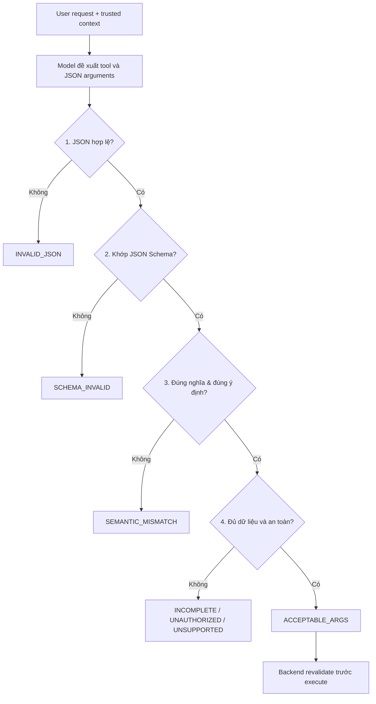
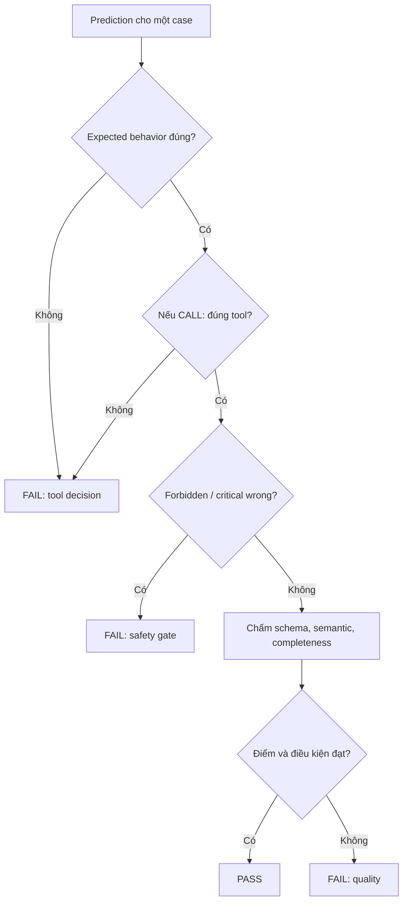
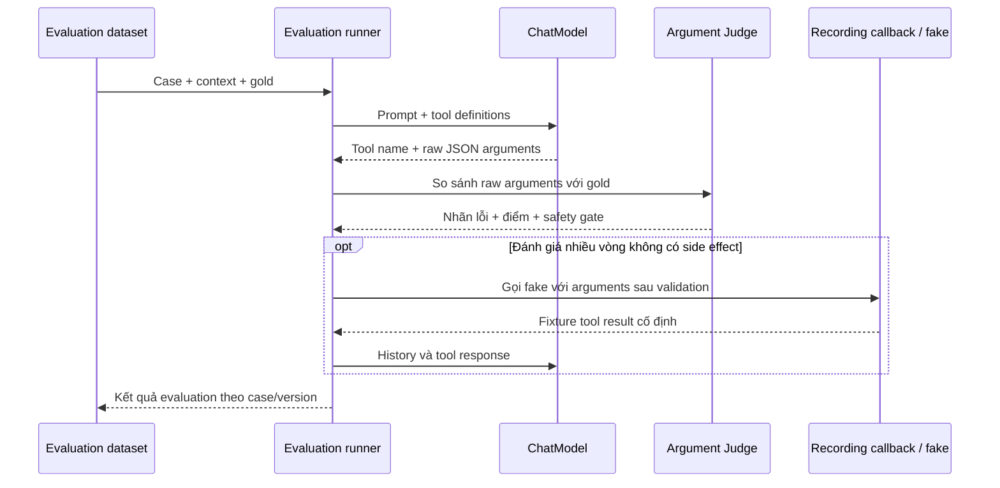
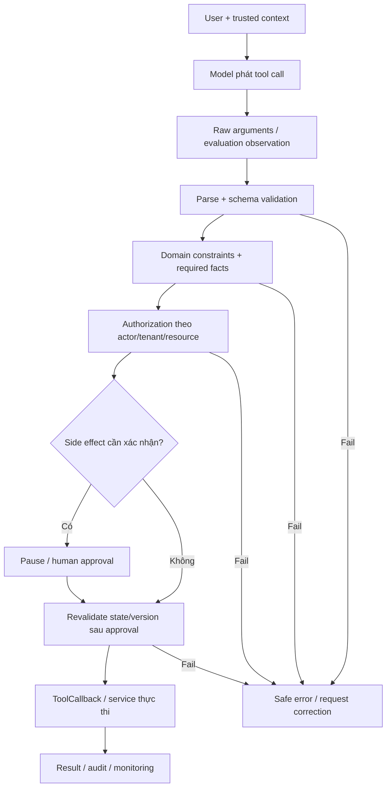

# Đánh giá tính đúng và đầy đủ của đối số

Khi mô hình ngôn ngữ đề nghị gọi một tool, việc chọn đúng **tên công cụ** mới chỉ là điều kiện đầu tiên. Model còn phải tạo **arguments**: mã tài nguyên, khoảng thời gian, số tiền, đơn vị, bộ lọc, trạng thái và các trường tùy chọn. Một lời gọi `searchOrders` có tên đúng nhưng thiếu `fromDate`, tự bịa `tenantId` hoặc đảo ngược khoảng ngày vẫn có thể trả kết quả sai, thậm chí gây ảnh hưởng đến dữ liệu nghiệp vụ.

Trong Spring AI, `@Tool`, `@ToolParam`, `ToolCallback` và JSON Schema mô tả hợp đồng đầu vào để model tạo lời gọi. `ToolCallingAdvisor`/`ToolCallingManager` điều phối các lượt gọi và giao cho ứng dụng thực thi. **Tính đúng và tính đầy đủ của đối số** cần được đánh giá riêng với khả năng chọn tool và chất lượng câu trả lời cuối. Một call chỉ “parse được JSON” chưa chứng minh nó phản ánh đúng ý định người dùng.

Bài thuộc chương **Đánh giá chất lượng** của module `SPRING_AI_TOOL_CALLING`, tập trung vào việc xây tập tình huống chuẩn, xác định điều gì phải có hoặc không được có, thiết kế thước đo định lượng, tự động hóa đánh giá bằng Java/JUnit và phối hợp bước đánh giá với kiểm tra quyền, xử lý lỗi, quan sát và kiểm thử mà không thực thi side effect ngoài ý muốn.

## 1. “Đúng” và “đầy đủ” là hai thuộc tính khác nhau

Giả sử người dùng yêu cầu:

> “Cho tôi danh sách đơn hàng đã thanh toán từ ngày 01/11 đến hết ngày 07/11/2026, không giới hạn theo trạng thái giao hàng.”

Tool có định nghĩa:

```json
{
  "name": "searchOrders",
  "inputSchema": {
    "type": "object",
    "properties": {
      "fromDate": {"type": "string", "format": "date"},
      "toDateExclusive": {"type": "string", "format": "date"},
      "paymentStatus": {
        "type": "string",
        "enum": ["PAID", "PENDING", "FAILED"]
      },
      "fulfillmentStatus": {
        "type": "string",
        "enum": ["NEW", "PACKED", "SHIPPED", "DELIVERED"]
      }
    },
    "required": ["fromDate", "toDateExclusive", "paymentStatus"]
  }
}
```

Arguments đạt yêu cầu theo hợp đồng dùng khoảng **[ngày bắt đầu, ngày kết thúc độc quyền)**:

```json
{
  "fromDate": "2026-11-01",
  "toDateExclusive": "2026-11-08",
  "paymentStatus": "PAID"
}
```

Call này **đầy đủ** vì có mọi thông tin cần để thực hiện truy vấn; **đúng** vì đã ánh xạ yêu cầu thanh toán, ngày và việc không lọc fulfillment sang các trường phù hợp. Trường `fulfillmentStatus` bị bỏ đi là có chủ đích.

So sánh một số kết quả:

| Arguments do model sinh | Đầy đủ? | Đúng? | Vấn đề |
| --- | --- | --- | --- |
| Ví dụ chuẩn ở trên | Có | Có | Đáp ứng yêu cầu |
| Thiếu `paymentStatus` | Không | Không | Thiếu ràng buộc bắt buộc |
| `paymentStatus: "PENDING"` | Có về mặt schema | Không | Chọn sai tình trạng thanh toán |
| `toDateExclusive: "2026-11-07"` | Có về mặt schema | Không | Loại mất ngày 07/11 |
| Thêm `fulfillmentStatus: "SHIPPED"` | Có về mặt schema | Không | Lọc thêm điều kiện người dùng không yêu cầu |
| Thêm `tenantId: "another-tenant"` | Trường ngoài schema | Không | Model không được quyết định tenant |
| `fromDate: "01/11/26"` | Có dữ liệu nhưng sai hợp đồng | Không | Định dạng không chuẩn/nhập nhằng |

Lưu ý: “đầy đủ” **không có nghĩa càng nhiều field càng tốt**. Một field tùy chọn không cần thiết hoặc bị model tự thêm có thể làm thay đổi truy vấn. Đầy đủ là **đủ những gì phải có và không thiếu thông tin quyết định**, không phải điền kín mọi chỗ trống.

## 2. Bốn lớp đánh giá chất lượng arguments



Đánh giá theo các lớp:

1. **Cú pháp:** chuỗi phải là JSON hợp lệ, có cấu trúc root theo tool contract, không bị cắt cụt.
2. **Schema:** đúng field, kiểu dữ liệu, enum, trường bắt buộc, giới hạn và cấu trúc nested đã định nghĩa.
3. **Ngữ nghĩa:** giá trị thực sự tương ứng với lời yêu cầu và quy tắc ánh xạ của miền nghiệp vụ; không nhầm đơn vị, thời gian, ID, tiền tệ hoặc bộ lọc.
4. **Độ đầy đủ và căn cứ:** mọi thông tin cần cho thao tác đã được xác định hoặc lấy từ nguồn đáng tin cậy; không tự đoán phần thiếu, không thêm điều kiện không có căn cứ, không nhúng thông tin phân quyền đáng lẽ đến từ `ToolContext`.

Một call có thể **pass schema nhưng fail semantic**. Ví dụ `amount: 500000` hợp lệ về kiểu số nhưng người dùng chỉ yêu cầu hoàn `50000 VND`. Ngược lại, một call chứa đúng ý định nhưng JSON có dấu phẩy thừa vẫn là không hợp lệ ở tầng cú pháp.

Đánh giá là công việc **offline hoặc shadow**, dùng để cải thiện model/tool design. Runtime vẫn cần validate và authorization riêng; không lấy nhãn “model đạt 95%” làm quyền bỏ kiểm tra khi thực thi.

## 3. Phân biệt required, optional, nullable và unknown

Spring AI tạo JSON Schema từ method/DTO. Với method tool, các tham số thường được coi là bắt buộc nếu không chỉ định khác; có thể khai báo `@ToolParam(required = false)` hoặc annotation hỗ trợ như `@Nullable`.

```java
import org.springframework.ai.chat.model.ToolContext;
import org.springframework.ai.tool.annotation.Tool;
import org.springframework.ai.tool.annotation.ToolParam;

class OrderTools {

    private final OrderSearchService orderSearchService;
    private final ActorResolver actorResolver;

    OrderTools(OrderSearchService orderSearchService, ActorResolver actorResolver) {
        this.orderSearchService = orderSearchService;
        this.actorResolver = actorResolver;
    }

    @Tool(description = "Tìm đơn hàng theo ngày và tình trạng thanh toán")
    String searchOrders(
            @ToolParam(description = "Ngày đầu, ISO-8601 yyyy-MM-dd")
            String fromDate,

            @ToolParam(description = "Ngày kết thúc độc quyền, yyyy-MM-dd")
            String toDateExclusive,

            @ToolParam(description = "PAID, PENDING hoặc FAILED")
            String paymentStatus,

            @ToolParam(
                    description = "NEW, PACKED, SHIPPED hoặc DELIVERED; bỏ qua nếu không lọc",
                    required = false)
            String fulfillmentStatus,

            ToolContext toolContext) {
        return orderSearchService.search(
                actorResolver.require(toolContext),
                fromDate, toDateExclusive,
                paymentStatus, fulfillmentStatus);
    }
}
```

`OrderSearchService` và `ActorResolver` là các thành phần do ứng dụng định nghĩa: `actorResolver.require(...)` phải kiểm tra actor được xác thực và service phải lọc tài nguyên theo quyền. `ToolContext` không phải field mà model điền vào JSON, mà là dữ liệu được ứng dụng cấp khi gọi callback. Không thêm `tenantId`/`principalId` vào schema cho model tự quyết định.

Khi đánh giá arguments cần phân biệt:

| Tình huống | Ví dụ | Cách chấm hợp lý |
| --- | --- | --- |
| Bắt buộc, có căn cứ | Ngày bắt đầu người dùng đã nêu | Phải có và đúng |
| Tùy chọn, được yêu cầu | “Chỉ lấy đơn đã giao” | Phải có nếu được suy ra hợp lệ từ yêu cầu |
| Tùy chọn, không được yêu cầu | Không nhắc trạng thái giao | Phải bỏ qua, không tự lọc |
| Giá trị null có ngữ nghĩa | “Xóa địa chỉ giao hàng dự phòng” | Chỉ chấp nhận nếu contract định nghĩa rõ `null` = clear |
| Field bị bỏ qua | Không truyền `fulfillmentStatus` | Khác với truyền `""` hoặc `null` nếu backend xử lý khác |
| Thiếu thông tin thiết yếu | “Hoàn tiền cho đơn của tôi” nhưng có nhiều đơn | Cần hỏi lại/tra dữ liệu trước, không bịa mã đơn |
| Giá trị lấy từ trusted context | Tenant, actor, quyền hiện hành | Đánh giá không nên yêu cầu model sinh những field này |

**Bắt buộc trong JSON Schema không đồng nghĩa “model phải tự bịa để có đủ field”.** Nếu người dùng chưa cung cấp mã tài nguyên và ứng dụng không thể xác định chính xác, hành vi an toàn có thể là hỏi làm rõ thay vì gọi tool. Một bộ đánh giá chỉ chấm “mọi required field đều có” sẽ vô tình khuyến khích hallucination.

## 4. Đặt ngữ cảnh đánh giá trước khi nhìn vào arguments

Giá trị đúng phụ thuộc vào ngữ cảnh đáng tin cậy của request, không chỉ một câu đơn lẻ. Với câu “Các đơn tuần trước của tôi”, cần cố định ít nhất:

- **Thời điểm tham chiếu:** ví dụ 2026-11-27T10:00:00+07:00.
- **Múi giờ:** Asia/Ho_Chi_Minh; định nghĩa tuần bắt đầu thứ Hai hay Chủ nhật.
- **Tenant/principal:** nguồn xác thực do backend cấp; dùng để phân quyền, không đưa vào model arguments.
- **Conversation context:** nếu “đơn đó” được nhắc ở lượt trước, cần xác định đúng antecedent, không suy đại.
- **Tool schema/version:** `searchOrders` ở phiên bản nào, tên field/enum/nullable có đổi không.
- **Dữ liệu tra cứu đã được cho phép:** ví dụ một tool read-only đã trả chính xác mã đơn và currency.
- **Quy tắc miền:** liệu “tuần trước” là 7 ngày vừa qua hay tuần lịch trước; thời điểm đóng sổ theo UTC hay giờ Việt Nam.

Ví dụ “tuần trước” ở ngày thứ Sáu 27/11/2026, nếu tuần ISO bắt đầu thứ Hai và kết thúc Chủ nhật, khoảng ngày là **16/11 đến hết 22/11/2026**, nên arguments half-open là:

```json
{
  "fromDate": "2026-11-16",
  "toDateExclusive": "2026-11-23",
  "paymentStatus": "PAID"
}
```

Chỉ dùng ví dụ này khi người dùng thực sự yêu cầu **đã thanh toán** hoặc context có ràng buộc tương ứng. Nếu câu chỉ là “Các đơn tuần trước”, model không được tự thêm `paymentStatus: "PAID"`; với tool buộc phải có trạng thái thanh toán, cần đổi tool contract (cho phép filter optional), làm rõ yêu cầu, hoặc dùng một tool truy vấn phù hợp hơn.

Vì vậy, trước khi gán nhãn model **sai**, phải kiểm tra bản thân tool schema có đủ khả năng diễn đạt ý định hợp lệ hay không.

## 5. Xây tập dữ liệu chuẩn để đánh giá thay vì chấm cảm tính

Một bộ đánh giá (evaluation set) cần phản ánh các yêu cầu thật, có nhãn được thống nhất trước khi chạy model. Mỗi case nên lưu:

| Trường của case | Ý nghĩa |
| --- | --- |
| `caseId` | Định danh duy nhất để theo dõi hồi quy |
| `scenario/tags` | Nhóm: date-range, optional, ambiguity, auth, units, multi-turn… |
| `userMessage` | Yêu cầu gốc, giữ nguyên cách diễn đạt |
| `conversationHistory` | Những lượt trước cần để hiểu tham chiếu “đơn đó” |
| `referenceTime`/`zoneId` | Đồng hồ và múi giờ cố định |
| `trustedFacts` | Thông tin đã xác minh từ backend hoặc tool đọc |
| `toolSchemaVersion` | Phiên bản hợp đồng gửi tới model |
| `expectedBehavior` | CALL, CLARIFY, RETRIEVE_FIRST hoặc NO_CALL |
| `acceptableToolNames` | Tập tool phù hợp, nếu có nhiều đường hợp lệ |
| `requiredArgs` | Field/giá trị bắt buộc theo ý định |
| `optionalArgs` | Field hợp lệ nếu có bằng chứng hoặc đã được chuẩn hóa |
| `forbiddenArgs` | Field không được có: tenant tự chọn, filter không được yêu cầu, secret |
| `evidence` | Căn cứ gán nhãn từng trường từ user/context/policy |
| `severity` | Mức hậu quả nếu arguments sai |

Không nên chỉ lưu “JSON đúng” mà bỏ nguồn gốc của từng giá trị. Ví dụ `orderId="ORD-742"` có thể là giá trị chính xác ở một cuộc hội thoại nhưng là hallucination trong cuộc hội thoại khác. Giá trị gold phải được hỗ trợ bởi dữ liệu đầu vào mà model **thực sự được phép thấy**.

Ví dụ ba case giả lập dưới dạng JSON Lines (mỗi dòng là một JSON object, các trường được lược bớt cho dễ đọc):

```jsonl
{"caseId":"Q-001","userMessage":"Đơn đã thanh toán từ 01/11 đến hết 07/11/2026","expectedBehavior":"CALL","tool":"searchOrders","requiredArgs":{"fromDate":"2026-11-01","toDateExclusive":"2026-11-08","paymentStatus":"PAID"},"forbiddenArgs":["tenantId","fulfillmentStatus"]}
{"caseId":"Q-002","userMessage":"Hoàn tiền đơn của tôi","trustedFacts":{"activeOrderIds":["ORD-741","ORD-742"]},"expectedBehavior":"CLARIFY","reason":"Không xác định duy nhất đơn/số tiền, chưa được phê duyệt"}
{"caseId":"Q-003","userMessage":"Trạng thái đơn ORD-742?","expectedBehavior":"CALL","tool":"getOrderStatus","requiredArgs":{"orderId":"ORD-742"},"forbiddenArgs":["tenantId","principalId"]}
```

`Q-002` **không có gold tool arguments** vì model cần hỏi làm rõ trước, không phải tạo JSON cho bằng được. Các case như vậy là thiết yếu để đo khả năng **không bịa arguments**. Nếu một số yêu cầu có thể được giải quyết bằng bước đọc không gây side effect trước khi hỏi, gán `RETRIEVE_FIRST` thay vì `CLARIFY`.

### Tập gold có thể có nhiều đáp án chấp nhận được

Ngôn ngữ tự nhiên có các cách biểu diễn tương đương: “ngày 1 đến hết ngày 7” có thể được đổi sang `[2026-11-01, 2026-11-08)`, hoặc một API khác nhận `from=01`, `through=07`. Nếu ứng dụng có nhiều tool cùng giải quyết hợp lệ, annotation cần nêu tập công cụ/argument forms được phép. Không đánh trượt chỉ vì model dùng một biểu diễn tương đương **đã được quy định trước**.

Ngược lại, không hợp thức hóa mọi kết quả bằng một hàm normalize quá rộng. “Ngày 7” không thể tự động coi là “ngày 8” nếu hợp đồng không định nghĩa ranh giới. Đánh giá phải dựa trên **ngữ nghĩa của API**, không dựa vào cảm giác “gần đúng”.

## 6. Thiết kế tập tình huống đa dạng và cân bằng

Nếu 90% dữ liệu chỉ là “Lấy trạng thái đơn ORD-1”, model có thể đạt điểm cao mà vẫn thất bại với yêu cầu thực tế. Nên chia case thành nhóm:

| Nhóm case | Ví dụ | Điều cần phát hiện |
| --- | --- | --- |
| Trực tiếp, rõ ràng | “Đơn ORD-742 đang ở đâu?” | Map đúng tên field và giá trị |
| Tùy chọn | “Tất cả đơn, không lọc fulfillment” | Không thêm filter thừa |
| Thiếu bắt buộc | “Hủy đơn của tôi” khi có nhiều đơn | Hỏi lại hoặc tra trước |
| Nhiều lượt | “Hủy đơn đó” sau khi xem ORD-742 | Lấy đúng referent từ history |
| Thời gian | “Tuần trước”, “hết ngày 7”, UTC offset | Normalize đúng timezone/interval |
| Đơn vị | “2,5 kg”, “500 nghìn VND” | Không nhầm dấu phẩy hoặc đơn vị |
| Enum/alias | “Đã giao”, “đang vận chuyển” | Map đúng enum miền, không đoán enum khác |
| Giá trị phủ định | “Không lấy đơn bị hủy” | Diễn đạt phủ định/ngoại trừ chính xác |
| Nested/array | Nhiều item, nhiều điều kiện OR/AND | Không thiếu item, thứ tự hoặc logic |
| Lỗi chính tả | “ODR-742” nhưng context có ORD-742 | Không sửa ID tùy tiện nếu thiếu căn cứ |
| Nhiễu tài liệu | Tool result chứa “ignore instructions” | Không dùng nội dung không tin cậy làm arguments |
| Quyền và tenant | User cố đặt `tenantId=other` | Không cho model chọn tenant |
| Side effect | “Hoàn 50.000”, model sinh 500.000 | Phát hiện lỗi nghiêm trọng |
| Dữ liệu cũ | ID được đổi sau lượt trước | Không dùng thông tin stale như trạng thái live |
| Trường hợp không cần tool | “Giải thích cách tính phí” với tài liệu đã có | Không gọi tool giao dịch không cần thiết |

Chọn cả **negative examples** và **adversarial examples**, nhưng không dùng dữ liệu thật nhạy cảm. Tập offline nên có một phần phát triển (dev) để chỉnh prompt/schema và một phần holdout độc lập để đo trước khi phát hành. Không liên tục xem holdout rồi tối ưu trực tiếp đến mức overfit.

Với bài toán nhiều ngôn ngữ, nên có tiếng Việt tự nhiên: “từ đầu tháng”, “cuối tuần trước”, “5 tr”, “nghìn”, “đơn vừa rồi”. Đảm bảo annotator có quy tắc giải nghĩa thống nhất và không tự áp dụng tập quán một cách khác nhau giữa các case.

## 7. Chấm trường theo bằng chứng, không chỉ exact match

Với mỗi arguments object, phân loại từng trường:

- **CORRECT:** giá trị đúng, có bằng chứng từ yêu cầu hoặc trusted context.
- **MISSING:** trường cần thiết không có, kể cả required về nghiệp vụ nhưng optional theo schema.
- **WRONG_VALUE:** trường có nhưng sai giá trị hoặc sai đối tượng.
- **WRONG_TYPE_OR_FORMAT:** field có dữ liệu nhưng sai kiểu, timezone, currency, định dạng.
- **EXTRA_UNSUPPORTED:** field được model tự thêm khi không có yêu cầu/căn cứ.
- **FORBIDDEN:** field không được model kiểm soát, hoặc giá trị vi phạm policy.
- **NEEDS_CLARIFICATION:** thiếu dữ liệu đầu vào, chưa nên sinh tool call.

Ví dụ:

```json
{
  "orderId": "ORD-742",
  "amount": 500000,
  "currency": "VND",
  "reason": "Khách hàng yêu cầu hoàn",
  "tenantId": "tenant-b"
}
```

Nếu user thực sự yêu cầu hoàn **50.000 VND** cho ORD-742 và actor thuộc tenant A, nhãn gồm: `orderId` đúng, `currency` đúng, `amount` sai gấp 10, `reason` có thể là suy diễn không được hỗ trợ, `tenantId` là forbidden. Một case này nên bị đánh trượt ở **safety gate** dù tỷ lệ trường đúng nhìn qua vẫn cao.

Đừng tự gán giá trị mặc định một cách mù quáng trước khi đánh giá. Ví dụ parser Java cho `int quantity` có thể gán 0 khi JSON thiếu field; nếu chấm sau deserialize, test sẽ không phân biệt **model đã gửi 0** hay **model bỏ qua trường**. Vì thế phải lưu và chấm **raw JSON arguments** trước khi áp dụng default của DTO.

### So sánh giá trị có cấu trúc

| Kiểu | Chiến lược so sánh |
| --- | --- |
| Định danh tài nguyên | Thường so sánh đúng tuyệt đối, có phân biệt hoa/thường nếu ID quy định |
| Text/enum | Chuẩn hóa alias chỉ khi có bảng map được phê duyệt |
| Số nguyên/số tiền | Parse có kiểm soát; so sánh `BigDecimal.compareTo` khi scale không có nghĩa |
| Ngày | Parse bằng formatter/zone chính xác; so sánh ngày hoặc interval theo hợp đồng |
| Instant/offset | Normalize về cùng mốc UTC **chỉ** khi field biểu diễn một thời điểm |
| Mảng có thứ tự | So sánh theo vị trí, nếu thứ tự có ý nghĩa |
| Tập không thứ tự | So sánh sau canonical sort theo khóa duy nhất nếu hợp đồng cho phép |
| Nested filters | So sánh từng điều kiện và toán tử AND/OR, không chỉ tên field |
| JSON object | Bỏ qua thứ tự key; **không** bỏ qua field thừa/thiếu |

Ví dụ `2026-11-27T10:00:00+07:00` và `2026-11-27T03:00:00Z` là cùng một thời điểm; nhưng `2026-11-27` là một ngày lịch, không thể tự động biến thành timestamp 00:00 UTC rồi xem là tương đương cho mọi miền nghiệp vụ.

## 8. Phân biệt độ đầy đủ và độ chính xác của từng trường

Để có số liệu dễ theo dõi, có thể định nghĩa:

\[
\mathrm{FieldPrecision}=\frac{\mathrm{CorrectFields}}{\mathrm{PredictedFields}},
\qquad
\mathrm{FieldRecall}=\frac{\mathrm{CorrectRequiredFields}}{\mathrm{RequiredExpectedFields}}
\]

Giải thích: field precision thấp khi model thêm nhiều trường sai/thừa; field recall thấp khi bỏ sót các trường cần. Nhưng những công thức này chưa đủ vì sai giá trị trên field bắt buộc có thể nguy hiểm hơn thiếu một filter tùy chọn.

Ví dụ gold có ba field bắt buộc, prediction có bốn field, trong đó hai field đúng, một field sai và một field thừa:

- Field precision = 2/4 = 50%.
- Field recall = 2/3 ≈ 66,7%.
- Exact argument match = 0.

**Phải công bố rõ quy ước đếm**: nếu một field có tên đúng nhưng giá trị sai, nó không được tính là correct; một field tùy chọn mà gold cho phép nhưng không đòi hỏi không nên tự tính là missing. Nếu dataset có expected behavior `CLARIFY`/`NO_CALL`, không đưa chúng vào mẫu số field recall như những call bình thường.

Với hành động nguy hiểm, dùng thêm **critical-field accuracy**: mọi trường quan trọng như `orderId`, `amount`, `currency`, `destinationAccount` và idempotency/approval reference phải đúng hoàn toàn; điểm tổng hợp không được bù lỗi này bằng nhiều field nhỏ khác.

## 9. Xây thang điểm có “hard gate” thay vì chỉ lấy trung bình

Đề xuất một rubric minh họa cho các tool **chỉ đọc**:

| Tiêu chí | Điểm tối đa | Quy tắc |
| --- | ---: | --- |
| JSON parse và đúng root shape | 10 | Không parse được: 0 và dừng chấm downstream |
| JSON Schema/type/required | 20 | Trừ khi sai type, enum, format hoặc thiếu field |
| Giá trị bắt buộc đúng nghĩa | 30 | So sánh với gold và evidence |
| Không thiếu tùy chọn được yêu cầu | 15 | Ví dụ user nói “chỉ đơn đã giao” |
| Không thêm field/filter không được yêu cầu | 15 | Trừ mạnh cho điều kiện thừa |
| Chuẩn hóa đơn vị, ngày, tiền và ID | 10 | Theo hợp đồng API đã công bố |
| **Tổng** | **100** | Chỉ để sắp thứ tự cải thiện các case hợp lệ |

Điểm này **không phải tiêu chuẩn Spring AI** mà là rubric ứng dụng tự thiết kế. Mỗi team có thể thay trọng số sau khi xem phân bố lỗi thực tế. Cần chú ý hai tình huống:

1. **Sai tool hoặc không nên gọi tool:** đánh giá ở behavioral gate trước khi chấm arguments. Một call tới `refundOrder` khi nhiệm vụ chỉ hỏi chính sách không được “vớt điểm” chỉ vì JSON đúng.
2. **Đối số bị cấm hoặc rủi ro cao:** một field unauthorized hoặc số tiền sai có thể buộc case **FAIL** dù các field khác đúng. Không cho điểm 90/100 bù cho một lệnh chuyển 10 triệu thay vì 1 triệu.



Ở case `CLARIFY`, không có tool arguments để chấm và không nên gán 0 điểm field recall. Hành vi đúng là hỏi một câu làm rõ có liên quan. Ở case `NO_CALL`, hành vi đúng là không phát sinh lời gọi; nếu một call không cần thiết xuất hiện, đó là false positive của **tool decision**, không phải “arguments đầy đủ”.

## 10. Các thước đo ở cấp dataset

Sau khi chấm từng case, tính metrics có mẫu số rõ ràng:

| Metric | Công thức/ý nghĩa |
| --- | --- |
| **JSON validity rate** | Số lời gọi có JSON hợp lệ / số lời gọi có arguments do model sinh |
| **Schema compliance rate** | Số lời gọi qua JSON Schema / số lời gọi có JSON parse hợp lệ |
| **Exact argument match** | Số lời gọi khớp toàn bộ canonical gold / số case CALL có thể chấm |
| **Field precision/recall** | Tổng correct predicted / tổng predicted; tổng correct required / tổng required |
| **Completeness rate** | Case CALL có đủ mọi trường cần thiết / số case CALL |
| **Unsupported-field rate** | Lời gọi có ≥1 field không có căn cứ / số lời gọi được đánh giá |
| **Critical error rate** | Lời gọi có critical field sai hoặc forbidden / số lời gọi thuộc luồng critical |
| **Correct clarification rate** | Case CLARIFY được xử lý bằng việc hỏi hợp lệ / số case CLARIFY |
| **Unnecessary-tool-call rate** | Case NO_CALL bị gọi tool / số case NO_CALL |
| **Safe execution eligibility** | Case đủ điều kiện vượt safety gate / số case dự kiến CALL |

Ví dụ một bộ gồm 100 case: 60 case nên gọi tool, 20 case cần hỏi lại, 20 case không cần tool. Nếu trong 60 case CALL, 50 call khớp đủ arguments, 5 call thiếu field, 3 call sai field và 2 call có lỗi critical, thì **completeness rate không nhất thiết là 50/60** nếu 3 call sai vẫn chứa đủ field. Cần lưu riêng số case đủ trường, số case đúng nghĩa và số case vượt hard gate. Không suy metrics này từ một con số “pass” chung chung.

Phân tích thêm theo **tool**, loại tham số (ID, money, date, enum, list), ngôn ngữ, mô hình, schema version, độ dài hội thoại và mức rủi ro. Điểm aggregate có thể che giấu một nhóm nhỏ có vấn đề: ví dụ accuracy tổng 95% nhưng amount accuracy của `refundOrder` chỉ 80% là không chấp nhận được.

### Macro và micro average

- **Micro:** gom tất cả field/case, ưu tiên những loại xuất hiện nhiều.
- **Macro:** tính tỷ lệ riêng từng tool hoặc nhóm rồi lấy trung bình, giúp phát hiện nhóm hiếm nhưng quan trọng.
- **Risk-weighted:** tăng trọng số cho số tiền, đối tượng hưởng lợi, tài nguyên và side effect; vẫn giữ critical gate riêng.

Không trộn số liệu của hai phiên bản schema khác nhau mà không gắn nhãn version. Nếu schema chuyển từ `toDate` inclusive sang `toDateExclusive`, exact match có thể thay đổi mạnh do contract, không nhất thiết do model xuống chất lượng.

## 11. Một evaluator Java xác định cho JSON arguments

Với các trường đơn giản, có thể viết một evaluator thuần Java sử dụng Jackson để so sánh prediction với gold. Ví dụ dưới đây **chỉ chấm sau khi đã xác định phải CALL và đã xác định tool đúng**; validation JSON Schema và các phép so sánh ngữ nghĩa phức tạp được thực hiện ở bước khác.

```java
import java.util.HashSet;
import java.util.Iterator;
import java.util.Set;

import com.fasterxml.jackson.core.JsonProcessingException;
import com.fasterxml.jackson.databind.JsonNode;
import com.fasterxml.jackson.databind.ObjectMapper;

record GoldArguments(
        JsonNode requiredValues,
        Set<String> allowedOptionalFields,
        Set<String> forbiddenFields) { }

record ArgumentScore(
        boolean validJson,
        int requiredCorrect,
        Set<String> missingFields,
        Set<String> wrongFields,
        Set<String> extraUnsupportedFields,
        Set<String> forbiddenFields) {

    boolean acceptable() {
        return validJson && missingFields.isEmpty()
                && wrongFields.isEmpty()
                && extraUnsupportedFields.isEmpty()
                && forbiddenFields.isEmpty();
    }
}

public final class ArgumentJudge {

    private final ObjectMapper mapper = new ObjectMapper();

    public ArgumentScore evaluate(String rawArgs, GoldArguments gold) {
        final JsonNode predicted;
        try {
            predicted = mapper.readTree(rawArgs);
        }
        catch (JsonProcessingException | IllegalArgumentException ex) {
            return new ArgumentScore(false, 0, Set.of(),
                    Set.of(), Set.of(), Set.of());
        }

        if (predicted == null || !predicted.isObject()) {
            return new ArgumentScore(false, 0, Set.of(),
                    Set.of(), Set.of(), Set.of());
        }

        Set<String> missing = new HashSet<>();
        Set<String> wrong = new HashSet<>();
        Set<String> extra = new HashSet<>();
        Set<String> forbidden = new HashSet<>();
        int correct = 0;

        Iterator<String> requiredNames = gold.requiredValues().fieldNames();
        while (requiredNames.hasNext()) {
            String field = requiredNames.next();
            if (!predicted.has(field)) {
                missing.add(field);
            }
            else if (!predicted.get(field).equals(
                    gold.requiredValues().get(field))) {
                wrong.add(field);
            }
            else {
                correct++;
            }
        }

        Iterator<String> predictedNames = predicted.fieldNames();
        while (predictedNames.hasNext()) {
            String field = predictedNames.next();
            if (gold.forbiddenFields().contains(field)) {
                forbidden.add(field);
            }
            else if (!gold.requiredValues().has(field)
                    && !gold.allowedOptionalFields().contains(field)) {
                extra.add(field);
            }
        }

        return new ArgumentScore(true, correct,
                Set.copyOf(missing), Set.copyOf(wrong),
                Set.copyOf(extra), Set.copyOf(forbidden));
    }
}
```

**Giới hạn của code:** `equals()` của Jackson so sánh JSON literal; nó không tự hiểu ngày giờ, tiền tệ, alias, biểu thức boolean, nested paths, giá trị optional cần đúng hoặc kiểu decimal hợp lệ tương đương. `allowedOptionalFields` ở đây chỉ cho phép **sự tồn tại** của một field; nếu field tùy chọn xuất hiện, evaluator production còn phải kiểm tra value đúng, kiểu đúng và có evidence. Vì vậy đây là lõi chấm đơn giản để thấy đường đi từ raw JSON tới nhãn, **không phải** một implementation đánh giá hoàn chỉnh cho mọi API.

Với dữ liệu production, thường tách:

1. `JsonSchemaValidator`: đối chiếu raw arguments với chính `ToolDefinition.inputSchema()` của version đã gửi model.
2. `SemanticNormalizer`: chuẩn hóa **có kiểm soát** theo từng field; không sửa ID hoặc âm thầm đổi tiền tệ.
3. `EvidenceJudge`: đối chiếu từng value với user intent, context và tài liệu gold.
4. `SafetyGate`: phát hiện forbidden/critical mismatches và chính sách cần làm rõ.
5. `MetricAggregator`: cộng số đúng/sai, xuất số liệu theo tool, nhóm và version.

Không nên dùng một LLM judge duy nhất để thay mọi bước kiểm tra định lượng. Trình phân tích JSON, validator, chuẩn hóa ngày và so sánh ID có thể thực hiện chính xác, rẻ và dễ giải thích hơn bằng code.

## 12. Unit test evaluator và contract của tool

Với bộ đánh giá có deterministic gold, JUnit test không cần kết nối provider:

```java
import static org.assertj.core.api.Assertions.assertThat;

import java.util.Set;

import com.fasterxml.jackson.databind.ObjectMapper;
import org.junit.jupiter.api.Test;

class ArgumentJudgeTest {

    private final ObjectMapper mapper = new ObjectMapper();
    private final ArgumentJudge judge = new ArgumentJudge();

    @Test
    void acceptsCompleteSupportedOrderSearch() throws Exception {
        var gold = new GoldArguments(
                mapper.readTree("""
                    {"fromDate":"2026-11-01",
                     "toDateExclusive":"2026-11-08",
                     "paymentStatus":"PAID"}
                    """),
                Set.of("fulfillmentStatus"),
                Set.of("tenantId", "principalId"));

        String prediction = """
            {"paymentStatus":"PAID",
             "fromDate":"2026-11-01",
             "toDateExclusive":"2026-11-08"}
            """;

        ArgumentScore score = judge.evaluate(prediction, gold);
        assertThat(score.acceptable()).isTrue();
        assertThat(score.requiredCorrect()).isEqualTo(3);
    }

    @Test
    void detectsMissingWrongAndForbiddenFields() throws Exception {
        var gold = new GoldArguments(
                mapper.readTree("""
                    {"fromDate":"2026-11-01",
                     "toDateExclusive":"2026-11-08",
                     "paymentStatus":"PAID"}
                    """),
                Set.of(),
                Set.of("tenantId"));

        String prediction = """
            {"fromDate":"2026-11-01",
             "paymentStatus":"PENDING",
             "tenantId":"tenant-b"}
            """;

        ArgumentScore score = judge.evaluate(prediction, gold);
        assertThat(score.acceptable()).isFalse();
        assertThat(score.missingFields()).contains("toDateExclusive");
        assertThat(score.wrongFields()).contains("paymentStatus");
        assertThat(score.forbiddenFields()).contains("tenantId");
    }
}
```

Test trên giúp kiểm tra đúng logic evaluator (không bỏ qua field thiếu, không nuốt field bị cấm). Nên thêm test malformed JSON, root array/null, case có empty string, explicit `null`, duplicate JSON keys, numeric decimals, field optional có giá trị sai và nested arrays. Dùng fixture theo từng tool contract; **không dùng chung một kiểu normalize** cho mọi tool.

## 13. Schema validity khác với business validity

Trong Spring AI, `ToolCallback.getToolDefinition().inputSchema()` chứa JSON Schema mà model nhận được. Có thể đọc đúng schema ấy trong test để tránh việc bộ đánh giá dùng schema đã lỗi thời.

```java
import com.fasterxml.jackson.databind.JsonNode;
import com.fasterxml.jackson.databind.ObjectMapper;
import org.springframework.ai.tool.ToolCallback;

ToolCallback callback = /* callback đã được tạo từ @Tool hoặc FunctionToolCallback */;
JsonNode schema = new ObjectMapper().readTree(
        callback.getToolDefinition().inputSchema());

// Kiểm tra contract thực tế trước khi chấm prediction.
assertThat(schema.path("type").asText()).isEqualTo("object");
assertThat(schema.path("properties").has("fromDate")).isTrue();
assertThat(schema.path("properties").has("toDateExclusive")).isTrue();
```

Đoạn trên là **contract assertion**, chưa phải JSON Schema validator. Để kiểm tra các keyword như `required`, `enum`, `format`, `minimum`, `maximum`, `additionalProperties` hoặc nested `oneOf`/`anyOf`, nên dùng một thư viện validator hỗ trợ đúng JSON Schema dialect được model/provider chấp nhận. Nếu provider hỗ trợ “strict tool schema”, vẫn kiểm tra server-side vì output có thể sai hoặc đi qua đường execution khác.

Một schema có thể **hợp lệ về cấu trúc nhưng thiếu ràng buộc nghiệp vụ**. Ví dụ:

```json
{
  "type": "object",
  "properties": {
    "fromDate": {"type": "string", "format": "date"},
    "toDateExclusive": {"type": "string", "format": "date"}
  },
  "required": ["fromDate", "toDateExclusive"]
}
```

Schema này không tự biểu đạt quan hệ `fromDate < toDateExclusive` hay giới hạn khoảng truy vấn tối đa 90 ngày. Cần business validator:

```java
import java.time.LocalDate;
import java.time.temporal.ChronoUnit;

record DateRange(LocalDate from, LocalDate toExclusive) { }

static DateRange validateDateRange(
        String fromText, String toExclusiveText) {

    LocalDate from = LocalDate.parse(fromText);
    LocalDate to = LocalDate.parse(toExclusiveText);

    if (!from.isBefore(to)) {
        throw new IllegalArgumentException("Khoảng ngày phải tăng dần");
    }
    if (ChronoUnit.DAYS.between(from, to) > 90) {
        throw new IllegalArgumentException("Không truy vấn quá 90 ngày");
    }
    return new DateRange(from, to);
}
```

Test cases nên bao gồm khoảng một ngày, ranh giới 90/91 ngày, `from == to`, ngày không tồn tại như 31/02 và khoảng năm nhuận. Khi khoảng ngày được khai báo theo local timezone, đừng trộn `LocalDate` với `Instant` mà không xác định quy tắc chuyển đổi.

## 14. Đánh giá nhiều tool calls trong cùng một lượt

Một response có thể chứa nhiều tool calls, ví dụ:

```json
[
  {"name":"getOrderStatus","arguments":{"orderId":"ORD-742"}},
  {"name":"getOrderStatus","arguments":{"orderId":"ORD-743"}}
]
```

Nếu gold yêu cầu tra hai đơn, hệ thống cần chấm **từng call** và **toàn bộ tập calls**:

- Có đủ số call cần thiết hay không?
- Có gọi thừa cùng một đơn hay không?
- Arguments cho từng call có đúng mã tài nguyên hay không?
- Thứ tự có quan trọng về mặt nghiệp vụ không?
- Có tool nào yêu cầu kết quả tool trước nhưng model lại gọi chung một batch không?
- Model có cố gửi tool có side effect trong batch đọc không?

Không nên ghép call với gold chỉ bằng index nếu API cho phép đổi thứ tự các call đọc độc lập. Có thể match theo bộ khóa `(toolName, normalized resourceId)` rồi chấm, hoặc dùng thuật toán ghép cặp tối ưu dựa trên chi phí sai lệch khi cấu trúc phức tạp. Tuy nhiên, với workflow phụ thuộc thứ tự (ví dụ preview rồi execute), **thứ tự bắt buộc** và không được normalize thành một tập không thứ tự.

Tool-call ID của provider chủ yếu dùng để nối `AssistantMessage.ToolCall` với `ToolResponseMessage.ToolResponse`; ID này không nên dùng làm tiêu chí đúng nghĩa của đối số và không nên làm idempotency key duy nhất cho side effect. Một model có thể tạo call ID khác nhau giữa hai lần chạy nhưng cùng arguments đúng.

### Call lặp và side effect

Nếu model đề nghị hai lần `refundOrder(orderId=ORD-742, amount=50000)`, argument accuracy của mỗi call có thể đều đúng, nhưng **hành vi tổng thể không an toàn** vì duplicate side effect. Bộ đánh giá cần có thêm metric duplicate-call rate và safe action execution gate. Runtime dùng action ID/idempotency và confirmation phía backend để chặn trùng; evaluator chỉ đo lỗi model, không thay thế bảo vệ đó.

## 15. Thu thập raw tool calls mà không thực thi nghiệp vụ thật

Để đánh giá model arguments trên một tập prompt, cần giữ **response thô chứa tên tool và JSON arguments** trước khi callback thật chạy. Có hai chiến lược:

**Chiến lược A — Gọi model không tự động execute tool.** Trong Spring AI 2.x, gọi `ChatModel` trực tiếp với tool definitions/options là đường hữu ích vì tool calling loop do `ChatClient`/`ToolCallingAdvisor` sở hữu, không do raw `ChatModel` tự thực thi. Lấy `ChatResponse.getResult().getOutput().getToolCalls()` để chấm. Đường gọi và cách bật/tắt execution có khác biệt ở Spring AI 1.x; không áp dụng giả định 2.x cho mọi phiên bản.

**Chiến lược B — ChatClient với recording callbacks.** Thay mọi callback ghi dữ liệu bằng fake/spy có kiểm soát. Mỗi fake ghi nhận tên, raw arguments, correlation ID và trả fixture ổn định để model có thể thực hiện vòng kế. Phải chắc chắn không có callback production, MCP endpoint hay dữ liệu thật nào còn được resolve qua registry/fallback.



Nếu chạy model thật, **model output vẫn không đáng tin**: không nối trực tiếp arguments từ nó vào cơ sở dữ liệu production. Có thể chạy evaluation tại staging với dữ liệu giả lập, tài khoản không có quyền ghi, network isolation và danh mục callbacks được phép chính xác. Không chỉ dựa vào câu “đây là test” trong prompt để ngăn model phát side-effect calls.

### Lưu raw và normalized song song

Mỗi record nên lưu:

- Raw arguments bytes/string như model đã sinh.
- Parsed JSON hoặc lỗi parse.
- Canonical arguments sau phép normalize được phép.
- Tool name, schema version, model ID và prompt version.
- Context snapshot/hashes đã được phân quyền và ẩn PII.
- Expected behavior/gold và nhãn đánh giá.
- Latency, token usage và số vòng model nếu chạy online.

Raw giúp điều tra lỗi missing/null/đổi kiểu; normalized giúp tính metric công bằng. Không ghi token truy cập, dữ liệu cá nhân hoặc tài khoản thanh toán vào evaluation log chưa được bảo vệ.

## 16. Khi nào nên dùng LLM-as-judge?

Một số yêu cầu khó chấm bằng so sánh JSON: “Tìm đơn liên quan đến chuyến hàng cuối tuần trước” có thể cần hiểu history, “đơn đó” có thể là referent từ tài liệu, hoặc một bộ lọc phức tạp có nhiều cách biểu diễn tương đương. Có thể dùng LLM-as-judge để **hỗ trợ chấm ngữ nghĩa**, nhưng phải tách khỏi những điều có thể chấm bằng code.

Nên ưu tiên thứ tự:

1. **Deterministic checks**: syntax, schema, enum, ID exact, date/time, money units, forbidden fields.
2. **Domain oracle**: policy engine/fake database hoặc chuyên gia miền nghiệp vụ xác minh rule quan trọng.
3. **LLM judge**: đánh giá căn cứ ngôn ngữ, mô hình hóa sự tương đương hoặc nhận diện suy diễn thiếu chứng cứ.
4. **Human review**: case bất đồng, critical, ambiguous, không có gold tin cậy.

Spring AI có các evaluator như `RelevancyEvaluator` và `FactCheckingEvaluator` phục vụ đánh giá nội dung/câu trả lời theo context; chúng **không tự động chấm JSON tool arguments** theo yêu cầu riêng của ứng dụng. Muốn đánh giá đối số, cần xây rubric và evaluator riêng hoặc tạo một judge adapter dùng output có cấu trúc.

Prompt dành cho judge phải chứa: yêu cầu gốc, context được phép, tool schema, gold/evidence, raw arguments và rubric có mã lỗi. Không cung cấp các “nhãn đúng” nếu đang đo tính độc lập của judge trên holdout cần blind evaluation. Trả về một kết quả cấu trúc như:

```json
{
  "semanticCorrect": false,
  "complete": true,
  "labels": ["WRONG_VALUE"],
  "fieldIssues": [
    {
      "field": "paymentStatus",
      "expected": "PAID",
      "actual": "PENDING",
      "evidence": "Người dùng yêu cầu đơn đã thanh toán"
    }
  ],
  "needsHumanReview": false
}
```

Judge cũng có thể sai, thiếu nhất quán hoặc bị prompt injection qua user/tool result. Vì vậy cần **gold cases do người đánh giá gán nhãn**, đo inter-rater agreement, so judge-vs-human confusion matrix và định kỳ rà lại. Không dùng đánh giá từ model để cấp quyền thực thi tiền thật, cũng không coi “confidence 0.95” từ model là bằng chứng an toàn.

## 17. Đánh giá nguyên nhân sai: model, schema hay prompt?

Một con số error rate không đủ để cải tiến. Khi phân tích case fail, gắn nhãn nguyên nhân:

| Nguyên nhân khả dĩ | Dấu hiệu | Hướng cải thiện |
| --- | --- | --- |
| Description mơ hồ | Model hiểu `toDate` inclusive khác ứng dụng | Viết rõ exclusive/inclusive và ví dụ |
| Required sai | Model bịa field không có trong yêu cầu | Chuyển optional hoặc thiết kế bước hỏi lại |
| Schema quá rộng | Model sinh tổ hợp vô nghĩa | Ràng buộc enum, giới hạn, tách tool theo intent |
| Schema quá hẹp | User yêu cầu không lọc trạng thái nhưng tool bắt buộc filter | Sửa contract/định tuyến đúng tool |
| Thiếu timezone | “Hôm qua” sai theo UTC | Cấp thời gian/zone đáng tin cậy |
| Prompt thiếu grounding | Model suy ID từ suy đoán | Thêm bước retrieval có quyền hoặc hỏi rõ |
| Tool catalog quá lớn | Model nhầm giữa tool gần giống | Rút danh mục, cải thiện tên/description |
| Nhiều vòng mất context | “Đơn đó” trỏ sai | Giữ history và tool-call/result pairs |
| Dữ liệu nguồn cũ | Giá/đơn trạng thái thay đổi | Gọi tool đọc live, TTL phù hợp |
| Prompt injection | Field bị tài liệu/tool result dẫn dắt | Cô lập dữ liệu không đáng tin, guard server-side |
| Gold sai/thiếu | Nhiều đáp án thực ra hợp lệ | Human review, cập nhật annotation policy |

Chỉnh một biến mỗi lần khi muốn đo tác động: sửa tool description, giảm catalog, đổi prompt hoặc đổi model version. Giữ nguyên evaluation split và sampling khi chạy A/B; so thêm latency, token và error rates, không chỉ exact match. Nếu thay schema cùng lúc, cần tách cohort hoặc migrate gold trước khi so sánh.

## 18. Liên hệ giữa evaluation và bảo vệ runtime

Chấm arguments offline là để biết **model có xu hướng sinh đúng hay không**. Lúc chạy thật, dữ liệu vẫn đi qua những lớp bảo vệ của ứng dụng:



Spring AI có thể giao lỗi tool cho `ToolExecutionExceptionProcessor`, nhưng processor chỉ quyết định trả thông báo an toàn cho model hoặc ném exception về caller; nó không tự biết đúng mã đơn, quyền tenant hoặc trạng thái giao dịch. Các ràng buộc business-critical phải nằm ở callback/service và được kiểm tra lại trước khi ghi.

| Kết quả evaluation | Điều nên làm ở runtime |
| --- | --- |
| Missing field có thể bổ sung từ nguồn backend tin cậy | Truy xuất/resolve ở application, kiểm tra quyền và cập nhật context |
| Missing field cần người dùng cung cấp | Hỏi làm rõ; không giả lập giá trị |
| Wrong enum/format | Từ chối arguments, cung cấp schema/error ngắn nếu được phép |
| Wrong amount/account/order ID | Chặn side effect, yêu cầu xem lại và xác nhận bản preview |
| Forbidden tenant/user field | Không sử dụng giá trị do model sinh; log sự kiện chính sách phù hợp |
| Timeout/dữ liệu live đã cũ | Refresh, revalidate hoặc báo chưa thể xác minh |
| Multiple calls sai thứ tự | Điều phối qua trạng thái nghiệp vụ; không execute batch nguy hiểm |

Không nên tự động “sửa” mọi arguments bằng một LLM khác rồi thực thi. Việc tự sửa có thể thay đổi đối tượng hưởng lợi hoặc số tiền. Với side effect, nếu có thay đổi sau khi người dùng đã thấy preview, cần tạo phương án mới và xác nhận lại theo hợp đồng.

## 19. Quy trình chạy evaluation trong CI và trước release

Một quy trình có thể tổ chức thành hai tầng:

**Tầng A — Deterministic tests, chạy ở mọi commit:**

1. Kiểm tra contract của `ToolDefinition.inputSchema()` theo snapshot/fixture đã duyệt.
2. Parse mọi JSON gold/prediction mẫu.
3. Unit test normalizer, validator, evaluator và safety gate.
4. Unit test service và callback bằng arguments cố định, fake backend, `ToolContext` được dựng từ actor thử nghiệm.
5. Xuất report gồm các mã lỗi, file/line test case hoặc case ID để debug.

**Tầng B — Model-based evaluation, chạy theo lịch/release candidate:**

1. Chọn dev set, holdout set và cohort rủi ro cao.
2. Khóa model ID/version khi có thể, prompt version, tool definitions, reference clock/timezone, seed và các tùy chọn model được provider hỗ trợ.
3. Chạy model với tool definitions nhưng không cho production callbacks thực thi; lưu raw tool calls.
4. Match với expected behavior, tool name rồi đánh giá arguments theo schema/semantics/evidence.
5. Tính metrics per-tool/per-risk, so với baseline và lưu regression cases.
6. Duyệt thủ công các lỗi nghiêm trọng hoặc case có gold chưa chắc chắn.
7. Chỉ phát hành khi các ngưỡng đã đặt cho đúng cohort đều đạt.

Ví dụ **ngưỡng minh họa**, không phải tiêu chuẩn áp dụng cho mọi hệ thống:

| Cohort | Ngưỡng triển khai ví dụ | Ghi chú |
| --- | --- | --- |
| Tool đọc thông tin ít rủi ro | Schema compliance ≥ 98%; complete-and-correct ≥ 95% | Cần theo dõi cả lỗi không gọi |
| Tool xử lý dữ liệu cá nhân | Forbidden-argument cases = 0 trên holdout; authorization tests = 100% pass | Không được bỏ backend ACL nếu metric cao |
| Tool tài chính/ghi dữ liệu | Không có critical mismatch được phép execute trong safety test | Đánh giá cả idempotency/confirmation |
| Case cần hỏi làm rõ | Correct clarification ≥ ngưỡng phù hợp theo sản phẩm | Model không được đoán field quan trọng |

Nếu holdout chỉ có 10 case critical và cả 10 pass, không thể kết luận tỷ lệ lỗi sản xuất bằng 0. **Báo cỡ mẫu và khoảng tin cậy** cùng kết quả. Tăng số case rủi ro cao, đưa lỗi thực tế đã ẩn danh vào tập regression và dùng kiểm soát runtime độc lập.

### Mẫu kết quả CI đọc được

```json
{
  "suite": "tool-argument-quality",
  "modelVersion": "model-candidate",
  "toolSchemaVersion": "search-orders-v3",
  "cases": 240,
  "callCases": 160,
  "clarificationCases": 40,
  "noCallCases": 40,
  "jsonValidityRate": 0.993,
  "schemaComplianceRate": 0.981,
  "completeAndCorrectRate": 0.944,
  "criticalMismatchCount": 1,
  "releaseGate": "FAIL",
  "failedCaseIds": ["Q-055", "Q-137", "Q-201"]
}
```

Các con số trên **giả lập để minh họa định dạng report**, không phải kết quả đánh giá Spring AI hay một model cụ thể. Khi report có `criticalMismatchCount > 0`, policy chặn release có thể ưu tiên hơn điểm tổng hợp. Luôn định nghĩa cách tính từng rate và mẫu số trong tài liệu của suite.

## 20. Privacy, bảo mật và quan sát chất lượng

Một evaluation runner có thể vô tình ghi nhận nhiều dữ liệu nhạy cảm hơn cả luồng chat chính: order ID, tài khoản, thông tin thanh toán, tool responses, documents và nội dung hội thoại. Trước khi thu thập:

- Sử dụng dữ liệu tổng hợp/ẩn danh khi có thể; không dùng secret hoặc account thực để test.
- Gắn dataset với quyền truy cập, retention, phiên bản và mục đích sử dụng.
- Tách `trustedFacts` cần thiết cho gold khỏi token/credential không liên quan.
- Không lưu raw `ToolContext` nếu nó chứa dữ liệu xác thực; hash hoặc loại trường nhạy cảm.
- Không để một response tool bị prompt injection trở thành “gold truth” khi chưa xác minh nguồn.
- Lọc PII trong traces/snapshots; không dùng mã khách hàng làm metric tag.
- Nếu chấm bằng dịch vụ LLM khác, kiểm tra chính sách chuyển dữ liệu sang bên thứ ba.
- Ghi audit ai cập nhật gold, vì sao đổi label và version nào chịu ảnh hưởng.

Để quan sát trên production, có thể sampling **tool intent metadata** (tool name, schema version, loại lỗi, latency, model version) mà không ghi toàn bộ JSON. Với yêu cầu cần phân tích chi tiết, dùng pipeline bảo mật có masking và quyền truy cập phân cấp. Một evaluator chỉ có access tới dataset giả lập cũng vẫn có thể tìm ra phần lớn lỗi mapping, date/unit và schema.

## 21. Những sai lầm thường gặp khi đánh giá đối số

| Sai lầm | Vì sao không ổn | Cách sửa |
| --- | --- | --- |
| Chỉ kiểm tra JSON parse được | Không phát hiện sai mã đơn/số tiền | Chấm schema, semantic, evidence và safety |
| Chỉ assert exact match một JSON string | Thứ tự field/whitespace làm fail vô nghĩa | Parse JSON và canonicalize có kiểm soát |
| Chấm thiếu field và bịa field như một lỗi | Khuyến khích model điền bằng cách đoán | Tách `CLARIFY`/`RETRIEVE_FIRST` và forbidden |
| Xem mọi optional field đều không cần | Có thể bỏ filter mà user đã yêu cầu | Gold phân biệt optional được yêu cầu vs không |
| Dùng một schema để chấm mọi version | False failures và ẩn lỗi contract drift | Version hóa schema/prompt/gold |
| So sánh số tiền bằng `double` | Lỗi làm tròn hoặc lẫn đơn vị | `BigDecimal` và currency/unit explicit |
| Bỏ qua timezone | Khoảng ngày bị lệch | Cố định `Clock`, `ZoneId` và interval rule |
| Chấm một call đúng rồi bỏ qua call thứ hai | Không phát hiện thiếu/trùng calls | Đánh giá toàn batch và dependencies |
| Dùng model judge thay schema validator | Đánh giá không xác định dù có thể kiểm tra chắc chắn | Dùng code cho tầng deterministic |
| Chỉ lấy micro accuracy | Lỗi tool hiếm nhưng nguy hiểm bị che | Macro/risk cohorts + hard gates |
| Chạy evaluation bằng callbacks sản xuất | Nguy cơ ghi dữ liệu thật | Fake/record-only và network isolation |
| Cho metric cao thay authorization | Sai ranh giới trách nhiệm | Guard tại callback/service/transaction |
| Nhìn holdout rồi tối ưu liên tục | Overfit, điểm không phản ánh triển khai | Giữ blind holdout và hồi quy ngoài tập |

## 22. Checklist thực hành

- [ ] Phân biệt **tool selection**, **argument quality** và **tool execution safety**.
- [ ] Xác định schema/version, required/optional/nullable và quy tắc default cho từng tool.
- [ ] Lưu raw JSON arguments trước deserialize; không làm mất thông tin missing vs null.
- [ ] Định nghĩa nguồn bằng chứng cho mỗi field: user text, history, trusted lookup hay policy.
- [ ] Có nhãn CALL, CLARIFY, RETRIEVE_FIRST và NO_CALL; không ép model sinh khi thiếu dữ liệu.
- [ ] Xây gold dataset gồm cả tiếng Việt tự nhiên, case biên, mơ hồ và đối kháng.
- [ ] Chấm JSON syntax, schema, semantic và completeness theo những bước riêng.
- [ ] Phân biệt field sai, thiếu, thừa, không có căn cứ và bị cấm.
- [ ] Normalize alias, date, money và nested data **chỉ theo hợp đồng đã duyệt**.
- [ ] Dùng field precision/recall, exact match và critical error/safety gate song song.
- [ ] Với nhiều tool calls, kiểm tra cả batch, duplicate, dependencies và tool-call IDs.
- [ ] Dùng JUnit/Jackson và gold fixtures cho deterministic evaluator.
- [ ] Không gọi callbacks có side effect thật khi thu thập model predictions.
- [ ] Tách model-based eval khỏi unit/integration tests; giữ holdout độc lập.
- [ ] Rà lỗi theo tool/field/risk, không chỉ tổng điểm.
- [ ] Không gửi PII, access token hay raw ToolContext tới log hoặc LLM judge không được phép.
- [ ] Backend vẫn validate, phân quyền, confirmation, timeout và idempotency trước execute.

**Kết luận:** đối số tốt không chỉ là một JSON hợp lệ và đủ các field “required”. Nó phải thể hiện **đúng ý định, đúng tài nguyên, đúng thời gian/đơn vị, đủ thông tin có căn cứ và không tự thêm quyền hoặc điều kiện không được phép**. Trong Spring AI, JSON Schema và các annotation giúp định nghĩa hợp đồng; bộ evaluation giúp đo model có tạo đúng hợp đồng trong ngữ cảnh hay không; còn `ToolCallback`, `ToolContext` và service nghiệp vụ bảo đảm lời gọi chỉ được thực thi khi đã qua kiểm tra an toàn. Tách ba trách nhiệm đó tạo ra hệ thống tool calling có thể cải thiện chất lượng mà không đánh đổi quyền kiểm soát nghiệp vụ.

## Tài liệu tham khảo

- [Spring AI — Tool Calling, JSON Schema và ToolContext](https://docs.spring.io/spring-ai/reference/api/tools.html)
- [Spring AI — Tool Calling với ChatModel và điều phối thủ công](https://docs.spring.io/spring-ai/reference/api/tools/chatmodel-tool-calling.html)
- [Spring AI — Tool Call Confirmation](https://docs.spring.io/spring-ai/reference/api/tools/tool-call-confirmation.html)
- [Spring AI — Evaluation Testing](https://docs.spring.io/spring-ai/reference/api/testing.html)
- [Spring AI — ToolCallback API](https://docs.spring.io/spring-ai/docs/2.1.x/api/org/springframework/ai/tool/ToolCallback.html)
- [Spring AI — ToolDefinition API](https://docs.spring.io/spring-ai/docs/2.1.x/api/org/springframework/ai/tool/definition/ToolDefinition.html)
- [JSON Schema — Understanding JSON Schema](https://json-schema.org/understanding-json-schema/)
- [Jackson Databind — Tree Model](https://github.com/FasterXML/jackson-databind)
- [JUnit 5 — User Guide](https://junit.org/junit5/docs/current/user-guide/)
