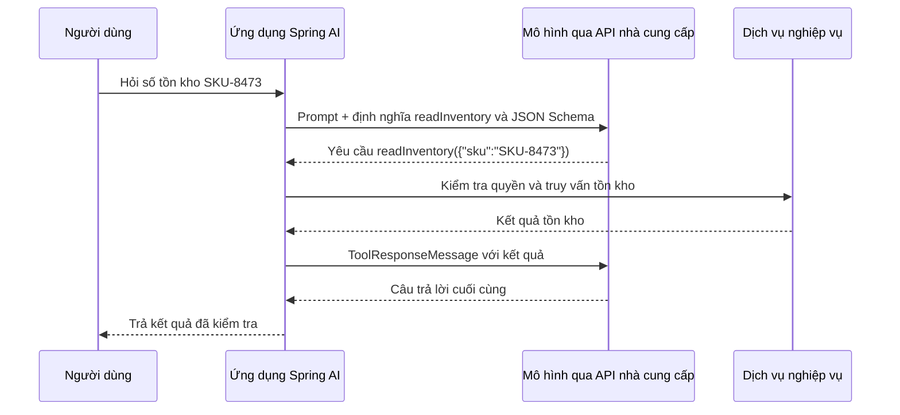

# Kiểm tra hỗ trợ tool calling của mô hình và nhà cung cấp

Trong ứng dụng Spring AI, khai báo phương thức `@Tool`, tạo `ToolCallback` và truyền chúng cho `ChatClient` mới chỉ là **cung cấp công cụ**. Để một lời gọi công cụ thực sự diễn ra, mô hình phải hiểu định nghĩa tool, dịch vụ cung cấp mô hình phải chấp nhận thông tin đó, mô hình phải trả về yêu cầu gọi tool hợp lệ và ứng dụng phải thực thi yêu cầu. Vì vậy, câu hỏi “nhà cung cấp này có tool calling không?” chưa đủ để quyết định một tích hợp nghiệp vụ có hoạt động hay không.

Bài học này sử dụng **Spring AI 2.1.0** làm mốc API. Sau bài học, bạn có thể đọc đúng bảng hỗ trợ theo nhà cung cấp, thiết kế phép thử trực tiếp trên một model/deployment cụ thể, phân biệt lỗi tương thích với lỗi điều phối và lập quyết định dùng hoặc thay thế mô hình một cách có căn cứ.

## 1. Hiểu chính xác thế nào là “hỗ trợ tool calling”

Một lượt tool calling có luồng cơ bản:



Mô hình **không tự truy cập** database, HTTP service hay Spring bean. Nó đề xuất tên tool và đối số; ứng dụng chịu trách nhiệm xác thực, gọi dịch vụ, xử lý lỗi và quyết định gửi kết quả trở lại mô hình. Trong Spring AI 2.x, `ChatClient` thường điều phối vòng lặp thông qua `ToolCallingAdvisor` và `ToolCallingManager`.

Nên kiểm tra theo bốn lớp độc lập:

| Lớp kiểm tra | Câu hỏi thực tế | Bằng chứng cần có |
| --- | --- | --- |
| **Adapter Spring AI** | Tích hợp `ChatModel` cho nhà cung cấp đó có hỗ trợ gửi tool và nhận tool calls? | Bảng so sánh Spring AI theo đúng phiên bản; tài liệu adapter. |
| **API và endpoint** | Endpoint, API version, gateway hoặc OpenAI-compatible proxy có thực sự chuyển tiếp trường `tools` và phản hồi `tool_calls`? | Hợp đồng API và thử nghiệm với endpoint đang triển khai. |
| **Model/deployment** | Model ID, bản phát hành, khu vực triển khai, chế độ suy luận cụ thể có hỗ trợ tool use? | Model card, danh sách tính năng của deployment và phép thử thực tế. |
| **Tính năng trong một lượt gọi** | Có hỗ trợ gọi nhiều tool, `tool_choice`, strict schema, streaming, nhiều vòng không? | Kiểm thử riêng từng chế độ mà ứng dụng sẽ dùng. |

**Không có thuộc tính chung của `ChatModel` bảo đảm mọi model đằng sau adapter đều gọi tool được.** Cột “Yes” trong bảng Spring AI nói về *năng lực tích hợp*; nó không phải cam kết dành cho mọi model ID, phiên bản API và cổng tương thích.

## 2. Tra cứu bảng hỗ trợ của Spring AI 2.1.0

Bảng [Chat Models Comparison của Spring AI 2.1.0](https://docs.spring.io/spring-ai/reference/api/chat/comparison.html) ghi nhận tình trạng hỗ trợ tool/function calling theo **tích hợp nhà cung cấp** như sau:

| Nhóm tích hợp | Tool/function calling theo bảng 2.1.0 | Điều cần xác minh thêm |
| --- | --- | --- |
| OpenAI Chat Completions; OpenAI Responses API | Có | Đúng model và đúng API đang gọi; hai API có kiểu tùy chọn, hành vi riêng. |
| Anthropic Claude; Google GenAI; Mistral AI; Amazon Bedrock Converse | Có | Model và phiên bản được nhà cung cấp/Bedrock hỗ trợ; đặc biệt tính năng tùy chọn theo từng API. |
| DeepSeek, Groq, NVIDIA qua giao diện tương thích OpenAI; MiniMax qua giao diện tương thích Anthropic | Có | Proxy phải giữ nguyên định nghĩa tool, đối số và định dạng kết quả; kiểm tra khác biệt giữa các dịch vụ. |
| Ollama; Qxotic jinfer (community) | Có | Mô hình thực tế đang tải, phiên bản runtime và chế độ chạy có hỗ trợ hay không. |
| Perplexity qua giao diện tương thích OpenAI | **Không**, theo bảng 2.1.0 | Không suy ra “có” chỉ từ việc endpoint nhận định dạng OpenAI. |

Bảng trên là **điểm khởi đầu**, không thay thế việc thử đúng cấu hình chạy thật. Chẳng hạn, Ollama có tích hợp hỗ trợ tool calling nhưng một mô hình local có thể không được huấn luyện để sinh tool call. Tài liệu [Ollama Chat](https://docs.spring.io/spring-ai/reference/api/chat/ollama-chat.html) của Spring AI nêu yêu cầu **Ollama 0.2.8 trở lên** cho tool calling và **0.4.6 trở lên** cho tool calling khi streaming; vẫn phải chọn model hỗ trợ chức năng này.

Khi thay đổi từ OpenAI sang nhà cung cấp khác, không nên chỉ thay API key hoặc `base-url` rồi mặc định rằng `tool_choice`, chế độ gọi song song, độ chặt JSON Schema hay luồng streaming cũng tương đương. Tích hợp tương thích OpenAI có thể chỉ triển khai một phần giao thức.

## 3. Quy trình xác minh trước khi chọn mô hình

### Bước 1 — Chốt bộ nhận dạng cần kiểm tra

Lập một dòng hồ sơ cho **từng deployment** với ít nhất:

```text
springAiVersion  = 2.1.0
adapter          = OpenAI Chat Completions | Anthropic | Ollama | ...
endpoint         = tên dịch vụ / base URL / vùng triển khai
modelId          = giá trị model chính xác đang cấu hình
providerApi      = API version nếu nhà cung cấp yêu cầu
mode             = call hoặc stream
featuresNeeded   = tool calling, nhiều tool, JSON Schema, ...
```

Ghi rõ cả **model ID cụ thể**, không chỉ tên họ mô hình. Nếu qua gateway hay proxy, coi gateway là một lớp cần kiểm chứng vì nó có thể bỏ các trường hoặc đổi định dạng phản hồi.

### Bước 2 — Đối chiếu tài liệu của ba bên

1. Xem bảng `Chat Models Comparison` và trang adapter của **Spring AI 2.1.0**.
2. Xem model card/tài liệu API của nhà cung cấp cho **model và endpoint** đang chọn; tìm thông tin về `tools`, `tool_choice`, số tool tối đa, hạn chế schema và streaming.
3. Với dịch vụ tương thích OpenAI hoặc local, xem tài liệu gateway/runtime và xác nhận mô hình thực tế có hỗ trợ tool calling. Nếu tài liệu các bên mâu thuẫn, ghi trạng thái **chưa xác minh** và chuyển sang phép thử.

### Bước 3 — Chạy probe chỉ đọc để tìm bằng chứng thực thi

Dùng một tool đọc dữ liệu giả lập có đầu ra dễ nhận diện; tránh dùng tool gửi email, thanh toán hoặc sửa cơ sở dữ liệu làm phép thử ban đầu. Quan sát **cả yêu cầu gọi tool lẫn việc callback thực sự chạy**, vì chỉ đọc câu trả lời cuối cùng của mô hình có thể đánh lừa: mô hình vẫn có thể tự đoán ra một con số mà chưa gọi tool.

Ví dụ sau dùng `ChatModel` đã được cấu hình trong ứng dụng và `ChatClient` của Spring AI 2.1.0. Có thể dùng starter tương ứng, chẳng hạn `org.springframework.ai:spring-ai-starter-model-openai`, cùng Spring AI BOM 2.1.0 và API key qua biến môi trường; không hard-code khóa trong mã.

```java
import java.util.concurrent.atomic.AtomicInteger;

import org.springframework.ai.chat.client.ChatClient;
import org.springframework.ai.chat.model.ChatModel;
import org.springframework.ai.tool.annotation.Tool;
import org.springframework.ai.tool.annotation.ToolParam;
import org.springframework.stereotype.Service;

@Service
public class ToolSupportProbe {

    private final ChatClient chatClient;

    public ToolSupportProbe(ChatModel chatModel) {
        this.chatClient = ChatClient.create(chatModel);
    }

    public ProbeResult check() {
        var probe = new InventoryProbe();

        String answer = chatClient.prompt()
                .user("Kiểm tra tồn kho SKU-8473 bằng readInventory "
                        + "trước khi trả lời. Hãy nêu số lượng thực tế.")
                .tools(probe)
                .call()
                .content();

        return new ProbeResult(probe.calls(), answer);
    }

    public record ProbeResult(int executions, String answer) {}

    public static final class InventoryProbe {
        private final AtomicInteger executions = new AtomicInteger();

        @Tool(name = "readInventory",
              description = "Tra tồn kho thực tế theo mã SKU; gọi khi cần số lượng hiện có")
        public String readInventory(
                @ToolParam(description = "Mã sản phẩm, ví dụ SKU-8473") String sku) {
            executions.incrementAndGet();

            if (!"SKU-8473".equals(sku)) {
                return "INVENTORY_PROBE:SKU_NOT_FOUND";
            }
            return "INVENTORY_PROBE:SKU-8473:available=7";
        }

        public int calls() {
            return executions.get();
        }
    }
}
```

Đọc kết quả như sau:

- `executions > 0` xác nhận có ít nhất một lần Spring AI đã thực thi callback. Nếu câu trả lời phản ánh `available=7`, đường đi từ tool đến mô hình cũng đã hoạt động ở trường hợp này.
- `executions == 0` **chưa đủ kết luận mô hình không hỗ trợ tool calling**. Mô hình có thể quyết định trả lời trực tiếp, prompt chưa rõ hoặc adapter/endpoint không chuyển đúng định nghĩa tool. Cần kiểm tra phản hồi gốc và log trước.
- Nếu API trả lỗi, phải phân loại lỗi trước khi kết luận: lỗi xác thực, hạn mức, model ID, JSON Schema, tên tool trùng, endpoint không hỗ trợ hoặc cách cấu hình advisor đều có triệu chứng khác nhau.

Với chương trình biên dịch AOT/GraalVM native image, lớp chứa `@Tool` cần là Spring bean hoặc được đăng ký reflection theo hướng dẫn Spring AI. Mã trên là probe tối giản cho ứng dụng JVM thông thường, không dùng làm dịch vụ tồn kho thật.

### Bước 4 — Tách phép thử phát sinh tool call khỏi phép thử thực thi

Khi cần chẩn đoán sâu, sử dụng API `ChatModel` ở tầng thấp với **chat options đúng loại của nhà cung cấp**, khai báo `toolCallbacks` rồi kiểm tra `ChatResponse.hasToolCalls()` và dữ liệu tool call (tên, arguments, id). Ví dụ `OpenAiChatOptions` cho OpenAI; không mặc định options của một provider áp dụng cho provider khác.

Lưu ý quan trọng theo [ChatModel Tool Calling của Spring AI 2.1.0](https://docs.spring.io/spring-ai/reference/api/tools/chatmodel-tool-calling.html): `ChatModel.call(...)` chỉ trả về phản hồi thô chứa yêu cầu tool, **không tự chạy tool**. Vì vậy:

| Kiểm tra | Kết luận có thể đưa ra |
| --- | --- |
| `ChatModel` trả về `hasToolCalls() == true` và tool name/arguments hợp lệ | Model và endpoint đã trả về một yêu cầu tool calling cho ca thử. |
| Dùng `ChatClient` và callback thực sự được gọi | Cả đường truyền tool và cơ chế thực thi của ứng dụng đã chạy cho ca thử. |
| Callback trả kết quả, mô hình dùng kết quả đó để trả lời | Vòng lặp tool → model → người dùng đã hoàn thành cho ca thử. |
| Không thấy tool call trong một lần chạy | Chưa thể khẳng định là thiếu khả năng; cần thêm kiểm tra và đối chiếu tài liệu. |

Trong Spring AI **1.x**, các `ChatModel` từng điều phối vòng lặp thực thi tool nội bộ. Từ **2.0** (bao gồm **2.1.0**), cơ chế đó được chuyển sang `ToolCallingAdvisor` trong `ChatClient`; nếu gọi `ChatModel` trực tiếp thì ứng dụng phải tự điều phối. Đây là khác biệt phiên bản rất dễ bị nhầm thành “model không hỗ trợ tool”.

## 4. Bộ phép thử tối thiểu cho một deployment

Sau khi probe cơ bản hoạt động, mở rộng bằng các ca riêng biệt; mỗi ca phải quan sát bằng log có cấu trúc hoặc bộ đếm thực thi tool, thay vì chỉ tin vào câu trả lời tự thuật của mô hình.

| Ca thử | Đầu vào mẫu | Điều kiện đạt | Phân loại khi không đạt |
| --- | --- | --- | --- |
| Không cần tool | “Chào bạn” khi có tool đọc tồn kho | Trả lời bình thường, không gọi tool vô cớ. | Chọn tool sai hoặc prompt/tool description chưa phù hợp. |
| Cần một tool | “Tồn kho SKU-8473 là bao nhiêu?” | Gọi đúng `readInventory`, đối số đúng mã, kết quả dựa vào dữ liệu tool. | Không sinh tool call, sai arguments hoặc không có vòng lặp. |
| Nhiều tool theo thứ tự | “Tra giá và tồn kho rồi lập báo giá” với hai tool giả lập | Gọi đủ tool cần thiết, dùng kết quả từ cả hai; không giả số. | Hạn chế điều phối nhiều lượt, lỗi chọn tool hoặc thiếu lịch sử. |
| Schema khó hơn | Tham số enum, ngày tháng, trường tùy chọn | Arguments tuân JSON Schema và được ứng dụng validate. | Không tương thích schema hoặc model sinh sai kiểu. |
| Streaming | Cùng bài toán dùng `.stream()` | Cuối cùng có tool execution và câu trả lời hợp lệ. | Runtime/provider hỗ trợ blocking nhưng chưa hỗ trợ streaming tool calls. |
| Kết quả lỗi | Tool trả “SKU_NOT_FOUND” hoặc lỗi có kiểm soát | Ứng dụng không bịa dữ liệu, xử lý lỗi theo chính sách. | Sai error handling, mô hình tự bịa hoặc loop không dừng. |
| Giới hạn an toàn | Tool có quyền hạn giả lập, thiếu quyền truy cập | Callback từ chối theo danh tính/tenant hiện tại. | Lỗi kiểm soát quyền trong ứng dụng, không phải bằng chứng model hỗ trợ hay không. |

Không cần ép mô hình phải gọi tool trong mọi câu hỏi. Khi provider hỗ trợ chế độ **bắt buộc gọi tool** (`tool_choice` hoặc cơ chế tương đương), có thể dùng chế độ đó cho phép thử protocol; nhưng cú pháp, phạm vi hỗ trợ và hành vi khác nhau giữa các nhà cung cấp. **Không có một thuộc tính `tool_choice` chung áp dụng chắc chắn cho mọi adapter.** Đối với lựa chọn model sản xuất, còn phải đo tỷ lệ chọn đúng tool trên tập câu hỏi đại diện, độ trễ, giá thành và độ ổn định khi gọi nhiều lượt.

Đặc biệt, “hỗ trợ function calling” không có nghĩa mặc nhiên hỗ trợ **parallel tool calls**, tự động bảo đảm JSON hợp lệ, chế độ JSON Schema nghiêm ngặt hoặc streaming từng phần arguments. Những tính năng này cần được đánh dấu riêng trong hồ sơ tương thích.

## 5. Đọc lỗi để xác định đúng nơi xảy ra vấn đề

| Hiện tượng | Nguyên nhân có thể | Cách kiểm tra tiếp |
| --- | --- | --- |
| HTTP 400/422, thông báo `tools` hoặc `tool_choice` không hợp lệ | Endpoint/model chưa hỗ trợ trường đó; hoặc chọn option đặc thù provider sai. | Ghi lại endpoint, model ID, API version, tên trường; đối chiếu API và thử một tool cực đơn giản. |
| HTTP 400 liên quan JSON Schema | Schema không được nhà cung cấp chấp nhận, trường bắt buộc hoặc kiểu dữ liệu không phù hợp. | Thu nhỏ schema về một `String` bắt buộc, bổ sung lại từng cấu trúc. |
| HTTP 401/403, 404 model hoặc 429 | Sai xác thực, quyền, tên model/region hoặc hết hạn mức. | Kiểm tra credential, deployment, quota; không kết luận thiếu tool calling. |
| Phản hồi chỉ là văn bản dù đã truyền tool | Model chọn không gọi; prompt chưa rõ; proxy bỏ `tools`; model không hỗ trợ. | Thử câu hỏi bắt buộc cần dữ liệu ngoài, kiểm tra request/response thô và capability tài liệu. |
| Phản hồi có tool call nhưng callback không chạy | Dùng `ChatModel` trực tiếp trong 2.x; đã tắt `ToolCallingAdvisor`; tool name không phân giải được. | Kiểm tra đường đi qua `ChatClient`, danh sách `ToolCallback`, tên tool và cấu hình advisor. |
| Callback được gọi nhưng đối số sai | Tool description/schema mơ hồ hoặc model chưa tuân thủ tốt. | Dùng `@ToolParam`, kiểu Java rõ ràng, kiểm tra input tại callback, tạo tập ca thử cạnh. |
| Blocking thành công, streaming thất bại | Khác biệt hỗ trợ giữa mode stream và non-stream; runtime quá cũ. | Kiểm tra tài liệu streaming của provider và phiên bản server (đặc biệt khi dùng Ollama). |
| Tool chạy lặp lại hoặc gọi ngoài ý muốn | Vòng lặp không có điều kiện dừng, cấu hình truy hồi lịch sử sai, prompt/tool description mơ hồ. | Giới hạn số lượt, kiểm tra trace nhiều vòng, áp chính sách dừng và xử lý lỗi. |

Khi ghi trace, hữu ích nhất là tên model, endpoint (không kèm bí mật), chế độ call/stream, danh sách tên tool được phép, có/không có tool call, tên tool được yêu cầu, kết quả callback và thời gian từng vòng. **Không đưa khóa API, dữ liệu cá nhân hay đối số nhạy cảm vào log công khai**. Spring AI có quan sát `spring.ai.tool`; việc xuất arguments/results chi tiết cần được cân nhắc riêng.

## 6. Kết nối kết quả kiểm tra với kiến trúc nghiệp vụ

Giả sử ứng dụng chăm sóc khách hàng phải lấy đơn hàng từ hệ thống nội bộ, có kiểm tra quyền theo tenant. Có ba quyết định cần tách biệt:

1. **Chọn mô hình:** model cụ thể có sinh đúng tool call và arguments cho tình huống tra đơn hàng hay không?
2. **Chọn cách điều phối:** dùng `ChatClient`/`ToolCallingAdvisor` để thực thi tự động, hay `ChatModel` với vòng lặp tự quản lý nếu có yêu cầu đặc biệt?
3. **Chọn quyền của tool:** dù mô hình nào được chọn, callback vẫn phải lấy danh tính/tenant từ ngữ cảnh đáng tin cậy của ứng dụng (`ToolContext` hoặc security context phù hợp), xác thực quyền trên từng tài nguyên, validate input và giới hạn hành động.

`ToolContext` chứa ngữ cảnh dành cho callback, không phải là chỗ để nhờ mô hình tự quyết định người dùng thuộc tenant nào. Tool chỉ nên được mở cho yêu cầu và vai trò thực sự cần đến; không đưa tất cả tool có quyền sửa dữ liệu vào cấu hình mặc định chỉ vì model hỗ trợ tool calling.

Nếu provider/model hiện tại không hỗ trợ tool calling hoặc chưa đạt bộ thử, có thể **chọn model được xác minh hỗ trợ**, hoặc **điều phối truy vấn theo luồng nghiệp vụ do ứng dụng quyết định** rồi cung cấp dữ liệu cho mô hình tổng hợp câu trả lời. Trong trường hợp này, đừng giả lập một lệnh gọi tool bằng cách yêu cầu mô hình in JSON và mặc nhiên thực thi JSON đó: vẫn phải validate, phân quyền và xác nhận rõ giao thức trước mọi thao tác.

## 7. Checklist chấp nhận một mô hình vào môi trường chạy thật

- [ ] Đã ghi lại Spring AI version, adapter, provider, endpoint, API version và **model ID chính xác**.
- [ ] Đã đọc bảng năng lực Spring AI 2.1.0 và tài liệu chính thức của model/deployment.
- [ ] Đã chứng minh phản hồi thật có tool call hợp lệ bằng probe chỉ đọc.
- [ ] Đã chứng minh callback thực thi trong `ChatClient` và kết quả đi qua vòng lặp về mô hình.
- [ ] Đã chạy ca không cần tool, cần tool, nhiều lượt, schema đặc thù, lỗi và streaming (nếu sử dụng).
- [ ] Đã phân loại các lỗi protocol/model với lỗi advisor, lỗi xác thực và lỗi phân quyền nghiệp vụ.
- [ ] Đã giới hạn tool được phép, kiểm tra danh tính ở callback, xác định điều kiện dừng và bảo vệ log/trace.
- [ ] Đã ghi kết quả theo từng deployment; cần chạy lại khi đổi model, phiên bản runtime, gateway hoặc Spring AI.

## Tài liệu tham khảo chính thức

- [Spring AI 2.1.0 — Chat Models Comparison](https://docs.spring.io/spring-ai/reference/api/chat/comparison.html): bảng hỗ trợ tool/function calling ở mức tích hợp nhà cung cấp.
- [Spring AI 2.1.0 — Tool Calling](https://docs.spring.io/spring-ai/reference/api/tools.html): `@Tool`, `ToolCallback`, `ChatClient`, `ToolCallingAdvisor`, bảo mật và vòng lặp thực thi.
- [Spring AI 2.1.0 — ChatModel Tool Calling](https://docs.spring.io/spring-ai/reference/api/tools/chatmodel-tool-calling.html): API tầng thấp và trách nhiệm thực thi tool của ứng dụng.
- [Spring AI 2.1.0 — Ollama Chat](https://docs.spring.io/spring-ai/reference/api/chat/ollama-chat.html): điều kiện phiên bản runtime cho tool calling và streaming.
- [Spring AI — Upgrade Notes](https://docs.spring.io/spring-ai/reference/upgrade-notes.html): thay đổi cơ chế điều phối tool từ Spring AI 1.x sang 2.x.
