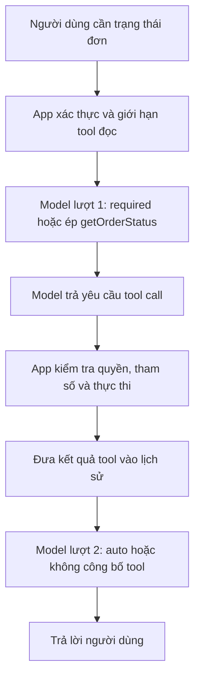

# Chế độ tự chọn, bắt buộc hoặc chỉ định công cụ khi API hỗ trợ

Trong **SPRING_AI_TOOL_CALLING**, ứng dụng cung cấp các công cụ nghiệp vụ cho mô hình ngôn ngữ thông qua `@Tool`, `ToolCallback` và schema tham số. Tuy nhiên, **có công cụ để gọi** và **yêu cầu mô hình chọn công cụ theo một chế độ cụ thể** là hai quyết định khác nhau. Bài học này tập trung vào quyết định thứ hai, đặc biệt khi chuyển giữa OpenAI, Anthropic, Google GenAI và các mô hình không có cùng khả năng cấu hình.

Sau bài học, bạn có thể:

- Phân biệt `auto`, `required`/`any`, ép gọi một công cụ có tên và `none`.
- Cấu hình đúng kiểu `ChatOptions` của provider trong **Spring AI 2.1**, tránh coi `toolChoice` là một tùy chọn chung cho mọi mô hình.
- Chọn chiến lược theo từng **lượt suy luận**, đồng thời quản lý vòng thực thi, quyền truy cập và kiểm thử ở phía ứng dụng.

## 1. Tool choice điều khiển điều gì?

Giả sử trợ lý hỗ trợ đơn hàng với ba công cụ:

| Công cụ | Ý nghĩa | Mức tác động |
| --- | --- | --- |
| `getOrderStatus(orderId)` | Xem trạng thái đơn | Chỉ đọc |
| `estimateShipping(orderId)` | Tính phí giao dự kiến | Chỉ đọc |
| `cancelOrder(orderId)` | Yêu cầu hủy đơn | Thay đổi trạng thái |

Khi người dùng hỏi “Đơn DH-102 đang ở đâu?”, mô hình có thể cần `getOrderStatus`. Khi người dùng hỏi “Bạn làm được gì?”, mô hình có thể trả lời trực tiếp. Chế độ chọn công cụ điều chỉnh quyết định này, với điều kiện **provider, endpoint và model cụ thể** đều hỗ trợ.

| Chế độ logic | Kỳ vọng ở **một lượt gọi mô hình** | Trường hợp phù hợp |
| --- | --- | --- |
| **Tự chọn** (`auto`) | Mô hình có thể trả lời bằng văn bản hoặc tạo 0, 1 hay nhiều yêu cầu gọi công cụ | Hội thoại hỗn hợp, cần tra cứu khi thực sự cần |
| **Bắt buộc** (`required` ở OpenAI, `any` ở Anthropic/Gemini) | Mô hình phải yêu cầu ít nhất một công cụ được cung cấp, theo khả năng API | Bước bắt buộc truy xuất dữ kiện trước khi trả lời |
| **Chỉ định công cụ** (forced/named tool) | Yêu cầu mô hình gọi một công cụ đích theo cú pháp riêng của provider | Luồng đã xác định chính xác nghiệp vụ cần gọi |
| **Không dùng công cụ** (`none`) | Không tạo yêu cầu gọi function tool ở lượt đó | Bước chỉ tóm tắt, giải thích hoặc hiển thị kết quả |

Điểm dễ nhầm:

1. `required` **không chỉ định công cụ nào**. Nếu có ba công cụ, mô hình vẫn phải chọn trong số chúng. Muốn một công cụ cụ thể, dùng chế độ chỉ định tên hoặc chỉ cung cấp đúng công cụ phù hợp.
2. “Bắt buộc” là ràng buộc **lượt model request**, không phải lời cam kết rằng tác vụ nghiệp vụ đã chạy thành công. API có thể từ chối request, trả lỗi, hoặc tạo đối số cần kiểm tra.
3. `auto` không bảo đảm mô hình sẽ tra cứu thông tin mới; nó có thể trả lời luôn. Với dữ kiện nghiệp vụ bắt buộc lấy từ hệ thống, ứng dụng cần có quy trình kiểm soát riêng.
4. `none` giới hạn việc **mô hình phát ra tool call** trong request; nó không thu hồi quyền truy cập ở lớp service và không thay thế quy tắc phân quyền.

### Ba lớp cần tách biệt

```text
Danh sách tool được phép  ->  Chế độ mô hình chọn tool  ->  Ứng dụng quyết định thực thi
     (allowlist)                (tool choice)                (authz, schema, quota)
```

`tools(...)` hoặc `toolCallbacks(...)` định nghĩa **công cụ được đưa vào request**. `toolChoice` định nghĩa **mô hình được/phải chọn theo cách nào**. `ToolCallingAdvisor` hoặc bộ điều phối của ứng dụng mới xử lý phần thực thi. Không có bước nào thay thế được xác thực danh tính, kiểm tra quyền theo tài nguyên và kiểm soát tác dụng phụ.

## 2. Spring AI 2.1: điểm cấu hình chung và điểm phụ thuộc provider

Trong Spring AI 2.1, `ChatClient` là lựa chọn thông dụng cho ứng dụng hội thoại. `ToolCallingAdvisor` được tự động đăng ký khi sử dụng công cụ và có thể điều phối nhiều lượt gọi mô hình, thực thi tool rồi đưa kết quả lại vào hội thoại. Ngược lại, gọi trực tiếp `ChatModel.call(new Prompt(...))` sẽ **trả về yêu cầu tool call mà không tự thực thi**; phía gọi phải điều phối vòng lặp nếu cần. Đây là thay đổi quan trọng so với hành vi tự thực thi bên trong `ChatModel` ở Spring AI 1.x.

Có hai thành phần cấu hình với mức độ di động khác nhau:

- **Cung cấp công cụ**: `@Tool`, `ToolCallback`, `ToolCallbacks.from(...)`, `ChatClient.prompt().tools(...)` được Spring AI chuẩn hóa ở mức API.
- **Chọn công cụ**: các biểu diễn `toolChoice` có thể là chuỗi, object từ SDK của provider hoặc class tùy chọn riêng. Không có một enum `ToolChoice` dùng chung mà cứ áp dụng cho mọi provider trong Spring AI 2.1.

Khi dùng `ChatModel` trực tiếp, hãy tạo `OpenAiChatOptions` cho `OpenAiChatModel`, `AnthropicChatOptions` cho `AnthropicChatModel`, `GoogleGenAiChatOptions` cho `GoogleGenAiChatModel`. Đừng kỳ vọng một cấu hình dành cho OpenAI được tất cả model khác hiểu theo cùng nghĩa.

### Bảng đối chiếu hành vi

| Provider / endpoint trong Spring AI 2.1 | Tự chọn | Bắt buộc một hoặc nhiều tool | Chỉ định tool | Tắt function call |
| --- | --- | --- | --- | --- |
| **OpenAI Chat Completions** (`OpenAiChatOptions`) | `"auto"` | `"required"` | Cấu trúc function chứa tên tool | `"none"` |
| **OpenAI Responses API** (`OpenAiResponsesChatOptions`) | `"auto"` | `"required"` | Cấu trúc function chứa tên tool, **khác hình dạng JSON** so với Chat Completions | `"none"` |
| **Anthropic** (`AnthropicChatOptions`) | `ToolChoiceAuto` | `ToolChoiceAny` | `ToolChoiceTool(name)` | `ToolChoiceNone` |
| **Google GenAI** (`GoogleGenAiChatOptions`) | `AUTO` | `ANY` | `ANY` + `allowedFunctionNames` chỉ có tên cần gọi | `NONE` |
| **Ollama / OpenAI-compatible / provider khác** | Tùy endpoint và model | Không mặc định có hỗ trợ tương đương | Phải xác minh theo từng triển khai | Phải xác minh theo từng triển khai |

Google GenAI còn có `VALIDATED`: mô hình **có thể gọi function hoặc trả văn bản**, đồng thời áp dụng danh sách tên được phép nếu có; vì vậy không được đánh đồng `VALIDATED` với `ANY`. `allowedFunctionNames` chỉ có hiệu lực với `ANY` hoặc `VALIDATED`, bị bỏ qua ở `AUTO` và `NONE`.

Các tên trong bảng mô tả **function calling do ứng dụng thực thi**. Các công cụ được chạy ngay trên server của provider (ví dụ web search tích hợp sẵn ở OpenAI Responses hoặc Google GenAI) có mô hình quyền, cấu hình và khả năng quan sát riêng. Không xem mọi loại “tool” là một `@Tool` Java.

> **Quy tắc phiên bản:** Ví dụ trong bài theo **Spring AI 2.1.0**. Tên builder, enum, thuộc tính và khả năng hỗ trợ phụ thuộc đúng phiên bản Spring AI, SDK bên dưới, API endpoint và tên model. Đừng copy cấu hình `toolChoice` giữa các provider mà không thử một request thực tế.

## 3. Ví dụ Java: cho phép model tự quyết định

Ví dụ sau dùng một công cụ mô phỏng dữ liệu để thấy rõ ranh giới giữa khai báo, chọn và thực thi:

```java
import org.springframework.ai.tool.annotation.Tool;
import org.springframework.ai.tool.annotation.ToolParam;

public class DemoOrderTools {

    @Tool(name = "getOrderStatus",
          description = "Lấy trạng thái hiện tại của đơn hàng theo mã đơn")
    public String getOrderStatus(
            @ToolParam(description = "Mã đơn hàng cần tra cứu") String orderId) {
        return "Đơn " + orderId + ": đang giao"; // Dữ liệu giả lập cho bài học
    }
}
```

Đưa tool vào một lần gọi `ChatClient`:

```java
import org.springframework.ai.chat.client.ChatClient;

// chatModel là bean ChatModel đã cấu hình kết nối và API key.
ChatClient client = ChatClient.create(chatModel);

String answer = client.prompt("Đơn DH-102 đang ở trạng thái nào?")
    .tools(new DemoOrderTools())
    .call()
    .content();
```

Ở đây `.tools(...)` cho phép dùng `getOrderStatus`, còn chế độ chọn mặc định của provider thường là `auto` khi có function tools. Nếu model yêu cầu gọi tool, `ToolCallingAdvisor` của `ChatClient` sẽ xử lý vòng gọi. Thực tế cần thay dữ liệu giả bằng service có quyền truy cập phù hợp, kiểm soát lỗi và hạn mức.

**Lưu ý về tập công cụ:** `ChatClient.Builder.defaultTools(...)` công bố công cụ cho mọi request của client; `prompt().tools(...)` **bổ sung** vào tập mặc định. Với công cụ có tác dụng phụ, nên cấp quyền theo từng request. Ở mức `ChatModel` trực tiếp, options của request thay thế default options, bao gồm cả danh sách tool; không tự động gộp hai danh sách.

## 4. OpenAI: `auto`, `required` và chỉ định tên

### 4.1. `auto` hoặc `required` trong Java

Với `OpenAiChatModel` sử dụng Chat Completions, cấu hình bằng `OpenAiChatOptions.builder().toolChoice(...)`:

```java
import org.springframework.ai.chat.model.ChatModel;
import org.springframework.ai.chat.model.ChatResponse;
import org.springframework.ai.chat.prompt.Prompt;
import org.springframework.ai.openai.OpenAiChatOptions;
import org.springframework.ai.tool.ToolCallbacks;

// chatModel là một OpenAiChatModel đã cấu hình.
OpenAiChatOptions firstRound = OpenAiChatOptions.builder()
    .model("gpt-4o-mini")
    .toolCallbacks(ToolCallbacks.from(new DemoOrderTools()))
    .toolChoice("required")
    .parallelToolCalls(false)
    .build();

ChatResponse response = chatModel.call(
    new Prompt("Tra cứu trạng thái đơn DH-102", firstRound));

boolean requestedTool = response.hasToolCalls();
// ChatModel chỉ trả yêu cầu; ứng dụng chưa thực thi getOrderStatus().
```

- Đổi thành `.toolChoice("auto")` nếu cho phép mô hình trả lời không gọi công cụ.
- Đổi thành `.toolChoice("none")` nếu lượt này chỉ được trả văn bản.
- `.parallelToolCalls(false)` giới hạn khả năng yêu cầu nhiều tool song song ở API/model hỗ trợ; nó là **tùy chọn khác** với `toolChoice`.

Ví dụ cố ý dùng `ChatModel` để quan sát được yêu cầu ở vòng đầu. Để thực thi thực tế, hoặc sử dụng `ChatClient` với advisor, hoặc xây vòng điều phối có `ToolCallingManager`, bổ sung kết quả tool và gọi lại model. Không được kết luận tool đã chạy chỉ vì `response.hasToolCalls()` là `true`.

### 4.2. Chỉ định tool ở mức request

API OpenAI có biểu diễn ép tên tool. Hai endpoint **khác nhau ở cấu trúc JSON**, nên không nên sao chép nguyên một object giữa chúng:

**Chat Completions — hình dạng `tool_choice`:**

```json
{
  "tool_choice": {
    "type": "function",
    "function": { "name": "getOrderStatus" }
  }
}
```

**Responses API — hình dạng `tool_choice`:**

```json
{
  "tool_choice": {
    "type": "function",
    "name": "getOrderStatus"
  }
}
```

Hai khối JSON trên là **trích cấu trúc cấu hình**, không phải request HTTP đầy đủ. `OpenAiChatOptions.toolChoice(Object)` nhận kiểu được bộ chuyển đổi của Spring AI và SDK OpenAI hỗ trợ; khi ép tên hãy tạo đúng cấu trúc/kiểu tương ứng và xác minh bằng integration test. `OpenAiResponsesChatOptions` là lớp options **riêng** cho Responses, có thuộc tính `toolChoice` tương ứng. Trong cấu hình Spring Boot, Responses có thuộc tính `spring.ai.openai.responses.tool-choice`; Chat Completions dùng `spring.ai.openai.chat.tool-choice`.

Với OpenAI, `required` nghĩa là cần **ít nhất một** function call; nó không bảo đảm đúng `getOrderStatus` khi có nhiều tool. Chỉ định tên thì buộc model nhắm vào tool đã nêu, nhưng ứng dụng vẫn phải bảo đảm tên nằm trong danh sách cấp phát cho request, schema hợp lệ và quyền thực thi còn hiệu lực.

## 5. Anthropic: dùng kiểu `ToolChoice` của SDK

Spring AI 2.1 tích hợp Anthropic Java SDK; `AnthropicChatOptions` nhận đối tượng `toolChoice` thay vì sao chép chuỗi OpenAI. Ví dụ từ API Anthropic:

```java
import com.anthropic.models.messages.ToolChoiceAny;
import com.anthropic.models.messages.ToolChoiceNone;
import com.anthropic.models.messages.ToolChoiceTool;
import org.springframework.ai.anthropic.AnthropicChatOptions;
import org.springframework.ai.tool.ToolCallbacks;

var callbacks = ToolCallbacks.from(new DemoOrderTools());

// Ít nhất một tool được chọn.
var any = AnthropicChatOptions.builder()
    .toolCallbacks(callbacks)
    .toolChoice(ToolChoiceAny.builder().build())
    .build();

// Chỉ định getOrderStatus.
var named = AnthropicChatOptions.builder()
    .toolCallbacks(callbacks)
    .toolChoice(ToolChoiceTool.builder().name("getOrderStatus").build())
    .build();

// Không tạo tool call trong lượt này.
var noTools = AnthropicChatOptions.builder()
    .toolCallbacks(callbacks)
    .toolChoice(ToolChoiceNone.builder().build())
    .build();
```

`AUTO` là mặc định của Anthropic; nếu muốn ghi tường minh có thể dùng `ToolChoiceAuto`. Tùy chọn `disableParallelToolUse` là một cấu hình độc lập: khi bật, model có tối đa một tool call trong mỗi phản hồi. Chế độ bắt buộc hoặc ép tên không cấp thêm quyền cho model hay bypass xác thực của service.

## 6. Google GenAI: `ANY` và `allowedFunctionNames`

Google GenAI ánh xạ `GoogleGenAiChatOptions.ToolChoice` sang `FunctionCallingConfig`. Ví dụ ép mô hình chọn công cụ `getOrderStatus` trong danh sách được phép:

```java
import java.util.List;
import org.springframework.ai.google.genai.GoogleGenAiChatOptions;

var options = GoogleGenAiChatOptions.builder()
    .toolChoice(new GoogleGenAiChatOptions.ToolChoice(
        GoogleGenAiChatOptions.ToolChoice.Mode.ANY,
        List.of("getOrderStatus")))
    .build();
```

Trong một `Prompt` thực tế, cần cung cấp `getOrderStatus` qua `toolCallbacks(...)` hoặc đường đi `ChatClient.tools(...)` tương ứng; tên trong `allowedFunctionNames` **không tự đăng ký tool**. Có thể cấu hình qua `application.yml`:

```yaml
spring:
  ai:
    google:
      genai:
        chat:
          tool-choice:
            mode: ANY
            allowed-function-names:
              - getOrderStatus
```

| Chế độ Google | Được trả văn bản luôn? | Có áp dụng `allowedFunctionNames`? |
| --- | --- | --- |
| `AUTO` | Có | Không |
| `ANY` | Không, kỳ vọng function call | Có |
| `VALIDATED` | Có | Có |
| `NONE` | Có, không gọi function | Không |

Nếu chỉ có `getOrderStatus` trong danh sách tên cho `ANY`, kết quả thực tế tương đương **ép chọn trong tập một phần tử**. Tuy nhiên đây là cơ chế whitelist của Gemini, không phải cùng kiểu “named function” của Anthropic hay OpenAI.

## 7. Vì sao không thể bật `required` cho cả vòng lặp?

Tool choice được gửi **mỗi lần gọi mô hình**. Một yêu cầu nghiệp vụ có thể trải qua nhiều lượt model request:



Nếu tất cả vòng đều giữ `required`, mô hình có thể **tiếp tục yêu cầu gọi công cụ** cả khi đã nhận kết quả, khiến số vòng tăng đến giới hạn. `ToolCallingAdvisor` không thể tự suy ra rằng ý định kinh doanh đã hoàn tất từ cấu hình bắt buộc đó. Vì vậy:

1. Chỉ ép gọi công cụ ở **giai đoạn cần lấy dữ kiện**; sau khi tool trả dữ liệu, chuyển lượt sinh câu trả lời sang `auto` hoặc `none` tùy quy trình.
2. Nếu mỗi giai đoạn có nghĩa vụ rõ ràng, tách thành hai `Prompt`/bước điều phối hoặc dùng `ChatModel` cùng `ToolCallingManager` để kiểm soát chuyển trạng thái.
3. Đặt số vòng tối đa, hạn mức gọi tool, deadline, bảo vệ idempotency và điều kiện dừng; xử lý riêng kết quả lỗi, từ chối quyền, thiếu tham số.

Ví dụ: yêu cầu “Đọc đơn DH-102 rồi giải thích tình trạng giao hàng”. Bước tra cứu được ép `getOrderStatus`; bước giải thích không được ép gọi lại. Ngược lại, nếu yêu cầu “Hủy đơn”, việc ép `cancelOrder` ngay từ đầu là lựa chọn nguy hiểm: trước hết phải xác thực, kiểm tra trạng thái đơn và yêu cầu xác nhận phù hợp từ người dùng.

## 8. Dùng chế độ lựa chọn như một phần của chính sách nghiệp vụ

Một hệ thống đặt hàng nên quyết định chế độ ở phía server theo mục tiêu của request:

| Tình huống | Tool được cấp | Chế độ gợi ý | Lý do |
| --- | --- | --- | --- |
| Hỏi kiến thức chung về vận chuyển | Không cần tool hoặc chỉ tool tra cứu công khai | `auto` / `none` | Không nhất thiết cần dữ liệu đơn thật |
| Hỏi trạng thái đơn sở hữu bởi người dùng | `getOrderStatus` | Bắt buộc hoặc ép tool ở bước tra cứu | Tránh suy đoán trạng thái đơn |
| Tính phí giao hàng cho một đơn đã xác thực | `estimateShipping` | Ép tool ở bước tính phí | Phải lấy giá từ nghiệp vụ |
| Đề nghị hủy đơn | Ban đầu chỉ tool đọc | Quy trình nhiều bước; cấp `cancelOrder` sau kiểm tra và xác nhận | Có thay đổi trạng thái |
| Viết lại kết quả đã tra cứu cho dễ hiểu | Không công bố tool thay đổi dữ liệu | `none` | Ngăn việc phát sinh yêu cầu hành động mới |

**Ba ranh giới an toàn luôn được giữ:**

- **Danh tính và phân quyền:** `orderId` do mô hình đưa ra chỉ là tham số không tin cậy. Ứng dụng phải dùng danh tính do cơ chế xác thực cấp, kiểm tra người gọi có quyền trên **đúng đơn hàng** trước khi truy vấn hay thay đổi. Có thể dùng `ToolContext` để chuyển thông tin ngữ cảnh tin cậy mà không cho mô hình tự khai báo người dùng.
- **Xác thực và lỗi:** Đối số tool phải đi qua schema và validation nghiệp vụ; từ chối request có mã đơn sai, thiếu quyền hoặc đã hết hạn. `required` không biến dữ liệu model sinh ra thành dữ liệu đáng tin.
- **Giới hạn thực thi:** Timeout, số lượt gọi, retry có kiểm soát, khóa chống gọi trùng hành động và ghi log/audit cần được quyết định tại ứng dụng. Không nhầm `tool_choice` với cơ chế đảm bảo kết quả, xác nhận giao dịch hay chống lặp.

### Khi provider không hỗ trợ ép công cụ

Đừng cố gán `toolChoice("required")` cho mọi `ChatOptions` rồi hy vọng SDK tự chuyển nghĩa. Với model/endpoint không xác nhận hỗ trợ:

1. Nếu biết trước chức năng phải chạy, ứng dụng **gọi service Java trực tiếp**, dùng LLM để giải thích kết quả nếu cần.
2. Hoặc chỉ công bố đúng tool hợp lệ trong request và để model ở `auto`; xử lý trường hợp không có tool call như nhánh hợp lệ của thuật toán, không coi đó là bắt buộc.
3. Nếu nghiệp vụ yêu cầu đảm bảo gọi tool, kiểm tra `response.hasToolCalls()` và tên/đối số sau phản hồi. Khi không đạt, dừng hoặc chuyển sang logic ứng dụng, thay vì gọi retry vô hạn với một câu nhắc “hãy bắt buộc gọi công cụ”.

Câu nhắc hệ thống “luôn gọi công cụ” **không tương đương** ràng buộc `required` của provider. Ngay cả khi API cho phép ép, quyết định cuối cùng cho phép **thực thi** phải thuộc ứng dụng.

## 9. Kiểm thử hành vi giữa các provider

Các ca kiểm thử nên thực hiện trên **đúng Spring AI 2.1.x, model và endpoint được triển khai**. Dùng callback giả ghi nhận số lần thực thi; không cần tác động đến đơn thật.

| Ca | Cấu hình | Kết quả cần kiểm tra |
| --- | --- | --- |
| Câu hỏi chung | `auto`, một tool đọc | Có thể không có tool call; phản hồi hoàn chỉnh |
| Yêu cầu tra cứu | `required`/`ANY`, một tool đọc | Lượt model đầu có tool call khi API hỗ trợ; tool được chạy đúng một lần theo điều phối |
| Ép tên | Forced `getOrderStatus` | Tên công cụ yêu cầu đúng tên đã khai báo; đối số được validate |
| Tắt tool | `none`/`NONE` | Không có tool call ở lượt mô hình tương ứng |
| Hai công cụ cùng được phép | `required` | Có thể chọn bất kỳ công cụ phù hợp; không tự suy ra tên cố định |
| Sau khi nhận kết quả | Chuyển từ `required` sang `auto`/`none` | Sinh được câu trả lời cuối, không lặp tool vô hạn |
| Tài nguyên không thuộc quyền | Bất kỳ chế độ | Service từ chối; không lộ nội dung đơn |
| Model không hỗ trợ chế độ | `required` hoặc forced | Lỗi được phát hiện và xử lý rõ ràng, không lặng lẽ coi là thành công |

Ngoài kết quả, nên quan sát tên tool model yêu cầu, số lượt model request, số lần callback thực thi, thời gian, trạng thái lỗi và lý do dừng; tránh log toàn bộ đối số/kết quả nhạy cảm. Kiểm thử riêng trường hợp model trả **nhiều tool call trong cùng một phản hồi** và trường hợp không trả tool call khi ở `auto`.

## 10. Những lỗi nhầm lẫn thường gặp

**“Đã gọi `.tools(...)` nên công cụ bắt buộc chạy.”** Không đúng: `.tools(...)` công bố công cụ; với `auto` model vẫn có thể trả văn bản.

**“`required` nghĩa là gọi một công cụ cụ thể.”** Không đúng: đó là yêu cầu ít nhất một tool call trong tập được cung cấp. Dùng forced named tool hoặc ràng buộc tập tên khi API hỗ trợ.

**“`ToolChoiceAny` của Anthropic có thể gán thẳng cho OpenAI.”** Không đúng: kiểu SDK và cấu trúc request khác nhau. Viết adapter theo provider nếu hệ thống cần một abstraction riêng.

**“Đặt `required` ở default options cho mọi request là an toàn.”** Không đúng với trợ lý nhiều vòng: các request chỉ cần giải thích có thể bị buộc gọi tool lại. Tốt hơn là đặt theo bước và giới hạn vòng lặp.

**“Model đã chọn `cancelOrder` thì được phép hủy.”** Không đúng: quyền truy cập, xác nhận thao tác và điều kiện nghiệp vụ được kiểm soát trong ứng dụng, không từ lựa chọn của model.

**“Dùng `ChatModel.call()` là tool đã chạy.”** Không đúng trong Spring AI 2.1: chỉ nhận kết quả từ model; phải dùng `ChatClient`/`ToolCallingAdvisor` hoặc tự điều phối.

## 11. Tổng kết ứng dụng

Chọn `auto` cho trợ lý có thể trả lời hoặc tra cứu; chọn `required`/`ANY` khi **một bước** không được bỏ qua việc yêu cầu tool; ép một công cụ có tên khi nghiệp vụ đã xác định chính xác thao tác cần thiết; chọn `none` cho bước chỉ trả lời. Mỗi chế độ gắn với một request, một tập tool hợp lệ và khả năng cụ thể của provider. Trong Spring AI 2.1, cú pháp cho OpenAI, Anthropic và Google GenAI khác nhau; `ChatClient` và `ToolCallingAdvisor` xử lý vòng gọi, còn ứng dụng luôn chịu trách nhiệm quyền, validation, lỗi và giới hạn.

### Tài liệu đối chiếu

- [Spring AI 2.1 — Tool Calling](https://docs.spring.io/spring-ai/reference/api/tools.html): cách khai báo/cấp công cụ và vòng thực thi qua `ChatClient`.
- [Spring AI 2.1 — OpenAI Chat](https://docs.spring.io/spring-ai/reference/api/chat/openai-chat.html): `spring.ai.openai.chat.tool-choice`, `parallel-tool-calls` và đặc điểm Chat Completions.
- [Spring AI 2.1 — OpenAI Responses API](https://docs.spring.io/spring-ai/reference/api/chat/openai-responses-chat.html): endpoint riêng, `OpenAiResponsesChatOptions` và `spring.ai.openai.responses.tool-choice`.
- [Spring AI 2.1 — Anthropic Chat](https://docs.spring.io/spring-ai/reference/api/chat/anthropic-chat.html): `ToolChoiceAuto`, `ToolChoiceAny`, `ToolChoiceTool`, `ToolChoiceNone`.
- [Spring AI 2.1 — Google GenAI Chat](https://docs.spring.io/spring-ai/reference/api/chat/google-genai-chat.html): `AUTO`/`ANY`/`VALIDATED`/`NONE` và `allowedFunctionNames`.
- [Spring AI — Upgrading to 2.0](https://docs.spring.io/spring-ai/reference/upgrade-notes.html): thay đổi vòng thực thi `ChatModel` so với 1.x, áp dụng cho 2.1.
- [OpenAI API — Function calling](https://developers.openai.com/api/docs/guides/function-calling): ngữ nghĩa các chế độ `tool_choice` và số tool call.
