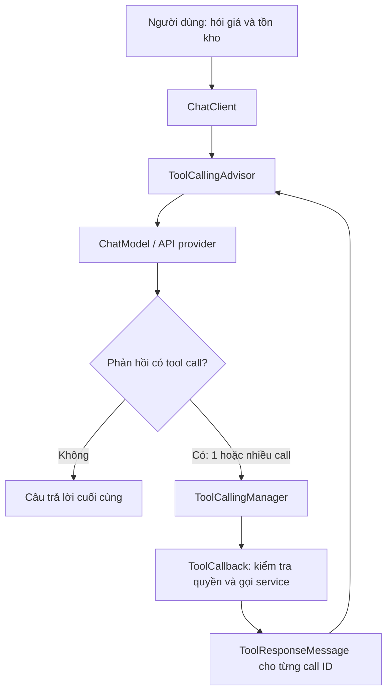

# Khả năng nhiều tool call, streaming và xử lý kết quả

> **Phạm vi:** Spring AI **2.1.0 GA** (phát hành ngày 20/11/2026), tích hợp tool calling qua `@Tool`, `ToolCallback`, schema đầu vào, `ToolContext` và `ChatClient`. Bài học tập trung vào sự khác nhau giữa các mô hình/nhà cung cấp khi sinh **nhiều lệnh gọi công cụ**, **streaming** và **trả kết quả**. Cần kiểm tra thêm tên model, phiên bản API và cấu hình triển khai thực tế trước khi dựa vào một tính năng cụ thể.

## 1. Sau bài học, bạn làm được gì?

- Phân biệt **nhiều tool call trong cùng một phản hồi** với **chuỗi tool call qua nhiều lượt hội thoại**.
- Giải thích đúng phần việc của mô hình, `ToolCallingAdvisor`, `ToolCallingManager` và ứng dụng Java.
- Chọn `call()` hoặc `stream()` phù hợp; nhận diện **delta đối số chưa hoàn chỉnh** và **tool call hoàn chỉnh** trong Spring AI 2.1.
- Xử lý nhiều kết quả, `returnDirect`, lỗi công cụ và giới hạn vòng lặp mà không mất mối liên hệ giữa từng tool call và kết quả.
- Thiết kế kiểm thử khi thay model hoặc chuyển nhà cung cấp: có tool calling không đồng nghĩa có hỗ trợ nhiều tool call hay streaming đối số.

## 2. Ba khả năng khác nhau thường bị nhầm

Giả sử người dùng yêu cầu: **“Cho biết giá và tồn kho của mã SP-42, rồi đề xuất có nên đặt 5 chiếc không.”**

| Khả năng | Mô hình có thể phản hồi | Ứng dụng cần làm | Điều cần kiểm tra |
| --- | --- | --- | --- |
| **Một tool call** | Chỉ gọi `getPrice("SP-42")` | Chạy công cụ và gửi kết quả lại mô hình | Model có hỗ trợ gọi công cụ không? |
| **Nhiều tool call trong một phản hồi** | Cùng một phản hồi chứa `getPrice` và `getStock` với **hai call ID riêng** | Thực thi và trả kết quả tương ứng **cả hai call ID** | Model/endpoint có phát sinh nhiều lời gọi trong một lượt không? |
| **Nhiều vòng gọi liên tiếp** | Lượt 1 gọi `getPrice`, đọc kết quả; lượt 2 gọi `getStock`; lượt cuối trả lời | Tiếp tục vòng lặp với lịch sử gồm yêu cầu và kết quả tool | Bộ điều phối có xử lý nhiều lượt, hạn mức và điều kiện dừng không? |
| **Streaming kết quả sinh ra** | Phát văn bản từng chunk; một số provider còn phát **delta đối số tool** | Tiêu thụ `Flux` và tổng hợp đúng ngữ nghĩa từng chunk | Provider có thực sự stream **đối số tool** hay chỉ stream văn bản? |

Hai lời gọi `getPrice` và `getStock` *độc lập* nên một model hỗ trợ nhiều call có thể yêu cầu chúng ngay trong cùng một phản hồi. Nếu `calculateShipping` cần địa chỉ kho lấy từ `getStock`, model thường phải **chờ kết quả** rồi mới biết đối số để phát lệnh gọi tiếp theo: đó là **nhiều vòng**, dù mỗi vòng chỉ có một tool call.

Không thể suy ra “gọi được tool” là “luôn gọi song song được nhiều tool”. Model có thể chọn không gọi, gọi một công cụ, gọi nhiều công cụ, hoặc gọi sai công cụ. Tùy chọn “parallel tool calls” ở API provider thường liên quan đến **việc model có thể sinh nhiều lời gọi trong một lượt**; không có nghĩa mã Java của tool tự chạy đa luồng, không bảo đảm giao dịch nghiệp vụ song song an toàn.

## 3. Ai điều phối vòng lặp trong Spring AI 2.1?

Trong Spring AI 2.1, cách dùng thông thường là `ChatClient`. `DefaultChatClient` tự đăng ký `ToolCallingAdvisor`; advisor gửi danh sách tool, nhận các call model đề xuất, giao `ToolCallingManager` tìm `ToolCallback` tương ứng và thực thi, thêm kết quả vào lịch sử rồi gọi lại model đến khi không còn tool call. Điều này áp dụng cho cả `.call()` và `.stream()`.



Mô hình **chỉ gửi ý định** gọi công cụ cùng đối số. Ứng dụng sở hữu mã thực thi, quyền truy cập dữ liệu và tác động bên ngoài. Khi một phản hồi có nhiều call, mỗi call phải được nối đúng kết quả bằng **ID** của nó; không nên tự ghép kết quả theo vị trí chuỗi văn bản hoặc chỉ theo tên hàm.

**Khác biệt phiên bản cần ghi nhớ:** Spring AI 1.x có vòng thực thi tool nằm trong từng `ChatModel`; từ **2.0**, vòng lặp đó được chuyển sang `ToolCallingAdvisor` của `ChatClient`. Trong **2.1**, gọi `ChatModel.call(prompt)` hoặc `ChatModel.stream(prompt)` trực tiếp sẽ **trả yêu cầu tool nhưng không tự chạy tool**. Khi đi qua `ChatModel` ở mức thấp, ứng dụng phải tự dùng `ToolCallingManager.executeToolCalls(prompt, response)` và cập nhật lịch sử để tiếp tục. Thuộc tính cũ `internalToolExecutionEnabled` đã bị loại bỏ; không dùng lại ví dụ 1.x để suy ra hành vi của 2.1.

## 4. Ví dụ nghiệp vụ: để model đề xuất hai công cụ

Trong ứng dụng thực, hai phương thức dưới đây gọi service nội bộ. `PriceService` và `StockService` là các service nghiệp vụ giả định; `PriceView` và `StockView` là DTO do ứng dụng định nghĩa. Ví dụ cho thấy *cách nối* tool với ứng dụng, không hàm ý rằng model bắt buộc sẽ chọn cả hai tool trong cùng một lượt.

```java
import org.springframework.ai.chat.client.ChatClient;
import org.springframework.ai.tool.annotation.Tool;
import org.springframework.ai.tool.annotation.ToolParam;
import org.springframework.ai.tool.ToolContext;

class ProductTools {
    private final PriceService prices;
    private final StockService stocks;

    ProductTools(PriceService prices, StockService stocks) {
        this.prices = prices;
        this.stocks = stocks;
    }

    @Tool(description = "Tra giá niêm yết hiện hành theo mã SKU")
    PriceView getPrice(
            @ToolParam(description = "Mã sản phẩm SKU") String sku,
            ToolContext context) {
        String tenantId = (String) context.getContext().get("tenantId");
        return prices.findVisiblePrice(tenantId, sku);
    }

    @Tool(description = "Tra số lượng có thể bán theo mã SKU")
    StockView getStock(
            @ToolParam(description = "Mã sản phẩm SKU") String sku,
            ToolContext context) {
        String tenantId = (String) context.getContext().get("tenantId");
        return stocks.findVisibleStock(tenantId, sku);
    }
}

// Giả sử đã có chatModel, prices, stocks và tenantId
ChatClient client = ChatClient.create(chatModel);
String answer = client.prompt()
    .user("Giá và tồn kho SP-42 hiện tại? Có đủ bán 5 chiếc không?")
    .tools(new ProductTools(prices, stocks))
    .toolContext(java.util.Map.of("tenantId", tenantId))
    .call()
    .content();
```

`@Tool` và `@ToolParam` giúp Spring AI tạo định nghĩa công cụ cùng JSON schema đối số mà model nhìn thấy. `ToolContext` mang dữ liệu **ngoài model** (ví dụ tenant được lấy từ principal đã xác thực); thông tin này không được chép vào prompt. Trong service, phải kiểm tra quyền với SKU, tenant và dữ liệu thật: **có tool trong danh sách không đồng nghĩa người dùng được quyền truy cập mọi bản ghi**.

Nếu model phát ra hai call độc lập, một lịch sử logic có dạng:

```text
User: Giá và tồn kho SP-42? Có đủ bán 5 chiếc không?
Assistant tool calls:
  id=c1, name=getPrice, arguments={"sku":"SP-42"}
  id=c2, name=getStock, arguments={"sku":"SP-42"}
Tool response (c1): {"sku":"SP-42","priceVnd":120000}
Tool response (c2): {"sku":"SP-42","available":7}
Assistant: Giá 120.000đ/chiếc, còn 7 chiếc, đủ 5 chiếc.
```

Các số liệu trên **chỉ là dữ liệu minh họa**. Lời gọi từ model có thể chỉ chứa `c1` ở lượt đầu, sau đó mới phát `c2`: `ToolCallingAdvisor` vẫn xử lý được cả hai kiểu. Nếu cần xử lý mỗi lượt theo quy trình riêng, hãy đặt advisor theo dõi vào **bên trong** vòng lặp hoặc dùng chế độ điều phối thủ công.

## 5. So sánh khác biệt giữa model và provider

Spring AI chuẩn hóa `ToolCallback` và API chat, nhưng khả năng cuối cùng phụ thuộc cả **provider, endpoint, tên model, version và cài đặt**. Bảng dưới đây phân biệt **tool calling / streaming phản hồi** (theo bảng hỗ trợ tích hợp Spring AI 2.1) với **streaming delta đối số tool** (tính năng được tài liệu Spring AI 2.1 nêu rõ).

| Nhóm tích hợp | Tool calling / stream phản hồi | Delta đối số tool trong Spring AI 2.1 | Ghi chú thực hành |
| --- | --- | --- | --- |
| **OpenAI Chat Completions** | Có / Có | **Có** | Call ID, tên và mảnh đối số có thể đi thành các delta; kiểm tra lựa chọn model và API. |
| **OpenAI Responses API** | Có / Có | **Có** | Kết quả theo cấu trúc phần thông điệp; không giả định giống hoàn toàn Chat Completions. |
| **Anthropic** | Có / Có | **Có** | Nhiều khối nội dung và tool use; delta đối số khác định dạng thô của OpenAI. |
| **Amazon Bedrock Converse** | Có / Có | **Có** | Khả năng thực tế còn tùy model chạy sau Bedrock; đối số có thể được chuẩn hóa khi call hoàn tất. |
| **DeepSeek** | Có / Có | **Có** | Có thể khác nhau giữa model thường, reasoning và endpoint tương thích OpenAI. |
| **Google GenAI (Gemini)** | Có / Có | **Không được bảo đảm theo danh sách delta nêu trên** | Model có thể báo finish reason thường dù đã yêu cầu tool; kiểm tra `hasToolCalls()`. |
| **Ollama** | Có / Có với runtime hỗ trợ | **Không được bảo đảm theo danh sách delta nêu trên** | Tài liệu yêu cầu Ollama ≥ 0.2.8 cho tool calling và ≥ 0.4.6 cho tool calling khi stream; vẫn phụ thuộc model địa phương. |
| **Mistral AI** | Có / Có | **Không được bảo đảm theo danh sách delta nêu trên** | Kiểm tra từng model và kiểu thông điệp mà endpoint trả về. |
| **Perplexity (OpenAI-proxy)** | **Không** / Có | Không áp dụng | Có stream văn bản không có nghĩa có thể sử dụng tool calling. |

**Cách đọc bảng:** “Có / Có” là năng lực của **tích hợp**, không phải lời cam kết mọi model trong provider đều gọi được nhiều công cụ trong một phản hồi. “Không được bảo đảm” nghĩa là tài liệu Spring AI 2.1 **không liệt kê provider đó** trong nhóm phát delta đối số; không khẳng định provider tuyệt đối không có tính năng tương tự. Khi chuyển model, hãy chạy bộ kiểm thử khả năng thay vì hard-code giả định “hai tool chắc chắn ở cùng lượt”.

Một số provider có tùy chọn riêng như `parallelToolCalls` (OpenAI) hoặc `disableParallelToolUse` (Anthropic); cách hỗ trợ và giá trị mặc định thay đổi theo API/model. Chỉ cấu hình khi có bằng chứng tương thích với endpoint đang chạy, và kiểm thử trên dữ liệu thật. Dù model trả nhiều call trong một lượt, vẫn **không được suy ra** việc tool callback Java chạy đồng thời hoặc có cùng thứ tự hoàn tất.

## 6. Streaming: văn bản, delta đối số và call đã hoàn chỉnh

`ChatClient.stream().content()` trả `Flux<String>` chứa các mảnh **văn bản**; `stream().chatResponse()` trả `Flux<ChatResponse>` nên có thể quan sát metadata và các message parts. Trong Spring AI 2.1, đối với những provider hỗ trợ streaming đối số, mỗi mảnh đối số tool được biểu diễn bằng `ToolCallPart` **partial** (qua `StreamingParts.isPartial(part)`). Nó mang ID, tên tool và *mảnh* đối số, có thể chưa phải JSON hợp lệ.

Ví dụ logic khi model chuẩn bị gọi `getPrice`:

```text
chunk 1: ToolCallPart(partial=true,  id=c1, name=getPrice, arguments="{\"sku\":")
chunk 2: ToolCallPart(partial=true,  id=c1, name=getPrice, arguments="\"SP-42\"}")
chunk 3: ToolCallPart(partial=false, id=c1, name=getPrice, arguments="{\"sku\":\"SP-42\"}")
```

Các chunk chỉ minh họa cách phân mảnh; provider có thể chia ở vị trí khác. Chỉ **call hoàn chỉnh** mới được `getToolCalls()` / `hasToolCalls()` nhìn nhận là yêu cầu thực thi. `ToolCallingManager` không chạy trên delta; `MessageAggregator` cũng không lưu partial tool call thành một lệnh gọi thật trong memory. Model phải phát call hoàn chỉnh sau các mảnh; không được thực thi trước vì một chuỗi partial có thể bị ngắt giữa chừng hoặc thiếu dữ liệu.

Cách quan sát tiến độ delta ở luồng chat (đoạn dưới đặt trong service đã có `chatClient` và `ProductTools`):

```java
import org.springframework.ai.chat.messages.part.MessagePart;
import org.springframework.ai.chat.messages.part.ToolCallPart;
import org.springframework.ai.chat.messages.part.StreamingParts;
import reactor.core.publisher.Flux;

Flux<ChatResponse> chunks = chatClient.prompt()
    .user("Giá và tồn kho SP-42?")
    .tools(productTools)
    .stream()
    .chatResponse();

return chunks.doOnNext(response -> {
    response.getResults().forEach(generation -> {
        for (MessagePart part : generation.getOutput().getParts()) {
            if (part instanceof ToolCallPart delta
                    && StreamingParts.isPartial(part)) {
                var call = delta.toolCall();
                // Chỉ ghi sự kiện tiến độ đã lọc dữ liệu nhạy cảm.
                progressSink.emit(call.id(), call.name());
                // call.arguments() ở đây mới là MỘT MẢNH, không phải JSON hoàn chỉnh.
            }
        }
    });
});
```

`ChatResponse` và `progressSink` ở đây là các biến/đối tượng do service cung cấp; `progressSink.emit(...)` là **giao diện minh họa** cho việc phát sự kiện UI, không phải API Spring AI. Ở ứng dụng thật, lấy thông tin tiến độ từ luồng do server trả, áp dụng backpressure và xử lý hủy subscription; tránh gọi `subscribe()` nhiều lần trên một yêu cầu vì có thể gây **thực thi lại** khi Flux cold.

Trong chế độ `ToolCallingAdvisor` tự điều phối, tool call **hoàn chỉnh** được advisor xử lý trong vòng lặp nên thường không xuất hiện như một sự kiện gọi tool thô cho client ngoài cùng; **partial delta** vẫn có thể đi qua để hiển thị tiến độ. Nếu cần thấy kết quả từng tool, retry và từng vòng để phát SSE, đặt một `StreamAdvisor` theo dõi bên trong vòng lặp (order lớn hơn `ToolCallingAdvisor.DEFAULT_ORDER`) hoặc chủ động điều phối vòng lặp với `ChatClientMessageAggregator`. Không coi “đã nhận delta” là “tool đã chạy thành công”.

## 7. Ghép kết quả đúng, trả trực tiếp và xử lý lỗi

### 7.1. Kết quả từng tool phải bám theo call ID

`ToolCallback` nhận đối số JSON và trả nội dung kết quả; với phương thức `@Tool`, giá trị trả về được `ToolCallResultConverter` chuyển thành chuỗi gửi cho model (mặc định dùng Jackson). `ToolCallingManager.executeToolCalls(...)` trả `ToolExecutionResult` chứa lịch sử đã cập nhật: thông điệp assistant yêu cầu gọi tool và các `ToolResponseMessage` tương ứng. Không tự nối mọi kết quả thành một đoạn text không nhãn rồi gửi lại model: làm vậy mất ID, khó phân biệt lỗi từng công cụ và có thể khiến model gán nhầm giá/tồn kho.

Ví dụ đặt quy ước kết quả nghiệp vụ:

```json
{
  "sku": "SP-42",
  "status": "OK",
  "priceVnd": 120000,
  "asOf": "2026-11-27T09:00:00+07:00"
}
```

Nên trả dữ liệu có ý nghĩa, giới hạn kích thước, loại bỏ bí mật, gắn đơn vị và thời điểm; đối với yêu cầu rủi ro cao, service xác thực quyền **trước khi đọc/ghi**. Model là bên *diễn giải* kết quả, không phải thẩm quyền cấp quyền.

### 7.2. `returnDirect` thay đổi luồng kết quả

Theo mặc định, kết quả tool đi **về model** để model viết câu trả lời. Khi một tool khai báo `@Tool(returnDirect = true)`, kết quả có thể trả **thẳng về caller** và vòng lặp dừng, không cần lượt sinh tiếp theo.

```java
@Tool(description = "Trả dữ liệu báo cáo đã được phê duyệt", returnDirect = true)
public String approvedReport(
        @ToolParam(description = "Mã báo cáo") String reportId) {
    return reportService.getAuthorizedReport(reportId);
}
```

**Góc cạnh dễ sai khi nhiều tool call:** nếu model yêu cầu **nhiều** tool trong **cùng một phản hồi**, `returnDirect` chỉ có hiệu lực khi **tất cả tool được gọi** đều có `returnDirect = true`. Chỉ một tool thường xen vào là các kết quả vẫn được trả về model để tiếp tục. Vì vậy đừng dựa vào `returnDirect` của một tool đơn lẻ để đảm bảo request nhiều tool dừng ngay.

### 7.3. Lỗi và giới hạn

Một tool có thể thất bại độc lập với các tool khác: sai schema/đối số, tên tool không được cấp, không có quyền trên tài nguyên, timeout, upstream lỗi, hoặc dữ liệu không tồn tại. `ToolExecutionExceptionProcessor` quyết định biến lỗi thành thông điệp để model xử lý hay ném lỗi cho caller. Mặc định trong Spring AI 2.1, thông điệp của `RuntimeException` có thể được chuyển về model; checked exception và `Error` được ném ra. Thuộc tính `spring.ai.tools.throw-exception-on-error=true` khiến lỗi tool được đẩy về caller.

Với production, hãy tránh đẩy nguyên văn stack trace, token, SQL hoặc chi tiết nội bộ vào kết quả tool. Chuẩn hóa lỗi nghiệp vụ như `NOT_FOUND` / `FORBIDDEN` / `TEMPORARY_UNAVAILABLE`, log theo `requestId` và `toolCallId`, cân nhắc timeout, retry chỉ cho thao tác có thể lặp an toàn (idempotent). Với nhiều tool call, phản hồi cần phân biệt kết quả thành công và thất bại của **từng** call. Tool có tác động như đặt hàng, hoàn tiền hoặc gửi email cần chốt danh tính, quyền, tính idempotent và bước xác nhận phù hợp.

Spring AI 2.1 có giới hạn mặc định `40` call cho mỗi tool và `150` call tổng cộng **mỗi lượt người dùng** (cấu hình bằng `spring.ai.tools.limits.*`); giới hạn bảo vệ khỏi vòng lặp không dừng, nhưng vẫn nên đặt ngân sách thời gian, số vòng LLM và yêu cầu hủy ở tầng ứng dụng. Khi vượt giới hạn, cách trả lỗi cho model hay dừng vòng lặp phụ thuộc cấu hình `on-limit-exceeded`. Trong một batch nhiều call, một phần tool có thể đã chạy trước khi phát hiện vượt giới hạn: phải thiết kế tránh thực thi lặp những thao tác có tác dụng phụ.

## 8. Khi cần tự điều phối bằng `ChatModel`

Gọi `ChatModel` trực tiếp hữu ích khi workflow cần phê duyệt, kiểm soát từng vòng hoặc tích hợp orchestrator riêng. Khi đó phải **tự đọc `hasToolCalls()`, thực thi cả batch bằng `ToolCallingManager`, đưa `conversationHistory()` vào lượt kế**, và xử lý `returnDirect()`. Khung logic (lược bớt phần xử lý dừng, trả lỗi và hiện kết quả trực tiếp) là:

```java
ToolCallback[] callbacks = ToolCallbacks.from(productTools);
ChatOptions options = ToolCallingChatOptions.builder()
    .toolCallbacks(callbacks)
    .build();
ToolCallingManager manager = ToolCallingManager.builder().build();
Prompt prompt = new Prompt("Giá và tồn kho SP-42?", options);

for (int round = 0; round < 8; round++) {
    ChatResponse response = chatModel.call(prompt);
    if (!response.hasToolCalls()) {
        return response.getResult().getOutput().getText();
    }
    ToolExecutionResult executed = manager.executeToolCalls(prompt, response);
    if (executed.returnDirect()) {
        // Trả nội dung tool trực tiếp theo chính sách của ứng dụng.
        return extractDirectToolResult(executed);
    }
    prompt = new Prompt(executed.conversationHistory(), options);
}
throw new IllegalStateException("Vượt ngân sách 8 vòng gọi model");
```

`extractDirectToolResult(...)` là hàm ứng dụng tự triển khai. Trong thực tế, cần xử lý `null` response, exception và xác thực đầu vào. Mã ví dụ không thay thế chính sách retry / audit thực tế. Khi **stream tự điều phối**, phải tổng hợp chunk của **mỗi vòng** (ví dụ qua `MessageAggregator` cho `ChatModel` hoặc `ChatClientMessageAggregator` cho `ChatClient`) rồi **mới** kiểm tra `hasToolCalls()`; không kiểm tra từng delta như một phản hồi đã hoàn chỉnh.

**Lựa chọn mặc định:** dùng `ChatClient` + `ToolCallingAdvisor` cho đa số ứng dụng vì đã quản lý vòng lặp và kết hợp advisor. Chỉ dùng luồng điều phối thủ công khi có yêu cầu nghiệp vụ cụ thể mà không đáp ứng được qua cấu hình/hook advisor.

## 9. Cách kiểm thử khả năng của một model mới

Kiểm thử **tính năng thực tế**, không chỉ kiểm tra code biên dịch hay bảng hỗ trợ provider:

| Tình huống | Tiêu chí PASS |
| --- | --- |
| Một yêu cầu chỉ cần `getPrice` | Gọi đúng tool, đúng schema, trả đúng kết quả. |
| Cần `getPrice` và `getStock` độc lập | Dù model chọn cùng batch hay nhiều vòng, cả hai kết quả đúng ID và câu trả lời không hoán đổi dữ liệu. |
| Tool thứ hai phụ thuộc kết quả tool thứ nhất | Tool thứ hai nhận **giá trị thật** từ lượt trước, không dùng giá trị bịa. |
| Stream đối số bị cắt giữa JSON | UI chỉ hiển thị tiến độ; không có thực thi tool trên partial. |
| Provider chỉ stream văn bản hoặc không stream delta đối số | Ứng dụng vẫn hoàn tất yêu cầu; UI không chờ sự kiện delta vốn không xuất hiện. |
| Hai tool, chỉ một tool `returnDirect` | Kết quả được trả lại model; không dừng sớm. |
| Tool lỗi/quá hạn mức/không được cấp quyền | Lỗi được phân loại và quan sát; không lộ bí mật, không chạy lại thao tác có tác dụng phụ. |
| Đổi từ model A sang model B | Đáp ứng mục tiêu nghiệp vụ qua `call()` và `stream()`; không dựa vào tên finish reason thô. |

Đặc biệt, **finish reason** có tên khác nhau theo provider; Spring AI 2.1 cung cấp `FinishReasonCategory` như `COMPLETED`, `TOOL_CALL`, `TRUNCATED`, `FILTERED`. Một số provider (ví dụ Gemini và Ollama) có thể trả finish reason thường khi kèm tool call; vì vậy khi kiểm tra yêu cầu gọi công cụ, dùng **`response.hasToolCalls()` trên phản hồi đã tổng hợp**, thay vì chỉ so sánh chuỗi `"tool_calls"`. Trên từng chunk streaming, finish reason có thể chưa mô tả đầy đủ trạng thái cuối của cả vòng.

### Bài tập thực hành

Xây API hỏi giá/tồn kho dùng hai tool `getPrice`, `getStock` và một `ChatClient`. Chạy cùng một bộ câu hỏi trên hai model khác provider, ghi lại: số vòng gọi model, số tool call trên mỗi vòng, thời gian, sự xuất hiện của delta đối số, cách trả kết quả và việc dừng khi giới hạn. Sau đó mô phỏng một tool thất bại và xác nhận API vẫn phản ánh **đúng trạng thái từng tool**, không tự bịa dữ liệu thiếu.

## 10. Tài liệu đối chiếu (Spring AI 2.1.0)

1. [Spring AI 2.1.0 GA — thông báo phát hành](https://spring.io/blog/2026/11/20/spring-ai-2-1-0-GA-available-now/): các thay đổi về message parts, streaming tool arguments và finish reason.
2. [Tool Calling — Spring AI Reference](https://docs.spring.io/spring-ai/reference/api/tools.html): vòng lặp advisor, `@Tool`, `ToolContext`, `returnDirect`, chuyển đổi kết quả, lỗi và giới hạn.
3. [ToolCallingAdvisor — Spring AI Reference](https://docs.spring.io/spring-ai/reference/api/tools/tool-calling-advisor.html): quan sát streaming, điều phối do ứng dụng kiểm soát và hook.
4. [ChatModel Tool Calling](https://docs.spring.io/spring-ai/reference/api/tools/chatmodel-tool-calling.html): nguyên tắc thực thi thủ công và lịch sử hội thoại.
5. [Chat Models Comparison](https://docs.spring.io/spring-ai/reference/api/chat/comparison.html): ma trận khả năng tích hợp.
6. [Chat Client API](https://docs.spring.io/spring-ai/reference/api/chatclient.html) và [Upgrade Notes](https://docs.spring.io/spring-ai/reference/upgrade-notes.html): `.call()`/`.stream()`, thay đổi so với 1.x/2.0, stream parts và chuẩn hóa finish reason.

**Ghi nhớ:** một vòng có thể chứa **nhiều tool call**, một tác vụ có thể cần **nhiều vòng**, và một stream có thể chứa **nhiều delta nhưng chưa có tool call hoàn chỉnh**. Spring AI thống nhất bộ khung điều phối; ứng dụng vẫn phải xác thực quyền, bảo toàn call ID, kiểm soát tác dụng phụ và kiểm thử khác biệt model/provider.

