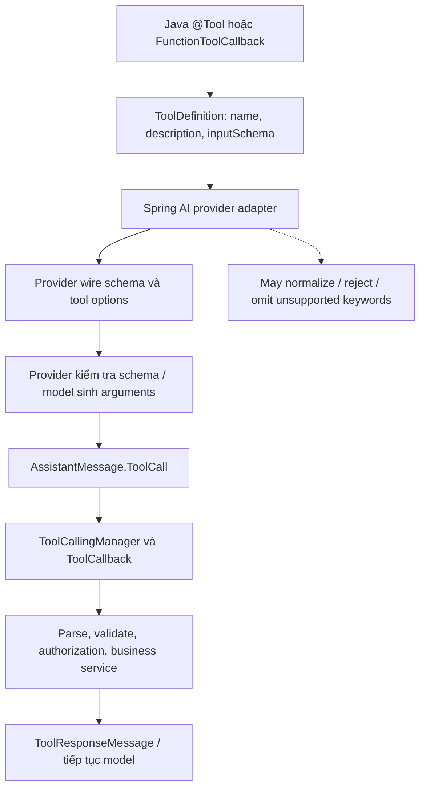
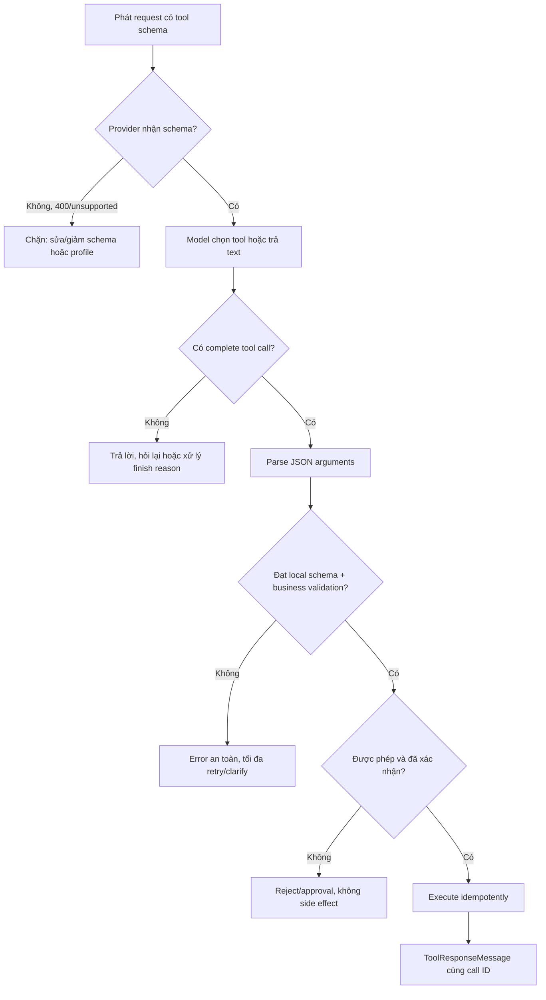
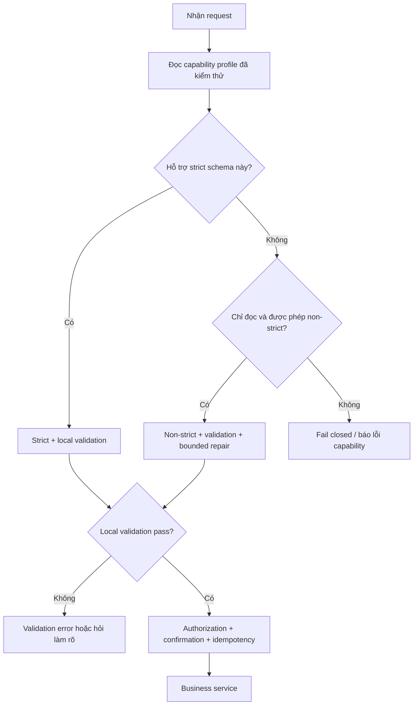

# Giới hạn strict schema và ràng buộc định dạng theo nhà cung cấp

Trong Spring AI, `@Tool`, `ToolCallback` và JSON Schema cho mô hình biết một công cụ cần những arguments gì. Một schema được sinh đúng ở phía Java **không có nghĩa mọi nhà cung cấp đều tiếp nhận, hiểu và thực thi các ràng buộc giống nhau**. OpenAI có cơ chế *strict function calling* với quy tắc tất cả properties phải xuất hiện trong `required`; Anthropic có strict tool use nhưng hỗ trợ một tập con JSON Schema khác; Gemini có function-calling modes và hệ thống schema riêng. Các API tương thích OpenAI, Bedrock Converse hoặc gateway trung gian còn có thể giới hạn hoặc biến đổi schema trước khi gửi tới model.

Bài học này dành cho module `SPRING_AI_TOOL_CALLING`: tìm hiểu ranh giới giữa **schema ứng dụng tạo ra**, **schema adapter gửi lên provider**, **arguments mô hình tạo ra** và **validation/authorization khi ứng dụng thực thi**. Mục tiêu là chủ động chọn chế độ định dạng phù hợp, không lầm tưởng rằng bật `strict` sẽ xác thực toàn bộ nghiệp vụ hoặc thay thế `ToolContext`, kiểm tra quyền, xử lý lỗi và kiểm thử.

## Mục tiêu

Sau bài này, bạn có thể:

1. Phân biệt strict tool arguments với JSON mode và structured **final response**.
2. Giải thích giới hạn `required`, optional, `null` và `additionalProperties` khi dùng OpenAI strict.
3. So sánh các khái niệm strict/schema của OpenAI, Anthropic, Google Gemini và cổng API khác mà không giả định chúng đồng nhất.
4. Kiểm tra schema thực sự được adapter phát đi, không chỉ nhìn annotation Java.
5. Thiết kế DTO, tool descriptions và validation an toàn khi đổi provider.
6. Nhận diện lỗi `400 INVALID_SCHEMA`, model tạo JSON không hợp lệ, partial streaming và lỗi nghiệp vụ dù schema hợp lệ.
7. Xây ma trận tương thích và regression tests cho mỗi tổ hợp provider–model–API–Spring AI version.

## 1. Bốn tầng hợp đồng phải tách riêng

Trong Spring AI 2.1.0, `ToolDefinition` chứa ba phần mà mô hình cần: `name()`, `description()` và `inputSchema()`. Các công cụ định nghĩa bằng `@Tool` và `@ToolParam` được chuyển thành `ToolCallback`, sau đó một chat model adapter biến các definitions thành định dạng request của nhà cung cấp.



| Tầng | Ai sở hữu | Điều cần kiểm chứng |
|---|---|---|
| **Java contract** | Ứng dụng | Kiểu DTO, annotation, mô tả, tên, trường required |
| **Provider request contract** | Adapter Spring AI và provider | Schema đã chuẩn hóa; `strict`, `tool_choice`, giới hạn keywords |
| **Generated arguments** | Mô hình/API | Đúng JSON, đúng schema được hỗ trợ, dữ liệu có nghĩa |
| **Execution contract** | Ứng dụng và backend | Quyền, tenant, số tiền, điều kiện trạng thái, side effect, idempotency |

**Strict chỉ có thể tăng độ phù hợp ở tầng định dạng.** Nó không bảo đảm mô hình đã chọn đúng tool, đã hiểu đúng user intent, hay `amountMinor` thực sự là số tiền được phép hoàn. Backend vẫn phải validate arguments và áp dụng business policy trước khi chạy callback.

### Ba chế độ thường bị gọi nhầm là “strict JSON”

| Cơ chế | Ràng buộc cái gì? | Không bảo đảm |
|---|---|---|
| **JSON mode** | Câu trả lời văn bản có dạng JSON hợp cú pháp, tùy API | Đúng schema, đúng tên tool |
| **Structured output / JSON Schema response** | **Final answer** của assistant theo schema | Tự động gọi Java tool |
| **Strict tool/function calling** | **Arguments của tool call** theo schema đã công bố | Tool được gọi đúng lúc, business validity, authorization |

Ví dụ `spring.ai.openai.chat.response-format.strict=true` áp dụng cho **response-format JSON Schema** của lời đáp, không phải công tắc strict cho `@Tool`. Còn `OpenAiChatOptions.builder().strict(true)` của Spring AI 2.1.0 điều khiển **strictness của tool definitions** theo OpenAI. Hai giá trị không nên được thay thế cho nhau.

## 2. OpenAI strict function calling yêu cầu gì?

Với OpenAI function calling, có thể đặt `strict: true` trên definition của function. OpenAI dùng cơ chế constrained outputs để giữ arguments theo schema trong tập keywords được hỗ trợ; một schema không thỏa điều kiện strict có thể bị API từ chối **trước khi model trả lời**.

Các quy tắc quan trọng:

- Mỗi object phải khai báo `"additionalProperties": false`, kể cả object lồng nhau.
- **Tất cả tên trong `properties` phải nằm trong `required`** tại object tương ứng.
- Muốn một field *ngữ nghĩa là tùy chọn*, có thể đưa `null` vào tập kiểu, nhưng field vẫn xuất hiện trong `required`.
- Chỉ một tập con JSON Schema được hỗ trợ. Những tổ hợp keywords không hỗ trợ, cấu trúc quá sâu/phức tạp hoặc schema vượt giới hạn provider có thể bị từ chối.
- Khi bật strict, nhà cung cấp kiểm tra **hình dạng arguments**. Dữ liệu đúng kiểu chưa chắc đúng ngữ nghĩa nghiệp vụ.

### Không strict: trường có thể bị bỏ khỏi arguments

Đây là một schema JSON hợp lệ thông thường:

```json
{
  "type": "object",
  "properties": {
    "orderId": {"type": "string"},
    "note": {"type": "string"}
  },
  "required": ["orderId"]
}
```

Theo JSON Schema thông thường, `note` là optional. Nhưng **không phải schema strict hợp lệ cho OpenAI** vì `note` không nằm trong `required` và object chưa khai báo `additionalProperties: false`.

### Strict: vẫn có field optional về nghiệp vụ

```json
{
  "type": "object",
  "properties": {
    "orderId": {
      "type": "string",
      "description": "Mã đơn, ví dụ ORD-2048"
    },
    "note": {
      "type": ["string", "null"],
      "description": "Ghi chú; null khi người dùng không cung cấp"
    }
  },
  "required": ["orderId", "note"],
  "additionalProperties": false
}
```

Lúc này `note` **luôn có key**, nhưng có thể có giá trị `null`. Không được hiểu “required” trên wire là bắt buộc người dùng phải cung cấp ghi chú. Đây là cách thể hiện optional mà OpenAI strict yêu cầu.

| Trạng thái | JSON arguments | Hợp schema strict trên? | Ngữ nghĩa |
|---|---|---|---|
| Người dùng không ghi chú | `{"orderId":"ORD-2048","note":null}` | Có | Không có ghi chú |
| Có ghi chú | `{"orderId":"ORD-2048","note":"Giao sau 17h"}` | Có | Có ghi chú |
| Bỏ hẳn field | `{"orderId":"ORD-2048"}` | Không | Thiếu key bắt buộc ở wire |
| Gửi extra key | `{"orderId":"ORD-2048","note":null,"tenantId":"x"}` | Không | `additionalProperties:false` |
| Sai kiểu | `{"orderId":2048,"note":null}` | Không | `orderId` cần string |

Nếu một DTO Java có nhiều trường nullable, nên phân biệt **null vì dữ liệu không có** với **giá trị mặc định thực sự của business service**. Đừng chuyển `null` thành chuỗi rỗng hoặc `0` một cách tự động rồi vô tình gây thao tác ghi sai.

### Mọi object lồng nhau cũng phải chặn extra keys

```json
{
  "type": "object",
  "properties": {
    "recipient": {
      "type": "object",
      "properties": {
        "customerId": {"type": "string"},
        "channel": {"type": "string", "enum": ["EMAIL", "SMS"]}
      },
      "required": ["customerId", "channel"],
      "additionalProperties": false
    }
  },
  "required": ["recipient"],
  "additionalProperties": false
}
```

Chỉ gắn `additionalProperties:false` ở root **không đủ**. Với schema MCP hoặc JSON Schema tự viết, các object con cũng cần thỏa cùng quy tắc. Danh sách lớn các `enum`, union branches và nhiều tầng lồng làm schema khó bảo trì; hãy giảm phức tạp, dùng mã nghiệp vụ gọn và validate chi tiết ở service.

### Đừng nhầm “strict” với mọi từ khóa JSON Schema

`minimum`, `maximum`, `pattern`, `format`, `minItems` hoặc `oneOf` không phải lúc nào cũng được provider hỗ trợ trong strict tool schema; một số tính năng bị cấm theo loại model. Các keywords composition như `allOf`, `not`, `if/then/else` có thể bị từ chối trong OpenAI structured outputs. Với fine-tuned models, giới hạn còn chặt hơn ở nhiều string/number/array constraints.

**Thực hành:** dùng schema nhỏ gồm `type`, `properties`, `required`, `additionalProperties:false`, `enum` và `items` khi phù hợp; kiểm tra tài liệu model cụ thể trước khi thêm keyword nâng cao. Ràng buộc như `amountMinor > 0`, `startDate <= endDate`, `order.status = PAID` luôn phải được thực thi trong service dù có mô tả trong schema.

## 3. OpenAI qua Spring AI 2.1.0: mặc định strict=false

Điểm quan trọng khi nâng Spring AI là **không dùng giả định từ phiên bản cũ**: trong Spring AI 2.1.0 GA, `OpenAiChatModel` **không mặc định** gửi tool definitions với `strict(true)`. Lý do là `JsonSchemaGenerator` tạo optional parameters bằng cách **bỏ khỏi `required`** theo quy ước JSON Schema thông thường, không phải kiểu `nullable + required` mà OpenAI strict đòi hỏi.

Khi bật strict trong options, adapter Spring AI chuyển các trường optional sang kiểu nullable và bổ sung chúng vào `required` để đáp ứng hợp đồng OpenAI.

```java
OpenAiChatOptions options = OpenAiChatOptions.builder()
        .strict(true)
        .build();

String answer = chatClient.prompt()
        .user("Tra cứu đơn ORD-2048, không cần ghi chú")
        .tools(orderTools)
        .options(options)
        .call()
        .content();
```

`orderTools` là object chứa `@Tool` hoặc callback do ứng dụng đăng ký. Cần kiểm tra model/API có hỗ trợ strict function calling trước khi triển khai. Nếu một tool đến từ MCP hoặc dùng `inputSchema` tự viết, Spring AI 2.1.x có logic chuẩn hóa `additionalProperties:false` ở các object levels; vẫn phải **test đúng wire schema** mà adapter gửi vì các keywords khác có thể không hợp lệ.

### Một @Tool có optional parameter

```java
public final class OrderTools {

    private final OrderService orderService;

    public OrderTools(OrderService orderService) {
        this.orderService = orderService;
    }

    @Tool(description = "Chỉ đọc trạng thái đơn hàng được phép xem")
    public OrderView lookupOrder(
            @ToolParam(description = "Mã đơn", required = true)
            String orderId,
            @ToolParam(description = "Ghi chú tìm kiếm, bỏ trống nếu không có",
                       required = false)
            String note,
            ToolContext toolContext) {

        String tenantId = requireTrustedTenant(toolContext);
        return orderService.findVisibleOrder(tenantId, orderId, note);
    }
}
```

`OrderService`, `OrderView` và `requireTrustedTenant(...)` là các thành phần nghiệp vụ minh họa. `ToolContext` **không được đưa vào schema cho model**; nó chứa thông tin principal/tenant do server xác thực. `note` optional ở cấp Java; với OpenAI strict trên wire có thể hiện thành `required` nhưng nullable. Dù schema của model đúng, service vẫn phải kiểm tra quyền trên đơn hàng thực tế.

### Chat Completions khác Responses API

| Lựa chọn | Điểm cần biết |
|---|---|
| OpenAI Chat Completions qua Spring AI | `OpenAiChatOptions.strict(true)` bật strict tool schema; mặc định strict **false** trong Spring AI 2.1.0 |
| OpenAI Responses qua Spring AI | `spring.ai.openai.responses.strict` điều khiển strict tool schemas, mặc định **false** trong adapter Spring AI |
| OpenAI API trực tiếp | Mặc định của **OpenAI Responses** có thể tự chuẩn hóa schema/fallback theo đặc điểm endpoint; **Chat Completions** non-strict khi không bật; không suy ngược mặc định API raw thành mặc định của Spring adapter |
| JSON Schema final response | `response-format.strict` chỉ áp dụng response-format; không bật strict cho mọi function |

Nếu đổi `spring.ai.openai.chat.api=responses`, cần kiểm tra **chính adapter và request payload** theo phiên bản 2.1.x hiện tại. Đừng coi hai API là một endpoint có options hoàn toàn tương đương; Responses có hosted tools và message parts/opaque reasoning khác Chat Completions.

### Parallel tool calls là tham số khác với strict

`parallel_tool_calls` quyết định liệu model có thể tạo nhiều function calls trong một lượt; nó không phải công tắc strict schema. Trong OpenAI API, tắt bằng `parallel_tool_calls=false` sẽ giới hạn không quá một tool call trong phản hồi. Với một số mô hình fine-tuned, trường hợp nhiều call đồng thời có ngoại lệ về strict adherence; cần kiểm tra tài liệu model đang chọn.

Một `AssistantMessage` chứa nhiều tool calls **không hứa** ứng dụng sẽ thực thi Java callbacks song song. `ToolCallingManager` của Spring AI có orchestration riêng và callback phải được authorization, confirmation, limits kiểm soát.

## 4. Anthropic Claude: strict tool use là cơ chế riêng

Claude Messages API có `tools[]` gồm `name`, `description`, `input_schema`; để bật **strict tool use** ở API gốc, đặt `"strict": true` trên **definition của từng tool được hỗ trợ**. Anthropic mô tả cơ chế này là grammar-constrained sampling để bảo đảm hình dạng input tuân theo **subset JSON Schema được hỗ trợ**. Khi model gọi một client tool, kết quả chứa `tool_use`; ứng dụng gửi lại `tool_result` tương ứng.

Ví dụ một definition ở **Anthropic raw Messages API** (không phải cấu trúc `ToolDefinition` của Spring AI):

```json
{
  "name": "lookup_order",
  "description": "Chỉ đọc đơn hàng được phép xem",
  "strict": true,
  "input_schema": {
    "type": "object",
    "properties": {
      "orderId": {"type": "string"}
    },
    "required": ["orderId"],
    "additionalProperties": false
  }
}
```

`strict:true` ở đây là một trường **ở cấp Anthropic tool definition**, không thể copy sang `inputSchema()` của Spring AI và kỳ vọng mọi model hiểu. Trong Spring AI 2.1.0, phần định nghĩa công cụ chung chỉ có `name`, `description`, `inputSchema`; các provider-specific flags phải được adapter/options tương ứng hỗ trợ. **Không tự khẳng định Spring AI Anthropic adapter đã chuyển một option strict chỉ vì API gốc có tính năng đó.** Nếu sản phẩm bắt buộc strict tool use với Anthropic, kiểm tra exact request payload và phiên bản adapter; khi chưa được expose, dùng adapter riêng/SDK gốc hoặc validation ứng dụng, không phát minh một `AnthropicChatOptions.strict(...)` không được tài liệu xác nhận.

### Các khác biệt đáng kiểm thử

Trong tài liệu strict/structured output của Anthropic, subset có những giới hạn khác OpenAI:

- Cho phép các kiểu cơ bản `object`, `array`, `string`, `integer`, `number`, `boolean`, `null` và một số `enum`, `const`, `anyOf`, `allOf`, `$ref`/`$defs` theo giới hạn riêng.
- Object trong strict output cần `additionalProperties:false`; một số tổ hợp `anyOf`/`allOf`/`$ref` không được hỗ trợ.
- Schema đệ quy và external `$ref` không thuộc mọi trường hợp được hỗ trợ.
- Các numeric bounds (`minimum`, `maximum`, `multipleOf`) và nhiều string/array constraints (`minLength`, `maxLength`, `uniqueItems`, …) không được strict grammar enforcement hỗ trợ; request có keyword không hỗ trợ có thể bị 400.
- Anthropic ghi nhận caveat với capitalization của một số giá trị `enum`/`const` dạng string. Không nên thiết kế các enum chỉ khác nhau chữ hoa/chữ thường; service vẫn cần kiểm tra và chuẩn hóa theo contract đã thỏa thuận.

**Không áp dụng quy tắc “mọi field phải nằm trong required” của OpenAI strict một cách máy móc cho Anthropic**. Mỗi provider có cách chuẩn hóa optional, nullable và constraints riêng. Thực hiện test strict schema cho model/API/version cụ thể thay vì dựa vào một schema chung không đổi.

Anthropic còn phân biệt **tool_choice** (model có được/chắc chắn phải gọi tool không) với **strict inputs** (khi đã gọi, arguments có hợp schema không). Trong hệ thống chỉ cho đọc, `tool_choice:any` có thể ép gọi tool không cần thiết; strict arguments không sửa được lỗi lựa chọn công cụ.

### JSON final answer khác strict tool input

Claude structured output cấu hình định dạng câu trả lời JSON, còn strict tool use áp dụng cho arguments trong `tool_use`. Một assistant có thể dùng cả hai, nhưng không nên trộn hai schema hoặc dùng một flag để ngầm bật cả hai. Trong Spring AI, hãy xem mục `Structured Output` của model adapter riêng; cơ chế final JSON output có thể yêu cầu phiên bản model mới hơn so với tool calling thông thường.

## 5. Google Gemini: function-calling modes và định dạng schema

Gemini định nghĩa tool/function parameters bằng một schema của Google GenAI. Tùy endpoint và SDK, hình dạng là các `FunctionDeclaration` với `parameters` ở dạng schema phù hợp OpenAPI hoặc một biến thể JSON Schema. Không thể suy rằng bản JSON Schema đầy đủ do Java generator tạo ra sẽ được giữ nguyên mọi keyword.

Trong Spring AI 2.1.0, `GoogleGenAiChatModel` dùng `GoogleGenAiChatOptions.ToolChoice` để định nghĩa **function calling mode**:

| Gemini mode | Ý nghĩa | Phạm vi |
|---|---|---|
| `AUTO` | Model chọn gọi tool hoặc trả lời text | Phù hợp chat thông thường |
| `ANY` | Buộc model dự đoán function call | Có thể hạn chế theo allowed names |
| `VALIDATED` | Model có thể trả lời text hoặc gọi tool và tuân function schema tốt hơn | Mức schema adherence theo chức năng Gemini |
| `NONE` | Không gọi function | Tác vụ text-only |

`VALIDATED` **không đồng nghĩa** với đặt `strict:true` của OpenAI hoặc Anthropic. Nó là **mode function calling của Gemini**, cần kiểm tra cùng model/endpoint/version và schema adapter. `ANY` không tự xác nhận người dùng có quyền thao tác.

Ví dụ Spring AI cấu hình **tool choice**:

```java
GoogleGenAiChatOptions options = GoogleGenAiChatOptions.builder()
        .toolChoice(new GoogleGenAiChatOptions.ToolChoice(
                GoogleGenAiChatOptions.ToolChoice.Mode.VALIDATED,
                List.of("lookupOrder")))
        .build();

ChatResponse reply = chatModel.call(new Prompt(
        "Kiểm tra đơn ORD-2048",
        options));
```

Ví dụ có ý nghĩa khi `lookupOrder` thực sự đã được đăng ký callback vào model/request; `allowedFunctionNames` chỉ giới hạn **danh sách tên có quyền chọn**, không tự đăng ký tools và không thực thi callback. Theo Spring AI, danh sách `allowedFunctionNames` chỉ được áp dụng ở mode `ANY`/`VALIDATED`, bị bỏ qua với `AUTO`/`NONE`.

### Function call khác JSON structured final response

Gemini hỗ trợ cấu hình JSON structured output để assistant trả final text theo schema. Đây là đường khác với function declaration. Ví dụ thuộc API provider, không phải Java `@Tool`:

```json
{
  "responseMimeType": "application/json",
  "responseSchema": {
    "type": "OBJECT",
    "properties": {
      "status": {"type": "STRING"}
    },
    "required": ["status"]
  }
}
```

Tên field và kiểu viết hoa ở một số API/SDK GenerateContent có thể khác `response_format`/`schema` của Gemini Interactions API. Đừng sao chép JSON của một endpoint sang endpoint khác hoặc gắn `responseMimeType` vào `ToolDefinition.inputSchema()`. Ở Spring AI, chọn options được adapter `GoogleGenAiChatOptions` hỗ trợ.

Gemini structured output hỗ trợ **một subset JSON Schema**; các schema quá sâu hoặc quá phức tạp có thể bị `400 INVALID_ARGUMENT`. Tài liệu Google cũng ghi một số ràng buộc như `minLength`, `maxLength`, `uniqueItems` có thể bị strip/ignore khi normalize schema của structured output. Không nên coi các keywords này là bảo đảm đã được enforce ở tool arguments. Luôn validate ở Java.

### Tool-call transcript và thought signatures

Một số model Gemini có thought signatures/opaque metadata cần được **replay nguyên vẹn** ở các vòng tool call. Spring AI 2.1.0 giữ ordered `MessagePart` và `OpaquePayload` để bảo toàn nội dung từ provider. Nếu tự điều phối `ChatModel`, không chỉ sao chép `getText()` rồi bỏ các parts của tool call/reasoning; provider có thể từ chối request kế tiếp dù JSON arguments hoàn toàn hợp schema.

Đừng xử lý streamed `ToolCallPart` chưa hoàn chỉnh như một call có thể chạy. Chỉ thực thi sau khi adapter/aggregator đã tạo call hoàn chỉnh; việc bật VALIDATED/strict không biến từng JSON fragment thành arguments hợp lệ.

## 6. Amazon Bedrock Converse và các cổng OpenAI-compatible

Trong Bedrock Converse, cấu trúc tool thường đi qua `toolConfig.tools[].toolSpec.inputSchema.json` với restrictions phụ thuộc model nằm sau API. Bedrock là **giao thức điều phối nhiều model**, không phải bằng chứng rằng mọi model đều tuân cùng một tập keyword JSON Schema. Khi đổi từ Claude trên Anthropic API sang Claude qua Bedrock hoặc đổi sang Nova/Llama, cần xác minh tài liệu và schema support của **cặp model + Converse endpoint**.

Với những server tương thích OpenAI như vLLM, Ollama, hoặc proxy nội bộ, endpoint có thể chấp nhận cùng tên trường `strict` nhưng:

- Chỉ kiểm tra JSON syntax thay vì enforce toàn bộ schema.
- Không hỗ trợ hoặc bỏ qua `additionalProperties`, enums, nullable union, nested arrays.
- Có giới hạn tool count, schema size hoặc `tool_choice` khác endpoint OpenAI chính thức.
- Sinh tool-call payload khác một vài chi tiết về `id`, `name`, finish reason hoặc streaming chunks.

**Không đồng nhất “OpenAI-compatible transport” với “OpenAI strict conformance”.** Test đúng endpoint và model thực tế, ghi version, không chỉ nhìn `200 OK`. Nếu model không hỗ trợ strict, ứng dụng phải chọn fallback có chủ đích (non-strict + validation + repair/clarification) hoặc từ chối thao tác không an toàn; không im lặng bỏ kiểm soát.

### Bảng định hướng hỗ trợ (không thay cho tài liệu phiên bản cụ thể)

| Provider/API | Khái niệm để kiểm tra | Điểm khác biệt cần nhớ |
|---|---|---|
| OpenAI Chat Completions | `strict: true` ở function definition | Mọi properties required + `additionalProperties:false` cho object |
| OpenAI Responses | Strict tool schema, hosted tools, API-specific defaults | Phân biệt adapter Spring AI với raw API |
| Anthropic Messages | `strict:true` trên client tool, `input_schema` | Schema subset riêng; cờ adapter phải được kiểm chứng |
| Google GenAI/Gemini | `AUTO`/`ANY`/`VALIDATED`/`NONE`, `FunctionDeclaration.parameters` | VALIDATED là function-calling mode, không phải OpenAI `strict` |
| Google Gemini structured output | `responseMimeType`/schema hoặc response-format theo endpoint | Ràng buộc final text, không tự gọi callback |
| Bedrock Converse | `toolSpec.inputSchema.json` | Khả năng phụ thuộc model sau Converse |
| OpenAI-compatible gateways | Cùng tên field, không bảo đảm cùng ngữ nghĩa | Test wire + generated output + validation |

Một hệ thống có thể cần nhiều bản schema adapter-specific hoặc biến đổi theo provider. Điều quan trọng là **Java DTO và business contract không đổi** sau khi adapter chuẩn hóa; hãy làm rõ những phép biến đổi trên đường ra, có test và versioning.

## 7. Thiết kế một contract DTO dùng được với nhiều provider

Giả sử ứng dụng có tool đề xuất hoàn tiền. Tool chỉ thực thi khi giao dịch, số tiền và người nhận đã được xác minh. Có thể tách ba lớp:

1. **Model input:** dữ liệu model thực sự có thể suy ra từ user request và ngữ cảnh được phép.
2. **Trusted context:** principal, tenant, request ID, policy, idempotency key do server cấp.
3. **Business validation:** dịch vụ kiểm tra amount, currency, payment state, role và confirmation ngay trước khi ghi.

Ví dụ một tool ở lớp Java:

```java
public record RefundProposal(
        String paymentId,
        long amountMinor,
        String currency,
        String note) {
}

public final class RefundTools {

    private final RefundService refunds;

    public RefundTools(RefundService refunds) {
        this.refunds = refunds;
    }

    @Tool(
        name = "requestRefund",
        description = """
            Tạo yêu cầu hoàn tiền cho giao dịch đã xác định.
            Chỉ dùng khi người dùng chủ động yêu cầu hoàn.
            Không dùng để tra cứu trạng thái; cần phê duyệt trước side effect.
            """,
        requiresConfirmation = true)
    public RefundReceipt requestRefund(
            @ToolParam(description = "Mã giao dịch đã được người dùng chỉ rõ")
            String paymentId,
            @ToolParam(description = "Số tiền theo đơn vị nhỏ nhất của tiền tệ")
            long amountMinor,
            @ToolParam(description = "Mã tiền tệ, ví dụ VND")
            String currency,
            @ToolParam(description = "Ghi chú hoặc null nếu không có",
                       required = false)
            String note,
            ToolContext context) {

        AuthenticatedActor actor = trustedActor(context);
        return refunds.refundIfAllowed(
                actor, paymentId, amountMinor, currency, note);
    }
}
```

`RefundService`, `RefundReceipt`, `AuthenticatedActor` và `trustedActor(...)` là ví dụ nghiệp vụ của ứng dụng; không phải Spring AI SDK. `RefundProposal` là record mô tả cùng contract dữ liệu; trong ví dụ `@Tool`, các tham số được khai báo trực tiếp để kiểm soát rõ optionality.

**Không cho model nhập `tenantId`, `role` hoặc idempotency key.** Những field này không thuộc `ToolDefinition.inputSchema()`; lấy từ principal/`ToolContext` đã xác thực. Khi provider adapter biến `note` từ optional sang nullable+required trên wire, backend vẫn phải coi `null` là “không có ghi chú”, không đổi rule về số tiền hoặc quyền.

### Chuẩn hóa có kiểm soát, không “ép cho qua”

| Input từ model | Cách xử lý phù hợp |
|---|---|
| `currency: "VND"` | Chấp nhận nếu service hỗ trợ và đúng giao dịch |
| `currency: "usd"` | Theo chính sách: normalize mã ISO đã biết hoặc từ chối, không tự đổi số tiền |
| `amountMinor: "450000"` | Sai kiểu JSON integer; trả validation error/repair có kiểm soát, không ngầm cast ở bước ghi |
| `amountMinor: -500` | Backend từ chối, kể cả provider không enforce `minimum` |
| `note: null` | Chấp nhận nếu field optional theo business |
| `note` bị thiếu | Với non-strict có thể hợp schema gốc; adapter/deserializer xử lý theo contract |
| `tenantId: "other-tenant"` | Không dùng giá trị do model tạo; từ chối unknown field nếu policy áp dụng |
| `paymentId` không thuộc principal | Backend từ chối; strict không cấp quyền |

Thêm ví dụ mô tả có nhiều trường là cách hữu ích để model chọn đúng; nhưng số lượng field lớn làm schema khó tương thích với strict grammar. Khi schema quá phức tạp, cân nhắc **tách tool read-only và tool có side effect** hoặc tạo một tool nghiệp vụ cấp cao có DTO nhỏ hơn.

## 8. Vì sao một schema hợp lệ theo JSON Schema vẫn lỗi trên provider?

JSON Schema là một ngôn ngữ nhiều keyword. Các model APIs chỉ thực thi **một tập con**, đôi khi có các điều kiện cấu trúc bổ sung. Cần phân loại lỗi:

| Loại lỗi | Ví dụ | Cách điều tra |
|---|---|---|
| JSON syntax không hợp lệ | Thiếu dấu `}` trong schema tự viết | Kiểm tra `ObjectMapper.readTree` hoặc schema linter |
| Schema hợp JSON nhưng không hợp strict profile | Optional không nằm trong `required`; thiếu `additionalProperties:false` | Kiểm tra profile OpenAI strict và payload provider |
| Keyword không được hỗ trợ | `oneOf`/`if-then-else`, recursion, numeric bounds | Đối chiếu danh sách supported schema của provider/model |
| Kích thước/quy mô schema vượt giới hạn | Object lồng quá sâu, quá nhiều enum/branch | Rút gọn structure, chia tools/DTO |
| Adapter normalize làm đổi nghĩa | Optional thành nullable+required; keyword bị bỏ qua | Diff `ToolDefinition` và request JSON thực tế |
| Model output không hợp schema khi non-strict | Thiếu field, sai type, enum ngoài danh sách | Validate và yêu cầu sửa trong giới hạn |
| Model output hợp schema nhưng sai nghiệp vụ | Số tiền đúng integer nhưng vượt mức còn hoàn | Service validation, không sửa prompt để che lỗi |
| Tool payload bị cắt do streaming/token | JSON arguments chưa hoàn chỉnh | Chỉ chạy tool sau complete call, xử lý truncated/error |
| Sai cấu hình tool-choice | Model bị ép gọi tool khi chưa đủ dữ liệu | Đổi mode/tool-choice và kịch bản clarification |
| Sai message replay | Thiếu tool result hoặc opaque signature | Giữ `MessagePart` và call IDs đầy đủ |

**HTTP 400 do schema không được hỗ trợ là lỗi contract/configuration**, không phải lỗi mạng thoáng qua. Retry nguyên request cùng schema thường không giải quyết được. Hãy log mã lỗi đã loại dữ liệu nhạy cảm, sửa schema hoặc chọn provider profile khác rồi mới thử lại. Tránh retry vô hạn, vì tool calling còn có giới hạn số vòng và chi phí token.

### Cần phân biệt API reject với model trả arguments không đạt



Một request được provider chấp nhận (`B=Yes`) **không** chứng minh sẽ có tool call. Mô hình có thể trả lời trực tiếp, từ chối, bị safety filter hoặc cần hỏi thêm. Điều kiện `hasToolCalls()` chỉ đúng với những tool calls hoàn chỉnh; streaming chunks có thể chứa partial arguments chưa được dùng để thực thi.

## 9. Kiểm tra cả schema sinh tự động và schema trên wire

Với Spring AI, đọc `ToolDefinition.inputSchema()` là bước đầu tốt nhưng **không đủ** để chứng minh strict profile được áp dụng. Schema gốc có thể để optional field ngoài `required`; khi gửi OpenAI strict, adapter mới normalize nó thành nullable+required.

### Test A: bảo vệ hợp đồng Java

```java
@Test
void generatedToolDefinitionMustMatchBusinessContract() throws Exception {
    ToolCallback callback = Arrays.stream(
            ToolCallbacks.from(new RefundTools(fakeRefundService())))
            .filter(c -> c.getToolDefinition().name().equals("requestRefund"))
            .findFirst()
            .orElseThrow();

    ToolDefinition definition = callback.getToolDefinition();
    assertThat(definition.description()).contains("hoàn tiền");

    JsonNode schema = new ObjectMapper()
            .readTree(definition.inputSchema());
    JsonNode properties = schema.path("properties");

    assertThat(properties.has("paymentId")).isTrue();
    assertThat(properties.has("amountMinor")).isTrue();
    assertThat(properties.has("currency")).isTrue();
    assertThat(properties.has("note")).isTrue();
    assertThat(properties.has("tenantId")).isFalse();

    List<String> required = StreamSupport.stream(
            schema.path("required").spliterator(), false)
            .map(JsonNode::asText)
            .toList();

    assertThat(required).contains(
            "paymentId", "amountMinor", "currency");
    assertThat(required).doesNotContain("note");
}
```

`fakeRefundService()` là test fixture không tạo side effect. Test A kiểm tra schema ban đầu của Spring AI, **không** assert rằng nó đã là strict wire schema cho OpenAI. Nếu vừa bỏ `note` khỏi required vừa bật OpenAI strict, adapter có thể tự thêm lại `note` vào required theo quy tắc nullable. Điều này không mâu thuẫn giữa test và runtime.

### Test B: kiểm tra request JSON thực sự được gửi

Ở mức integration test, dùng fake HTTP server hoặc mock transport ở ranh giới provider SDK/adapter. Gửi một request có `OpenAiChatOptions.strict(true)`, thu lại JSON request và xác nhận:

- Tool definition có đúng tên `requestRefund`.
- Có cờ strict tại **đúng vị trí** mà API yêu cầu, không nằm trong `properties`.
- Root object và nested objects có `additionalProperties:false`.
- Trên wire, các properties nằm trong `required`; optional `note` có kiểu nullable.
- `ToolContext`/principal/tenant không lọt vào JSON arguments schema.
- Chỉ những callback đã được phép trong request được gửi; không để tool mặc định thừa.

Một helper kiểm tra profile object nghiêm ngặt (dùng JUnit/AssertJ):

```java
static void assertStrictObjectShape(JsonNode schema) {
    if (schema.isArray()) {
        schema.forEach(MySchemaAssertions::assertStrictObjectShape);
        return;
    }
    if (!schema.isObject()) {
        return;
    }

    if ("object".equals(schema.path("type").asText())) {
        assertThat(schema.path("additionalProperties").asBoolean(true))
                .as("object phải có additionalProperties=false")
                .isFalse();

        Set<String> properties = new LinkedHashSet<>();
        schema.path("properties").fieldNames()
                .forEachRemaining(properties::add);

        Set<String> required = new LinkedHashSet<>();
        schema.path("required").forEach(
                item -> required.add(item.asText()));
        assertThat(required).containsExactlyInAnyOrderElementsOf(properties);
    }

    schema.fields().forEachRemaining(entry ->
            assertStrictObjectShape(entry.getValue()));
}
```

`MySchemaAssertions` là class test chứa helper. Đoạn trên kiểm tra phần lớn object thông thường; nếu schema dùng `type:["object","null"]` hoặc `$ref`, cần mở rộng test để giải tham chiếu và nhận diện mọi nhánh object. **Không dùng helper này làm JSON Schema validator hoàn chỉnh**, vì nó chưa kiểm tra giới hạn enum, union, string constraints hoặc tất cả keyword bị cấm.

### Test C: đối chiếu behavior bằng provider thật

Một provider integration/smoke test nên gửi các case cố định:

| Case | Kỳ vọng |
|---|---|
| Đủ arguments | Có call đúng tên, args parse hợp lệ |
| Thiếu optional note | OpenAI strict trả `note:null` nếu chọn tool, service hiểu được |
| JSON có extra key | Strict profile chặn/không sinh extra key; local validator cũng từ chối |
| Sai kiểu amount | Local validator phát hiện trước service; strict nếu hỗ trợ thì không sinh |
| Schema có keyword unsupported | Provider reject; phân loại là contract error |
| Không cần tool | Model có thể trả text khi tool-choice AUTO |
| User thiếu paymentId | Model hỏi rõ hoặc không gọi tool; không bịa ID |
| Công cụ ghi chưa có quyền | Service/confirmation chặn, kể cả schema hợp lệ |
| Streaming partial tool call | Không thực thi trước complete call |
| Mixed/parallel tool calls | Mỗi result khớp đúng call ID, không lẫn arguments |

Đừng assert chuỗi văn bản tự nhiên của model phải giống y hệt. Đo tool name, trường arguments, schema conformance, số vòng và side effects; lưu model snapshot, endpoint, API version và Spring AI version để tái hiện.

## 10. JSON Schema validation không thay thế business validation

Provider strict có thể hạn chế `amountMinor` thành integer hoặc `currency` thuộc một tập enum. Nó không biết một giao dịch đang còn bao nhiêu tiền có thể hoàn, người dùng đang có quyền gì hoặc tài khoản nào thật sự nhận tiền.

Ví dụ service nghiệp vụ:

```java
public RefundReceipt refundIfAllowed(
        AuthenticatedActor actor,
        String paymentId,
        long amountMinor,
        String currency,
        String note) {

    if (amountMinor <= 0) {
        throw new DomainValidationException("Số tiền phải dương");
    }
    Payment payment = repository.findForTenant(
            actor.tenantId(), paymentId)
            .orElseThrow(NotFoundException::new);

    authorizer.requireCanRefund(actor, payment);
    if (!payment.currency().equals(currency)) {
        throw new DomainValidationException("Sai đồng tiền");
    }
    if (amountMinor > payment.remainingRefundableMinor()) {
        throw new DomainValidationException("Vượt số tiền còn hoàn");
    }

    return gateway.refundIdempotently(
            payment, amountMinor, note, actor.requestId());
}
```

Các lớp trên thuộc ứng dụng minh họa. Trong production, kiểm tra trạng thái và số tiền còn hoàn phải gắn với transaction/lock hoặc optimistic version để tránh TOCTOU. `requestId` không mặc nhiên là khóa idempotency hợp lệ cho mọi thao tác; chọn khóa ổn định theo **lệnh hoàn được phê duyệt**.

Tool có side effect cần `requiresConfirmation`/`ToolCallConfirmationPolicy` và bản xem trước có thể kiểm tra; strict schema không xác thực người dùng đã đồng ý. `ToolContext` chỉ đưa principal/tenant đáng tin tới callback, còn service phải kiểm tra authorization trên resource.

### Ba loại validator phải tách

| Validator | Kiểm tra | Ví dụ mã lỗi |
|---|---|---|
| Syntax parser | Arguments là JSON object parse được | `INVALID_JSON` |
| Structural schema validator | Required, type, enum, additionalProperties | `SCHEMA_VIOLATION` |
| Business validator | Resource thuộc tenant, amount/status/version hợp lệ | `BUSINESS_RULE` / `FORBIDDEN` |

Với lỗi sửa được (thiếu mã đơn, sai định dạng ngày), có thể trả một thông báo **không lộ thông tin** cho model để hỏi lại hoặc sửa arguments. Với lỗi quyền, không gửi chi tiết role/tenant vào tool response. Phải giới hạn số lần repair/retry và vòng tool calling để tránh lặp vô tận.

## 11. Fallback khi provider không hỗ trợ strict

Không nên triển khai luồng sau:

```text
Strict tool schema bị HTTP 400
  -> tự động tắt strict
  -> gửi lại nguyên lời gọi ghi dữ liệu
  -> thực thi arguments mà không kiểm chứng
```

Việc đó biến một lỗi bảo vệ thành đường bỏ qua chính sách. Phương án có chủ đích:



Capability profile nên lưu provider, endpoint, model/version, Spring AI adapter version, strict support, schema subset, size/depth limits, tool-choice modes và streaming behavior đã kiểm thử. Một gateway có thể hỗ trợ model này nhưng không hỗ trợ model khác; không dùng một cờ toàn cục `providerSupportsStrict` cho tất cả.

Với tool ghi giá trị lớn, có thể yêu cầu provider đã được kiểm thử strict profile hoặc đưa thao tác về giao diện nghiệp vụ có form/approval riêng. Khi không thể bảo đảm mức an toàn cần thiết, từ chối thay vì âm thầm downgrade.

### Phân biệt 400 với lỗi tạm thời

| Lỗi | Retry y nguyên request? | Hướng xử lý |
|---|---|---|
| HTTP 400 do schema keyword không hỗ trợ | Không | Sửa schema/profile rồi test lại |
| HTTP 400 do tool name/schema sai | Không | Kiểm tra danh mục và wire payload |
| HTTP 429 rate limit | Có thể sau backoff | Quota/deadline; không nhân side effect |
| HTTP 5xx trước khi có tool response | Tùy policy | Retry model có giới hạn; reconcile side effect riêng |
| Timeout sau tool đã chạy | Không retry mù | Kiểm tra trạng thái qua idempotency key |
| Stream dừng giữa `ToolCallPart` | Không thực thi partial | Xử lý interrupted/truncated |
| Safety filter/refusal | Không ép gọi tool | Trả trạng thái phù hợp |

Strict hợp lệ không loại bỏ việc model bị từ chối, cạn output tokens hoặc provider ngừng stream. Spring AI 2.1.0 cung cấp `FinishReasonCategory` để quy về các nhóm finish reason; hãy kiểm tra metadata/parts thay vì so sánh chuỗi finish reason riêng của một provider.

## 12. Portability checklist cho schema của Java tools

Để một `@Tool` dễ chuyển nhà cung cấp, ưu tiên hợp đồng input đơn giản và có thể kiểm thử:

| Chủ đề | Khuyến nghị | Tránh |
|---|---|---|
| Tên tool | Ngắn, duy nhất và nhất quán trong request | Trùng tên local/MCP, ký tự bất thường |
| Description | Nêu khi dùng, khi không dùng, side effects | “Quản lý mọi thứ” quá mơ hồ |
| Object properties | Tên rõ, ít cấp lồng | Đồ thị object đệ quy không cần thiết |
| Required/optional | Khớp nghiệp vụ, có profile nullable theo provider | Đánh dấu tất cả required ở Java chỉ để qua strict |
| Enum | Tập nhỏ, mã ổn định | Hàng trăm enum động hoặc chỉ khác chữ hoa |
| Date/time | ISO-8601, timezone và ý nghĩa rõ | Chuỗi ngày không định dạng |
| Amount | Integer minor units cùng currency | Number không có đơn vị |
| Free-form map | Hạn chế, thay bằng entries có cấu trúc nếu cần | Arbitrary `additionalProperties` ở OpenAI strict |
| Recursion | Cắt độ sâu, dùng ID tham chiếu | `$ref` đệ quy sâu không được model hỗ trợ |
| Keyword nâng cao | Chỉ thêm khi provider profile hỗ trợ | Mặc định mọi `pattern`, `minimum` sẽ được enforce |
| ToolContext | Chỉ chứa principal/tenant server-trusted | Cho model tự điền `tenantId`/`role` |
| Side effect | Authorization, confirmation, idempotency | Lấy schema làm rào chắn quyền duy nhất |

### Free-form map là một điểm khó khi strict cấm additionalProperties

Một JSON Schema dùng map tùy ý thường thuận tiện cho Java:

```json
{
  "type": "object",
  "additionalProperties": {
    "type": "string"
  }
}
```

Nhưng profile yêu cầu `additionalProperties:false` cho mọi object không chấp nhận dạng map này. Có thể thay bằng danh sách entries:

```json
{
  "type": "object",
  "properties": {
    "attributes": {
      "type": "array",
      "items": {
        "type": "object",
        "properties": {
          "key": {"type": "string"},
          "value": {"type": "string"}
        },
        "required": ["key", "value"],
        "additionalProperties": false
      }
    }
  },
  "required": ["attributes"],
  "additionalProperties": false
}
```

Đây là chiến lược **thay đổi shape**, không phải biến đổi luôn an toàn: nếu key có miền giá trị giới hạn, dùng enum; validate key uniqueness và giới hạn số entries ở Java. Khi dữ liệu lớn, đừng bắt model sinh toàn bộ map, hãy cho model cung cấp ID tham chiếu và backend tải dữ liệu.

## 13. Ma trận regression khi đổi nhà cung cấp

Test từng tổ hợp: **provider endpoint × model/version × tool schema profile × Spring AI adapter version**. Ghi thêm streaming/non-streaming nếu sản phẩm hỗ trợ cả hai.

| Tình huống | Schema check | Behavioral check | Execution check |
|---|---|---|---|
| Field required | Provider nhận schema | Model điền khi có dữ liệu | Callback parse đúng |
| Optional field vắng mặt | Nullable/missing đúng profile | Không bịa giá trị | Backend hiểu “không có” |
| Nested object | `additionalProperties` đúng tại mọi tầng khi cần | Không lẫn properties | Validate local |
| Enum | Provider chấp nhận enum | Trả giá trị đúng | Case/normalization đúng contract |
| Numeric bound | Keyword được hỗ trợ hoặc xử lý rõ | Model không tạo sai quá mức | Service chặn vi phạm |
| Unsupported keyword | Provider reject/cảnh báo rõ | Không có silent downgrade | Không side effect |
| Không cần tool | `tool_choice` cho phép text | Model trả text | Callback không chạy |
| Thiếu dữ liệu bắt buộc | Schema có required | Model hỏi thêm, không bịa | Không chạy với ID giả |
| Nhiều tool một batch | Provider hỗ trợ multi calls | Đúng tool names/args | Result ID gắn đúng |
| Streaming fragments | Adapter giữ partial parts | Chỉ complete mới được gọi | Không chạy JSON dang dở |
| Confirmation | Tool definition đúng | Model đề xuất đúng nghiệp vụ | Batch pause trước callback |
| Schema quá phức tạp | Có phản hồi lỗi rõ | Không nhầm là model chọn sai | Fail closed khi cần |

### Test contract so sánh trước và sau adapter

Một bộ kiểm thử nên lưu snapshot **không chứa thông tin nhạy cảm** của:

1. `ToolDefinition.name/description/inputSchema` sau `ToolCallbacks.from(...)`.
2. Wire request (hoặc dạng đã normalize) thực sự gửi tới provider.
3. Sample tool-call response của provider.
4. Kết quả parse/validate tại callback với fake backend.

Khi đổi Spring AI hoặc model, diff schema và metadata giữa phiên bản cũ/mới. Một thay đổi nhỏ ở `required`, `nullable` hoặc extra keys có thể gây HTTP 400 hoặc làm service nhận `null` khi trước đây field bị bỏ.

Không lưu API key, raw prompt hoặc dữ liệu khách hàng thật trong snapshot. Dùng synthetic fixtures, schema hash và version labels để phân tích regression.

## 14. Bài tập thực hành: sửa lỗi strict khi có optional parameter

**Bối cảnh:** công cụ `lookupOrder(orderId, note?)` chạy được với non-strict nhưng nhận `400 Invalid function.parameters` sau khi bật strict của OpenAI.

**Quy trình chẩn đoán:**

1. Xác định chính xác OpenAI API: Chat Completions hay Responses; kiểm tra Spring AI 2.1.0 GA và model snapshot.
2. Đọc `ToolDefinition.inputSchema()` gốc, xem `note` có nằm trong `required` không.
3. Capture wire request sau adapter với strict=true; **không kết luận chỉ từ schema gốc**.
4. Kiểm tra `required`, `type:["string","null"]` và `additionalProperties:false` của root cùng nested objects.
5. Đọc provider error để phân biệt thiếu required, keyword unsupported hay schema depth/size.
6. Sửa DTO/schema/adapter profile theo ý nghĩa nghiệp vụ; đừng biến optional thành required không-null một cách tùy tiện.
7. Chạy case `note=null`, `note` có giá trị, sai kiểu, extra keys và missing `orderId`.
8. Nếu có thao tác ghi, chạy lại test authorization, confirmation và idempotency trước release.

**Kỳ vọng:** provider nhận strict schema, mô hình không cần bịa `note` khi người dùng không cung cấp; callback hiểu giá trị `null` và service vẫn từ chối request sai quyền. Nếu endpoint không hỗ trợ strict, báo lỗi capability hoặc chuyển sang fallback được policy chấp thuận và có validation thật.

### Bài mở rộng: chuyển cùng một tool sang Gemini và Anthropic

Giữ nguyên business contract, lần lượt chuyển adapter và trả lời:

- Provider có chấp nhận schema gốc không? Nó biến đổi nullable, enums hoặc keywords nào?
- Flag strict/validated nằm ở đâu? Spring AI adapter có **thật sự gửi** flag đó không?
- Khi người dùng không cung cấp `note`, model trả `null`, bỏ field hay hỏi lại?
- Khi stream, provider phát partial và complete tool parts ra sao? Có bị gọi tool từ fragment không?
- Khi model gọi lại, các `MessagePart`/opaque signatures đã được replay đầy đủ chưa?
- Nếu arguments hợp schema nhưng resource thuộc tenant khác, service có từ chối không?

Bài tập chỉ hoàn tất khi cả **schema compatibility** và **execution safety** đã được chứng minh. Một câu trả lời tự nhiên nghe hợp lý không đủ làm kết luận.

## 15. Checklist khi cấu hình strict schema đa nhà cung cấp

1. Xác định **tool arguments** hay **final JSON response** đang cần ràng buộc.
2. Ghi rõ provider, model, endpoint, SDK/adapter và Spring AI version đang dùng.
3. Lấy schema gốc từ `ToolDefinition.inputSchema()`, kiểm tra tên/required/types.
4. Kiểm tra **wire schema thực tế** sau khi adapter normalize.
5. Với OpenAI strict, bảo đảm `additionalProperties:false` và tất cả properties nằm trong `required`; optional dùng nullable.
6. Nhớ OpenAI `OpenAiChatOptions.strict(true)` khác `response-format.strict=true`.
7. Nhớ Spring AI 2.1.0 OpenAI tool strict mặc định `false`, không dựa vào defaults phiên bản cũ.
8. Với Anthropic, xác minh cờ strict của **client tool** có được adapter hỗ trợ và gửi tới Messages API.
9. Với Gemini, phân biệt `VALIDATED`/`ANY` function-calling modes với structured final output.
10. Với Bedrock/gateway OpenAI-compatible, test **model cụ thể**, không chỉ giao thức bề ngoài.
11. Hạn chế schema recursion, object lồng sâu, enum quá lớn và keywords unsupported.
12. Dùng local JSON parser + schema validator; business service validate dữ liệu và quyền.
13. Không đưa tenant, user role, token hoặc idempotency key vào model input schema.
14. Với tool ghi, dùng confirmation có nội dung cụ thể, authorization tại execution và idempotency.
15. Chỉ thực thi complete tool calls; giữ call IDs và `MessagePart` cần thiết khi stream/replay.
16. Không silent downgrade từ strict sang non-strict khi gặp provider 400.
17. Test cả trường hợp missing/null/extra keys, no-tool, wrong-tool, multiple calls và provider error.
18. Lưu tool definition version + provider profile để rollback đúng tổ hợp khi có regression.

## Kết luận

**Strict schema là một hợp đồng định dạng theo provider, không phải một tiêu chuẩn thống nhất được mọi chat model thực thi giống nhau.** OpenAI strict yêu cầu mọi properties xuất hiện trong `required` và `additionalProperties:false` ở mỗi object; Spring AI 2.1.0 chuyển optional sang nullable+required khi bật `OpenAiChatOptions.strict(true)`, nhưng để mặc định strict tools là `false`. Anthropic có strict tool use với schema subset riêng; Gemini có các function-calling modes như `VALIDATED` và một định dạng schema khác theo endpoint. Với Bedrock và OpenAI-compatible gateways, còn phải xem model cụ thể có hỗ trợ gì.

Trong ứng dụng Spring AI, cần quan sát đủ bốn tầng: Java `@Tool`/`ToolDefinition`, schema adapter phát lên provider, arguments model sinh và kiểm tra tại service. Khi giữ các tầng tách bạch, bạn có thể đổi provider, nhận diện lỗi schema đúng nguồn, áp dụng fallback có kiểm soát và bảo vệ side effects. **Schema hợp lệ không bao giờ thay thế authorization, validation nghiệp vụ, confirmation và idempotency.**

## Tài liệu tham khảo

- [Spring AI 2.1.0 — Upgrade Notes](https://docs.spring.io/spring-ai/reference/upgrade-notes.html) — OpenAI strict tools đổi default sang false, cách xử lý optional nullable+required, message parts/streaming.
- [Spring AI 2.1.0 — Tool Calling](https://docs.spring.io/spring-ai/reference/api/tools.html) — `ToolDefinition`, `@Tool`, `@ToolParam`, `ToolContext` và `ToolCallingManager`.
- [Spring AI 2.1.0 — OpenAI Chat](https://docs.spring.io/spring-ai/reference/api/chat/openai-chat.html) — Chat Completions options, `response-format` và tool-choice.
- [Spring AI 2.1.0 — OpenAI Responses](https://docs.spring.io/spring-ai/reference/api/chat/openai-responses-chat.html) — Responses adapter, strict tools và hosted tools.
- [Spring AI 2.1.0 — Anthropic Chat](https://docs.spring.io/spring-ai/reference/api/chat/anthropic-chat.html) — model adapter và structured final output.
- [Spring AI 2.1.0 — Google GenAI Chat](https://docs.spring.io/spring-ai/reference/api/chat/google-genai-chat.html) — `GoogleGenAiChatOptions.ToolChoice`, Gemini function-calling modes và message replay.
- [OpenAI API — Function Calling and Strict Mode](https://developers.openai.com/api/docs/guides/function-calling) — `strict:true`, `additionalProperties:false`, all-required, null optional và parallel calls.
- [OpenAI API — Structured Outputs](https://developers.openai.com/api/docs/guides/structured-outputs) — subset JSON Schema và giới hạn các keywords.
- [Anthropic — Strict Tool Use](https://platform.claude.com/docs/en/agents-and-tools/tool-use/strict-tool-use) — `strict:true` ở tool definition trong Messages API.
- [Anthropic — Structured Outputs / Schema Limitations](https://platform.claude.com/docs/en/build-with-claude/structured-outputs) — các giới hạn của subset JSON Schema dùng cho strict tool use.
- [Google Gemini — Function Calling](https://ai.google.dev/gemini-api/docs/function-calling) — function declarations và modes `AUTO`, `ANY`, `VALIDATED`, `NONE`.
- [Google Gemini — Structured Output](https://ai.google.dev/gemini-api/docs/structured-output) — định dạng final JSON, subset schema và giới hạn keywords.
- [Google Cloud — Function Calling](https://cloud.google.com/vertex-ai/generative-ai/docs/multimodal/function-calling) — schema/API differences, function declarations và model support.
