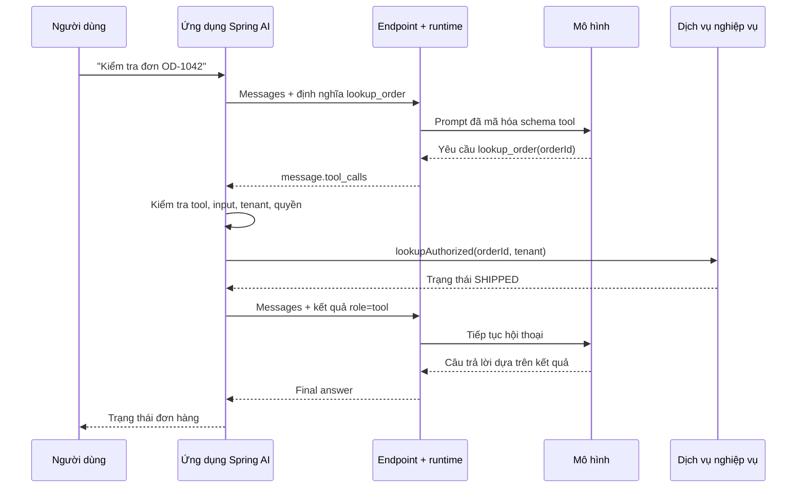

# Kiểm tra khả năng thực tế của mô hình cục bộ và endpoint tương thích

> **Phạm vi:** Chương *Khác biệt mô hình* của mô-đun **Spring AI Tool Calling**; các ví dụ Spring AI dựa trên tài liệu **2.1.0**. Bài học tập trung vào việc chứng minh một tổ hợp **mô hình + runtime phục vụ + endpoint + cấu hình Spring AI** thực sự gọi được công cụ, thay vì suy luận từ tên mô hình hoặc nhãn “OpenAI-compatible”.

## 1. Vấn đề: endpoint trả lời được chưa chắc gọi tool được

Một nhóm xây dựng trợ lý tra cứu đơn hàng chạy trên máy nội bộ. Gọi `/v1/chat/completions` với câu “Xin chào” trả HTTP 200 và sinh được văn bản. Nhóm kết luận mô hình đã tương thích OpenAI, rồi gắn `@Tool` để truy vấn hệ thống đơn hàng. Khi hỏi “Đơn OD-1042 đang ở đâu?”, mô hình lại *tự viết* rằng sẽ gọi `lookup_order`, hoặc trả JSON trong `content`, nhưng ứng dụng không thực thi gì.

Lỗi nằm ở việc đánh đồng **chat hoạt động** với **tool calling hoạt động**. Trong Spring AI, mô hình chỉ **đề nghị gọi tool** bằng tên và đối số; **ứng dụng** tìm đúng `ToolCallback`, kiểm tra quyền, gọi dịch vụ nghiệp vụ và chuyển kết quả về mô hình. Mô hình không trực tiếp chạm vào cơ sở dữ liệu, HTTP service hay Spring bean. Luồng này còn cần vận hành qua nhiều lượt đối thoại, truyền kết quả đúng định dạng và kết thúc mà không gọi lặp vô hạn.

Sau bài học, bạn có thể:

1. Phân biệt bốn tầng phải tương thích: **mô hình**, **runtime/chat template/parser**, **giao thức endpoint** và **vòng thực thi trong Spring AI**.
2. Chạy phép thử “có tool thật” trên endpoint OpenAI-compatible, đọc phản hồi `tool_calls` và kiểm tra lượt trả kết quả tool.
3. Cấu hình `OllamaChatModel` hoặc `OpenAiChatModel` trong Spring AI 2.1 và xác minh tool có được gọi hay không.
4. Lập ma trận thử nghiệm để chọn mô hình cục bộ có độ tin cậy phù hợp, với các rào chắn quyền truy cập và xử lý lỗi nằm ở ứng dụng.

## 2. Bốn tầng năng lực cần đánh giá độc lập

| Tầng | Cần chứng minh | Dấu hiệu **chưa đủ** |
| --- | --- | --- |
| **Mô hình/checkpoint** | Biết **khi nào** cần dùng tool, chọn đúng tên, suy ra đối số từ yêu cầu và dùng kết quả trả về | Model card ghi “function calling”, một câu trả lời kể về việc sẽ gọi tool |
| **Runtime + chat template + parser** | Mã hóa định nghĩa tool vào prompt, giải mã đầu ra thành cấu trúc tool call, xử lý lịch sử có tin nhắn `tool` | Runtime có tùy chọn “tools” hoặc có parser nhưng dùng sai chat template |
| **Endpoint/API** | Nhận `tools`/`tool_choice` trong phạm vi hỗ trợ; trả đúng `message.tool_calls`, id, tên, đối số; chấp nhận lượt trả `role: tool` | `GET /v1/models` thành công, `POST /v1/chat/completions` chỉ chat văn bản |
| **Ứng dụng Spring AI** | Chuyển schema, nhận phản hồi, thực thi `ToolCallback` có kiểm soát, đưa kết quả lại vào vòng hội thoại | `@Tool` có mặt trong source code; log chỉ có câu trả lời của mô hình |

Điểm quan trọng nhất: **“OpenAI-compatible” mô tả mức tương thích của *một tập con API*, không bảo đảm mọi endpoint, tham số hay hành vi giống hệt dịch vụ OpenAI**. Chính tài liệu Ollama nói rõ mức hỗ trợ chỉ là một tập con của OpenAI API. Với vLLM, tool calling tự động còn phụ thuộc các cờ khởi chạy và parser; với LM Studio, runtime có thể thử phân tích tool call từ văn bản, nên chất lượng khác nhau giữa mô hình có hỗ trợ native và mô hình chỉ được hỗ trợ mặc định. [1][6][7][8]

Hình dung chuỗi trách nhiệm:



Nếu một mắt xích trả sai định dạng, vòng gọi tool sẽ đứt dù mạng và endpoint vẫn hoạt động.

## 3. Khảo sát môi trường trước khi thử

### 3.1. Ghi lại đúng tổ hợp đang chạy

Mỗi phép thử phải gắn với **model ID/tag và bản định lượng (quantization) nếu có**, **phiên bản runtime**, **URL, loại API**, **chat template/parser**, **streaming bật/tắt**, **tham số điều khiển**, **phiên bản Spring AI**, và **thời điểm**. Cùng tên mô hình nhưng checkpoint hoặc runtime khác vẫn có thể cho kết quả khác.

Ví dụ với Ollama cục bộ:

```bash
ollama --version
ollama list
ollama show qwen3:8b
curl -sS http://localhost:11434/api/tags
curl -sS http://localhost:11434/v1/models
```

`qwen3:8b` là **model ID minh họa**, chỉ chạy khi đã tải mô hình tương ứng (ví dụ `ollama pull qwen3:8b`). Nếu dùng LM Studio/vLLM, thay bằng model ID thực tế mà server công bố. Hai lệnh GET giúp xác định mô hình khả dụng và kiểm tra đường mạng; chúng **không chứng minh tool calling**.

### 3.2. Chọn đúng hợp đồng API

- **Ollama native:** `http://localhost:11434/api/chat`, định nghĩa tool trong `tools`, phản hồi có `message.tool_calls`; đối số `function.arguments` ở dạng **object** trong ví dụ tài liệu Ollama; kết quả tool đưa lại bằng tin nhắn có `role: "tool"` và `tool_name`. [6]
- **Ollama OpenAI-compatible:** `http://localhost:11434/v1/chat/completions`; dùng cấu trúc OpenAI Chat Completions để tiện kết nối `OpenAiChatModel`. Spring AI ghi nhận `spring.ai.openai.chat.base-url=http://localhost:11434/v1` là cấu hình phù hợp. [2][7]
- **vLLM/LM Studio:** thường có `/v1/chat/completions`, nhưng cần kiểm tra cách bật tool parser và template theo bản server, model đang dùng. Chẳng hạn vLLM có cờ `--enable-auto-tool-choice` và `--tool-call-parser` khi dùng tool choice tự động; tên parser phải phù hợp model. [8]

Không tự chuyển JSON phản hồi của **Ollama native** sang khuôn OpenAI chỉ bằng cách đổi URL; hai giao thức có chi tiết khác nhau về đối số và tin nhắn trả kết quả.

## 4. Phép thử trên dây: hai lượt mới được tính là “gọi tool thành công”

Phép thử dùng một tool chỉ đọc, không tạo tác động nghiệp vụ. Giả sử ta muốn bắt mô hình tra cứu đơn `OD-1042` từ `lookup_order`. **Ở bước đầu, không có dịch vụ đơn hàng thật**; mục tiêu chỉ là quan sát chính xác yêu cầu gọi tool.

### Bước A — yêu cầu mô hình phát sinh structured tool call

Lưu JSON sau thành `probe.json` (UTF-8). Thay `model` bằng model ID đã xác nhận từ endpoint:

```json
{
  "model": "qwen3:8b",
  "stream": false,
  "messages": [
    {
      "role": "system",
      "content": "Để biết trạng thái đơn hàng, hãy sử dụng lookup_order. Không tự suy đoán trạng thái."
    },
    {
      "role": "user",
      "content": "Tra cứu trạng thái đơn OD-1042 cho tôi."
    }
  ],
  "tools": [
    {
      "type": "function",
      "function": {
        "name": "lookup_order",
        "description": "Tra cứu trạng thái đơn hàng từ hệ thống theo mã đơn.",
        "parameters": {
          "type": "object",
          "properties": {
            "orderId": {
              "type": "string",
              "description": "Mã đơn hàng, ví dụ OD-1042."
            }
          },
          "required": ["orderId"],
          "additionalProperties": false
        }
      }
    }
  ],
  "tool_choice": "auto"
}
```

Gửi request (trên Windows dùng `curl.exe` nếu `curl` là alias của PowerShell):

```bash
curl -sS -X POST http://localhost:11434/v1/chat/completions \
  -H "Content-Type: application/json" \
  --data-binary @probe.json
```

Nếu server yêu cầu khóa, thêm header `Authorization: Bearer <token>` theo quy định của chính server. Ollama local thường không cần xác thực. Một số server chỉ hỗ trợ một phần `tool_choice`: nếu nhận HTTP 400 với tham số này, ghi nhận hạn chế rồi thử lại **không có** `tool_choice`. Đừng xem việc bỏ tham số là đã sửa được vấn đề chọn tool tự động; cần quan sát hành vi thực tế.

**Phản hồi kỳ vọng về mặt cấu trúc** (minh họa, không phải kết quả đã chạy):

```json
{
  "choices": [
    {
      "index": 0,
      "finish_reason": "tool_calls",
      "message": {
        "role": "assistant",
        "content": null,
        "tool_calls": [
          {
            "id": "call_probe_01",
            "type": "function",
            "function": {
              "name": "lookup_order",
              "arguments": "{\"orderId\":\"OD-1042\"}"
            }
          }
        ]
      }
    }
  ]
}
```

Cần kiểm tra đủ các điểm sau:

1. Có `choices[*].message.tool_calls` dạng mảng, với `type: "function"` và đúng `function.name`. Câu “Tôi sẽ gọi lookup_order” trong `content` **không phải** structured tool call.
2. `function.arguments` là **chuỗi JSON hợp lệ** theo giao thức OpenAI Chat Completions; parse ra object có `orderId` đúng. Kiểu dữ liệu và quy tắc nghiệp vụ phải được ứng dụng kiểm lại, ngay cả khi schema hợp lệ.
3. Mỗi tool call có **id** để liên kết kết quả đúng lượt; `finish_reason: "tool_calls"` thường có mặt nhưng không nên đánh đồng một giá trị finish reason duy nhất với chuẩn của mọi provider. Chính **cấu trúc tool call** và lượt tiếp theo mới là bằng chứng chính.
4. Nếu chỉ thấy JSON trong `content`, tool name sai, đối số sai kiểu, hoặc runtime bỏ mất id, ghi **FAIL/INCOMPATIBLE** cho kịch bản này, dù HTTP 200.

### Bước B — trả kết quả tool và bắt mô hình dùng kết quả

**Ứng dụng** giả lập đã kiểm tra quyền và nhận được `{"orderId":"OD-1042","status":"SHIPPED"}`. Gửi lượt tiếp theo với đầy đủ lịch sử đã có. `call_probe_01` phải thay bằng **id thực nhận từ bước A**; cấu trúc dưới đây chỉ là ví dụ:

```json
{
  "model": "qwen3:8b",
  "stream": false,
  "messages": [
    {
      "role": "user",
      "content": "Tra cứu trạng thái đơn OD-1042 cho tôi."
    },
    {
      "role": "assistant",
      "tool_calls": [
        {
          "id": "call_probe_01",
          "type": "function",
          "function": {
            "name": "lookup_order",
            "arguments": "{\"orderId\":\"OD-1042\"}"
          }
        }
      ]
    },
    {
      "role": "tool",
      "tool_call_id": "call_probe_01",
      "content": "{\"orderId\":\"OD-1042\",\"status\":\"SHIPPED\"}"
    }
  ]
}
```

Kỳ vọng: endpoint chấp nhận lịch sử có **assistant tool call + tool result**, và câu trả lời cuối sử dụng `SHIPPED`, không yêu cầu gọi `lookup_order` mãi. Đây là phép thử khác với bước A: mô hình có thể gọi đúng tool nhưng runtime không tái dựng nổi lịch sử với `role: tool`. Nếu có nhiều tool call trong cùng phản hồi, phải đưa kết quả tương ứng cho **từng id** trước khi xét lượt tiếp theo.

Với Ollama native, tin nhắn trả tool sử dụng `tool_name`; `function.arguments` thường là object thay vì chuỗi JSON trong OpenAI-compatible. Hãy dùng *đúng tài liệu của giao thức đang thử*. [6]

### Bước C — kiểm chứng ba trường hợp đối chứng

- **Không cần tool:** hỏi “2 + 2 bằng mấy?” khi tool `lookup_order` vẫn được công bố. Hệ thống tốt nên trả lời trực tiếp; việc gọi tool tra đơn không liên quan là lỗi chọn công cụ.
- **Thiếu dữ kiện:** hỏi “Tra cứu đơn giúp tôi” nhưng không có `orderId`. Không chấp nhận việc mô hình tự bịa một mã đơn hợp lệ; mô hình nên yêu cầu bổ sung, hoặc ứng dụng từ chối đối số do suy diễn.
- **Hai đơn:** hỏi trạng thái `OD-1042` và `OD-2048`. Kiểm tra có trả **hai yêu cầu tool trong một phản hồi** hay xử lý qua **nhiều lượt**; cả hai cách đều có thể dùng được nếu đối số, id và kết quả nhất quán. Không mặc nhiên khẳng định mọi mô hình hỗ trợ `parallel_tool_calls`.

## 5. Kiểm tra qua chính Spring AI 2.1

Thử raw HTTP là cách tách lỗi endpoint/model khỏi lỗi tích hợp Java. Khi raw HTTP đã đạt, chuyển sang Spring AI để kiểm chứng **chuyển schema và vòng gọi tool thực tế**.

### 5.1. Cấu hình một trong hai đường kết nối

Chọn starter tương ứng; quản lý phiên bản các dependency Spring AI bằng cùng một **BOM 2.1.0** theo tài liệu dự án. Nếu khai báo cả hai starter trong một ứng dụng thì cần chọn rõ ChatModel được dùng và tránh ambiguity khi tiêm bean.

**Đường A — Ollama native** với dependency `org.springframework.ai:spring-ai-starter-model-ollama`:

```yaml
spring:
  ai:
    model:
      chat: ollama
    ollama:
      base-url: http://localhost:11434
      chat:
        model: qwen3:8b
```

**Đường B — OpenAI-compatible** với dependency `org.springframework.ai:spring-ai-starter-model-openai`:

```yaml
spring:
  ai:
    model:
      chat: openai
    openai:
      chat:
        base-url: http://localhost:11434/v1
        model: qwen3:8b
        api-key: ""
```

Trong ví dụ này `api-key: ""` dành cho **server local không đòi khóa**; endpoint có xác thực phải dùng khóa hợp lệ lấy từ secret manager/biến môi trường, không hard-code credential. Với server khác, thay `base-url` bằng base URL mà **client Spring AI thực sự mong đợi**, thường kết thúc tại `/v1`, không phải tự thêm `/chat/completions`. Spring AI 2.1 có cả `spring.ai.openai.base-url` chung lẫn `spring.ai.openai.chat.base-url` dùng riêng cho chat, trong đó cấu hình riêng được ưu tiên. [2][3]

### 5.2. Hai phép thử Spring AI có ý nghĩa khác nhau

Định nghĩa một công cụ kiểm thử không cần kết nối hệ thống thật:

```java
import java.util.concurrent.atomic.AtomicInteger;
import org.springframework.ai.tool.annotation.Tool;
import org.springframework.ai.tool.annotation.ToolParam;

public final class OrderProbeTools {
    private final AtomicInteger calls = new AtomicInteger();

    @Tool(name = "lookup_order",
          description = "Tra cứu trạng thái đơn hàng khi người dùng đưa mã đơn.")
    public String lookup(
            @ToolParam(description = "Mã đơn hàng, ví dụ OD-1042")
            String orderId) {
        calls.incrementAndGet();
        if (!"OD-1042".equals(orderId)) {
            throw new IllegalArgumentException("Mã đơn không hợp lệ");
        }
        return "{\"orderId\":\"OD-1042\",\"status\":\"SHIPPED\"}";
    }

    public int callCount() {
        return calls.get();
    }
}
```

Đầu tiên, gọi trực tiếp `ChatModel` để kiểm tra **khả năng sinh tool call**, không thực thi tool:

```java
import org.springframework.ai.chat.model.ChatModel;
import org.springframework.ai.chat.model.ChatResponse;
import org.springframework.ai.chat.prompt.ChatOptions;
import org.springframework.ai.chat.prompt.Prompt;
import org.springframework.ai.model.tool.ToolCallingChatOptions;
import org.springframework.ai.tool.ToolCallback;
import org.springframework.ai.tool.ToolCallbacks;

// chatModel là bean OllamaChatModel hoặc OpenAiChatModel đã cấu hình.
OrderProbeTools probe = new OrderProbeTools();
ToolCallback[] callbacks = ToolCallbacks.from(probe);

ChatOptions options = ToolCallingChatOptions.builder()
        .toolCallbacks(callbacks)
        .build();

ChatResponse raw = chatModel.call(
        new Prompt("Tra cứu đơn OD-1042 bằng công cụ có sẵn.", options));

boolean modelRequestedTool = raw.hasToolCalls();
int executedByApp = probe.callCount();  // Phải bằng 0 ở đường ChatModel trực tiếp.
```

Đến đây, **`raw.hasToolCalls() == true`** chứng minh model/provider adapter đã đưa yêu cầu vào cấu trúc Spring AI. Nhưng **`executedByApp == 0`** là đúng thiết kế **2.1**, vì `ChatModel.call()` không chạy tool. Nếu `hasToolCalls() == false`, kiểm tra lại raw HTTP, chat template, tên model và schema trước khi đổ lỗi cho `@Tool`. [4]

Sau đó, dùng `ChatClient` để kiểm tra **vòng thực thi tự động**:

```java
import org.springframework.ai.chat.client.ChatClient;

OrderProbeTools probe2 = new OrderProbeTools();

String answer = ChatClient.create(chatModel)
        .prompt("Hãy tra cứu trạng thái đơn OD-1042 bằng lookup_order.")
        .tools(probe2)
        .call()
        .content();

int executed = probe2.callCount();
System.out.println("Tool executions: " + executed);
System.out.println("Answer: " + answer);
```

Kỳ vọng: `executed == 1`, phản hồi cuối dựa trên `SHIPPED`. `executed == 0` là thất bại của kịch bản yêu cầu tool (dù `answer` nghe có vẻ hợp lý). `executed > 1` cần kiểm tra xem có vòng lặp dư hoặc xử lý lặp. Đây là một **probe live**, kết quả mang tính xác suất: lặp lại nhiều lần với cấu hình giống nhau rồi thống kê, không chỉ chạy một lượt.

`ChatClient` tự dùng `ToolCallingAdvisor` để gửi định nghĩa tool, nhận tool call, giao `ToolCallingManager` thực thi và gửi tool result vào lượt tiếp theo. `.tools(probe2)` được gắn theo từng request; nên ưu tiên cách này khi tập tool phụ thuộc quyền của người dùng. Nếu cùng client đã có `.defaultTools(...)`, `.tools(...)` **bổ sung** vào danh sách mặc định, vì vậy hãy kiểm tra cả danh sách trước khi gọi. [1]

**Lưu ý về SDK/API:** Các đoạn Java trên minh họa đường gọi của Spring AI **2.1.0**; chúng giả định lớp đã được import và môi trường Spring Boot cung cấp `chatModel`. Chúng không khẳng định mô hình `qwen3:8b` trên thiết bị cụ thể đã vượt qua phép thử.

### 5.3. Khi muốn kiểm soát từng lượt

Nếu cần kiểm tra từng quyết định gọi tool, thực hiện phê duyệt, hoặc dừng vòng lặp theo điều kiện nghiệp vụ, dùng `ToolCallingManager` trong vòng lặp do ứng dụng quản lý. Lõi kiểm soát theo tài liệu:

```java
ToolCallingManager manager = ToolCallingManager.builder().build();
Prompt prompt = new Prompt("Tra cứu đơn OD-1042", options);
ChatResponse response = chatModel.call(prompt);

while (response.hasToolCalls()) {
    // Tại đây: đo log, áp chính sách, kiểm tra quota và quyền.
    ToolExecutionResult result = manager.executeToolCalls(prompt, response);
    if (result.returnDirect()) {
        break;
    }
    prompt = new Prompt(result.conversationHistory(), options);
    response = chatModel.call(prompt);
}
```

Trong ứng dụng thật, bổ sung timeout, giới hạn lượt, xử lý ngoại lệ và lưu dấu hoạt động trước khi đưa vào production. Không tự viết parser từ chuỗi `content` để biến “lời kể” của mô hình thành lệnh chạy, vì sẽ đánh mất giao thức tool calling và hàng rào kiểm soát. [4]

## 6. Bộ kiểm thử năng lực theo tình huống

Không có một bit “supports tools” đáng tin cậy cho mọi mô hình và mọi server. Hãy dùng bộ tình huống bên dưới với dữ liệu giả có đáp án xác định. Thử riêng cả đường raw API và đường Spring AI cho **mỗi cấu hình cần triển khai**.

| Ca thử | Input / điều kiện | Tín hiệu PASS | Dấu hiệu FAIL |
| --- | --- | --- | --- |
| T0 — Chat nền | Hỏi thông tin không dùng tool | Nhận phản hồi hợp lệ, không lỗi kết nối | Timeout, 401, 404, sai model ID |
| T1 — Một tool | `lookup_order("OD-1042")` | Đúng tên, JSON parse được, đối số đúng; `ChatClient` gọi đúng một lần | Chỉ “mô phỏng gọi” bằng văn bản; sai ID/đối số |
| T2 — Không gọi thừa | Câu hỏi số học với tool vẫn có sẵn | Không gọi `lookup_order` | Tool được gọi dù không liên quan |
| T3 — Thiếu/thừa đối số | Thiếu mã đơn; có trường lạ | Hỏi lại hoặc bị ứng dụng từ chối; không tạo hành động không có thẩm quyền | Tự bịa mã đơn hoặc cho qua giá trị ngoài schema |
| T4 — Nhiều tool | Tra cứu hai mã đơn | Kết quả khớp từng yêu cầu, không lẫn id; hỗ trợ tuần tự hoặc song song đúng cách | Chỉ xử lý một mã, tráo kết quả, lặp vô hạn |
| T5 — Round trip | Gửi assistant tool call + tool result | Endpoint chấp nhận và mô hình dùng đúng `status` thực nhận | 400, mất lịch sử, bịa status |
| T6 — Lỗi tool | Tool trả “không tìm thấy”, 403, timeout | Ứng dụng phân loại lỗi, không lộ nội bộ, không bịa thành công | Thông báo lỗi chứa stack trace/secret hoặc hành động trái quyền |
| T7 — Streaming | Bật `stream: true`, theo dõi chunks | Gộp được tool call đầy đủ rồi mới chạy; lịch sử hoàn chỉnh | Chạy tool dựa trên JSON delta chưa khép kín |
| T8 — Lặp yêu cầu | Gửi cùng yêu cầu nhiều lần | Tỷ lệ đúng và độ trễ đạt ngưỡng triển khai | Lúc gọi lúc không, lỗi format không ổn định |

**Cách đo:** lưu cho từng lần chạy `run_id`, model/checkpoint, runtime/template, endpoint, testcase, `http_status`, `tool_call_present`, `tool_name_correct`, `arguments_valid`, `tool_executed_count`, `round_trip_ok`, `latency_ms` và lý do thất bại. Có thể chạy **10 lần mỗi ca** ở cấu hình cố định để nhìn thấy dao động ban đầu, rồi tăng số lần khi cần ước lượng ổn định. Tránh log token truy cập, thông tin khách hàng hoặc toàn bộ dữ liệu nhạy cảm.

Các tiêu chí chấp nhận do nhóm đặt dựa trên mức rủi ro của sản phẩm; chẳng hạn với tool đọc dữ liệu khách hàng, **không có lần gọi trái quyền** là điều kiện bắt buộc. Một mức đạt 9/10 cho T1 chỉ là số tham khảo nội bộ, **không** phải mức đạt chuẩn được Spring AI hay nhà cung cấp công bố. Không nâng cấp endpoint vào production chỉ vì một request mẫu thành công.

### Những lỗi có thể trông giống “mô hình không hỗ trợ”

| Quan sát | Nguyên nhân có thể | Bước kiểm tra tiếp theo |
| --- | --- | --- |
| HTTP 404/405 ở `/v1/chat/completions` | Sai base URL hoặc endpoint không triển khai Chat Completions | Xem tài liệu runtime, so đường native và đường `/v1` |
| HTTP 400 khi có `tools` hoặc `tool_choice` | Tham số/schema không được hỗ trợ, hoặc server chưa bật tool parser | Thu response body; thử một schema tối giản, kiểm tra cờ runtime |
| HTTP 200 nhưng chỉ có `content` | Model không chọn tool, template/parser không nhận ra cú pháp, prompt chưa rõ | Đọc raw response, thử model có native tool use và prompt rõ hơn |
| Tool call đúng ở raw HTTP nhưng `ChatClient` không gọi | Adapter/cấu hình trỏ sai server, tool không đăng ký đúng, advisor bị tắt | In tên model/base URL, kiểm tra `ChatResponse.hasToolCalls()` từ `ChatModel.call()` rồi `ChatClient` |
| Chỉ lỗi khi stream | Delta tool call chưa đầy đủ hoặc server stream format lạ | Chạy lại `stream: false`, kiểm tra aggregator/phiên bản server |
| Model gọi lặp liên tục | Không đọc được tool result, dữ liệu trả mơ hồ hoặc không có điểm dừng | Kiểm tra assistant/tool history, result converter, quota và điều kiện dừng |
| Tool bị gọi nhưng trả 403 | Quyền ứng dụng từ chối, không phải lỗi model | Kiểm tra tenant/principal phía server; không tăng quyền vì model yêu cầu |

## 7. Giới hạn và bảo vệ thực thi vẫn thuộc về ứng dụng

Một mô hình nội bộ có thể đáp ứng tốt T1–T5 mà vẫn **không đủ an toàn** để thao tác dịch vụ thật. Hãy gắn chính sách vào lớp gọi tool:

- **Danh sách công cụ theo quyền:** chỉ đưa tool người dùng được phép gọi vào `.tools(...)` của request. Đừng đặt tool xóa/sửa dữ liệu trong `.defaultTools(...)` áp dụng cho mọi người. `spring.ai.tools.resolution.fallback.enabled` mặc định **false** trong Spring AI 2.1; bật nó có thể cho phép thực thi tool đã biết trong resolver ngay cả khi request không công bố tool đó, nên không bật tùy tiện. [1]
- **`ToolContext` cho dữ liệu tin cậy:** đưa tenant/user/request scope từ phiên xác thực của server vào `.toolContext(...)`; dữ liệu này **không gửi cho mô hình**. Phương thức tool phải kiểm tra lại quyền trên dữ liệu thật trước khi gọi repository. Tuyệt đối không dùng `tenantId` hay `userId` do model tự điền trong `arguments` làm căn cứ cấp quyền. [1]
- **Xác thực đối số và dữ liệu trả về:** JSON Schema hướng dẫn mô hình tạo đối số; nó không thay thế validation của ứng dụng (pattern, giới hạn, quyền truy cập tài nguyên, danh sách cho phép). Không mở rộng tên tool bằng string động từ model nếu không có allowlist.
- **Giới hạn chi phí và vòng lặp:** Spring AI **2.1.0** bổ sung giới hạn mặc định **40 lần/tool/lượt** và **150 tool calls tổng/lượt**, có thể cấu hình bằng `spring.ai.tools.limits.*`. Đây là trần bảo vệ framework, không thay cho hạn mức nghiêm ngặt hơn của nghiệp vụ, timeout hay circuit breaker. [5]
- **Lỗi và dữ liệu nhạy cảm:** `ToolExecutionExceptionProcessor` có thể trả thông báo lỗi tool về mô hình; với lỗi runtime, mặc định có thể đưa **message** của exception vào hội thoại. Tránh thông điệp chứa SQL, token, đường dẫn hay stack trace; phân loại lỗi trước khi trả. `spring.ai.tools.throw-exception-on-error=true` giúp chuyển mọi lỗi tool cho caller xử lý thay vì tự gửi lỗi về model. [1]
- **Hành động có tác dụng phụ:** yêu cầu xác nhận tại ứng dụng trước khi thực thi gửi email, cập nhật hay xóa dữ liệu. Kết hợp idempotency key phía nghiệp vụ để retry/duplicate tool calls không thực thi lặp. Quyền quyết định cuối cùng luôn thuộc policy của server.

Một ví dụ tối giản về truyền context tin cậy:

```java
class OrderTools {
    private final OrderService service;

    OrderTools(OrderService service) {
        this.service = service;
    }

    @Tool(description = "Đọc trạng thái đơn hàng được cấp quyền")
    public String lookupOrder(String orderId, ToolContext context) {
        String tenantId = (String) context.getContext().get("tenantId");
        if (tenantId == null) {
            throw new SecurityException("Missing tenant context");
        }
        // lookupAuthorized phải thực hiện kiểm tra tenant và quyền tại service.
        return service.lookupAuthorized(tenantId, orderId).status();
    }
}

String response = ChatClient.create(chatModel)
        .prompt("Tra cứu đơn OD-1042")
        .tools(new OrderTools(orderService))
        .toolContext(Map.of("tenantId", tenantIdFromAuthenticatedSession))
        .call()
        .content();
```

`OrderService`, `lookupAuthorized` và `tenantIdFromAuthenticatedSession` ở đây biểu thị **API nghiệp vụ do ứng dụng tự triển khai**, không phải class/giá trị được Spring AI cung cấp sẵn. Trong triển khai thật, kết hợp principal và kiểm soát hành động ở service hoặc tầng authorization theo chính sách hệ thống.

## 8. Khác biệt phiên bản Spring AI phải ghi chính xác

Tài liệu chính thức tại thời điểm soạn ghi **Spring AI 2.1.0**. Khi đọc hướng dẫn cũ hoặc sao chép snippet, cần đối chiếu:

| Chủ đề | Spring AI 1.x hoặc ví dụ cũ | Spring AI 2.0–2.1 |
| --- | --- | --- |
| Ai chạy vòng tool? | `ChatModel` có vòng thực thi tool nội bộ, thường mặc định bật | `ChatModel.call()` **không** tự chạy tool; `ChatClient` dùng `ToolCallingAdvisor` hoặc ứng dụng tự gọi `ToolCallingManager` |
| Cờ `internalToolExecutionEnabled` | Từng dùng để chuyển sang tự điều khiển | **Đã loại bỏ**; không viết `.internalToolExecutionEnabled(false)` cho 2.1 |
| Tên advisor | Một số ví dụ cũ dùng `ToolCallAdvisor` | Dùng `ToolCallingAdvisor`; tên cũ đã bị deprecated |
| Tool mặc định và tool từng request | Cần xem cơ chế từng phiên bản | Trong `ChatClient`, `.tools(...)` **thêm vào** `.defaultTools(...)`; với `ChatModel`, callback trong options của request **ghi đè** callback mặc định của model |
| OpenAI strict schema | Một số bản trước mặc định `strict=true` | Trong 2.1, `OpenAiChatModel` mặc định `strict=false` để tránh từ chối schema có tham số tùy chọn; **không** hiểu là endpoint luôn bảo đảm đúng JSON Schema |
| Quota tool calls | Trước 2.1 không có giới hạn mặc định tương đương | 2.1 thêm trần mặc định **40/tool/lượt** và **150 tổng/lượt** |
| Streaming tool call | Ví dụ cũ có thể quan sát raw chunks khác cách | 2.1 biểu diễn delta bằng `ToolCallPart` **partial**; chỉ tool call hoàn chỉnh mới đủ điều kiện thực thi |

Đặc biệt, `ChatClient.stream().content()` chủ yếu đưa ra phần văn bản; muốn quan sát delta đối số tool cần xử lý `chatResponse()`/message parts thích hợp. **Không bao giờ thực thi tool từ một partial `ToolCallPart`**: fragment hiện tại có thể chưa phải JSON hợp lệ và sẽ được phát lại bằng tool call hoàn chỉnh. [1][4][5]

## 9. Ra quyết định chọn mô hình và endpoint

Có thể phân mức chấp nhận như sau (đây là **quy ước đánh giá đề xuất**, không phải bảng phân hạng chính thức của Spring AI):

| Mức | Bằng chứng đã có | Phù hợp |
| --- | --- | --- |
| **L0 — Chat only** | T0 đạt, chưa có structured tool call đạt T1 | Trợ lý trả lời văn bản, tóm tắt |
| **L1 — Tool request** | T1 đạt, tên và đối số hợp lệ | Thử nghiệm nguyên mẫu, chưa dùng dịch vụ thật |
| **L2 — Round trip** | T1, T3, T5 và `ChatClient` thực thi đúng | Tool chỉ đọc trong môi trường kiểm soát |
| **L3 — Vận hành ổn định** | T0–T8 đạt ngưỡng đã đặt; bảo vệ quyền, lỗi, giới hạn và quan sát đầy đủ | Cân nhắc triển khai nghiệp vụ theo mức rủi ro |

Với mỗi ứng viên, lưu bảng so sánh gồm **model ID, lượng RAM/VRAM, runtime version, base URL, parser/template, kết quả T0–T8, lỗi phổ biến, P50/P95 latency và chi phí vận hành**. Hiệu năng trong môi trường máy thật mới quyết định lựa chọn; đừng suy từ dung lượng tham số hay tên “tool-use” đơn lẻ.

**Bài tập thực hành:**

1. Chọn một mô hình đã tải trên Ollama (hoặc server OpenAI-compatible hiện có) và ghi phiên bản runtime/model.
2. Chạy `probe.json`, đọc đúng `tool_calls` và replay kết quả `role: tool`; ghi bằng chứng PASS/FAIL.
3. Lặp lại trên `OllamaChatModel` và `OpenAiChatModel` nếu endpoint hỗ trợ cả hai; so kết quả raw và `ChatClient`.
4. Thử một ca thiếu mã đơn, một ca hai mã đơn và một ca tool trả lỗi; giải thích lỗi ở **tầng** nào và sửa bằng thay đổi nhỏ nhất.
5. Xây dựng một tiêu chí chấp nhận nội bộ trước khi đưa model vào công cụ đọc dữ liệu có quyền truy cập.

**Câu hỏi tự kiểm tra:** Nếu `ChatResponse.hasToolCalls()` sau khi gọi `ChatModel.call()` là `true` nhưng counter `@Tool` vẫn bằng 0, đây có phải lỗi của endpoint không? **Không**: ở Spring AI 2.1, đó là hành vi đúng của `ChatModel` cấp thấp. Phải chạy qua `ChatClient` hoặc vòng `ToolCallingManager` mới mong đợi counter tăng.

## 10. Tài liệu đối chiếu

Các nguồn sau là tài liệu chính thức được dùng để kiểm chứng cơ chế và khác biệt phiên bản; với runtime/model cụ thể, kiểm tra thêm bản tài liệu tương ứng với bản đã cài.

1. **Spring AI 2.1 — Tool Calling:** https://docs.spring.io/spring-ai/reference/api/tools.html
2. **Spring AI 2.1 — Ollama Chat:** https://docs.spring.io/spring-ai/reference/api/chat/ollama-chat.html
3. **Spring AI 2.1 — OpenAI Chat:** https://docs.spring.io/spring-ai/reference/api/chat/openai-chat.html
4. **Spring AI 2.1 — ChatModel Tool Calling:** https://docs.spring.io/spring-ai/reference/api/tools/chatmodel-tool-calling.html
5. **Spring AI 2.1 — Upgrade Notes:** https://docs.spring.io/spring-ai/reference/upgrade-notes.html
6. **Ollama — Tool calling:** https://docs.ollama.com/capabilities/tool-calling
7. **Ollama — OpenAI compatibility:** https://docs.ollama.com/api/openai-compatibility
8. **vLLM — Tool Calling:** https://docs.vllm.ai/en/stable/features/tool_calling/
9. **LM Studio — Tool Use:** https://lmstudio.ai/docs/developer/openai-compat/tools
