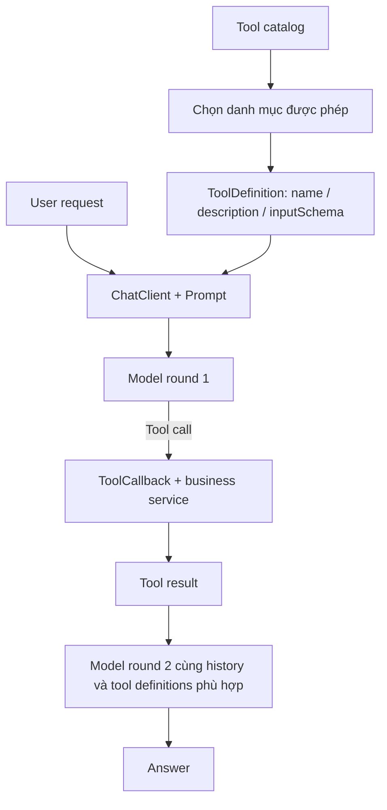
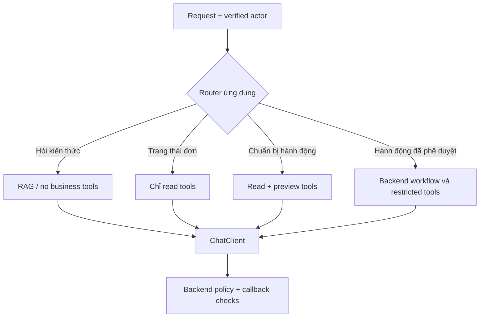
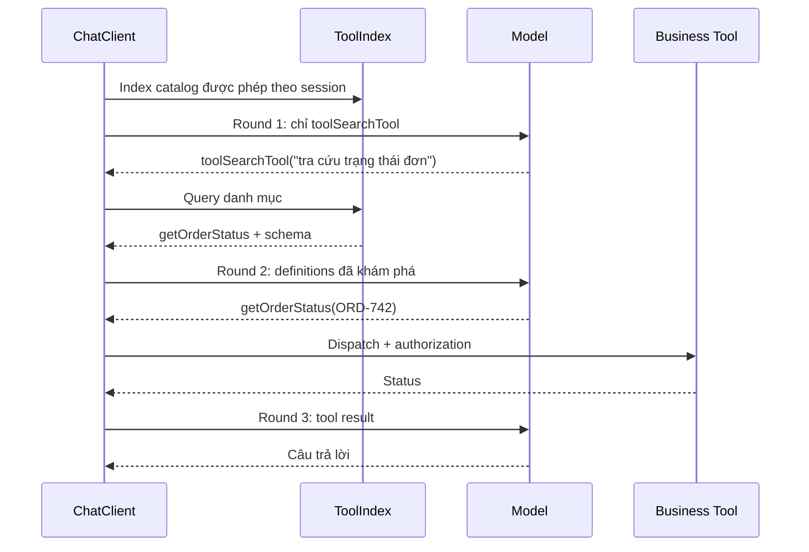

# Giảm token bằng mô tả ngắn rõ và tập công cụ phù hợp

Trong Spring AI Tool Calling, mô hình không chỉ nhận câu hỏi của người dùng. Nó còn nhận **định nghĩa các công cụ đang được công bố**: tên, mô tả, JSON Schema của đầu vào và một phần hướng dẫn liên quan. Nếu ứng dụng có hàng chục `@Tool`, `FunctionToolCallback` hoặc tool từ MCP server, danh mục này có thể chiếm đáng kể ngữ cảnh ngay cả khi người dùng chỉ cần một công cụ. Mỗi lần mô hình tiếp tục sau một tool call, định nghĩa công cụ có thể lại được gửi trong request tiếp theo.

Bài học trong chương **Hiệu năng và chi phí** của module `SPRING_AI_TOOL_CALLING` tập trung vào hai đòn bẩy: **viết mô tả ngắn nhưng đủ rõ** và **chỉ công bố tập công cụ phù hợp với tác vụ, người dùng và từng giai đoạn**. Mục tiêu không phải cắt càng nhiều chữ càng tốt, mà là giảm input tokens, độ trễ và độ nhầm lẫn khi chọn tool **mà vẫn giữ** tính đúng của arguments, kiểm tra quyền, giới hạn vòng gọi, xử lý lỗi và tính an toàn của các dịch vụ nghiệp vụ.

Một mô tả quá dài làm tốn token; một mô tả quá ngắn như “Xử lý đơn” khiến model chọn sai và có thể sinh thêm vòng hỏi/gọi tool. Tối ưu chỉ có ý nghĩa khi đo **chi phí toàn lượt** cùng chất lượng và mức an toàn, không chỉ đo số ký tự của một annotation.

## 1. Tool definitions được tính vào đâu?

Spring AI mô tả tool bằng `ToolDefinition`: `name()`, `description()` và `inputSchema()`. Chúng được xây từ `@Tool`/`@ToolParam`, DTO/record, `FunctionToolCallback` hoặc adapter MCP. `ChatClient` gửi definitions tới model để model quyết định có gọi tool nào và sinh arguments JSON nào. Ứng dụng thực thi tool thông qua `ToolCallback`/`ToolCallingManager`, rồi đưa kết quả vào lượt suy luận kế tiếp.



Trong mỗi model request, input tokens có thể đến từ:

| Thành phần | Ví dụ | Có thể tối ưu thế nào? |
| --- | --- | --- |
| System/developer instructions | Quy tắc trợ lý và chính sách giao tiếp | Ngắn, không lặp lại mô tả từng tool |
| Conversation history | Nhiều lượt hỏi và tool messages | Chỉ giữ ngữ cảnh cần thiết, không làm hỏng cặp tool-call/result |
| RAG context | Các đoạn tài liệu truy xuất | Top-K/rerank, giới hạn bằng chứng theo câu hỏi |
| **Tool definitions** | Tên, mô tả, JSON Schema của mọi callback được công bố | Rút gọn mô tả và **giảm số tool được gửi** |
| Tool results | JSON từ CRM/ERP/REST/MCP | Trả về thông tin cần thiết, phân trang và giới hạn kích thước |
| Routing/discovery | Tool search hoặc model router | Đo overhead trước khi thêm một vòng chọn tool |

Token là đơn vị do tokenizer/model/provider tính; **số ký tự hoặc số từ không phải số token chính xác**. Schema ngắn hơn thường giúp giảm phần prompt liên quan đến tool, nhưng số token thực tế còn phụ thuộc model, encoding, cách provider serialize tool definitions và cơ chế prompt caching.

## 2. Vì sao danh mục lớn có thể tốn nhiều hơn một lần?

Một user turn có thể gồm nhiều vòng model:

```text
Round 1: prompt + tools → model gọi getOrderStatus
Round 2: prompt + history + tools → model gọi getReturnPolicy
Round 3: prompt + history + tools → model tổng hợp câu trả lời
```

Nếu cùng một catalog có 30 công cụ được đưa vào mọi vòng, token của danh mục có thể xuất hiện trong cả ba request; có provider/cache làm chi phí thực thấp hơn nhưng không nên giả định bằng 0.

Mô hình hóa để ước lượng:

\[
T_{\text{input}}=\sum_{r=1}^{R}
 \left(T_{\text{base},r}+T_{\text{tools},r}+T_{\text{history},r}+T_{\text{context},r}\right)
\]

Ở đây `R` là số model rounds; `T_tools,r` là token do definitions được công bố ở round đó. Đó là **ước lượng số token được đưa vào**, không tự động là số token được tính tiền. Hóa đơn thực tế phụ thuộc input/output token rates, cache read/write, các request phụ và chính sách provider.

Ví dụ **giả định để tính nhanh**, không phải benchmark Spring AI:

| Thông số | Catalog toàn bộ | Catalog theo tác vụ |
| --- | ---: | ---: |
| Số tool được gửi | 40 | 4 |
| Token/definition bình quân giả định | 180 | 180 |
| Token definitions/round | 7.200 | 720 |
| Số model rounds | 3 | 3 |
| Tổng tokens từ definitions (trước caching) | 21.600 | 2.160 |

Chênh lệch lý thuyết là **19.440 input tokens** của riêng definitions. Nhưng catalog rút gọn có thể làm mô hình thiếu khả năng cần dùng, gọi lại để tìm công cụ hoặc thất bại trong một số yêu cầu. Chỉ nên chọn phương án sau khi đo thêm **tỷ lệ hoàn tất đúng, số vòng, latency và token thực tế**.

## 3. Thế nào là mô tả tool “ngắn nhưng rõ”?

Một mô tả tốt cần trả lời súc tích:

1. **Mục đích cụ thể:** tool trả về điều gì hay tạo tác động gì?
2. **Khi nào dùng:** những tình huống nào phù hợp, đặc biệt khi có tool tương tự?
3. **Phạm vi/giới hạn quan trọng:** chỉ đọc hay có side effect; có điều kiện cần kiểm tra trước không?

Các ý này không đồng nghĩa phải viết một đoạn văn dài. Với tool đọc trạng thái đơn, ví dụ:

```java
@Tool(description = "Lấy trạng thái giao hàng mới nhất của một đơn hàng theo mã đơn")
OrderStatus getOrderStatus(
        @ToolParam(description = "Mã đơn hàng, ví dụ ORD-742") String orderId,
        ToolContext toolContext) {
    AuthenticatedActor actor = actorResolver.require(toolContext);
    return orderQueryService.getStatus(actor, orderId);
}
```

Đoạn code chỉ minh họa phần annotation; `actorResolver` và `orderQueryService` là các thành phần do ứng dụng định nghĩa. Trong ứng dụng thật, service phải kiểm tra actor/tenant từ nguồn xác thực, không tin `orderId` là đủ để cấp quyền. Không đưa quyền và bí mật nghiệp vụ vào lời mô tả gửi model.

So sánh các cách mô tả:

| Mô tả | Vấn đề hoặc ưu điểm |
| --- | --- |
| “Làm việc với đơn hàng” | Quá mơ hồ: model không phân biệt đọc, hủy hay cập nhật |
| “Công cụ này được thiết kế nhằm cho phép ứng dụng của chúng ta thực hiện quá trình truy vấn nhằm tìm kiếm, thu thập, xử lý và cung cấp những thông tin có liên quan…” | Dài nhưng không thêm điều kiện chọn tool hữu ích |
| **“Lấy trạng thái giao hàng mới nhất của một đơn hàng theo mã đơn”** | Ngắn, thể hiện intent, đầu vào và kết quả |
| “Lấy thông tin đơn hàng” | Tạm được nếu catalog chỉ có một tool, nhưng mơ hồ khi có nhiều tool liên quan |

Nên dùng **động từ phân biệt năng lực**: `get`/`list`/`search`/`preview`/`create`/`update`/`cancel`, cùng đối tượng nghiệp vụ và trạng thái đọc/ghi. Đừng đặt ba tool đều có mô tả “Xử lý yêu cầu khách hàng”.

## 4. Mẫu viết mô tả ba tầng

Nên phân bổ thông tin theo đúng nơi có tác dụng, tránh lặp một quy tắc ở nhiều vị trí:

| Tầng | Nên chứa | Không nên chứa |
| --- | --- | --- |
| **Tên tool** | Động từ + đối tượng, phân biệt được với tool khác | Mã dự án mơ hồ, tên chung như `process` |
| **Description của tool** | Một câu mục đích; thêm một điều kiện phân biệt khi cần | Tài liệu nghiệp vụ dài, prompt hệ thống, secrets |
| **Description/schema của từng tham số** | Ý nghĩa, đơn vị, định dạng, optional/null/default khi quan trọng | Nhắc lại toàn bộ mục đích của tool ở từng field |

Ví dụ dạng concise:

```java
import org.springframework.ai.chat.model.ToolContext;
import org.springframework.ai.tool.annotation.Tool;
import org.springframework.ai.tool.annotation.ToolParam;

class OrderReadTools {

    private final OrderQueryService orders;

    OrderReadTools(OrderQueryService orders) {
        this.orders = orders;
    }

    @Tool(description = "Tìm đơn hàng theo khoảng ngày giao; chỉ đọc")
    OrderPage searchDeliveredOrders(
            @ToolParam(description = "Ngày đầu, yyyy-MM-dd") String from,
            @ToolParam(description = "Ngày cuối độc quyền, yyyy-MM-dd") String toExclusive,
            @ToolParam(description = "Trạng thái thanh toán; bỏ qua nếu không lọc",
                    required = false)
            String paymentStatus,
            ToolContext toolContext) {

        AuthenticatedActor actor = requireActor(toolContext);
        return orders.searchDelivered(actor, from, toExclusive, paymentStatus);
    }
}
```

`OrderQueryService`, `OrderPage`, `AuthenticatedActor` và `requireActor` là thành phần ứng dụng tự định nghĩa. `ToolContext` nhận danh tính do backend cung cấp, không phải tham số để model tự điền trong JSON. Tool ở đây chỉ đọc, còn service vẫn phải validate ngày, phân quyền, giới hạn trang và xử lý lỗi.

Vì tên `searchDeliveredOrders` đã nói về đơn được giao, mô tả không cần viết một đoạn liệt kê mọi trạng thái logistics. Nhưng từ “cuối độc quyền” là **điều kiện quan trọng**, không nên cắt bỏ chỉ để tiết kiệm vài token. Nếu ngày cuối bị hiểu thành inclusive, model có thể trả kết quả sai cả một ngày.

## 5. Những thông tin không nên lược bỏ để giảm token

Có những ký tự rất đáng giữ vì nếu thiếu chúng model dễ gọi sai:

- **Đơn vị và kiểu tiền:** VND, USD, cents hay đơn vị nhỏ nhất; giá trị decimal hoặc số nguyên.
- **Thời gian:** ISO-8601, có/không offset, timezone, khoảng §[from,to)`, ngày lịch hay timestamp.
- **Định danh tài nguyên:** mã đơn hay mã khách hàng; không tự suy hoặc sửa ID.
- **Tính bắt buộc:** phân biệt required, optional và nullable; bỏ trường khác với gửi `null` nếu nghiệp vụ định nghĩa khác.
- **Ràng buộc tác động:** tool chỉ đọc, preview hay thực sự ghi dữ liệu; cần confirmation khi nào.
- **Enum rõ ràng:** giá trị nào được nhận; khi có nhiều cách diễn đạt trong tiếng Việt, map alias ở application khi hợp lệ.
- **Giới hạn an toàn quan trọng:** mức tối đa, số bản ghi, điều kiện không thể hoàn tác.

Ví dụ description cực ngắn “Hoàn tiền” là **không đủ** nếu catalog có cả `previewRefund` và `executeRefund`. Mô tả an toàn hơn:

```java
@Tool(description = "Xem trước số tiền và phí hoàn; không thực hiện chuyển tiền")
RefundPreview previewRefund(RefundPreviewRequest request) { /* ... */ }

@Tool(description = "Thực hiện hoàn tiền theo draft đã phê duyệt; có side effect")
RefundReceipt executeRefund(ApprovedRefundRequest request) { /* ... */ }
```

Hai method chỉ minh họa cách phân biệt tên/description; kiểu DTO và service thực thi là thành phần của ứng dụng. **Mô tả “cần phê duyệt” không phải là authorization**. Backend phải kiểm tra quyền, approval state, trạng thái giao dịch và idempotency ngay trước khi chuyển tiền; với Spring AI 2.1.0 có thể dùng `@Tool(requiresConfirmation = true)` như một lớp bổ sung.

## 6. Kiểm soát độ lớn JSON Schema, không chỉ description

Với tool phức tạp, tên và description có thể chỉ chiếm một phần nhỏ; JSON Schema của input chứa tên field, mô tả field, cấu trúc nested, enum và ràng buộc. Nếu một tool nhận DTO gồm 25 field dù hầu hết không liên quan tới thao tác, model vẫn phải đọc và cân nhắc toàn bộ.

Ví dụ contract quá rộng:

```json
{
  "type": "object",
  "properties": {
    "orderId": {"type": "string"},
    "customerId": {"type": "string"},
    "customerName": {"type": "string"},
    "shippingAddress": {"type": "object"},
    "customerNotes": {"type": "string"},
    "paymentStatus": {"type": "string"},
    "fulfillmentStatus": {"type": "string"},
    "warehouseId": {"type": "string"},
    "internalWorkflow": {"type": "object"},
    "rawPayload": {"type": "object"}
  }
}
```

Nếu mục tiêu chỉ là lấy trạng thái đơn, contract tốt hơn:

```json
{
  "type": "object",
  "properties": {
    "orderId": {
      "type": "string",
      "description": "Mã đơn hàng, ví dụ ORD-742"
    }
  },
  "required": ["orderId"],
  "additionalProperties": false
}
```

Điểm tối ưu là **loại bỏ những field ứng dụng không cần model quyết định**, chứ không giấu thông tin cần thiết. Địa chỉ giao hàng, token, tenant, user ID, mức quyền hoặc payload nội bộ không nên xuất hiện trong schema nếu được backend truy xuất theo danh tính đã xác thực.

Một số hướng thực hiện:

1. Tách DTO theo use case thay vì tái sử dụng entity JPA hoặc DTO REST khổng lồ.
2. Chỉ gửi parameters thật sự được model cho phép chọn; các trường tin cậy đến từ `ToolContext`/service.
3. Dùng enum nhỏ có nghĩa, tránh enum chứa hàng trăm giá trị nếu có thể tra cứu mã hợp lệ ở tầng ứng dụng.
4. Giữ nested structures đơn giản nhưng **đúng biểu đạt**; không làm phẳng arrays/AND-OR filters rồi mất semantics.
5. Viết mô tả ở đúng field cần giải nghĩa, không sao chép nguyên văn tool description vào mọi field.
6. Với generic tools có schema khó hiểu, cân nhắc tách thành các tool chuyên biệt; nhưng tránh tạo quá nhiều tool gần trùng nhau.

Không tự ý minify JSON Schema bằng cách xóa các từ khóa quan trọng như `required`, `enum`, `additionalProperties` hoặc giới hạn kiểu. Những ràng buộc đó có thể giúp model sinh đối số đúng, giảm lỗi và retry. Mục tiêu là giảm **nội dung thừa**, không giảm chất lượng hợp đồng.

## 7. Tách tool theo nghiệp vụ, nhưng tránh phân mảnh quá mức

Hai cực đều có vấn đề:

| Thiết kế | Nhược điểm |
| --- | --- |
| Một tool `executeAction(actionName, payload)` cho mọi thao tác | Schema mơ hồ, model phải hiểu một mini-language; khó phân quyền và đánh giá arguments |
| 60 tool gần giống `getOrderStatusA`/`getOrderStatusB`/… | Catalog dài, chọn sai tool do tên và mô tả chồng lấn |
| Nhóm tool theo domain/use case, với schema rõ | Cân bằng độ rõ và khả năng chỉ công bố subset phù hợp |

Một cách tổ chức hợp lý:

```text
order.read:
  getOrderStatus(orderId)
  searchOrders(from, toExclusive, filters)

order.action:
  previewCancellation(orderId)
  executeApprovedCancellation(draftId)

support.read:
  searchKnowledge(query)
  getTicketStatus(ticketId)

support.action:
  createTicket(request)
```

Tên nhóm ở trên dùng để **quản trị catalog**, không nhất thiết phải đưa tiền tố nhóm vào tên tool nếu đã rõ nghĩa và không trùng. Khi nhiều MCP servers cung cấp các tên giống nhau, tên có namespace ổn định lại quan trọng.

Nên thiết kế mỗi tool quanh một nhiệm vụ có schema dễ kiểm tra và quyền rõ ràng. Không gộp đọc và ghi vào cùng một tool chỉ để giảm tổng số definitions; giá phải trả ở validation, security và khả năng lựa chọn đúng có thể lớn hơn vài trăm token.

## 8. Đòn bẩy lớn nhất: chỉ công bố tool phù hợp với request

Ngay cả những description được viết rất ngắn vẫn chiếm token nếu 80 công cụ đều xuất hiện trong một request. Trước khi gọi model, application có thể xác định **một tập nhỏ hợp lệ** từ route, role, tenant, feature flag hoặc giai đoạn workflow.

Ví dụ trợ lý bán hàng:

| Intent đã được ứng dụng phân loại | Nhóm tool cần công bố |
| --- | --- |
| Hỏi khái niệm chung | Không cần tool nghiệp vụ |
| Hỏi trạng thái đơn | `getOrderStatus` |
| Tìm nhiều đơn | `searchOrders` + `getOrderStatus` |
| Xem chính sách | RAG/search knowledge, không cần tool ghi |
| Chuẩn bị hủy | `getOrderStatus` + `previewCancellation` |
| Thực thi hủy đã được duyệt | Chỉ đường điều phối/backend có quyền, không công bố mặc định cho mọi request |

Đây là **tool exposure**, tức tập khả năng model nhìn thấy. Nó không thay thế **authorization**: callback/service vẫn phải kiểm tra quyền theo actor và tài nguyên ngay khi thực thi. Với các hành động nhạy cảm, backend nên quản lý prepare–validate–approve–execute thay vì chỉ tin prompt sẽ điều phối đúng.

### Ví dụ Spring AI: tools theo từng request

```java
import java.util.Map;
import org.springframework.ai.chat.client.ChatClient;
import org.springframework.ai.chat.model.ChatModel;

class SalesAssistant {

    private final ChatClient chatClient;
    private final OrderReadTools orderReadTools;
    private final CancellationPreviewTools cancellationPreviewTools;

    SalesAssistant(
            ChatModel model,
            OrderReadTools orderReadTools,
            CancellationPreviewTools cancellationPreviewTools) {
        // Không khai báo hàng chục default tools cho mọi request.
        this.chatClient = ChatClient.builder(model).build();
        this.orderReadTools = orderReadTools;
        this.cancellationPreviewTools = cancellationPreviewTools;
    }

    String answerOrderQuestion(String question, AuthenticatedActor actor) {
        return chatClient.prompt()
                .user(question)
                .tools(orderReadTools)
                .toolContext(Map.of("actor", actor))
                .call()
                .content();
    }

    String prepareCancellation(String question, AuthenticatedActor actor) {
        return chatClient.prompt()
                .user(question)
                .tools(orderReadTools, cancellationPreviewTools)
                .toolContext(Map.of("actor", actor))
                .call()
                .content();
    }
}
```

`CancellationPreviewTools` và `AuthenticatedActor` là các lớp do ứng dụng định nghĩa. Actor phải do backend tạo từ phiên đăng nhập được xác thực, không nhận tùy ý từ model hoặc body của client. Với code này, hai phương thức chỉ cung cấp nhóm tool phù hợp; service vẫn chịu trách nhiệm validation, quyền và tác động nghiệp vụ.

**Chi tiết rất dễ nhầm trong Spring AI:** `.tools(...)` theo request **bổ sung** vào `.defaultTools(...)` của `ChatClient`; nó **không thay thế** defaults. Nếu builder đã có 40 default tools, viết `prompt().tools(orderReadTools)` không hề thu nhỏ catalog còn một tool. Muốn giảm token thực sự, thiết kế defaults tối thiểu hoặc tạo các client/profile riêng có danh mục được cấp phép phù hợp.

## 9. Chọn tập công cụ bằng routing có kiểm soát

Không nhất thiết dùng một model call riêng để chọn tool. Với ứng dụng đã biết URL nghiệp vụ, màn hình UI hoặc loại thao tác, **deterministic routing** thường rẻ và đáng tin hơn.



Có thể dùng:

- **Rule-based routing:** endpoint, action type từ UI, nhóm quyền hoặc bước quy trình đã xác định.
- **Classifier nhẹ:** một mô hình/thuật toán dự đoán domain khi yêu cầu quá đa dạng.
- **Hybrid:** rule cứng cho thao tác nhạy cảm; classifier gợi ý trong tập domain đã được phép.

Router không nên lấy `role=admin`, `tenantId` hoặc “hãy mở mọi công cụ” từ chính văn bản người dùng như nguồn quyền. Routing chọn **ứng viên được phép**; cuối cùng service kiểm tra quyền thực thi.

### Trade-off của một model router

Nếu router tiêu tốn 400 input tokens + 50 output tokens và thêm 200 ms, nó phải tiết kiệm nhiều hơn tổng chi phí đó, hoặc có lợi ích đáng kể về chính xác. Nếu câu hỏi có thể nhận diện trực tiếp từ endpoint, thêm một model round cho routing thường không đáng.

Đừng tối ưu chỉ chi phí prompt của vòng trả lời cuối. Tổng chi phí của một workflow có thể tăng do router, vector search, tool discovery, retry và phản hồi lại model. Nên đo toàn bộ từ lúc nhận yêu cầu đến lúc hoàn thành.

## 10. Khi có hàng chục hoặc hàng trăm tool: progressive disclosure

Spring AI 2.1.0 hỗ trợ `ToolSearchToolCallingAdvisor`, mở rộng `ToolCallingAdvisor` để **công bố công cụ theo nhu cầu** thay vì gửi toàn bộ definitions ngay từ đầu:

1. Advisor lập chỉ mục bộ callbacks đã được ứng dụng cấp phép theo session.
2. Model ban đầu chỉ thấy công cụ tìm danh mục `toolSearchTool`.
3. Model gọi tool search với mô tả khả năng cần dùng.
4. Tool index trả các công cụ liên quan; advisor bổ sung definitions đó ở vòng tiếp theo.
5. Model gọi tool nghiệp vụ bình thường; `ToolCallingManager` thực thi callback.



Một ví dụ cấu hình Spring Boot:

```xml
<dependency>
    <groupId>org.springframework.ai</groupId>
    <artifactId>spring-ai-starter-tool-search-advisor</artifactId>
</dependency>
```

```properties
spring.ai.chat.client.tool-search-advisor.enabled=true
spring.ai.chat.client.tool-search-advisor.tool-index-type=lucene
spring.ai.chat.client.tool-search-advisor.max-results=5
```

Khi bật auto-configuration, `ToolSearchToolCallingAdvisor` **thay thế** default `ToolCallingAdvisor`; không đăng ký thêm một tool advisor thứ hai. Bài học dùng API của Spring AI 2.1.0: nếu dự án đang dùng 1.x hoặc 2.0.x, cần đối chiếu tính khả dụng và cách cấu hình của phiên bản đang khóa.

Spring AI có các dạng index như `RegexToolIndex` (không cần embedding), `LuceneToolIndex` (keyword), `VectorToolIndex` (semantic retrieval) và `DecisionToolIndex` (sử dụng model đánh giá tool phù hợp). Mỗi loại có overhead và failure mode riêng; không mặc định index “thông minh hơn” có tổng chi phí thấp hơn.

## 11. Khi nào tool search thực sự tiết kiệm?

Tool search không miễn phí: có index creation/lookup, một tool call khám phá và thường thêm ít nhất một model round trước lời gọi nghiệp vụ. Nó hữu ích khi tổng chi phí của **danh mục dài lặp lại** lớn hơn chi phí của quá trình khám phá.

Định nghĩa để đánh giá một cohort:

\[
S_{\text{net}}=
\sum_{r=1}^{R}\left(T_{\text{full},r}-T_{\text{selected},r}\right)
-T_{\text{discovery}}
-T_{\text{extra-rounds}}
\]

Các đại lượng ở đây đều đo bằng token input/output quy đổi về cùng đơn vị để so sánh; nếu tính thành **tiền**, phải nhân đúng đơn giá của input/output, cached reads và model router. Không được cộng số token như thể mọi loại đều có giá bằng nhau. Công thức này chỉ mô hình hóa một phần; độ trễ, độ chính xác và các lần retry cũng ảnh hưởng.

| Tình huống | Lựa chọn nên thử trước |
| --- | --- |
| 2–5 tool cố định cho một endpoint | Công bố trực tiếp subset, không cần discovery |
| 6–15 tool trong vài domain rõ ràng | Rule-based routing hoặc per-request catalog |
| 20–50 tool với nhiều năng lực ít dùng | So benchmark per-domain routing và tool search |
| Hàng trăm tool từ nhiều MCP servers | Progressive disclosure, bộ lọc quyền và index theo session |
| Tool catalog lớn nhưng mỗi user chỉ có 2 quyền | Lọc theo actor trước, sau đó có thể không cần tool search |
| Tool được dùng gần như mọi lượt | Cân nhắc gửi trực tiếp; discovery thêm vòng không cần thiết |

Các ngưỡng trên là **gợi ý để chọn thí nghiệm**, không phải tiêu chuẩn chính thức hoặc cam kết tiết kiệm. Tài liệu Spring AI gợi ý tool search phù hợp khi có từ khoảng 10 tool hoặc definitions chiếm hơn 10K tokens, nhưng lựa chọn thực tế vẫn phải qua đo lường ở workload của ứng dụng.

### Kiểm tra chi phí index

Tool Search hỗ trợ nhiều kiểu index:

| Index | Chi phí bổ sung | Trade-off |
| --- | --- | --- |
| Regex | Rất thấp, không cần embeddings | Hợp với tên có quy luật; khó hiểu đồng nghĩa |
| Lucene | Index/lookup keyword | Khá rẻ nhưng phụ thuộc tên/mô tả rõ |
| Vector | Embeddings và truy xuất semantic | Hiểu cách diễn đạt khác từ khóa; có chi phí embedding/index |
| Decision model | Thêm lời gọi model để quyết định tool có phù hợp không | Linh hoạt, có thể không chọn tool; chi phí/token/latency cao hơn |

Một `DecisionToolIndex` có thể giúp tránh gọi tool không phù hợp, nhưng nếu nó gửi cả catalog cho decision model mỗi lần, lợi ích token ở model chính phải bù được chi phí đó. Với catalog rất lớn, có thể dùng bộ lọc rẻ để tạo shortlist trước khi ra quyết định đắt hơn.

## 12. Session scoping và quyền truy cập của ToolSearch

`ToolSearchToolCallingAdvisor` giữ index theo session. Mặc định, nó đọc session ID từ advisor context qua khóa `MemoryAdvisor.CONVERSATION_ID`; có thể cấu hình khóa khác bằng `sessionIdKeyName(...)`.

```java
String answer = chatClient.prompt()
        .user("Tìm công cụ để xem trạng thái đơn ORD-742")
        .advisors(a -> a.param(
                MemoryAdvisor.CONVERSATION_ID,
                serverIssuedConversationId))
        .call()
        .content();
```

Đây là code rút gọn của request có ToolSearch Advisor đã cấu hình; `serverIssuedConversationId` do application cấp và gắn với actor/tenant. Không sử dụng một ID session cố định cho tất cả người dùng. Nếu role, tenant hoặc danh sách tool được phép thay đổi, phải làm mới index theo đúng quyền hoặc hủy session cũ.

Các lưu ý:

1. **ToolIndex chỉ chứa các tools đã được cho phép trong session.** Không index toàn bộ các tool quản trị rồi trông chờ model search “đúng quyền”.
2. **Cô lập session theo danh tính.** Một session key đoán được hoặc dùng chung có thể dẫn tới lộ tool metadata giữa tenants.
3. **Eviction:** index được tạo/lưu theo session, cần chiến lược LRU/TTL và loại bỏ khi logout hoặc thu hồi quyền.
4. **Đổi catalog:** khi tool schema/version đổi, phải biết các tool references cũ còn hiệu lực hay không.
5. **Phân quyền lúc thực thi:** việc tool được khám phá không phải bằng chứng người dùng có quyền sử dụng tài nguyên cụ thể.

ToolSearch Advisor có cơ chế eviction theo session (mặc định LRU với giới hạn phiên). Quản lý index đúng giúp giảm chi phí bộ nhớ và tránh tích lũy schemas cũ; nó **không** loại bỏ yêu cầu kiểm tra quyền ở `ToolCallback`.

## 13. Tối ưu theo từng vòng, không chỉ lúc khởi tạo ChatClient

Một luồng có thể cần công cụ khác nhau theo trạng thái nghiệp vụ:

```text
Round 1: getOrderStatus, searchReturnPolicy
Round 2: previewReturn
Round 3: không công bố tool ghi; chờ người dùng xác nhận
Sau khi approve: executeApprovedReturn trong backend workflow
```

Spring AI 2.1.0 có `ToolCallingAdvisor` điều phối tool loop và các hook trước/sau mỗi round như `doBeforeCall`/`doBeforeStream`. Custom advisor có thể điều chỉnh callbacks được gửi ở round kế mà không cần viết lại toàn bộ luồng. Tuy nhiên:

- Giữ catalog gốc từ ứng dụng và mỗi round chỉ tạo **view được phép**; không dùng tập đã lọc ở round trước làm source duy nhất nếu cần bổ sung tool.
- Không để việc “mở thêm tool” phụ thuộc duy nhất vào nội dung không đáng tin cậy của tool result hoặc RAG.
- Nếu model đã phát tool call, không thay schema/name rồi cố chạy JSON dưới một callback khác.
- Giữ nguyên lịch sử `AssistantMessage`/`ToolResponseMessage` và tool-call IDs để provider chấp nhận transcript.
- Không dùng field mutable singleton trong advisor để lưu actor, current round hoặc allowed tools của một user.

Nếu chỉ muốn giảm token mà catalog của request không thay đổi theo thời gian, **per-request selection** đơn giản hơn custom advisor. Chỉ nâng lên per-round hoặc ToolSearch khi đo được vấn đề thực sự.

## 14. Giảm kích thước tool result để tránh tăng token vòng sau

Tối ưu definitions không đủ nếu mỗi callback trả hàng trăm KB JSON, stack trace hoặc bản ghi chứa nhiều field. Kết quả tool thường được gửi trở lại model để nó tổng hợp. Một tool chỉ cần trạng thái đơn không nên trả cả địa chỉ, ghi chú nội bộ, bản ghi audit và toàn bộ các trường ORM.

Ví dụ kết quả quá rộng:

```json
{
  "orderId": "ORD-742",
  "status": "SHIPPED",
  "customer": {"name": "...", "email": "...", "phone": "..."},
  "shippingAddress": {"street": "...", "city": "..."},
  "internalNotes": "...",
  "auditHistory": [],
  "warehouseDebug": {},
  "fullPaymentProviderPayload": {}
}
```

Kết quả phù hợp với ý định hỏi trạng thái:

```json
{
  "orderId": "ORD-742",
  "status": "SHIPPED",
  "estimatedDeliveryDate": "2026-11-29",
  "checkedAt": "2026-11-27T10:00:00+07:00"
}
```

Trường nào được trả là quyết định nghiệp vụ; kết quả phải kiểm tra quyền trước khi serialize. Không xóa thông tin nguồn quan trọng như timestamp/đơn vị nếu việc đó làm model kết luận sai. Với danh sách lớn nên giới hạn kết quả (page size, top-K), trả ID/tóm tắt trước và chỉ truy xuất chi tiết khi cần.

Ở Spring AI, `ToolCallResultConverter` quyết định cách biến kết quả Java thành `String` cho model; có thể thiết kế DTO trả lời gọn và converter phù hợp. Không dùng nguyên entity/database object làm output nếu chứa dữ liệu không cần thiết.

### Khi nào return-direct giúp giảm vòng?

`ToolMetadata.returnDirect = true` (hoặc cấu hình tương ứng trên `@Tool`) cho phép trả kết quả tool thẳng về caller khi điều kiện return-direct được đáp ứng, thay vì gửi lại model để diễn giải. Nó có thể tránh một model round, nhưng chỉ phù hợp khi **bản thân tool result là output cuối an toàn và dễ hiểu**, ví dụ một JSON báo cáo chuẩn đã được backend định dạng và kiểm tra quyền. Với yêu cầu cần giải thích/ghép nhiều nguồn, return-direct có thể làm mất phần tổng hợp cần thiết; đừng bật chỉ để giảm token.

## 15. Giảm nội dung lặp giữa system prompt, RAG và tool descriptions

Có ba dạng lặp phổ biến:

| Lặp lại | Hậu quả | Cách xử lý |
| --- | --- | --- |
| System prompt liệt kê từng tool, trong khi tool definitions đã có description | Tốn tokens và rủi ro lệch phiên bản | System prompt chỉ quy định nguyên tắc chung; description mô tả tool cụ thể |
| Mỗi tool description lặp nguyên văn chính sách dài | Catalog phình to và khó cập nhật | Dùng policy service/RAG retrieval để cung cấp điều khoản đúng khi cần |
| Tool result trả toàn bộ tài liệu đã xuất hiện trong RAG | History tăng mạnh mỗi vòng | Trả mã nguồn, đoạn liên quan và metadata cần thiết; không nhân bản tài liệu |

Một system prompt ngắn có thể nói “Chỉ dùng tool được công bố; không tự khẳng định dữ liệu live khi chưa có kết quả tool; hành động ghi phải được kiểm tra và phê duyệt”. Không cần nhắc lại mọi tên field và rule mà schema đã thể hiện.

Nhưng **đừng xóa thông tin chỉ nằm ở mô tả tool nếu không có nơi khác cung cấp**. Mô hình cần biết công cụ nhận gì và dùng khi nào. Chuyển mọi rule vào system prompt dài cũng không chắc tiết kiệm hơn; model nhận cả system prompt và tool catalog.

Với RAG, tối ưu retrieval/rerank và provenance riêng. Đừng biến một tool chung `searchDocuments(query)` thành thay thế hoàn toàn ingestion, metadata filters, citation và cập nhật index. Chỉ công bố tool tìm kiếm khi yêu cầu thật sự cần tài liệu; phần phân quyền retrieval vẫn thuộc backend.

## 16. Caching giúp chi phí nhưng có giới hạn

Các lớp cache khác nhau có tác dụng khác nhau:

| Loại cache | Tiết kiệm | Cần cảnh giác |
| --- | --- | --- |
| Provider prompt caching | Có thể giảm tiền/token processing của prefix lặp | Cơ chế và giá tùy provider; thứ tự schema ổn định quan trọng |
| Tool definition/index cache | Giảm thời gian dựng danh mục và khám phá | Catalog/role thay đổi, invalidation |
| Tool result cache | Giảm API calls và dữ liệu đưa lại model | Dữ liệu live stale, nhầm tenant, TTL |
| RAG query/result cache | Giảm embedding/search/rerank | ACL, document version, freshness |
| Conversation compaction | Giảm history tokens | Không làm mất tool-call/result pairs hoặc quyết định đã xác nhận |

Không thể suy rằng “schema không đổi” thì provider sẽ tự động cache đúng hoặc tính tiền rẻ. Cần đọc usage/billing của provider, đo tỉ lệ cached tokens (nếu được cung cấp) và không để sự ổn định của prompt bị phá bởi việc chèn timestamps ngẫu nhiên trước đoạn prefix cần cache.

Caching không được làm lộ dữ liệu giữa tenants. Một cache key cho tool result cần ít nhất scope dữ liệu/người gọi và phiên bản phù hợp; với dữ liệu giao dịch nhạy cảm, có thể không cache hoặc chỉ cache trong request.

## 17. Đo token thực, không lấy số ký tự làm hóa đơn

Để biết tối ưu có hiệu quả, cần đo bằng **provider usage** hoặc hệ thống telemetry đáng tin cậy. Việc tính `description.length()` hoặc dùng token counter của một tokenizer khác chỉ là chỉ báo sơ bộ.

Các chỉ số tối thiểu:

| Metric | Định nghĩa | Vì sao cần |
| --- | --- | --- |
| `exposed_tool_count` | Số tool definitions được gửi cho model trong một round | Xác nhận router thật sự thu nhỏ catalog |
| `tool_definition_bytes` | Tổng kích thước serialized definitions | Chỉ báo drift, không thay token usage |
| `input_tokens` | Input tokens theo provider cho từng model request | Chi phí ngữ cảnh thực |
| `output_tokens` | Output tokens theo provider | Tool search/router có thể tăng số lượt sinh |
| `cached_input_tokens` | Lượng input dùng cache, nếu provider báo | Phân biệt token kỹ thuật và token được tính tiền |
| `model_round_count` | Số lượt gọi model trong một user turn | Phát hiện discovery/retry phát sinh |
| `tool_search_count` | Số lần gọi `toolSearchTool` | Chi phí progressive disclosure |
| `tool_invocation_count` | Số callback thực thi, theo tool | Phát hiện công cụ bị gọi thừa |
| `end_to_end_latency_p50/p95` | Thời gian từ request đến câu trả lời | Người dùng quan tâm cả tail latency |
| `actual_cost_per_successful_turn` | Tổng tiền model + router/embedding/infra chia số lượt thành công | Chỉ số quyết định tối ưu |

Trong Spring AI, có thể lấy `ChatResponse` và usage metadata nếu model/provider cung cấp:

```java
import org.springframework.ai.chat.model.ChatResponse;

ChatResponse response = chatClient.prompt()
        .user(question)
        .call()
        .chatResponse();

if (response != null && response.getMetadata() != null) {
    var usage = response.getMetadata().getUsage();
    // Ghi metrics theo các trường usage mà provider thực sự trả.
    // Không log raw prompt/arguments chứa dữ liệu nhạy cảm.
}
```

**Cảnh báo quan trọng:** response cuối của `ChatClient` không nhất thiết tổng hợp usage của **mọi model round** trong một tool loop. Nếu cần tổng chi phí một lượt, đo các model calls ở cấp advisor/observability cho từng round hoặc dùng số liệu từ provider/billing, rồi tổng hợp theo correlation ID. Đối với cached tokens, provider có thể cung cấp chi tiết riêng hoặc không hỗ trợ; nếu thiếu, ghi là “không có dữ liệu” thay vì tự gán bằng 0.

### Đo schema footprint mà không gọi model

Có thể lấy định nghĩa hiện hành từ callback và kiểm tra quy mô tương đối:

```java
import java.nio.charset.StandardCharsets;
import org.springframework.ai.tool.ToolCallback;
import org.springframework.ai.tool.definition.ToolDefinition;

long definitionBytes(ToolCallback[] callbacks) {
    long bytes = 0;
    for (ToolCallback callback : callbacks) {
        ToolDefinition definition = callback.getToolDefinition();
        String text = definition.name()
                + definition.description()
                + definition.inputSchema();
        bytes += text.getBytes(StandardCharsets.UTF_8).length;
    }
    return bytes;
}
```

Số byte trên **không** tương đương số tokens trên provider wire protocol; nó cũng chưa bao gồm serialization wrapper, system prompt và history. Dùng nó để so trend/schema drift trong CI, sau đó đo provider tokens thực để xác nhận tiết kiệm.

## 18. Đánh giá chất lượng song song với chi phí

Rút catalog có thể làm model **không nhìn thấy công cụ đúng**, còn rút mô tả quá tay có thể khiến model chọn nhầm hoặc sinh sai arguments. Vì vậy benchmark phải có nhãn chất lượng, không chỉ token count.

| Chỉ số chất lượng | Câu hỏi cần trả lời |
| --- | --- |
| Tool selection accuracy | Model có chọn đúng tool trong tập được phép? |
| Unnecessary tool rate | Model có gọi tool khi không cần? |
| Missing-capability rate | Router có loại mất tool đúng trước khi model thấy? |
| Argument accuracy/completeness | JSON arguments có đúng ID, ngày, tiền, enum và đủ field? |
| Clarification quality | Khi thiếu dữ liệu, model có hỏi lại thay vì bịa field? |
| Successful task completion | User có nhận kết quả chính xác và hữu ích? |
| Safety violations | Có tool ngoài quyền hoặc side effect trước approval? |
| Additional rounds/fallback rate | Model có phải gọi search lại hoặc hỏi vòng không cần? |

Một bộ test thực tế nên có các case:

1. Câu chỉ cần trả lời từ hướng dẫn, **không cần tool**.
2. Câu cần một tool đọc đơn hàng.
3. Câu cần hai tool đọc ở hai domain.
4. Câu cần tham chiếu thời gian và currency rõ.
5. Câu thiếu order ID, đúng hành vi là hỏi lại.
6. Câu chứa prompt injection yêu cầu mở tool quản trị.
7. Câu dùng tham chiếu nhiều lượt: “đơn đó”, “khách này”.
8. Câu cần hủy/hoàn tiền, phải đi qua preview và approval.
9. Câu nhắc tool gần giống nhau như `searchOrders`/`searchReturns`.
10. Câu cần năng lực hiếm chỉ nằm trong catalog lớn.

Đặt trọng số riêng cho tool ghi và dữ liệu nhạy cảm. Nếu chiến lược giảm token tiết kiệm 30% nhưng làm sai số tiền hoàn tăng lên, đó là thất bại bất kể chi phí giảm bao nhiêu. Không dùng “model tự tin” làm cơ sở bỏ backend guard.

## 19. Thí nghiệm A/B công bằng cho các chiến lược

Đề xuất bốn cấu hình cần thử trên **cùng một tập câu hỏi**:

| Biến thể | Mô tả |
| --- | --- |
| A — Baseline | Toàn bộ catalog, mô tả hiện tại |
| B — Concise descriptions | Giữ tool set nhưng rút description/schema dư thừa |
| C — Per-request subset | Giữ description tối ưu, lọc tool theo domain/actor |
| D — Progressive disclosure | Dùng Tool Search Advisor trên catalog được phép |

Quy trình:

1. Đóng băng model/provider version, sampling parameters, tool schemas, prompt version và tài liệu RAG trong phạm vi có thể.
2. Tạo cùng đầu vào, time zone, mock service responses và permissions cho từng biến thể.
3. Dùng dữ liệu giả lập/staging; không cho model gọi trực tiếp side-effect callback sản xuất.
4. Chạy lặp số lần phù hợp vì model có độ biến thiên; lưu random seed nếu provider hỗ trợ nhưng không cho rằng seed làm kết quả luôn trùng.
5. Đếm token usage **toàn bộ rounds**, cached tokens, tool invocations, latency và cost theo request.
6. Chấm tool selection, arguments, task success, clarification và safety trên holdout.
7. Phân tích theo các nhóm tool/intent, không chỉ lấy trung bình toàn bộ.
8. Chỉ áp dụng biến thể tiết kiệm nếu đạt các ngưỡng chất lượng/khả dụng đã định trước.

Một bảng kết quả **giả lập**, không phải benchmark thực:

| Phương án | Input tokens/turn | Model rounds | Thành công đúng | Nhận định |
| --- | ---: | ---: | ---: | --- |
| A | 9.800 | 2,1 | 96% | Baseline |
| B | 8.900 | 2,1 | 96% | Có lợi nhẹ, ít rủi ro |
| C | 4.500 | 2,1 | 97% | Có thể tối ưu tốt nếu router chính xác |
| D | 3.600 | 3,0 | 94% | Token giảm nhưng thêm round và accuracy thấp hơn |

Không kết luận D là tốt nhất chỉ vì input token thấp: có thêm model round, latency, output tokens và tỷ lệ hoàn tất thấp hơn. Chỉ số **chi phí trên một lượt thành công đúng** mới giúp quyết định. Thay thế bằng số đo thật trước release.

### Một ví dụ tính chi phí trên lượt thành công

Nếu biến thể A có tổng chi phí trung bình mỗi turn là 0,020 USD và task success rate 96%, còn B là 0,017 USD với success 96%:

\[
C_{\text{success,A}}\approx \frac{0.020}{0.96},
\qquad
C_{\text{success,B}}\approx \frac{0.017}{0.96}.
\]

Đây là tỷ lệ tính từ chi phí **bình quân trên mọi lượt** chia xác suất thành công, hữu ích khi cơ chế retry và tỉ lệ thất bại ổn định; với các workflow có retry/phân bổ cost khác nhau, nên đo trực tiếp tổng tiền của một cohort chia số lượt thật sự thành công. Đừng cộng chi phí sai kiểu giữa input/output token rates.

## 20. Test bằng Java: bảo đảm router không công bố tool thừa

Logic chọn nhóm tool nên là một thành phần Java kiểm thử độc lập với model:

```java
import java.util.Set;

enum Intent {
    GENERAL_QUESTION, ORDER_STATUS, ORDER_SEARCH, CANCELLATION_PREVIEW
}

final class ToolExposurePolicy {

    Set<String> allowedToolNames(Intent intent) {
        return switch (intent) {
            case GENERAL_QUESTION -> Set.of();
            case ORDER_STATUS -> Set.of("getOrderStatus");
            case ORDER_SEARCH -> Set.of("searchOrders", "getOrderStatus");
            case CANCELLATION_PREVIEW ->
                    Set.of("getOrderStatus", "previewCancellation");
        };
    }
}
```

Đây là **routing theo intent**, chưa phải authorization theo người dùng. Trong production, tập cuối cùng phải là giao của routing set, allowlist theo actor/tenant/role, feature flags và trạng thái quy trình. Không đưa tên `executeApprovedCancellation` vào set chỉ vì user viết “tôi là admin”.

```java
import static org.assertj.core.api.Assertions.assertThat;
import org.junit.jupiter.api.Test;

class ToolExposurePolicyTest {

    private final ToolExposurePolicy policy = new ToolExposurePolicy();

    @Test
    void generalQuestionHasNoBusinessTools() {
        assertThat(policy.allowedToolNames(Intent.GENERAL_QUESTION))
                .isEmpty();
    }

    @Test
    void orderStatusUsesOnlyReadTool() {
        assertThat(policy.allowedToolNames(Intent.ORDER_STATUS))
                .containsExactly("getOrderStatus");
    }

    @Test
    void cancellationPreviewDoesNotExposeExecutionTool() {
        assertThat(policy.allowedToolNames(Intent.CANCELLATION_PREVIEW))
                .contains("previewCancellation")
                .doesNotContain("executeApprovedCancellation");
    }
}
```

Với một `ChatClient` thực tế, thêm **component test với fake ChatModel** để đọc tool definitions gửi vào request, bảo đảm không có default tools ngoài ý muốn. Nếu chỉ unit test `allowedToolNames(...)` mà builder vẫn khai báo 40 `defaultTools(...)`, catalog gửi model vẫn bị phình; phải kiểm tra đường wiring thật.

## 21. Benchmark tự động: quality gate trước khi chấp nhận savings

Một bộ evaluation có thể lưu mỗi case với:

```json
{
  "caseId": "PERF-017",
  "userMessage": "Đơn ORD-742 hiện đang ở đâu?",
  "intent": "ORDER_STATUS",
  "allowedTools": ["getOrderStatus"],
  "expectedTool": "getOrderStatus",
  "requiredArguments": {"orderId": "ORD-742"},
  "forbiddenTools": ["refundOrder", "deleteCustomer"],
  "requireNoSideEffect": true
}
```

CI nên test được:

- Mô tả ngắn không làm giảm tỷ lệ chọn đúng công cụ.
- Không thiếu tool cần thiết do routing.
- Tool call arguments khớp JSON Schema và đúng nghĩa.
- Mã định danh, số tiền, timezone và enum không bị diễn giải sai.
- Không thêm tool cấm hoặc dùng tool ghi cho nhiệm vụ đọc.
- Phép đo token được lấy từ provider usage hoặc công cụ đo theo model đúng, có ghi nguồn.
- Thời gian chờ, tool search rounds và result size không vượt budget.
- Độ lệch chất lượng ở cohort quan trọng nằm trong ngưỡng chấp nhận đã thỏa thuận.

Với test run không dùng provider, có thể kiểm thử cấu hình và lượng serialized definitions như một regression check. Với evaluation chạy provider, phải dùng fake callbacks an toàn và giữ tập gold/holdout ổn định. Không kiểm thử bằng cách thực sự chuyển tiền hoặc sửa dữ liệu khách hàng trên môi trường production.

## 22. Những sai lầm dễ làm “tiết kiệm token” thất bại

| Sai lầm | Hậu quả | Cách làm tốt hơn |
| --- | --- | --- |
| Rút description thành “Xử lý dữ liệu” | Model khó phân biệt tool, chọn sai và phải retry | Một câu rõ mục đích, khi dùng và điều kiện quan trọng |
| Xóa mô tả đơn vị/ngày/tiền | Arguments đúng JSON nhưng sai nghĩa | Giữ unit, timezone, half-open interval, currency |
| Chỉ rút description, vẫn gửi 80 tool | Catalog vẫn lớn | Lọc theo intent và quyền trước request |
| Dùng `.tools(...)` tưởng đã thay `.defaultTools(...)` | Defaults vẫn được gửi | Thiết kế default tool set tối thiểu |
| Chuyển toàn bộ rule vào system prompt dài | Không giảm token, còn có thể trùng | Phân thông tin đúng tên/description/schema/policy |
| Một tool generic nhận action + payload tùy ý | Khó phân quyền và sinh đúng schema | Tool chuyên biệt với DTO nhỏ và có giới hạn |
| Chia thành hàng trăm tool quá giống nhau | Model nhầm lẫn, tool search khó ranking | Thiết kế domain catalog có tên rõ |
| Thêm model router cho mọi request | Mất latency và output tokens khi routing vốn đơn giản | Dùng deterministic route khi có thể |
| Bật ToolSearch cho 3 tool | Thêm discovery round không đáng | Gửi trực tiếp subset nhỏ |
| Index tất cả MCP tools bao gồm tool cấm | Có thể lộ metadata và mở rộng attack surface | Filter theo caller và allowlist trước indexing |
| Dùng cùng session ID cho mọi user | Lẫn catalog và data giữa tenants | Session do server cấp, kiểm tra ownership và eviction |
| Cache callback/result toàn cục | Tool listing/identity stale, dữ liệu rò rỉ | Cache theo scope và invalidation rõ |
| Dùng `returnDirect` cho tool cần tổng hợp | Mất bước giải thích và ghép nguồn | Chỉ dùng với kết quả cuối đã đủ nghĩa |
| Chỉ đo prompt chars hoặc token ước lượng | Không thấy chi phí provider thật | Ghi usage từng model round và toàn workflow |
| Chỉ nhìn token, bỏ task success | Tiết kiệm giả khi fail/loop tăng | Cost per successful task + safety/quality gates |
| Quên giới hạn tool rounds và timeouts | Model có thể lặp vô hạn hoặc tăng chi phí | Tool-call limits, deadline, rate limit, circuit breaker |

## 23. Bảo mật khi giảm catalog và mô tả

Rút ngắn definitions còn mang lại lợi ích **giảm thông tin nhạy cảm bị phơi cho model**, nhưng việc bảo mật phải có chính sách riêng:

- Không đưa API key, endpoint nội bộ, SQL hay bí mật phê duyệt vào description.
- Không coi một công cụ bị ẩn khỏi model là đã bị vô hiệu hóa ở backend.
- Khi phối hợp `ToolCallbackProvider` từ MCP, chọn kết nối tin cậy và lọc tools theo tenant/role trước khi công bố; provider có thể phải gọi `tools/list` qua mạng, nên đo chi phí discovery.
- Không đưa actor/tenant do model tự nhận là thật; dữ liệu danh tính đến từ authenticated context/`ToolContext` do ứng dụng cấp.
- Với MCP callbacks, một phần `ToolContext` có thể bị chuyển thành `_meta` gửi tới remote server; dùng converter có allowlist/no-op và xác thực transport phù hợp.
- Với tool ghi, thực hiện prepare/validate/confirm/execute và chống retry trùng dù model có mô tả công cụ rất chính xác.
- Với dữ liệu từ RAG hoặc tool result, coi nội dung là dữ liệu có thể chứa prompt injection; không cho nội dung đó mở thêm tool bị cấm hoặc nâng quyền.

Một catalog nhỏ giúp ít lựa chọn nhầm hơn, nhưng không tạo được bảo đảm an ninh nếu authorization, schema validation và giới hạn nghiệp vụ tại execution boundary bị bỏ qua.

## 24. Checklist tối ưu thực tế

- [ ] Liệt kê tools hiện có và lấy `ToolDefinition`/input schema đang thật sự gửi model.
- [ ] Đo baseline input/output/cached tokens, số rounds, số tools và cost per successful turn.
- [ ] Rà tên công cụ: động từ + đối tượng rõ, không trùng và không quá chung.
- [ ] Viết description ngắn, nêu mục đích, điều kiện chọn và tính đọc/ghi quan trọng.
- [ ] Giữ định dạng ngày, timezone, đơn vị, enum, ID và required/optional/nullable rõ ràng.
- [ ] Dùng DTO đầu vào chuyên biệt, không expose entity/payload không cần thiết.
- [ ] Kiểm tra system prompt không lặp nguyên văn từng tool description.
- [ ] Trả tool result gọn, có timestamp/căn cứ quan trọng và không chứa dữ liệu ngoài quyền.
- [ ] Nhớ `.tools(...)` cộng với `.defaultTools(...)`; xác minh danh mục thực trong request.
- [ ] Dùng deterministic routing và per-request selection khi có sẵn intent/role.
- [ ] Filter theo authenticated actor/tenant và business policy trước khi đưa tool cho model.
- [ ] Chỉ cân nhắc ToolSearch khi catalog lớn hoặc accuracy giảm; đo discovery overhead.
- [ ] Cô lập ToolIndex/session và làm mới khi catalog, role hoặc quyền thay đổi.
- [ ] Bảo vệ callback/service bằng authorization, validation và confirmation nếu có side effect.
- [ ] Có budget cho model rounds, tool calls, timeout, result size và concurrency.
- [ ] Đo usage từng round; tránh cộng đúp và không gọi character count là token count.
- [ ] So sánh A/B trên cùng holdout về arguments, tool choice, safety và task success.
- [ ] Đánh giá token và latency theo toàn workflow, bao gồm router/search/RAG/cache.
- [ ] Giữ CI regression tests cho schema, routing và các trường hợp tool nhạy cảm.

**Kết luận:** giảm token trong Spring AI Tool Calling hiệu quả nhất khi **mô hình chỉ nhìn thấy những công cụ cần thiết**, mỗi tool có **tên và mô tả ngắn nhưng đủ phân biệt**, schema chỉ chứa arguments thật sự do model được phép quyết định, và kết quả tool không mang dữ liệu thừa. Với catalog nhỏ, per-request selection đơn giản thường đủ; với catalog lớn, có thể dùng progressive disclosure qua `ToolSearchToolCallingAdvisor` sau khi đo chi phí tìm kiếm. Bất kỳ mức tiết kiệm nào cũng phải được xác minh bằng token usage thực, task success, độ chính xác arguments và các kiểm soát an toàn tại backend.

## Tài liệu tham khảo

- [Spring AI 2.1 — Tool Calling: @Tool, @ToolParam, JSON Schema và ToolContext](https://docs.spring.io/spring-ai/reference/api/tools.html)
- [Spring AI 2.1 — ToolCallingAdvisor và vòng model–tool](https://docs.spring.io/spring-ai/reference/api/tools/tool-calling-advisor.html)
- [Spring AI 2.1 — Tool Search Tool và progressive disclosure](https://docs.spring.io/spring-ai/reference/api/tools/tool-search-tool.html)
- [Spring AI 2.1 — Recursive Advisors](https://docs.spring.io/spring-ai/reference/api/advisors-recursive.html)
- [Spring AI 2.1 — Tool Call Confirmation](https://docs.spring.io/spring-ai/reference/api/tools/tool-call-confirmation.html)
- [Spring AI 2.1 — MCP Client Boot Starter](https://docs.spring.io/spring-ai/reference/api/mcp/mcp-client-boot-starter-docs.html)
- [Spring AI 2.1 — Observability](https://docs.spring.io/spring-ai/reference/observability/index.html)
- [JSON Schema — Understanding JSON Schema](https://json-schema.org/understanding-json-schema/)
