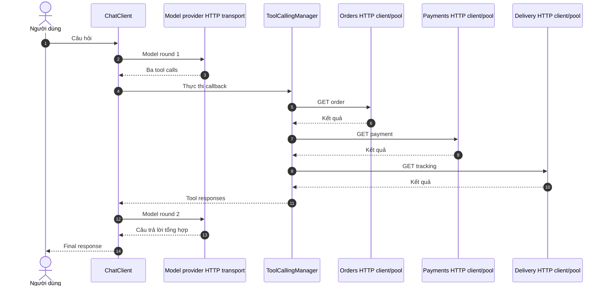
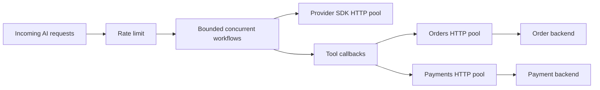

# Tái sử dụng client và quản lý connection pool

Trong Spring AI tool calling, một câu hỏi của người dùng có thể tạo nhiều lượt gọi mô hình. Mô hình có thể yêu cầu tra cứu đơn hàng, thanh toán và vận chuyển; ứng dụng thực thi các `ToolCallback`, truy cập nhiều dịch vụ HTTP rồi gửi các kết quả trở lại mô hình. Nếu mỗi lần xử lý đều tạo client và pool mới, hoặc nhiều request cạnh tranh một pool không được giới hạn phù hợp, ứng dụng có thể chậm, tốn socket, tăng lỗi timeout dù phần sinh câu trả lời của mô hình vẫn bình thường.

Trong module **SPRING_AI_TOOL_CALLING**, Spring AI hỗ trợ `ChatClient`, `@Tool`, `ToolCallback`, input schema và `ToolContext`. Tuy nhiên, **ứng dụng** chịu trách nhiệm thực thi công cụ, bảo vệ quyền trên dịch vụ ngoài, kiểm soát retry và tối ưu tài nguyên. Tái sử dụng client không chỉ giảm chi phí tạo đối tượng; nó còn giúp cấu hình thống nhất tracing, timeout, TLS, proxy và connection pooling.

Bài học sử dụng Spring AI **2.1.0** và các HTTP client của Spring/SDK làm bối cảnh. Ta phân biệt `ChatClient` với `ChatModel` và HTTP transport; dùng đúng bean lifecycle; cấu hình pool cho outbound tool calls; xác định timeout và concurrency budget; sau đó đo và kiểm thử dưới tải.

Sau bài học, bạn sẽ biết:

- Tại sao `ChatClient` và HTTP connection pool là **hai lớp khác nhau**.
- Cách tái sử dụng `ChatClient`, `RestClient`, `WebClient` và bean công cụ.
- Cách tránh lẫn dữ liệu người dùng khi nhiều request dùng chung client.
- Cách đặt `maxConnections`, giới hạn pending, idle/lifetime và timeout ở Reactor Netty.
- Cách xác minh transport của nhà cung cấp mô hình trước khi chỉnh pool.
- Cách xử lý streaming, cancellation, backpressure và retry để không giữ kết nối quá lâu.
- Cách đo hiệu năng và kiểm thử reuse, pool saturation, shutdown và lỗi kết nối.

## 1. Một request AI có thể tạo nhiều outbound requests

Giả sử người dùng hỏi: “Đơn ORD-104 đã thanh toán và giao tới đâu?”. Assistant có ba công cụ:

1. `orders_get_status` gọi order service.
2. `payments_get_status` gọi payment service.
3. `delivery_get_tracking` gọi logistics service.



Vì thế **một** `ChatClient.call()` có thể gồm nhiều HTTP requests tới model provider, và **mỗi tool callback** có thể phát thêm HTTP requests tới backend khác. Trong Spring AI 2.x, `DefaultToolCallingManager` duyệt các tool calls của cùng assistant response theo thứ tự; mô hình phát nhiều tool calls không tự biến callback thành concurrent execution. Nếu ứng dụng chủ động fan-out song song, số kết nối cần thiết sẽ khác.

## 2. Ba loại client cần phân biệt

| Lớp | Ví dụ | Điều gì được tái sử dụng? | Ai quản lý kết nối? |
|---|---|---|---|
| API ở tầng assistant | `ChatClient` | Prompt defaults, advisors, model reference, tool integration | Không phải connection pool |
| Model adapter/SDK | `ChatModel` và transport của provider | API/SDK object, HTTP transport, cấu hình model | SDK hoặc HTTP client của provider |
| Backend gọi bởi tool | `RestClient`, `WebClient`, MCP client | HTTP facade, codec, base URL, filters, connector | Request factory/connector hoặc SDK tương ứng |

**Không** suy ra pool của model provider là pool mà `WebClient` dùng để gọi order service. Trong Spring AI 2.1.0, OpenAI integration hiện có các thuộc tính timeout/retry và thống kê pool của **OkHttp** ở HTTP transport bên dưới OpenAI SDK. Các provider khác có cách triển khai khác nhau.

Tái sử dụng `ChatClient` tránh cấu hình lặp và tạo những object không cần thiết, nhưng muốn điều chỉnh số TCP connections phải tìm đúng transport và connection manager thực sự thực hiện HTTP request.

## 3. Vòng đời bean đề xuất

```text
Spring ApplicationContext
  ChatModel provider adapter
  ChatClient for order assistant
  ChatClient for support assistant
  Tool POJO / ToolCallback beans
  Order RestClient/WebClient
  Payment RestClient/WebClient
  ConnectionProvider / SDK-managed HTTP pools
  ObservationRegistry / Tracer

Request A -> new prompt + caller context A
Request B -> new prompt + caller context B
```

Spring AI tự cấu hình `ChatClient.Builder` có scope **prototype**, cho phép inject builder vào service rồi gọi `build()` một lần. Mẫu phổ biến:

```java
@Service
public final class OrderAssistantService {

    private final ChatClient client;
    private final OrderTools tools;

    public OrderAssistantService(
            ChatClient.Builder builder,
            OrderTools tools) {
        this.client = builder
            .defaultSystem("Bạn hỗ trợ tra cứu trạng thái đơn hàng.")
            .build();
        this.tools = tools;
    }

    public String answer(String question, CallerContext caller) {
        return client.prompt()
            .user(question)
            .tools(tools)
            .toolContext(Map.of("caller", caller))
            .call()
            .content();
    }
}
```

Đối tượng `ChatClient` được tái sử dụng trong bean service, còn **mỗi lần gọi** tạo prompt riêng và truyền `CallerContext` theo request. Không giữ `question` hoặc `caller` cuối cùng trong field mutable của singleton.

## 4. Không mutate chung một `ChatClient.Builder` theo request

Builder là đối tượng phục vụ quá trình xây dựng cấu hình, không phải kho state chia sẻ giữa các HTTP requests. Ví dụ nguy hiểm:

```java
// Tránh mẫu này: nhiều thread sửa cùng builder.
@Service
public class UnsafeAssistant {

    private final ChatClient.Builder mutableBuilder;

    public UnsafeAssistant(ChatClient.Builder mutableBuilder) {
        this.mutableBuilder = mutableBuilder;
    }

    public String answer(String question, String systemText) {
        ChatClient client = mutableBuilder
            .defaultSystem(systemText)
            .build();
        return client.prompt().user(question).call().content();
    }
}
```

Khi hai thread thay `defaultSystem` hoặc `defaultTools` trên cùng builder, cấu hình của hai requests có thể bị lẫn. Cách đúng là:

- Build client một lần cho một workflow có defaults cố định.
- Dùng `prompt().user(...)`, `prompt().system(...)` và `toolContext(...)` cho dữ liệu riêng từng lần gọi.
- Nếu cần nhiều workflows, tạo nhiều bean `ChatClient` phù hợp, không thay đổi bean chung lúc runtime.
- Với Spring Boot `RestClient.Builder` và `WebClient.Builder` cũng là **stateful/prototype**; tạo HTTP client một lần khi khởi tạo bean, hoặc dùng `clone()` cho biến thể cần thiết.

## 5. Nhiều `ChatClient` cùng một model

Spring AI cho phép tạo nhiều `ChatClient` cho một model, ví dụ:

```java
@Configuration(proxyBeanMethods = false)
public class AssistantClientsConfig {

    @Bean("lookupChatClient")
    ChatClient lookupChatClient(ChatClient.Builder builder) {
        return builder
            .defaultSystem("Chỉ hỗ trợ tra cứu thông tin được phép.")
            .build();
    }

    @Bean("supportChatClient")
    ChatClient supportChatClient(ChatClient.Builder builder) {
        return builder
            .defaultSystem("Hỗ trợ phân tích và soạn câu trả lời ticket.")
            .build();
    }
}
```

Hai bean có prompt/advisor defaults khác nhưng **có thể vẫn dùng cùng** `ChatModel` và transport của provider. Tách tên bean không đồng nghĩa tách HTTP pool.

Khi dùng nhiều loại `ChatModel`, cần lựa chọn hoặc định nghĩa builder tương ứng. Tạo `ChatClient.builder(chatModel)` trực tiếp có thể bỏ qua những phần autoconfiguration/customization mà Spring Boot vốn áp dụng, chẳng hạn observation hoặc `ChatClientBuilderCustomizer`. Hãy so sánh cấu hình thực tế nếu xây client thủ công.

## 6. Chia sẻ cấu hình nhưng không chia sẻ danh tính người dùng

Tái sử dụng client phải đi cùng cách ly state:

| Được tái sử dụng | Phải là dữ liệu riêng theo request |
|---|---|
| Config base URL, TLS/proxy, codecs | User/tenant đã xác thực |
| Model reference, static advisors | Message/prompt/conversation riêng |
| Stateless `@Tool` beans | `ToolContext` của request hiện tại |
| HTTP pool và thread-safe transport | Access token/caller headers theo request |
| MeterRegistry và tracing config | Correlation ID cho một workflow |

Không đặt access token hoặc `tenantId` của người dùng vào **default mutable headers** trên `RestClient`/`WebClient` dùng chung. Không lưu `lastUser`/`currentOrder` trong singleton callback. Caller identity phải đến từ backend authentication mỗi request, và service phải kiểm tra quyền trên từng tài nguyên trước khi trả dữ liệu.

Tương tự, thêm `.tools(...)` trên một request của `ChatClient` là thao tác bổ sung vào tập `.defaultTools(...)`. Đừng khai báo các tool có quyền cao làm default rồi cho rằng các requests chỉ-read không thể thấy chúng.

## 7. Tái sử dụng `RestClient` cho tool nghiệp vụ

Spring Boot auto-configure `RestClient.Builder` prototype, gồm request factory và converters phù hợp. Tạo client trong bean:

```java
@Configuration(proxyBeanMethods = false)
public class BackendClientsConfig {

    @Bean("ordersRestClient")
    RestClient ordersRestClient(RestClient.Builder builder) {
        return builder
            .baseUrl("https://orders.internal.example")
            .build();
    }
}
```

Gọi từ service:

```java
@Service
public final class OrderGateway {

    private final RestClient client;

    public OrderGateway(
            @Qualifier("ordersRestClient") RestClient client) {
        this.client = client;
    }

    public OrderStatusDto status(String orderId) {
        return client.get()
            .uri("/orders/{id}/status", orderId)
            .retrieve()
            .body(OrderStatusDto.class);
    }
}
```

Spring Boot khuyến nghị inject auto-configured builder để giữ converters, SSL và customizers. Tạo thẳng `RestClient.create()` có thể bỏ qua các cấu hình đó.

**Lưu ý:** `RestClient` là một facade, pool phụ thuộc `ClientHttpRequestFactory` và implementation đứng dưới (JDK HttpClient, Apache HttpComponents, Jetty...). Đừng mặc định tất cả `RestClient` đều dùng Reactor Netty hoặc có chung quy tắc pooling.

## 8. `WebClient` và tài nguyên chung của Reactor Netty

Với tool dùng WebFlux/reactive API, `WebClient` và Reactor Netty là một lựa chọn. Spring Boot cung cấp `WebClient.Builder` prototype; build một client rồi tái sử dụng.

Theo Spring Framework, `HttpClient.create()` của Reactor Netty sử dụng global resources gồm event loops và connection pool. Đây thường là lựa chọn tốt khi server có cùng vòng đời với application process. Không nhất thiết phải tạo custom pool chỉ vì “cần tái sử dụng client”.

Nếu cần **cô lập backend** hoặc đo thấy pending queue/latency bất thường, có thể cấu hình `ConnectionProvider` riêng. Ví dụ tiếp theo chỉ cấu hình **WebClient outbound tới order service**, không chỉnh HTTP transport của model SDK.

## 9. Một custom `ConnectionProvider` có giới hạn

```java
import java.time.Duration;

import io.netty.channel.ChannelOption;
import org.springframework.context.annotation.Bean;
import org.springframework.context.annotation.Configuration;
import org.springframework.http.client.reactive.ReactorClientHttpConnector;
import org.springframework.web.reactive.function.client.WebClient;
import reactor.netty.http.client.HttpClient;
import reactor.netty.resources.ConnectionProvider;

@Configuration(proxyBeanMethods = false)
public class OrdersWebClientConfig {

    @Bean(destroyMethod = "dispose")
    ConnectionProvider orderConnectionPool() {
        return ConnectionProvider.builder("orders-backend")
            .maxConnections(40)
            .pendingAcquireMaxCount(80)
            .pendingAcquireTimeout(Duration.ofSeconds(3))
            .maxIdleTime(Duration.ofSeconds(20))
            .maxLifeTime(Duration.ofMinutes(2))
            .metrics(true)
            .build();
    }

    @Bean("ordersWebClient")
    WebClient ordersWebClient(
            WebClient.Builder builder,
            ConnectionProvider orderConnectionPool) {

        HttpClient transport = HttpClient.create(orderConnectionPool)
            .option(ChannelOption.CONNECT_TIMEOUT_MILLIS, 2_000)
            .responseTimeout(Duration.ofSeconds(8));

        return builder
            .baseUrl("https://orders.internal.example")
            .clientConnector(new ReactorClientHttpConnector(transport))
            .build();
    }
}
```

`40` connections, `80` pending, `3s` acquire và `8s` response là **số ví dụ**, không phải cấu hình tối ưu cho mọi ứng dụng. Test trên môi trường tương tự production và tuân thủ giới hạn upstream.

Bean `ConnectionProvider` được ứng dụng sở hữu nên đóng tại shutdown. Không `dispose()` trong mỗi callback vì các request khác vẫn dùng pool đó.

## 10. Hiểu từng tham số pool

| Cấu hình | Tác dụng | Sai lầm thường gặp |
|---|---|---|
| `maxConnections` | Giới hạn số kết nối pool | Tăng rất cao khi upstream chậm |
| `pendingAcquireMaxCount` | Số request được phép xếp hàng chờ connection | Đặt vô hạn rồi cạn memory |
| `pendingAcquireTimeout` | Deadline lấy được connection rảnh | Nhầm với TCP connect timeout |
| `maxIdleTime` | Thời gian kết nối được phép idle | Dài hơn timeout của proxy/upstream |
| `maxLifeTime` | Tuổi thọ tối đa của kết nối | Không cân nhắc rotation/giới hạn server |
| `evictInBackground` | Quét/dọn connection đã quá hạn | Bật quá thường gây overhead |
| `metrics(true)` | Bật Micrometer metrics của pool | Tưởng mọi model SDK đều xuất các metrics này |

Connection pool thường được phân hoạch theo remote host/port trong provider. Với HTTP/2, một TCP connection có thể mang nhiều HTTP streams, nên **số request đồng thời không nhất thiết bằng số TCP connections**.

Default pool sizing thay đổi theo thư viện và phiên bản; không sao chép một con số mặc định từ bài viết cũ rồi xem đó là tiêu chuẩn cố định.

## 11. Phân biệt các timeout

Một HTTP request trải qua nhiều pha:

```text
queue/pool acquire
    -> DNS
    -> TCP connect
    -> TLS handshake
    -> send request
    -> wait response
    -> read response/stream
    -> release/close connection
```

| Timeout | Bảo vệ giai đoạn |
|---|---|
| Acquire timeout | Thời gian đợi connection từ pool |
| Connect timeout | Thời gian thiết lập TCP connection |
| TLS handshake timeout | Thời gian bắt tay TLS nếu được cấu hình |
| Response timeout | Thời gian chờ phản hồi ở transport |
| Overall deadline | Toàn bộ request hoặc workflow gồm nhiều model/tool calls |
| Streaming idle timeout | Khoảng chờ quá dài giữa các dữ liệu streaming, tùy protocol |

`responseTimeout(8s)` trong ví dụ không đồng nghĩa một `ChatClient.call()` có deadline 8 giây. Một tool loop có thể gồm nhiều vòng model và nhiều callback, cộng thêm thời gian xếp hàng.

Một chiến lược tốt là đặt **deadline tổng** cho workflow, rồi cung cấp **remaining budget** cho mỗi chặng. Tránh kiểu mỗi tầng cho retry tối đa và timeout lớn khiến toàn request vượt mức người dùng có thể chấp nhận.

## 12. Ước lượng pool capacity bằng tải thực tế

Little's Law cho ước lượng ban đầu:

```text
average in-flight requests ≈ requests/second × average latency (seconds)
```

Ví dụ order service nhận 40 requests/giây, mỗi request giữ connection trung bình 0,25 giây. Trung bình có khoảng `40 × 0,25 = 10` yêu cầu in-flight.

`10` **không phải giá trị pool nên đặt ngay**. Cần tính peak/burst, p95/p99 latency, số service hosts, HTTP/2 multiplexing, connection reuse và thời gian backend bị chậm. Tăng headroom có kiểm soát nhưng không dùng pool quá lớn để che upstream overload.

Số user online cũng không phải số connection cần có. Một user có thể chỉ đọc UI không giữ outbound connection; một workflow khác lại gọi nhiều service.

## 13. Pool không thay thế concurrency limit

Một pool `40` connection không tự giới hạn tổng số workflow. Nếu hàng nghìn requests dồn vào, queue vẫn có thể quá dài.

Các lớp giới hạn nên phối hợp:

1. API rate limit theo caller/tenant.
2. Giới hạn concurrent ChatClient/model requests.
3. Pool acquire queue của từng backend.
4. Quota/rate limit của model provider hoặc API ngoài.
5. Retry budget và exponential backoff.
6. Deadline tổng cùng chính sách backpressure.



Nếu latency upstream tăng, việc nâng `maxConnections` quá mạnh có thể làm backend chậm hơn. Một chính sách từ chối nhanh hoặc trả `429`/`503` có kiểm soát thường tốt hơn queue không giới hạn.

## 14. Ví dụ giới hạn blocking workflows theo instance

```java
@Service
public class BoundedAssistant {

    private final ChatClient client;
    private final Semaphore permits = new Semaphore(24);

    public BoundedAssistant(ChatClient.Builder builder) {
        this.client = builder.build();
    }

    public String ask(String question) {
        boolean acquired = false;

        try {
            acquired = permits.tryAcquire(2, TimeUnit.SECONDS);
            if (!acquired) {
                throw new TooManyAiRequestsException();
            }

            return client.prompt()
                .user(question)
                .call()
                .content();
        }
        catch (InterruptedException ex) {
            Thread.currentThread().interrupt();
            throw new IllegalStateException("Interrupted", ex);
        }
        finally {
            if (acquired) {
                permits.release();
            }
        }
    }
}
```

Đây là ví dụ blocking **trong một JVM**, không giới hạn cả cụm. Nhiều pods cần rate limiter hoặc policy toàn hệ thống. Với `Flux` reactive, đừng acquire/release permit trong `try/finally` bao quanh việc **tạo** publisher lazy: lệnh thực sự chạy khi subscribe. Cần quản lý permit ở subscribe/termination/cancellation và không block event loop.

## 15. Streaming giữ connection lâu hơn

Với `ChatClient.stream()`, provider có thể trả dữ liệu qua một kết nối kéo dài hàng chục giây hoặc lâu hơn. Hãy theo dõi:

- Số stream đang mở và thời lượng.
- Time to first token (TTFT) và khoảng idle bất thường.
- Cancellation khi người dùng đóng SSE connection.
- Backpressure và giới hạn buffer.
- Số concurrent streams, nếu backend hỗ trợ HTTP/2.
- Việc hoàn tất/lỗi của stream có thực sự release/close connection không.

Không tính mỗi chunk như một HTTP request. Không tạo pool cho mỗi chunk. Không coi việc client cancel SSE đồng nghĩa một tool có side effect đã rollback: callback ghi dữ liệu cần idempotency và state riêng.

## 16. Pool của model provider không nhất thiết là pool của tool

Spring AI 2.1.0 có nhiều model adapters; transport của chúng tùy vào provider/SDK. Ví dụ tài liệu **OpenAI Chat** hiện hành có các thuộc tính:

```properties
# Ví dụ cấu hình riêng cho Spring AI OpenAI integration:
spring.ai.openai.timeout=60s
spring.ai.openai.max-retries=3
spring.ai.openai.connection-pool-metrics-enabled=true
```

Theo tài liệu, property cuối cho phép ghi metrics connection pool của **OkHttp client bên dưới OpenAI SDK**. Nó không chỉnh pool Reactor Netty mà `WebClient` dùng để gọi order service.

Lưu ý:

- `spring.ai.openai.*` dành cho adapter OpenAI trong phiên bản tài liệu tương ứng, không phải cấu hình chung cho mọi nhà cung cấp.
- Một số provider có metrics, retry và pool settings riêng.
- Trước khi tuning hãy xác minh provider/SDK/version đang dùng, transport cụ thể và ai sở hữu vòng đời.
- Không tạo một `WebClient` mới để “tuning model HTTP” nếu model SDK thực tế không dùng client đó.
- Không mặc định tất cả outbound HTTP connections đều nằm trong cùng một pool.

## 17. Retry có thể làm cạn connection pool nhanh hơn

Một lỗi timeout có thể bị retry ở nhiều tầng:

```text
HTTP client attempts
  × Tool adapter attempts
  × Model re-requests
  × Worker or gateway redeliveries
= Số lượt gọi downstream thực tế có thể tăng mạnh
```

Nếu một model request tạo ba tool calls, mỗi backend tự retry vài lần, sau đó model lại yêu cầu một tool do chưa thấy kết quả thì tổng số request lên service có thể lớn hơn nhiều so với số câu hỏi của người dùng.

Chính sách nên có:

1. Một tầng chính chịu trách nhiệm retry theo từng loại lỗi.
2. Giới hạn tổng attempts, deadline, backoff và jitter.
3. Tôn trọng `Retry-After` khi upstream trả `429` nếu hợp đồng API hỗ trợ.
4. Không retry lỗi validation, authorization hoặc business rejection.
5. Không coi HTTP timeout là bằng chứng tool ghi dữ liệu chưa chạy.
6. Có idempotency key cho mọi hành động tạo side effect.

Khi pool pending tăng, retry ngay có thể làm vấn đề nghiêm trọng hơn. Hãy kiểm tra queue và retry metrics trước khi tăng `maxConnections`.

## 18. Tái sử dụng client không thay thế idempotency

Ví dụ tool `payments_execute_refund` gọi payment gateway. Shared HTTP client giúp giảm handshake và giữ một số resource ổn định, nhưng không bảo đảm không hoàn tiền hai lần.

Luồng nghiệp vụ cần:

- Proposal/operation ID do server tạo.
- Caller identity từ `ToolContext` và authorization trên payment hiện tại.
- Kiểm tra trạng thái/version trước khi thực hiện.
- Dùng downstream idempotency key ổn định qua retry.
- Nếu mất response sau timeout, tra cứu operation ID hoặc reconciliation thay vì gửi lệnh mới tùy ý.
- Lưu receipt và business outcome ở durable ledger.

Không nhét user token hoặc tenant của request A vào default headers của singleton HTTP client. Nếu backend cần token theo user, đặt header **theo request** sau khi xác thực. Với token do service account dùng chung, áp dụng quyền ở service đích và không biến service credential thành quyền vô hạn của model.

## 19. Pool metrics của Reactor Netty

Khi bật `metrics(true)` trên `ConnectionProvider` của Reactor Netty, Micrometer có thể hiển thị các metrics:

```text
reactor.netty.connection.provider.total.connections
reactor.netty.connection.provider.active.connections
reactor.netty.connection.provider.idle.connections
reactor.netty.connection.provider.pending.connections
reactor.netty.connection.provider.max.connections
reactor.netty.connection.provider.pending.connections.time
reactor.netty.http.client.connect.time
reactor.netty.http.client.response.time
```

Đây là metrics của **Reactor Netty**; nó không tự động đại diện cho `RestClient` dùng Apache HttpClient hoặc OpenAI SDK dùng OkHttp. Với model provider có SDK transport riêng, dùng metrics của adapter/provider đó nếu có.

Spring AI còn có các observation ở tầng logic:

| Observation | Phạm vi |
|---|---|
| `spring.ai.chat.client` | Một ChatClient call/stream |
| `gen_ai.client.operation` | Mỗi model call trong vòng lặp |
| `spring.ai.tool` | Mỗi lần thực thi callback |

Khi điều tra request chậm, kết hợp model/tool spans với pool metrics. Nếu `spring.ai.tool` chậm nhưng backend response time thấp và `pending.connections.time` cao, có thể bottleneck nằm ở **chờ connection** chứ không phải logic của service.

## 20. Đọc các triệu chứng pool saturation

| Tín hiệu | Có thể hàm ý | Nên xem thêm |
|---|---|---|
| `active.connections` gần `max.connections` | Pool gần capacity | Pending, latency, số stream |
| `pending.connections` tăng | Nhiều request chờ acquire | Arrival rate, upstream response latency |
| Pending acquire p95 tăng | Pool contention | Backend duration, timeout, queue limit |
| `idle.connections` gần 0 | Ít connection nhàn rỗi | Có thể bình thường dưới tải cao |
| `connect.time` tăng | Kết nối mới chậm | DNS, TCP, TLS, proxy, network |
| `response.time` tăng, pending thấp | Upstream trả chậm | CPU/DB/provider latency |
| `total.connections` không giảm | Pool giữ idle connections hoặc nghi leak | Max idle/lifetime, release semantics |
| Nhiều TCP connections ở `TIME_WAIT` | Connection churn | Client được tạo liên tục, keep-alive, upstream close |

Không kết luận connection leak chỉ từ một số liệu `total.connections`. Pool có thể giữ idle connections để tái sử dụng; streams dài có thể giữ active connections một cách hợp lệ. Cần xem timeline, trạng thái kết nối, traffic, queue và thời điểm shutdown.

## 21. Response lifecycle và connection leak

Thông thường, HTTP connection được trả về pool sau khi body được consume hoặc resource được giải phóng đúng theo API. Những lỗi thường gặp:

- Dùng low-level HTTP client nhưng quên đóng response body hoặc stream.
- Tạo response streaming nhưng không subscribe/không xử lý cancellation.
- Tạo transport/connection provider trong mỗi tool callback.
- Giữ `ClientResponse` hoặc byte buffers trong cache lâu không cần thiết.
- Làm blocking I/O trên Reactor event-loop, khiến việc đọc/đóng response bị nghẽn.
- Dùng pool mới theo từng tenant/request rồi không đóng chúng.

Với `RestClient` và `WebClient` API `retrieve()`, framework thường quản lý lifecycle khi body được tiêu thụ đúng hợp đồng. Với raw response, `exchange()` hoặc stream tuỳ biến, cần đọc API release của chính phiên bản đang dùng.

Đừng “chữa leak” chỉ bằng `maxConnections=10000`: điều đó có thể kéo dài thời gian trước khi cạn sockets và file descriptors, nhưng không loại bỏ nguyên nhân.

## 22. Quản lý shutdown của connection pool

Pool custom nên được Spring sở hữu và đóng khi context dừng:

```java
@Bean(destroyMethod = "dispose")
ConnectionProvider paymentConnectionPool() {
    return ConnectionProvider.builder("payment-backend")
        .maxConnections(20)
        .maxIdleTime(Duration.ofSeconds(30))
        .build();
}
```

Không gọi `dispose()` trong từng request vì các callbacks khác có thể đang dùng chung pool.

Reactor Netty còn có **global resources** trong `HttpResources`. Không gọi global dispose từ một tool bean nếu các HTTP clients khác trong JVM còn dùng event loops/connections đó. Với ứng dụng có Spring context được start/stop nhiều lần trong một JVM, hãy cân nhắc `ReactorResourceFactory` do Spring quản lý.

Nếu SDK provider hoặc ứng dụng tự tạo `ExecutorService`, dispatcher hay client transport riêng, cần biết thành phần nào chịu trách nhiệm `shutdown`. Một cấu hình auto-managed không nhất thiết giống custom transport tự tạo.

## 23. Một pool dùng chung hay nhiều pool riêng?

| Thiết kế | Ưu điểm | Mặt trái |
|---|---|---|
| Dùng tài nguyên chung theo framework | Ít thread/object, reuse tốt, đơn giản | Không cô lập tuyệt đối khi downstream bị nghẽn |
| Pool riêng cho order/payment | Quota độc lập, dễ đo saturation mỗi backend | Phải quản lý lifecycle, tăng cấu hình |
| Pool riêng cho mỗi request | Gần như không có lợi ích | TCP/TLS churn, tốn socket, khó shutdown |
| Pool riêng cho từng tenant | Có thể phục vụ isolation đặc biệt | Bùng nổ số pool/metrics/cardinality |
| Một client có default auth header thay đổi theo user | Trông có vẻ tiện | Có nguy cơ lộ token/caller giữa các requests |

Bắt đầu bằng client/transport auto-configured của framework. Tạo pool riêng khi có bằng chứng từ metrics hoặc có yêu cầu cách ly rõ ràng. **Cách ly kết nối** không thay thế **cách ly dữ liệu và authorization** của mỗi request.

## 24. Test client reuse và request isolation

Các test trước tiên phải xác minh tính ổn định của object lifecycle:

| Kịch bản | Assertion |
|---|---|
| 100 requests gọi cùng assistant service | Client được build khi cấu hình, không trong từng request |
| Hai user khác tenant cùng gọi tool | `ToolContext` và kết quả không lẫn |
| Hai request có system prompt riêng | Không mutate cùng builder shared |
| Default tools vs request tools | Không lộ tool nhạy cảm ngoài workflow |
| HTTP gateway gọi lại nhiều lần | Không tạo `RestClient`/`WebClient` mới trong callback |
| Một request fail | Client/pool vẫn phục vụ request khác |

Một test ứng dụng với fake model và tool spy:

```java
@Test
void eachRequestKeepsItsOwnCallerContext() {
    CallerContext alice = caller("tenant-a", "alice");
    CallerContext bob = caller("tenant-b", "bob");

    assistant.answer("Đơn của tôi?", alice);
    assistant.answer("Đơn của tôi?", bob);

    assertThat(toolSpy.seenCallers()).containsExactly(alice, bob);
}
```

`caller` và `toolSpy` là fixtures của test, không phải API Spring AI. Ngoài test tuần tự, cần chạy song song để phát hiện singleton callback giữ mutable field “current caller”. Test phải kiểm tra service authorization thật, không chỉ việc prompt có nhãn tenant.

## 25. Kiểm thử connection reuse bằng HTTP test server

Dùng một mock HTTP server như WireMock, MockWebServer hoặc Reactor Netty test server:

1. Khởi động backend trên một cổng cố định.
2. Tạo `WebClient` và `ConnectionProvider` **một lần** trong test context.
3. Gửi 20–50 requests tuần tự, consume toàn bộ body.
4. Ghi số kết nối được thiết lập, active/idle/total connections, HTTP successes.
5. Tăng concurrency để tạo thời điểm pool gần capacity.
6. Shutdown context rồi kiểm tra lifecycle.

Không assert “50 requests chắc chắn dùng đúng 1 TCP connection” cho mọi transport: server/proxy có thể đóng keep-alive, HTTP/2 có multiplexing, và connection policy phụ thuộc adapter. Hãy kiểm tra xu hướng giảm connection churn cùng cấu hình phù hợp, và rằng **active connections không vượt giới hạn pool** trong trường hợp được định nghĩa.

## 26. Kiểm thử saturation, pending và acquire timeout

Tạo pool nhỏ và backend cố ý giữ response:

```java
ConnectionProvider provider = ConnectionProvider.builder("test-pool")
    .maxConnections(2)
    .pendingAcquireMaxCount(2)
    .pendingAcquireTimeout(Duration.ofMillis(200))
    .build();
```

Phát nhiều HTTP requests đồng thời hơn capacity. Các kết quả cần quan sát:

- Một số calls chiếm connections.
- Một số calls chờ acquire.
- Khi pending queue đầy hoặc timeout, request bị từ chối/lỗi có kiểm soát.
- Khi backend hoàn tất, connection được reuse.
- Không còn task/connection treo vô hạn sau cancellation.

Loại exception cụ thể có thể khác giữa các phiên bản Reactor Netty. Test error category và chính sách xử lý hơn là so exact message không cần thiết. Dùng latch/barrier hoặc backend delay được điều khiển, tránh dựa vào `Thread.sleep` gây flaky tests.

## 27. Kiểm thử streaming và cancellation

Fake model hoặc backend trả stream nhiều chunks. Client hủy sau một số chunks:

- Subscriber nhận tín hiệu cancel.
- Client transport giải phóng hoặc đóng connection đúng cách.
- Active/pending metrics trở về mức ổn định sau cleanup.
- Không đếm mỗi chunk thành một model call.
- Stream không giữ buffer tăng không giới hạn.
- Tool có side effect đã chạy vẫn được ghi vào workflow ledger, không giả định rollback.

Với `ChatClient.stream()`, hãy phân biệt kiểm thử **model aggregation/tool loop** với kiểm thử **HTTP transport**. Fake `ChatModel` giúp kiểm tra số rounds, còn mock HTTP backend giúp đo pool thật mà không tiêu token của provider.

## 28. Benchmark công bằng trước và sau

| Chỉ số | Mục tiêu so sánh |
|---|---|
| p50/p95/p99 latency | Giảm overhead/queue không làm giảm success rate |
| Connection creation rate | Ít TCP/TLS handshakes hơn khi reuse |
| Active/pending connections | Không tạo backlog vô hạn |
| CPU, heap, direct memory | Không tăng ngoài dự kiến |
| HTTP timeout/retry rate | Không có retry storm |
| Model rounds/total tokens | Workflow logic không thay đổi ngoài ý muốn |
| Tool success/error rate | Business correctness giữ nguyên |
| Throughput ở peak load | Hệ thống chịu được burst hợp lý |

Warm up JVM và pool trước khi đo; giữ request mix, payload, tỷ lệ tool calls/streaming tương đương. Nếu model provider được gọi thật, latency và nội dung sinh có thể biến động; dùng fake model khi cần cô lập riêng hiệu ứng pooling.

Tái sử dụng client **không trực tiếp giảm token usage** của mô hình. Nó giảm overhead kết nối/configuration. Muốn giảm token cost, cần tối ưu context size, số model rounds, kích thước tool results và retry.

## 29. Khi nào cache giúp hơn tăng maxConnections?

Connection pooling giảm chi phí thiết lập kết nối, nhưng mỗi cache miss vẫn đi tới backend. Với những tool đọc được gọi lặp:

- Catalog khóa học công khai: có thể cache theo TTL.
- Đơn hàng của người dùng: cache key cần tenant/owner/scope và chính sách invalidation.
- Giá/tồn kho: phải kiểm tra độ mới trước hành động ghi.
- Side effect: không dùng cache theo input đơn thuần thay idempotency ledger.

Một truy vấn backend chậm do SQL tốn tài nguyên sẽ không tự nhanh lên khi tăng pool. Đôi khi giải pháp là tối ưu query, giới hạn dữ liệu trả về, batching hoặc caching đúng phạm vi.

## 30. Những lỗi thiết kế thường gặp

| Triệu chứng | Nguyên nhân | Cách khắc phục |
|---|---|---|
| Mỗi request tạo mới HTTP client | Tạo client trong callback | Build bean một lần và inject |
| Latency cao do chờ socket | Pool quá nhỏ hoặc upstream chậm | Đo pending acquire/response rồi tuning |
| File descriptors/socket tăng không giảm | Chưa release response hoặc chưa dispose custom pool | Đúng response lifecycle và shutdown |
| Model request chậm nhưng order pool không bận | Đang quan sát sai transport | Đo riêng SDK model pool và tool HTTP pool |
| Cùng client làm lẫn user token | Default header mutable trên singleton | Set auth headers theo request |
| Tăng maxConnections làm upstream quá tải | Không có concurrency/rate limit | Bounded concurrency và backpressure |
| HTTP timeout tạo thanh toán hai lần | Retry side effect không có idempotency | Dùng operation ID/reconciliation |
| Stream cancel nhưng active còn lâu | Chưa xử lý cancel hoặc backend còn đọc | Verify transport lifecycle và deadline |
| Metrics báo mỗi chunk là một model request | Sai điểm instrumentation | Đếm model exchange/stream completion |
| Shutdown một pool làm nhiều client lỗi | Global dispose khi pool còn được dùng chung | Quản lý owner/lifecycle đúng |

## 31. Checklist triển khai

- Xác định đủ ba tầng: `ChatClient`, model SDK HTTP transport, tool outbound HTTP clients.
- Dùng `ChatClient.Builder` được Spring AI auto-configure; build theo workflow, không theo request.
- Giữ caller/session/`ToolContext` trong từng prompt, không trong mutable singleton fields.
- Inject `RestClient.Builder`/`WebClient.Builder` của Boot và build client trong bean.
- Không giả định mọi transport dùng Reactor Netty; xác minh implementation/version.
- Tận dụng pool mặc định nếu đủ; chỉ custom khi có số liệu hoặc yêu cầu isolation.
- Giới hạn active connections, pending queue và acquire timeout.
- Đặt connect/response timeout và overall workflow deadline rõ ràng.
- Phối hợp rate limits, concurrency limits và retry budget.
- Không block Reactor event-loop; quản lý reactive cancellation đúng lifecycle.
- Không đưa token/identity người dùng vào default headers của shared client.
- Với tool ghi, dùng authorization và idempotency; timeout không chứng minh thất bại.
- Bật pool metrics ở đúng transport; quan sát active/idle/pending và p95/p99 latency.
- Đóng pools/executors do ứng dụng sở hữu; không tự dispose global resources đang được dùng.
- Kiểm thử reuse, saturation, timeout, streaming, startup/shutdown và tenant isolation.

## 32. Ghi nhớ

- **Tái sử dụng `ChatClient` không đồng nghĩa đã tối ưu HTTP connection pool.** Pool phải chỉnh ở transport thực tế.
- Spring AI cung cấp `ChatClient.Builder` prototype; nên build client một lần theo workflow và dùng prompt riêng cho mỗi request.
- Spring Boot `RestClient.Builder`/`WebClient.Builder` cũng stateful/prototype; không mutate chung khi nhiều requests chạy đồng thời.
- Pool hiệu quả cần **bounded connections, bounded pending queue, timeout và lifecycle rõ**.
- HTTP/2 và streaming khiến số connection không luôn bằng số HTTP requests in-flight.
- Retry nhiều tầng có thể gây bão traffic; công cụ ghi phải có idempotency.
- Metrics Reactor Netty chỉ phản ánh Reactor Netty; provider SDK có công cụ quan sát riêng.
- Reuse client giảm overhead, còn token cost phụ thuộc model rounds, context, tool results và retry.
- Tái sử dụng client phải giữ cách ly `ToolContext`, quyền và dữ liệu theo từng người dùng.

Khi tối ưu Spring AI tool calling, hãy xác định **client nào đang gửi request đến đâu** trước khi thay tham số. Giữ client sống đúng vòng đời ứng dụng, cấu hình pool theo số liệu thật, giới hạn backlog và retry, rồi kiểm thử dưới tải. Hiệu năng tốt chỉ có ý nghĩa khi các callback vẫn bảo đảm quyền, tính lũy đẳng và kết quả nghiệp vụ chính xác.

## Tài liệu tham khảo

- [Spring AI 2.1 — Chat Client API](https://docs.spring.io/spring-ai/reference/api/chatclient.html)
- [Spring AI 2.1 — OpenAI Chat: Connection Properties và Pool Metrics](https://docs.spring.io/spring-ai/reference/api/chat/openai-chat.html)
- [Spring AI — Tool Calling](https://docs.spring.io/spring-ai/reference/api/tools.html)
- [Spring Boot — Calling REST Services](https://docs.spring.io/spring-boot/reference/io/rest-client.html)
- [Spring Framework — WebClient Configuration và Reactor Netty Resources](https://docs.spring.io/spring-framework/reference/web/webflux-webclient/client-builder.html)
- [Reactor Netty — HTTP Client Connection Pool and Metrics](https://projectreactor.io/docs/netty/release/reference/http-client.html)
