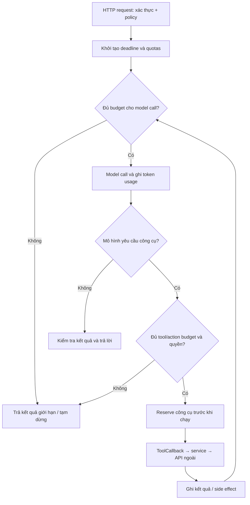

# Đặt ngân sách thời gian, token và số hành động

Trong Spring AI Tool Calling, một lượt người dùng không nhất thiết tương ứng với một lần gọi mô hình. `ChatClient` có thể nhận yêu cầu, gọi mô hình lần một, thực thi `ToolCallback`, đưa kết quả công cụ trở lại mô hình rồi tiếp tục nhiều vòng. Một chuỗi hợp lệ nhưng không bị giới hạn có thể tạo hàng chục lượt model, hàng trăm API calls, nhiều truy vấn đắt tiền và độ trễ vượt xa khả năng chịu đựng của người dùng.

Ví dụ yêu cầu “kiểm tra tồn kho, so sánh ba phương án giao hàng và lập đơn giúp tôi”: một mô hình có thể gọi lặp `inventory_check`, `shipping_quote` hoặc `orders_create`. Nếu mỗi vòng lại thử một phương án mà không có điều kiện dừng, vấn đề không chỉ là chi phí token; thao tác ghi dữ liệu có thể xảy ra ngoài dự kiến. Trong dự án Spring AI, **ứng dụng sở hữu việc thực thi tool** và phải quyết định trước một yêu cầu được tiêu tốn tối đa bao nhiêu thời gian, token và hành động.

Bài học xây dựng một **budget policy** cho từng request/turn và workflow, phân biệt quota của provider với hạn mức của ứng dụng, hướng dẫn dùng giới hạn `ToolCallingManager` trong các phiên bản hỗ trợ, bổ sung deadline/usage guard và kiểm thử các trường hợp vượt ngân sách. Các con số trong ví dụ là **số minh họa**, không phải mặc định hay khuyến nghị cố định cho mọi sản phẩm.

## Ba ngân sách khác nhau nhưng liên quan với nhau

| Trục ngân sách | Câu hỏi cần trả lời | Đơn vị | Điểm kiểm soát chính |
| --- | --- | --- | --- |
| **Thời gian** | Người dùng có thể chờ đến lúc nào? | ms, giây, deadline | Entry point, từng lần gọi model, HTTP tool/SDK, retry và queue. |
| **Token** | Một lượt được tiêu thụ bao nhiêu input/output tokens? | tokens hoặc chi phí ước tính | Trước mỗi model call, sau khi nhận `Usage`, tổng qua các vòng. |
| **Số hành động** | Cho phép bao nhiêu model/tool invocations và side effects? | Lượt gọi, weighted units | `ToolCallingManager`, request guard, gateway nghiệp vụ. |

Không dùng số tool calls để thay thế thời gian: một công cụ có thể mất 20 giây dù chỉ gọi một lần. Không dùng `maxTokens` của model để thay thế tổng ngân sách token: nó thường là giới hạn **output của một lần gọi**, trong khi vòng tool calling có nhiều lần gọi với lịch sử tăng dần. Không dùng giới hạn tool calls để quyết định giao dịch được thực hiện: một lần `capturePayment` đã đủ gây side effect.

Một chính sách có thể bổ sung ngân sách **chi phí tiền**, **số lần thử retry**, **lưu lượng đồng thời** và **quota theo tenant/user**. Các giới hạn đó được kiểm soát ở nhiều tầng, không phải tất cả nằm trong `ChatOptions`.

### Ví dụ policy cho một yêu cầu tra cứu

Giả sử endpoint trợ lý tra đơn hàng sử dụng profile `standard-read`:

```yaml
app:
  ai:
    budgets:
      standard-read:
        total-duration: 12s
        model-calls: 4
        total-tokens: 6000
        max-output-tokens-per-model-call: 600
        total-tool-calls: 5
        max-calls-per-tool: 3
        max-side-effect-actions: 0
        max-parallel-tool-calls: 2
```

Đây là **cấu hình của ứng dụng** (`app.ai.budgets.*`), **không phải property có sẵn của Spring AI**. Bạn phải viết policy binder/validation và các guard tương ứng. `max-side-effect-actions=0` phù hợp luồng chỉ đọc; một luồng hủy đơn cần profile riêng, quyền riêng và cơ chế approval/idempotency.

Một request có thể dừng trước khi dùng hết budget. Budget là **trần**, không phải mục tiêu để mô hình cố sử dụng đủ. Prompt nên khuyến khích chỉ gọi tool khi cần, nhưng kiểm soát cuối cùng phải ở backend, không dựa vào lời nhắc “hãy dừng sau ba lần”.

## Xác định đúng phạm vi ngân sách

Từ “một lượt” có thể mang nhiều nghĩa. Hãy định nghĩa rõ phạm vi trước khi đặt ngưỡng:

| Phạm vi | Ví dụ | Lưu trữ và đặt giới hạn |
| --- | --- | --- |
| **Một model call** | Lượt suy luận trước một lần tool execution | `maxTokens` / request timeout / response `Usage`. |
| **Một ChatClient turn** | Một `.prompt().call()` có nhiều model/tool iterations | Deadline, tổng model calls, tokens, tool calls. |
| **Một conversation/session** | Nhiều lần người dùng hỏi trong cùng cuộc hội thoại | Tổng token/cost theo session, làm mới theo cửa sổ rõ ràng. |
| **Một workflow nghiệp vụ** | Chuỗi hủy đơn/hoàn tiền qua nhiều request và restart | Tổng side effects/retries, operation ledger, deadline dài hơn HTTP request. |
| **User/tenant/project** | Quota theo ngày/tháng của tổ chức | Shared/distributed quota store, rate limit, billing/audit. |
| **Provider/account** | Rate limit hoặc credit từ nhà cung cấp model | Cơ chế rate limiter, theo dõi quota và response headers. |

Một `ToolCallingManager` dùng chung có thể tính số tool calls trong **turn hiện tại**, nhưng không tự duy trì ngân sách theo tháng cho tenant, không đảm bảo deadline và không thay thế operation ledger cho workflow nhiều bước. Nếu người dùng tạo hai request song song, mỗi request có thể tuân thủ `maxTotalToolCalls=5` mà tổng tenant vẫn vượt 5. Muốn giới hạn toàn tenant, cần quota store có phép cập nhật nguyên tử.

Không dùng `conversationId` làm `traceId` hay dùng tool call ID của provider làm idempotency key. Khi việc thực thi kéo dài qua restart, `workflowId` mới là định danh nghiệp vụ bền vững; ngân sách còn lại của workflow phải được đọc từ nơi lưu bền vững.

## Hard limit, soft limit và cách xử lý khi hết ngân sách

Một hệ thống cần phân biệt các mức:

| Loại | Mục đích | Cách hành xử |
| --- | --- | --- |
| **Soft threshold** | Cảnh báo trước khi đến trần | Thu gọn context/tool result, giảm tìm kiếm, ưu tiên câu trả lời tóm tắt. |
| **Hard limit** | Không cho phép một hoạt động mới vượt budget | Kiểm tra trước khi gọi model/tool hoặc bắt đầu side effect, từ chối/hoãn. |
| **Safety limit** | Bảo vệ dữ liệu và quyền bất kể budget còn bao nhiêu | Luôn kiểm tra authorization, tenant, approval và trạng thái nghiệp vụ. |
| **Provider limit** | Nhà cung cấp từ chối do quota/rate limit | Xử lý 429, retry sau hạn phù hợp, circuit breaker; không coi là toàn bộ policy của ứng dụng. |

Đến hard limit, không được cho mô hình thêm một vòng chỉ để “giải thích rằng đã hết token” nếu vòng đó lại vi phạm cùng budget. Một số sản phẩm có thể dành trước một khoản output nhỏ cho câu trả lời kết thúc; khi khoản đó không còn, trả một kết quả định trước từ ứng dụng như “Chưa thể hoàn tất trong giới hạn hiện tại” kèm trạng thái đã xác minh.

Không tự động coi **đã hết ngân sách** là **tác vụ đã thất bại và cần chạy lại toàn bộ**. Nếu trước đó đã tạo yêu cầu hủy đơn hoặc giữ tồn kho, hãy đọc operation ledger và báo trạng thái đang xử lý; không lặp side effect chỉ vì vòng model không kịp kết luận.

## Vòng tool calling và những điểm tiêu ngân sách



Giả sử model trả **ba tool calls trong cùng phản hồi**: không được chỉ tăng biến đếm “model iteration” một lần rồi cho rằng đã dùng một hành động. Mỗi callback được thực thi là một tool invocation riêng. Nếu chỉ cho phép thêm hai tool calls, hệ thống phải quyết định xử lý batch thế nào, giữ các kết quả đã thực thi và không âm thầm mất trạng thái side effect.

Với streaming, `ToolCallPart` dạng partial arguments không phải một lần chạy tool. Chỉ tính tool execution khi callback thực sự được invoke; có thể đếm requested tool calls riêng để phát hiện model yêu cầu vượt hạn. Nếu model dừng streaming giữa chừng, cần đóng/cancel tài nguyên và xử lý đúng trạng thái tool đã chạy.

## Giới hạn số tool calls có sẵn trong Spring AI 2.x

**Spring AI từ 2.0.1** cung cấp hạn mức trong `DefaultToolCallingManager`. Tài liệu Spring AI 2.0.2/2.1 nêu hai giá trị mặc định khá rộng: **40 lần cho mỗi tên tool trong một turn** và **150 lần cho tất cả tool trong turn**. Các giá trị này nhằm ngăn vòng runaway, không nên xem là ngân sách sản phẩm đã được phê duyệt.

| Dòng phiên bản | Điều cần xác minh trước khi cấu hình |
| --- | --- |
| **1.x** | Vòng tool execution nằm trong `ChatModel`; không sao chép `ToolCallingAdvisor`/property mới của 2.x. Hạn mức tổng thời gian, token và hành động cần có guard riêng theo phiên bản. |
| **2.0.0** | `ToolCallingAdvisor` quản lý vòng qua `ChatClient`; không giả định các tool-call limits mới đã có đầy đủ. |
| **2.0.1 / 2.0.2** | Hỗ trợ tool-call limits với manager và `spring.ai.tools.limits.*`; default 40/tool và 150/turn, có lựa chọn xử lý vượt hạn. |
| **2.1.x** | Tiếp tục có giới hạn tool; tài liệu 2.1 cũng mô tả cumulative `Usage` qua tool loop, hữu ích để tính tổng tokens sau lượt. |

Khi dùng một `ToolCallingManager` **tự tạo**, phải bảo đảm builder được cấu hình đúng giới hạn mong muốn; đừng giả định các property của auto-configuration sẽ luôn override một manager custom. Khóa BOM và kiểm tra hành vi thực tế bằng test trước khi dựa vào một default để bảo vệ môi trường production.

Khi muốn hạn mức nhỏ hơn, có thể dùng các property có sẵn (áp dụng cho các phiên bản hỗ trợ):

```yaml
spring:
  ai:
    tools:
      limits:
        max-calls-per-tool-default: 3
        max-calls-per-tool:
          local_inventory_check: 2
          local_orders_find: 2
        max-total-tool-calls: 5
        on-limit-exceeded: THROW
```

Ở đây, `max-calls-per-tool-default` là giới hạn theo **tên tool**; `max-calls-per-tool.local_inventory_check` là override cụ thể; `max-total-tool-calls` tính tổng tool invocations trong turn. Giá trị tên phải khớp `ToolDefinition.name()` cuối cùng sau khi đặt prefix local/MCP. Nếu tên MCP đổi sau reconnect, override cũ có thể không còn áp dụng.

Cũng có thể tạo manager bằng builder trong cấu hình Java:

```java
import org.springframework.ai.model.tool.ToolCallLimitBehavior;
import org.springframework.ai.model.tool.ToolCallingManager;

ToolCallingManager manager = ToolCallingManager.builder()
        .maxCallsPerTool(3)
        .maxCallsPerTool("local_inventory_check", 2)
        .maxTotalToolCalls(5)
        .onLimitExceeded(ToolCallLimitBehavior.THROW)
        .resolutionFallbackEnabled(false)
        .build();
```

Nếu tự xây `ToolCallingAdvisor`, truyền manager này vào advisor:

```java
import org.springframework.ai.chat.client.advisor.ToolCallingAdvisor;

ToolCallingAdvisor toolAdvisor = ToolCallingAdvisor.builder()
        .toolCallingManager(manager)
        .build();

// Trong cấu hình ChatClient, đăng ký đúng một ToolAdvisor.
ChatClient chatClient = ChatClient.builder(chatModel)
        .defaultAdvisors(toolAdvisor)
        .build();
```

Đoạn code minh họa cần được đặt trong cấu hình ứng dụng với `manager` và `chatModel` đã tạo. Spring AI 2.x yêu cầu **chỉ một `ToolAdvisor`** trong chain; không đăng ký thêm một advisor khác điều phối cùng vòng tool calling. Khi tự tạo manager, cần bảo đảm observation registry, exception processor và các cấu hình mặc định cần thiết không vô tình bị bỏ qua; kiểm tra điều này bằng integration test.

### Phạm vi đếm và xử lý khi vượt giới hạn

Giới hạn tích hợp tính các `ToolResponseMessage` của **turn hiện tại**, từ `UserMessage` gần nhất về sau. Nó không cần giữ counter chung trên `ToolCallingManager` và có thể dùng một manager cho nhiều request đồng thời. Memory của turn cũ không tự tăng bộ đếm turn mới.

Khi đặt `on-limit-exceeded: THROW`, manager phát `ToolCallLimitExceededException`; nó mang thông tin vi phạm và **các tool results đã hoàn tất trước đó trong batch**. Trong vòng tự động, `ToolCallingAdvisor` xử lý exception này thành final response có finish reason chuyên biệt (`ToolCallLimitExceededException.FINISH_REASON`) và lưu partial tool responses trong metadata khi có. Vì vậy, **không mặc định mong chờ caller luôn bắt được exception trực tiếp** từ `.call()`; hãy kiểm tra metadata/finish reason theo API phiên bản sử dụng.

`RETURN_ERROR_RESPONSE` là lựa chọn khác: manager không thực thi callback vượt hạn mà tạo tool response báo lỗi cho mô hình; mô hình có thể tiếp tục xử lý. Đây là lựa chọn hữu ích nếu ứng dụng cần hướng dẫn model rút gọn kế hoạch, nhưng **không phải điểm dừng hard toàn lượt** vì nó vẫn có thể tiêu token ở các model calls sau. Với ngân sách cứng hoặc side effect, ưu tiên dừng ở tầng orchestrator và đưa ra kết quả cuối do ứng dụng kiểm soát.

Hãy đặc biệt chú ý `ToolCallLimitExceededException` trong batch song song: có tool trước đó đã thành công dù tool sau bị chặn. Không phát lại toàn bộ batch mà không dùng idempotency và operation ledger.

### Đừng vô hiệu hóa giới hạn mà không có policy thay thế

Spring AI cũng có `unlimitedCallsPerTool()`, `unlimitedTotalToolCalls()`, thuộc tính `-1` và danh sách công cụ miễn giới hạn per-tool. Đây là những tùy chọn kỹ thuật, không phải chế độ an toàn mặc định. Một tool được loại khỏi **per-tool limit** vẫn đếm vào **total tool calls**, trừ khi tổng hạn mức cũng bị tắt.

Nếu một công cụ thực sự cần phân trang nhiều lần, đặt override riêng có căn cứ và giới hạn các trang/kết quả ở service, không nâng tổng hạn mức lên vô hạn chỉ để làm một test đi qua. Với tool nhạy cảm như hoàn tiền, quota per-tool nên nhỏ và phải có approval/authorization/idempotency độc lập.

## Số tool calls khác số hành động nghiệp vụ

Một tool invocation có thể chỉ đọc cache, nhưng cũng có thể đặt hàng hoặc phát nhiều HTTP requests. Vì vậy, dùng thêm một **action budget** ở application layer:

| Hành động | Có tính vào tool-call count? | Có thể có trọng số nghiệp vụ? | Hạn mức bổ sung |
| --- | --- | --- | --- |
| `local_orders_find` | Có | 1 đơn vị đọc | Max số lần tra cứu và thời gian HTTP. |
| `local_inventory_check` | Có | 1 đơn vị đọc | Max SKU/page/calls. |
| `mcp_catalog_search` | Có | 1–2 đơn vị tùy chi phí remote | Max kết quả, timeout, rate limit. |
| `local_orders_cancel_request` | Có | 5 đơn vị rủi ro | Approval, max một operation logic, idempotency. |
| `local_payments_refund_request` | Có | 10 đơn vị rủi ro | Quyền, approval, hạn mức số tiền và số giao dịch. |
| `sendNotification` | Có | 3 đơn vị | Giới hạn người nhận, deduplication, quota bên ngoài. |

Trọng số chỉ là cách minh họa cho admission control nội bộ; **không thay thế giới hạn số lượng thật**, hạn mức tiền, quyền hoặc business invariant. Hãy lưu ít nhất hai counter: `toolAttempts` và `sideEffectOperations`. Cùng một tool có thể gọi lại vì retry, nhưng operation logic nghiệp vụ chỉ nên được tạo một lần nếu idempotency key giống nhau.

Đối với action có side effect, ngân sách cần áp dụng **trước khi chạy** và có cơ chế chống thực thi trùng. Không đợi callback hoàn tất rồi mới phát hiện đã dùng quá số lần gửi email.

## Budget guard theo từng request và kiểm soát đồng thời

Một cách triển khai thực tế là tạo **một budget state riêng cho mỗi request**, truyền tham chiếu này cho các callback wrapper được tạo tại thời điểm request. Tránh lưu counter người dùng vào singleton `@Component`: hai request chạy đồng thời có thể dùng nhầm quota của nhau.

Guard phải dùng phép cập nhật nguyên tử. Đoạn code sau thể hiện ý tưởng với Java 17+, giới hạn thời gian bằng `System.nanoTime()` và đếm model calls/tool-action units:

```java
import java.time.Duration;
import java.util.concurrent.atomic.AtomicInteger;

public final class RequestBudget {

    private final long startedNanos = System.nanoTime();
    private final long maxElapsedNanos;
    private final int maxModelCalls;
    private final int maxActionUnits;

    private final AtomicInteger modelCalls = new AtomicInteger();
    private final AtomicInteger actionUnits = new AtomicInteger();

    public RequestBudget(Duration maxDuration, int maxModelCalls, int maxActionUnits) {
        if (maxDuration.isZero() || maxDuration.isNegative()
                || maxModelCalls < 1 || maxActionUnits < 0) {
            throw new IllegalArgumentException("Ngân sách phải có giá trị hợp lệ");
        }
        this.maxElapsedNanos = maxDuration.toNanos();
        this.maxModelCalls = maxModelCalls;
        this.maxActionUnits = maxActionUnits;
    }

    public boolean expired() {
        // Đồng hồ monotonic; không bị thay đổi bởi chỉnh clock hệ thống.
        return System.nanoTime() - startedNanos >= maxElapsedNanos;
    }

    public long remainingNanos() {
        return Math.max(0L, maxElapsedNanos - (System.nanoTime() - startedNanos));
    }

    public boolean reserveModelCall() {
        return reserve(modelCalls, 1, maxModelCalls);
    }

    public boolean reserveAction(int weight) {
        if (weight <= 0) {
            throw new IllegalArgumentException("Action weight phải dương");
        }
        return reserve(actionUnits, weight, maxActionUnits);
    }

    private boolean reserve(AtomicInteger usedCounter, int amount, int limit) {
        for (;;) {
            if (expired()) {
                return false;
            }
            int used = usedCounter.get();
            if (amount > limit - used) {
                return false;
            }
            if (usedCounter.compareAndSet(used, used + amount)) {
                return !expired();
            }
        }
    }

    public int usedModelCalls() { return modelCalls.get(); }
    public int usedActionUnits() { return actionUnits.get(); }
}
```

`reserve(...)` cố ý **không hoàn lại** quota nếu callback thất bại: quota đang tính **attempts**, bao gồm lần thử đã thực sự bắt đầu. Một reservation có thể được ghi nhận dù deadline vừa hết ngay sau phép CAS; đây là cách fail closed, ưu tiên không cho thêm hành động. Nếu cần quota theo số giao dịch hoàn tất, hãy lưu một counter riêng với operation ledger thay vì trừ lại counter attempts theo kết quả HTTP.

Guard ở trên minh họa ngân sách trong một JVM. Nó **không** thay thế quota phân tán nhiều instance, không đảm bảo timeout của IO đang chạy và không giải quyết idempotency. Với workload nhiều node, token/action quota dùng Redis transaction/Lua, database conditional update hoặc một quota service để reserve nguyên tử trên khóa `tenantId + window` hoặc `workflowId`.

### Bọc ToolCallback để chặn trước khi thực thi

Một `ToolCallback` decorator có thể đọc tên công cụ và gọi `reserveAction()` trước khi delegate chạy. Ví dụ sau tách hoàn toàn danh tính/counter theo request:

```java
import org.springframework.ai.chat.model.ToolContext;
import org.springframework.ai.tool.ToolCallback;
import org.springframework.ai.tool.definition.ToolDefinition;
import org.springframework.ai.tool.execution.ToolExecutionException;
import org.springframework.ai.tool.metadata.ToolMetadata;

public final class BudgetedToolCallback implements ToolCallback {

    private final ToolCallback delegate;
    private final RequestBudget budget;
    private final int weight;

    public BudgetedToolCallback(ToolCallback delegate, RequestBudget budget, int weight) {
        this.delegate = delegate;
        this.budget = budget;
        this.weight = weight;
    }

    @Override
    public ToolDefinition getToolDefinition() {
        return delegate.getToolDefinition();
    }

    @Override
    public ToolMetadata getToolMetadata() {
        return delegate.getToolMetadata();
    }

    private void requirePermit() {
        if (!budget.reserveAction(weight)) {
            throw new ToolExecutionException(getToolDefinition(),
                    new BudgetExceededException("TOOL_ACTION_BUDGET_EXCEEDED"));
        }
    }

    @Override
    public String call(String toolInput) {
        requirePermit();
        return delegate.call(toolInput);
    }

    @Override
    public String call(String toolInput, ToolContext context) {
        requirePermit();
        return delegate.call(toolInput, context);
    }
}

final class BudgetExceededException extends RuntimeException {
    BudgetExceededException(String code) { super(code); }
}
```

Ở đây `weight` phải do **ứng dụng** quyết định từ catalog công cụ, không được lấy từ JSON arguments do model sinh. Ví dụ catalog gán `orders_find=1`, `inventory_check=1`, `orders_cancel_request=5`. Nếu tool mới được phát hiện từ MCP mà chưa có policy weight, hãy từ chối đăng ký hoặc áp dụng mức an toàn theo chính sách, không mặc định weight bằng 0.

Tạo wrapper mới cho mỗi request, và đặt chúng vào đúng danh sách tool gửi model:

```java
RequestBudget budget = new RequestBudget(Duration.ofSeconds(12), 4, 6);

List<ToolCallback> guardedCallbacks = allowedCallbacks.stream()
        .map(callback -> new BudgetedToolCallback(
                callback, budget, actionWeightFor(callback.getToolDefinition().name())))
        .map(ToolCallback.class::cast)
        .toList();

String response = chatClient.prompt()
        .user(question)
        .tools(guardedCallbacks)
        .call()
        .content();
```

`allowedCallbacks`, `actionWeightFor(...)`, `chatClient` và `question` do ứng dụng cung cấp. Danh sách phải được lọc theo role/tenant trước bước này. `ChatClient` **không được có default tools đặc quyền** chạy ngoài danh sách đã bọc; trong Spring AI 2.x, `.tools(...)` cộng vào `.defaultTools(...)`, không xóa defaults. Nếu có nhiều nguồn callback (local, MCP, resolver), kiểm tra tất cả đều qua quota/authorization.

### Exception budget phải thật sự dừng vòng lặp

`ToolExecutionException` được Spring AI xử lý theo `ToolExecutionExceptionProcessor`. Với cấu hình mặc định, một số runtime tool errors được chuyển thành thông điệp gửi lại mô hình, khiến mô hình có thể tiếp tục gọi tool khác và tiêu token. Để dùng budget exceed làm điểm dừng cứng, ứng dụng phải cấu hình **rethrow** cho loại lỗi này hoặc dùng một processor riêng có chính sách fail-closed. Có thể chọn hành vi toàn cục:

```yaml
spring:
  ai:
    tools:
      throw-exception-on-error: true
```

Property này tác động đến **mọi** tool errors, không chỉ `BudgetExceededException`; cần thiết kế API error handling phù hợp. Nếu không muốn đổi hành vi chung, dùng `ToolExecutionExceptionProcessor` tùy chỉnh nhận biết nguyên nhân budget và ném ra caller, còn các lỗi nghiệp vụ khác xử lý theo policy. Đừng chỉ dựa vào prompt hoặc exception text để kết luận vòng đã dừng.

Một wrapper giới hạn số action units cũng không thay thế `ToolCallingManager.maxTotalToolCalls`, vì hai số đo có mục tiêu khác nhau: một bên giới hạn số lần gọi/tên tool, bên kia giới hạn tổng rủi ro hoặc chi phí theo capability. Có thể dùng cả hai, với thông điệp lỗi riêng để biết hạn mức nào chạm trước.

## Ngân sách model calls và số vòng suy luận

Một request có thể dùng 1 tool nhưng 3 lần gọi model. Vì vậy, giới hạn `maxTotalToolCalls` không phải `maxModelCalls`. Các trường hợp làm tăng model calls gồm:

- Model gọi tool rồi đọc kết quả và tiếp tục trả lời.
- Model yêu cầu thêm tool ở vòng sau.
- Advisor retry một response không hợp lệ hoặc structured-output validation.
- Retry HTTP/model provider do timeout, rate limit hoặc lỗi tạm thời.
- Một workflow có bước phân nhánh cần model quyết định lại.

Trong Spring AI 2.x, `ToolCallingAdvisor` có các extension hook `doBeforeCall` và `doAfterCall` (cùng biến thể streaming) để quan sát từng iteration. Với một custom subclass, `doBeforeCall` có thể gọi `reserveModelCall()` trước mỗi lượt; `doAfterCall` có thể ghi token usage của response lượt đó. Các hook cần được triển khai theo **chữ ký chính xác của minor version** và cần đăng ký **chỉ một `ToolAdvisor`**. Nếu không cần custom advisor, có thể dùng user-controlled execution và điều phối `ChatModel` trực tiếp để kiểm soát từng vòng.

Logic minh họa của orchestrator (pseudocode, không phải Java API đầy đủ):

```text
while (true):
    budget.requireRemainingTime()
    budget.reserveModelCallOrStop()
    estimatedInput = tokenEstimator.estimate(prompt, toolDefinitions)
    tokenLedger.reserveBeforeModelCall(estimatedInput + outputAllowance)

    response = chatModel.call(promptWithTools)
    tokenLedger.settleFromProviderUsage(response.metadata.usage)

    if response.hasNoToolCalls():
        return validatedFinalAnswer(response)

    for requestedToolCall in response.toolCalls:
        validateAllowedNameAndArguments(requestedToolCall)
        budget.reserveActionOrStop(weightFor(requestedToolCall))
        toolResult = executeThroughAuthorizedGateway(requestedToolCall)
        appendResponseToHistory(toolResult)

    promptWithTools = nextPromptFromHistory()
```

Nếu dùng user-controlled loop, ứng dụng phải giữ đúng chuỗi `AssistantMessage` tool-call request và `ToolResponseMessage`, tránh gửi response sai cấu trúc đến model. Với tool có nhiều calls trong một batch, phải validate **tất cả** tên/arguments và lên kế hoạch reserve/execute phù hợp trước khi chạy side effects.

### Reserve trước khác kiểm tra sau

Nếu chỉ gọi `usage.getTotalTokens()` sau khi model trả lời rồi kiểm tra vượt budget, chi phí đã xảy ra. Đây là **post-hoc accounting**, hữu ích để báo cáo nhưng **không phải hard cap**. Muốn ngăn vượt trần, trước model call tiếp theo cần ước lượng input (bao gồm history, system prompt, tool definitions và tool responses), dự trữ output allowance và chặn nếu không đủ.

Các model calls đồng thời phải reserve token capacity nguyên tử trước khi gửi. Nếu cả ba cùng thấy “còn 1000 tokens” rồi mỗi call tự sử dụng 800 tokens, budget toàn tenant sẽ bị vượt. Đây là lý do quota phân tán cần cơ chế reservation/settlement, không chỉ đọc một biến số.

## Ngân sách token: giới hạn output khác tổng chi phí

Model xử lý **input tokens** (system/user messages, history, JSON schemas, tool results) và sinh **output tokens**. Ở vòng tool calling, lịch sử gửi lại model thường dài hơn ở mỗi vòng vì nó chứa thêm assistant tool-call request và tool responses. Một chuỗi có 4 lượt model không chỉ nhân 4 lần output; cùng một tool result dài có thể nằm trong input của nhiều lượt tiếp theo.

Spring AI có `ChatOptions.maxTokens()` như một tùy chọn chat tương đối phổ biến, thường dùng để giới hạn **số token có thể sinh ở một lần gọi**. Cách mapping thực tế (`max_tokens`, `max_completion_tokens`, giới hạn reasoning tokens...) thay đổi theo provider và model, nên cần kiểm tra adapter cụ thể.

Ví dụ giới hạn response theo model call:

```java
import org.springframework.ai.chat.prompt.ChatOptions;

ChatOptions options = ChatOptions.builder()
        .maxTokens(600)
        .build();

ChatResponse result = chatClient.prompt()
        .user("Tra cứu và tóm tắt trạng thái ORD-1042")
        .tools(allowedTools)
        .options(options)
        .call()
        .chatResponse();
```

`maxTokens(600)` **không** bảo đảm toàn lượt chỉ dùng 600 tokens: các model calls sau tool execution cũng có output riêng, trong khi input tokens, tool definitions, history và retries đều tiếp tục tiêu tài nguyên. Với model có reasoning nội bộ, output allowance còn có thể gồm token không xuất hiện trong câu trả lời cuối. Không dùng độ dài String theo ký tự làm số token chính xác.

### Đọc Usage do provider trả về

Spring AI cung cấp metadata qua `ChatResponse.getMetadata().getUsage()`:

```java
import org.springframework.ai.chat.model.ChatResponse;
import org.springframework.ai.chat.metadata.Usage;

ChatResponse response = chatClient.prompt()
        .user("Kiểm tra tồn kho SKU-A")
        .tools(allowedTools)
        .call()
        .chatResponse();

Usage usage = response == null || response.getMetadata() == null
        ? null : response.getMetadata().getUsage();

if (usage != null && usage.getTotalTokens() != null) {
    int totalTokens = usage.getTotalTokens();
    // Ghi token usage đã lọc vào metrics/billing ledger.
}
```

Đây là kế toán **sau khi hoàn tất**. `getPromptTokens()`, `getCompletionTokens()` và `getTotalTokens()` là các trường phổ biến; mức độ đầy đủ còn phụ thuộc provider, model và streaming mode. Không coi số `null`, `0` mặc định hoặc usage thiếu là số lượng token thực tế bằng 0.

**Khác biệt phiên bản:** tài liệu Spring AI 2.1 nêu `ToolCallingAdvisor` cộng dồn `Usage` qua **tất cả model calls của tool loop** trong final `ChatResponse`, thay vì chỉ thấy usage của lượt cuối như một số phiên bản trước. Khi cộng dồn, `getNativeUsage()` có thể là `null` vì các cấu trúc usage đặc thù provider không thể ghép an toàn. Do đó:

- Nếu đọc final `ChatResponse` sau vòng 2.1 đã cộng gộp, **không cộng thêm** từng model call usage lần nữa.
- Nếu instrument ở mỗi iteration, ghi mỗi model call usage **đúng một lần** và tự quản lý tổng trong budget ledger.
- Không giả định final `Usage` của Spring AI 1.x/2.0.x luôn có cùng ý nghĩa; xác minh version và test một vòng có ít nhất hai model calls.
- Với streaming, đóng/cancel và final usage event có thể khác nhau theo provider; thiếu số liệu phải được đánh dấu unknown và đối soát với billing khi cần.

### Input estimate và headroom

Trước khi gửi model call, ứng dụng có thể dùng tokenizer tương ứng model, API đếm token nếu provider hỗ trợ hoặc một estimator đã hiệu chuẩn. Ước lượng phải tính:

1. System instructions và các developer/application prompts.
2. User message và conversation history còn giữ.
3. Tool names, descriptions và JSON Schema được gửi model.
4. Tool call requests/results ở các vòng trước.
5. Kết quả RAG, tài liệu và dữ liệu khác được đưa vào prompt.
6. Token overhead của message formatting, provider wrappers và reasoning/output allowance.

Ước lượng bằng `chars / 4` hoặc một tỷ lệ tương tự chỉ thích hợp cho **sizing thô**; không phải hard cap an toàn cho tiếng Việt, JSON hoặc đa ngôn ngữ. Hãy giữ biên dự phòng và chặn trước khi model call nếu `estimatedInput + reservedOutput > remainingTokenBudget`.

Nếu prompt vượt giới hạn, các cách giảm chi phí có kiểm soát gồm rút gọn history bằng summary có nguồn gốc, lọc công cụ ít liên quan, giới hạn `topK` của RAG, cắt kết quả tool theo field allowlist, phân trang và chỉ giữ dữ liệu cần thiết. Không xóa ngẫu nhiên tool responses đang ghép với tool calls trong conversation history; nhiều provider yêu cầu cặp message hợp lệ.

### Reservation và settlement cho token quota

Một token ledger có thể vận hành theo cơ chế sau:

```text
totalBudget = 6000
usedActual = 0
reservedInFlight = 0

Trước mỗi model call:
    estimatedInput = estimate(fullPromptAndTools)
    reservedOutput = configuredOutputAllowance
    required = estimatedInput + reservedOutput
    if usedActual + reservedInFlight + required > totalBudget:
        stopBeforeSendingRequest()
    reserveAtomically(required)

Sau mỗi model call:
    if providerUsageKnown:
        settleReservation(required, providerUsageTotal)
    else:
        markUnknownAndReconcile()

Trước iteration kế tiếp:
    check remaining token budget and deadline again
```

Nếu usage thực tế cao hơn reservation, ledger phải phản ánh phần vượt và chặn các calls tiếp theo; không thể thu hồi token đã tính phí. Nếu request timeout sau khi provider nhận request, kết quả usage có thể **không rõ**, vì vậy không nên lập tức hoàn lại toàn bộ reservation rồi gửi yêu cầu mới như thể chưa tốn gì. Có thể giữ phần dự phòng đến khi đối soát hoặc áp dụng chính sách bảo thủ.

Với nhiều tenant dùng chung tài khoản provider, nên có hai lớp: per-request token budget và per-tenant/provider spend ledger. Reservation cho quota chia sẻ phải là thao tác atomic ở store có tính nhất quán cần thiết; `AtomicLong` trong một instance không bảo vệ nhiều replica.

## Từ token sang chi phí tiền

Chi phí provider không nhất thiết tỷ lệ tuyến tính với **tổng token**; input/output có đơn giá khác nhau, cached input và các modality có thể được tính riêng. Vì vậy, nếu hệ thống phải đặt **cost budget**, lưu bảng giá theo model, vùng, thời điểm và loại token phù hợp.

Với một model giả định có giá **0,002 USD/1.000 input tokens** và **0,006 USD/1.000 output tokens**, bốn model calls dùng tổng 8.000 input và 2.000 output sẽ có chi phí tham khảo:

```text
Input:  8.000 / 1.000 × 0,002 USD = 0,016 USD
Output: 2.000 / 1.000 × 0,006 USD = 0,012 USD
Tổng:                              0,028 USD
```

Các đơn giá này chỉ để minh họa phép tính, **không phản ánh bảng giá hiện hành của bất kỳ provider nào**. Không tính giá từ số token của câu trả lời cuối nếu model còn sinh reasoning tokens hoặc dùng cache. Với provider trả chi tiết cache tokens, phải đọc usage metadata tương ứng và chính sách giá thực tế, thay vì lấy `getTotalTokens()` nhân với một đơn giá duy nhất.

Ngoài model token cost, phải đo phí tìm kiếm/vector database, MCP/partner API, storage và nhân công approval/reconciliation nếu đó là phần đáng kể của nghiệp vụ. Một tool rẻ về token có thể phát sinh phí dịch vụ ngoài cao; action budget và monetary budget vì thế là hai lớp khác nhau.

## Ngân sách thời gian: deadline toàn lượt và timeout từng chặng

Một request HTTP có ngân sách 12 giây không có nghĩa được đặt timeout **12 giây cho model + 12 giây cho mỗi tool + 12 giây cho retry**. Nếu nối tiếp như vậy, độ trễ có thể vượt xa 12 giây.

Hãy xác định deadline toàn lượt trước, rồi phân bổ phần thời gian còn lại theo từng chặng:

| Chặng | Timeout tối đa minh họa | Vai trò |
| --- | ---: | --- |
| Xác thực, đọc policy, xây prompt | 0,5 s | Cần hoàn tất trước model. |
| Model call đầu | 4,0 s | Định tuyến hoặc trả lời. |
| Tool HTTP đọc dữ liệu | 2,0 s | Không giữ request quá lâu trên dịch vụ ngoài. |
| Model call sau tool | 3,0 s | Tạo final answer. |
| Headroom, truyền dữ liệu và xử lý lỗi | 2,5 s | Dự phòng biến động, cleanup, serialization. |
| **Tổng** | **12,0 s** | Giới hạn tổng đầu-cuối. |

Đây là một **phương án phân bổ giả định**, không phải số timeout của Spring AI. Với workload có model lớn, tool nhiều nguồn hoặc streaming, hãy đo P50/P95/P99 thực tế rồi điều chỉnh. Headroom nên đủ cho các chặng không dự đoán trước, thay vì dùng hết toàn bộ thời gian cho lần gọi model đầu.

### Dùng đồng hồ monotonic thay vì wall-clock

`System.nanoTime()` đo **thời gian trôi qua** và không bị ảnh hưởng bởi điều chỉnh NTP/wall clock. Đối với code trong một process, `RequestBudget` đã tính `remainingNanos()` theo cách này. Ở mỗi chặng:

```java
long remainingMillis = Duration.ofNanos(budget.remainingNanos()).toMillis();

if (remainingMillis < 200) {
    throw new BudgetExceededException("DEADLINE_TOO_CLOSE");
}

long operationTimeoutMillis = Math.min(2000, remainingMillis - 150);
```

Ví dụ chừa 150 ms cho response/cleanup. Không dùng giá trị âm hoặc bằng 0 làm timeout vì nhiều API coi 0 là “không giới hạn”. Trong cấu hình HTTP client cần clamp về khoảng hợp lệ của SDK và cộng thêm buffer phù hợp cho kết nối/serialization.

Với workflow có thể sống sau restart, không thể lưu `System.nanoTime()` vào database để worker khác dùng lại: giá trị đó chỉ có nghĩa trong process hiện tại. Hãy lưu `deadlineAt` là **thời điểm tuyệt đối UTC** trong workflow ledger, khi worker nhận việc thì tính ngân sách còn lại từ đồng hồ hệ thống và thêm cơ chế chống clock skew phù hợp. Dùng monotonic time cho timeout khi worker đang thực thi.

### Timeout ở nhiều tầng

| Tầng | Vì sao cần timeout | Cảnh báo |
| --- | --- | --- |
| HTTP endpoint/gateway | Không giữ connection quá lâu | Timeout của proxy không tự dừng tool ở backend. |
| Model provider SDK | Giới hạn kết nối/đọc dữ liệu model | Client timeout không bảo đảm model chưa tiêu token. |
| Tool callback | Chặn công việc mới khi hết deadline | Không thay thế timeout của HTTP/DB/SDK bên trong. |
| `RestClient`/`WebClient` | Ngăn phụ thuộc ngoài treo vô hạn | Tách connect timeout và response/read timeout. |
| DB query | Ngăn truy vấn quá lâu | Có thể dùng statement timeout hoặc query timeout. |
| Retry | Chỉ thử khi còn thời gian | Retry + backoff phải nằm trong tổng deadline. |
| Workflow worker | Dừng/hoãn trước side effect mới | Lease và idempotency cần được xử lý độc lập. |

Với `RestClient` trong Spring Boot, thường nên inject auto-configured `RestClient.Builder` để giữ observability và cấu hình request factory/timeout của integration. Ví dụ dùng một request factory độc lập:

```java
import org.springframework.context.annotation.Bean;
import org.springframework.context.annotation.Configuration;
import org.springframework.http.client.SimpleClientHttpRequestFactory;
import org.springframework.web.client.RestClient;

@Configuration
class PartnerClientConfig {

    @Bean
    RestClient inventoryClient(RestClient.Builder builder) {
        SimpleClientHttpRequestFactory factory = new SimpleClientHttpRequestFactory();
        factory.setConnectTimeout(500);
        factory.setReadTimeout(2000);

        return builder.baseUrl("https://inventory.internal.example")
                .requestFactory(factory)
                .build();
    }
}
```

Ví dụ sử dụng host giả và timeout cố định; trong production nên cấu hình từ properties và phù hợp deadline còn lại. `ReadTimeout` của một HTTP client không nhất thiết bao phủ toàn bộ thời gian model-tool loop. Với client hỗ trợ per-request timeout/deadline, truyền thời gian còn lại của lượt vào lớp gateway; với client không hỗ trợ, cần profile timeout đủ nhỏ và dừng trước khi gọi nếu không còn headroom.

**Không coi `CompletableFuture.orTimeout(...)`, Reactor `.timeout(...)` hoặc HTTP client abort là rollback nghiệp vụ.** Chúng có thể làm caller dừng chờ nhưng callback hoặc API bên ngoài đã thực hiện side effect. Với payment/email/order update, phải có idempotency key, trạng thái operation và reconciliation khi kết quả không rõ.

### Retry phải “ăn” ngân sách chung

Giả sử còn 1,2 giây trước deadline; HTTP tool bị 503 và retry policy đang chờ backoff 2 giây. Không lên lịch retry trong lượt hiện tại, vì chắc chắn không còn đủ thời gian để hoàn tất. Công thức kiểm tra:

```text
remainingTime >= nextBackoff + estimatedNextAttemptTimeout + responseHeadroom
```

Ngoài deadline, kiểm tra cả `remainingToolCalls`, `remainingActionUnits`, rate limit và quota provider trước khi retry. Một attempt thứ hai là **một outbound call mới**, ngay cả khi nó thuộc cùng tool invocation logic. Tách `ToolCallback` invocation count khỏi HTTP retry attempts count để không bỏ sót chi phí ở tầng gateway.

## Giới hạn concurrency và áp lực từ nhiều request

Một request có ngân sách hợp lệ vẫn có thể gây quá tải khi hàng trăm người cùng gọi tool. Do đó cần giới hạn **in-flight model calls**, **in-flight tool calls** và kết nối đến từng phụ thuộc ngoài, song song với budget per-request.

```java
import java.util.concurrent.Semaphore;

public final class ToolConcurrencyLimiter {

    private final Semaphore permits = new Semaphore(8);

    public <T> T runWithinLimit(java.util.concurrent.Callable<T> task) throws Exception {
        if (!permits.tryAcquire()) {
            throw new IllegalStateException("TOOL_CONCURRENCY_LIMIT");
        }
        try {
            return task.call();
        }
        finally {
            permits.release();
        }
    }
}
```

Đoạn code dùng **8 permits trong một JVM** để minh họa bulkhead không chờ. Ứng dụng production cần chọn cách xử lý khi hết permits: trả `429/503`, xếp hàng có thời hạn hoặc shed load theo ưu tiên. Với nhiều instance, `Semaphore` cục bộ không tạo concurrency cap toàn tenant; cần kết hợp global quota/rate limiter hoặc quy hoạch tổng connection pools.

Nếu tool có thể chạy song song, kiểm tra quota trước khi submit, không để mọi task cùng đọc một counter rồi tự kết luận còn quota. Khi model yêu cầu 10 tool calls trong một phản hồi mà budget chỉ cho phép 3, có thể **từ chối batch từ đầu** để không chạy nửa chừng nếu nghiệp vụ yêu cầu tính nguyên tử về mặt hành vi. Với tool độc lập chỉ đọc, có thể thực thi một tập được cho phép và báo rõ phần còn lại bị bỏ qua; không trình bày dữ liệu thiếu như kết quả đầy đủ.

Concurrency limiter khác rate limiter: rate limiter giới hạn số yêu cầu trong cửa sổ thời gian, bulkhead giới hạn số việc đang chạy đồng thời, còn budget giới hạn mức tiêu thụ của một request/workflow. Cả ba có thể cần thiết với MCP/HTTP/DB và model provider.

## Ngân sách side effect phải gắn với operation ledger

Tool `refund_request`, `orders_cancel_request` hoặc `send_notification` không nên dựa vào counter trong memory như cơ chế bảo vệ duy nhất. Khi JVM restart, counter mất đi, nhưng payment/email đã được gửi. Một workflow bền vững cần lưu:

- `workflowId` và `operationId` do ứng dụng tạo.
- `idempotencyKey` ổn định cho một hành động logic.
- Số action được chấp nhận, đang chạy, hoàn tất hoặc chưa rõ kết quả.
- Hạn mức retry và `nextAttemptAt` của từng step.
- External reference và trạng thái đối soát từ hệ thống đích.
- Deadline/expiration của workflow và quyền/approval liên quan.

Ví dụ transaction database ở tầng nghiệp vụ:

```sql
UPDATE workflow_budget
SET reserved_actions = reserved_actions + 1,
    version = version + 1
WHERE workflow_id = :workflowId
  AND reserved_actions < max_actions
  AND version = :expectedVersion;
```

Chỉ khi update ảnh hưởng đúng một row mới được tạo operation mới. **Nhưng update quota và tạo operation phải nằm trong cùng transaction** để tránh trường hợp đã trừ quota nhưng không có record hành động, hoặc có record hành động nhưng quota chưa được reserve. Với operation trùng `idempotencyKey`, transaction phải trả về operation đã tồn tại thay vì tăng budget hai lần.

Đừng xóa số lần đã dùng chỉ vì HTTP timeout. Có thể tool đã hoàn tất side effect ở remote service nhưng response bị mất; workflow phải đánh dấu `UNKNOWN_OUTCOME` và đối soát trước khi quyết định retry. Nếu budget bị cạn sau khi một số step thành công, trả trạng thái **partial/pending** có dẫn chiếu operation IDs thay vì phát lại toàn bộ chuỗi.

### Budget theo tenant không được phụ thuộc vào ToolContext do mô hình chọn

`tenantId` và `subjectId` phải đến từ principal đã xác thực. Ứng dụng dùng chúng để tạo khóa quota, nhưng không để model sinh tenant hoặc giá trị quota qua arguments. `ToolContext` có thể chuyển dữ liệu không dành cho model đến local tools, nhưng khi tích hợp MCP, converter mặc định có thể chuyển một số mục context sang metadata `_meta` gửi tới server từ xa. Vì vậy, không đặt secret, số dư tài khoản, token ủy quyền hoặc nguyên trạng đối tượng `RequestBudget` vào `ToolContext` rồi cho rằng chúng không bao giờ rời JVM.

Trong ví dụ wrapper ở trên, `RequestBudget` được giữ trong closure của callback theo request. Nếu cần chia sẻ state giữa nhiều thành phần, có thể chỉ truyền một `requestId` mờ (opaque) và tra state trong service/server-side store có phân quyền; không biến `requestId` thành bearer credential. Với workflow chạy qua queue, dùng `workflowId` và quota ledger bền vững, không truyền Java object từ thread-local.

## Provider rate limit và quota ứng dụng là hai chuyện khác nhau

Nhà cung cấp mô hình có thể giới hạn requests/minute, tokens/minute hoặc concurrency theo API key/project. Spring AI có `RateLimit` metadata từ `ChatResponse` khi provider hỗ trợ, ví dụ `getRequestsRemaining()`, `getTokensRemaining()` và khoảng thời gian reset.

Không nhầm các con số này với **budget của sản phẩm**:

| Provider quota | Application budget |
| --- | --- |
| Có thể chia sẻ bởi nhiều ứng dụng hoặc tenant dùng cùng key | Được xác định theo role, user, tenant, workflow và mục tiêu chi phí. |
| Có thể reset theo phút hoặc khung tính phí của provider | Có thể reset theo request, ngày, tháng hoặc vòng đời workflow. |
| Provider trả 429 khi vượt hạn | Ứng dụng có thể chặn trước để đảm bảo fairness và không tạo quá tải. |
| Thông tin trong response không phải lúc nào cũng đầy đủ | Ứng dụng phải tự quản lý trạng thái quota chính thức. |

Khi bị 429, đọc `Retry-After` hoặc rate-limit reset khi có, song vẫn phải kiểm tra **deadline và số attempts còn lại** trước khi chờ và retry. Nếu thời gian chờ dài hơn budget hiện tại, dừng turn hoặc chuyển sang workflow bất đồng bộ. Không retry không giới hạn để “chờ đến khi provider phục hồi”.

Chú ý một số implementation Spring AI trả `EmptyRateLimit` khi provider không hỗ trợ metadata; các accessor có thể là 0 mặc dù không có dữ liệu. Hãy phân biệt **không có thông tin** với quota thực sự còn 0, tránh tự động đóng toàn hệ thống do diễn giải sai.

## Chiến lược giảm chi phí mà không làm sai nghiệp vụ

Budget không chỉ là công tắc dừng. Trong vùng soft threshold, ứng dụng có thể thay đổi cách làm **trước khi** chạm trần:

| Biện pháp | Tác động kỳ vọng | Rủi ro cần kiểm soát |
| --- | --- | --- |
| Chỉ công bố tool cần thiết theo intent/role | Giảm token tool schema và chọn nhầm công cụ | Không ẩn tool thực sự cần cho tác vụ. |
| Tóm tắt conversation history | Giảm input tokens ở các vòng tiếp | Không làm mất ràng buộc quyền, tham số hoặc tool-call pairing. |
| Giới hạn tool result DTO | Giảm token gửi lại model | Giữ đủ trường để model trả lời đúng. |
| Cache kết quả chỉ đọc có TTL | Giảm HTTP calls, độ trễ, chi phí | Tenant-aware key, freshness và invalidation. |
| Phân trang và `topK` hợp lý | Tránh một truy vấn trả dữ liệu khổng lồ | Kiểm tra completeness khi user yêu cầu toàn bộ. |
| Chọn model rẻ/nhanh cho bước định tuyến | Giảm cost trước tool call | Cần đo sai số routing và quality regression. |
| `returnDirect` cho tool phù hợp | Bớt một model round-trip | Chỉ dùng khi tool output đã là final answer an toàn. |
| Dừng khi đủ thông tin | Tránh model/tool iterations vô ích | Không bỏ qua kiểm tra bắt buộc hoặc approval. |

`returnDirect=true` trong metadata tool có thể làm `ToolCallingAdvisor` trả thẳng output của tool mà không gọi model lần nữa khi điều kiện áp dụng được đáp ứng. Tuy nhiên, nếu một phản hồi model chứa **nhiều tool calls**, return-direct chỉ phát huy khi mọi call tương ứng đều có `returnDirect=true`. Không dùng `returnDirect` cho dữ liệu thô chứa PII, secret hoặc nội dung cần hậu xử lý/kiểm tra quyền.

Cache là tối ưu hóa cho **tool đọc**. Không cache “thành công” của một hành động ghi rồi phát lại như side effect mới; dùng idempotency ledger cho điều đó. Cache của dữ liệu tenant A không được phục vụ tenant B, và TTL không thay thế freshness requirement của yêu cầu “ngay lúc này”.

## Quan sát mức tiêu thụ theo từng chặng

Để biết budget nào bị tiêu thụ, cần đo được model, tool, HTTP và orchestration trong cùng trace. Spring AI phát Micrometer observations cho `ChatClient`, `ChatModel` và tool execution. Một số metric/attribute hữu ích:

| Nhóm | Metric/field có thể dùng | Ý nghĩa |
| --- | --- | --- |
| ChatClient | `spring.ai.chat.client` | Thời gian đầu-cuối của `.call()`/`.stream()`. |
| ChatModel | `gen_ai.client.operation` | Độ trễ từng lượt model, provider/model. |
| Token | `gen_ai.client.token.usage` | Input/output/total token usage khi provider trả dữ liệu. |
| Tool | `spring.ai.tool` | Thời gian và tên công cụ được thực thi. |
| Application | `budget.remaining_ms`, `budget.action_units_used`, `budget.exceeded` | Các số đo tự bổ sung trong application code. |
| Dependency | HTTP client/server spans, timeout, retry attempts | Thời gian bị tiêu thụ ở service ngoài. |

Các tên ở bảng là tên observation/metric khái niệm; tên xuất trong Prometheus có thể được chuyển đổi, chẳng hạn `gen_ai_client_token_usage_total`. Các trường `budget.*` là **do ứng dụng tạo**, không phải metric chuẩn có sẵn của Spring AI.

Metric tags nên có cardinality thấp: `budgetType=time|token|action|model_call`, `toolName` ổn định, `outcome=allowed|denied|exceeded`, `modelTier` và `dependency`. Không dùng `traceId`, `requestId`, `userId`, `tenantId`, raw tool arguments hoặc prompt làm low-cardinality tags. Dùng trace/audit được bảo vệ khi cần tìm một request cụ thể.

Ngoài số request vượt limit, cần theo dõi **mức sử dụng trước khi dừng**: thường xuyên dùng 95% ngân sách token có thể cho thấy context/tool result quá dài; thường xuyên hết deadline vì HTTP tool cho thấy cần tối ưu dependency, chứ không phải tăng `maxTokens`.

### Trả kết quả rõ ràng khi dừng

Khi đã chạm hard limit, API cần trả một trạng thái có thể xử lý:

```json
{
  "status": "PARTIAL",
  "reason": "TOOL_ACTION_BUDGET_EXCEEDED",
  "completedSteps": ["CHECK_ORDER", "CHECK_STOCK"],
  "pendingSteps": ["CHECK_SHIPPING"],
  "workflowReference": "wf-demo-1042",
  "retryable": false
}
```

Đây là payload **của ứng dụng**, không phải kiểu response mặc định từ Spring AI. Nếu chưa lưu workflow bền vững, không tự khẳng định bước đã hoàn tất dựa vào lời model. Với workflow đang chạy có side effect, `retryable=false` có thể chỉ có nghĩa không nên retry **toàn bộ yêu cầu y nguyên**, chứ không có nghĩa không thể resume từ trạng thái đã lưu.

Không lộ nội dung prompt, tool arguments chứa PII, API key hoặc thông tin quota nội bộ nhạy cảm trong thông điệp lỗi gửi model/người dùng. Một error code ngắn cho biết trần nào đã chạm sẽ hữu ích hơn stack trace dài.

## Kiểm thử giới hạn bằng fake model và fake tools

Các bài test budget nên chạy được **không cần model/provider thật** để tránh chi phí và tính không xác định. Dùng fake `ChatModel` có chuỗi phản hồi tool calls cố định, fake `ToolCallback` đếm execution, fake `RestClient`/HTTP server và dữ liệu side effect ghi vào bộ nhớ riêng của test.

| Test case | Cấu hình/điều kiện | Kết quả mong đợi |
| --- | --- | --- |
| `T01` | Turn có 2 calls, limit tổng 2 | Cả 2 có thể chạy; call thứ 3 bị từ chối. |
| `T02` | Per-tool limit `orders_find=1`, model gọi lại cùng tool | Chỉ call đầu được chạy, call thứ hai bị chặn. |
| `T03` | Global 5, per-tool 3, tool A gọi 4 lần | Dừng tại per-tool trước khi chạm global. |
| `T04` | `THROW`, batch 3 calls, call thứ 3 vượt hạn | Có finish reason đặc biệt và partial results của calls đã hoàn tất. |
| `T05` | `RETURN_ERROR_RESPONSE`, tool vượt limit | Tool không thực thi; model thấy error response, các vòng sau vẫn có thể tiêu token. |
| `T06` | Model không gọi tool, chỉ trả lời | Tool count = 0; vẫn có 1 model call và token usage. |
| `T07` | Model lặp request tool vô hạn | `maxModelCalls`/tool cap dừng trong ngân sách, không treo. |
| `T08` | Parallel calls cùng dùng một request budget | Tổng CAS reservation không vượt max action units. |
| `T09` | Tool trả 503 rồi retry HTTP 3 lần | 1 callback invocation nhưng 3 outbound attempts, đều được đo. |
| `T10` | Trước model call còn quá ít tokens | Không gửi thêm request model; trả kết quả budget exhausted. |
| `T11` | Usage provider không có hoặc timeout | Đánh dấu `unknown`, không ghi usage = 0 và không giải phóng reservation bừa bãi. |
| `T12` | Final `Usage` cộng dồn trong Spring AI 2.1 | Không double count khi tổng hợp metrics/billing. |
| `T13` | Deadline hết giữa HTTP tool | Caller dừng phù hợp, không tự khẳng định side effect chưa xảy ra. |
| `T14` | Tool write thành công trước khi hết budget | Resume/retry không tạo operation thứ hai nhờ idempotency. |
| `T15` | Hai request/tenant cùng chạy | Counter request độc lập; quota tenant dùng store nguyên tử. |
| `T16` | Application restart giữa workflow | Quota/operation ledger bền vững; không reset số hành động đã dùng. |
| `T17` | Local/MCP tool mới không có policy weight | Fail closed; không được mặc định không giới hạn. |
| `T18` | Role không có quyền nhưng budget còn đầy | Không expose/execute tool đặc quyền. |
| `T19` | Tool result 2 MB dù còn tool-call budget | Kích thước response bị giới hạn/lọc trước khi gửi model. |
| `T20` | Partial tool-call arguments trong streaming | Không đếm partial chunks thành nhiều callback invocations. |

### Unit test atomic reservation

```java
import static org.assertj.core.api.Assertions.assertThat;
import java.time.Duration;
import java.util.ArrayList;
import java.util.List;
import java.util.concurrent.CompletableFuture;
import org.junit.jupiter.api.Test;

@Test
void concurrentReservationsCannotExceedActionBudget() {
    RequestBudget budget = new RequestBudget(Duration.ofSeconds(5), 4, 3);

    List<CompletableFuture<Boolean>> attempts = new ArrayList<>();
    for (int i = 0; i < 20; i++) {
        attempts.add(CompletableFuture.supplyAsync(() -> budget.reserveAction(1)));
    }

    long granted = attempts.stream()
            .map(CompletableFuture::join)
            .filter(Boolean::booleanValue)
            .count();

    assertThat(granted).isLessThanOrEqualTo(3);
    assertThat(budget.usedActionUnits()).isLessThanOrEqualTo(3);
}
```

Test này chứng minh bộ đếm trong **một process** không vượt 3 dù có 20 request đồng thời. Nó không chứng minh tool external không bị thực thi trùng do retry hoặc nhiều node; cần integration test với quota store/operation ledger riêng.

### Unit test chặn tool trước khi delegate chạy

```java
@Test
void budgetWrapperRejectsBeforeDelegateExecution() {
    RequestBudget budget = new RequestBudget(Duration.ofSeconds(5), 2, 1);
    ToolCallback delegate = fakeCallbackNamed("local_orders_find");
    ToolCallback guarded = new BudgetedToolCallback(delegate, budget, 1);

    guarded.call("{\"orderId\":\"ORD-1\"}");

    assertThatThrownBy(() -> guarded.call("{\"orderId\":\"ORD-2\"}"))
            .isInstanceOf(ToolExecutionException.class);

    verify(delegate, times(1)).call(anyString());
}
```

Trong ví dụ, `fakeCallbackNamed(...)` phải tạo hoặc trả một Mockito spy/mock callback có `getToolDefinition()` ổn định; `verify(...)` minh họa phép đếm. Không dùng một fake callback có exception không mong muốn rồi nhầm kết quả test với budget enforcement. Khi chạy integration test với `ChatClient`, xác minh tool exception processor thực sự **dừng loop theo policy**, không chỉ tạo một error message rồi tiếp tục.

### Kiểm thử deadline bằng thời gian giả

Để tránh test ngủ 12 giây và dễ flake, nên đóng gói monotonic time source vào một abstraction có thể giả lập khi cần kiểm thử deadline. `RequestBudget` phía trên gọi thẳng `System.nanoTime()` để minh họa nhanh; nếu muốn test chính xác các ranh giới `remainingNanos == 0`, `remainingNanos == 1` hoặc leap/overflow, refactor thành `NanoTimeSource` được inject.

Trong integration test thật, đặt timeout của fake HTTP service ở vài trăm mili giây, theo dõi rằng request không tiếp tục model/tool calls khi deadline hết và resource được cleanup. Với tool side effect, xác minh operation ledger cho trường hợp timeout nhưng provider đã thực hiện xong; chỉ một timeout exception không chứng minh không có tác động.

## Khi nào cần custom ToolAdvisor thay vì chỉ cấu hình manager?

| Yêu cầu | Lớp nên xử lý |
| --- | --- |
| Chặn tool name gọi quá nhiều lần trong turn | `spring.ai.tools.limits.*` / `ToolCallingManager`. |
| Chặn tổng tool calls trong turn | `max-total-tool-calls`. |
| Chặn action risk-weighted theo role/request | `BudgetedToolCallback` + service/operation ledger. |
| Chặn tổng model iterations | Custom `ToolCallingAdvisor` hook hoặc user-controlled loop. |
| Chặn tổng token qua nhiều model calls trước khi gửi request mới | Token reservation ledger + iteration guard. |
| Chặn HTTP tool vượt deadline | Per-service timeout và deadline propagation. |
| Hạn mức ngày/tháng theo tenant | Distributed quota service/store. |
| Resume workflow sau restart với quota còn lại | Durable workflow/operation ledger. |

Không cần tự viết lại toàn bộ `ToolCallingAdvisor` chỉ để đổi `maxTotalToolCalls`. Ngược lại, việc đặt giới hạn công cụ trong manager sẽ không tự tạo ra hard token/time budget; lúc đó cần một guard được gọi tại các điểm thích hợp. Custom advisor phải xử lý cả `.call()` và `.stream()` nếu sản phẩm hỗ trợ cả hai, đồng thời giữ đúng advisor order và quan hệ với memory advisor.

## Lỗi vận hành thường gặp

| Hiện tượng | Nguyên nhân có thể | Cách khắc phục |
| --- | --- | --- |
| Request bị treo dù tool count thấp | Một tool hoặc provider HTTP không có timeout | Đặt deadline toàn lượt và timeout từng phụ thuộc. |
| Model hết output allowance nhưng vẫn có nhiều vòng | `maxTokens` chỉ giới hạn mỗi model call | Thêm max model calls và total-token ledger. |
| Token usage cuối thấp bất thường sau nhiều vòng | Dùng phiên bản trước khi cumulative usage được hỗ trợ hoặc chỉ đọc lượt cuối | Đo từng iteration/đối chiếu version, tránh double counting ở 2.1. |
| Provider trả 429 liên tục | Rate limiter/provider quota không gắn budget của ứng dụng | Backoff theo reset và kiểm tra deadline, concurrency, quota. |
| Tool cap mặc định vẫn cho hàng chục calls | Default 40/tool và 150/turn khá rộng | Hạ limits theo use case. |
| Vượt limit nhưng model vẫn trả lời thêm | Dùng `RETURN_ERROR_RESPONSE` | Dùng stop policy cứng ở orchestrator nếu muốn chấm dứt. |
| Callback vượt action budget nhưng vẫn chạy | Guard đặt sau delegate hoặc tool không qua wrapper | Reserve trước khi gọi; kiểm tra default tools/MCP/resolver. |
| Hai người dùng dùng chung budget | Counter lưu ở singleton hoặc global variable | State theo request; quota chia sẻ qua store nguyên tử. |
| Tool result lớn khiến model call sau tốn nhiều token | Không giới hạn kích thước output và history | Tạo DTO tối thiểu, phân trang, summarize. |
| Dừng vì timeout rồi chạy lại thao tác ghi | Không có idempotency/operation ledger | Resume/đối soát thay vì replay nguyên chuỗi. |
| Tăng unlimited để tránh lỗi test | Che vòng lặp runaway hoặc thiết kế tool sai | Sửa điều kiện dừng, chỉ nâng quota có căn cứ. |
| Metric nổ cardinality | Gắn user/tenant/trace ID làm metric labels | Dùng loại budget/tool/outcome, đưa ID vào audit. |

## Checklist triển khai

1. Xác định SLO/P95 latency, token spend mục tiêu, mức rủi ro và loại workflow trước khi chọn ngưỡng.
2. Tách các profile: read-only, analyst multi-read, side-effect workflow; kiểm tra role/tenant trước khi gắn tools.
3. Đặt một deadline đầu-cuối bằng monotonic clock, giữ headroom cho response và cleanup.
4. Dùng timeout cho model provider, HTTP tools, database và retries; không chỉ timeout ở HTTP gateway.
5. Cấu hình `ToolCallingManager.maxCallsPerTool` và `maxTotalToolCalls` theo phiên bản; tránh vô hạn khi chưa có guard khác.
6. Đặt thêm giới hạn **model calls** và tính toán token theo **toàn bộ loop**, không coi `maxTokens` là total-token cap.
7. Trước model call, ước lượng prompt/tools/history, reserve input + output allowance; sau response, settle bằng provider usage nếu có.
8. Trước mỗi tool action, reserve atomic action budget, kiểm tra quyền/approval và thực thi qua gateway có timeout.
9. Giữ action quota theo workflow/tenant trong ledger bền vững nếu có nhiều request, nhiều node hoặc khả năng restart.
10. Khi vượt limit, ghi mã lỗi an toàn, giữ partial results đã xác nhận, không tự động replay side effects.
11. Thiết lập bulkhead/rate limiter, retry/backoff trong deadline, theo dõi P95/P99 và metric usage/cost.
12. Kiểm thử runaway loops, parallel batch, timeout, thiếu usage, streaming, duplicate side effect và recovery trước khi triển khai.

Ngân sách hiệu quả không chỉ là đặt một số tối đa rồi hy vọng mô hình dừng đúng lúc. Nó là **hợp đồng thực thi** ở phía ứng dụng: trước một model call hoặc tool call mới, hệ thống phải biết còn bao nhiêu thời gian, token capacity và quyền hành động; sau khi call hoàn tất, nó cập nhật ledger và quyết định có tiếp tục hay không. Kết hợp giới hạn sẵn có của Spring AI với deadline, token accounting, atomic action reservations và idempotency giúp kiểm soát chi phí mà không đánh đổi an toàn nghiệp vụ.

## Tài liệu tham khảo

- [Spring AI 2.1 — Tool Calling: giới hạn per-tool và tổng tool calls](https://docs.spring.io/spring-ai/reference/api/tools.html)
- [Spring AI 2.1 — ToolCallingAdvisor: vòng lặp và các extension hooks](https://docs.spring.io/spring-ai/reference/api/tools/tool-calling-advisor.html)
- [Spring AI 2.1 — Chat Response Metadata: Usage và RateLimit](https://docs.spring.io/spring-ai/reference/api/usage-handling.html)
- [Spring AI 2.1 — Chat Model API và ChatOptions](https://docs.spring.io/spring-ai/reference/api/chatmodel.html)
- [Spring AI 2.1 — Observability và token metrics](https://docs.spring.io/spring-ai/reference/observability/)
- [Spring AI 2.1 — Tool Call Confirmation và giới hạn khi resume](https://docs.spring.io/spring-ai/reference/api/tools/tool-call-confirmation.html)
- [Spring AI 2.1 — Upgrading notes: tool limits và cumulative usage](https://docs.spring.io/spring-ai/reference/upgrade-notes.html)
- [Spring Framework — Declarative Transaction Management](https://docs.spring.io/spring-framework/reference/data-access/transaction/declarative/annotations.html)
- [Spring Boot — Observability và HTTP client](https://docs.spring.io/spring-boot/reference/actuator/observability.html)
