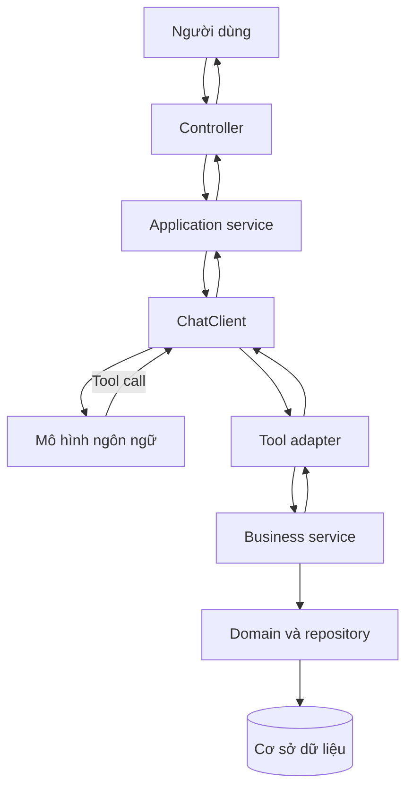

# Tổ chức ChatClient, lớp công cụ và dịch vụ nghiệp vụ

Khi đưa tool calling vào một ứng dụng Spring AI, cách tổ chức mã nguồn quyết định mức độ dễ kiểm soát của hệ thống. `ChatClient` điều phối hội thoại với mô hình; lớp công cụ công bố những thao tác mà mô hình có thể yêu cầu; dịch vụ nghiệp vụ thực hiện quy tắc và truy cập dữ liệu của hệ thống. Ba phần này nên có ranh giới rõ ràng để quyền truy cập, transaction, kiểm thử và thay đổi nghiệp vụ vẫn được quản lý như trong một ứng dụng Spring thông thường.

Trong module `SPRING_AI_TOOL_CALLING`, mục tiêu là để mô hình có thể yêu cầu gọi công cụ thông qua `@Tool`, `ToolCallback`, schema đầu vào và `ToolContext`. Mô hình chỉ đề xuất tên công cụ cùng đối số. Ứng dụng quyết định công cụ nào được đăng ký cho từng yêu cầu, xác thực dữ liệu và danh tính, rồi mới cho phép mã thực thi gọi dịch vụ nghiệp vụ.

Một cách tổ chức dễ duy trì là giữ luồng hội thoại ở tầng ứng dụng, đặt các phương thức `@Tool` trong những adapter mỏng theo năng lực nghiệp vụ, và để service/domain xử lý quy tắc thực tế. Lớp công cụ không nên trở thành nơi chứa toàn bộ logic đơn hàng, thanh toán hay khách hàng; `ChatClient` cũng không nên bị gọi ngược từ chính callback mà nó đang điều phối.

## 1. Phân chia trách nhiệm giữa các lớp

Một ứng dụng trợ lý tra cứu đơn hàng có thể chia thành các trách nhiệm sau:

| Thành phần | Trách nhiệm chính | Ví dụ |
|---|---|---|
| API / Controller | Nhận yêu cầu HTTP, xác thực người gọi và chuyển yêu cầu vào application service | `OrderAssistantController` |
| Application service | Điều phối use case, chuẩn bị prompt, ngữ cảnh tin cậy và danh sách công cụ được phép | `OrderAssistantService` |
| ChatClient configuration | Tạo và cấu hình `ChatClient`, các mặc định hội thoại dùng chung | `ChatClientConfiguration` |
| Tool adapter | Công bố thao tác qua `@Tool`, mô tả đầu vào, nhận `ToolContext`, chuyển yêu cầu đến service | `OrderTools` |
| Business application service | Áp dụng quy tắc nghiệp vụ, xác thực quyền trên tài nguyên, quản lý transaction | `OrderQueryService` |
| Domain / Repository | Biểu diễn quy tắc miền và lưu trữ, truy vấn dữ liệu | `Order`, `OrderRepository` |

Luồng phụ thuộc nên đi từ lớp giao tiếp AI về phía dịch vụ nghiệp vụ:



Sơ đồ thể hiện đường đi của một yêu cầu có tool call. Trong thực tế, `ChatClient` gửi tool definition đến model provider; khi nhận tool call, cơ chế điều phối của Spring AI ánh xạ tên công cụ đến callback. Callback gọi service, nhận kết quả và đưa kết quả vào lịch sử hội thoại để mô hình tiếp tục tạo câu trả lời.

Các lớp AI không nên sở hữu quy tắc miền. Nếu sau này cần gọi `OrderQueryService` từ REST API, batch job hoặc một message consumer, service vẫn hoạt động độc lập mà không cần khởi tạo `ChatClient`.

## 2. Gợi ý cấu trúc package

Với một ứng dụng Spring Boot vừa phải, có thể bắt đầu bằng cấu trúc theo năng lực nghiệp vụ:

```text
src/main/java/com/example/shop/
├── ShopApplication.java
├── api/
│   └── order/
│       ├── OrderAssistantController.java
│       └── AskOrderRequest.java
├── application/
│   └── order/
│       └── OrderAssistantService.java
├── ai/
│   ├── config/
│   │   └── ChatClientConfiguration.java
│   └── tool/
│       └── order/
│           └── OrderTools.java
└── order/
    ├── application/
    │   └── OrderQueryService.java
    ├── domain/
    │   ├── Order.java
    │   └── OrderStatus.java
    └── infrastructure/
        └── OrderRepository.java
```

Đây là một ví dụ tổ chức, không phải cấu trúc bắt buộc của Spring. Dự án lớn có thể gom các thành phần theo feature như `order`, `customer`, `inventory`, trong đó mỗi feature có application, domain và infrastructure riêng. Điểm cần giữ là tool adapter thuộc lớp tích hợp AI, còn service và domain không phụ thuộc vào API của Spring AI.

Nên đặt tên công cụ theo hành động nghiệp vụ cụ thể, ví dụ `getOrderStatus`, `findCustomerProfile` hoặc `checkProductAvailability`. Tránh tạo một công cụ tổng quát như `executeBusinessAction` nhận tên service và tên phương thức từ mô hình. Công cụ càng cụ thể, schema càng rõ và ứng dụng càng dễ kiểm tra quyền.

## 3. Cấu hình ChatClient dùng chung

Spring Boot auto-configuration có thể cung cấp `ChatClient.Builder` khi ứng dụng đã khai báo starter cho model provider. Từ builder này, tạo một `ChatClient` để application service sử dụng:

```java
package com.example.shop.ai.config;

import org.springframework.ai.chat.client.ChatClient;
import org.springframework.context.annotation.Bean;
import org.springframework.context.annotation.Configuration;

@Configuration
public class ChatClientConfiguration {

    @Bean
    ChatClient shopChatClient(ChatClient.Builder builder) {
        return builder
                .defaultSystem("""
                        Bạn là trợ lý hỗ trợ khách hàng của cửa hàng.
                        Chỉ sử dụng công cụ được cung cấp để tra cứu dữ liệu nghiệp vụ.
                        Không suy đoán trạng thái đơn hàng hoặc dữ liệu khách hàng.
                        Nếu thiếu thông tin, hãy hỏi lại người dùng.
                        """)
                .build();
    }
}
```

System prompt định hướng cách mô hình giao tiếp và sử dụng công cụ. Nó không phải cơ chế bảo mật. Dù prompt yêu cầu chỉ tra cứu dữ liệu được phép, ứng dụng vẫn phải xác minh quyền trong service trước khi trả dữ liệu.

Giữ `ChatClient` dùng chung cho những cấu hình hội thoại giống nhau. Những công cụ có thể sử dụng nên được đăng ký theo từng yêu cầu ở application service. Cách này cho phép use case tra cứu đơn hàng chỉ mở `OrderTools`, trong khi use case tra cứu tồn kho chỉ mở `InventoryTools`. Nếu một công cụ được đăng ký mặc định toàn cục, mọi luồng dùng client đó có thể vô tình nhìn thấy khả năng gọi công cụ không cần thiết.

Nếu ứng dụng có nhiều nhóm trợ lý với system prompt, model option hoặc chính sách khác nhau, có thể tạo nhiều bean `ChatClient` có tên rõ ràng. Không đưa dữ liệu người dùng, tenant hoặc quyền hạn vào `defaultSystem`; đó là dữ liệu theo từng request và cần được truyền qua ngữ cảnh tin cậy.

## 4. Application service điều phối yêu cầu hội thoại

Application service nhận câu hỏi cùng danh tính đã xác thực từ tầng API. Nó chọn công cụ cho use case và cung cấp dữ liệu ngữ cảnh do server xác định:

```java
package com.example.shop.application.order;

import java.util.Map;

import com.example.shop.ai.tool.order.OrderTools;
import com.example.shop.security.AuthenticatedUser;
import org.springframework.ai.chat.client.ChatClient;
import org.springframework.stereotype.Service;

@Service
public class OrderAssistantService {

    private final ChatClient chatClient;
    private final OrderTools orderTools;

    public OrderAssistantService(
            ChatClient shopChatClient,
            OrderTools orderTools) {
        this.chatClient = shopChatClient;
        this.orderTools = orderTools;
    }

    public String ask(String question, AuthenticatedUser user) {
        Map<String, Object> trustedContext = Map.of(
                "userId", user.userId(),
                "tenantId", user.tenantId());

        return chatClient.prompt()
                .user(question)
                .toolContext(trustedContext)
                .tools(orderTools)
                .call()
                .content();
    }
}
```

`AuthenticatedUser` trong ví dụ là đối tượng ứng dụng tạo từ security principal đã được xác thực, chẳng hạn một record có `userId` và `tenantId`. Không lấy các giá trị này từ phần văn bản câu hỏi hoặc DTO do người dùng gửi lên. Nếu ứng dụng không đa tenant, có thể chỉ truyền `userId` hoặc định danh phù hợp với chính sách của hệ thống.

`toolContext(...)` chuyển ngữ cảnh đến các phương thức công cụ trong chu trình thực thi. `.tools(orderTools)` đăng ký các phương thức `@Tool` trên đối tượng đó cho prompt hiện tại. Cả hai đều gắn với yêu cầu đang xử lý, giúp tránh lưu trạng thái người dùng trong field của bean singleton.

Application service cũng là nơi thích hợp để áp dụng timeout tổng thể, chọn model option theo use case, ghi correlation ID và xử lý trạng thái lỗi ở cấp hội thoại. Không nên đặt logic truy vấn repository hoặc kiểm tra trạng thái đơn hàng trực tiếp ở đây; phần đó thuộc service nghiệp vụ.

## 5. Tool adapter chỉ làm nhiệm vụ chuyển tiếp có kiểm soát

Tool adapter công bố một thao tác nhỏ, mô tả rõ ý nghĩa và chuyển dữ liệu đã nhận sang business service. Ví dụ:

```java
package com.example.shop.ai.tool.order;

import com.example.shop.order.application.OrderQueryService;
import com.example.shop.order.application.OrderStatusView;
import org.springframework.ai.chat.model.ToolContext;
import org.springframework.ai.tool.annotation.Tool;
import org.springframework.ai.tool.annotation.ToolParam;
import org.springframework.security.access.AccessDeniedException;
import org.springframework.stereotype.Component;

@Component
public class OrderTools {

    private final OrderQueryService orderQueryService;

    public OrderTools(OrderQueryService orderQueryService) {
        this.orderQueryService = orderQueryService;
    }

    @Tool(description = "Tra cứu trạng thái một đơn hàng mà người dùng hiện tại được phép xem.")
    public OrderStatusView getOrderStatus(
            @ToolParam(description = "Mã đơn hàng cần tra cứu") String orderId,
            ToolContext toolContext) {

        String userId = requiredContextValue(toolContext, "userId");
        String tenantId = requiredContextValue(toolContext, "tenantId");

        return orderQueryService.findVisibleStatus(orderId, userId, tenantId);
    }

    private String requiredContextValue(ToolContext toolContext, String key) {
        Object value = toolContext.getContext().get(key);
        if (!(value instanceof String text) || text.isBlank()) {
            throw new AccessDeniedException("Thiếu ngữ cảnh xác thực cần thiết.");
        }
        return text;
    }
}
```

Các điểm quan trọng trong ví dụ:

- `@Tool` mô tả công cụ để Spring AI tạo tool definition.
- `@ToolParam` giúp mô hình hiểu ý nghĩa của `orderId`.
- `ToolContext` nhận `userId` và `tenantId` do application service cung cấp. Đây không phải tham số mà mô hình được quyền tự khai báo.
- Tool adapter không truy cập repository và không tự quyết định một đơn hàng có thuộc người dùng hay không. Nó chuyển yêu cầu sang service chịu trách nhiệm nghiệp vụ.
- Giá trị trong `ToolContext` vẫn cần được kiểm tra trước khi sử dụng. Nếu thiếu ngữ cảnh, callback phải từ chối thực thi.

Tool adapter thường là bean không trạng thái. Không lưu `currentUserId`, `currentTenantId`, câu hỏi hiện tại hoặc tool arguments vào field của component, vì bean Spring thường được dùng đồng thời bởi nhiều request. Truyền dữ liệu theo tham số phương thức hoặc context của từng lần gọi.

## 6. Business service giữ quy tắc và quyền truy cập

Service nghiệp vụ không cần biết yêu cầu đến từ REST, batch job hay tool calling. Nó nhận đầu vào rõ ràng, kiểm tra quyền trên tài nguyên và trả về một kiểu dữ liệu mà caller được phép sử dụng:

```java
package com.example.shop.order.application;

import com.example.shop.order.infrastructure.OrderRepository;
import org.springframework.stereotype.Service;
import org.springframework.transaction.annotation.Transactional;

@Service
public class OrderQueryService {

    private final OrderRepository orderRepository;

    public OrderQueryService(OrderRepository orderRepository) {
        this.orderRepository = orderRepository;
    }

    @Transactional(readOnly = true)
    public OrderStatusView findVisibleStatus(
            String orderId,
            String userId,
            String tenantId) {

        return orderRepository
                .findStatusVisibleTo(orderId, userId, tenantId)
                .orElseThrow(() -> new OrderNotFoundException(orderId));
    }
}
```

`findStatusVisibleTo` là phương thức repository minh họa: truy vấn cần giới hạn theo mã đơn hàng, người dùng và tenant trong cùng một phạm vi truy cập. Không nên truy vấn đơn hàng chỉ theo `orderId`, sau đó tin rằng mô hình đã chọn đúng mã thì người dùng có quyền xem.

Kết quả trả về nên là DTO giới hạn dữ liệu cần thiết:

```java
package com.example.shop.order.application;

public record OrderStatusView(
        String orderId,
        String status,
        String carrier,
        String estimatedDelivery) {
}
```

Không trả trực tiếp JPA entity hoặc object nội bộ lớn cho mô hình. DTO rõ ràng giúp kiểm soát trường dữ liệu được đưa vào prompt, giảm rủi ro lộ thông tin và tránh phụ thuộc vào cấu trúc persistence.

Với thao tác ghi, business service vẫn phải kiểm tra trạng thái hiện tại, quyền thực hiện, điều kiện chuyển trạng thái và transaction. Tool adapter có thể yêu cầu một thao tác hủy đơn, nhưng service quyết định đơn đó có được phép hủy hay không. Nếu thao tác có tác động lớn, ứng dụng cần quy trình xác nhận riêng và mã idempotency do server quản lý.

## 7. Controller chỉ xử lý giao tiếp HTTP

Controller lấy principal đã xác thực, kiểm tra request cơ bản và gọi application service. Ví dụ dưới đây minh họa ranh giới, các kiểu `AuthenticatedUser` và cách chuyển đổi principal phụ thuộc cấu hình bảo mật của dự án:

```java
@RestController
@RequestMapping("/api/order-assistant")
public class OrderAssistantController {

    private final OrderAssistantService assistantService;

    public OrderAssistantController(OrderAssistantService assistantService) {
        this.assistantService = assistantService;
    }

    @PostMapping
    public AskOrderResponse ask(
            @RequestBody AskOrderRequest request,
            @AuthenticationPrincipal AuthenticatedUser user) {

        String answer = assistantService.ask(request.question(), user);
        return new AskOrderResponse(answer);
    }
}

public record AskOrderRequest(String question) {}

public record AskOrderResponse(String answer) {}
```

Trong ứng dụng thực tế, hãy kiểm tra `question` không rỗng, giới hạn độ dài, áp dụng rate limit và xử lý lỗi ở tầng HTTP. Controller không nên tự tạo tool schema, phân tích tool call JSON hoặc gọi trực tiếp `OrderRepository`.

## 8. Chọn cách đăng ký công cụ phù hợp

Spring AI hỗ trợ khai báo công cụ bằng `@Tool` và tạo callback theo cách lập trình. Với một nhóm công cụ ổn định, đối tượng có phương thức `@Tool` thường dễ đọc và dễ bảo trì:

```java
return chatClient.prompt()
        .user(question)
        .tools(orderTools)
        .call()
        .content();
```

Khi cần cấu hình callback động, ứng dụng có thể xây dựng `ToolCallback` từ function hoặc method rồi đăng ký callback tương ứng cho yêu cầu. `ToolCallbackProvider` hữu ích khi muốn đóng gói và cung cấp một nhóm callback theo feature hoặc cấu hình. Dù dùng cách nào, application service vẫn phải quyết định callback nào được phép xuất hiện trong từng prompt.

Không tạo một danh sách công cụ khổng lồ rồi gửi cho mọi yêu cầu. Hãy chia theo năng lực: `OrderTools`, `CustomerTools`, `InventoryTools`, `ShippingTools`. Nếu một use case cần nhiều nhóm, application service có thể đăng ký đúng các nhóm đó. Mô tả công cụ nên tránh trùng tên và tránh các chức năng chồng lấn khiến mô hình khó chọn.

Với các công cụ nhạy cảm, nên tách riêng quyền đọc và quyền ghi. Ví dụ `getOrderStatus` chỉ đọc dữ liệu; `requestOrderCancellation` yêu cầu service kiểm tra trạng thái và quyền hủy. Không gom tra cứu, cập nhật và xóa vào một callback tổng quát.

## 9. Giữ dữ liệu theo request và bảo vệ ranh giới bảo mật

Một cấu trúc tốt phân biệt dữ liệu do mô hình đề xuất với dữ liệu do server xác định:

| Dữ liệu | Nguồn | Nơi xử lý |
|---|---|---|
| `orderId` | Đối số tool call do mô hình tạo | Tool adapter kiểm tra định dạng; business service kiểm tra tài nguyên và quyền |
| `userId` | Principal đã xác thực | Application service đưa vào `ToolContext`; business service dùng để giới hạn truy vấn |
| `tenantId` | Phiên hoặc security context phía server | Application service đưa vào `ToolContext`; service áp dụng phạm vi tenant |
| Vai trò / quyền | Hệ thống xác thực và phân quyền | Security layer và business service kiểm tra theo hành động |
| Câu hỏi hội thoại | Người dùng | Application service giới hạn kích thước và đưa vào prompt |

Một số nguyên tắc cần duy trì:

1. Chỉ đưa công cụ cần thiết vào prompt hiện tại. Danh sách tool callback là một phần của bề mặt quyền mà mô hình có thể yêu cầu.
2. Không nhận `userId`, `tenantId`, `role` hoặc `isAdmin` từ tool arguments do mô hình tạo.
3. Kiểm tra quyền trong service trên tài nguyên cụ thể. Việc ẩn một công cụ khỏi prompt không thay thế authorization.
4. Không trả bí mật, access token, entity nội bộ hoặc dữ liệu cá nhân không cần thiết vào kết quả công cụ.
5. Giữ callback không trạng thái; context phải thuộc đúng request đang chạy.
6. Đặt timeout, giới hạn kết quả và ngân sách cho toàn bộ chu trình hội thoại.

Nội dung tool result sẽ được đưa lại vào prompt ở lượt tiếp theo. Vì vậy, dữ liệu từ database, hệ thống bên ngoài và thông điệp lỗi cũng cần được xử lý như dữ liệu đầu vào không đáng tin cậy đối với mô hình. Không để một trường dữ liệu lưu trữ có thể biến thành chỉ thị điều khiển công cụ.

## 10. Tránh các kiểu tổ chức gây khó bảo trì

| Cách tổ chức không phù hợp | Vấn đề | Cách tổ chức nên dùng |
|---|---|---|
| Controller gọi trực tiếp `ChatModel`, tự phân tích JSON tool call và truy cập repository | HTTP, giao thức model và nghiệp vụ bị trộn trong một lớp | Controller → application service → ChatClient / tool adapter → business service |
| Tool class chứa toàn bộ truy vấn và quy tắc nghiệp vụ | Logic khó tái sử dụng, khó kiểm thử ngoài AI | Tool adapter gọi business service |
| Business service phụ thuộc `ChatClient` | Nghiệp vụ bị khóa vào công nghệ AI và dễ tạo vòng phụ thuộc | Để application service điều phối ChatClient; domain service độc lập |
| Tool bean lưu user hiện tại trong field | Request đồng thời có thể dùng nhầm danh tính | Truyền `ToolContext` theo từng lần gọi |
| Mọi prompt đều nhận toàn bộ callback | Mô hình có thể yêu cầu thao tác ngoài use case | Đăng ký tool theo yêu cầu và vai trò |
| Trả JPA entity làm tool result | Lộ trường không cần thiết và phụ thuộc persistence | Trả DTO hẹp, có cấu trúc |
| Chỉ kiểm tra quyền trong prompt hoặc tool description | Prompt không phải ranh giới bảo mật | Kiểm tra quyền trong business service |
| Dùng một callback `executeAnything` | Schema rộng, khó allowlist và khó kiểm toán | Công cụ nhỏ theo hành động nghiệp vụ |

## 11. Kiểm thử theo từng ranh giới

Không nên chỉ kiểm thử bằng cách gửi câu hỏi đến model thật. Mỗi lớp có trách nhiệm riêng và cần được kiểm thử ở mức phù hợp.

| Phạm vi | Nội dung cần xác minh |
|---|---|
| `OrderQueryService` | Trả dữ liệu đúng; không truy cập đơn hàng của người dùng hoặc tenant khác; áp dụng quy tắc trạng thái |
| `OrderTools` | Tên và mô tả công cụ đúng; nhận `orderId`; lấy user/tenant từ `ToolContext`; chuyển lời gọi đến đúng service |
| `OrderAssistantService` | Đăng ký đúng tool group; truyền context lấy từ principal; tạo prompt và xử lý kết quả hội thoại |
| `ChatClientConfiguration` | Bean được khởi tạo với model provider và system prompt dự kiến |
| Controller | Xác thực, validation request, status code và định dạng response |
| Luồng tích hợp | Model giả lập phát tool call; callback được thực thi; kết quả quay lại mô hình; câu trả lời cuối được trả về |

Một số ca kiểm thử bảo mật quan trọng:

- Người dùng A yêu cầu mã đơn hàng của người dùng B: service từ chối hoặc trả kết quả không tiết lộ sự tồn tại của tài nguyên.
- Mô hình đưa `tenantId` hoặc `userId` giả vào đối số: schema không cần trường này và service không sử dụng nó làm danh tính.
- `ToolContext` thiếu `userId` hoặc `tenantId`: tool từ chối thực thi.
- Callback gặp lỗi nghiệp vụ: ứng dụng không tạo câu trả lời thành công giả.
- Hai request đồng thời từ hai người dùng: context không bị trộn giữa các lần gọi.
- Tool ghi bị retry sau timeout: idempotency ngăn tạo tác động trùng.

Ở kiểm thử tích hợp, có thể thay model thật bằng model giả hoặc mock phù hợp với phiên bản Spring AI đang dùng. Điều cần xác minh là chu trình message và callback, không phải khả năng ngôn ngữ của một model cụ thể. Kiểm thử với model thật nên được dùng bổ sung để đánh giá mô hình có chọn đúng công cụ và tạo đối số phù hợp với mô tả hay không.

## 12. Checklist trước khi đưa cấu trúc vào sử dụng

Trước khi hoàn tất tích hợp, hãy kiểm tra:

- `ChatClient` được cấu hình bằng Spring bean và không chứa dữ liệu người dùng theo request.
- Application service là nơi chọn tool group và truyền `ToolContext` lấy từ danh tính đã xác thực.
- Tool adapter có tên, mô tả và schema hẹp; không chứa logic persistence hoặc quy tắc miền phức tạp.
- Business service độc lập với Spring AI, kiểm tra quyền và transaction ở đúng ranh giới.
- Tool result là DTO tối thiểu, không trả entity hoặc dữ liệu nhạy cảm.
- Tool bean không giữ trạng thái request trong field.
- Công cụ đọc và ghi được phân tách; hành động quan trọng có xác nhận và idempotency.
- Có kiểm thử cho quyền, tenant, lỗi, request đồng thời và chu trình tool calling.

Khi `ChatClient`, tool adapter và business service được tổ chức theo các trách nhiệm này, Spring AI trở thành lớp giao tiếp hội thoại với hệ thống. Mô hình có thể chọn một hành động và cung cấp dữ liệu đầu vào; ứng dụng giữ quyền quyết định việc thực thi, còn service nghiệp vụ bảo vệ dữ liệu và tính nhất quán của hệ thống.
