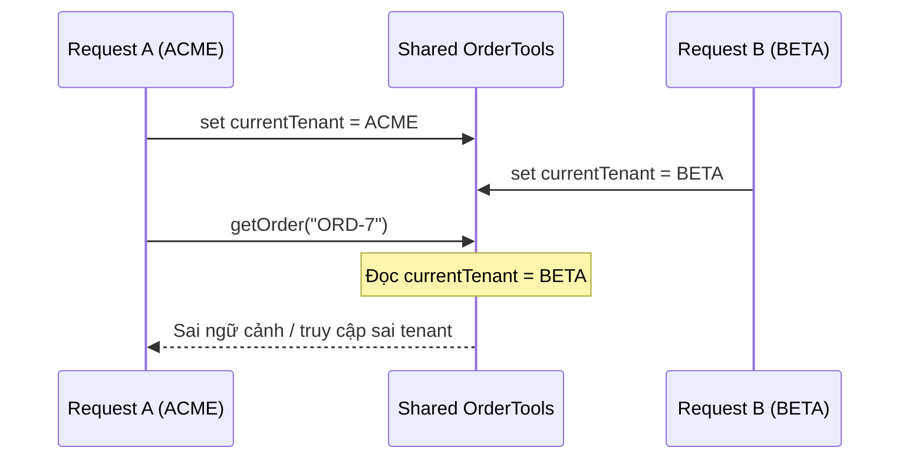
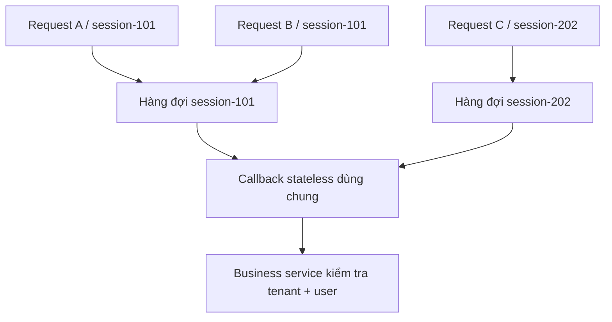

# Bảo đảm callback dùng chung an toàn với nhiều yêu cầu đồng thời

> **Chương:** Vận hành — **Module:** SPRING_AI_TOOL_CALLING. Bài này xét ứng dụng Spring AI **2.1.0** phục vụ nhiều người dùng đồng thời bằng `ChatClient`, `@Tool`, `ToolCallback`, JSON Schema và `ToolContext`. Mục tiêu là giữ dữ liệu, quyền truy cập và trạng thái của từng lời gọi độc lập dù các yêu cầu cùng dùng một callback Java. Phần điều phối model, xử lý lỗi, giám sát và kiểm thử được đặt trong đúng bối cảnh vận hành tool calling.

## 1. Mục tiêu

Sau bài học, bạn có thể:

1. Phân biệt **dùng chung đối tượng callback** với **dùng chung dữ liệu của từng request**.
2. Nhận diện race condition, rò rỉ tenant/user và các nguồn trạng thái ẩn trong `@Tool`, `FunctionToolCallback`, `ToolCallback`, converter hoặc service phụ thuộc.
3. Thiết kế tool **stateless**, truyền `tenantId`, `userId` và request ID bằng `ToolContext` được tạo cho mỗi request; thực thi kiểm tra quyền trong tầng nghiệp vụ.
4. Giải thích vì sao cần đồng bộ **theo session** đối với nhiều lượt chat cùng một hội thoại, trong khi các session khác nhau vẫn nên chạy đồng thời.
5. Kiểm tra an toàn với lời gọi đồng thời có chủ đích, retry, timeout, idempotency, giới hạn và observability.

## 2. Vấn đề xảy ra như thế nào?

Giả sử một `ChatClient` và một bean `OrderTools` được dùng chung để phục vụ hai yêu cầu HTTP:

| Thời điểm | Request A | Request B |
| --- | --- | --- |
| T1 | Người dùng Alice thuộc tenant `ACME` hỏi đơn `ORD-7` | |
| T2 | Callback ghi `currentTenant = "ACME"` | |
| T3 | | Người dùng Bob thuộc tenant `BETA` hỏi đơn `ORD-9` |
| T4 | | Callback ghi `currentTenant = "BETA"` |
| T5 | Callback A đọc lại `currentTenant` và truy vấn `ORD-7` bằng tenant `BETA` | |
| T6 | | Callback B hoàn tất bình thường |

Dù phương thức `@Tool` nhận đối số JSON chính xác, **biến thành viên chung có thể bị ghi đè giữa hai luồng**. Kết quả tùy cách kiểm tra ở service: A có thể nhận dữ liệu không đúng, gặp lỗi quyền hoặc gây rò rỉ giữa tenant nếu truy vấn không ràng buộc tenant.



Một điểm dễ nhầm: Spring AI không biến mọi phương thức `@Tool` thành tác vụ chạy song song. Nhưng khi máy chủ nhận **nhiều request** cùng lúc, cùng một đối tượng tool có thể bị gọi từ nhiều luồng hoặc luồng reactive khác nhau; với mô hình có thể phát ra nhiều tool call và với hệ thống tự chạy callback song song, yêu cầu thread-safe còn quan trọng hơn. **Đừng dựa vào giả định callback chỉ được gọi tuần tự.**

## 3. Có thể chia sẻ gì và phải tách gì?

| Thành phần | Phạm vi thường phù hợp | Điều kiện |
| --- | --- | --- |
| `ChatClient` đã cấu hình | Có thể tái sử dụng giữa các request | Tạo **prompt/request spec mới** cho mỗi lần `.prompt()`; không cất spec đang xây trong field dùng chung |
| `@Tool` object, `ToolCallback`, `ToolCallbackProvider` | Có thể tái sử dụng | Callback và mọi dependency dùng chung phải an toàn khi gọi đồng thời; không ghi request data vào instance field |
| `ToolDefinition`, JSON Schema, cấu hình converter | Dùng chung | Cố định sau khởi tạo; không sửa trong lúc request đang chạy |
| Repository/service, HTTP client, connection pool | Dùng chung theo thiết kế framework | Tuân theo cam kết thread-safety của implementation; giao dịch và quyền cần gắn đúng request |
| `ToolContext` chứa `tenantId`, `userId`, correlation ID | **Mỗi request riêng** | Nguồn xác thực phía server; tạo map riêng, tránh giá trị thay đổi sau khi gọi |
| Biến cục bộ trong phương thức callback | Mỗi lời gọi | Không rò qua static field, cache sai key, closure dùng biến thay đổi |
| Conversation/session ID | **Mỗi hội thoại riêng** | Gán từ session đã kiểm tra quyền; điều phối tuần tự các turn dùng cùng session |
| Thông tin ghi lệnh, retry, idempotency | Theo thao tác hoặc yêu cầu, lưu bền vững nếu cần | Không dùng bộ đếm/khóa cục bộ trong callback để bảo vệ nhiều tiến trình |
| Metric, tracer, logger | Có thể dùng chung | Gắn correlation/trace context theo lời gọi; giới hạn nhãn nhạy cảm và cardinality |

Quy tắc then chốt: **cấu hình và dịch vụ có thể chia sẻ; danh tính, dữ liệu đang xử lý, conversation state và quyền của người gọi phải có phạm vi chính xác**.

Trong Spring AI 2.1.0, `ChatClient` đăng ký `ToolCallingAdvisor` để điều phối vòng lặp gọi tool. `ToolCallingManager` tìm và thực thi callback khớp tên, rồi trả kết quả lại mô hình. Việc tái sử dụng callback không khiến framework tự bảo vệ các field mutable do ứng dụng tạo.

## 4. Phản ví dụ: callback giữ trạng thái request trong field

Mã sau **không an toàn** khi nhiều request dùng chung đối tượng:

```java
import org.springframework.ai.tool.annotation.Tool;

final class UnsafeOrderTools {

    private final OrderQueryService orders;

    // SAI: các request cùng ghi/đọc field của một đối tượng.
    private String currentTenantId;
    private String currentUserId;

    UnsafeOrderTools(OrderQueryService orders) {
        this.orders = orders;
    }

    void setCaller(String tenantId, String userId) {
        this.currentTenantId = tenantId;
        this.currentUserId = userId;
    }

    @Tool(description = "Tra cứu trạng thái đơn hàng")
    public OrderStatus getOrderStatus(String orderId) {
        return orders.findAuthorized(
            currentTenantId, currentUserId, orderId);
    }
}
```

Mẫu `tools.setCaller(...); chatClient.prompt().tools(tools).call()` rất nguy hiểm: giữa `setCaller` và lúc mô hình thực sự yêu cầu chạy tool có thể có **nhiều lượt gọi LLM, độ trễ mạng, retry** và request khác chen vào. `volatile` chỉ giải quyết một số vấn đề hiển thị giữa luồng, **không làm chuỗi thiết lập–đọc trở thành thao tác nguyên tử**, nên vẫn sai.

Tương tự, những dạng trạng thái sau cũng thường gây lỗi:

- `StringBuilder lastResult`, `HashMap<String,Object> currentArgs`, danh sách kết quả hoặc `SimpleDateFormat` dùng chung và bị sửa giữa các lời gọi.
- Một field `lastToolContext` để “tiện lấy lại tenant”, hoặc biến `static` lưu người dùng đang gọi.
- `FunctionToolCallback` nhận lambda đóng trên `AtomicReference<Caller> currentCaller`; nguyên tử của một lần `set` không ngăn lời gọi khác thay đổi danh tính.
- Cache `orderId -> result` mà thiếu tenant, quyền/phiên bản dữ liệu trong khóa; một lookup hợp lệ có thể trả dữ liệu của tenant khác.
- Một bộ đếm `int calls++` hoặc map thường để hạn chế rate; mất cập nhật, phân phối hạn mức sai khi nhiều worker/instance cùng chạy.
- Tự giữ `Transaction`, `EntityManager`, `ResultSet` hoặc mutable SDK request builder vào field rồi dùng đồng thời.

## 5. Thiết kế đúng: callback stateless và `ToolContext` theo request

Spring AI cho phép tham số `ToolContext` trong phương thức `@Tool`. Ứng dụng cung cấp dữ liệu bằng `.toolContext(Map.of(...))`; các giá trị này **không nằm trong JSON Schema mà mô hình nhìn thấy**. Mô hình chọn công cụ và cung cấp đối số nghiệp vụ như `orderId`, còn server cung cấp danh tính đã xác thực.

### 5.1. Ví dụ Java hoàn chỉnh về ranh giới đồng thời

Ví dụ sau chỉ minh họa **đường đi đọc đơn hàng**; `OrderQueryService` là giao diện tầng nghiệp vụ cần có implementation kiểm tra quyền trên dữ liệu thực.

```java
import java.util.Map;

import org.springframework.ai.chat.client.ChatClient;
import org.springframework.ai.chat.model.ChatModel;
import org.springframework.ai.tool.ToolContext;
import org.springframework.ai.tool.annotation.Tool;
import org.springframework.ai.tool.annotation.ToolParam;
import org.springframework.context.annotation.Bean;
import org.springframework.context.annotation.Configuration;
import org.springframework.stereotype.Component;
import org.springframework.stereotype.Service;

record OrderStatus(String orderId, String state) {}

interface OrderQueryService {
    // Bắt buộc lọc tenant và kiểm tra user được xem orderId.
    OrderStatus findAuthorized(String tenantId, String userId, String orderId);
}

record Caller(
    String tenantId,
    String userId,
    String requestId,
    boolean canReadOrders
) {}

@Component
final class OrderTools {

    private final OrderQueryService orders;

    OrderTools(OrderQueryService orders) {
        this.orders = orders;
    }

    @Tool(
        name = "get_order_status_v1",
        description = "Chỉ tra cứu trạng thái đơn hàng người dùng được xem. " +
                      "Không thay đổi đơn hàng."
    )
    public OrderStatus getOrderStatus(
        @ToolParam(description = "Mã đơn, dạng ORD-123")
        String orderId,
        ToolContext context
    ) {
        // Biến local cho đúng lần gọi, không dùng field mutable.
        String tenantId = requiredContext(context, "tenantId");
        String userId = requiredContext(context, "userId");

        if (orderId == null || !orderId.matches("ORD-[0-9]{1,12}")) {
            throw new IllegalArgumentException("Mã đơn không hợp lệ");
        }

        // Tầng nghiệp vụ phải xác thực tenant + quyền trên đơn.
        return orders.findAuthorized(tenantId, userId, orderId);
    }

    private static String requiredContext(ToolContext context, String key) {
        if (context == null) {
            throw new SecurityException("Thiếu ngữ cảnh tin cậy");
        }
        Object value = context.getContext().get(key);
        if (!(value instanceof String text) || text.isBlank()) {
            throw new SecurityException("Thiếu thông tin xác thực: " + key);
        }
        return text;
    }
}

@Configuration(proxyBeanMethods = false)
class AiClientConfig {

    @Bean
    ChatClient orderChatClient(ChatModel chatModel) {
        // ChatClient dùng chung, chưa mặc định mở tool cho mọi người.
        return ChatClient.builder(chatModel).build();
    }
}

@Service
final class OrderChatService {

    private final ChatClient client;
    private final OrderTools orderTools;

    OrderChatService(ChatClient orderChatClient, OrderTools orderTools) {
        this.client = orderChatClient;
        this.orderTools = orderTools;
    }

    String answer(String question, Caller caller) {
        // Caller phải đến từ xác thực server, không lấy từ LLM hay user JSON.
        if (caller == null || !caller.canReadOrders()) {
            throw new SecurityException("Không có quyền tra cứu đơn hàng");
        }

        // Map bất biến, mỗi request tạo một giá trị mới.
        Map<String, Object> context = Map.of(
            "tenantId", caller.tenantId(),
            "userId", caller.userId(),
            "requestId", caller.requestId()
        );

        return client.prompt()
            .user(question)
            .tools(orderTools)       // Chỉ mở công cụ cho request đã qua gate.
            .toolContext(context)    // Tenant/user không gửi cho mô hình.
            .call()
            .content();
    }
}
```

Trong sản phẩm thật, ứng dụng phải xây `Caller` từ principal/session/token được backend xác thực và **xác thực sự tồn tại của các giá trị** trước khi lập `Map.of` (không chấp nhận `null`). API HTTP không được tin `tenantId`, `userId` do client tự khai. `OrderQueryService.findAuthorized(...)` phải kiểm tra trên mỗi bản ghi, dùng truy vấn được ràng buộc tenant, vì tên tool, prompt và schema không phải kiểm soát truy cập.

**Vì sao ví dụ chịu đồng thời tốt hơn?**

- `OrderTools` chỉ giữ tham chiếu `final` đến service đã được thiết kế thread-safe; không giữ `tenantId`, `userId`, `orderId` hay bộ đệm request.
- Mỗi lần `answer(...)` sinh một `Prompt` riêng từ `client.prompt()`, một map ngữ cảnh riêng và các biến local riêng.
- Model chỉ sinh `orderId`. `ToolContext` mang danh tính tới callback đúng lời gọi; không lấy danh tính từ model.
- Callback đọc ngữ cảnh **tại thời điểm thực thi**, không phụ thuộc `ThreadLocal` của luồng HTTP.
- Service tự thực thi kiểm soát truy cập. Nếu mô hình bịa mã của tenant khác, service từ chối.

### 5.2. Có thể dùng `.defaultTools(...)` không?

Có, nếu công cụ là **an toàn với mọi request dùng client ấy**, và callback cùng các dependency thread-safe:

```java
ChatClient client = ChatClient.builder(chatModel)
    .defaultTools(orderTools)
    .build();
```

Tuy nhiên, tài liệu Spring AI 2.1.0 nêu rõ công cụ mặc định được chia sẻ giữa những request sử dụng client; `.tools(...)` ở call site **bổ sung**, không thay thế `.defaultTools(...)`. Nếu quyền dùng tool khác nhau theo người dùng, nên chọn tool tại từng request và kiểm tra quyền trước khi truy vấn hệ thống. Không thể “ẩn” một công cụ đã đặt mặc định chỉ bằng cách bỏ nó khỏi `.tools(...)`.

### 5.3. Khi nào cần state?

Không phải mọi trạng thái đều sai. Vấn đề là **đúng phạm vi và đúng cơ chế đồng bộ**:

| Tình huống | Cách lưu phù hợp |
| --- | --- |
| Kết quả tính toán trong một lời gọi | Biến local hoặc object chỉ thuộc lời gọi |
| Request metadata, principal | `ToolContext` mới theo từng request; có thể chuyển thành record bất biến |
| Bộ nhớ của hội thoại | Session memory có session ID độc lập; điều phối turn cùng session |
| Cache tra cứu dùng chung | Cache thread-safe có khóa gồm tenant và ràng buộc truy cập; TTL và invalidation |
| Tổng số request, độ trễ, lỗi | Micrometer meter thread-safe, không tạo một meter cho mỗi user ID |
| Hạn mức toàn cụm | Redis/DB/limiter phân tán hoặc gateway; đồng bộ đúng khóa người dùng/tenant |
| Lệnh thay đổi dữ liệu | Transaction, optimistic locking và idempotency key do ứng dụng quản lý |

## 6. Hai loại đồng thời khác nhau: callback và hội thoại

**Loại A — hai session độc lập:** Alice và Bob có thể gửi yêu cầu đồng thời; callback vẫn dùng chung nếu stateless và service bảo vệ dữ liệu theo principal.

**Loại B — hai turn trong cùng một session:** hai tin nhắn đến gần như cùng lúc cho một hội thoại. Ngay cả khi callback an toàn, **thứ tự chat history/tool result** có thể bị xáo trộn. Spring AI 2.1.0 có Session API; tài liệu `SessionAdvisors` nói rõ hai call đồng thời trên cùng session có thể đan xen message, và khuyến nghị **serialize các call theo session trong ứng dụng**.



Điều phối cần thực hiện theo khóa `sessionId`; **không đặt `synchronized` lên toàn bộ phương thức tool**, vì sẽ khóa cả các tenant/session độc lập và tạo nút thắt cổ chai. Trong hệ thống nhiều replica, `ConcurrentHashMap<sessionId, Lock>` chỉ khóa trong **một JVM**, không đủ để kiểm soát turn giữa các node. Dùng queue, lease hoặc cơ chế phân phối theo session có khả năng xử lý timeout và thất bại nếu cần bảo đảm thứ tự toàn cụm.

Nếu dùng `SessionAdvisors` trong Spring AI 2.1:

```java
ChatClient client = ChatClient.builder(chatModel)
    .defaultAdvisors(SessionAdvisors.builder(sessionService).build())
    .build();

String answer = client.prompt()
    .user(question)
    .advisors(SessionAdvisors.session(sessionId))
    .tools(orderTools)
    .toolContext(context)
    .call()
    .content();
```

Đây là đoạn **tích hợp session rút gọn**; cần khai báo `SessionService` và artifact `spring-ai-session-advisor` trong ứng dụng thực. `sessionId` phải gắn với hội thoại được backend xác thực quyền; không tự đặt một session ID cố định cho tất cả request. Serializing turn cùng session là trách nhiệm ứng dụng, không phải hệ quả tự động khi truyền đúng ID.

**Khác biệt phiên bản:** `ChatMemory` và `MessageChatMemoryAdvisor` còn trong Spring AI 2.1 nhưng được đánh dấu **deprecated từ 2.1.0**, hướng chuyển sang Session API. Không lấy một ví dụ memory từ Spring AI 1.x rồi mặc định rằng cơ chế đồng thời/session của 2.1 là như nhau.

## 7. Rủi ro từ tool phụ thuộc và hệ thống ngoài

Một `@Tool` “không có field mutable” vẫn có thể không an toàn nếu dependency của nó giữ state chung:

**Repository/transaction.** Spring data repository thường được thiết kế để dùng chung, nhưng không nên lưu `EntityManager`, transaction hoặc JDBC cursor gắn request trong field tool. Kiểm tra chính sách transaction tại service; lệnh đọc vẫn cần lọc tenant/owner để tránh IDOR.

**HTTP client và header.** Dùng client/pool theo hướng dẫn thư viện; mỗi lời gọi tạo request và header riêng. Đừng sửa một `HttpHeaders` mutable dùng chung thành `Authorization: Bearer token-cua-A` rồi gửi request B.

**Cache.** Nếu hai tenant có cùng mã đơn `ORD-7`, `cache.get("ORD-7")` dễ bị lẫn. Khóa có thể là `(tenantId, orderId)`, nhưng nếu quyền xem của từng user khác nhau thì cache cũng phải giải quyết chính sách quyền, vòng đời và phiên bản ACL; có thể chỉ cache dữ liệu đã kiểm tra ở mức tenant và luôn xác thực quyền mỗi lần đọc.

**MCP.** Trong Spring AI 2.1, kết nối MCP **modern** có `client-scope=PER_REQUEST` theo mặc định, giúp mỗi ChatClient request giải quyết callback dưới danh tính tương ứng. `SHARED` chỉ nên dùng khi server được gọi bằng cùng một identity, ví dụ service account; nếu tool list phụ thuộc user, `SHARED` có thể tái dùng danh sách của người đầu tiên. MCP **legacy** dùng client/session được chia sẻ theo kết nối; session giao thức không phải ranh giới tenant. Dù chọn scope nào vẫn phải kiểm soát xác thực tại MCP server và vòng đời client.

**Reactive/streaming.** Một tool có thể thực thi trên luồng khác với luồng tạo yêu cầu. Spring AI ghi rõ đối với MCP streaming, tool callback có thể chạy sau trên Reactor scheduler. Không dựa vào `ThreadLocal<Principal>`, request-scoped proxy, `MDC` hay security context dạng thread-bound nếu chưa thiết kế cơ chế truyền context. `ToolContext` là kênh rõ ràng cho dữ liệu do ứng dụng cấp; việc cần truy cập hệ thống ngoài theo danh tính user phải được ràng buộc vào request/client tương ứng.

## 8. Retry, giới hạn và lệnh có tác dụng phụ

An toàn dữ liệu đồng thời khác với **an toàn khi lặp lại lệnh**. Một tool tạo đơn hoặc chuyển tiền có thể bị gọi lần hai vì timeout, retry của ứng dụng, mô hình sinh lại yêu cầu hay callback chạy trên một node khác. `synchronized` trong một JVM không ngăn thực thi hai lần trên hai node.

Giả sử tool `submit_payment` nhận `paymentRequestId` đã được server xác thực:

1. Tạo idempotency key ổn định cho **cùng một thao tác**, ví dụ `(tenantId, paymentRequestId)`; không dùng một key mới cho từng retry.
2. Dùng khóa duy nhất hoặc transaction/constraint trong DB để chỉ một lần ghi thành công; retry nhận lại cùng kết quả hoặc trạng thái của thao tác đang chạy.
3. Phân biệt “kết quả chưa rõ vì timeout” với “chưa thực thi”: phải truy vấn trạng thái đã ghi trước khi quyết định retry.
4. Áp đặt hạn mức theo tenant/user/service và giới hạn đồng thời ở hệ thống ngoài; không dùng `int counter` trên instance callback làm rate limiter phân tán.
5. Đối với thao tác nguy hiểm, dùng bước xác nhận có kiểm soát ở ứng dụng, cùng authorizer kiểm tra lại ngay trước khi ghi.

Spring AI 2.1.0 có **tool call limits** ở `DefaultToolCallingManager`: mặc định **40 lời gọi mỗi tool/turn** và **150 lời gọi tổng mỗi turn**. Các giới hạn này nhằm ngăn vòng lặp model quá mức; chúng **không** thay thế giới hạn concurrency, tốc độ truy cập DB, API quota hoặc idempotency toàn cụm.

Ví dụ cấu hình giới hạn mặc định qua properties:

```yaml
spring:
  ai:
    tools:
      limits:
        max-calls-per-tool-default: 20
        max-total-tool-calls: 60
```

Giá trị `20` và `60` ở trên chỉ minh họa cấu hình siết chặt hơn; điều chỉnh theo nghiệp vụ và số lần tool cần hợp lệ. Có thể đặt limiter riêng tại service/gateway khi cần bảo vệ tài nguyên ngoài.

### Lỗi phải được trả đúng ranh giới

Tài liệu Spring AI 2.1 ghi nhận `DefaultToolExecutionExceptionProcessor` có thể chuyển thông báo `RuntimeException` thành kết quả cho mô hình; mặc định `spring.ai.tools.throw-exception-on-error=false`. Nếu thông báo exception chứa token, query DB hoặc tên người dùng, chúng có thể lọt vào model output. Hãy dùng thông điệp lỗi đã khử thông tin nhạy cảm, hoặc cấu hình để lỗi được ném ra cho ứng dụng xử lý và ánh xạ sang phản hồi an toàn:

```yaml
spring:
  ai:
    tools:
      throw-exception-on-error: true
```

Không trả mã bí mật, stack trace, thông tin nội bộ tenant hoặc kết quả nhạy cảm trong văn bản tool trả về mô hình. Hệ thống cần phân biệt từ chối quyền (403), input không hợp lệ (400) và lỗi tạm thời (503) tại biên ứng dụng; cơ chế ánh xạ cụ thể phụ thuộc luồng API của sản phẩm.

## 9. Kịch bản kiểm thử đồng thời có chủ đích

Chỉ kiểm tra callback với **một** request không phát hiện được lẫn trạng thái. Bộ kiểm thử cần tạo hai lời gọi có quyền khác nhau và buộc chúng trùng thời điểm. Có thể bắt đầu ở **tầng Java** với cùng một `OrderTools`, mock/fake `OrderQueryService`, `CountDownLatch` và `ExecutorService`, không cần LLM thật.

Ví dụ ý tưởng về một test JUnit 5:

```java
@Test
void sharedToolUsesItsOwnContextForConcurrentCalls() throws Exception {
    CountDownLatch start = new CountDownLatch(1);
    OrderQueryService fake = (tenant, user, orderId) ->
        new OrderStatus(tenant + "/" + orderId, user);

    OrderTools shared = new OrderTools(fake);
    ExecutorService pool = Executors.newFixedThreadPool(2);
    try {
        Future<OrderStatus> acme = pool.submit(() -> {
            start.await();
            return shared.getOrderStatus(
                "ORD-7",
                new ToolContext(Map.of("tenantId", "ACME", "userId", "alice")));
        });
        Future<OrderStatus> beta = pool.submit(() -> {
            start.await();
            return shared.getOrderStatus(
                "ORD-9",
                new ToolContext(Map.of("tenantId", "BETA", "userId", "bob")));
        });

        start.countDown();
        assertEquals("ACME/ORD-7", acme.get(3, TimeUnit.SECONDS).orderId());
        assertEquals("alice", acme.get().state());
        assertEquals("BETA/ORD-9", beta.get(3, TimeUnit.SECONDS).orderId());
        assertEquals("bob", beta.get().state());
    } finally {
        pool.shutdownNow();
    }
}
```

*Imports cần thêm trong bài test:* `org.junit.jupiter.api.Test`, `org.junit.jupiter.api.Assertions.assertEquals`, `java.util.Map`, `java.util.concurrent.*` và `org.springframework.ai.tool.ToolContext`. Đoạn test kiểm tra tính cô lập ngữ cảnh nhưng **không tự chứng minh không có race trong mọi lịch chạy**. Để tái hiện phản ví dụ ở phần 4, dùng hai `CountDownLatch`/`CyclicBarrier` cố ý chặn giữa bước “ghi field” và “đọc field”, tạo interleaving có thể lặp lại; tránh test dựa vào `Thread.sleep(...)` rồi hy vọng race tự xuất hiện.

Sau test cấp callback, kiểm tra thêm:

| Trường hợp | Kết quả cần chứng minh |
| --- | --- |
| 50–100 request đọc song song của nhiều tenant | Không có câu trả lời/callback result khác tenant, không thay đổi dữ liệu ngoài ý muốn |
| Hai user cùng hỏi mã đơn trùng nhau | Mỗi bên chỉ thấy dữ liệu mà mình được quyền xem |
| Request không có `userId`/`tenantId` | Fail closed; service không được gọi với danh tính mặc định |
| Model trả `orderId` không hợp lệ | Callback từ chối; không gọi repository |
| Cùng session nhận hai turn đồng thời | Chạy tuần tự theo session; thứ tự history và tool result đúng |
| Hai session độc lập cùng chạy | Có thể tiến hành song song, không bị global lock chặn vô lý |
| Lỗi timeout trong tool ghi | Không tạo giao dịch trùng khi retry; trạng thái cuối xác minh được |
| Stream/chat đổi luồng | Identity truyền đúng qua ngữ cảnh, không phụ thuộc `ThreadLocal` mất giá trị |
| Cache hit sau thao tác đổi quyền | Không trả dữ liệu cũ trái phép |
| Hạn mức service khi tải cao | Từ chối/throttle có kiểm soát; không làm cạn pool/DB |

Đối với tool có tác dụng phụ, chạy test bằng service giả lập hoặc môi trường cô lập để tránh thay đổi dữ liệu nghiệp vụ thật. Khi cần đo race, dùng các mốc đồng bộ tất định; khi cần đo throughput, chạy stress/integration test có quan sát connection pool và số request đang chạy. Hai loại test kiểm tra hai vấn đề khác nhau.

## 10. Quan sát và xử lý sự cố khi chạy nhiều request

Spring AI 2.1 phát ra Micrometer observation cho tool dưới tên `spring.ai.tool`. Nên liên kết một trace với HTTP request, các lần gọi model và callback, đồng thời ghi các trường không nhạy cảm như `toolName`, `requestId`, `sessionId` (ở nơi truy cập được kiểm soát), latency, status và error category.

- **Không** xuất nguyên `ToolContext`, token, nội dung customer/order, đối số hoặc kết quả nhạy cảm vào log mặc định.
- Quan sát `in_flight_tools`, số lần gọi theo tên tool, duration percentiles, lỗi timeout, rate-limit, authorization denied và retries/idempotency conflicts.
- Tách metric tổng theo tool/provider với log chi tiết có request ID. Không gắn user ID, order ID hay request ID vào **metric label** vì cardinality lớn và có thể làm lộ dữ liệu.
- Nếu cùng một callback bị gọi chậm hơn khi tải tăng, kiểm tra connection pool, lock granularity, cache contention, retry storm và thread pool trước khi kết luận rằng mô hình chậm.
- Khi thấy tenant mismatch, **dừng truy vấn bị ảnh hưởng**, đối chiếu đường đi principal → `ToolContext` → repository; đặc biệt tìm instance field, map mutable, cache key sai và MCP shared identity.

## 11. Checklist trước khi triển khai

1. Tất cả field trong tool bean dùng chung đều là dependency cấu hình bất biến hoặc cấu trúc thread-safe có lý do rõ ràng; không lưu người dùng, tenant, input hay kết quả request.
2. `ChatClient.prompt()` được tạo mới cho mỗi lời gọi; không tái sử dụng request spec đang cấu hình.
3. `ToolContext` mới được tạo cho từng request với dữ liệu từ backend đã xác thực; không dùng một default context chứa danh tính user.
4. `ToolDefinition` và tên callback ổn định; permission gate quyết định tool được đưa vào request; service luôn kiểm tra quyền trên từng bản ghi.
5. Mọi cache, hạn mức, khóa và transaction được đặt đúng phạm vi request/tenant/session và xét đến nhiều tiến trình.
6. Mỗi hội thoại có session ID riêng; các turn cùng session được điều phối tuần tự, các session độc lập có thể chạy song song.
7. Callback và dependency làm việc được khi thay đổi luồng thực thi; streaming/MCP không phụ thuộc sai vào `ThreadLocal`.
8. Tool có tác dụng phụ hỗ trợ idempotency và xử lý timeout ở trạng thái “chưa rõ kết quả”.
9. Lỗi không chuyển thông tin bí mật cho mô hình; logging/metrics có correlation nhưng được che dữ liệu cần bảo vệ.
10. Có test concurrency tất định theo tenant, test session ordering, test retry/idempotency, và giám sát tải thực tế.

## 12. Tài liệu đối chiếu

- [Spring AI 2.1.0 — Tool Calling](https://docs.spring.io/spring-ai/reference/api/tools.html): `@Tool`, `ToolCallback`, `.tools()`/`.defaultTools()`, `ToolContext`, error processor, tool call limits và observation.
- [Spring AI 2.1.0 — ToolCallingAdvisor](https://docs.spring.io/spring-ai/reference/api/tools/tool-calling-advisor.html): vòng lặp gọi công cụ, thứ tự advisor, cấu hình lịch sử trong tool loop.
- [Spring AI 2.1.0 — Session ChatClient Integration](https://docs.spring.io/spring-ai/reference/api/session/chat-client.html): `SessionAdvisors`, session ID, giới hạn khi có hai turn đồng thời và luồng streaming.
- [Spring AI 2.1.0 — MCP Client Boot Starter](https://docs.spring.io/spring-ai/reference/api/mcp/mcp-client-boot-starter-docs.html): client scope `PER_REQUEST`/`SHARED`/`CUSTOM`, identity, session của MCP legacy và những lưu ý với streaming.
- [Spring AI 2.1.0 GA Announcement — 20/11/2026](https://spring.io/blog/2026/11/20/spring-ai-2-1-0-GA-available-now/): xác nhận mốc phát hành 2.1.0 và thay đổi Session API/tool call limits.

> **Ghi chú về ví dụ:** các đoạn Java minh họa cách thiết kế ranh giới đồng thời, không phải một ứng dụng triển khai độc lập; cần cung cấp service thực, dependency tương ứng và cấu hình xác thực. Trong ví dụ kiểm thử, chưa gọi model thật hoặc chạy test; việc tích hợp thực tế cần được kiểm chứng trên cấu hình Spring AI 2.1.0 và môi trường triển khai của dự án.

