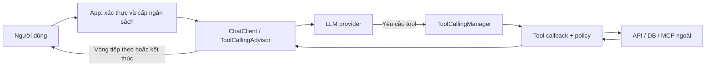
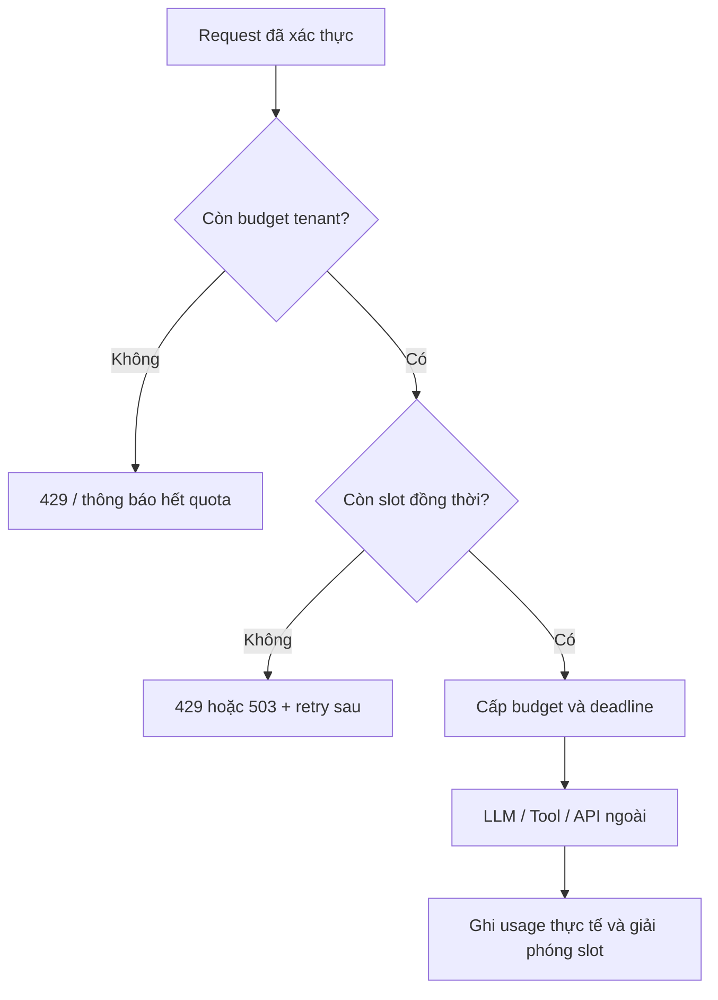

# Đặt timeout, quota và giới hạn phụ thuộc bên ngoài

Trong **SPRING_AI_TOOL_CALLING**, mô hình ngôn ngữ có thể yêu cầu gọi `@Tool`, `ToolCallback` hoặc công cụ trên MCP server. Ứng dụng Java mới là nơi thực thi và chịu trách nhiệm khi dịch vụ phía sau chậm, hết quota, trả lỗi hoặc ngừng hoạt động. Một yêu cầu người dùng tưởng như đơn giản có thể phát sinh nhiều **lượt gọi mô hình**, mỗi lượt lại có nhiều **tool call**, rồi mỗi tool call tiếp tục gọi HTTP API, cơ sở dữ liệu hoặc nhà cung cấp khác.

Chủ đề thuộc phần **Vận hành**: đặt giới hạn để sự cố ở một phụ thuộc không làm cạn thread, kết nối, tài nguyên dùng chung, chi phí token hoặc trải nghiệm của toàn bộ ứng dụng. Các ví dụ dựa trên **Spring AI 2.1.0**, và các giá trị thời gian/hạn mức bên dưới chỉ là **ví dụ để thiết kế và kiểm thử**, không phải cấu hình mặc định hay SLA được bảo đảm.

Sau bài học, bạn có thể:

- Phân biệt timeout của kết nối, một HTTP request, một tool call và deadline của **toàn bộ yêu cầu người dùng**.
- Áp dụng giới hạn số lần gọi tool của Spring AI 2.1, cùng quota theo tenant/người dùng và giới hạn đồng thời ở ứng dụng.
- Thiết kế retry, phản hồi lỗi, dừng vòng lặp, giám sát và kiểm thử khi API ngoài trả `429`, `5xx`, treo hoặc chậm bất thường.

## 1. Nhìn đúng đường đi của một yêu cầu



Mỗi mũi tên có thể bị chậm hoặc lỗi. Hơn nữa, khi mô hình yêu cầu tool, `ToolCallingAdvisor` của `ChatClient` có thể lặp lại quá trình gọi mô hình → thực thi tool → đưa kết quả về mô hình cho tới khi mô hình không còn yêu cầu công cụ. Gọi trực tiếp `ChatModel.call(...)` ở Spring AI 2.1 chỉ thu được yêu cầu tool; ứng dụng phải tự điều phối nếu dùng đường đi cấp thấp.

Ba loại giới hạn **giải quyết ba vấn đề khác nhau**:

| Lớp | Thứ cần giới hạn | Lỗi được ngăn chặn |
| --- | --- | --- |
| **Thời gian (timeout/deadline)** | Thời gian chờ kết nối, một lần I/O, toàn chuỗi | Tắc nghẽn vì phụ thuộc không trả lời |
| **Tần suất và sức chứa (quota/bulkhead)** | Request/phút, token/ngày, lượt đồng thời, kết nối | Vượt hạn mức nhà cung cấp, làm quá tải phụ thuộc |
| **Số bước (tool/model loop limit)** | Số tool call, số vòng gọi mô hình, số lần thử lại | Mô hình gọi lặp, thao tác bị nhân lên, chi phí không kiểm soát |

Một giới hạn tốt ở lớp này không tự bảo vệ các lớp còn lại. Ví dụ `max-total-tool-calls: 6` không ngăn **một** lần gọi HTTP bị treo mãi nếu timeout I/O không được cấu hình.

## 2. Thiết kế deadline từ ngoài vào trong

### 2.1. Bốn mốc thời gian cần phân biệt

| Mốc | Bắt đầu – kết thúc | Cách thực thi |
| --- | --- | --- |
| **Connect timeout** | Mở kết nối TCP/TLS đến dịch vụ ngoài | HTTP client/SDK hoặc transport |
| **Request/response timeout** | Gửi một request và nhận phản hồi, theo ngữ nghĩa của client | `HttpRequest.timeout`, SDK provider hoặc MCP `request-timeout` |
| **Tool-call timeout** | Từ lúc bắt đầu gọi callback cho đến khi có kết quả hoặc lỗi | Client của phụ thuộc, deadline truyền xuống, timeout thao tác |
| **End-to-end deadline** | Từ lúc app nhận yêu cầu người dùng đến lúc trả lời/dừng | Chính sách ứng dụng; phải bao trùm cả các lượt model, tool, retry và xếp hàng |

Trong hệ thống phục vụ HTTP, deadline tổng phải tính cả thời gian xếp hàng và gửi phản hồi. Nếu request ngoài được timeout sau 2 giây, nhưng gọi lại ba lần và mỗi lần backoff, thì **toàn bộ** tool vẫn có thể chiếm hơn 6 giây. Nếu sau đó mô hình suy luận thêm hai vòng, tổng thời gian còn tăng nữa.

Ví dụ ngân sách **minh họa** cho endpoint cần phản hồi trong khoảng 15 giây:

| Thành phần | Ngân sách thiết kế |
| --- | ---: |
| Nhận request, xác thực, điều phối và trả response | 1 giây |
| Gọi mô hình ban đầu | 5 giây |
| Chờ API đơn hàng (gồm cả retry nếu có) | 2 giây |
| Gọi mô hình tổng hợp cuối | 5 giây |
| Dự phòng biến động | 2 giây |
| **Tổng** | **15 giây** |

Đây là **ngân sách theo giai đoạn**, không phải một lời hứa rằng mọi mô hình sẽ trả trong 5 giây. Cần đo số liệu thực tế và chấp nhận trả lời suy giảm khi không đủ thời gian.

Thiết kế an toàn dùng **deadline tuyệt đối** (ví dụ thời điểm kết thúc theo đồng hồ đơn điệu của tiến trình), mỗi khi xuống phụ thuộc tính thời gian còn lại rồi lấy **giá trị nhỏ hơn** giữa cấu hình của phụ thuộc và ngân sách còn lại. Khi thời gian còn lại không đủ cho thao tác tiếp theo, dừng sớm. Không cho retry bắt đầu nếu nó vượt quá deadline.

```text
timeout cho HTTP ngoài = min(timeout cấu hình cho HTTP, deadline còn lại - phần dự phòng)
deadline của một bước không được vượt deadline của toàn yêu cầu
```

Trong Java, `System.nanoTime()` phù hợp để đo khoảng thời gian; không dùng `System.currentTimeMillis()` để suy ra thời gian đã trôi qua vì đồng hồ hệ thống có thể bị điều chỉnh. Khi chạy đa tiến trình, truyền deadline ở ranh giới hệ thống bằng timestamp hoặc TTL thích hợp, sau đó quy đổi về thời gian còn lại trên từng tiến trình.

### 2.2. Timeout không đồng nghĩa hủy công việc

Trả `TIMEOUT` cho người dùng không bảo đảm request HTTP hay thao tác phía server đã dừng. Một lệnh ghi dữ liệu có thể **đã thành công ở dịch vụ ngoài** nhưng phản hồi bị mất. `CompletableFuture.orTimeout(...)` và timeout ở lớp controller cũng không tự động hủy một I/O blocking trong thread khác. Cần hỗ trợ hủy từ SDK/transport, sử dụng timeout I/O thật, giới hạn tác vụ tồn đọng và kiểm tra trạng thái giao dịch khi kết quả không rõ.

Riêng tool gọi hành động thay đổi trạng thái (hủy đơn, chuyển tiền, tạo booking), phải có **idempotency key** hoặc cơ chế xác định thao tác đã xảy ra trước khi retry.

## 3. Cấu hình cụ thể trong Spring AI 2.1

### 3.1. Các thuộc tính cho OpenAI, tool call và MCP

Ví dụ `application.yml` cho một triển khai dùng OpenAI Chat và tùy chọn kết nối MCP:

```yaml
spring:
  ai:
    openai:
      timeout: 12s
      max-retries: 1
    tools:
      limits:
        max-calls-per-tool-default: 3
        max-calls-per-tool:
          getOrderStatus: 2
          estimateShipping: 2
        max-total-tool-calls: 5
        on-limit-exceeded: THROW
    mcp:
      client:
        request-timeout: 3s
        modern:
          call-timeout: 6s
```

Ý nghĩa:

- `spring.ai.openai.timeout` là timeout cho request tới **OpenAI Java SDK**; `spring.ai.openai.max-retries` là giới hạn retry của **SDK OpenAI**, không phải số lần callback `@Tool` được chạy. Cấu hình này không tạo ra deadline 15 giây cho toàn bộ chuỗi hội thoại.
- `spring.ai.tools.limits.*` giới hạn **số lần gọi công cụ trong một turn**, kể cả khi có nhiều lần gọi mô hình. Có thể đặt trần chung và trần riêng cho công cụ tốn kém.
- `spring.ai.mcp.client.request-timeout` là thời gian cho **một trao đổi** với MCP server. `spring.ai.mcp.client.modern.call-timeout` áp dụng cho **toàn một MCP call** của kết nối dùng giao thức `MODERN` (bao gồm các trao đổi và thời gian chờ input). Cấu hình `modern` không biến transport `LEGACY` thành `MODERN`.

Các property phụ thuộc starter/provider thực sự được nạp; chỉ thêm key vào YAML không bảo đảm tạo giới hạn cho một REST client tùy chỉnh bên trong `@Tool`. Trên OpenAI Responses API vẫn cần xem đúng các options của endpoint, còn Anthropic dùng `spring.ai.anthropic.timeout` và `spring.ai.anthropic.max-retries`. Với model khác, phải kiểm tra tài liệu provider; không gán một property “toàn cục” cho mọi SDK.

**Phân biệt chính sách retry:** Trong Spring AI 2.1, một số tích hợp dùng cơ chế retry của Spring AI với nhóm `spring.ai.retry.*`, còn OpenAI/Anthropic dùng retry của SDK tương ứng. Vì vậy cần đối chiếu tích hợp/phiên bản đang sử dụng và tránh vô ý chồng hai bộ retry. Khi có `429` hoặc `503`, dù client tự retry vẫn phải nằm trong deadline tổng và quota còn lại.

### 3.2. Giới hạn tool call là tính năng của Spring AI 2.1

`DefaultToolCallingManager` trong Spring AI 2.1 có mức mặc định **40 lần mỗi công cụ trong một turn** và **150 lần tổng cộng trong một turn**. Đây là giới hạn an toàn rộng, thường **quá lớn** đối với một nghiệp vụ như tra trạng thái đơn. Mỗi turn tính từ `UserMessage` cuối; bộ đếm không phải quota theo giờ/ngày của tenant, và **không** giới hạn số token hoặc thời gian thực thi.

Ngoài YAML, có thể cấu hình chương trình:

```java
// Giả sử chatModel là ChatModel đã cấu hình.
var manager = ToolCallingManager.builder()
    .maxCallsPerTool(3)
    .maxCallsPerTool("getOrderStatus", 2)
    .maxTotalToolCalls(5)
    .onLimitExceeded(ToolCallLimitBehavior.THROW)
    .build();

var advisor = ToolCallingAdvisor.builder()
    .toolCallingManager(manager)
    .build();

var client = ChatClient.builder(chatModel)
    .defaultAdvisors(advisor)
    .build();
```

Trong ví dụ, cần import các lớp tương ứng từ Spring AI 2.1; `ToolCallingAdvisor` được cấu hình riêng để thay cho advisor mặc định. Đừng đăng ký hai `ToolAdvisor` trên cùng một `ChatClient`. Trong ứng dụng tự cấu hình `ToolCallingManager`, chọn **một** nơi làm nguồn cấu hình hạn mức để tránh kỳ vọng YAML đang áp dụng nhưng bean tùy chỉnh đã thay thế nó.

Hai cách xử lý khi chạm trần:

| `onLimitExceeded` | Hành vi Spring AI 2.1 | Nên dùng khi |
| --- | --- | --- |
| `THROW` (mặc định) | Manager phát `ToolCallLimitExceededException`; `ToolCallingAdvisor` bắt và trả **final response** thể hiện dừng vì vượt hạn mức, kèm metadata của tool call đã hoàn tất trước đó nếu có | Không được tiếp tục vòng lặp |
| `RETURN_ERROR_RESPONSE` | Bỏ qua lệnh vượt trần, tạo `ToolResponse` lỗi và đưa lại vào hội thoại; mô hình có thể tiếp tục | Muốn model giải thích hết hạn mức, có **giới hạn dừng bổ sung** |

Không mặc định hiểu `THROW` là exception văng ra HTTP controller: khi qua `ToolCallingAdvisor`, nó được biến thành phản hồi kết thúc. Lớp ứng dụng phải kiểm tra finish reason/metadata và trình bày lỗi có kiểm soát, tránh cho rằng đó là một câu trả lời nghiệp vụ thành công.

## 4. Bảo vệ một `@Tool` gọi dịch vụ HTTP ngoài

Giả sử trợ lý tra cứu đơn hàng. Dữ liệu “đơn đang giao” phải lấy từ hệ thống đơn hàng, không suy đoán từ prompt. Chuỗi thực thi có hai vòng kiểm soát:

1. **Trước callback:** request đã qua xác thực, chọn tập tool được phép, cấp quota và deadline.
2. **Trong callback:** kiểm tra tenant và tham số, giới hạn số call đồng thời, gọi API với timeout và xử lý phản hồi theo loại lỗi.

Ví dụ dưới đây minh họa chặn quá tải bằng một `Semaphore` cục bộ và lấy tenant tin cậy qua `ToolContext`:

```java
import java.util.concurrent.Semaphore;
import org.springframework.ai.tool.ToolContext;
import org.springframework.ai.tool.annotation.Tool;
import org.springframework.ai.tool.annotation.ToolParam;

interface OrderGateway {
    // Tự kiểm tra quyền theo tenant + orderId, gọi API với timeout riêng.
    String statusFor(String tenantId, String orderId);
}

public final class OrderTools {

    private final OrderGateway orders;
    private final Semaphore inFlight = new Semaphore(8);

    public OrderTools(OrderGateway orders) {
        this.orders = orders;
    }

    @Tool(name = "getOrderStatus",
          description = "Đọc trạng thái một đơn hàng của tenant hiện tại")
    public String getOrderStatus(
            @ToolParam(description = "Mã đơn, ví dụ DH-102") String orderId,
            ToolContext toolContext) {

        Object tenant = toolContext.getContext().get("tenantId");
        if (!(tenant instanceof String tenantId) || tenantId.isBlank()) {
            throw new SecurityException("UNAUTHORIZED");
        }
        if (orderId == null || !orderId.matches("DH-[0-9]{1,10}")) {
            return "INVALID_ORDER_ID";
        }
        if (!inFlight.tryAcquire()) {
            return "UPSTREAM_BUSY"; // Fail fast; không tạo hàng đợi vô hạn.
        }
        try {
            return orders.statusFor(tenantId, orderId);
        }
        finally {
            inFlight.release();
        }
    }
}
```

`Semaphore(8)` ở trên chỉ khống chế **tám lời gọi đang chạy trong một instance ứng dụng**; nó không phải quota theo tenant, QPS toàn cụm hay giới hạn thread của web server. Ở production, dùng rate limiter/bulkhead tại API gateway hoặc hệ thống chia sẻ (ví dụ Redis) nếu có nhiều instance, đồng thời thêm timeout cho cuộc gọi HTTP thật sự. `OrderGateway` bắt buộc xác minh tenant có quyền xem **đơn cụ thể**, không chỉ kiểm tra chuỗi `orderId`.

Ứng dụng lấy `tenantId` từ authentication context rồi cấp vào tool context; không để model khai báo tự do:

```java
String reply = ChatClient.create(chatModel)
    .prompt("Kiểm tra trạng thái đơn DH-102")
    .tools(new OrderTools(orderGateway))
    .toolContext(java.util.Map.of("tenantId", authenticatedTenantId))
    .call()
    .content();
```

Đây là chỗ để truyền danh tính đáng tin mà không đưa tenantId vào JSON schema do mô hình sinh ra. Cũng không đưa API key, access token hay toàn bộ security principal vào kết quả tool gửi về LLM.

### 4.1. Timeout bên trong `OrderGateway`

Một HTTP client tiêu chuẩn của Java 17+ có thể giới hạn **kết nối** và **request** như sau; đây là đoạn minh họa cách dựng transport, chưa bao gồm auth/giải mã JSON ở nghiệp vụ:

```java
import java.net.URI;
import java.net.http.HttpClient;
import java.net.http.HttpRequest;
import java.net.http.HttpResponse;
import java.time.Duration;

HttpClient http = HttpClient.newBuilder()
    .connectTimeout(Duration.ofMillis(500))
    .build(); // Nên tái sử dụng, không khởi tạo cho mỗi tool call.

HttpRequest request = HttpRequest.newBuilder(
        URI.create("https://orders.internal.example/api/orders/DH-102"))
    .timeout(Duration.ofSeconds(2))
    .header("Accept", "application/json")
    .GET()
    .build();

HttpResponse<String> response =
    http.send(request, HttpResponse.BodyHandlers.ofString());

// Sau đó: kiểm tra status code, quyền truy cập và schema kết quả.
```

Trong code production, xử lý `HttpTimeoutException`, `IOException` và `InterruptedException`; nếu bắt `InterruptedException` thì khôi phục interrupt flag bằng `Thread.currentThread().interrupt()` trước khi kết thúc. Tránh trả raw exception message hoặc nguyên JSON lớn về mô hình. Đặt giới hạn kích thước payload, số bản ghi và trường được phép trả; giấu PII, header xác thực và lỗi nội bộ.

**Chú ý:** `HttpRequest.timeout` giới hạn một request theo ngữ nghĩa của Java client; không tạo deadline cho toàn bộ hội thoại và không bảo đảm hoàn tác tác vụ đã được server tiếp nhận. Với Spring `RestClient`/`WebClient` cũng cần cấu hình timeout ở HTTP transport thực tế; một annotation `@Tool` không tự sinh timeout.

### 4.2. MCP server là phụ thuộc ngoài có hai lớp thời gian

Với MCP tool, nên phân biệt:

- `spring.ai.mcp.client.request-timeout`: thời gian chờ một trao đổi với MCP server (mặc định tài liệu Spring AI 2.1 là `20s`).
- `spring.ai.mcp.client.modern.call-timeout`: giới hạn **toàn MCP call** với modern transport, kể cả các lần trao đổi và chờ tương tác, nếu được cấu hình.
- **Connect timeout** của MCP transport: độc lập với `request-timeout`; với JDK transport, Spring AI 2.1 mô tả mặc định SDK khoảng `10s` và cách cấu hình qua `McpClientCustomizer<HttpClientMcpTransport.Builder>`.

Với HTTP endpoint MCP bị mất kết nối, phải quyết định rõ “mất kết nối” có nghĩa là chưa chạy hay đã chạy nhưng mất phản hồi, đặc biệt với tool có tác dụng phụ. Đặt deadline ngoài ở ứng dụng, tránh dùng cấu hình MCP làm trần thời gian toàn hội thoại.

## 5. Quota: từ số lần gọi đến chi phí và độ công bằng

“Quota” có nhiều đơn vị; không nên dùng một counter thay cho mọi loại:

| Loại | Phạm vi ví dụ | Cách áp dụng |
| --- | --- | --- |
| **Request rate** | 30 request/phút/tenant đến tool tra cứu | Rate limiter kiểu token bucket/sliding window tại ingress |
| **Concurrent calls** | Tối đa 8 request đang chạy đến service đơn hàng/instance | Bulkhead/semaphore, từ chối sớm hoặc hàng đợi nhỏ |
| **Call budget/turn** | Tối đa 5 tool call trên một lượt người dùng | `spring.ai.tools.limits.max-total-tool-calls` |
| **Token budget** | N token/ngày/tenant hoặc khoản tiền/ngày | Ước lượng trước, đối soát usage sau gọi model |
| **Provider quota** | RPM/TPM/token hoặc credit của API model bên ngoài | Giới hạn đầu vào theo thấp hơn giữa hạn mức provider và ngân sách tổ chức |
| **Dependency quota** | 500 request/phút tới API đối tác | Bucket riêng theo partner/key, chia công suất giữa các tenant |

**Phạm vi** là yếu tố quyết định. Bộ đếm 5 tool call/turn trong `ToolCallingManager` không chia sẻ trạng thái qua các request, qua nhiều JVM, hay giữa ngày hôm nay và ngày mai. Muốn hạn mức ngày, cần **bộ đếm riêng** theo tenant/user/tool với thao tác cập nhật nguyên tử và TTL phù hợp. Nên hạn chế số nhãn/counter có độ đa dạng cao để tránh tiêu thụ bộ nhớ và bùng nổ metrics.

Luồng admission control gợi ý:



Khi nhiều request của cùng tenant chạy song song, không dùng cách “đọc counter → thấy còn → tăng sau” không nguyên tử; cả hai request có thể vượt quota. Sử dụng cơ chế **reserve trước**, điều chỉnh theo usage thực tế sau, định nghĩa rõ có hoàn quota hay không khi request lỗi, và không đếm trùng retry nội bộ thành request mới từ người dùng.

Đừng trộn **quota của người dùng** với **quota của nhà cung cấp**. Ngay cả khi user còn 20 lượt, account OpenAI hoặc đối tác có thể đã hết token/phút. Trường hợp đó cần từ chối/throttle ở phía app, phân phối công suất công bằng và bảo vệ dịch vụ ngoài.

## 6. Retry, backoff và circuit breaker

### 6.1. Chỉ retry điều có khả năng phục hồi

| Tín hiệu | Cách xử lý gợi ý | Vì sao |
| --- | --- | --- |
| `408` / timeout trước khi chắc chắn có kết quả | Có thể retry **đọc thuần**, trong deadline và số lượt còn lại | Không rõ trạng thái server khi timeout |
| `429` rate limit | Tôn trọng `Retry-After` nếu có, giảm tốc chung; không tất cả client retry cùng lúc | Tránh tạo thác lưu lượng |
| `502/503/504` tạm thời | Retry có giới hạn, exponential backoff + jitter, hoặc circuit breaker | Thường là lỗi nhất thời |
| `400` schema/đối số sai | Không retry nguyên request; sửa đầu vào | Lặp lại không tự làm dữ liệu đúng |
| `401/403` thiếu quyền | Không retry bằng cùng danh tính; dừng và báo quyền | Tránh làm nhiễu hệ thống xác thực |
| Thao tác ghi đã gửi nhưng mất phản hồi | Kiểm tra trạng thái/idempotency trước khi retry | Tránh thực hiện hai lần |

Tính trần của retry theo **số lần thử** và **thời gian còn lại**. Ví dụ request HTTP tối đa 2 giây, thử 2 lần với backoff 200 ms có thể mất khoảng 4,2 giây, chưa tính xếp hàng và overhead. Nếu ngân sách cho tool chỉ còn 2 giây, không nên cho phép lần thử thứ hai.

Tránh retry theo **ba lớp lồng nhau**: SDK tự retry model → advisor tự lặp tool → HTTP client của tool cũng retry. Nếu mỗi lớp thử 3 lần, số thao tác phía sau có thể phình ra nhiều lần so với dự kiến. Lập bảng ai chịu trách nhiệm retry cho từng tuyến I/O và đo số `attempt` thực sự.

### 6.2. Circuit breaker và bulkhead có mục đích khác nhau

- **Circuit breaker** mở khi phụ thuộc lỗi liên tục, giúp bỏ qua kết nối có khả năng thất bại và cho thử lại có kiểm soát khi hồi phục.
- **Bulkhead** khống chế số tác vụ đồng thời hoặc tài nguyên được cấp cho một phụ thuộc, để dịch vụ đơn hàng bị chậm không chiếm hết thread phục vụ các chức năng khác.
- **Rate limiter** giảm tốc độ theo cửa sổ thời gian; nó không tự khống chế số request đang chạy lâu.

Spring AI không tự tạo circuit breaker cho **mọi** phương thức Java được gắn `@Tool`. Triển khai ở `OrderGateway`/service bằng thư viện resilience được chọn, HTTP gateway, hoặc hạ tầng chung; nhớ rằng timeout, retry và circuit breaker phải cùng một **deadline thực tế**.

## 7. Ứng xử khi không thể hoàn tất

Khi tool bị timeout hoặc hết hạn mức, không nên đưa stack trace, host nội bộ, SQL, secret hay dữ liệu đơn hàng khác vào thông điệp mà mô hình nhận. Chuẩn hóa kết quả ở ranh giới service, ví dụ:

```json
{
  "ok": false,
  "errorCode": "UPSTREAM_TIMEOUT",
  "retryable": false,
  "message": "Không thể lấy trạng thái đơn lúc này."
}
```

`retryable: false` trong ví dụ có nghĩa **không retry trong turn hiện tại** vì ngân sách đã hết; đây là quyết định ứng dụng, dù lỗi hạ tầng có thể tạm thời. Một trường hợp trả về `UPSTREAM_BUSY` nên hướng UI đề nghị thử lại sau, không ép mô hình tiếp tục gọi công cụ ngay lập tức.

Spring AI 2.1 đưa ngoại lệ tool qua `ToolExecutionExceptionProcessor`. Mặc định, thông điệp của `RuntimeException` có thể được gửi lại cho model, còn checked exception và `Error` bị ném ra; có thể đổi chiến lược bằng `spring.ai.tools.throw-exception-on-error=true` hoặc cung cấp processor riêng. Khi xử lý dữ liệu nhạy cảm, cần **sanitization** trước khi exception tới lớp này. Sự cố quota là trạng thái nghiệp vụ vận hành, không nên chỉ phát tán `Exception.getMessage()` một cách máy móc.

Phân loại phản hồi cuối cho người dùng:

- **Thành công:** Dữ liệu tool hợp lệ, đủ mới, người dùng được quyền truy cập.
- **Thành công một phần:** Một dịch vụ phụ bị chậm; trình bày phần đã xác minh và ghi rõ phần còn thiếu.
- **Không thể phục vụ:** Deadline/quota/giới hạn vòng lặp đã hết hoặc dịch vụ cốt lõi không sẵn sàng; trả thông điệp ngắn gọn cùng hướng xử lý tiếp.
- **Không rõ kết quả giao dịch:** Đối với thao tác ghi, tra cứu tình trạng giao dịch qua idempotency key; tuyệt đối không khẳng định đã thất bại hay thành công khi chưa xác minh.

`returnDirect = true` trên tool có thể tránh một lượt gọi mô hình bổ sung trong những trường hợp kết quả tool chính là phản hồi cuối; đó là lựa chọn giảm độ trễ **theo từng tool**, không thay thế cơ chế phân quyền, quota hay giới hạn phụ thuộc.

## 8. Giám sát timeout và quota để biết giới hạn có hiệu lực

Theo dõi theo các cấp: request người dùng → lượt model → tool call → outbound API. Spring AI 2.1 phát Micrometer observation cho tool dưới tên `spring.ai.tool`; kết hợp span HTTP client và trace ID của yêu cầu để thấy đoạn nào chậm.

| Tín hiệu | Cần quan sát | Cách diễn giải |
| --- | --- | --- |
| Latency | p50/p95/p99 của request, model, tool và upstream | p99 tăng trước khi người dùng bắt đầu timeout |
| Từ chối | Số lần chạm quota, không nhận slot, mở circuit | Hệ thống đang tự bảo vệ hay đang thiếu công suất |
| Vòng lặp | Số tool call/turn, số model request/turn, lý do kết thúc | Nhận biết model gọi lặp bất thường |
| Retry | Attempt/operation, backoff, `429`/`503` | Xem retry có làm nặng sự cố không |
| Chi phí | Token input/output, mức dùng theo tenant | Phát hiện tăng chi phí dù không tăng request |
| Phụ thuộc | Connect timeout, request timeout, response bytes, active calls | Phân biệt lỗi mạng, lỗi API, tải lớn |

Không gắn `userId`, `orderId` hay nguyên đối số/kết quả nhạy cảm làm metric label; dùng key có cardinality hữu hạn như `tool.name`, `dependency.name`, `error.code` và định danh tenant đã được kiểm soát trong hệ thống kế toán quota nếu cần. Khi cần debug một sự cố cụ thể, tra theo trace ID với log đã che dữ liệu.

Một cảnh báo hữu ích: nếu p95 tool latency tăng cùng số slot `inFlight` chạm trần, chính phụ thuộc có thể đang chậm. Nếu p95 model latency tăng và tỷ lệ `429` từ provider cũng tăng, xem lại quota và retry của model trước khi nâng giới hạn tool.

## 9. Kiểm thử điều kiện biên

Trong kiểm thử, thay API ngoài bằng HTTP mock/server có thể chủ động trì hoãn, trả `429` và cắt kết nối. Không cần gọi API thật hay phụ thuộc vào đáp án không xác định của mô hình để xác nhận các chính sách vận hành.

| Tình huống | Thiết lập | Điều kiện PASS |
| --- | --- | --- |
| API treo | Giữ kết nối quá request timeout | Tool dừng, slot được giải phóng, không tích tụ thread |
| Connect timeout | Host không phản hồi bắt tay kết nối | Lỗi xảy ra trong giới hạn connect timeout |
| Quota theo tenant | N request đồng thời vượt ngưỡng | Quyết định cấp/từ chối là nguyên tử, không cấp quá quota |
| Bulkhead đầy | Chiếm hết 8 slot trong ví dụ | Request mới bị từ chối nhanh, không treo đợi vô hạn |
| `429` và `Retry-After` | API ngoài giới hạn tốc độ | Dừng hoặc chờ trong deadline, không “retry storm” |
| Tool call vượt giới hạn | Mô hình yêu cầu quá `max-total-tool-calls` | Loop kết thúc hoặc nhận lỗi theo cấu hình; không chạy thêm tool |
| Hai tool call cùng phản hồi | Một thành công, một vượt trần | Đánh dấu rõ kết quả đã thực hiện và lý do dừng |
| Thao tác ghi timeout sau khi server commit | Cắt kết nối sau commit | Retry có idempotency, không tạo bản ghi thứ hai |
| Client ngắt kết nối giữa chừng | Hủy request ở UI | Không có tác vụ vô hạn; hủy/thu hồi tài nguyên theo transport |
| Model không còn thời gian | Deadline còn ít hơn thời gian tối thiểu cho bước sau | Dừng có kiểm soát, không bắt đầu một vòng mới |

Đo **thời gian thực tế**, số lần outbound HTTP, số lần callback chạy, số slot đang chiếm và phản hồi ứng dụng. Với `ToolCallingAdvisor`, kiểm tra cả finish reason cho `ToolCallLimitExceededException`; đừng chỉ assert có hoặc không có text.

## 10. Áp dụng vào triển khai vận hành

Đối với một trợ lý tra đơn hàng, cấu hình ban đầu có thể là:

1. Nhận yêu cầu, xác thực người dùng, cấp quota theo tenant và deadline tổng.
2. Chỉ đưa vào request các tool có quyền truy cập; với tool đọc, đặt timeout ở outbound client và chặn đồng thời bằng bulkhead.
3. Giới hạn số tool call/turn thấp hơn mặc định Spring AI 2.1; đặt riêng giới hạn với tool có chi phí lớn.
4. Để retry cho **một lớp sở hữu cụ thể**, chỉ với lỗi có thể phục hồi, không vượt deadline; các lệnh ghi có idempotency key.
5. Khi quota, timeout hoặc circuit breaker kích hoạt, trả lỗi đã chuẩn hóa; ngừng vòng suy luận và bảo toàn thông tin giao dịch đã xảy ra.
6. Theo dõi p95/p99, số lỗi, số lượt thực thi, token và số lần bị giới hạn; điều chỉnh theo số liệu thực tế.

Điều cần ghi nhớ: **timeout** giới hạn thời gian chờ, **quota** giới hạn công suất/chi phí, còn **tool-call limit** giới hạn số bước suy luận có thể thực thi. Một ứng dụng Spring AI tool calling an toàn cần kết hợp cả ba với **deadline xuyên suốt, quyền nghiệp vụ và hành vi khi thất bại**, thay vì trông chờ mô hình tự dừng hoặc một property đơn lẻ kiểm soát mọi phụ thuộc.

### Tài liệu đối chiếu

- [Spring AI 2.1.0 — Tool Calling](https://docs.spring.io/spring-ai/reference/api/tools.html): `ToolCallingAdvisor`, `ToolCallingManager`, giới hạn tool call, exception processor và `ToolContext`.
- [Spring AI 2.1.0 — ToolCallingAdvisor](https://docs.spring.io/spring-ai/reference/api/tools/tool-calling-advisor.html): vòng thực thi, manager tùy chỉnh và hành vi dừng.
- [Spring AI 2.1.0 — OpenAI Chat](https://docs.spring.io/spring-ai/reference/api/chat/openai-chat.html): timeout và max retries của OpenAI SDK.
- [Spring AI 2.1.0 — Anthropic Chat](https://docs.spring.io/spring-ai/reference/api/chat/anthropic-chat.html): timeout và max retries của Anthropic SDK.
- [Spring AI 2.1.0 — MCP Client Boot Starter](https://docs.spring.io/spring-ai/reference/api/mcp/mcp-client-boot-starter-docs.html): `request-timeout`, modern `call-timeout` và connect timeout của transport.
- [Spring AI — Retry (tham khảo đối chiếu theo tích hợp)](https://docs.spring.io/spring-ai/reference/2.1-SNAPSHOT/resilience/retry.html): phân biệt các model dùng Spring AI retry với các SDK tự retry; chú ý trang SNAPSHOT có thể thay đổi so với bản 2.1.0 được triển khai.
- [Java 17 — HttpRequest.timeout](https://docs.oracle.com/en/java/javase/17/docs/api/java.net.http/java/net/http/HttpRequest.Builder.html#timeout(java.time.Duration)): timeout của một HTTP request.
