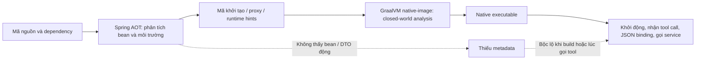

# Kiểm tra reflection, AOT và native image theo phiên bản

> **Chương:** Vận hành • **Module:** SPRING_AI_TOOL_CALLING • **Mốc đối chiếu:** Spring AI **2.1.0 GA** (20/11/2026), Spring Boot **4.2.0**, Spring Framework 7 và GraalVM Native Image. Các bản Spring AI 1.x, 2.0.x có khác biệt cần đọc theo đúng phiên bản đang dùng; không lấy hướng dẫn mới áp nguyên xi cho bản cũ.

## 1. Mục tiêu và tình huống vận hành

Một ứng dụng Java có `ChatClient`, hai phương thức đánh dấu `@Tool` và một service nghiệp vụ tra tồn kho. Trên JVM, mô hình đề nghị gọi `getStock("SP-42")` và câu trả lời đúng. Sau khi đóng gói GraalVM native executable, ứng dụng vẫn khởi động nhưng lỗi khi tạo tool schema, giải mã JSON vào DTO hoặc gọi phương thức bằng reflection. Một trường hợp khác: bản native không còn đăng ký tool vì bean chứa tool chỉ xuất hiện khi bật một property ở thời điểm chạy.

Sau bài này, người học có thể:

- Phân biệt **reflection trên JVM**, **Spring Ahead-of-Time (AOT)** và **GraalVM Native Image**; biết lỗi xuất hiện ở pha nào.
- Kiểm tra cách khai báo `@Tool`, `ToolCallback`, schema JSON, DTO đầu vào/đầu ra và `ToolContext` để chạy trong native image.
- Biết **khi nào phải thêm runtime hints** (`@RegisterReflection`, `@RegisterReflectionForBinding`, `RuntimeHintsRegistrar`) và khi nào Spring AOT đã tự xử lý.
- Chọn lệnh build, kiểm tra artifacts và thực thi kiểm thử theo **đúng tổ hợp phiên bản** Spring AI – Boot – GraalVM/JDK.
- Xây tiêu chí PASS rõ ràng cho tool discovery, quyền truy cập, vòng gọi tool, lỗi và hành vi native tương đương JVM.

**Nguyên tắc quan trọng:** build native thành công chỉ chứng minh chương trình *có thể tạo executable*; chưa chứng minh mọi đường gọi tool, dữ liệu JSON và quyền nghiệp vụ đều chạy đúng.

## 2. Vì sao JVM chạy nhưng native image có thể lỗi?

### 2.1. Reflection và giả định “thấy lớp khi chạy”

Một `@Tool` thường được Spring AI chuyển thành `MethodToolCallback`: Spring lấy thông tin phương thức, tham số, mô tả/schema và gọi phương thức khi model đưa yêu cầu. Một đường khác là `FunctionToolCallback`, nơi ứng dụng cung cấp một function với kiểu đầu vào để sinh schema. DTO có thể tiếp tục được Jackson chuyển từ JSON sang Java và từ Java ra chuỗi kết quả.

Trên JVM, framework có thể khám phá lớp, phương thức, constructor và annotation bằng reflection tại runtime. GraalVM Native Image dùng mô hình **closed world**: khi biên dịch, trình phân tích reachability chỉ giữ lại những thành phần được xác định là cần thiết. Các truy cập reflection, resource, proxy, serialization mà trình phân tích không thể suy ra thường phải có **reachability metadata** / **runtime hints**. Vì thế không nên coi “ứng dụng chạy trên JVM” là bằng chứng native image đã đăng ký đủ metadata.

### 2.2. Spring AOT làm gì?

Spring AOT xem xét `ApplicationContext` và môi trường cấu hình tại **build time**, sinh mã khởi tạo bean, proxy cần thiết và các JSON hint cho GraalVM. Native Image tiêu thụ những kết quả đó để tạo executable.



Spring AOT và GraalVM là **hai bước liên quan nhưng khác nhau**:

| Khái niệm | Thời điểm | Thực hiện | Rủi ro thường gặp |
| --- | --- | --- | --- |
| Reflection JVM | Khi ứng dụng hoạt động | Khám phá/gọi phương thức, constructor, truy cập dữ liệu | Có thể chạy đúng trên JVM nhưng che giấu phần metadata native còn thiếu |
| Spring AOT | Khi build | Phân tích Spring bean, điều kiện, proxy; sinh Java/classes và hints | Bean tạo theo property/profile tại runtime không được đưa vào tập AOT |
| GraalVM Native Image | Khi biên dịch executable | Phân tích reachability, liên kết mã và metadata thành binary | Một lớp/phương thức/resource chỉ được truy cập động có thể không sẵn có |
| Runtime native | Khi binary chạy | Thực thi tool, deserialize JSON, gọi service và provider | Lỗi `MissingReflectionRegistrationError`, lỗi binding, thiếu resource hoặc tool |

Với AOT, **classpath và tập bean được quyết định từ quá trình build**. Các cấu hình `@Profile` và `@ConditionalOnProperty` ảnh hưởng đến **sự hiện diện của bean** phải được quyết định nhất quán giữa build và chạy. Thay đổi `apiKey`, URL endpoint hoặc giá trị nghiệp vụ lúc chạy thường khác với thay đổi điều kiện *tạo hay không tạo bean*; hãy kiểm tra trực tiếp loại cấu hình đang dùng.

## 3. Khóa tương thích theo đúng phiên bản

| Dòng Spring AI | Nền tảng liên quan | Tác động đến tool/native cần xác minh |
| --- | --- | --- |
| **1.x** | Spring Boot **3.x**, Jackson 2 (đối chiếu từng minor) | Vòng tool-call từng nằm trong `ChatModel`. Đọc tài liệu/hints tương ứng 1.x; code cũ có thể dùng `toolNames` hoặc cơ chế resolver cũ. |
| **2.0.x** | Spring Boot **4.0/4.1**, Spring Framework 7, Jackson 3 | `ToolCallingAdvisor` của `ChatClient` đảm nhiệm vòng lặp; `toolNames`/`SpringBeanToolCallbackResolver` cũ bị loại bỏ, dùng `ToolCallback` rõ ràng. Khi nâng cấp cần kiểm thử lại DTO/schema và AOT. |
| **2.1.0 GA** | Spring Boot **4.2**, Spring Framework 7, Jackson 3 | Dùng reference Spring AI 2.1; hỗ trợ nội dung message parts mới và nâng cấp MCP. Thông báo phát hành xác nhận **MCP annotation** hoạt động trong GraalVM native image; cần kiểm tra cả `@McpTool` nếu ứng dụng dùng MCP. |
| **Bản tương lai, milestone, snapshot** | Xem BOM/release notes đúng bản | Không suy đoán tính năng từ bản GA khác; cần khóa tổ hợp build, xem thay đổi AOT, Jackson, SDK provider và kiểm thử lại native. |

**Ghi chú về 2.1.0:** bản GA ngày 20/11/2026 xây trên Boot 4.2; nếu dùng Spring AI 2.0.x hoặc 1.x, không nên ghép tự do với Boot 4.2 rồi kết luận thiếu hint. Mặt khác, một native image phải được build với toolchain phù hợp: hướng dẫn Spring Boot 4.2 cho **Buildpacks** và **GraalVM Native Build Tools** dùng **JDK 25**; lệnh và yêu cầu hệ điều hành có thể khác giữa hai đường build. Khóa chính xác Boot, Spring AI BOM, JDK/GraalVM, OS/kiến trúc và cả provider/model trong báo cáo lỗi.

**Phân biệt `@Tool` với `@McpTool`:** `@Tool` công bố chức năng cho `ChatClient` trong ứng dụng; `@McpTool` công bố một phương thức thành tool của **MCP server**. Spring AI 2.1 thông báo cải thiện native cho MCP annotations, nhưng điều đó không tự chứng minh mọi custom `ToolCallback` hoặc mọi thư viện SDK bên ngoài có đủ hints. Phải kiểm thử theo **đường thực thi thực sự được triển khai**.

## 4. Điểm kiểm tra số một: lớp chứa `@Tool`

### 4.1. Đưa lớp tool vào Spring context

Tài liệu Spring AI **2.1** nêu rõ: để AOT/GraalVM hoạt động với `@Tool`, **lớp chứa phương thức `@Tool` nên là Spring bean** (ví dụ `@Component`). Khi đó Spring AOT có thể thấy bean trong quá trình phân tích và đăng ký reflection tương ứng.

Ví dụ service tra cứu chỉ đọc (các type `InventoryService`/`StockView` do ứng dụng định nghĩa):

```java
import org.springframework.ai.tool.ToolContext;
import org.springframework.ai.tool.annotation.Tool;
import org.springframework.ai.tool.annotation.ToolParam;
import org.springframework.stereotype.Component;

@Component
public class InventoryTools {

    private final InventoryService inventoryService;

    public InventoryTools(InventoryService inventoryService) {
        this.inventoryService = inventoryService;
    }

    @Tool(description = "Tra số lượng có thể bán của một SKU")
    public StockView getStock(
            @ToolParam(description = "Mã SKU cần tra") String sku,
            ToolContext toolContext) {

        String tenantId = (String) toolContext.getContext().get("tenantId");
        // Cần validate sku, kiểm tra tenantId và quyền xem SKU trước khi đọc DB.
        return inventoryService.findAvailable(tenantId, sku);
    }
}
```

Và truyền bean đã inject cho `ChatClient`:

```java
import org.springframework.ai.chat.client.ChatClient;
import org.springframework.ai.chat.model.ChatModel;
import org.springframework.context.annotation.Bean;
import org.springframework.context.annotation.Configuration;

@Configuration(proxyBeanMethods = false)
class ChatConfiguration {
    @Bean
    ChatClient stockChatClient(ChatModel chatModel, InventoryTools inventoryTools) {
        return ChatClient.builder(chatModel)
                .defaultTools(inventoryTools)
                .build();
    }
}

// Trong service yêu cầu (lấy tenantId từ identity đã xác thực):
String answer = stockChatClient.prompt()
        .user("Kho còn bao nhiêu chiếc mã SP-42?")
        .toolContext(java.util.Map.of("tenantId", tenantId))
        .call()
        .content();
```

`ToolContext` là dữ liệu ứng dụng truyền **ngoài prompt của model**; tham số này không thuộc JSON schema đầu vào do model cung cấp. Native image không thay thế kiểm tra phân quyền: service vẫn phải xác thực tenant và quyền truy cập dữ liệu trên **mọi** lời gọi, kể cả khi model tạo JSON hợp lệ.

### 4.2. Nếu dùng POJO khởi tạo bằng `new` ngoài Spring context

Mẫu `.tools(new InventoryTools(...))` là hợp lệ khi chạy JVM, nhưng trong native image lớp tool không được Spring AOT tự khám phá chỉ vì nó được khởi tạo bằng `new` ở thời gian chạy. Theo **Spring AI 2.1 Tool Calling Reference**, hãy gắn `@RegisterReflection(memberCategories = MemberCategory.INVOKE_DECLARED_METHODS)` lên lớp chứa `@Tool` nếu lớp đó không phải Spring bean.

```java
import org.springframework.ai.tool.annotation.Tool;
import org.springframework.aot.hint.MemberCategory;
import org.springframework.aot.hint.annotation.RegisterReflection;

@RegisterReflection(memberCategories = MemberCategory.INVOKE_DECLARED_METHODS)
public class StandaloneTools {

    @Tool(description = "Kiểm tra trạng thái hệ thống")
    public String health() {
        return "UP";
    }
}
```

Phải đảm bảo annotation/hints được **phát hiện ở giai đoạn AOT** theo cách cấu hình hiện tại. Nếu lớp nằm ngoài phạm vi Spring AOT có thể quét, hoặc method được xây dựng hoàn toàn động, hãy đăng ký `RuntimeHints` một cách tường minh (xem mục 5). Không đăng ký reflection đại trà cho cả thư viện nếu chỉ cần một số method cụ thể.

### 4.3. Tool callback được tạo bằng code

Một `FunctionToolCallback` có `inputType` để dựng JSON schema, chẳng hạn:

```java
import org.springframework.ai.tool.function.FunctionToolCallback;

record StockRequest(String sku) {}

ToolCallback stockCallback = FunctionToolCallback
        .builder("getStock", (StockRequest req) ->
                inventoryService.findAvailable(tenantId, req.sku()))
        .description("Tra tồn kho theo mã SKU")
        .inputType(StockRequest.class)
        .build();
```

Trong mẫu này, `tenantId` chỉ là biến minh họa trong scope Java: **không** lấy giá trị tenant từ đối số model, và không tái sử dụng callback singleton nếu lambda bắt giữ dữ liệu của một người dùng. Khi callback được đăng ký/tạo động ở runtime, cần xác định trước những DTO và method sẽ bị truy cập động để Spring AOT/GraalVM nhìn thấy. Đối với provider MCP từ xa, đường HTTP/SDK có thể có yêu cầu metadata riêng; đừng suy đoán rằng các hint của `@Tool` cũng đủ cho SDK.

## 5. JSON binding, schema và runtime hints

Thường có **hai loại reflection cần kiểm tra độc lập**:

1. **Reflection để gọi Java method**: `MethodToolCallback` cần tìm và gọi phương thức `@Tool`.
2. **Reflection/binding để dựng schema, giải mã tham số và chuyển kết quả**: DTO có constructor/record component/getter/setter, nested type hoặc custom converter; Spring AI 2.x dùng Jackson 3 cho đường JSON. Hints chỉ cho phương thức có thể chưa đủ cho DTO.

Khi AOT chưa tự nhận diện DTO (ví dụ DTO chỉ xuất hiện trong `FunctionToolCallback.inputType` hoặc được dùng bên trong client/service), đăng ký binding cho type cần thiết:

```java
import org.springframework.aot.hint.annotation.RegisterReflectionForBinding;
import org.springframework.context.annotation.Configuration;

// DTO do ứng dụng sở hữu và dùng trong JSON của tool.
record StockRequest(String sku) {}
record StockView(String sku, int available) {}

@Configuration(proxyBeanMethods = false)
@RegisterReflectionForBinding({ StockRequest.class, StockView.class })
class ToolBindingHints {
}
```

**Lưu ý:** `@RegisterReflectionForBinding` đăng ký metadata phù hợp cho JSON binding, gồm các type lồng nhau mà binder nhận diện. Nó **không cấp quyền** cho tool, không kiểm tra input và không tự xử lý mọi thư viện JSON tùy biến. Nếu DTO đã được AOT phát hiện, thêm hint trùng lặp không giải quyết được nguyên nhân lỗi khác.

Dấu hiệu cần mở rộng kiểm tra gồm: DTO deserialize khác giữa JVM/native, Jackson báo thiếu constructor/creator, schema thiếu trường, record có nested type, custom serializer/deserializer, dùng reflection qua một SDK hay nội dung trong file resource không được đóng gói.

### 5.1. `RuntimeHintsRegistrar` cho resource, method và proxy

Khi một thành phần động không được AOT tự phát hiện, ứng dụng có thể cung cấp `RuntimeHintsRegistrar`. Đoạn dưới cố tình đăng ký **một resource rõ ràng** và **một method rõ ràng** để tránh gợi ý mở quyền reflection quá mức:

```java
import java.lang.reflect.Method;

import org.springframework.aot.hint.ExecutableMode;
import org.springframework.aot.hint.RuntimeHints;
import org.springframework.aot.hint.RuntimeHintsRegistrar;
import org.springframework.aot.hint.annotation.ImportRuntimeHints;
import org.springframework.context.annotation.Configuration;
import org.springframework.util.ReflectionUtils;

final class InventoryRuntimeHints implements RuntimeHintsRegistrar {

    @Override
    public void registerHints(RuntimeHints hints, ClassLoader classLoader) {
        Method method = ReflectionUtils.findMethod(StandaloneTools.class, "health");
        if (method == null) {
            throw new IllegalStateException("Không tìm thấy method health");
        }
        hints.reflection().registerMethod(method, ExecutableMode.INVOKE);
        hints.resources().registerPattern("prompts/stock-system.txt");
        // Chỉ đăng ký JDK proxy nếu code thực sự dùng proxy interface:
        // hints.proxies().registerJdkProxy(ExampleClient.class);
    }
}

@Configuration(proxyBeanMethods = false)
@ImportRuntimeHints(InventoryRuntimeHints.class)
class NativeConfiguration {
}
```

Spring Boot còn cho phép metadata JSON tĩnh trong `src/main/resources/META-INF/native-image/<group>/<artifact>-additional-hints/`. Đặt hints riêng ở thư mục **không xung đột** với thư mục Spring AOT sinh (`META-INF/native-image/<group>/<artifact>/`); ưu tiên `RuntimeHintsRegistrar` hoặc annotation rõ ràng để có thể kiểm thử bằng Java.

**Không dùng giải pháp hời hợt:** thêm mọi constructor/method với quyền reflection rộng, loại bỏ bảo mật hoặc đổi tên DTO cho đến khi hết lỗi có thể che khuất thiếu metadata thật. Chọn hint hẹp theo stack trace và hành vi có thể tái hiện.

## 6. Quy trình kiểm tra build theo phiên bản 2.1 / Boot 4.2

### 6.1. Ghi lại baseline trước build

Trước khi quy trách nhiệm cho native, ghi nhận một bộ thông tin có thể tái lập:

| Thành phần | Cần cố định / xác minh |
| --- | --- |
| Maven/Gradle | Tool và plugin phiên bản đang sử dụng; Spring Boot plugin, GraalVM Native Build Tools |
| Spring AI | `spring-ai-bom`, starter/model integration, Spring AI 2.1.0 GA |
| Spring Boot / Framework | Boot 4.2.0 và Framework 7 do Boot quản lý |
| Java / GraalVM | Vendor, phiên bản JDK/native-image, kiến trúc; với hướng dẫn Boot 4.2 dùng JDK 25 |
| Hệ điều hành build | Linux/macOS/Windows, CPU architecture và native toolchain; native-image không tự cross-compile giữa OS |
| Cấu hình AOT | Profiles, conditional bean properties, classpath, resource |
| Tool / provider | Danh sách tool ID/tên/schema, model/endpoint, biến cấu hình SDK |

Trên Windows, xây native executable trực tiếp cần toolchain tương ứng; hướng dẫn Boot khuyên dùng **x64 Native Tools Command Prompt** khi chạy native build vì giới hạn độ dài command line. Với build container, cần Docker/Buildpacks hoạt động và nguồn JDK phù hợp.

### 6.2. Maven: baseline có quản lý phiên bản

Ví dụ tối giản phần cấu hình để người học nhận biết thành phần; dự án thật cần bổ sung HTTP starter, phiên bản dependency được quản lý và cấu hình model/API key phù hợp:

```xml
<parent>
    <groupId>org.springframework.boot</groupId>
    <artifactId>spring-boot-starter-parent</artifactId>
    <version>4.2.0</version>
</parent>

<dependencyManagement>
    <dependencies>
        <dependency>
            <groupId>org.springframework.ai</groupId>
            <artifactId>spring-ai-bom</artifactId>
            <version>2.1.0</version>
            <type>pom</type>
            <scope>import</scope>
        </dependency>
    </dependencies>
</dependencyManagement>

<dependencies>
    <dependency>
        <groupId>org.springframework.ai</groupId>
        <artifactId>spring-ai-starter-model-openai</artifactId>
    </dependency>
</dependencies>

<build>
    <plugins>
        <plugin>
            <groupId>org.springframework.boot</groupId>
            <artifactId>spring-boot-maven-plugin</artifactId>
        </plugin>
        <plugin>
            <groupId>org.graalvm.buildtools</groupId>
            <artifactId>native-maven-plugin</artifactId>
        </plugin>
    </plugins>
</build>
```

Với `spring-boot-starter-parent`, profile `native` cung cấp cấu hình AOT/native thích hợp. Nếu không kế thừa parent, phải cấu hình thêm execution `process-aot` của Spring Boot và reachability metadata của Native Build Tools theo tài liệu.

Các bước minh họa để **người vận hành chạy trên project thực**:

```bash
# Chạy JVM thường để có baseline
mvn test
mvn package

# Tạo jar có AOT assets, sau đó chạy nó trên JVM ở chế độ AOT
mvn -Pnative package
java -Dspring.aot.enabled=true -jar target/my-app.jar

# Chọn MỘT đường build native phù hợp môi trường:
mvn -Pnative native:compile
# Hoặc native container bằng Buildpacks (yêu cầu Docker):
mvn -Pnative spring-boot:build-image
```

Tên `my-app.jar` chỉ là ví dụ; thay bằng đường dẫn file JAR build thực tế. Đối với Boot 4.2, `native:compile` yêu cầu bộ Native Build Tools + GraalVM đã cài; `spring-boot:build-image` dùng Buildpacks và Docker. Hai đường này cùng cần xác minh runtime, nhưng artifacts, hệ điều hành và cách cấu hình môi trường có thể khác.

### 6.3. Gradle: kiểm tra plugin AOT thay vì đoán task

Với Spring Boot 4.2, khi áp dụng plugin `org.graalvm.buildtools.native`, Spring Boot Gradle plugin tự kết nối các task AOT; chạy `nativeCompile` để sinh executable hoặc `bootBuildImage` để build container native. Nếu chỉ cần chạy AOT trên JVM, tài liệu Boot 4.2 hướng dẫn plugin `org.springframework.boot.aot`.

```bash
# Dùng Gradle wrapper của dự án:
./gradlew nativeCompile
./gradlew bootBuildImage

# Build outputs thông thường:
# build/native/nativeCompile/...
# build/generated/aotResources/...
# build/generated/aotClasses/...
```

Trên Windows có thể dùng `gradlew.bat`. Không lấy file `jar` thông thường rồi bật `-Dspring.aot.enabled=true` khi chưa tạo/đóng gói AOT assets; như vậy không kiểm thử đúng cấu hình thực tế.

## 7. Đọc artifacts và xác định pha lỗi

Spring Boot ghi mã và reflection/resource metadata được sinh bởi AOT tại các vị trí sau (đường dẫn có thể thay đổi theo plugin/phiên bản):

- Maven: `target/spring-aot/main/resources/` (hints trong `META-INF/native-image`), `target/spring-aot/main/classes/` (lớp sinh bởi AOT).
- Gradle: `build/generated/aotResources/` và `build/generated/aotClasses/`.
- Native executable: với Maven thường ở `target/`; Gradle ở `build/native/nativeCompile/`.

**Tìm đúng class/method/DTO cần dùng trong metadata, sau đó kiểm tra hành vi**, không kết luận chỉ vì thấy chuỗi tên class trong JSON. Ví dụ, một hint có thể chỉ cho phép **khám phá** method nhưng chưa có quyền **INVOKE**, hoặc chỉ register DTO cha mà bỏ sót type của custom converter.

| Dấu hiệu | Pha kiểm tra đầu tiên | Hướng xử lý |
| --- | --- | --- |
| AOT báo bean thiếu/circular dependency/conditional mismatch | `process-aot` | Cố định property/profile build-time; sửa điều kiện khai báo bean và vòng phụ thuộc |
| Schema tool thiếu hoặc tên tool không xuất hiện trong request | Khởi tạo `ChatClient` / tạo callback | Kiểm tra bean tool có được tạo trong AOT không, schema/`@Tool`, việc truyền `.tools()`; chưa kết luận do reflection |
| `MissingReflectionRegistrationError` hoặc `NoSuchMethodException` chỉ ở native | Khi gọi method | Kiểm tra class chứa `@Tool` là bean, `@RegisterReflection` hoặc hint method/constructor cụ thể |
| Jackson không tạo được record/DTO hoặc tham số nhận sai | Deserialize JSON tool | Kiểm tra schema, Jackson 3, creator và `@RegisterReflectionForBinding` cho DTO bị thiếu |
| `FileNotFoundException` với prompt/template | Lúc tải resource | Register resource pattern tương ứng bằng `RuntimeHintsRegistrar` |
| Lỗi JDK proxy/dynamic proxy | Khởi tạo HTTP client/advisor/service | Kiểm tra Spring AOT proxy sinh ra và `hints.proxies().registerJdkProxy(...)` nếu thực sự cần |
| `403`, timeout HTTP hoặc model không yêu cầu tool | Khi gọi API/provider | Kiểm tra quyền, endpoint, model hỗ trợ tool calling và mạng; không phải lỗi AOT |
| JVM hoạt động, AOT-on-JVM lỗi | `java -Dspring.aot.enabled=true ...` | Khoanh vùng bean/profiles/condition của Spring AOT trước khi thử native-image |
| Chỉ lỗi khi đóng gói container | Runtime container | Kiểm tra image, kiến trúc CPU, CA certificates, DNS, env vars và volume/resource cần có |

## 8. Khi cần dùng GraalVM tracing agent

Đa phần hạ tầng Spring/Boot và nhiều thư viện hỗ trợ native có thể tự cung cấp hints. Nếu xác định một library hoặc đường xử lý động **chưa có reachability metadata**, dùng **GraalVM tracing agent** để quan sát JVM khi chạy đường nghiệp vụ tương ứng:

```bash
# Trên JVM có GraalVM agent; jar cần chứa Spring AOT assets.
java -Dspring.aot.enabled=true \
     -agentlib:native-image-agent=config-output-dir=./captured-native-hints \
     -jar target/my-app.jar
```

Lệnh dùng dấu `\` nối dòng cho shell Unix; trên Windows hãy viết một dòng hoặc dùng cú pháp nối dòng phù hợp PowerShell. Khi app đang chạy, chủ động gửi request khiến model gọi đúng tool, deserialize DTO, truy cập resource và HTTP client. Dừng app để agent ghi metadata. **Rà soát** các hints thu được, loại bỏ mục chỉ phát sinh từ test tooling/secrets, sau đó lưu phần cần thiết vào `META-INF/native-image/...-additional-hints/` hoặc chuyển thành `RuntimeHintsRegistrar`. Agent chỉ ghi nhận **đường đã thực thi**; không bao phủ chức năng chưa được kích hoạt.

Mẫu workflow này giúp xác định missing metadata, nhưng không thay thế test binary cuối: bản native có thể còn khác về khởi tạo lớp, thư viện native, network và cấu hình TLS.

## 9. Kiểm thử AOT hints và kiểm thử end-to-end native

### 9.1. Kiểm tra hint ở mức đơn vị

Với `RuntimeHintsRegistrar` tự viết, có thể chạy phép thử `RuntimeHintsPredicates` mà không build native chỉ để kiểm tra đã khai báo đúng resource:

```java
import org.junit.jupiter.api.Test;
import org.springframework.aot.hint.RuntimeHints;
import org.springframework.aot.hint.predicate.RuntimeHintsPredicates;

import static org.assertj.core.api.Assertions.assertThat;

class InventoryRuntimeHintsTests {

    @Test
    void resourceHintIsRegistered() {
        RuntimeHints hints = new RuntimeHints();
        new InventoryRuntimeHints().registerHints(hints, getClass().getClassLoader());

        assertThat(RuntimeHintsPredicates.resource()
                .forResource("prompts/stock-system.txt"))
                .accepts(hints);
    }
}
```

Kiểm thử trên **một registrar** chỉ khẳng định registrar ấy có dữ liệu mong muốn; vẫn cần đảm bảo nó được import vào ứng dụng và AOT thực sự sinh metadata tương ứng.

### 9.2. Ma trận smoke test có thể lặp lại

| Kiểm thử | JVM bình thường | JVM với AOT | Native binary/container |
| --- | --- | --- | --- |
| Ứng dụng khởi động, bean tool xuất hiện | PASS | PASS | PASS |
| Model được gửi danh sách tool và JSON schema đúng | PASS | PASS | PASS |
| Model đề nghị gọi `getStock`, callback được tìm và thực thi | PASS | PASS | PASS |
| JSON có DTO/record lồng nhau, deserialize và serialize đúng | PASS | PASS | PASS |
| `ToolContext` chứa tenant thực tế; truy cập tenant khác bị chặn | PASS | PASS | PASS |
| Model gọi hai tool hoặc nhiều vòng; kết quả giữ đúng call ID | PASS | PASS | PASS |
| Method ném lỗi, callback chuyển lỗi theo chính sách | PASS | PASS | PASS |
| Prompt file/resource, HTTP client/SSL và network hoạt động | PASS | PASS | PASS |
| Thao tác có tác dụng phụ bảo toàn idempotency/quyền | PASS | PASS | PASS |

**Không buộc model phải luôn chọn cùng công cụ** trong cùng một lượt; kiểm tra kết quả và quyền qua mock/stub model có tool call biết trước, sau đó bổ sung một luồng thử với provider thật. Với chức năng có tác động như đặt hàng, gửi thư hoặc thanh toán, kiểm thử trên môi trường cách ly và xác nhận hành động theo chính sách ứng dụng.

### 9.3. Phân biệt lỗi framework với lỗi model

Gọi `ChatClient` trong Spring AI 2.1 sẽ dùng `ToolCallingAdvisor` tự điều phối; gọi trực tiếp `ChatModel` chỉ trả yêu cầu tool để ứng dụng tự thực thi. Nếu một bản native “không chạy tool”, trước hết kiểm tra **đường API đang dùng** và dữ liệu model phản hồi:

- Model **không phát tool call**: kiểm tra khả năng model, tên/mô tả/schema, prompt.
- Model **phát tool call** nhưng không có callback tương ứng: kiểm tra `ToolCallback` registration, resolver, sai tên và conditional bean.
- Callback **được tìm thấy nhưng ném lỗi**: kiểm tra reflection/binding/permission/service theo stack trace.
- Callback đã trả dữ liệu nhưng model trả lời sai: kiểm tra nội dung kết quả, ánh xạ call ID, vòng lặp và context; AOT không thể sửa lỗi reasoning.

Thông tin giúp quan sát: phiên bản runtime, `toolName`, `toolCallId`, kiểu lỗi và trace ID. Không log nguyên văn API key, `ToolContext` nhạy cảm, PII hoặc toàn bộ đối số/kết quả.

## 10. Checklist khi nâng cấp hoặc chuyển native

1. **Chốt tổ hợp phiên bản**: Spring AI BOM – Boot – Framework – Jackson – JDK/GraalVM – provider SDK; xác minh bản GA và ghi lại môi trường build.
2. **Rà soát registration**: `@Tool` nằm trong Spring bean hoặc có `@RegisterReflection`; `ToolCallback` động có type/hints được biết ở build time; không giữ code `toolNames` cũ từ 1.x sang 2.x.
3. **Rà soát dữ liệu**: JSON schema đầu vào, `@ToolParam`, kiểu DTO/record và custom converter; thêm `@RegisterReflectionForBinding` khi có bằng chứng thiếu.
4. **Rà soát AOT condition**: profile/conditional tạo bean nhất quán giữa build và deploy; nguồn resource và proxy phải có hint.
5. **Kiểm tra artifacts**: Maven/Gradle AOT output, `META-INF/native-image`, native binary, kiến trúc CPU và image nền.
6. **Chạy cùng smoke test trên JVM, AOT-on-JVM và native**: ít nhất một tool read-only, một lỗi/không có quyền, một DTO phức tạp, một luồng nhiều tool/vòng.
7. **Phân loại sự cố trước khi sửa**: metadata/reflect, DTO/JSON, resource/proxy, provider/tool selection, network/TLS hoặc nghiệp vụ.
8. **Quan sát và phát hành**: giữ bản ghi version/build, thời điểm build, loại lỗi, trace/tool ID; đo cold start, memory và timeout trong môi trường giống production.

Khi cần sửa hints, ưu tiên thay đổi hẹp có thể giải thích từ stack trace hoặc test bị lỗi. Dù runtime native nhỏ và khởi động nhanh, ứng dụng vẫn phải tự quản lý **quyền, lọc input, lỗi service, retry, hạn mức vòng tool và kiểm thử hành vi**.

## 11. Bài tập vận hành

Lập ứng dụng gồm một Spring bean `InventoryTools` với `@Tool getStock(String sku, ToolContext context)`, một DTO `StockView` và `ChatClient`. Dùng một mock model yêu cầu `getStock`, xác minh quyền tenant và kết quả. Tiếp theo, thử đổi tool thành POJO tạo bằng `new`, build AOT/native và phân tích metadata reflection; sau đó dùng `@RegisterReflection` (nếu cần) để xác nhận nguyên nhân. Bổ sung một DTO nested và một resource prompt để kiểm chứng `@RegisterReflectionForBinding` / `RuntimeHintsRegistrar`. Cuối cùng so sánh JVM, JVM AOT và native về đầu ra, lỗi, thời gian khởi động và memory.

**Bằng chứng nộp bài**: bảng phiên bản và toolchain; đoạn code đăng ký tool; vị trí metadata sinh ra; kết quả smoke test của ba chế độ; một lỗi native được phân loại cùng hướng khắc phục. Không cần công bố bất kỳ secret hay dữ liệu người dùng nào.

## 12. Nguồn đối chiếu theo phiên bản

1. [Spring AI 2.1.0 GA (20/11/2026)](https://spring.io/blog/2026/11/20/spring-ai-2-1-0-GA-available-now/) — Boot 4.2, các thay đổi về tool calling và thông tin MCP annotations trong GraalVM native image.
2. [Spring AI 2.0.0 GA (12/06/2026)](https://spring.io/blog/2026/06/12/spring-ai-2-0-0-GA-available-now/) — nền Boot 4, chuyển vòng tool sang `ToolCallingAdvisor`, Jackson 3.
3. [Spring AI 2.1 — Tool Calling](https://docs.spring.io/spring-ai/reference/api/tools.html) — yêu cầu AOT với `@Tool`, `@RegisterReflection`, `ToolCallback`, JSON schema, `ToolContext`, xử lý lỗi.
4. [Spring AI — Upgrade Notes](https://docs.spring.io/spring-ai/reference/upgrade-notes.html) — thay đổi API và migration tương ứng từng phiên bản.
5. [Spring Framework — AOT Optimizations](https://docs.spring.io/spring-framework/reference/core/aot.html) — `@RegisterReflection`, `@RegisterReflectionForBinding` và hạn chế Spring AOT.
6. [Spring Boot 4.2 — Introducing Native Images](https://docs.spring.io/spring-boot/reference/packaging/native-image/introducing-graalvm-native-images.html) và [Advanced Native Images Topics](https://docs.spring.io/spring-boot/reference/packaging/native-image/advanced-topics.html) — AOT output, runtime hints, tracing agent, diagnostics.
7. [Spring Boot 4.2 — Developing Your First GraalVM Native Application](https://docs.spring.io/spring-boot/how-to/native-image/developing-your-first-application.html) — Maven/Gradle, buildpacks, native:compile và yêu cầu môi trường.
8. [Spring Boot 4.2 — AOT on JVM](https://docs.spring.io/spring-boot/reference/packaging/aot.html) — phân biệt JVM bình thường và JVM với Spring AOT.

**Ghi nhớ:** luôn kiểm tra **phiên bản** trước khi thêm reflection hints. Spring AOT thường xử lý được bean tool và nhiều kiểu dữ liệu mà nó nhìn thấy lúc build; phần còn lại cần metadata có chủ đích. Chỉ một lần build native thành công chưa đủ — kết quả thật của bài kiểm tra là **tool được công bố đúng, được gọi đúng, xử lý JSON đúng và thực thi đúng quyền trong binary cuối cùng**.

