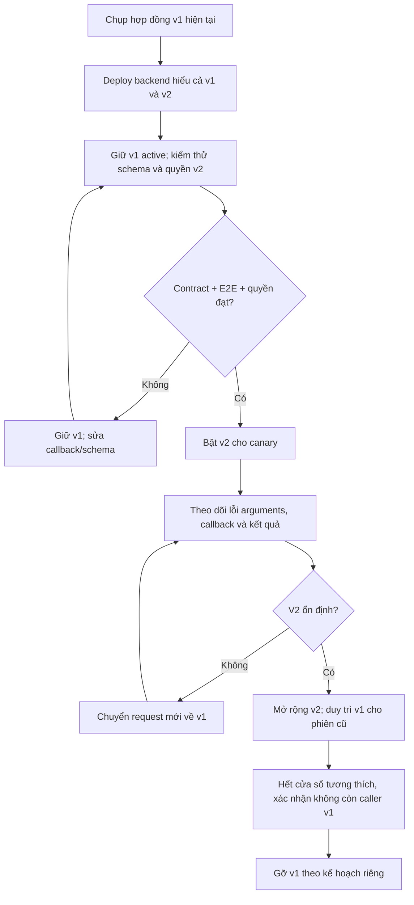

# Triển khai thay đổi schema cùng mã công cụ tương thích

Trong một ứng dụng **SPRING_AI_TOOL_CALLING**, mô hình yêu cầu gọi `get_order_status` bằng đối số JSON và Spring AI chuyển yêu cầu ấy đến phương thức `@Tool` hoặc `ToolCallback`. Khi nhóm phát triển thêm tham số, đổi tên tool hay thay cấu trúc kết quả, việc triển khai **mã Java** và **schema mà mô hình nhìn thấy** phải được phối hợp. Nếu chỉ sửa một phía, các lượt hội thoại đang chạy, dữ liệu lịch sử hoặc phiên bản ứng dụng chưa nâng cấp có thể tiếp tục gọi hợp đồng cũ và thất bại.

Bài thuộc chương **Vận hành**, dùng **Spring AI 2.1.0** làm mốc. Mục tiêu là nhận diện thay đổi tương thích, viết code xử lý cả hợp đồng cũ và mới, phát hành nhiều bước có khả năng quay lui, kiểm thử schema và theo dõi an toàn khi nâng cấp tool gọi dịch vụ nghiệp vụ. Các quy tắc đặt tên phiên bản và lộ trình triển khai dưới đây là **quy ước thiết kế của ứng dụng**, không phải chức năng tự động mà Spring AI cung cấp.

## 1. Hợp đồng tool gồm những gì?

Với Spring AI 2.1.0, `ToolCallback` chứa hai phần: `ToolDefinition` mô tả công cụ cho mô hình và logic `call(...)` thực thi công cụ trong ứng dụng. `ToolDefinition` có ba thành phần:

| Thành phần | Nơi thể hiện | Vì sao ảnh hưởng tương thích |
| --- | --- | --- |
| **Tên tool** | `ToolDefinition.name()`, ví dụ `get_order_status_v1` | Mô hình gửi lại đúng tên này; callback cần được gắn vào request và tìm được ở thời điểm thực thi. |
| **Mô tả** | `ToolDefinition.description()` hoặc `@Tool(description=...)` | Thay đổi cách mô hình lựa chọn tool; có thể thay đổi hành vi dù chữ ký Java giữ nguyên. |
| **JSON Schema đầu vào** | `ToolDefinition.inputSchema()` | Quy định đối số, kiểu dữ liệu, thuộc tính bắt buộc và cách mô hình tạo lời gọi. |
| **Mã thực thi** | Phương thức `@Tool` hoặc `ToolCallback.call(...)` | Phải parse/validate đúng đối số, phân quyền, gọi backend và xử lý lỗi theo hợp đồng được công bố. |
| **Dạng kết quả** | Giá trị Java được `ToolCallResultConverter` chuyển thành chuỗi gửi lại mô hình | Trường và ý nghĩa của dữ liệu trả về phải ổn định với người dùng kết quả; đây là hợp đồng ứng dụng cần tự quản lý. |
| **Ngữ cảnh thực thi** | `ToolContext` | Truyền danh tính, tenant hoặc request-scoped data đáng tin cậy; dữ liệu này không phải đối số JSON do mô hình tạo. |

`@Tool` và `@ToolParam` cho phép Spring AI tạo schema từ chữ ký phương thức. Mặc định **các tham số được xem là bắt buộc**; dùng `@ToolParam(required = false)` để đánh dấu một tham số có thể bỏ qua. `ToolContext` không xuất hiện trong schema gửi cho mô hình. <https://docs.spring.io/spring-ai/reference/api/tools.html>

Một thay đổi nhỏ trong Java có thể là thay đổi hợp đồng lớn: đổi `String orderId` thành `Long orderId`, thêm `Boolean includeHistory` mà quên `required = false`, đổi tên thuộc tính hoặc sửa mô tả tool đều cần được đánh giá. Việc sửa Java thành công về mặt biên dịch **không bảo đảm mô hình hoặc callback cũ còn dùng được**.

### Ba loại tương thích cần kiểm soát

1. **Tương thích đầu vào:** JSON do phiên bản mô hình/ứng dụng cũ phát ra vẫn được callback đang phục vụ chấp nhận.
2. **Tương thích kết quả và hành vi:** các trường cũ, ý nghĩa trạng thái, mã lỗi và quyền vẫn được giữ theo cam kết.
3. **Tương thích triển khai:** trong lúc có nhiều replica hoặc cuộc hội thoại kéo dài, đúng tool name, schema và callback còn khả dụng cho từng request.

Đồng thời kiểm tra **khả năng nhà cung cấp mô hình**: JSON Schema được Spring AI sinh ra không đồng nghĩa mọi model, API hoặc gateway đều hỗ trợ mọi keyword, chế độ strict JSON hay kiểu nullable giống nhau.

## 2. Phân loại thay đổi trước khi viết code

| Thay đổi đề xuất | Đánh giá | Cách triển khai an toàn |
| --- | --- | --- |
| Cải thiện mô tả của tham số mà không thay ý nghĩa | Thường tương thích ở mức JSON, nhưng có rủi ro mô hình chọn/sinh đối số khác | Kiểm thử lại độ chính xác chọn tool và arguments. |
| Thêm tham số **tùy chọn**, có giá trị mặc định ở server | Thường tương thích với payload cũ | Đặt `required = false`; callback chịu được `null`/trường vắng mặt; thử provider thực tế. |
| Thêm trường mới vào kết quả, vẫn giữ các trường cũ | Có thể tương thích với consumer linh hoạt | Không đổi ý nghĩa trường cũ, kiểm tra consumer/model không phụ thuộc danh sách trường cố định. |
| Thêm tham số bắt buộc | **Breaking** với payload cũ | Tạo contract mới hoặc duy trì adapter cũ để bổ sung dữ liệu đáng tin cậy. |
| Đổi tên tool, tên thuộc tính, hoặc kiểu dữ liệu | **Breaking** | Đặt tên phiên bản mới; giữ tên và callback cũ trong giai đoạn chuyển tiếp. |
| Biến optional thành required; thu hẹp enum; đổi đơn vị tiền/timestamp | **Breaking hoặc thay đổi ngữ nghĩa nguy hiểm** | Tạo phiên bản riêng, chuyển đổi rõ đơn vị/kiểu, kiểm thử đầu vào biên. |
| Xóa trường kết quả, đổi `status` từ chuỗi sang object | **Breaking** với consumer cũ | Cung cấp kết quả cũ cho v1 và kết quả mới cho v2. |
| Thay hành động đọc thành ghi; thêm side effect | Thay đổi quyền và nghiệp vụ, dù schema giống | Tạo tool có tên/mô tả khác, phân quyền và xác nhận độc lập. |
| Thay `returnDirect`, cơ chế xác nhận hoặc mã lỗi | Thay đổi hợp đồng vận hành | Review riêng luồng điều phối, retry, logging và hành vi downstream. |

Một sửa đổi **tương thích cú pháp** chưa chắc **tương thích ngữ nghĩa**. Ví dụ thêm `includeHistory = false` là optional, nhưng nếu callback mới trả kèm lịch sử nhạy cảm khi tham số thiếu thì đây vẫn là thay đổi không an toàn.

Không xem việc “mô hình có thể tự học từ prompt” là cơ chế migration. Tool name và JSON Schema là hợp đồng máy móc; input từ mô hình vẫn cần kiểm tra như input từ bên ngoài.

## 3. Ví dụ thay đổi có kiểm soát: tra trạng thái đơn hàng v1 → v2

**Yêu cầu ban đầu:** `get_order_status_v1` nhận `orderId`, trả lại `orderId` và `status`.

**Yêu cầu mới:** cho phép xem thêm sự kiện gần đây của đơn hàng nếu `includeHistory=true`, nhưng dữ liệu lịch sử chỉ được trả cho người có quyền. Tham số mới là tùy chọn và mặc định không lấy lịch sử. Với v2, kết quả có thêm `recentEvents`; v1 tiếp tục giữ nguyên kết quả cũ.

### 3.1. JSON Schema tham chiếu

V1 có dạng tối giản:

```json
{
  "type": "object",
  "properties": {
    "orderId": {
      "type": "string",
      "description": "Mã đơn hàng"
    }
  },
  "required": ["orderId"]
}
```

V2 chỉ bổ sung tham số tùy chọn:

```json
{
  "type": "object",
  "properties": {
    "orderId": {
      "type": "string",
      "description": "Mã đơn hàng"
    },
    "includeHistory": {
      "type": "boolean",
      "description": "Có trả sự kiện gần đây hay không; mặc định false"
    }
  },
  "required": ["orderId"]
}
```

Hai đoạn trên là **hình dạng hợp đồng rút gọn để so sánh**, không phải bản sao từng byte của schema do Spring AI tạo. Schema thực tế có thể thêm từ khóa, `format` hoặc cấu trúc khác tùy kiểu Java và phiên bản `JsonSchemaGenerator`. Khi triển khai, luôn trích từ `ToolCallback.getToolDefinition().inputSchema()` để đối chiếu.

### 3.2. Triển khai hai callback cùng dùng một domain service

Mẫu sau tách định nghĩa tool v1 và v2 nhưng dùng lại cùng tầng truy vấn. `OrderQueryService` là **giao diện nghiệp vụ do ứng dụng triển khai**, có nhiệm vụ kiểm tra quyền trên bản ghi thật. `TrustedCaller` được tạo bởi lớp xác thực server sau khi kiểm tra session/JWT; không được lấy trực tiếp từ prompt.

```java
import java.util.List;
import org.springframework.ai.tool.ToolContext;
import org.springframework.ai.tool.annotation.Tool;
import org.springframework.ai.tool.annotation.ToolParam;
import org.springframework.stereotype.Component;

record TrustedCaller(String userId, String tenantId) {}
record OrderSnapshot(String orderId, String status) {}
record StatusV1(String orderId, String status) {}
record StatusV2(String orderId, String status, List<String> recentEvents) {}

interface OrderQueryService {
    // Kiểm tra caller, tenant, quyền ORDER_READ và orderId tại backend.
    OrderSnapshot readAuthorized(TrustedCaller caller, String orderId);

    // Kiểm tra thêm quyền ORDER_HISTORY trên chính đơn hàng.
    List<String> recentEventsAuthorized(TrustedCaller caller, String orderId);
}

final class ToolSecurity {
    static TrustedCaller requireCaller(ToolContext ctx) {
        if (ctx == null
                || !(ctx.getContext().get("caller") instanceof TrustedCaller caller)
                || caller.userId() == null
                || caller.tenantId() == null) {
            throw new SecurityException("Missing authenticated caller");
        }
        return caller;
    }

    static String requireOrderId(String orderId) {
        if (orderId == null || orderId.isBlank() || orderId.length() > 80) {
            throw new IllegalArgumentException("Invalid orderId");
        }
        return orderId;
    }
}

@Component
final class OrderToolsV1 {
    private final OrderQueryService service;

    OrderToolsV1(OrderQueryService service) {
        this.service = service;
    }

    @Tool(name = "get_order_status_v1",
          description = "Đọc trạng thái đơn hàng người gọi được phép xem")
    public StatusV1 getStatus(
            @ToolParam(description = "Mã đơn hàng") String orderId,
            ToolContext context) {
        var caller = ToolSecurity.requireCaller(context);
        var snapshot = service.readAuthorized(
                caller, ToolSecurity.requireOrderId(orderId));
        return new StatusV1(snapshot.orderId(), snapshot.status());
    }
}

@Component
final class OrderToolsV2 {
    private final OrderQueryService service;

    OrderToolsV2(OrderQueryService service) {
        this.service = service;
    }

    @Tool(name = "get_order_status_v2",
          description = "Đọc trạng thái đơn hàng; tùy chọn lấy lịch sử gần đây")
    public StatusV2 getStatus(
            @ToolParam(description = "Mã đơn hàng") String orderId,
            @ToolParam(
                description = "Có lấy lịch sử hay không; mặc định false",
                required = false
            ) Boolean includeHistory,
            ToolContext context) {
        var caller = ToolSecurity.requireCaller(context);
        var id = ToolSecurity.requireOrderId(orderId);
        var snapshot = service.readAuthorized(caller, id);
        var history = Boolean.TRUE.equals(includeHistory)
                ? service.recentEventsAuthorized(caller, id)
                : List.<String>of();
        return new StatusV2(snapshot.orderId(), snapshot.status(), history);
    }
}
```

Điểm thiết kế đáng chú ý:

- V1 giữ nguyên **tên, đầu vào và kết quả** cũ; V2 có tên riêng. Cùng dùng một domain service để tránh hai logic nghiệp vụ phân kỳ.
- `Boolean` là kiểu wrapper, cho phép xử lý giá trị thiếu/`null`; `Boolean.TRUE.equals(includeHistory)` bảo đảm mặc định `false` ngay cả khi model bỏ trường. `@ToolParam(required = false)` giúp schema phản ánh điều đó.
- `ToolContext` chứa caller đáng tin cậy và không phải trường mà mô hình tự tạo. Cả v1 và v2 đều kiểm tra quyền ở domain service; lấy lịch sử đòi thêm quyền, không chỉ dựa vào `includeHistory=true`.
- DTO kết quả riêng cho từng phiên bản khiến field mới của v2 không làm thay đổi payload của v1. Spring AI mặc định chuyển kết quả Java thành chuỗi bằng `DefaultToolCallResultConverter`; cần kiểm tra JSON thực tế vì `ToolDefinition` chỉ mô tả **input schema**, không tự bảo đảm dạng output.
- Tool method được đánh dấu `@Component` để Spring có thể quản lý và thuận lợi khi biên dịch AOT/native image; đăng ký bean **không có nghĩa công cụ tự động được cấp cho tất cả request**.

Với một thay đổi chỉ thêm tham số tùy chọn, có thể giữ một tên tool và mở rộng trực tiếp nếu mọi consumer, provider và luồng đang chạy đều đã được xác minh tương thích. **Hai tên v1/v2 trong ví dụ là chiến lược giảm rủi ro khi chưa thể bảo đảm các điều kiện ấy.**

### 3.3. Chọn hợp đồng theo request

Spring AI 2.1.0 cho phép cấp `@Tool` objects trực tiếp bằng `ChatClient.prompt().tools(...)`. Trong giai đoạn rollout, chọn **một phiên bản cho từng request** để mô hình không tự lựa giữa hai tool cùng chức năng:

```yaml
# Cờ riêng của ứng dụng, không phải thuộc tính tích hợp Spring AI.
app:
  ai:
    order-tools:
      v2-enabled: false

spring:
  ai:
    tools:
      resolution:
        fallback:
          enabled: false
```

```java
import java.util.Map;
import org.springframework.ai.chat.client.ChatClient;
import org.springframework.boot.context.properties.ConfigurationProperties;
import org.springframework.boot.context.properties.EnableConfigurationProperties;
import org.springframework.context.annotation.Configuration;
import org.springframework.stereotype.Service;

@ConfigurationProperties(prefix = "app.ai.order-tools")
record OrderToolRollout(boolean v2Enabled) {}

@Configuration(proxyBeanMethods = false)
@EnableConfigurationProperties(OrderToolRollout.class)
class OrderToolConfiguration {}

@Service
final class OrderAssistant {
    private final ChatClient client;
    private final OrderToolsV1 v1;
    private final OrderToolsV2 v2;
    private final OrderToolRollout rollout;

    OrderAssistant(ChatClient.Builder builder,
            OrderToolsV1 v1, OrderToolsV2 v2, OrderToolRollout rollout) {
        this.client = builder.build(); // Không cấu hình defaultTools quyền cao.
        this.v1 = v1;
        this.v2 = v2;
        this.rollout = rollout;
    }

    String ask(String question, TrustedCaller authenticatedCaller) {
        if (authenticatedCaller == null) {
            throw new SecurityException("Unauthenticated");
        }

        Object publishedTool = rollout.v2Enabled() ? v2 : v1;
        return client.prompt()
                .user(question)
                .tools(publishedTool)
                .toolContext(Map.of("caller", authenticatedCaller))
                .call()
                .content();
    }
}
```

`app.ai.order-tools.v2-enabled` chỉ là feature flag của ứng dụng; đổi giá trị trong config không bảo đảm tất cả replica áp dụng ngay. Với hội thoại có tool call chờ thực thi hoặc chờ phê duyệt, bản sản xuất nên **ghim phiên bản tool ở phiên/turn** và lưu lại phiên bản đó cùng dữ liệu tiếp tục hội thoại. Cần giữ đúng callback đã gắn vào prompt khi thực thi hoặc tiếp tục một tool call bị tạm dừng; không lấy cờ mới rồi vô tình dùng schema khác.

Không đặt cả v1 và v2 vào `defaultTools(...)` nếu request phải chọn theo version. Trong Spring AI 2.1, `.tools(...)` trên request **cộng thêm** vào `.defaultTools(...)`, không ghi đè default. Đồng thời, tránh hai callback **cùng tên** trong một tập tool; tên trùng có thể làm đăng ký hoặc dispatch thất bại.

## 4. Lấy schema thực sự từ Spring AI và lập dấu vết phiên bản

Đừng tự gõ lại JSON Schema rồi cho rằng nó khớp Java. Trong CI hoặc phép thử local, trích hợp đồng do Spring AI dựng từ chính `@Tool`:

```java
import org.springframework.ai.support.ToolCallbacks;
import org.springframework.ai.tool.ToolCallback;

ToolCallback[] callbacks = ToolCallbacks.from(v1, v2);
for (ToolCallback callback : callbacks) {
    var definition = callback.getToolDefinition();
    String toolName = definition.name();
    String actualSchema = definition.inputSchema();

    // Trong bài test: parse actualSchema như JSON, lưu snapshot đã chuẩn hóa;
    // so với hợp đồng đã duyệt theo toolName.
    verifyApprovedContract(toolName, actualSchema);
}
```

Đoạn trên là phần lõi của một phép thử/snapshot (`verifyApprovedContract(...)` do dự án tự cài đặt). Khi phân tích diff, nên **parse JSON thành cây rồi chuẩn hóa thứ tự key**; so sánh nguyên chuỗi dễ báo thay đổi giả do thứ tự JSON hoặc format. Ngược lại, không bỏ qua thay đổi ở `required`, `enum`, tên thuộc tính, `type` và những annotation làm đổi ý nghĩa.

Một mục trong registry hợp đồng của ứng dụng có thể ghi:

```yaml
toolName: get_order_status_v2
contractVersion: 2
implementationVersion: release-2026-11
springAiVersion: 2.1.0
modelProvider: verified-provider
inputSchemaHash: "<sha256 cua JSON da chuan hoa>"
responseContract: "StatusV2: orderId:string, status:string, recentEvents:string[]"
risk: read-with-sensitive-history
owner: order-platform
rollbackContract: get_order_status_v1
```

Đây là **dữ liệu registry minh họa**, không phải YAML bắt buộc của Spring AI. Hash dùng để kiểm toán/schema diff; không nên đưa giá trị hash vào tool name mà mô hình phải tự suy đoán. Tool name có hậu tố phiên bản chỉ là quy ước ổn định, dễ phân biệt trong trace và thực thi.

## 5. Quy trình phát hành expand → chuyển lưu lượng → contract



### Pha A — Baseline và xác định người tiêu thụ

Kiểm kê: tool name, `inputSchema`, mô tả, kết quả thực, callback/service version, model/provider, quy tắc quyền, prompt hay workflow nào gọi tool, phiên hội thoại đang chờ và thời hạn giữ lịch sử. Ghi lại số lượng lời gọi v1 trên môi trường sản xuất trước khi thay đổi.

Tạo tập mẫu đại diện, kể cả JSON thiếu trường, có trường `null`, sai kiểu, enum lạ, mã đơn sai tenant, nhiều tool call trong một lượt và lỗi backend. Quy định từ đầu **điều kiện đạt/điều kiện rollback** bằng số liệu; ví dụ tỷ lệ tool arguments được validate, tỷ lệ domain từ chối hợp lệ, timeout và lỗi mất callback.

### Pha B — Expand: triển khai mã tương thích trước

Deploy callback v1 và v2 đến các replica mà vẫn **chỉ công bố v1** cho yêu cầu người dùng. Domain service mới phục vụ cả hai hợp đồng. Nếu cần thay đổi database hoặc API backend, bổ sung khả năng đọc/ghi dữ liệu cũ trước; không xóa trường hoặc enum mà code cũ vẫn cần.

Trong rolling deployment nhiều replica, một replica cũ có thể chưa có v2. Vì vậy không bật phân phối v2 toàn hệ thống cho đến khi mọi instance nhận được traffic có thể xử lý nó, hoặc có routing theo phiên bản đã kiểm chứng.

### Pha C — Chuyển lưu lượng có kiểm soát

Bật v2 cho một nhóm/tenant thử nghiệm, xác minh provider và model cụ thể sinh arguments theo schema mới. Công bố v1 cho các phiên đã ghim v1; ghi `toolName` và `contractVersion` trong session/trace. Điều kiện chọn tool cần nằm trong **logic máy chủ**, không được suy ra bằng cách để mô hình chọn giữa một danh sách v1/v2 tùy ý.

Không dùng cùng một cuộc hội thoại đang có tool call v1 chờ thực thi rồi đổi sang một callback v2 có schema khác. Với Spring AI 2.x, `ToolCallingAdvisor` điều phối vòng lặp qua `ToolCallingManager`; nếu dùng `ChatModel.call(...)` trực tiếp thì phải tự điều phối và giữ mapping tool/arguments nhất quán. Các lượt bị tạm dừng để xác nhận càng cần bảo quản prompt, reply và tập tool gốc.

### Pha D — Mở rộng, loại bỏ hợp đồng cũ có điều kiện

Chỉ bắt đầu loại bỏ v1 khi hoàn tất cửa sổ tương thích đã công bố, không còn request/session/workflow tích cực yêu cầu v1, tất cả consumer đã đổi và rollback sang v1 không còn cần thiết. Gỡ định nghĩa khỏi request, resolver/catalog và sau cùng mới xóa mã v1. Nếu contract cũ được dùng bởi tác nhân ngoài ứng dụng như MCP client hoặc dịch vụ khác, phải có quy trình deprecation/notice riêng.

## 6. Các điểm dễ gây sai lệch phiên bản trong Spring AI 2.1

### 6.1. JSON Schema của `@ToolParam` và Java không phải hai nguồn sự thật

Chữ ký Java và annotation sinh input schema. Một trường mới `Boolean includeHistory` mặc định là required nếu không ghi `@ToolParam(required = false)`. Đánh dấu optional trên schema nhưng sau đó ép `Objects.requireNonNull(includeHistory)` trong callback cũng làm mất tính tương thích. Hãy thống nhất annotation, giá trị mặc định, validation và hành vi nghiệp vụ.

Không dùng `Optional<T>` làm tham số của `MethodToolCallback`; tài liệu Spring AI khuyến nghị dùng `@Nullable` hoặc `@ToolParam(required = false)`. Tránh các kiểu `CompletableFuture`, `Mono`, `Flux` làm tham số/giá trị trả về cho phương thức tool vì chúng không được biểu diễn hợp lệ như đối số/kết quả tool.

### 6.2. Mỗi provider có giới hạn JSON Schema khác nhau

Một tool gửi qua OpenAI, Anthropic, Bedrock hay model local có thể được provider kiểm tra khác nhau. Nếu bật chế độ strict schema riêng của provider, một thay đổi vốn hợp lệ trong JSON Schema có thể bị từ chối do subset keyword được hỗ trợ. Cần thử **đúng model ID, endpoint, phiên bản API, mode call/stream** đang dùng; đừng kết luận chỉ từ phép thử parse JSON ở backend.

### 6.3. Tool context và quyền truy cập nằm ngoài input schema

Đổi từ `orderId` sang `tenantId + orderId` trong schema để “tăng an toàn” có thể khiến mô hình tự chế ra `tenantId`. Thông tin danh tính/tenant đáng tin phải đi qua `ToolContext` do ứng dụng tạo và được service kiểm tra lại; chỉ nhận từ model các tham số cần thiết cho nghiệp vụ. Khi thay schema, cũng phải thử quyền của callback cũ và callback mới.

### 6.4. Thay đổi Spring AI và MCP cũng ảnh hưởng hợp đồng

Spring AI **2.0** chuyển vòng lặp tool từ `ChatModel` sang `ToolCallingAdvisor` của `ChatClient`; `ChatModel.call(...)` trực tiếp trả về tool call thô và không tự thực thi. Trong 2.1, cần giữ nguyên nguyên tắc này khi nâng cấp nhiều thành phần. `ToolCallbacks.from(...)` nằm trong `org.springframework.ai.support.ToolCallbacks`; API 2.x dùng `ToolCallback`/`@Tool` thay cho `toolNames(...)` cũ để đăng ký công cụ.

Từ Spring AI **2.0.1**, `spring.ai.tools.resolution.fallback.enabled` mặc định `false`. Khi bị tắt, `ToolCallingManager` chỉ thực thi những callback gắn vào request. Không bật fallback chỉ để cứu lỗi do rút v1 quá sớm: tìm lại tool theo tên từ resolver rộng có thể tạo đường chạy công cụ mà request hiện tại không được phép.

Với MCP server/client, hợp đồng công cụ còn nằm ở `inputSchema` từ server ngoài. Spring AI 2.1.0 ghi nhận thay đổi SDK liên quan `McpSchema.Tool.inputSchema()` dùng `Map<String,Object>` thay cho `JsonSchema` cũ, và MCP server kiểm tra đối số theo schema mặc định. Nếu pipeline có MCP, cần chạy lại contract test ở phía **server và client**, không chỉ test `@Tool` local.

Tài liệu nâng cấp Spring AI cũng nêu thay đổi `BeanOutputConverter` dùng chung `JsonSchemaGenerator`, bổ sung `format` và điều chỉnh trạng thái required theo annotation. Đây là lời nhắc nên snapshot schema sau mỗi lần nâng phiên bản thư viện/serializer, kể cả khi không chỉnh mã tool.

## 7. Bộ kiểm thử tương thích bắt buộc trước rollout

| Lớp kiểm thử | Trường hợp | Điều kiện đạt |
| --- | --- | --- |
| **Schema snapshot** | Sinh định nghĩa cho v1/v2 bằng `ToolCallbacks.from(...)` | Tên khác nhau, v1 không đổi, v2 có `orderId` required và `includeHistory` optional. |
| **Đầu vào cũ** | Gọi v1 với `{"orderId":"ORD-19"}` | Callback và backend vẫn xử lý, trả `StatusV1`. |
| **Đầu vào v2 tối thiểu** | Gọi v2 chỉ có `orderId` | `includeHistory` được hiểu là false; không lấy dữ liệu lịch sử. |
| **Đầu vào v2 đầy đủ** | `{"orderId":"ORD-19","includeHistory":true}` | Trả lịch sử khi caller có đúng quyền trên đơn. |
| **Schema sai** | `orderId` null, chuỗi rỗng, sai kiểu, `includeHistory` sai kiểu | Từ chối có kiểm soát; không gọi backend khi đối số không hợp lệ. |
| **Quyền và tenant** | Caller tenant A hỏi đơn tenant B | Cả v1/v2 từ chối, không rò dữ liệu, không dựa vào tenant do model sinh. |
| **Quyền lịch sử** | Có quyền đọc trạng thái nhưng thiếu quyền xem sự kiện | V1 vẫn được đọc; v2 yêu cầu lịch sử bị từ chối ở service. |
| **Tool catalog** | Canary chỉ bật v2, request cũ ghim v1 | Mô hình nhìn đúng một hợp đồng và callback đúng phiên bản được thực thi. |
| **Lặp nhiều vòng** | Model gọi tool, nhận kết quả, hỏi tiếp hoặc gọi tool khác | `ToolCallingAdvisor` giữ lịch sử đúng; không sinh lại tool call sai contract. |
| **Streaming** | Cùng yêu cầu qua `.stream()` | Tool call và kết quả được ghép/thực thi đúng với model/adapter đã kiểm chứng. |
| **Rolling deployment** | Một số replica chưa nâng cấp, flag bắt đầu thay đổi | Không chuyển v2 đến replica chưa có v2; không thất lạc session ghim v1. |
| **Rollback** | Tắt cờ v2 sau khi canary lỗi | Request mới trở về v1, phiên đang chạy hoàn tất đúng phiên bản hoặc dừng có kiểm soát. |
| **MCP** | MCP server kiểm tra input, client gửi args cũ/mới | Các hợp đồng được dự kiến đều vượt qua kiểm tra; lỗi schema có mã/nhật ký rõ ràng. |

Ngoài unit test của callback, cần **contract test** với schema thực tế và **end-to-end test** với model/provider triển khai. Không xem việc LLM tự nói “đã gọi tool thành công” là bằng chứng; theo dõi số lần callback thực thi, arguments được validate và kết quả thật. Dùng tool đọc hoặc môi trường dữ liệu giả cho smoke test để tránh thao tác ghi không mong muốn.

Với thay đổi kết quả, lưu các mẫu JSON output v1/v2 và kiểm tra các consumer downstream có đọc được. Đặc biệt kiểm tra chuyển đổi của `ToolCallResultConverter` khi đổi Jackson record/annotation, field naming và giá trị `null`.

## 8. Quan sát, phát hiện lỗi và quay lui

Gắn các trường vận hành tối thiểu: `correlationId`, `toolName`, `contractVersion`, `implementationVersion`, `modelId`, `provider`, `deploymentId`, thời gian xử lý, trạng thái validate và mã lỗi tổng quát. Spring AI phát observation `spring.ai.tool`; dùng thêm audit ở domain nếu tool có side effect. Tránh đưa raw arguments/kết quả chứa dữ liệu đơn hàng, token và thông tin cá nhân vào log công khai.

| Triệu chứng sau triển khai | Khả năng cao | Cách ứng phó |
| --- | --- | --- |
| Model gọi `get_order_status_v1` nhưng request chỉ gắn v2 | Session cũ bị đổi contract giữa chừng hoặc đã thu hồi v1 sớm | Khôi phục routing/ghim v1 cho session cũ; kiểm tra catalog và lịch sử. |
| `No ToolCallback found for tool name` | Tên tool không khớp hoặc callback thiếu trong request | Kiểm tra tên, tập tool cấp theo request, cờ rollout và fallback. |
| HTTP 400 do JSON Schema | Provider không chấp nhận schema mới hoặc options strict khác | Chuyển về v1, giảm schema tới cấu trúc được hỗ trợ và test đúng endpoint. |
| Tool v2 thiếu `includeHistory` nên thất bại | Schema yêu cầu sai hoặc callback không có default | Đặt optional đúng và chịu được giá trị null; phát hành sửa mã cùng schema. |
| Người dùng đọc được lịch sử ngoài quyền | Bug phân quyền backend, không phải vấn đề mô hình đơn thuần | Chặn tại domain ngay, thu hồi quyền, audit và xử lý sự cố dữ liệu. |
| Lỗi chỉ xuất hiện ở vài replica | Rolling deployment và flag lệch phiên bản | Dừng rollout, kiểm tra readiness/schema version và routing; đợi đồng bộ trước khi bật tiếp. |
| Tool thực thi lại sau retry | Retry không phân biệt lỗi, thiếu idempotency cho tool ghi | Ngăn retry ở hành động ghi, dùng idempotency key và đối soát giao dịch. |

**Rollback hiệu quả phải quay lại cả lựa chọn tool và implementation còn tương thích.** Nếu mã cũ đã xóa field/backend API cần thiết, chỉ tắt cờ v2 sẽ không cứu được v1. Vì vậy giữ giai đoạn expand đủ lâu, tránh schema migration phá hủy dữ liệu cho đến khi hệ thống hết sử dụng hợp đồng cũ.

## 9. Checklist triển khai an toàn

- [ ] Đã kiểm kê tool name, mô tả, JSON input, output, domain semantics, quyền và consumer hiện có.
- [ ] Đã phân loại thay đổi additive/optional và breaking; có quyết định giữ tên hoặc tạo version mới.
- [ ] Đã lấy `inputSchema()` thực tế từ Spring AI 2.1.0, chuẩn hóa và lưu snapshot được duyệt.
- [ ] `@ToolParam`, kiểu Java, giá trị mặc định, validation và xử lý `null` phản ánh cùng một hợp đồng.
- [ ] Có callback cũ và mới cùng sử dụng nghiệp vụ thống nhất; quyền và tenant được kiểm tra ở service.
- [ ] Các request chỉ được cấp phiên bản tool phù hợp; không để `defaultTools` hoặc resolver phá chính sách.
- [ ] Có chiến lược ghim version cho conversation/paused tool call và routing qua nhiều replica.
- [ ] Đã kiểm thử schema, payload cũ, payload mới, output, quyền, lỗi, streaming và model/provider thật.
- [ ] Có canary, số liệu quan sát và ngưỡng dừng; rollback được thử trước khi mở rộng traffic.
- [ ] Chỉ gỡ phiên bản cũ sau khi hết cửa sổ tương thích và không còn caller/session cần đến nó.
- [ ] Nếu tích hợp MCP, đã đối chiếu input schema phía server và kiểm thử validation cho cả hai version.

## Tài liệu tham khảo chính thức

- [Spring AI 2.1.0 — Tool Calling](https://docs.spring.io/spring-ai/reference/api/tools.html): `@Tool`, `@ToolParam`, `ToolDefinition`, `ToolCallback`, schema, `ToolContext`, đăng ký tool và resolver.
- [Spring AI 2.1.0 — ChatModel Tool Calling](https://docs.spring.io/spring-ai/reference/api/tools/chatmodel-tool-calling.html): khác biệt giữa `ChatModel` trực tiếp và vòng lặp `ChatClient`.
- [Spring AI 2.1.0 — ToolCallingAdvisor](https://docs.spring.io/spring-ai/reference/api/tools/tool-calling-advisor.html): điều phối nhiều lượt và trách nhiệm thực thi callback.
- [Spring AI 2.1.0 — Upgrade Notes](https://docs.spring.io/spring-ai/reference/upgrade-notes.html): thay đổi Java/JSON Schema, tool registration, fallback, MCP và tương thích phiên bản.
- [Spring AI 2.1.0 API — ToolCallbacks](https://docs.spring.io/spring-ai/docs/2.1.x/api/org/springframework/ai/support/ToolCallbacks.html): `ToolCallbacks.from(...)` để lấy callback từ `@Tool` objects.

