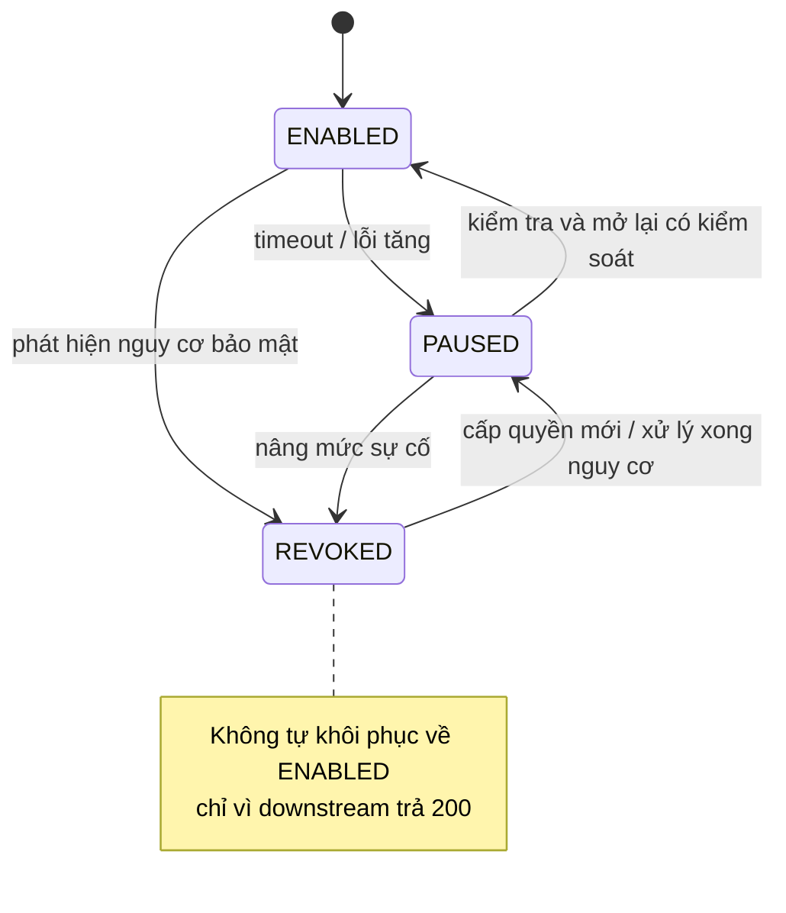

# Điều khiển bật tắt hoặc thu hồi công cụ đang gặp sự cố

> **Chương:** Vận hành  
> **Module:** `SPRING_AI_TOOL_CALLING` — tích hợp công cụ nghiệp vụ với Spring AI  
> **Phiên bản trọng tâm:** Spring AI **2.1.0**. Cơ chế cụ thể của provider hoặc công cụ MCP có thể khác nhau; ví dụ trong bài dùng `ChatClient`, `@Tool`, `ToolContext` và `ToolCallingAdvisor`.

## Mục tiêu học tập

Sau bài này, bạn có thể:

1. Phân biệt **tạm dừng**, **tắt cấp phát** và **thu hồi quyền thực thi** công cụ khi dịch vụ ngoài bị lỗi hoặc công cụ không còn an toàn.
2. Thiết kế **kill switch** có tác dụng ở cả danh sách công cụ gửi đến model và tại điểm ứng dụng Java chuẩn bị thực thi.
3. Giải thích các đường đi có thể khiến một tool bị vô hiệu hóa ở lớp prompt nhưng vẫn chạy, đặc biệt `defaultTools`, `ToolCallbackResolver`, request đang thực hiện và các node ứng dụng chưa nhận cấu hình mới.
4. Triển khai một ví dụ Spring AI 2.1.0 với cấu hình tool theo request, cổng kiểm tra trạng thái và thông báo xuống cấp an toàn.
5. Lập quy trình ứng phó, kiểm chứng chặn gọi, khôi phục có kiểm soát và ghi nhận sự cố.

## 1. Tình huống vận hành: công cụ còn đăng ký nhưng dịch vụ ngoài đã lỗi

Một trợ lý theo dõi vận đơn được cấp `getShipmentStatus` để tra cứu trạng thái hiện tại từ hãng vận chuyển. Trong giờ cao điểm, hệ thống hãng vận chuyển trả HTTP 503 hoặc timeout liên tục. Model vẫn nhìn thấy mô tả công cụ, cố gọi lại, rồi nhận lỗi; người dùng chờ lâu và ngân sách token tăng vì các lượt model → tool → model lặp lại.

Tệ hơn, một công cụ thay đổi dữ liệu có thể gây tác động không mong muốn nếu downstream đang trả dữ liệu thiếu nhất quán. Trong tình huống lộ credential hoặc bị nghi dùng sai quyền, **ẩn tool trong prompt chưa đủ**: request đã bắt đầu trước khi thay đổi có thể vẫn đang chuẩn bị thực thi.

Mục tiêu của cơ chế vận hành là:

- Dừng các yêu cầu **mới** đến công cụ đang lỗi càng sớm càng tốt.
- Chặn thực thi **ngay tại ranh giới ứng dụng** đối với các tool call đã được tạo, bao gồm những call xuất phát từ request đang chạy.
- Duy trì những khả năng không phụ thuộc công cụ đó; thông báo rõ dữ liệu hiện tại chưa thể xác minh.
- Ghi lại ai đổi trạng thái, lý do, phạm vi, thời điểm, kết quả và điều kiện mở lại.
- Với sự cố bảo mật, thu hồi credential/quyền ở dịch vụ đích và xử lý các tác vụ đã khởi chạy.

**Nguyên tắc:** Model **đề nghị** gọi công cụ; ứng dụng Spring AI chịu trách nhiệm thực thi. Việc model “không nên gọi nữa” là hướng dẫn, còn quyết định “có được chạy hay không” phải nằm trong mã Java hoặc chính sách của hệ thống đích.

## 2. Hiểu đúng ba cấp độ kiểm soát

| Hành động | Tác dụng | Khi nào sử dụng | Có thể khôi phục thế nào |
|---|---|---|---|
| **Tắt cấp phát** (hide/disable discovery) | Không đưa `ToolCallback` vào tập công cụ của request mới | Tool trục trặc, cần giảm số lần model đề nghị gọi | Bật lại sau khi đủ tín hiệu khỏe |
| **Tạm dừng thực thi** (pause) | Handler từ chối call mới ở Java dù model đã tạo tool call | Timeout nhiều, downstream quá tải, cần chặn in-flight đến ranh giới thực thi | Kiểm tra sức khỏe, mở dần theo phạm vi |
| **Thu hồi** (revoke) | Chặn tại handler và thu hồi quyền ở downstream, ví dụ credential/token, policy mạng hoặc quyền dịch vụ | Lộ bí mật, nghi truy cập trái phép, tool thay đổi dữ liệu sai | Cấp lại credential/quyền mới, phê duyệt an toàn, kiểm thử rồi mới mở |

Hai hành động đầu thường dùng đồng thời. **Tắt cấp phát** giảm khả năng model sinh tool call; **tạm dừng thực thi** bảo vệ hệ thống khi request đã gửi mô tả tool từ trước. **Thu hồi** là mức khẩn cấp cao hơn, cần có hiệu lực ở hệ thống thực thi ngoài ứng dụng.

Ví dụ trạng thái tối giản:



Trạng thái `ENABLED/PAUSED/REVOKED` ở đây là **thiết kế của ứng dụng**, không phải ba trạng thái có sẵn trong API Spring AI. Tác vụ chuyển trạng thái phải đi qua một luồng vận hành có phân quyền và audit.

## 3. Đặt công tắc ở đâu để thực sự có hiệu lực?

Cần nhận diện nhiều lớp, vì không lớp nào riêng lẻ bao phủ mọi thời điểm và mọi đường đi.

| Lớp | Quyết định | Điểm kiểm soát điển hình | Giới hạn |
|---|---|---|---|
| **Cấp phát cho model** | Tool nào được mô hình nhìn thấy ở request mới? | `chatClient.prompt().tools(...)` theo allowlist sau khi đọc trạng thái sự cố | Không thể thu lại tool definition đã gửi trong request đang chạy |
| **Phân giải và điều phối** | Model được phép gọi tool nào từ tên/callback đã nhận? | `ToolCallingManager` / `ToolCallbackResolver`, chính sách cấp tool theo request | Cấu hình fallback có thể làm lộ đường thực thi ngoài danh sách request |
| **Handler Java** | Call cụ thể có được bắt đầu không? | Guard kiểm tra trạng thái ngay trong phương thức `@Tool` hoặc adapter `ToolCallback` | Lệnh đã đi qua guard và đang chạy cần cách xử lý riêng |
| **Dịch vụ ngoài** | Credential/tenant/quyền mạng có cho phép thao tác không? | IAM, ACL, API gateway, token revocation, ngừng worker/queue | Có độ trễ hiệu lực, và thao tác đã commit có thể không đảo ngược |
| **Điều khiển vận hành** | Ai được bật lại, phạm vi bao nhiêu, khi nào? | Feature flag trung tâm, dashboard vận hành, audit trail, canary | Cấu hình phân tán có thể lệch giữa các node nếu thiếu đồng bộ |

### Những đặc điểm của Spring AI 2.1.0 dễ gây nhầm

**1. `.tools(...)` không xóa `.defaultTools(...)`.** Tài liệu `ChatClient` xác nhận hai tập được **cộng** vào nhau. Nếu đã cấu hình `defaultTools(failingTool)`, việc không truyền `failingTool` ở request tiếp theo **không làm nó biến mất**. Đối với tool cần điều khiển trong sự cố, hãy tránh cấu hình làm công cụ luôn được cấp phát; dùng allowlist cho request hoặc xây `ChatClient` chuyên biệt không đăng ký default tool đó.

**2. Phân giải theo tên có đường fallback.** Theo tài liệu Spring AI 2.1.0, `spring.ai.tools.resolution.fallback.enabled` mặc định là `false`. Nếu bật `true`, một tool không nằm trong request nhưng có trong `ToolCallbackResolver` vẫn có thể được phân giải theo tên và thực thi khi model gọi. Vì vậy, ở hệ thống cần thu hồi mạnh, giữ fallback tắt hoặc giới hạn resolver bằng allowlist và guard bắt buộc. Không coi việc ẩn tool khỏi danh sách request là một cơ chế phân quyền hoàn chỉnh.

**3. Tắt `ToolCallingAdvisor` không tương đương thu hồi tool.** Cấu hình `spring.ai.chat.client.tool-calling.enabled=false` tắt vòng **thực thi tự động** của `ChatClient`, nhưng definition của tool vẫn có thể được gửi đến model. Khi ấy ứng dụng phải tự xử lý phản hồi tool call nếu muốn dùng tool. Đây là tùy chọn điều phối, **không phải kill switch riêng cho một công cụ**.

**4. `ChatModel` tầng thấp trả tool call mà không tự chạy.** Trong Spring AI 2.1.0, nếu gọi `ChatModel` trực tiếp, ứng dụng phải tự điều phối vòng lặp và kiểm tra công cụ trước khi gọi `ToolCallingManager`. Không sao chép giả định “framework đã chặn” từ `ChatClient` sang bộ điều phối tùy chỉnh.

**5. Tool lấy từ MCP hoặc registry động cũng cần được kiểm tra.** Vô hiệu hóa một provider/registry, hủy cache danh sách công cụ và chặn ở cổng thực thi là các hành động khác nhau. Nếu tool vẫn được resolve qua một callback đã giữ trong bộ nhớ, trạng thái xóa khỏi màn hình quản trị không đủ để kết luận đã chặn hoàn toàn.

## 4. Ví dụ Spring AI 2.1.0: hai lần kiểm tra quanh tool

Giả sử `getShipmentStatus` là tool **chỉ đọc** và truy vấn downstream thông qua `ShipmentQueryService`. Ứng dụng muốn tạm dừng tool mà không phải triển khai lại toàn bộ trợ lý.

Ý tưởng gồm:

1. Kiểm tra trạng thái **trước khi xây request**, chỉ đưa công cụ vào `ChatClient` khi đang `ENABLED`.
2. Kiểm tra lại trong chính phương thức `@Tool`, phòng trường hợp công tắc chuyển `PAUSED/REVOKED` sau khi request đã gửi cho model.
3. Lấy danh tính thật qua `ToolContext` từ server và phân quyền trong dịch vụ nghiệp vụ. Model chỉ tự điền mã vận đơn, không tự điền quyền truy cập.
4. Trả thông báo xuống cấp đã định trước khi hệ thống biết tool không sẵn sàng, thay vì yêu cầu model đoán trạng thái.

```java
import java.util.Map;
import java.util.concurrent.atomic.AtomicReference;

import org.springframework.ai.chat.client.ChatClient;
import org.springframework.ai.tool.ToolContext;
import org.springframework.ai.tool.annotation.Tool;
import org.springframework.ai.tool.annotation.ToolParam;
import org.springframework.security.access.AccessDeniedException;
import org.springframework.stereotype.Component;
import org.springframework.stereotype.Service;

// Mô hình trạng thái do ứng dụng định nghĩa.
enum ToolMode { ENABLED, PAUSED, REVOKED }

@Component
final class ShipmentToolGate {
    private final AtomicReference<ToolMode> mode =
            new AtomicReference<>(ToolMode.ENABLED);

    boolean availableForNewRequests() {
        return mode.get() == ToolMode.ENABLED;
    }

    void requireExecutionAllowed() {
        if (mode.get() != ToolMode.ENABLED) {
            // Không đưa nội dung nội bộ hay dữ liệu bí mật vào message lỗi.
            throw new IllegalStateException("SHIPMENT_TOOL_UNAVAILABLE");
        }
    }

    // Chỉ control plane có xác thực/phân quyền và audit được gọi.
    void setModeFromTrustedControlPlane(ToolMode next) {
        mode.set(next);
    }
}

record ShipmentStatus(String trackingId, String state, String updatedAt) {}

// Dịch vụ nghiệp vụ phải kiểm tra user thực sự sở hữu mã vận đơn.
interface ShipmentQueryService {
    ShipmentStatus findVisibleShipment(String userId, String trackingId);
}

@Component
final class ShipmentTools {
    private final ShipmentToolGate gate;
    private final ShipmentQueryService shipments;

    ShipmentTools(ShipmentToolGate gate, ShipmentQueryService shipments) {
        this.gate = gate;
        this.shipments = shipments;
    }

    @Tool(
        name = "getShipmentStatus",
        description = "Tra cứu trạng thái vận đơn hiện tại theo mã, " +
                      "chỉ đọc; không tạo hoặc hủy đơn vận chuyển."
    )
    public ShipmentStatus getShipmentStatus(
            @ToolParam(description = "Mã vận đơn cụ thể") String trackingId,
            ToolContext toolContext) {

        // Chặn call được model quyết định TRƯỚC khi công tắc bị hạ.
        gate.requireExecutionAllowed();

        Object actor = toolContext.getContext().get("authenticatedUserId");
        if (!(actor instanceof String userId) || userId.isBlank()) {
            throw new AccessDeniedException("Không có danh tính hợp lệ");
        }

        return shipments.findVisibleShipment(userId, trackingId);
    }
}

@Service
final class ShipmentAssistant {
    private final ChatClient chatClient;
    private final ShipmentToolGate gate;
    private final ShipmentTools tools;

    ShipmentAssistant(
            ChatClient.Builder builder,
            ShipmentToolGate gate,
            ShipmentTools tools) {
        this.gate = gate;
        this.tools = tools;
        // Đảm bảo builder này không cấu hình defaultTools cho tool bị quản lý.
        this.chatClient = builder
            .defaultSystem("""
                Bạn hỗ trợ tra cứu trạng thái vận đơn.
                Chỉ gọi getShipmentStatus khi cần trạng thái hiện tại
                và có mã vận đơn cụ thể; thiếu mã thì hỏi lại.
                Không đoán trạng thái và không hứa thao tác sửa/hủy.
                """)
            .build();
    }

    // Endpoint này chỉ xử lý yêu cầu tra cứu trạng thái hiện tại.
    String answerStatusQuestion(String question, String authenticatedUserId) {
        if (authenticatedUserId == null ||
                authenticatedUserId.isBlank()) {
            throw new AccessDeniedException("Chưa xác thực");
        }

        if (!gate.availableForNewRequests()) {
            return "Tra cứu trạng thái vận đơn tạm thời gián đoạn. " +
                   "Vui lòng thử lại sau hoặc liên hệ hỗ trợ.";
        }

        return chatClient.prompt()
            .user(question)
            .tools(tools)
            .toolContext(Map.of(
                "authenticatedUserId", authenticatedUserId))
            .call()
            .content();
    }
}
```

### Giải thích giới hạn của ví dụ

- `AtomicReference` tạo một công tắc **trong một JVM** để dễ thấy logic; nó không phải giải pháp đồng bộ cho nhiều pod, container hoặc vùng địa lý. Trong production, dùng control plane/feature flag đáng tin cậy, đồng bộ trạng thái giữa các instance, kiểm soát độ trễ lan truyền và chọn mặc định **fail closed** khi không xác nhận được trạng thái.
- Ví dụ chỉ cho phép công cụ được cấp phát trong request mới nếu trạng thái `ENABLED`. Nó cũng chặn một tool call **chưa vào handler** sau khi trạng thái đổi. Nếu thao tác bên trong `ShipmentQueryService` đã bắt đầu, kiểm tra trước đó không thể rút lại lời gọi đang chạy; cần timeout, cancellation, cơ chế từ chối ở downstream hoặc quản lý tác vụ đang thực thi.
- `setModeFromTrustedControlPlane(...)` là điểm nối minh họa, **không phải REST API quản trị công khai**. Muốn dùng thực tế, phải xác thực người vận hành, phân quyền đổi trạng thái, lưu actor/reason/ticket/time và giới hạn khả năng khôi phục `REVOKED`.
- `ShipmentQueryService` và cấu hình `ChatClient.Builder` là phụ thuộc của ứng dụng, không phải mã có thể chạy độc lập. Phải thực thi kiểm tra sở hữu theo tenant/người dùng, xác thực định dạng `trackingId` và timeout tại tầng truy vấn.
- Nhánh thông báo gián đoạn là chính sách của **endpoint tra cứu trạng thái**. Những chức năng khác như giải thích quy trình giao hàng nên đi qua một route/assistant riêng vẫn hoạt động. Không nên để một tool bị lỗi làm ngưng toàn bộ trợ lý nếu phần còn lại không phụ thuộc vào tool đó.
- Việc mở lại chỉ thực hiện qua quy trình vận hành đã được phê duyệt. Đừng đặt lịch tự chuyển từ `REVOKED` sang `ENABLED` khi nhận một phản hồi HTTP 200.

### Phương án khi cần quyết định tool động ở nhiều vòng

Một request có thể chứa nhiều lượt model → tool → model. Nếu ứng dụng cần thay đổi tập tool **giữa các vòng**, Spring AI 2.1.0 cung cấp hook `ToolCallingAdvisor.doBeforeCall(...)` / `doBeforeStream(...)` trong custom advisor để điều chỉnh request trước mỗi lượt. Đây là phương án nâng cao cho sản phẩm nhiều tool; điểm chặn tại **handler** vẫn cần thiết khi yêu cầu đã đi qua bước xây request. Nếu điều phối qua `ChatModel` trực tiếp, phải thực hiện chính sách này trong vòng lặp do chính ứng dụng quản lý.

## 5. Làm gì khi tool bị lỗi nhưng model vẫn cố gọi?

Lỗi có nhiều ý nghĩa khác nhau: dịch vụ quá tải, người dùng không đủ quyền, sai schema, tool đã bị tạm dừng, hoặc thao tác trước đó đã ghi dữ liệu nhưng phản hồi bị mất. Không được xử lý tất cả như “thử lại ngay”.

| Tình huống | Cách vận hành phù hợp | Cách trả lời phù hợp |
|---|---|---|
| Downstream HTTP 429/503 kéo dài | Tạm dừng, giới hạn concurrency, tăng backoff hoặc dùng circuit breaker | Dịch vụ tra cứu tạm thời không sẵn sàng |
| Tool lỗi trong một số tenant | Tắt ở tenant có vấn đề; giữ phạm vi còn khỏe nếu chính sách cho phép | Chỉ giải thích chức năng đang gián đoạn ở tenant đó |
| Lộ API key / nghi truy cập trái phép | Thu hồi credential; chặn ở handler, gateway và danh sách cấp phát | Không phơi bày lý do bí mật; cung cấp kênh hỗ trợ |
| Tool trả dữ liệu mâu thuẫn | Tạm dừng cho đến khi xác minh nguồn và kiểm tra độ tin cậy | Không suy diễn trạng thái từ lịch sử model |
| Gọi công cụ sai quyền | Chặn tại tầng nghiệp vụ, ghi sự kiện bảo mật phù hợp | Thông báo không đủ quyền, không xác nhận tài nguyên thuộc ai |
| Tool ghi dữ liệu đã timeout sau khi gửi | Kiểm tra trạng thái nghiệp vụ/khóa idempotency trước khi retry | Thừa nhận kết quả chưa xác định, tránh hứa thao tác thành công hoặc thất bại |

### Spring AI xử lý exception thế nào?

Tài liệu 2.1.0 mô tả `ToolExecutionExceptionProcessor` xử lý exception từ tool. Với cấu hình mặc định, thông điệp của `RuntimeException` có thể được gửi ngược cho model để model phản hồi; một số lỗi khác bị ném về ứng dụng. Có thể chọn xử lý lỗi ở application boundary bằng cấu hình:

```properties
# Tùy chọn cấu hình có phạm vi ứng dụng: đánh giá tác động trước khi bật.
spring.ai.tools.throw-exception-on-error=true

# Giữ không cho resolver thực thi tool nằm ngoài danh sách request:
spring.ai.tools.resolution.fallback.enabled=false
```

Khi ứng dụng tự bắt lỗi, phải map `SHIPMENT_TOOL_UNAVAILABLE` thành phản hồi người dùng được kiểm soát và log sự kiện vận hành với correlation ID; không đưa stack trace, token, dữ liệu khách hàng hoặc exception downstream nguyên dạng cho model. Đừng mặc định retry mọi `ToolExecutionException`: trước hết phân loại có **được phép thử lại**, có **idempotent** và có cần xác minh một thao tác trước đó đã commit không.

**Lưu ý:** Thay đổi một thuộc tính trong tập tin cấu hình không tự bảo đảm cập nhật ngay các tiến trình đang chạy. Với kill switch tức thời, dùng cơ chế phân phối trạng thái riêng có độ trễ xác định và kiểm tra hiệu lực trên tất cả instance.

## 6. Runbook sự cố: cô lập, kiểm chứng, khôi phục

### Bước 1 — Xác định phạm vi

Thu thập tên tool, phiên bản ứng dụng, provider, tenant, vùng, số lỗi/timeout, latency, số lượt gọi tool, loại dữ liệu và mức tác động. Phân biệt lỗi của model (chọn sai tool) với lỗi của Java handler, MCP server hoặc dịch vụ phía sau. Gắn mã sự cố và thời điểm bắt đầu quan sát.

**Ví dụ:** `getShipmentStatus` có tỷ lệ timeout tăng từ nền bình thường lên ngưỡng cảnh báo do đội vận hành định nghĩa trong 5 phút, trong khi tool hỏi đáp chính sách vẫn bình thường.

### Bước 2 — Hạ khả năng tiếp xúc ngay

Tại control plane, đổi `getShipmentStatus` từ `ENABLED` sang `PAUSED`; mọi request mới không đưa tool vào model, handler từ chối call tới sau thời điểm chuyển. Nếu rủi ro liên quan credential hoặc thao tác ghi dữ liệu, chuyển `REVOKED`, thu hồi credential/quyền và đóng đường gọi từ worker/task queue.

Đối với hệ thống phân tán, đối chiếu trạng thái nhận được ở từng instance và gateway. Nếu trạng thái quản trị không đồng bộ, chặn ở điểm điều phối tập trung hoặc downstream để tránh node cũ tiếp tục thực thi.

### Bước 3 — Kiểm chứng hiệu lực

Thực hiện các kiểm tra ở cả **đường cấp phát** lẫn **đường thực thi**:

- Request mới không nhìn thấy `getShipmentStatus` trong tool definitions khi `PAUSED/REVOKED`.
- Tool call được tạo trước thời điểm tắt nhưng chưa vào Java handler phải bị từ chối khi xử lý.
- Gọi trực tiếp vào callback/endpoint của tool hoặc thông qua registry không được vượt qua gate.
- Nếu `resolution.fallback.enabled=true` ở một môi trường cũ, xác minh và loại bỏ đường thực thi ngoài allowlist.
- Không có yêu cầu mới tới dịch vụ ngoài sau khi đã xác nhận thời điểm chặn; phân biệt những request đã khởi chạy trước đó.
- Trợ lý trả thông báo không có dữ liệu hiện tại, **không bịa ra trạng thái**; các tool khác vẫn hoạt động đúng phạm vi.

Không chỉ dựa vào thông báo “đã cập nhật feature flag”. Kết quả quan trọng là **một tool call mới không thể dẫn tới side effect bị cấm**.

### Bước 4 — Ổn định và điều tra

Xem log/traces/métric theo sự kiện; điều tra lỗi kết nối, giới hạn nhà cung cấp, schema không tương thích, phân quyền, phát hành gần nhất, thay đổi credential hoặc model. Nếu lỗi do người dùng thiếu dữ liệu, hãy sửa mô tả tool/prompt và validation; không dùng tắt toàn bộ tool như giải pháp lâu dài.

Với tool thay đổi dữ liệu, đánh giá các tác vụ đã chạy: trạng thái giao dịch, khóa idempotency, retry tự động, bản ghi audit/outbox, queue đang chờ và khả năng bù trừ. Một kill switch chỉ ngăn bước tiếp theo, không tự khôi phục thay đổi đã commit.

### Bước 5 — Khôi phục từng phần

Chỉ xem xét khôi phục khi nguyên nhân đã được xử lý, quyền và credential hợp lệ, có dấu hiệu sức khỏe ổn định, đã kiểm chứng ca lỗi ban đầu và cơ chế rollback đã sẵn. Có thể mở ở môi trường thử nghiệm, sau đó một tenant/nhóm nhỏ, quan sát trước khi mở rộng. Nếu đã `REVOKED`, phải phê duyệt cấp lại quyền/credential mới; không cho công tắc tự bật theo bộ đếm lỗi.

### Bước 6 — Đóng sự cố và cải thiện

Lưu thời gian phát hiện, quyết định tắt, người thao tác, độ trễ truyền trạng thái, số call còn lọt qua, phạm vi ảnh hưởng, bằng chứng khôi phục và hành động phòng ngừa. Cập nhật ngưỡng cảnh báo và tình huống kiểm thử dựa trên sự cố thật.

## 7. Theo dõi điều gì để biết đã chặn đúng?

Spring AI 2.1.0 phát Micrometer observation cho tool call dưới tên **`spring.ai.tool`**. Có thể dùng thời gian thực thi, tên tool và tracing context để liên hệ yêu cầu model với Java handler và downstream. Dữ liệu đối số và kết quả tool có thể nhạy cảm; tài liệu mặc định không đưa chúng vào span attribute.

Bộ chỉ số vận hành nên bao gồm:

| Chỉ số / sự kiện | Dùng để trả lời |
|---|---|
| `tool_mode{tool,instance,tenant}` | Mọi node đã nhận đúng trạng thái chưa? |
| `tool_call_attempts_total{tool}` | Model còn đề nghị gọi tool sau khi tắt không? |
| `tool_call_blocked_total{tool,reason}` | Gate có thực sự chặn call không, vì lý do nào? |
| `downstream_requests_total{tool,result}` | Sau thời điểm tắt còn truy vấn mới thoát ra ngoài không? |
| `tool_inflight{tool}` | Còn tác vụ đang chạy tại thời điểm thu hồi không? |
| `tool_latency` và `tool_errors_total` | Downstream có đủ khỏe để mở lại chưa? |
| `tool_control_audit{actor,action,ticket}` (sự kiện audit) | Ai đã thay đổi và phê duyệt trạng thái? |

Những tên bắt đầu bằng `tool_mode`, `tool_call_blocked_total`… là **metric/sự kiện do ứng dụng tự thiết kế**, không phải tên metric mặc định của Spring AI. Tránh dùng tracking ID, user ID, token hoặc full tool input làm nhãn metric; chúng có độ nhạy và cardinality cao. Liên kết trace bằng ID ngẫu nhiên và log có che dữ liệu.

Cảnh báo có ý nghĩa khi kết hợp **tốc độ lỗi**, **độ trễ**, **số lần thử gọi sau khi chặn**, **thay đổi trạng thái** và **tình trạng không đồng bộ giữa các node**. Đừng xem “model không gọi tool nữa” là bằng chứng duy nhất vì request đang thực thi vẫn có thể đi tới downstream.

## 8. Các tình huống kiểm thử vận hành

Không cần phụ thuộc vào một model thật để kiểm tra kill switch: dùng fake callback hoặc mock `ShipmentQueryService` để xác minh ranh giới thực thi; thêm các bài kiểm thử hội thoại để xác nhận thông báo và hành vi của model.

| Ca | Trạng thái và điều kiện | Kết quả kỳ vọng |
|---|---|---|
| K1 | `ENABLED`, người dùng hợp lệ và có mã vận đơn | Tool được cấp phát; handler kiểm quyền rồi tra cứu |
| K2 | `PAUSED` trước khi request được xây | Không đưa tool vào request; trả thông báo gián đoạn |
| K3 | Cấp phát khi `ENABLED`, đổi `PAUSED` trước khi handler chạy | Handler từ chối; không gọi downstream |
| K4 | `REVOKED`, model/hệ thống cũ vẫn đề nghị tên tool | Từ chối tại handler hoặc resolver; credential đã thu hồi |
| K5 | Multi-instance: một node nhận flag chậm | Bảo vệ tại gateway/downstream vẫn chặn; phát cảnh báo lệch trạng thái |
| K6 | Lỗi HTTP 503, retry liên tiếp | Backoff/giới hạn hữu hạn; không loop vô hạn, không trả trạng thái giả |
| K7 | Yêu cầu của tenant không có quyền | Dù tool `ENABLED`, phân quyền tài nguyên vẫn từ chối |
| K8 | Tool ghi dữ liệu timeout sau khi gửi lệnh | Kiểm tra idempotency và trạng thái trước retry; không thực thi lặp |
| K9 | Khôi phục một nhóm nhỏ rồi phát sinh lỗi trở lại | Đổi `PAUSED` nhanh; không tự mở toàn bộ |
| K10 | Đang tắt tool, phần trợ lý giải thích chính sách hoạt động | Những chức năng độc lập vẫn phục vụ bình thường |

Nếu ứng dụng có feature flag, kiểm tra cả tình huống không đọc được flag, mất kết nối control plane, khởi động lại pod, cache hết TTL và thay đổi trạng thái giữa hai lượt tool call. Quy định rõ từng trường hợp **fail closed** hay xử lý từ chối có thông báo, tránh dùng giá trị mặc định `ENABLED` ngoài kiểm soát.

## 9. Các sai lầm thường gặp

**Chỉ sửa system prompt: “Không gọi tool X nữa”.** Model có thể bỏ qua hoặc vẫn sinh call từ ngữ cảnh đã nhận; đây là chỉ dẫn, không phải thu hồi năng lực. Cần thay đổi allowlist và kiểm tra trong handler.

**Chỉ bỏ `.tools(failingTool)` ở request mới.** Nếu tool còn nằm trong `defaultTools` hoặc fallback resolver có thể phân giải, ứng dụng vẫn có đường thực thi. Phải rà soát cả cấu hình nền và registry.

**Tắt `ToolCallingAdvisor` rồi coi như đã thu hồi quyền.** Điều đó thay cách xử lý tool call nhưng không triệt tiêu khả năng ứng dụng tự thực thi callback; còn có thể khiến model trả phản hồi chứa tool call chưa được xử lý. Muốn chặn một công cụ, đặt luật tại cổng thực thi của công cụ đó.

**Chỉ đặt `AtomicBoolean` trong một pod.** Các pod khác có thể vẫn cho chạy, và biến trạng thái sẽ mất khi restart. Production cần control plane phân tán, phiên bản cấu hình, xác nhận đã triển khai và đường chặn ở downstream cho sự cố nghiêm trọng.

**Retry ngay mọi tool call thất bại.** Với công cụ đọc có thể dùng retry giới hạn; với công cụ ghi, timeout không cho biết lệnh đã commit chưa. Cần idempotency key và xác minh trạng thái.

**Bật lại khi tỷ lệ lỗi vừa giảm.** Sau `REVOKED`, sức khỏe dịch vụ không đồng nghĩa an toàn. Phải xử lý credential/quyền và phê duyệt mở lại; quan sát sau canary.

## 10. Checklist áp dụng

1. **Nhận diện đúng tool:** tên, loại tác động đọc/ghi, người dùng/tenant, callback, resolver/MCP, credential và dịch vụ ngoài.
2. **Chọn mức hành động:** `PAUSED` để hạn chế lỗi, `REVOKED` khi cần thu hồi quyền; ghi lý do và thời điểm.
3. **Chặn ở hai thời điểm:** trước khi gửi tool definition cho model và trước khi handler thực thi; bổ sung chặn downstream khi cần.
4. **Rà các đường đi khác:** `defaultTools`, resolver fallback, tool search, callback cached, request đang chạy, worker queue và node chậm cập nhật.
5. **Duy trì hành vi xuống cấp:** nói rõ công cụ tạm gián đoạn, không đoán dữ liệu hiện tại, giữ các chức năng độc lập.
6. **Giới hạn thiệt hại:** timeout, circuit breaker, concurrency, số lượt gọi, retry có điều kiện, idempotency và kiểm tra quyền.
7. **Quan sát và xác minh:** trace, số call bị chặn, downstream traffic, trạng thái đa node, in-flight, audit thay đổi trạng thái.
8. **Mở lại có bằng chứng:** đã sửa lỗi, test tình huống cũ, canary, theo dõi hậu khôi phục và có rollback.

## Câu hỏi tự kiểm tra

1. Vì sao bỏ `getShipmentStatus` khỏi `.tools(...)` **chưa đủ** để bảo đảm công cụ không thể thực thi?
2. Nếu một request đã gửi tool definition trước khi công tắc chuyển `PAUSED`, kiểm tra ở đâu để ngăn lần gọi Java sắp diễn ra?
3. Điểm khác biệt vận hành giữa `PAUSED` và `REVOKED` là gì khi credential ngoài ứng dụng đã bị lộ?
4. Tại sao `spring.ai.chat.client.tool-calling.enabled=false` không nên được dùng làm kill switch riêng cho một tool?
5. Khi một công cụ ghi dữ liệu timeout, vì sao bật retry tự động có thể gây tác động lặp?
6. Những bằng chứng nào cần thu thập để xác nhận tất cả node và toàn bộ đường thực thi đều đã chặn công cụ?

## Tài liệu tham khảo

- [Spring AI 2.1.0 — Tool Calling](https://docs.spring.io/spring-ai/reference/api/tools.html): cách định nghĩa `@Tool`, truyền tool cho `ChatClient`, `ToolContext`, phân giải callback, xử lý lỗi và giới hạn vòng gọi.
- [Spring AI 2.1.0 — Chat Client API](https://docs.spring.io/spring-ai/reference/api/chatclient.html): `ToolCallingAdvisor` được đăng ký tự động và các tùy chọn bật/tắt điều phối.
- [Spring AI 2.1.0 — ToolCallingAdvisor](https://docs.spring.io/spring-ai/reference/api/tools/tool-calling-advisor.html): hook trước/sau mỗi lượt, điều phối vòng gọi, điều kiện dừng.
- [Spring AI 2.1.0 — ChatModel Tool Calling](https://docs.spring.io/spring-ai/reference/api/tools/chatmodel-tool-calling.html): dùng model tầng thấp và trách nhiệm tự điều phối.
- [Spring AI 2.1.0 — Tool Call Observability](https://docs.spring.io/spring-ai/reference/observability/index.html): tích hợp observation và nguyên tắc giám sát/ẩn dữ liệu nhạy cảm.

*Ghi chú:* đây là bài hướng dẫn thiết kế vận hành dựa trên Spring AI 2.1.0; `ShipmentToolGate`, quy tắc phân quyền, feature flag phân tán, metric và runbook là thành phần **do ứng dụng tự triển khai**, không phải dịch vụ kill switch dựng sẵn của Spring AI. Bài chưa thay thế việc triển khai control plane, kiểm thử tải và quy trình phản ứng sự cố thực tế.

