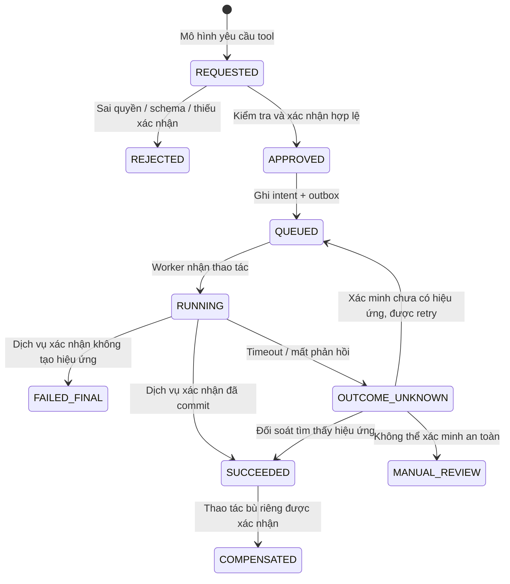

# Lưu vết hành động đã thực hiện để hỗ trợ khôi phục

> **Mô-đun:** SPRING_AI_TOOL_CALLING · **Chương:** Vận hành · **Phiên bản tham chiếu:** Spring AI **2.1.0**. Bài này hướng dẫn thiết kế dấu vết **có thể khôi phục** cho hành động do mô hình đề xuất qua `@Tool`, `ToolCallback` và `ToolContext`. Trọng tâm là xác định **hành động nào thực sự đã xảy ra**, có được phép không, đã tạo hiệu ứng nghiệp vụ gì, và có thể tiếp tục sau sự cố ra sao.

## 1. Một câu trả lời thành công không chứng minh hành động đã thành công

Giả sử trợ lý hỗ trợ vận hành đơn hàng có tool `create_shipment(orderId)`. Mô hình nhận yêu cầu “Tạo vận đơn cho OD-1042” và đề nghị gọi tool. Ứng dụng gọi dịch vụ vận chuyển; dịch vụ tạo vận đơn `SHP-881`, nhưng mạng đứt **sau khi dịch vụ xử lý và trước khi ứng dụng nhận phản hồi**. Người dùng thấy thông báo lỗi và bấm thử lại. Mô hình có thể sinh tool call mới với id mới. Nếu ứng dụng chạy lại mù quáng, cùng đơn có thể bị tạo **hai vận đơn**.

Bài toán khôi phục là trả lời chính xác:

1. **Ai** yêu cầu và ai đã **phê duyệt** thao tác?
2. Mô hình **đề nghị** tool nào, đối số nào; ứng dụng có **chấp nhận** và **thực thi** hay không?
3. Dịch vụ ngoài **đã hoàn tất**, **chắc chắn chưa hoàn tất**, hay **chưa biết kết quả**?
4. Khi người dùng/worker retry hoặc ứng dụng khởi động lại, có thể **lấy lại kết quả cũ**, **tiếp tục**, **đối soát** hay **cần xử lý thủ công**?
5. Có thể trả lời câu hỏi trên **không cần tin lời mô hình** hoặc đọc log debug đã hết hạn?

Nguyên tắc xuyên suốt: **tool call do mô hình tạo ra là một ý định; hiệu ứng nghiệp vụ chỉ được xác nhận bằng hệ thống thực thi có thẩm quyền**. `ChatClient.call().content()` có thể là văn bản hợp lý nhưng không đủ để chứng minh một hành động đã ghi thành công ở dịch vụ ngoài.

### Mục tiêu học tập

Sau bài này, bạn có thể thiết kế nhật ký cho một lần gọi tool, phân biệt `trace`/hội thoại/nhật ký nghiệp vụ, đặt khóa idempotency đúng chỗ, xử lý các “cửa sổ lỗi” trước và sau hiệu ứng ngoài, viết một tool Spring AI có truyền ngữ cảnh tin cậy, và xây dựng quy trình khôi phục có bằng chứng.

## 2. Ba loại lưu vết phục vụ ba câu hỏi khác nhau

| Loại | Trả lời | Cơ chế phù hợp | Giới hạn |
| --- | --- | --- | --- |
| **Observability: log, metric, trace** | Gọi tool mất bao lâu, lỗi ở span nào, trace nào nối ChatClient với dịch vụ ngoài? | Spring AI Observability, Micrometer, tracing, log có correlation ID | Có sampling, TTL, khả năng thất lạc; span hoàn tất không bảo đảm transaction bên ngoài đã commit |
| **Lịch sử hội thoại / session** | Mô hình đã thấy những message/tool result nào và cần tiếp tục hội thoại ở đâu? | Spring AI 2.1 **Session Memory**, `SessionService`, `SessionRepository` và advisor | Event hội thoại không tự chứng minh trạng thái nghiệp vụ và không thay cơ chế chống thực thi lặp |
| **Nhật ký hành động bền vững (action ledger)** | Hành động có được cấp quyền không, đã ghi nhận hiệu ứng nào, lần retry có được phép thực thi lại không? | Bảng action + append-only event, idempotency, outbox, trạng thái và đối soát | Ứng dụng phải tự thiết kế, bảo trì và gắn vào ranh giới nghiệp vụ |

Spring AI 2.1 có `spring.ai.tool` observation với `gen_ai.operation.name=execute_tool`, `spring.ai.tool.call.id` (id do mô hình cung cấp) và `spring.ai.tool.definition.name`. Thuộc tính có thể chứa đối số/kết quả được **tắt mặc định** qua `spring.ai.tools.observations.include-content=false` để giảm nguy cơ lộ thông tin. Các span giúp điều tra, nhưng **không thể thay việc ghi một sự kiện nghiệp vụ bền vững**. [1][2]

Spring AI 2.1 cũng giới thiệu **Session Memory**: log sự kiện append-only của session, hỗ trợ JDBC repository và bảo toàn các lượt hội thoại qua nhiều instance. `ChatMemory`/`MessageChatMemoryAdvisor` cũ đã deprecated ở 2.1. Lưu ý: `JdbcChatMemoryRepository` cũ không lưu được tool-call messages và `ToolResponseMessage`; nếu cần lưu đủ lịch sử tool, dùng Session Memory với JDBC session repository. Tuy vậy, **kể cả Session Memory có lưu “tool trả thành công”, hệ thống nghiệp vụ vẫn là nguồn sự thật cuối cùng**. [3][4][5]

## 3. Cần lưu vết **cả ý định, quyền, nỗ lực và kết quả**

Một hành động có thể đi qua các trạng thái sau (các tên là **thiết kế gợi ý của ứng dụng**, không phải enum Spring AI):



**Không đánh đồng:**

- `REQUESTED`: mô hình trả cấu trúc tool call; chưa có quyền thực thi.
- `APPROVED`: ứng dụng đã xác thực, phân quyền, đáp ứng bước xác nhận nếu cần; chưa tạo hiệu ứng.
- `QUEUED`: ý định đã được lưu bền vững để worker có thể xử lý.
- `RUNNING`: đã bắt đầu nỗ lực gọi; **không** chứng minh đã hoàn tất.
- `SUCCEEDED`: có kết quả hoặc bằng chứng từ hệ thống có thẩm quyền (ví dụ provider reference tồn tại).
- `FAILED_FINAL`: có bằng chứng chắc chắn không tạo hiệu ứng; khác với lỗi mạng.
- `OUTCOME_UNKNOWN`: request có thể đã đến nơi và được xử lý, nhưng ứng dụng chưa có bằng chứng đủ chắc; **không tự chuyển thành FAILED_FINAL**.
- `COMPENSATED`: một hành động bù đã chạy thành công; không có nghĩa lịch sử đã được xóa hoặc thế giới quay về chính xác trạng thái ban đầu.

Một event nên được **ghi thêm**, không sửa/xóa dòng cũ để “làm sạch” lịch sử. Bảng trạng thái hiện tại có thể cập nhật như một **projection** để truy vấn nhanh; event log bất biến theo thiết kế vẫn giữ thứ tự và lý do chuyển trạng thái.

## 4. Mã định danh: phân biệt cái do mô hình sinh và cái do ứng dụng sở hữu

| ID | Nguồn tạo | Dùng cho việc gì? | Có thể làm khóa chống thực thi trùng không? |
| --- | --- | --- | --- |
| `session_id` / `conversation_id` | Ứng dụng | Gom các lượt hội thoại, phục hồi ngữ cảnh | **Không**; một session có nhiều hành động |
| `turn_id` | Ứng dụng | Nhận diện một lượt yêu cầu đã được chấp nhận | **Chưa đủ** nếu lượt đó có nhiều hành động |
| `tool_call_id` | Mô hình/provider | Liên hệ đề nghị gọi tool với `ToolResponseMessage` và span | **Không**; retry có thể sinh id khác |
| `action_id` | **Ứng dụng**, lưu bền vững | Định danh **một ý định nghiệp vụ cụ thể**; giữ nguyên qua retry | **Có**, khi gắn với đúng ý định và unique constraint |
| `attempt_id` | Ứng dụng/worker | Phân biệt từng lần truyền request ra dịch vụ ngoài | **Không**; mỗi retry tạo attempt mới |
| `trace_id` / `span_id` | Hạ tầng tracing | Nối chặng ChatClient → tool → dịch vụ | **Không**; trace thường thay khi retry |
| `provider_reference` | Dịch vụ nghiệp vụ | Bằng chứng/tọa độ đối soát kết quả (ví dụ mã vận đơn) | Dùng tra cứu đối soát, tùy hợp đồng provider |

**Quy tắc thiết kế khóa:** `action_id` phải thuộc về **một hành động nghiệp vụ** và được phát sinh/lưu **bởi backend**, trước khi side effect xảy ra. Nếu cùng hành động bị gọi lại, dùng lại `action_id`; nếu người dùng chủ động yêu cầu hành động thứ hai thật sự, tạo `action_id` mới. Mỗi lượt hội thoại có thể có nhiều action, mỗi action có nhiều attempts. **Đừng lấy raw JSON của model hay `tool_call_id` làm nguồn duy nhất của khóa idempotency.**

Cần ràng buộc thêm `tenant_id`, `operation`, `logical_key` và bản tóm tắt tham số chuẩn hóa. Một `action_id` đã dùng với `orderId=OD-1042` mà bị retry với `orderId=OD-2048` phải bị từ chối vì **xung đột ý định**, không được dùng kết quả cũ rồi trả nhầm.

### Ví dụ bản ghi sự kiện tối thiểu

```json
{
  "eventId": "3e1778e3-ff03-4b31-a1eb-6d149e932476",
  "actionId": "8fd5b93f-8ec8-4fe2-b1a5-003da426eb1d",
  "sequence": 4,
  "eventType": "OUTCOME_UNKNOWN",
  "occurredAt": "2026-11-27T08:12:34Z",
  "tenantId": "tenant-42",
  "actorId": "operator-7",
  "sessionId": "session-991",
  "turnId": "turn-14",
  "toolCallId": "call_R2x",
  "toolName": "create_shipment",
  "attemptId": "attempt-02",
  "traceId": "7d1f0f6eac25b4d41b5801fa4c79a881",
  "argsDigest": "sha256-of-canonical-validated-args",
  "errorCode": "UPSTREAM_READ_TIMEOUT",
  "providerReference": null,
  "resultSummary": "Đã gửi request; chưa xác minh được hiệu ứng"
}
```

Các giá trị mẫu chỉ minh họa **schema audit do ứng dụng tự định nghĩa**; `argsDigest` biểu thị việc băm đối số đã chuẩn hóa, không phải cách Spring AI tự động tạo hash. Với thông tin có tập giá trị nhỏ, hash đơn giản có thể bị dò; nếu cần đối chiếu mà không lộ giá trị, cân nhắc HMAC có khóa bảo vệ.

## 5. Thiết kế kho hành động bền vững

Tối thiểu nên có **bản ghi định danh hành động**, **log sự kiện append-only**, và nếu xử lý bất đồng bộ thì **outbox**. Ví dụ PostgreSQL giản lược:

```sql
CREATE TABLE action_registry (
    action_id          uuid PRIMARY KEY,
    tenant_id          text NOT NULL,
    logical_key        text NOT NULL,
    operation          text NOT NULL,
    args_digest        text NOT NULL,
    state              text NOT NULL,
    provider_reference text,
    updated_at         timestamptz NOT NULL DEFAULT now(),
    UNIQUE (tenant_id, logical_key)
);

CREATE TABLE action_event (
    event_id       uuid PRIMARY KEY,
    action_id      uuid NOT NULL REFERENCES action_registry(action_id),
    sequence_no    bigint NOT NULL,
    event_type     text NOT NULL,
    actor_id       text,
    session_id     text,
    turn_id        text,
    tool_call_id   text,
    attempt_id     text,
    trace_id       text,
    error_code     text,
    occurred_at    timestamptz NOT NULL DEFAULT now(),
    UNIQUE (action_id, sequence_no)
);

CREATE TABLE action_outbox (
    message_id    uuid PRIMARY KEY,
    action_id     uuid NOT NULL REFERENCES action_registry(action_id),
    event_type    text NOT NULL,
    created_at    timestamptz NOT NULL DEFAULT now(),
    claimed_at    timestamptz,
    delivered_at  timestamptz
);
```

Đây là **DDL minh họa** cho bài học, chưa bao gồm đầy đủ chỉ mục vận hành, chính sách lưu trữ, khóa ngoại tenant và cơ chế lock/lease. Ở ứng dụng thật, `action_registry` có thể có `version` (optimistic locking), `next_retry_at`, `lease_owner`, `lease_until`, `last_error_code` và thời hạn đối soát.

**Bốn bất biến dữ liệu cần giữ:**

1. Trong cùng tenant và cùng `logical_key`, chỉ có **một** hành động logic được tạo. DB unique constraint phải là chốt cuối, không dựa vào “check rồi insert” ở bộ nhớ.
2. Mỗi lần đổi trạng thái phải **append sự kiện** tương ứng và cập nhật projection trong **cùng transaction DB**. Thứ tự `sequence_no` được cấp phát khi giữ khóa hoặc qua cơ chế đảm bảo không va chạm.
3. Không ghi `SUCCEEDED` chỉ vì `HTTP 200` hoặc mô hình khẳng định thành công; kiểm tra ngữ nghĩa phản hồi và trạng thái commit phía provider.
4. Log phải đủ để phục hồi và đối soát, nhưng không tùy tiện lưu token, nội dung prompt, mật khẩu, PII hay payload nhạy cảm nguyên văn.

**Ai được thay đổi ledger?** Chỉ lớp nghiệp vụ phía server chạy bằng service identity có quyền; model chỉ được *đề nghị* công cụ qua schema. Muốn bảo vệ vết audit, thiết lập role DB hạn chế update/delete trên `action_event`, backup và chính sách chống sửa đổi, hoặc chuyển event sang kho append-only có kiểm soát thay đổi.

## 6. Đưa ngữ cảnh đáng tin vào `@Tool` trong Spring AI 2.1

Trong Spring AI 2.1, `ChatClient` có `ToolCallingAdvisor` tự đăng ký và dùng `ToolCallingManager` để tìm `ToolCallback`, thực thi tool, đưa kết quả về mô hình rồi lặp khi cần. `ChatModel.call()` cấp thấp **không tự thực thi** tool. Vì thế nếu dùng `ChatClient`, điểm ghi audit nghiệp vụ đáng tin cậy nhất là **ngay trong lớp thực thi tool/service**, trước và sau side effect; chỉ quan sát advisor chưa đủ để biết external commit. [1][6]

Bên dưới, `ShipmentActions` và `ShipmentReceipt` là **class nghiệp vụ ứng dụng tự triển khai**. Dấu vết bền vững và chống retry nằm trong `ShipmentActions.createOnce(...)`, **không được Spring AI tự cấp sẵn**.

```java
import java.util.Map;
import org.springframework.ai.chat.client.ChatClient;
import org.springframework.ai.tool.annotation.Tool;
import org.springframework.ai.tool.annotation.ToolParam;
import org.springframework.ai.chat.model.ToolContext;

record ShipmentReceipt(String shipmentId, String state) {}

final class ShipmentTools {
    private final ShipmentActions actions;

    ShipmentTools(ShipmentActions actions) {
        this.actions = actions;
    }

    @Tool(
        name = "create_shipment",
        description = "Tạo vận đơn cho đơn hàng đã được người dùng phê duyệt"
    )
    public ShipmentReceipt createShipment(
        @ToolParam(description = "Mã đơn hàng cần tạo vận đơn")
        String orderId,
        ToolContext toolContext
    ) {
        Map<String, Object> trusted = toolContext.getContext();
        String tenantId = (String) trusted.get("tenantId");
        String actorId = (String) trusted.get("actorId");
        String actionId = (String) trusted.get("actionId");

        // createOnce phải kiểm tra đủ 3 giá trị, quyền, approval và tham số.
        return actions.createOnce(actionId, tenantId, actorId, orderId);
    }
}
```

Khi **backend đã phát hành một `actionId` và gắn nó với hành động được xác nhận**, gọi:

```java
// Ví dụ: các biến này lấy từ phiên xác thực và action registry phía server.
String finalAnswer = chatClient.prompt()
    .user("Tạo vận đơn đã được xác nhận cho đơn OD-1042.")
    .tools(new ShipmentTools(shipmentActions))
    .toolContext(Map.of(
        "tenantId", trustedTenantId,
        "actorId", authenticatedActorId,
        "actionId", persistedActionId
    ))
    .call()
    .content();
```

`.toolContext(...)` chuyển dữ liệu tới phía thực thi `@Tool` **mà không gửi phần context đó cho mô hình**; phù hợp với tenant, principal và `actionId` do server quản lý. **Không lấy `actionId` từ argument do mô hình tự sinh** rồi coi là đã được phép thực thi. Khi một request có thể sinh **nhiều thao tác side effect khác nhau**, không tái sử dụng cùng một `actionId` cho mọi tool call: server cần gắn từng tool call với **một action record riêng** đã được phê duyệt (chẳng hạn qua lớp điều phối thực thi/tool callback wrapper). [1]

`ShipmentActions.createOnce` phải có logic kiểm soát quyền, trạng thái action và đối soát với provider. Mã ví dụ minh họa **đường thực thi đồng bộ** có idempotency và có thể trả `ShipmentReceipt` khi provider đã xác nhận. Nếu dùng **outbox bất đồng bộ** ở phần sau, tool nên trả ngay **action ID + trạng thái `QUEUED`/`PENDING`**, rồi để giao diện truy vấn trạng thái hoặc nhận thông báo khi worker hoàn thành; không trả `SUCCEEDED` sớm. Mã ví dụ không đại diện cho một hệ thống phân quyền có sẵn; nó minh họa đúng ranh giới Spring AI và code nghiệp vụ. Trong triển khai thật, thiếu bất kỳ khóa context nào phải **fail closed**; kiểm tra `tenantId` từ security principal server-side và ràng buộc `orderId` thuộc tenant.

### Vì sao không chỉ đặt audit trong `Advisor`?

Một advisor có thể quan sát phản hồi mô hình, đo từng vòng và ghi “mô hình đã yêu cầu create_shipment”. Nhưng advisor không tự biết request tới provider đã commit hay chưa. Spring AI 2.1 cho phép custom advisor ở trong loop (order lớn hơn `ToolCallingAdvisor.DEFAULT_ORDER`) để quan sát từng vòng. Với thao tác thay đổi dữ liệu, vẫn phải ghi **action ledger tại transaction boundary / service adapter**. [6]

Nếu dùng `ToolCallback` tùy biến hoặc wrapper, đặt audit xung quanh `call(input, ToolContext)` là hợp lý cho nhiều tool; tuy vậy phải tránh ghi `SUCCEEDED` chỉ vì callback **trả về chuỗi** “OK” mà chưa xác minh hậu điều kiện nghiệp vụ.

## 7. Ghi intent trước, thực thi có khóa chống trùng, đối soát sau

Kỹ thuật chủ chốt là **durable intent + idempotent execution + reconciliation**.

```mermaid
sequenceDiagram
    participant A as Ứng dụng
    participant DB as Action ledger + Outbox
    participant W as Worker/Tool service
    participant P as Dịch vụ vận chuyển
    A->>DB: TX: tạo action APPROVED + outbox
    DB-->>A: action_id bền vững
    W->>DB: Claim outbox; append ATTEMPT_STARTED
    W->>P: createShipment(orderId, idempotencyKey=action_id)
    P-->>W: shipmentId=SHP-881
    W->>DB: TX: append SUCCEEDED, cập nhật projection
    W-->>A: Lấy lại ShipmentReceipt từ ledger
    Note over W,P: Nếu mất phản hồi: chuyển OUTCOME_UNKNOWN
    W->>P: Tra cứu theo action_id / business key
    P-->>W: Trạng thái có thẩm quyền
    W->>DB: Append RECONCILED_* hoặc MANUAL_REVIEW
```

### 7.1. Logic xử lý một action (mã giả)

```text
createOnce(actionId, tenantId, actorId, validatedArgs):
  assert authenticated actor and approved business intent
  begin DB transaction
    action = SELECT ... FOR UPDATE WHERE action_id = actionId
    reject if tenant/operation/argsDigest differ
    if action.state == SUCCEEDED:
        return saved business receipt (không gọi provider)
    if action.state == OUTCOME_UNKNOWN:
        return REQUIRES_RECONCILIATION (không gửi lại mù quáng)
    if state is REJECTED, FAILED_FINAL or MANUAL_REVIEW:
        return domain error / operator escalation
    atomically claim action for execution and record attempt
  commit

  try:
      result = provider.createShipment(
          validatedArgs, idempotencyKey = actionId
      )
      verify provider response means durable success
      begin DB transaction
        append SUCCEEDED with providerReference
        update action projection, persist safe result
      commit
      return safe result

  catch definite rejection (validated by provider contract):
      append FAILED_FINAL and reason code in DB transaction
      return domain failure

  catch timeout / lost connection / uncertain 5xx:
      append OUTCOME_UNKNOWN in DB transaction
      schedule reconciliation
      return "Đang xác minh kết quả" (không tự retry tạo mới)
```

Đây là **giả mã nghiệp vụ**, không phải API có sẵn trong `ToolCallingManager`. Một trường hợp còn khó hơn: tiến trình có thể chết ngay sau provider commit nhưng **trước khi kịp append `OUTCOME_UNKNOWN`**. Vì thế job quét `RUNNING`/lease hết hạn phải coi đây là kết quả **chưa biết** và chạy đối soát, chứ không suy ra chưa gửi request.

**Một lần thực thi cho một action** cần được chống tranh chấp bằng transaction, row lock/optimistic compare-and-set và lease nếu nhiều worker; không tin vào khóa trong JVM. Khi dùng idempotency key, cần kiểm tra provider có **thực sự cam kết** deduplication, phạm vi key, thời gian lưu key và cách xử lý payload khác nhau cùng key. Retry phải dùng **cùng khóa** và **cùng payload hợp lệ**.

### 7.2. Vì sao outbox quan trọng?

Trường hợp local DB và hệ thống bên ngoài là hai transaction khác nhau. Nếu ghi DB `APPROVED` rồi chỉ gọi provider trực tiếp, JVM có thể crash trước khi gửi mà không còn worker biết phải tiếp tục. Nếu gọi provider trước rồi mới ghi DB, có thể tạo hiệu ứng mà không còn dấu vết durable.

**Transactional outbox** ghi `action registry + action event + outbox message` trong **cùng một transaction DB**, rồi worker lấy outbox để dispatch. Điều này bảo đảm ý định không bị mất giữa DB commit và gửi request, **không** tự tạo ra exactly-once qua mạng. Worker có thể gửi lặp; provider cần idempotency hoặc hệ thống phải đối soát để chống hiệu ứng lặp.

Nếu tác động nằm **trong cùng một cơ sở dữ liệu** với ledger, có thể cập nhật dữ liệu nghiệp vụ và append audit event trong **cùng transaction**, vừa commit cả hai vừa rollback cả hai. Nếu có nhiều hệ thống ngoài, cân nhắc **saga/compensating action**; hoàn tác là một hành động mới có kiểm soát, log và điều kiện phê duyệt riêng.

## 8. Bốn “cửa sổ lỗi” cần biết cách khôi phục

| Thời điểm lỗi | Trạng thái/bằng chứng có thể còn | Hành động khôi phục |
| --- | --- | --- |
| Trước khi commit `APPROVED + outbox` | Chưa có action bền vững, chưa dispatch | Chỉ tái tạo intent từ yêu cầu còn hợp lệ sau khi xác thực/phê duyệt; không tự suy rằng side effect đã xảy ra |
| Sau commit outbox, trước khi gọi provider | `QUEUED`, chưa có attempt được gửi | Worker có thể dispatch với `actionId` ổn định |
| Sau khi provider xử lý, trước khi lưu `SUCCEEDED` | `RUNNING` hết lease hoặc `OUTCOME_UNKNOWN`; có thể đã có hiệu ứng | **Tra cứu provider theo idempotency/business key**; ghi sự kiện đối soát, không tự gọi tạo lại nếu kết quả còn mơ hồ |
| Sau khi lưu `SUCCEEDED`, trước khi trả ChatClient/người dùng | Có `providerReference` và receipt bền vững | Trả receipt đã lưu; cập nhật hội thoại nếu cần; **không thực thi side effect lần nữa** |

**Không có đối soát đáng tin?** Nếu provider không hỗ trợ idempotency và không cho tra cứu một hành động theo business key, một lỗi timeout có thể thực chất đã thành công. Đánh dấu `MANUAL_REVIEW` và yêu cầu kiểm tra bên ngoài; tuyên bố “retry an toàn” là sai về mặt kỹ thuật.

**Không có rollback toàn cục tự động:** `@Transactional` chỉ bảo vệ transaction của resource được Spring quản lý; nó không cuộn ngược HTTP request đã commit ở hệ thống ngoài. Kể cả có cơ chế bù, kết quả bù cũng có thể lỗi và cần được audit thành một action riêng.

## 9. Quy trình khôi phục sau khi ứng dụng khởi động lại

Một quy trình có thể tự động hóa theo **action ledger**, sau đó quyết định cần đưa thông tin nào vào hội thoại:

1. **Quét** các action ở `QUEUED`, `RUNNING` quá lease, `OUTCOME_UNKNOWN`, và outbox chưa hoàn tất; lọc theo tenant và chính sách độ trễ.
2. **Đối chiếu** projection với append-only events; cảnh báo lỗ hổng thứ tự, trạng thái bất hợp lệ, trùng logical key hoặc action không có owner.
3. Với `QUEUED` chưa gửi, **claim lại** bằng cơ chế atomic và dispatch. Với `RUNNING` hết lease, **đừng mặc định coi là chưa tạo hiệu ứng**.
4. Với `OUTCOME_UNKNOWN`, hỏi **hệ thống nguồn sự thật** bằng provider reference, idempotency key hoặc business key. Kết quả tìm thấy → `SUCCEEDED`; xác nhận chắc chắn không tồn tại và policy cho phép → xếp retry; không đủ thông tin → `MANUAL_REVIEW`.
5. Với `SUCCEEDED`, đọc receipt bền vững; khi người dùng retry cùng action, trả **cùng kết quả** mà không tạo hiệu ứng mới.
6. **Tiếp nối hội thoại** sau khi đã xử lý hiệu ứng thật. Có thể khôi phục thông điệp về trạng thái từ ledger vào session dưới dạng tool result đã xác minh; tránh phát lại `@Tool` gây thay đổi dữ liệu một lần nữa.
7. **Kiểm tra hậu điều kiện** (ví dụ mỗi đơn chỉ có một vận đơn hiệu lực) và ghi kết quả đối soát bằng event mới. Nếu phát hiện trùng, tạo quy trình xử lý riêng có quyền và audit.

Một bản ghi `SUCCEEDED` cần chứa đủ **receipt an toàn** để trả lời người dùng (như mã vận đơn, trạng thái) hoặc khóa tham chiếu để đọc lại. Nếu chỉ có dòng log “success” nhưng không biết đã tạo đối tượng nào, khả năng khôi phục bị giới hạn.

### Ví dụ timeline có ý nghĩa vận hành

```text
08:12:30  action A1 REQUESTED, tool_call_id=call_101
08:12:30  A1 APPROVED, actor=operator-7, orderId digest=...
08:12:31  A1 QUEUED (transaction có outbox)
08:12:32  A1 ATTEMPT_STARTED, attempt=T1, trace_id=...
08:12:33  provider tạo SHP-881
08:12:34  client timeout; A1 OUTCOME_UNKNOWN
08:14:00  reconciler tra cứu provider bằng actionId A1
08:14:01  tìm thấy SHP-881; A1 SUCCEEDED (reconciled=true)
08:15:00  người dùng retry; model sinh call_222
08:15:00  backend tìm lại A1 từ logical business intent
08:15:00  trả SHP-881, external create count vẫn = 1
```

Tại `08:15:00`, `tool_call_id` mới không tạo ra `actionId` mới vì nghiệp vụ xác định người dùng **retry cùng một ý định đã được phê duyệt**. Nếu người dùng cố ý tạo một vận đơn thứ hai, đó là ý định mới cần kiểm tra chính sách, không nên để bộ deduplication tự quyết sai.

## 10. Lưu dấu ở đâu trong Spring AI 2.1?

### 10.1. Vòng gọi tool và nơi đặt audit

`ToolCallingAdvisor` được `DefaultChatClient` tự đăng ký, gọi `ToolCallingManager` thực thi `ToolCallback` và quay lại mô hình. Có thể dùng hook/inner advisor để quan sát từng lần model trả tool call và mỗi vòng. Tuy vậy, **thời điểm xác nhận side effect** phải được xác định trong **service adapter/callback** hoặc từ kết quả đối soát bên ngoài. [1][6]

Nếu chạy `ChatModel.call()` trực tiếp, ứng dụng có thể tự dùng `ToolCallingManager` và tự kiểm soát vòng gọi, nhưng lúc đó **phải tự đảm bảo các điểm ghi nhật ký và trạng thái** cho mọi nhánh (gọi thành công, lỗi, `returnDirect`, nhiều tool call, timeout). Cũng không được replay tool-result vào một lời gọi `ChatClient` mới một cách thiếu kiểm soát quyền.

Với hành động cần phê duyệt, `@Tool(requiresConfirmation = true)` và cơ chế confirmation của Spring AI 2.1 có thể dừng vòng tool chờ quyết định; ứng dụng vẫn phải **ghi approval có actor, thời điểm, scope và binding với actionId** để khôi phục. [1][6]

### 10.2. Session Memory để phục hồi ngữ cảnh hội thoại

Spring AI 2.1 có `Session Memory` với event log append-only, `SessionAdvisors` và JDBC repository. Ví dụ khởi tạo từ docs:

```java
@Bean
ChatClient chatClient(ChatModel chatModel, SessionService sessionService) {
    return ChatClient.builder(chatModel)
        .defaultAdvisors(SessionAdvisors.builder(sessionService).build())
        .build();
}

String answer = chatClient.prompt()
    .user("Trạng thái vận đơn vừa tạo?")
    .advisors(SessionAdvisors.session("session-991"))
    .call()
    .content();
```

Để có backend JDBC, dependency là `org.springframework.ai:spring-ai-starter-model-session-jdbc`, cùng DataSource đã cấu hình; schema init ngoài môi trường embedded cần được quản lý qua migration/thuộc tính phù hợp. Lưu ý `sessionId` phải được cấp phát và ràng buộc với user/tenant ở ứng dụng, không dùng một ID chung cho mọi người. [3][5]

**Không nhầm hai loại event:** `SessionEvent` giúp phục hồi diễn tiến hội thoại và trạng thái session; `action_event` trong bài là record nghiệp vụ do **chúng ta thiết kế**. Một session event có thể nói mô hình “đã nhận kết quả tool”, nhưng hệ thống bán hàng/vận chuyển mới xác nhận được kết quả đó có còn tồn tại hoặc đã bị hoàn tác.

### 10.3. Correlation qua observation và tracing

Cấu hình gợi ý để giữ kín nội dung:

```yaml
spring:
  ai:
    tools:
      observations:
        include-content: false
    chat:
      client:
        observations:
          log-prompt: false
          log-completion: false
      observations:
        log-prompt: false
        log-completion: false
```

Các khóa quan sát Spring AI 2.1 có `spring.ai.tool.call.id`, `spring.ai.tool.definition.name` và span `execute_tool <tool-name>`. Ứng dụng nên thêm `action_id`/`attempt_id`/`tenant_id` **dưới dạng đã được kiểm soát** vào structured log và span của **service** để nối được trace và ledger. Không lấy những ID có cardinality cao làm label Prometheus metric; dùng chúng để truy vấn log/trace và dùng metric tổng hợp theo `tool_name`/`outcome`. [2][7]

**Traces là công cụ tra cứu, ledger là nguồn để ra quyết định retry.** Nếu không có span vì sampling hoặc lỗi exporter nhưng `action_registry` ghi `SUCCEEDED` và provider reference được xác minh, không được coi là chưa thực thi.

### 10.4. Lỗi tool và kết quả bất định

Spring AI 2.1 bọc lỗi tool bằng `ToolExecutionException`; `ToolExecutionExceptionProcessor` có thể đưa một error message lại vào mô hình hoặc ném lỗi cho caller. Mặc định, message của `RuntimeException` có thể được gửi về mô hình. Vì thế thiết kế lớp nghiệp vụ phải **ghi trạng thái thật** (kể cả `OUTCOME_UNKNOWN`) trước khi rút gọn lỗi để trả về; tránh để mô hình thấy stack trace, SQL, credential hay thông tin khách hàng. `spring.ai.tools.throw-exception-on-error=true` chuyển mọi lỗi tool cho caller quản lý, **không** tự biến lỗi thành rollback. [1]

Đặc biệt, không phân loại mọi HTTP 5xx là “chưa thành công”: 500 có thể xuất hiện **sau khi** provider hoàn tất hiệu ứng, tùy hợp đồng API.

## 11. Bảo mật, tính toàn vẹn và chi phí lưu trữ

Nhật ký khôi phục thường chứa nhiều thông tin nhạy cảm hơn log vận hành thông thường. Thiết kế thực tế nên có:

- **Ít dữ liệu nhất có ích:** lưu mã công cụ, action ID, business reference, digest/HMAC của input đã chuẩn hóa, mã lỗi, trạng thái, thời gian, chủ thể có quyền. Chỉ lưu payload nguyên văn trong kho mã hóa chuyên dụng nếu có yêu cầu điều tra rõ ràng.
- **Ràng buộc tenant và actor:** mọi truy vấn khôi phục, xuất log, replay receipt đều kiểm tra lại tenant/user. Một `actionId` đoán được không được cấp quyền đọc hoặc thực thi.
- **Tính toàn vẹn:** append-only events, quyền DB tối thiểu, chống sửa/xóa ngoài luồng, backup, kiểm soát người sửa, có thể dùng event hash chaining hoặc WORM storage tùy yêu cầu pháp lý.
- **Phân quyền khôi phục:** người vận hành có thể xem sự kiện đã che nội dung; chỉ service identity được retry action; hành động bù phải qua quyền, phê duyệt và audit riêng.
- **Thời gian lưu:** giữ ledger đủ lâu để bao phủ khoảng retry của client, retention idempotency của provider, tranh chấp nghiệp vụ và yêu cầu kiểm toán; xóa/ẩn danh dữ liệu cá nhân theo chính sách, không giữ mãi mặc định.
- **Phân định lỗi:** lỗi validation/403 phải ghi `REJECTED`, lỗi thật chắc chắn không có hiệu ứng là `FAILED_FINAL`, còn mất kết quả hoặc network timeout là `OUTCOME_UNKNOWN`.

Nếu log lưu `orderId` hoặc email dưới dạng hash thông thường, kẻ tấn công vẫn có thể thử đoán từ tập mã đơn nhỏ. HMAC với secret quản lý tốt hoặc field-level encryption phù hợp hơn khi cần đối chiếu và bảo vệ dữ liệu.

## 12. Các phép thử bắt buộc để tin vào cơ chế khôi phục

Thử bằng service giả có thể chủ động tạo timeout và “thành công nhưng mất response”; kiểm tra **hậu điều kiện nghiệp vụ** và event log, thay vì chỉ assert câu trả lời của mô hình.

| Ca | Tiêm lỗi / mô phỏng | Điều kiện PASS |
| --- | --- | --- |
| A — Thông thường | Provider trả `SHP-881` và xác nhận | Có `REQUESTED→APPROVED→...→SUCCEEDED`, receipt lưu được, tạo đúng một vận đơn |
| B — Retry trùng | Gọi cùng action 2–10 lần, kể cả tool call id khác | `provider_create_count = 1` (khi provider/idempotency hỗ trợ); trả cùng receipt |
| C — Crash trước dispatch | Commit outbox rồi kill worker | Khởi động lại, worker xử lý tiếp và có đầy đủ event |
| D — Crash sau provider commit | Provider tạo vận đơn rồi chặn response, kill app | Recovery xác minh bằng provider, ghi `SUCCEEDED`, không tạo lần hai |
| E — Timeout chưa rõ | Provider không hỗ trợ tra cứu hoặc dedupe | `OUTCOME_UNKNOWN→MANUAL_REVIEW`, **không** retry mù quáng |
| F — Sai quyền | Actor không sở hữu đơn | `REJECTED`, không có external side effect, log không lộ PII |
| G — Sai payload với cùng actionId | Lần đầu `OD-1042`, retry `OD-2048` | Từ chối xung đột, không trả nhầm receipt |
| H — Cạnh tranh | Hai worker cùng claim một `actionId` | Chỉ một worker sở hữu lượt xử lý; state/event không bị ghi đè |
| I — Nhiều tool call | Mô hình gọi 2 action khác nhau trong một turn | Hai `actionId` riêng, kết quả không tráo; nếu cùng action thì dedupe đúng |
| J — Lỗi sau lưu thành công | `SUCCEEDED` đã commit nhưng lỗi trả người dùng | Retry nhận receipt từ ledger; provider không chạy lại |
| K — Compensation | Tạo mới thành công rồi yêu cầu hủy hợp lệ | Có action hủy riêng, sự kiện `COMPENSATED` và bằng chứng hủy |
| L — Thay đổi model/runtime | Cùng ý định nhưng model sinh tên/id tool khác | Backend map đúng ý định và quyền; hành động cũ không bị lặp |

Một test tích hợp đáng giá là cho adapter giả xử lý yêu cầu thành công **nhưng cố ý ném timeout trước khi trả phản hồi**. Nếu code đánh dấu `FAILED_FINAL` rồi tự gửi lại mà không kiểm tra idempotency, test sẽ phát hiện trùng hiệu ứng. Ngoài ra, thử cả yêu cầu streaming: Spring AI 2.1 có các `ToolCallPart` *partial* trong streaming; không cho chạy side effect chỉ dựa trên đoạn argument đang được stream dở. [1]

### Bài tập thực hành: lưu lại và khôi phục một lần tạo vận đơn

1. Định nghĩa `@Tool` gọi dịch vụ vận đơn giả; cấp `tenantId`, `actorId`, `actionId` từ backend qua `ToolContext`.
2. Tạo `action_registry` + `action_event` + `action_outbox`, lưu approval và intent trong một transaction.
3. Cho provider giả hỗ trợ `idempotencyKey=actionId`. Ghi attempt, gọi provider, lưu provider reference sau khi được xác nhận.
4. Tiêm sự cố “provider đã tạo nhưng client timeout”; khởi động lại worker, chạy đối soát.
5. Dùng một lượt `ChatClient` mới để hỏi trạng thái; kết quả phải là `SHP-881` đã lưu và **số vận đơn được tạo vẫn bằng 1**.
6. Đối chiếu theo `actionId` từ audit record đến attempt log và `traceId`, bảo đảm câu trả lời không cần đọc raw prompt hoặc suy diễn từ lời mô hình.

**Câu hỏi tự kiểm tra:** Nếu một trace ghi “tool execute success” nhưng không có business reference trong ledger và HTTP response bị mất, có được retry tool tạo vận đơn không? **Chưa.** Trước tiên phải đối soát nguồn sự thật và hợp đồng idempotency của provider. Trace không đủ xác nhận một hiệu ứng đã hoặc chưa commit.

## 13. Tóm tắt thiết kế và tài liệu đối chiếu

Điểm mấu chốt khi vận hành tool calling là lưu **quyết định**, **nỗ lực** và **bằng chứng hiệu ứng** thành những sự kiện có thể kiểm tra. Khi có sự cố, hệ thống phải biết khi nào **được tiếp tục**, khi nào **đã xong nên chỉ trả lại kết quả**, và khi nào **cần đối soát**. `ToolContext` mang identity/khóa tin cậy từ ứng dụng, còn `ToolCallingAdvisor` điều phối hội thoại; các thành phần đó phối hợp với action ledger và idempotency để khôi phục an toàn.

Tài liệu chính thức (đã đối chiếu theo **Spring AI 2.1.0**, ngày 27/11/2026):

1. **[Spring AI — Tool Calling](https://docs.spring.io/spring-ai/reference/api/tools.html)**: trách nhiệm của ứng dụng, `@Tool`, `ToolCallback`, `ToolContext`, lỗi tool, confirmation, vòng lặp.
2. **[Spring AI — Observability](https://docs.spring.io/spring-ai/reference/observability/index.html)**: span `spring.ai.tool`, `execute_tool`, `spring.ai.tool.call.id` và cờ nội dung nhạy cảm.
3. **[Spring AI — Session Memory](https://docs.spring.io/spring-ai/reference/api/session.html)**: session event log append-only, `SessionAdvisors`, `SessionService` và JDBC starter.
4. **[Spring AI — Chat Memory](https://docs.spring.io/spring-ai/reference/api/chat-memory.html)**: deprecation từ 2.1, giới hạn `JdbcChatMemoryRepository` với tool messages.
5. **[Spring AI — Session JDBC Repository](https://docs.spring.io/spring-ai/reference/api/session/jdbc.html)**: `AI_SESSION`, `AI_SESSION_EVENT` và cơ chế lưu event.
6. **[Spring AI — ToolCallingAdvisor](https://docs.spring.io/spring-ai/reference/api/tools/tool-calling-advisor.html)**: vòng tool, hooks/advisor, confirmation, `returnDirect`.
7. **[Spring AI — Upgrade Notes](https://docs.spring.io/spring-ai/reference/upgrade-notes.html)**: khác biệt 1.x/2.x và thay đổi trong các tên/thuộc tính quan sát tool calling.

> **Phạm vi trách nhiệm:** Bảng `action_registry`/`action_event`/`action_outbox`, các trạng thái, `ShipmentActions` và toàn bộ quy trình đối soát ở đây là **thiết kế đề xuất của ứng dụng**. Spring AI không cung cấp sẵn một hệ thống “thực thi đúng một lần + hoàn tác” cho mọi dịch vụ ngoài.
