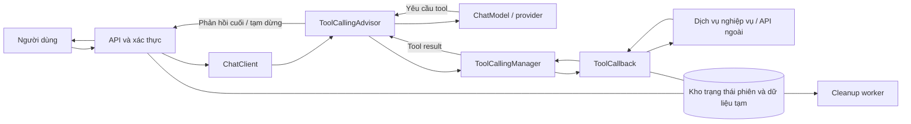
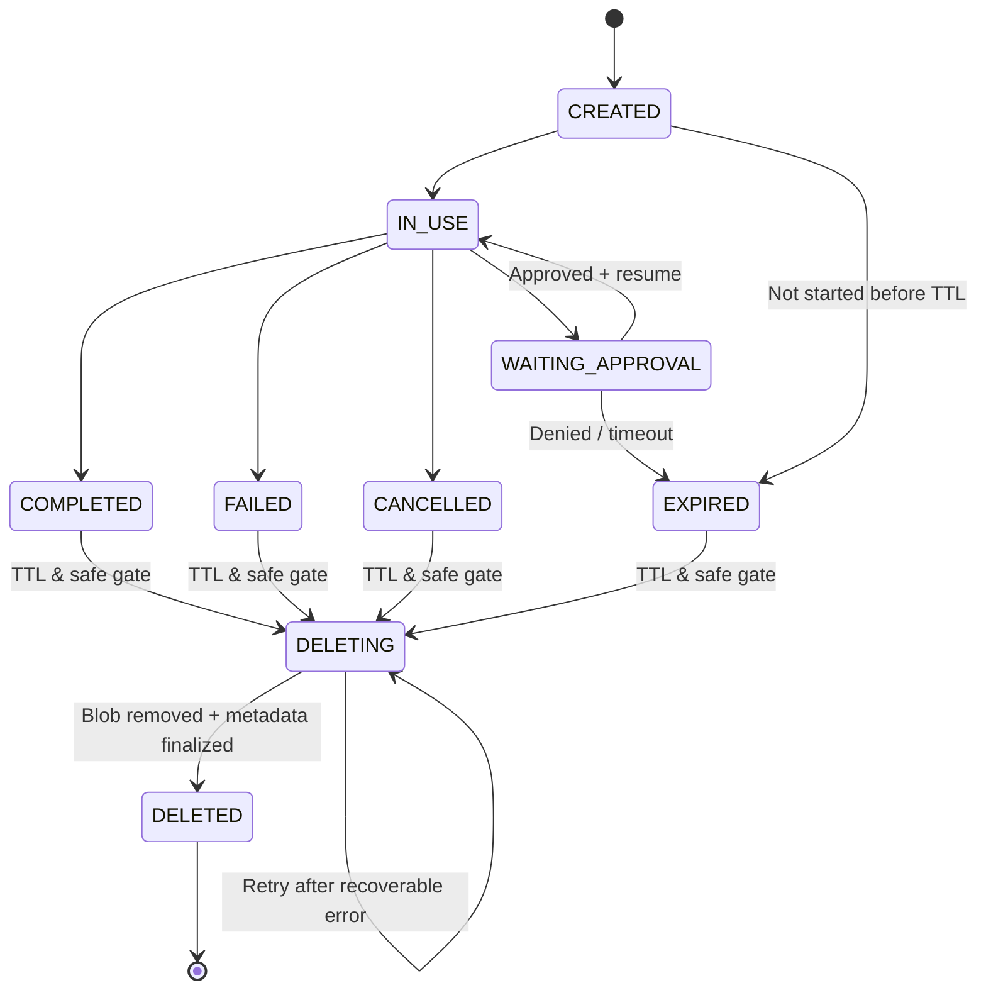

# Xây dựng quy trình xử lý sự cố và dọn dữ liệu tạm

## Mục tiêu

Khi vận hành ứng dụng **SPRING_AI_TOOL_CALLING**, vấn đề không dừng ở việc model có yêu cầu gọi đúng `@Tool`. Ứng dụng còn phải ứng phó khi dịch vụ ngoài trả lỗi, một vòng tool calling kéo dài bất thường, người dùng chưa phê duyệt thao tác, callback đã tạo tác dụng phụ nhưng phản hồi bị mất, hoặc dữ liệu trung gian còn tồn tại sau khi phiên xử lý kết thúc.

Sau bài học, bạn có thể:

- Thiết kế **runbook xử lý sự cố** có người chịu trách nhiệm, tín hiệu phát hiện, quyết định dừng/khôi phục và bằng chứng hậu kiểm.
- Theo dõi một yêu cầu xuyên qua `ChatClient`, `ToolCallingAdvisor`, `ToolCallingManager`, `ToolCallback` và dịch vụ ngoài để xác định lỗi phát sinh ở đâu.
- Phân biệt **trạng thái cần giữ để khôi phục** với **dữ liệu tạm đủ điều kiện xóa**, kể cả tool call có yêu cầu phê duyệt.
- Xây dựng quy trình cleanup có thời hạn lưu trữ, khóa/lease, kiểm tra quyền sở hữu, khả năng chạy lại và cơ chế đối soát.
- Kiểm thử tình huống ngắt giữa chừng, retry, cleanup trùng, hết hạn chờ duyệt và thao tác nghiệp vụ đã xảy ra nhưng chưa được ghi nhận.

**Phạm vi phiên bản:** Ví dụ API dựa trên tài liệu **Spring AI 2.1.0**. Mã SQL/Java cho kho dữ liệu tạm là thiết kế minh họa của **ứng dụng**; Spring AI không tự cung cấp bảng `ai_temp_artifact`, lịch TTL hay quy trình xóa tệp được trình bày trong bài. Các thời hạn và ngưỡng cảnh báo bên dưới là giá trị minh họa, phải điều chỉnh theo SLO, loại dữ liệu và chính sách lưu giữ thực tế.

## 1. Nhận diện các ranh giới vận hành

Trong Spring AI 2.1, `ChatClient` có thể tự đăng ký `ToolCallingAdvisor` để quản lý vòng lặp: model gửi yêu cầu gọi công cụ, `ToolCallingManager` tìm `ToolCallback` và thực thi, kết quả được chuyển lại cho model cho đến khi vòng gọi kết thúc. Nếu ứng dụng gọi **trực tiếp `ChatModel`**, phản hồi tool call **không được thực thi tự động**; ứng dụng phải tự quản lý vòng gọi. Đây là khác biệt quan trọng khi tìm nguyên nhân “model đã yêu cầu tool nhưng nghiệp vụ không chạy”.

`ToolContext` cho phép ứng dụng đưa tenant, định danh người dùng và thông tin request đã xác thực vào callback mà không cần đưa các giá trị ấy vào lời nhắc. Quyết định có được thực thi trên **tài nguyên thực tế** vẫn thuộc ứng dụng và dịch vụ nghiệp vụ. Việc một model yêu cầu tên tool hợp lệ không tương đương với việc người dùng có quyền thực thi.

Sơ đồ cho thấy các điểm cần quan sát:



Cần tách ba loại trạng thái để tránh khôi phục sai:

| Loại | Ví dụ | Ai quyết định kết thúc/xóa? |
|---|---|---|
| **Nghiệp vụ bền vững** | Đơn hàng đã hủy, giao dịch đã ghi sổ, biên bản phê duyệt | Dịch vụ nghiệp vụ và chính sách lưu giữ; **không** xóa chỉ vì chat kết thúc |
| **Trạng thái khôi phục** | Phiên đang chạy, yêu cầu tool chờ xác nhận, idempotency key, checkpoint, dấu vết đối soát | Bộ điều phối ứng dụng, quy trình xác nhận/hết hạn và chính sách giữ an toàn |
| **Dữ liệu tạm** | Tệp trích xuất trung gian, file tải về để xử lý, cache theo phiên, bản nháp có TTL, blob để gửi cho tool | Chính sách vòng đời dữ liệu tạm và cleanup worker sau khi hết điều kiện sử dụng |

**Quy tắc gốc:** Không xóa dữ liệu vì “request HTTP đã đóng”. Có thể có callback còn chạy, tác vụ ngoài chưa phản hồi hoặc hội thoại đang chờ một quyết định mà người dùng sẽ gửi sau.

## 2. Hợp đồng vận hành trước khi đưa vào production

Mỗi tool cần có một “thẻ vận hành” ngắn, được kiểm soát phiên bản cùng code:

| Trường | Câu hỏi phải trả lời | Ví dụ |
|---|---|---|
| Tên và chức năng | Tool đọc hay ghi? Được phép với vai trò nào? | `cancel_order`, chỉ vai trò chủ đơn |
| Xác thực và tenant | Quyền được kiểm tra ở callback và service nào? | `tenantId` từ `ToolContext`, kiểm chủ sở hữu đơn tại service |
| Timeout | Sau bao lâu ngừng chờ provider/dịch vụ ngoài? | 8 giây cho dịch vụ tra cứu, theo SLO |
| Retry | Lỗi nào có thể retry, tối đa mấy lần, có jitter không? | Chỉ retry 429/503 với ngân sách cố định |
| Idempotency | Gọi lặp có tạo nhiều tác dụng phụ không? | Cùng `operationId` chỉ hủy đơn một lần |
| Xác nhận | Có cần duyệt riêng trước khi thực thi không? | `requiresConfirmation=true` |
| Giới hạn vòng | Số lần gọi một tool và tổng lượt tool trong turn? | Điều chỉnh theo nghiệp vụ |
| Đầu ra lỗi | Model/người dùng được biết gì, log nội bộ giữ gì? | Mã lỗi công khai, trace ID; không lộ token |
| Dữ liệu tạm | Tạo gì, nằm đâu, ai sở hữu, giữ bao lâu? | `export-file` theo tenant, TTL sau khi kết thúc |
| Chủ sở hữu sự cố | Ai nhận alert, ai có quyền ngắt tool? | On-call AI + owner dịch vụ đơn hàng |

Không đặt hạn mức retry và thời gian chờ ở một lớp duy nhất. Có thể có retry ở HTTP client của provider, trong callback, ở SDK dịch vụ ngoài và tại hàng đợi. **Tổng số lần thực thi thật** phải có ngân sách chung; nếu mỗi lớp tự retry ba lần, số tác dụng phụ có thể tăng vượt mức dự kiến.

### Minh họa: giữ nguyên hợp đồng khi xảy ra lỗi

```java
record OrderStatusResult(String code, String orderId, String state) {}

final class OrderReadTools {
    private final OrderService service;

    OrderReadTools(OrderService service) {
        this.service = service;
    }

    @Tool(
        name = "order_status",
        description = "Tra cứu trạng thái đơn hàng do người dùng cung cấp mã"
    )
    public OrderStatusResult status(
            @ToolParam(description = "Mã đơn hàng cần tra cứu") String orderId,
            ToolContext context) {

        String tenantId = (String) context.getContext().get("tenantId");
        if (tenantId == null || tenantId.isBlank()) {
            // Từ chối trước khi gọi hệ thống ngoài.
            throw new SecurityException("Unauthorized request");
        }
        if (orderId == null || orderId.isBlank()) {
            return new OrderStatusResult("INVALID_INPUT", null, null);
        }

        // Service bắt buộc kiểm tra quyền đối với chính orderId.
        return service.readForTenant(tenantId, orderId);
    }
}

// Lấy tenant từ danh tính đã xác thực, tuyệt đối không nhận từ model.
ChatResponse response = ChatClient.create(chatModel)
    .prompt("Tra cứu đơn ORD-17")
    .tools(new OrderReadTools(orderService))
    .toolContext(Map.of("tenantId", authenticatedTenantId))
    .call()
    .chatResponse();
```

Trong ví dụ, `OrderService` là thành phần nghiệp vụ do ứng dụng định nghĩa; code cố ý lược bỏ import và khai báo service để tập trung vào ranh giới. Với lỗi bảo mật, lớp API cần trả trạng thái từ chối phù hợp; đừng đưa nguyên exception nội bộ vào câu trả lời của model. Trong Spring AI 2.1, `ToolExecutionExceptionProcessor` có thể chuyển lỗi tool thành thông điệp cho model; bộ xử lý mặc định trả thông điệp của `RuntimeException` cho model và ném lại checked exception/`Error`. **Do đó thông điệp lỗi của service có thể vô tình làm lộ dữ liệu.** Hãy xử lý/chuẩn hóa lỗi ở ranh giới tin cậy và chọn chính sách ném ngoại lệ cho caller khi cần.

## 3. Phát hiện và phân loại sự cố

### 3.1. Một sự cố có thể nằm ở nhiều lớp

| Dấu hiệu | Nguyên nhân cần kiểm tra | Bước an toàn đầu tiên |
|---|---|---|
| Không có callback dù model trả tool call | Dùng `ChatModel` trực tiếp, tool không được đăng ký, schema/ID không hợp lệ, lỗi advisor | Kiểm tra luồng gọi thực và tool definition |
| Một turn gọi tool liên tục | Model lặp quyết định, tool trả lỗi, thiếu điều kiện dừng, hạn mức không phù hợp | Giới hạn vòng và tạm dừng workflow liên quan |
| 429/5xx từ provider | Rate limit, quá tải, cấu hình endpoint, lỗi transient | Circuit breaker, giới hạn retry, ghi mã lỗi |
| Timeout sau khi gửi lệnh ghi | Phản hồi mất nhưng tác dụng phụ có thể đã xảy ra | **Đối soát bằng operation ID trước khi retry** |
| Truy cập sai tenant/role | Context không tin cậy, sai kiểm quyền, tool quá rộng | Chặn tool nhạy cảm, bảo toàn chứng cứ, báo security |
| Tool yêu cầu xác nhận nhưng “trả trống” | `content()` bỏ qua trạng thái pause; caller không đọc `ChatResponse` | Kiểm tra metadata chờ xác nhận trước khi coi là xong |
| Dữ liệu tạm tăng nhanh | TTL thiếu, cleanup chết, lease kẹt, job retry vô hạn | Hạn chế tạo mới và xác minh bộ chọn record đủ điều kiện |
| Đã xóa tệp nhưng còn metadata | Worker lỗi giữa hai bước, object store trả trạng thái chưa xác định | Chạy đối soát, xóa idempotent rồi hoàn tất tombstone |
| Đã xóa metadata nhưng còn blob | Xóa sai thứ tự, thiếu orphan scan | Khoanh vùng prefix và đối soát theo manifest/owner |
| Câu trả lời nói thành công nhưng ngoài hệ thống thất bại | Model suy đoán, mất `ToolResponseMessage`, lỗi trả kết quả | Kiểm tra trạng thái nghiệp vụ thật; đính chính cho người dùng |

### 3.2. Xếp mức độ ưu tiên

Dùng mức độ theo **tác động**, không theo cảm giác từ stack trace. Ví dụ chính sách của đội vận hành (không phải mức mặc định Spring AI):

- **SEV-1:** Tool ghi dữ liệu lặp, gọi vượt quyền, rò rỉ nội dung nhạy cảm hoặc không thể xác định phạm vi tác động. Ngắt đường thực thi nguy hiểm, chuyển tới trực vận hành và bảo mật.
- **SEV-2:** Nhiều khách hàng không thể hoàn thành workflow, hàng đợi pending approval quá hạn, cleanup hỏng làm tăng chi phí/lộ dữ liệu theo thời gian. Cô lập luồng và áp dụng phương án suy giảm dịch vụ an toàn.
- **SEV-3:** Lỗi cục bộ có workaround, số lần gọi tool tăng, cảnh báo dung lượng tiệm cận ngưỡng. Theo dõi, xử lý theo ưu tiên và không để tồn đọng vô hạn.

Ngưỡng chính xác phải gắn với SLO thực tế: số request bị ảnh hưởng, số tenant, tỷ lệ thất bại, sự tồn tại của side effect và thời gian dữ liệu nằm quá TTL.

## 4. Telemetry tối thiểu để truy vết an toàn

Spring AI tích hợp Spring Boot/Micrometer Observation. Với phiên bản 2.1, các observation hữu ích gồm:

- `spring.ai.chat.client`: thời gian thực thi yêu cầu `ChatClient`;
- `spring.ai.advisor`: thời gian ở từng advisor;
- `gen_ai.client.operation`: hoạt động gọi model; kèm model/provider và token usage nếu có;
- `spring.ai.tool`: thời gian thực thi tool và tên công cụ (`spring.ai.tool.definition.name`).

Kết hợp tracing tới HTTP client/DB của dịch vụ ngoài bằng công cụ Spring Boot/Micrometer thích hợp. **Không giả định mọi trace đều tự nối xuyên qua thread, async executor và SDK ngoài**; kiểm tra trace thật, truyền context ở các ranh giới bất đồng bộ và tạo span có chủ đích khi thiếu.

Thiết lập nền tảng bảo vệ dữ liệu quan sát:

```yaml
# Cấu hình ví dụ cho ứng dụng Spring AI 2.1.0
spring:
  ai:
    chat:
      client:
        observations:
          log-prompt: false
          log-completion: false
      observations:
        log-prompt: false
        log-completion: false
    tools:
      observations:
        include-content: false
```

Các giá trị trên là mặc định bảo thủ trong tài liệu 2.1. Bật thu thập prompt, completion, đối số hoặc kết quả tool chỉ khi đã đánh giá quyền truy cập và chính sách lưu giữ. Khi cần debug sự cố cụ thể, ưu tiên log **mã lỗi chuẩn hóa** và các ID tương quan thay cho payload thô.

### Thiết kế định danh theo luồng

Ứng dụng nên tạo và truyền các định danh (một số là **field tự định nghĩa**, không phải tag mặc định của Spring AI):

| Định danh | Phạm vi | Mục đích |
|---|---|---|
| `traceId` | Chuỗi API → model → tool → dịch vụ ngoài | Nối các span |
| `requestId` / `turnId` | Một HTTP request / một lượt hội thoại | Nhận diện vị trí workflow |
| `operationId` | **Một tác dụng phụ nghiệp vụ** | Khử trùng khi retry và đối soát |
| `toolCallKey` | Một tool call trong phản hồi model | Ghép yêu cầu và kết quả trong lượt đó |
| `tenantId` | Phạm vi dữ liệu tin cậy | Kiểm quyền và phân vùng; không đặt vào metric label có cardinality lớn |
| `artifactId` | Một bản ghi dữ liệu tạm | Cleanup và truy vấn vòng đời |

Một provider có thể trả tool call ID rỗng/trùng; Spring AI 2.1 có cơ chế khóa theo vị trí `#0`, `#1` khi xử lý xác nhận. **Không dùng mỗi tool call ID từ model làm khóa idempotency toàn cục.** Sinh `operationId` ở ứng dụng và ràng buộc nó với người dùng, loại hành động, tài nguyên, phiên và trạng thái nghiệp vụ.

### Metrics và alert tự bổ sung

Tạo metrics ứng dụng ngoài metrics sẵn có:

| Metric/alert minh họa | Ý nghĩa vận hành |
|---|---|
| `ai_tool_calls_total{tool,outcome}` | Phân loại success, denied, validation_error, timeout, upstream_error |
| `ai_tool_call_duration_seconds{tool}` | p95/p99 độ trễ callback |
| `ai_tool_loop_limit_total` | Số turn bị chặn do vượt hạn mức |
| `ai_tool_confirmation_pending`, `ai_tool_confirmation_oldest_age_seconds` | Số yêu cầu chờ duyệt và tuổi già nhất |
| `ai_external_reconcile_required` | Tác vụ side effect có trạng thái chưa biết |
| `ai_temp_bytes{kind}`, `ai_temp_expired_objects` | Áp lực dung lượng và lượng artifact quá hạn |
| `ai_cleanup_failures_total{reason}`, `ai_cleanup_oldest_overdue_seconds` | Cleanup lỗi và tuổi dữ liệu chưa xóa |

Không dùng `tenantId`, `orderId`, `operationId` hay lời nhắc làm nhãn metric nhiều giá trị. Những ID này nên nằm trong trace/log đã kiểm soát truy cập. Một alert tốt có điều kiện, ví dụ “artifact quá TTL hơn 2 giờ **và** số lượng đang tăng qua ba lần kiểm tra”, cùng link tới dashboard và runbook; hai giờ chỉ là ngưỡng minh họa.

## 5. Runbook chuẩn: phát hiện → cô lập → khôi phục → hậu kiểm

Mỗi sự cố cần có bản ghi `incidentId`, người chỉ huy, thời điểm, phạm vi tenant/workflow, các công cụ bị ảnh hưởng, biện pháp đã áp dụng và mốc cập nhật tiếp theo. Dùng quy trình sau làm mẫu.

### Bước 1 — Xác nhận tín hiệu

Nhận alert, phân biệt lỗi model, callback, dịch vụ nghiệp vụ và cleanup. Kiểm tra tỷ lệ lỗi so với baseline, deployment gần nhất, model ID, công cụ nào bị gọi, loại HTTP/status, hạn mức bị vượt và các turn bị ảnh hưởng.

Không cần đọc prompt đầy đủ để chẩn đoán mọi sự cố. Tập hợp trước: `traceId`, `turnId`, `tool`, mã lỗi, thời lượng, số lần gọi, phiên bản, trạng thái xác nhận và trạng thái nghiệp vụ.

### Bước 2 — Đánh giá tác động và mức độ

Tính số request/tenant bị ảnh hưởng, xác định có thao tác ghi đã phát sinh không. Nếu có khả năng **gọi sai quyền, thao tác không mong muốn hoặc rò rỉ**, chuyển severity cao, kích hoạt chính sách an ninh dữ liệu và thông báo cho người phụ trách.

### Bước 3 — Cô lập theo phạm vi nhỏ nhất

Ưu tiên ngừng **tool hoặc workflow có vấn đề**, thông qua allowlist, cờ cấu hình hoặc rate limit ở ứng dụng. Nếu lỗi do provider, có thể tạm chuyển sang fallback đã qua kiểm thử hợp đồng; nếu chưa có fallback đạt kiểm thử, trả lỗi dễ hiểu cho người dùng và duy trì công việc hiện có ở trạng thái an toàn.

Đối với tool ghi dữ liệu, sau khi ngắt đường gọi mới vẫn phải đối soát các operation đang chạy; dừng HTTP request không bảo đảm backend đã rollback. Không xóa queue hoặc checkpoint để “thử lại từ đầu”.

### Bước 4 — Chọn biện pháp theo loại lỗi

| Loại lỗi | Có tự retry? | Việc cần làm trước khi khôi phục |
|---|---|---|
| Dữ liệu đầu vào thiếu/sai schema | Không | Trả lời xin bổ sung dữ liệu; sửa validation nếu cần |
| 401/403 hoặc sai tenant | Không | Kiểm quyền, thu hồi quyền nếu cần, điều tra phạm vi truy cập |
| 404 nghiệp vụ | Không, trừ khi quy ước dịch vụ khác | Trả “không tìm thấy”; không tự tạo tài nguyên |
| 429/503 tạm thời | Có, **nếu** trong ngân sách | Dùng backoff/jitter và `Retry-After` nếu có |
| Timeout ở tool **chỉ đọc** | Có giới hạn | Kiểm tra timeout/circuit breaker/cache |
| Timeout sau tool **ghi** | Chưa retry ngay | Tra cứu `operationId`, xác định side effect đã hoàn tất hay chưa |
| Vượt giới hạn vòng tool | Không lặp tự do | Dừng turn, lưu dấu vết, xem tool/schema/prompt và error mapping |
| Chờ xác nhận quá hạn | Không tự cho phép | Đóng quyết định theo chính sách, bảo đảm lịch sử hợp lệ |

### Bước 5 — Khôi phục có điều kiện

Chỉ bật lại luồng khi biết rõ trạng thái của tác vụ cũ. Với operation có side effect, đối soát qua API trạng thái/nhật ký nghiệp vụ bằng **idempotency key**. Nếu kết quả là `SUCCEEDED`, phát lại **kết quả** cho workflow; nếu `NOT_EXECUTED` mới cân nhắc gọi lại; nếu `UNKNOWN`, giữ trong hàng đợi kiểm tra thủ công hoặc bộ đối soát, không mặc định ghi thêm.

### Bước 6 — Đánh giá chất lượng và điều kiện đóng

Chạy các tình huống tái hiện và một nhóm probe sau sửa: gọi đúng công cụ, đúng tenant, đúng trạng thái, không phát sinh side effect lặp, kiểm tra timeout và đóng dần alert. Ghi thời điểm khôi phục, bản build/model và trạng thái toàn bộ operation chưa xác định. Chỉ đóng incident khi đã có owner xử lý hết các mục tồn đọng.

### Bước 7 — Hậu kiểm

Viết timeline dựa trên trace và sự kiện được kiểm chứng; tìm nguyên nhân gốc, hệ thống phát hiện sớm hay muộn, tại sao rollback hoặc retry có/không có tác dụng. Mỗi hành động cải tiến phải có owner, mức ưu tiên, thời hạn và phép thử để chứng minh đã sửa.

## 6. Tình huống đặc biệt: yêu cầu xác nhận bị bỏ dở

Spring AI 2.1 hỗ trợ `@Tool(requiresConfirmation = true)`. Khi một phản hồi model có bất kỳ tool call cần duyệt, `ToolCallingManager` tạm dừng **cả nhóm tool call trong phản hồi đó**, chưa thực thi call nào của nhóm. `ToolCallingAdvisor` trả phản hồi có metadata chỉ ra những khóa đang chờ quyết định. Bản thân vòng gọi ở framework **không giữ trạng thái chờ**: ứng dụng phải lưu hội thoại/phản hồi thích hợp rồi tiếp tục sau khi nhận quyết định.

Ví dụ tối giản:

```java
class OrderWriteTools {
    @Tool(
        name = "cancel_order",
        description = "Hủy đơn hàng sau khi người dùng có quyền xác nhận",
        requiresConfirmation = true
    )
    String cancel(String orderId) {
        return orderService.cancelOnce(orderId); // Service phải kiểm quyền/idempotency.
    }
}

ChatResponse reply = chatClient.prompt()
    .user("Hủy đơn ORD-17")
    .tools(new OrderWriteTools())
    .call()
    .chatResponse();

List<String> awaiting = ToolCallDecisions.awaitingDecision(reply);
if (!awaiting.isEmpty()) {
    // Ứng dụng lưu snapshot hội thoại/response trong kho tin cậy,
    // gắn TTL và quyền phê duyệt. Chưa thực thi callback hủy.
    approvalWorkflow.persistPausedReply(reply, awaiting);
}
```

Ví dụ minh họa cấu trúc API; `orderService` và `approvalWorkflow` là thành phần tự xây. **Không đưa paused reply từ trình duyệt gửi lại làm nguồn tin cậy**; phải đọc từ kho do server quản lý, kiểm tra đúng tenant, người phê duyệt và quyền tại thời điểm resume. Spring AI mô tả quy tắc quyết định `ToolCallDecisions` cho **mọi call** trong nhóm trước khi dùng `ToolCallingManager.executeToolCalls(prompt, reply, decisions)`.

Khi duyệt hết hạn hoặc người dùng rời đi:

1. Khóa record pause theo `pauseId`, kiểm `expiresAt` và trạng thái `PENDING`; đánh dấu `EXPIRED` hoặc `DENIED` **đúng một lần**.
2. Đưa kết quả từ chối/không có kết quả vào lịch sử theo cơ chế hội thoại đang dùng, trước khi chấp nhận một turn tiếp theo có thể yêu cầu các cặp tool call/tool result hợp lệ.
3. Giữ phần lịch sử tối thiểu và dấu quyết định cho đến khi bảo đảm không có đường resume hợp lệ hoặc request đang chờ; sau đó mới đưa blob liên quan vào diện cleanup.
4. Nếu đã tiếp nhận turn mới, **không tiếp tục resume** một pause cũ. Mọi yêu cầu mới phải qua quy trình xét quyền và xác nhận mới.

Tài liệu 2.1 giải thích `SessionTurnAdvisor` có thể tự bổ sung kết quả trung tính cho tool call đang chờ khi bắt đầu turn mới; với `ChatMemory` truyền thống, ứng dụng có thể cần chủ động xử lý. `ChatMemory`/`MessageChatMemoryAdvisor` được đánh dấu deprecated từ 2.1 để hướng tới session memory. Hãy kiểm tra kiểu lưu hội thoại ứng dụng thật đang dùng.

## 7. Thiết kế vòng đời của dữ liệu tạm

### 7.1. Phân loại và xác định retention

“Dữ liệu tạm” có thể bao gồm tệp CSV từ một tool export, ảnh/tệp trung gian model xử lý, kết quả tìm kiếm cache theo phiên, payload pending confirmation và artifact từ tác vụ dài. Mỗi loại cần chủ sở hữu và điều kiện xóa riêng.

| Loại | Có thể xóa khi nào? | Giá trị retention **minh họa** |
|---|---|---|
| Mảnh streaming chưa hoàn chỉnh | Khi stream kết thúc/hủy và không cần phục hồi | Giữ trong memory theo stream |
| File trích xuất phục vụ một turn | Turn cuối đã terminal, không có lease hoặc operation đang dùng | 30 phút sau terminal |
| Blob xuất cho người dùng tải về | Hết thời gian link, không còn download/lease hợp lệ | 24 giờ sau terminal |
| Cache đọc qua tool | Hết TTL cache, không dùng làm bằng chứng nghiệp vụ | 15 phút từ lúc tạo |
| Snapshot chờ phê duyệt | Chỉ sau khi đã xử lý deny/expire và không còn khả năng resume hợp lệ | Theo chính sách duyệt, ví dụ 48 giờ |
| Dấu đối soát side effect | Sau khi có trạng thái chắc chắn và hết cửa sổ retry/đối soát | Theo chính sách nghiệp vụ, có thể dài hơn file tạm |
| Audit log, hóa đơn, biên bản pháp lý | Theo lịch lưu giữ bắt buộc của hệ thống | **Không nằm trong cron xóa dữ liệu tạm** |

Không lấy một TTL chung áp vào mọi loại. Thời hạn cũng phải áp dụng được với tenant có yêu cầu xóa dữ liệu hoặc legal hold; các chính sách này được xét trước cleanup. Nếu blob có dữ liệu người dùng, phải tính cả backup, bản sao, URL chia sẻ, object version và log theo hệ thống lưu trữ đang sử dụng.

### 7.2. Đề xuất trạng thái



Đây là trạng thái **lưu trữ tạm do ứng dụng xây dựng**, không phải trạng thái `ToolCallingManager`. Một operation nghiệp vụ ở `UNKNOWN` vì timeout **không** được vội xếp `FAILED` để xóa bằng chứng. Phải đối soát thành `SUCCEEDED`, `NOT_EXECUTED` hoặc đưa vào xử lý thủ công trước.

Đặt các trường tối thiểu: `artifactId`, `tenantId`, `kind`, `objectKey`, `state`, `createdAt`, `expiresAt`, `operationId` (nếu có), `legalHold`, `leaseOwner`, `leaseUntil`, `attempts`, `lastErrorCode`, `version`. `objectKey` phải do server sinh và bị giới hạn dưới namespace cho phép, không được nhận từ đối số do model tạo.

### 7.3. Ví dụ schema riêng của ứng dụng

```sql
-- PostgreSQL, ví dụ minh họa, không phải DDL Spring AI
CREATE TABLE ai_temp_artifact (
    id UUID PRIMARY KEY,
    tenant_id TEXT NOT NULL,
    kind TEXT NOT NULL,
    object_key TEXT NOT NULL UNIQUE,
    operation_id UUID,
    state TEXT NOT NULL,
    created_at TIMESTAMPTZ NOT NULL,
    updated_at TIMESTAMPTZ NOT NULL,
    expires_at TIMESTAMPTZ NOT NULL,
    legal_hold BOOLEAN NOT NULL DEFAULT FALSE,
    lease_owner TEXT,
    lease_until TIMESTAMPTZ,
    attempts INTEGER NOT NULL DEFAULT 0,
    last_error_code TEXT,
    version BIGINT NOT NULL DEFAULT 0
);

CREATE INDEX ai_temp_cleanup_candidates
    ON ai_temp_artifact (expires_at, state)
    WHERE legal_hold = FALSE;
```

Bảng này là **control plane của artifact**, không phải nơi lưu bí mật trong plaintext. Nên mã hóa nội dung lưu trữ theo chính sách tổ chức, kiểm soát URL ký số và giới hạn quyền đọc/xóa object store theo prefix/tenant.

## 8. Cleanup có thể chạy lại sau crash

### 8.1. Điều kiện eligibility

Một record chỉ được claim để xóa nếu đồng thời thỏa mãn:

1. `expiresAt <= now`; đồng hồ chuẩn lấy từ backend chung hoặc DB để tránh lệch giữa worker.
2. `state` đã terminal (`COMPLETED`, `FAILED`, `CANCELLED`, `EXPIRED`) và không có pending approval chưa được hòa giải.
3. Không có `legalHold`, giữ theo yêu cầu pháp lý, báo cáo sự cố hoặc chính sách lưu trữ liên quan.
4. Không có reader/job đang dùng object; lease không còn hiệu lực và có cơ chế xử lý lease chết.
5. Operation ghi dữ liệu bên ngoài đã được đối soát; không xóa khóa idempotency/bằng chứng cần cho replay an toàn.

Các điều kiện phải được **kiểm tra atomically khi claim**, tránh trường hợp worker A chọn file để xóa đúng lúc worker B bắt đầu dùng lại. Trạng thái `DELETING` chặn những tác vụ mới mở cùng object. Phải thiết kế phương án nếu có yêu cầu legal hold đến trong lúc đang xóa: khóa cùng bản ghi trong bước chuyển trạng thái, cấm cấp lease mới và có chính sách xử lý những trường hợp đã xóa vật lý.

### 8.2. Claim theo batch, không xóa theo wildcard

Ví dụ PostgreSQL sử dụng transaction claim; khi triển khai, kiểm tra thêm state transition, tenant ownership và fencing token:

```sql
WITH eligible AS (
    SELECT id
    FROM ai_temp_artifact
    WHERE state IN ('COMPLETED', 'FAILED', 'CANCELLED', 'EXPIRED')
      AND expires_at <= :now
      AND legal_hold = FALSE
      AND (lease_until IS NULL OR lease_until < :now)
    ORDER BY expires_at, id
    LIMIT :batch_size
    FOR UPDATE SKIP LOCKED
)
UPDATE ai_temp_artifact AS a
SET state = 'DELETING',
    lease_owner = :worker_id,
    lease_until = :lease_until,
    attempts = a.attempts + 1,
    updated_at = :now,
    version = a.version + 1
FROM eligible
WHERE a.id = eligible.id
RETURNING a.id, a.tenant_id, a.object_key, a.version;
```

Bước SQL này chỉ **đánh dấu claim**; không gọi object store khi còn giữ transaction lâu. `:worker_id` và `version` là token để bảo đảm worker cũ không thể ghi đè kết quả của worker mới sau khi lease hết hạn. Tránh xây job bằng `DELETE FROM ... WHERE created_at < now()` rồi hy vọng không có request đang dùng.

### 8.3. Xóa vật lý, ghi nhận và retry

Pseudocode Java cấp ứng dụng:

```java
void cleanupOne(Claim claim) {
    try {
        // objectKey chỉ lấy từ record đã được server claim hợp lệ.
        // Object store policy chỉ cho phép xóa prefix dữ liệu tạm.
        objectStore.deleteIfExists(claim.objectKey());

        // Conditional update: id + version + leaseOwner + state=DELETING.
        // Chỉ ghi DELETED khi bước xóa vật lý được xác nhận thành công.
        repository.markDeleted(claim.id(), claim.version(), claim.workerId());
        audit.recordCleanup(claim.id(), "DELETED");
    }
    catch (TransientStorageException ex) {
        repository.scheduleRetryIfStillOwner(
            claim.id(), claim.version(), claim.workerId(), "STORAGE_UNAVAILABLE");
    }
    catch (Exception ex) {
        repository.quarantineIfStillOwner(
            claim.id(), claim.version(), claim.workerId(), "UNKNOWN_FAILURE");
    }
}
```

Các interface `Claim`, `objectStore`, `repository`, `audit` và exception trong ví dụ do hệ thống tự định nghĩa. Mọi ghi database phải có ràng buộc ownership/fencing; mẫu ở trên không đủ để chạy production nếu thiếu chúng. `deleteIfExists` cần có ngữ nghĩa **idempotent**; xóa một object đã mất nên được coi là hoàn tất sau khi xác minh đúng key/namespace.

Thứ tự hợp lý: **claim → xóa blob → đánh dấu DELETED/tombstone → ghi audit**, với audit quan trọng cần thiết kế outbox/transaction riêng để không mất sự kiện nếu crash sau khi cập nhật. Nếu xóa blob thành công nhưng DB update thất bại, chạy lại phải an toàn. Nếu object store lỗi, giữ metadata để retry; không đánh dấu `DELETED` rồi bỏ mặc blob.

Với object store hỗ trợ phiên bản, xóa “current version” có thể chỉ tạo delete marker. Quy tắc hết hạn *versions*, bản sao và backup cần được xử lý theo khả năng riêng của nền tảng. Không tuyên bố đã xóa hoàn toàn dữ liệu khi mới có phản hồi thành công cho một lệnh xóa logic.

### 8.4. Giới hạn job và đối soát orphan

Cleanup worker phải có batch size, concurrency, timeout, retry/backoff và dead-letter/quarantine sau số lần lỗi nhất định. Nếu quota API hoặc DB bị quá tải, hạ nhịp; không để job dọn dữ liệu làm nghẽn tool nghiệp vụ.

Chạy đối soát riêng theo lịch: tìm metadata `DELETING` có lease quá hạn, metadata trỏ tới blob đã mất, và blob trong prefix tạm **không còn metadata**. Với orphan blob, áp dụng thời gian chờ an toàn và kiểm tra namespace/tenant trước khi xóa; tránh quét/xóa toàn bộ bucket theo một prefix do model truyền vào. Lưu số lượng phát hiện, xử lý, bỏ qua và lỗi; tạo cảnh báo nếu backlog không giảm.

## 9. Một incident điển hình: timeout lúc hủy đơn và file tạm chưa xóa

Giả sử người dùng yêu cầu “Hủy ORD-17 và xuất biên nhận”. Tool `cancel_order` đã được người dùng xác nhận; callback gửi lệnh sang hệ thống đơn hàng rồi gặp timeout. Đồng thời, tool export tạo file biên nhận nhưng phiên bị ngắt, để lại một object tạm.

Diễn tiến xử lý đúng:

1. **Phát hiện:** `traceId` cho thấy call `cancel_order` timeout, `operationId=op-17` đang có trạng thái `UNKNOWN`. Không kết luận hủy thất bại chỉ từ timeout.
2. **Cô lập:** chặn mọi lần hủy mới của cùng `operationId`; nếu sự cố lặp rộng, tạm ẩn tool ghi hoặc dùng circuit breaker.
3. **Đối soát:** hỏi hệ thống đơn hàng theo `op-17`. Nếu đã `CANCELLED`, cập nhật trạng thái nghiệp vụ và cho phép tiếp tục từ kết quả đã ghi. Nếu không hề thực thi và vẫn còn quyền, chỉ retry theo chính sách với **cùng** idempotency key.
4. **Hòa giải hội thoại:** tạo kết quả tool có căn cứ, không tự gửi thông báo “đã hủy” khi chưa kiểm chứng; giữ đủ lịch sử tool call/result cho provider.
5. **Xử lý file export:** record vẫn `IN_USE` hoặc `UNKNOWN` trong thời gian đối soát. Chỉ khi quy trình cuối đã `COMPLETED`/`FAILED` và không còn ai sử dụng thì đánh dấu terminal, đặt TTL.
6. **Cleanup:** worker claim sau TTL, xóa đúng file export, ghi tombstone và xác minh không còn orphan. Bằng chứng side effect và audit đơn hàng vẫn lưu theo chính sách nghiệp vụ.

Nếu vội retry không có khóa idempotency, có thể hủy hai lần hoặc phát hai lần sự kiện; nếu dọn toàn bộ thư mục theo tuổi tệp khi còn đối soát, bạn có thể xóa biên nhận và bằng chứng cần thiết để khôi phục. Hai lỗi có cùng gốc: không gắn dữ liệu tạm với trạng thái nghiệp vụ có thể xác minh.

## 10. Kiểm thử trước khi bật runbook và cleanup

Thử với service giả và môi trường staging; các ca mang side effect phải dùng dữ liệu không sản xuất:

| Ca thử | Cách gây lỗi | Điều kiện PASS |
|---|---|---|
| OB-01 | Provider timeout trước tool call | Không tự chạy callback; request kết thúc có mã lỗi rõ |
| OB-02 | Timeout **sau** khi hệ thống ngoài ghi thành công | Đối soát ra đúng một side effect; không ghi lần hai |
| OB-03 | Model gọi tool lặp | Giới hạn vòng dừng turn; không chạy vô hạn |
| OB-04 | Tool trả 401/403 | Không retry; không lộ thông tin tenant/tài nguyên |
| OB-05 | Tool runtime exception chứa dữ liệu nhạy cảm | Model/API/log công khai không nhận payload nhạy cảm |
| OB-06 | Pending confirmation quá hạn | Không thực thi thao tác; đóng pause đúng một lần |
| OB-07 | Resume cùng quyết định hai lần | Ứng dụng khử trùng; side effect chỉ chạy một lần |
| OB-08 | HTTP request kết thúc nhưng callback còn chạy | Artifact chưa được xóa; lease bảo vệ dữ liệu |
| OB-09 | Hai cleanup worker claim một record | Chỉ một owner hợp lệ tại mỗi thời điểm |
| OB-10 | Crash sau xóa blob, trước cập nhật DB | Retry idempotent và cuối cùng ghi tombstone |
| OB-11 | Sự cố object store/DB lúc cleanup | Có backoff, retry/quarantine và metric lỗi |
| OB-12 | Legal hold trên record hết hạn | Không được chọn xóa |
| OB-13 | Blob orphan hoặc metadata mồ côi | Được phát hiện, xử lý theo policy an toàn |
| OB-14 | Cleanup được truyền path/prefix từ model | Từ chối; chỉ xóa objectKey server đã xác minh |
| OB-15 | Mất trace qua async callback | Có trace propagation hoặc log correlation xác minh được |
| OB-16 | Tool confirmation + tool chỉ đọc trong cùng reply | Cả nhóm chờ trước thực thi; sau duyệt chỉ call được cho phép chạy |

Với runbook, nên diễn tập sự cố có thời gian giới hạn: ai phát hiện, ai được ngắt tool, ai đối soát side effect, có thể khôi phục từ snapshot hay không, và thời gian từ lúc alert đến lúc giảm tác động. Chạy cả **dry run cleanup**: thống kê danh sách artifact “sẽ xóa” theo điều kiện, kiểm số lượng/tenant/kind; chỉ sau khi kiểm chứng mới bật mode xóa thật.

## 11. Điều kiện nghiệm thu cho vận hành

Bộ quy trình được coi là sử dụng được khi:

- Mỗi tool có owner, phân quyền, timeout, retry/idempotency và tài liệu xử lý lỗi rõ ràng.
- Sự cố có correlation ID nối được API → model → callback → dịch vụ ngoài, với telemetry che nội dung nhạy cảm.
- Có ngưỡng giới hạn tool call, cách kết thúc loop và phương án cho các yêu cầu chờ xác nhận.
- Artifact tạm có TTL theo loại, trạng thái terminal, lease/fencing, legal hold, cleanup idempotent và đối soát orphan.
- Các thao tác side effect không bị lặp khi timeout, pause resume hoặc callback bị retry.
- Có dashboard, alert và quy tắc chuyển người xử lý; postmortem tạo ra phép thử hồi quy cụ thể.
- Đã diễn tập ít nhất lỗi timeout sau side effect và crash giữa quá trình xóa, có bằng chứng hệ thống phục hồi đúng.

**Lưu ý về quyền sở hữu:** Spring AI chịu trách nhiệm framework cho việc khai báo/cấp tool và điều phối vòng gọi theo API cấu hình. Quy tắc xóa dữ liệu tạm, SLA, giao dịch nghiệp vụ, quyền tenant, kho lưu trạng thái chờ duyệt, idempotency và chính sách giữ chứng cứ là trách nhiệm của ứng dụng cùng hạ tầng vận hành.

## 12. Câu hỏi tự kiểm tra

1. Vì sao không nên xóa tệp theo `createdAt` ngay khi request HTTP timeout?
2. Một lệnh ghi gặp timeout nhưng dịch vụ ngoài có thể đã thực hiện: trước retry cần đọc trạng thái nào và theo khóa gì?
3. Vì sao `ToolCallDecisions.awaitingDecision(reply)` quan trọng hơn việc chỉ đọc `content()` trong luồng phê duyệt?
4. Khi cleanup crash sau khi xóa blob nhưng trước khi cập nhật database, điều gì giúp lần chạy sau an toàn?
5. Bạn sẽ đặt gì trong metric label, gì trong trace/log để vừa chẩn đoán được sự cố vừa kiểm soát cardinality và dữ liệu nhạy cảm?
6. Hãy đề xuất hai chỉ số định lượng chứng minh cleanup có tiến triển và hai điều kiện bắt buộc trước khi bật lại tool ghi sau incident.

## Tài liệu tham khảo

- [Spring AI 2.1 — Tool Calling](https://docs.spring.io/spring-ai/reference/api/tools.html): vòng `ToolCallingAdvisor`, `ToolContext`, giới hạn lượt gọi, lỗi tool và quan sát.
- [Spring AI 2.1 — Tool Call Confirmation](https://docs.spring.io/spring-ai/reference/api/tools/tool-call-confirmation.html): `requiresConfirmation`, quyết định, cách resume và pause bị bỏ dở.
- [Spring AI 2.1 — ToolCallingAdvisor](https://docs.spring.io/spring-ai/reference/api/tools/tool-calling-advisor.html): lifecycle của advisor, kết thúc vòng, memory bên trong/bên ngoài loop.
- [Spring AI 2.1 — Observability](https://docs.spring.io/spring-ai/reference/observability/): observation của `ChatClient`, model và tool, chính sách log nội dung.
- [Spring Boot — Actuator/Observability](https://docs.spring.io/spring-boot/reference/actuator/observability.html): cấu hình Micrometer Observation và tracing ở ứng dụng.
