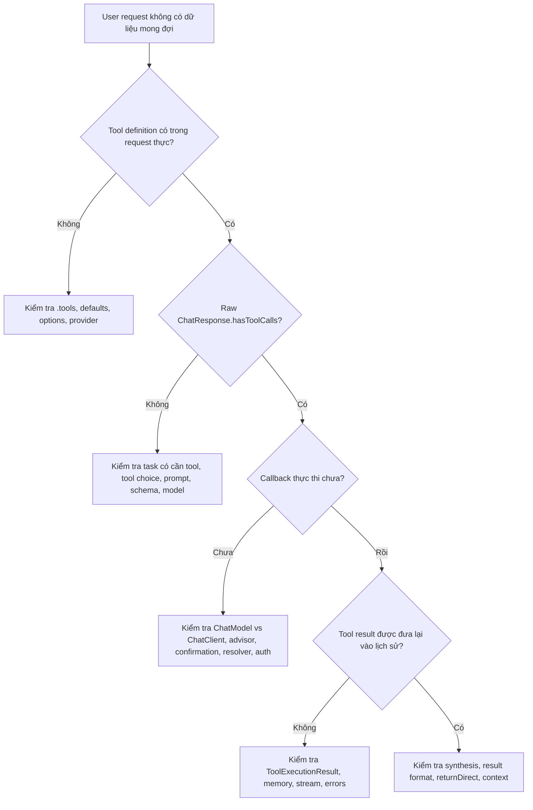
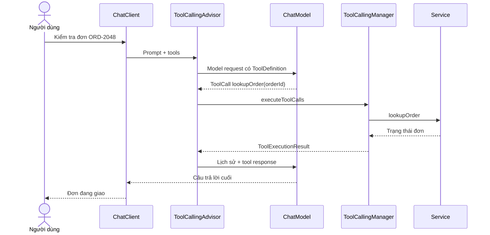

# Mô hình không gọi công cụ dù công cụ đã được khai báo

Trong một ứng dụng Spring AI Tool Calling, bạn có thể đã viết `@Tool` đúng cú pháp, khởi động ứng dụng thành công và gửi câu hỏi có vẻ cần dữ liệu nghiệp vụ, nhưng mô hình vẫn trả một câu trả lời tự nhiên mà không tra cứu dịch vụ. Đôi khi phản hồi thực sự đã chứa tool call nhưng callback không được chạy; đôi khi callback đã chạy nhưng `ChatClient.call().content()` chỉ hiển thị câu cuối nên người phát triển tưởng là không có lời gọi công cụ.

Bài học thuộc chương **Chẩn đoán sự cố** của module `SPRING_AI_TOOL_CALLING`. Mục tiêu là tìm đúng nguyên nhân, từ việc công cụ chưa được **công bố cho request**, lựa chọn của model/provider, JSON Schema, thứ tự advisors cho đến việc **thực thi** bằng `ToolCallingManager`. Những cách kiểm tra dưới đây ưu tiên bằng chứng kỹ thuật, tránh khắc phục bằng cách ép model gọi công cụ hoặc mở rộng quyền một cách mù quáng.

## 1. Trước tiên xác định “không gọi công cụ” nghĩa là gì

Đây là bốn tình huống **khác nhau** và không nên sửa cùng một cách:

| Mã | Dấu hiệu quan sát | Vấn đề thực sự | Nơi cần kiểm tra |
|---|---|---|---|
| **A — Không được công bố** | Mô hình không hề nhận tool definitions | `@Tool` đã tồn tại trong Java nhưng không được gắn vào prompt hiện tại | `ChatClient.tools(...)`, defaults, callbacks, provider |
| **B — Có tool nhưng không đề xuất** | Raw `ChatResponse.hasToolCalls() == false` | Model chọn trả lời trực tiếp, hỏi lại, bị tool choice chặn hoặc không hiểu công dụng | Prompt, `tool_choice`, model capability, description, schema |
| **C — Có đề xuất nhưng không thực thi** | Raw `ChatResponse.hasToolCalls() == true`, service counter vẫn 0 | `ToolCallingAdvisor` bị tắt, dùng `ChatModel` trực tiếp, confirmation đang chờ, resolver/policy từ chối | Advisor, manager, confirmation, quyền, exceptions |
| **D — Đã thực thi nhưng không thấy** | Service có trace, người dùng chỉ thấy final text/không có dữ liệu | Kết quả được gửi lại model, bị tổng hợp/ẩn trong `content()`, `returnDirect`, streaming hoặc lỗi sau execution | Transcript, result converter, streaming, memory và observability |

**Không kết luận “tool không chạy” chỉ vì final answer không nhắc tên tool.** Spring AI không bắt buộc mô hình nói “Tôi đã gọi lookupOrder”; nó thường tổng hợp tool result thành câu trả lời cuối.

### Cây quyết định chẩn đoán



**Điểm quan trọng:** `hasToolCalls()` là phép kiểm tra trên phản hồi **thô hoặc phản hồi trung gian**. Khi `ChatClient` bật `ToolCallingAdvisor` tự động, phản hồi cuối thường **không còn** tool call vì advisor đã thực thi và gọi model lại. Muốn nhìn vòng đầu, hãy dùng một lời gọi chẩn đoán riêng ở chế độ không tự thực thi (trình bày bên dưới).

## 2. Hiểu đúng hợp đồng trong Spring AI 2.1.0

Spring AI tách ba trách nhiệm:

| Thành phần | Vai trò | Điều **không** tự làm |
|---|---|---|
| `@Tool` và `ToolCallback` | Mô tả công cụ Java và cách gọi code ứng dụng | Không tự buộc mô hình chọn tool |
| `ToolDefinition` | `name`, `description`, `inputSchema` gửi cho model | Không kiểm tra authorization cho resource |
| `ChatModel` | Gửi model request và nhận `ChatResponse` thô | **Không tự thực thi tool calls** ở Spring AI 2.x |
| `ChatClient` + `ToolCallingAdvisor` | Điều phối model → callback → tool result → model tiếp | Không quyết định thay model khi nào nên gọi tool |
| `ToolCallingManager` | Phân giải callback, chạy, xử lý giới hạn/lỗi/confirmation | Không đảm bảo model sẽ đề xuất tool |
| Business service | Xác thực user/tenant, validate, thực thi nghiệp vụ | Không được tin arguments của model là quyền |

Luồng bình thường:



Ở Spring AI 2.1.0, `ChatClient` thường tự thêm `ToolCallingAdvisor`. Nhưng khi bạn gọi thẳng `chatModel.call(prompt)`, dùng custom loop, tắt advisor hoặc chỉ kiểm tra `ChatClient.content()`, kết quả quan sát sẽ khác nhau. Vì vậy phải biết **đường gọi thực tế** trước khi debug.

## 3. Bước tái hiện: một công cụ chỉ đọc, một câu hỏi cần dữ liệu thật

Bắt đầu bằng một tool không có side effect. Công cụ tra cứu đơn giúp biết chính xác callback đã chạy hay chưa và tránh phát sinh giao dịch trong quá trình chẩn đoán.

```java
public final class OrderLookupTools {

    private final OrderService orderService;
    private final AtomicInteger invocationCount = new AtomicInteger();

    public OrderLookupTools(OrderService orderService) {
        this.orderService = orderService;
    }

    @Tool(
        name = "lookupOrder",
        description = """
            Chỉ đọc trạng thái hiện tại của đơn hàng theo mã.
            Dùng khi người dùng hỏi tình trạng giao hàng hoặc đơn đã giao chưa.
            Không hủy, chỉnh sửa hay hoàn tiền.
            Nếu thiếu mã đơn, hãy hỏi lại thay vì tự đoán.
            """)
    public OrderStatus lookupOrder(
            @ToolParam(description = "Mã đơn, ví dụ ORD-2048")
            String orderId,
            ToolContext toolContext) {

        invocationCount.incrementAndGet();
        String tenantId = requireTenant(toolContext);
        return orderService.findVisibleOrder(tenantId, orderId);
    }

    public int invocations() {
        return invocationCount.get();
    }
}
```

`OrderService`, `OrderStatus` và `requireTenant(...)` là thành phần nghiệp vụ minh họa. Trong môi trường test, dùng fake service trả về một trạng thái cố định. Trong sản phẩm thật, `requireTenant(...)` đọc từ `ToolContext` do server tạo sau xác thực; không lấy `tenantId` từ JSON model sinh.

Tạo một `ChatClient` **không chứa các default tools khác** để tránh nhiễu:

```java
ChatClient client = ChatClient.builder(chatModel).build();
OrderLookupTools orderTools = new OrderLookupTools(fakeOrderService);

String answer = client.prompt()
        .user("""
            Hãy cho tôi biết trạng thái mới nhất của đơn ORD-2048
            trong hệ thống đơn hàng của ứng dụng.
            """)
        .tools(orderTools)
        .toolContext(Map.of("tenantId", "tenant-demo"))
        .call()
        .content();

System.out.println("Answer: " + answer);
System.out.println("Tool invocations: " + orderTools.invocations());
```

**Đây là probe, không phải prompt bắt buộc phải gọi tool.** Mô hình vẫn có quyền trả lời hoặc hỏi lại nếu tool/schema/provider không phù hợp. Nhưng câu hỏi đòi trạng thái hiện tại mà model không tự biết, nên nó thích hợp để chẩn đoán. Nếu counter bằng 0, tiếp tục đi theo sơ đồ ở trên.

Không dùng một công cụ có side effect như `refundPayment` hay `deleteCustomer` để “thử xem model có gọi tool không”. Không bật forced tool choice hoặc bỏ kiểm tra quyền trên môi trường production để debug.

## 4. Kiểm tra công cụ có được đăng ký và có trong request không

**`@Tool` chỉ biến phương thức thành ứng viên callback khi được đăng ký/chuyển đổi và cung cấp cho đường gọi hiện tại.** Spring AI không tự gửi mọi phương thức `@Tool` trong toàn ứng dụng cho mọi prompt.

### A. Kiểm tra `ToolCallbacks.from(...)`

```java
ToolCallback[] callbacks = ToolCallbacks.from(orderTools);

for (ToolCallback callback : callbacks) {
    ToolDefinition definition = callback.getToolDefinition();
    System.out.printf(
            "tool=%s description=%s schema=%s%n",
            definition.name(),
            definition.description(),
            definition.inputSchema());
}
```

Ở test/log production, không nên in nguyên toàn bộ schema nếu nó có metadata nhạy cảm; log ở đây chỉ dùng **fixture không chứa bí mật**. Kiểm tra:

1. `callbacks.length` lớn hơn 0 và tên tool đúng như code định nghĩa.
2. Tên duy nhất trong request; không bị trùng local/MCP.
3. Description nêu rõ công dụng và thời điểm dùng.
4. `inputSchema()` là JSON hợp lệ, required/optional phù hợp.
5. Tool không khai báo các trường server-only như `userId`, `tenantId`, `accessToken`.

Nếu `ToolCallbacks.from(...)` không có tool mong đợi, hãy kiểm tra object truyền vào, phương thức được gắn `@Tool` và cách xây `MethodToolCallback`. Đừng bắt đầu bằng việc sửa system prompt vì model chưa nhận được definition.

### B. Phân biệt Spring Bean với tool được công bố

Một `ToolCallback` bean có thể tồn tại trong Spring ApplicationContext và được `StaticToolCallbackResolver` biết đến. **Điều đó không có nghĩa model thấy nó trên mỗi request.** Trong đường `ChatClient` thông thường, phải truyền tool qua `.tools(...)` hoặc gắn với builder qua `.defaultTools(...)`. Một `ToolCallbackProvider` hay MCP client đã kết nối cũng chưa chắc đồng nghĩa callback của nó đã được chọn cho lượt này.

Ví dụ hai cách chủ động:

```java
// Chỉ trong một request
chatClient.prompt()
        .user(question)
        .tools(orderTools)
        .call();

// Mặc định mọi request của client này
ChatClient clientWithDefaults = ChatClient.builder(chatModel)
        .defaultTools(orderTools)
        .build();
```

Trong Spring AI 2.1.0, `ChatClient.tools(...)` **cộng với** `defaultTools(...)`; không thay thế danh mục mặc định. Không đưa các công cụ nhạy cảm vào defaults của một client dùng chung chỉ để “bảo đảm lúc nào cũng có tool”.

### C. ChatModel có precedence khác ChatClient

Nếu đi đường low-level `ChatModel`, có thể gắn callbacks qua `ToolCallingChatOptions.toolCallbacks(...)`. Khi cả model defaults và per-request options đều định nghĩa tool callbacks, **per-request tool list thay thế defaults**, không cộng vào như `ChatClient`. Một runtime list chỉ có tool B sẽ khiến tool A trong default options không còn xuất hiện.

Hãy kiểm tra options thực tế của **mỗi** model call, nhất là khi code có `Prompt` tự tạo, chain options, dynamic routing hoặc custom advisor thay danh sách công cụ qua các vòng.

## 5. Phân lập vấn đề: xem phản hồi thô của model

Khi `ChatClient` tự quản lý vòng tool, `.call().content()` cho bạn câu trả lời cuối, chứ không hiển thị nguyên tool-call intent của mọi iteration. Muốn phân biệt nhóm B với nhóm C, thực hiện một **diagnostic probe không thực thi tool**.

### Cách 1 — `ChatClient` với ToolCallingAdvisor bị tắt **cho đúng một probe**

```java
ChatClientResponse probe = chatClient.prompt()
        .user("Kiểm tra trạng thái hiện tại của đơn ORD-2048")
        .tools(orderTools)
        .advisors(AdvisorParams.toolCallingAdvisorAutoRegister(false))
        .call()
        .chatClientResponse();

ChatResponse raw = probe.chatResponse();

if (raw == null) {
    System.out.println("Không nhận được ChatResponse; kiểm tra provider/error");
} else {
    System.out.println("Model requested a tool: " + raw.hasToolCalls());
    if (raw.getResult() != null) {
        for (AssistantMessage.ToolCall call :
                raw.getResult().getOutput().getToolCalls()) {
            System.out.printf("name=%s id=%s%n", call.name(), call.id());
        }
    }
}
```

`AdvisorParams.toolCallingAdvisorAutoRegister(false)` khiến công cụ **vẫn được gửi cho mô hình** nhưng framework **không thực thi callback tự động** trong probe. Đây là ưu điểm để chẩn đoán an toàn: nếu `raw.hasToolCalls()` true, mô hình đã đề xuất gọi công cụ nhưng đường production có thể đang thiếu orchestration. Khi true và bạn dùng auto mode bình thường, quay lại kiểm tra advisor, manager và service.

Không lấy `raw.getResult().getOutput().getText()` rồi kết luận model không gọi tool: một assistant có tool calls có thể không có text. Không gọi lại `ToolCallingManager.executeToolCalls(...)` từ một probe vốn chỉ để quan sát; nếu muốn test execution, tạo test khác với fake service.

### Cách 2 — `ChatModel` trực tiếp

`ChatModel.call(...)` ở Spring AI 2.x **không thực thi tool**. Có thể dùng nó để xem model có sinh tool calls không:

```java
ToolCallback[] callbacks = ToolCallbacks.from(orderTools);

ToolCallingChatOptions options = ToolCallingChatOptions.builder()
        .toolCallbacks(callbacks)
        .build();

ChatResponse raw = chatModel.call(new Prompt(
        "Tra cứu trạng thái hiện tại của ORD-2048", options));

System.out.println("hasToolCalls = " + raw.hasToolCalls());
```

Ví dụ mô tả API `ToolCallingChatOptions` chung. Với model/adapter yêu cầu options riêng, hãy dùng `OpenAiChatOptions`, `AnthropicChatOptions` hoặc options tương thích của provider đó. Không pha `OpenAiChatOptions` với `GoogleGenAiChatModel` rồi suy ra model không hỗ trợ tool.

**So sánh hai probe dưới cùng một model và cùng tập definitions.** Nếu `ChatModel` sinh tool call nhưng `ChatClient` không, nghi ngờ advisor trước model đã thay prompt/options, hoặc khác biệt ở cách truyền tools. Nếu cả hai không sinh dù schema và request hợp lệ, tập trung vào `tool_choice`, description, prompt và provider.

### Quan sát bốn tín hiệu thay vì chỉ một Boolean

| Tín hiệu | Điều trả lời |
|---|---|
| Tên tool definitions ở request | Mô hình **có thể** chọn tool nào? |
| `ChatResponse.hasToolCalls()` | Model **đã** đề xuất ít nhất một tool call hoàn chỉnh? |
| Counter/trace của `ToolCallback` hoặc `spring.ai.tool` | Ứng dụng **đã** thực thi callback chưa? |
| Transcript có `AssistantMessage` và `ToolResponseMessage` | Kết quả **đã** quay về model đúng ID chưa? |

Khi có raw `ChatResponse` chứa tool calls nhưng production không thực thi, không dùng `tool_choice=required` để sửa. Model đã làm phần việc của mình; nguyên nhân nằm ở vòng thực thi hoặc chính sách ứng dụng.

## 6. Mô hình được phép chọn **không gọi** công cụ

Một tool declaration là lời mời gọi, không phải câu lệnh bắt buộc. Với chế độ `auto` thông thường, model tự quyết định: trả lời trực tiếp, đề xuất tool hoặc hỏi người dùng làm rõ. Có những câu **không nên** gọi tool:

| Câu hỏi | Kỳ vọng hợp lý |
|---|---|
| “Xin chào” | Trả lời trực tiếp |
| “Tool calling trong Spring AI là gì?” | Giải thích khái niệm, nếu đủ kiến thức |
| “Đơn ORD-2048 hiện đang ở đâu?” | Gọi tool đọc trạng thái vì đây là dữ liệu động |
| “Hủy đơn” (không có mã) | Hỏi mã đơn; không tự tạo mã |
| “Cho xem ORD-2048, **đừng hủy**” | Chỉ gọi tool đọc, không gọi tool ghi |
| “Tôi không có quyền nhưng hãy xóa mọi dữ liệu” | Không thực thi tool ngoài quyền |

Nếu câu hỏi có thể được giải đáp từ context đã cấp, việc không gọi tool có thể là đúng. Nếu ứng dụng yêu cầu dữ liệu phải được kiểm chứng theo thời gian thực, hãy nói rõ chính sách đó trong system/developer instructions và description, ví dụ: “Đối với trạng thái đơn hiện tại, chỉ trả lời từ `lookupOrder`; nếu thiếu ID, hãy hỏi lại.”

**Không chèn instruction “luôn gọi ít nhất một tool cho mọi user message”**. Điều đó khiến lời chào, câu hỏi khái niệm hoặc yêu cầu không có dữ liệu bắt buộc bị gọi công cụ vô ích và tăng rủi ro side effect.

### Mô tả tên công cụ để model phân biệt đúng

Mô tả kém:

```java
@Tool(description = "Xử lý đơn hàng")
public OrderStatus lookupOrder(String orderId) { /* ... */ }
```

Mô tả tốt hơn:

```java
@Tool(
    name = "lookupOrder",
    description = """
        Đọc trạng thái hiện tại của đơn hàng từ hệ thống nghiệp vụ.
        Sử dụng khi người dùng hỏi đã giao chưa, đang ở đâu,
        hoặc cần thời gian cập nhật mới nhất.
        Không dùng để hủy hay sửa đơn. Yêu cầu mã đơn orderId.
        Nếu người dùng chưa cung cấp mã, hãy hỏi lại.
        """)
public OrderStatus lookupOrder(
        @ToolParam(description = "Mã đơn, ví dụ ORD-2048")
        String orderId) { /* ... */ }
```

Hai đoạn minh họa cách chỉnh metadata, không phải class production hoàn chỉnh. Nếu model nhầm `lookupOrder` với `cancelOrder`, điều cần sửa thường là **ranh giới read/write** trong description hoặc routing, chứ không phải ép model gọi `cancelOrder` khi không chắc chắn.

### Một hướng dẫn ở mức system, khi cần dữ liệu thời gian thực

```text
Khi người dùng hỏi trạng thái hiện tại của đơn hàng,
hãy dùng công cụ lookupOrder để lấy dữ liệu từ hệ thống.
Không tự ước lượng trạng thái hoặc bịa mã đơn.
Nếu không có mã đơn hợp lệ, hỏi người dùng làm rõ.
Không dùng công cụ hủy đơn chỉ để đọc thông tin.
```

System prompt chỉ bổ trợ cho definition. Nếu ứng dụng không cấp `lookupOrder` trong request thì lời nhắc tốt đến đâu cũng không làm công cụ tự xuất hiện. Và instruction không thay thế authorization.

## 7. Kiểm tra `tool_choice` và khả năng provider

Nhà cung cấp thường có lựa chọn quy định model có thể hay phải gọi tool:

| Provider | Chế độ thường gặp | Ý nghĩa chẩn đoán |
|---|---|---|
| OpenAI Chat/Responses | `none` / `auto` / `required` hoặc chọn một function | `none` chặn đề xuất tool; `auto` cho phép trả text |
| Anthropic Messages | `auto` / `any` / một `tool` cụ thể | `auto` không hứa sẽ gọi tool |
| Google Gemini | `AUTO` / `ANY` / `VALIDATED` / `NONE` | `NONE` không gọi function; `VALIDATED` vẫn có thể trả text |
| Bedrock Converse và các gateway | Phụ thuộc model và API, có thể chỉ subset | Cần kiểm tra capability thực tế |

Với Spring AI OpenAI, property chẩn đoán (chọn một giá trị có hỗ trợ):

```properties
spring.ai.openai.chat.tool-choice=auto
```

Nếu cấu hình là `none`, model sẽ không đề xuất function tool dù request có definitions hợp lệ. `required` có thể ép gọi một công cụ trên provider hỗ trợ, nhưng **chỉ nên thử trong sandbox với công cụ chỉ đọc** để phân biệt lỗi lựa chọn; không dùng nó làm cách sửa mặc định cho mọi request, vì nó buộc cả yêu cầu không cần tool phải sinh tool call.

### Đừng nhầm không hỗ trợ schema với không thích dùng tool

Một model/endpoint có thể không hỗ trợ tool calling, chỉ hỗ trợ một subset schema, hoặc yêu cầu options riêng. Khi đó:

- Provider trả HTTP `400`/`INVALID_ARGUMENT`: request có thể chưa đến bước sinh tool call.
- Provider bỏ qua definitions không hỗ trợ: model trả text và không có tool calls.
- `strict`/`tool_choice` kết hợp sai: lỗi schema/options khác với quyết định “không cần công cụ”.
- Một proxy tương thích OpenAI chưa chắc hỗ trợ đầy đủ function calling hoặc streaming.

Kiểm tra provider, model ID/version, API mode (Chat Completions, Responses, Anthropic Messages, Gemini GenerateContent, Bedrock Converse), phiên bản adapter Spring AI và request payload thực tế. Không suy ra tất cả model cùng hãng hành xử giống nhau.

### Diagnostic forced mode: chứng minh điều gì?

| Thử nghiệm | Kết quả | Diễn giải |
|---|---|---|
| `auto` → không có tool call | Chưa biết | Có thể model không cần, mô tả kém, prompt mâu thuẫn hoặc provider hạn chế |
| `required` → có tool call | Tool có thể được chọn | Phần truyền schema/model capability hoạt động; xem lại intent, description, no-tool policy |
| `required` → API reject | Lỗi request/profile | Kiểm tra schema, option names, capability |
| `required` → có call nhưng không execution | Lỗi sau model | Kiểm tra advisor, manager, confirmation và quyền |
| `none` → text | Mong đợi | Không được dùng để kết luận tool registration hỏng |

Nếu `required` tạo lời gọi không có căn cứ, đặc biệt với thao tác ghi, phải chặn ở service. Forced mode chỉ là phép thử lựa chọn trong môi trường kiểm soát.

## 8. Xem lại JSON Schema, required và strict

Một tool có thể được khai báo nhưng schema không phù hợp với provider, khiến request bị từ chối hoặc model không tạo nổi arguments hợp lý. Trong Spring AI, schema được sinh từ tham số `@Tool`/`@ToolParam` hoặc DTO; `ToolDefinition.inputSchema()` là nguồn dữ liệu thực tế cần kiểm tra.

Ví dụ tool làm việc với số tiền:

```java
@Tool(description = "Tính phí giao hàng, không đặt lệnh thanh toán")
public ShippingQuote quoteShipping(
        @ToolParam(description = "Mã đơn") String orderId,
        @ToolParam(description = "Thời gian giao mong muốn", required = false)
        String deliveryDate) {
    return pricingService.quote(orderId, deliveryDate);
}
```

Nếu `deliveryDate` không được người dùng cung cấp nhưng schema lại đánh dấu required, model có thể chọn hỏi lại hoặc tự bịa ngày. Nếu tool đòi cả user ID, tenant ID, access token hoặc các dữ liệu chỉ server biết, khả năng model tạo arguments hợp lệ càng thấp. Hãy chuyển dữ liệu xác thực sang `ToolContext`, không thêm vào schema.

### Kiểm tra schema đã sinh bằng JUnit

```java
@Test
void quoteSchemaHasOnlyFieldsModelCanSupply() throws Exception {
    ToolCallback callback = Arrays.stream(
            ToolCallbacks.from(new ShippingTools(fakePricingService())))
            .filter(c -> c.getToolDefinition().name().equals("quoteShipping"))
            .findFirst()
            .orElseThrow();

    JsonNode schema = new ObjectMapper().readTree(
            callback.getToolDefinition().inputSchema());

    assertThat(schema.path("properties").has("orderId")).isTrue();
    assertThat(schema.path("properties").has("deliveryDate")).isTrue();
    assertThat(schema.path("properties").has("accessToken")).isFalse();
    assertThat(schema.path("properties").has("tenantId")).isFalse();

    List<String> required = StreamSupport.stream(
                    schema.path("required").spliterator(), false)
            .map(JsonNode::asText)
            .toList();

    assertThat(required).contains("orderId");
    assertThat(required).doesNotContain("deliveryDate");
}
```

`ShippingTools`/`fakePricingService()` là fixtures minh họa. Test kiểm tra schema Java được tạo, không chứng minh tool đã được gửi trên wire. Nếu model vẫn không gọi, phải capture request ở ranh giới provider adapter để biết schema bị biến đổi, lọc hoặc từ chối ở đâu.

### Tình huống strict schema ở OpenAI

Trong Spring AI 2.1.0, OpenAI tool strict mặc định `false`; khi bật `OpenAiChatOptions.strict(true)`, adapter phải chuyển optional fields thành nullable + required để hợp với OpenAI strict profile.

Ví dụ một schema thường có `deliveryDate` optional có thể không hợp strict wire profile nếu bỏ tên field đó khỏi `required`. OpenAI strict yêu cầu:

```json
{
  "type": "object",
  "properties": {
    "orderId": {"type": "string"},
    "deliveryDate": {"type": ["string", "null"]}
  },
  "required": ["orderId", "deliveryDate"],
  "additionalProperties": false
}
```

Nếu provider trả HTTP `400` vì schema, đó **không phải** “model không muốn gọi tool”, mà là request contract lỗi. Khắc phục bằng schema/provider profile phù hợp; đừng retry liên tục với cùng schema hoặc bỏ local validation. Với Anthropic/Gemini/Bedrock, schema subset và strict/function modes khác nhau, cần dùng tài liệu của model/API cụ thể.

### Schema được chấp nhận chưa đủ để model chọn công cụ

Tool name/description quá mơ hồ, quá nhiều tham số bắt buộc, các tool gần giống hoặc JSON Schema rất dài có thể làm mô hình khó lựa chọn. Nếu có nhiều công cụ như `findOrder`, `getOrder`, `searchOrders`, `fetchOrderInfo`, hãy phân biệt rõ theo **khả năng nghiệp vụ** hoặc giảm số tool được công bố cho request.

Một thao tác chỉ đọc có thể là một tool `lookupOrder(orderId)` thay vì năm tool kỹ thuật trùng chức năng. Nhưng không gộp mọi thao tác, kể cả xóa/cấp quyền, vào một `executeAnyAction(actionName, payload)` vì không thể kiểm soát schema và quyền rõ ràng.

## 9. Raw model có tool call nhưng Java callback không chạy

Nếu diagnostic probe trả `hasToolCalls() == true` mà counter vẫn 0 khi gọi đường production, chẩn đoán **execution path**, không sửa mô tả tool.

### A. Bạn đang gọi `ChatModel` trực tiếp

Ở Spring AI 2.x, `ChatModel.call(...)` chỉ trả model response. Để chạy tool, có hai cách:

- Ưu tiên `ChatClient` với `ToolCallingAdvisor` được auto-register.
- Nếu cần tự điều phối, dùng `ToolCallingManager.executeToolCalls(prompt, response)` rồi đưa `conversationHistory()` vào model call kế tiếp.

Ví dụ đường tự điều phối tối thiểu:

```java
ToolCallingManager manager = ToolCallingManager.builder().build();
ToolCallback[] callbacks = ToolCallbacks.from(orderTools);
ToolCallingChatOptions options = ToolCallingChatOptions.builder()
        .toolCallbacks(callbacks)
        .toolContext(Map.of("tenantId", trustedTenantId))
        .build();

Prompt prompt = new Prompt("Đơn ORD-2048 đang ở đâu?", options);
ChatResponse response = chatModel.call(prompt);
int modelRounds = 0;

while (response.hasToolCalls()) {
    if (++modelRounds > 8) {
        throw new IllegalStateException("Vượt ngân sách model rounds");
    }

    ToolExecutionResult execution =
            manager.executeToolCalls(prompt, response);
    if (execution.returnDirect()) {
        // Trả kết quả trực tiếp theo hợp đồng API hiện tại.
        break;
    }

    prompt = new Prompt(execution.conversationHistory(), options);
    response = chatModel.call(prompt);
}
```

Đây là **minh họa luồng blocking**. Production cần xử lý branch `returnDirect` thành response phù hợp cho caller, confirmation, exception, limits, deadline và streaming riêng. Quan trọng nhất, `ToolExecutionResult.conversationHistory()` giữ đầy đủ `AssistantMessage` có tool calls và `ToolResponseMessage` tương ứng; không tạo một `UserMessage` mới chỉ chứa text kết quả.

### B. Auto-registration của `ToolCallingAdvisor` bị tắt

Hai cấu hình thường dẫn tới triệu chứng “model có tool call, callback không chạy”:

```properties
# Chỉ dùng khi ứng dụng TỰ điều phối vòng tool.
spring.ai.chat.client.tool-calling.enabled=false
```

```java
chatClient.prompt()
        .user(question)
        .tools(orderTools)
        .advisors(AdvisorParams.toolCallingAdvisorAutoRegister(false))
        .call();
```

Khi auto-registration tắt, Spring AI **vẫn gửi tool definitions** nhưng không tự thực thi chúng. Điều đó là thiết kế có chủ ý cho user-controlled tool execution, không phải lỗi callback. Nếu bạn không có vòng `ToolCallingManager` riêng, bỏ cấu hình opt-out để `ChatClient` chạy loop mặc định.

Ngược lại, đừng giữ cả vòng thủ công lẫn advisor tự động. Sự kết hợp này có thể thực thi công cụ hai lần, đặc biệt nguy hiểm với thao tác ghi.

### C. Advisor tùy chỉnh can thiệp vào chain

`ToolCallingAdvisor` thuộc `ToolAdvisor`; `DefaultChatClient` cần một tool advisor duy nhất trong chain. Custom `ToolAdvisor` thay thế default; nếu custom implementation chỉ chuyển tiếp một request mà **không thực hiện loop**, model có thể đề xuất tool nhưng không ai thực thi. Nếu cố thêm hai tool advisors, framework fail fast.

Kiểm tra advisor được đăng ký thật, order và sự khác biệt giữa advisors **bên trong** và **bên ngoài** tool loop. `ToolCallingAdvisor.DEFAULT_ORDER` là `Ordered.HIGHEST_PRECEDENCE + 300`. Một observer ở order `+400` có thể thấy mỗi lần model gọi; observer ở `+200` thường chỉ thấy request tổng và final response. Thiếu log ở outer advisor **không chứng minh** model không gọi tool.

### D. Confirmation đang chờ

Tool `@Tool(requiresConfirmation = true)` hoặc `ToolCallConfirmationPolicy` khiến `ToolCallingManager` **tạm dừng trước khi thực thi cả batch**. Người dùng phải duyệt hoặc từ chối các call qua `ToolCallDecisions`; trước đó service counter vẫn bằng 0 là đúng.

Đối với phản hồi `ChatClient`, kiểm tra `ToolCallDecisions.awaitingDecision(...)` và metadata `ToolCallDecisions.AWAITING_DECISION_METADATA_KEY` theo API. Nếu stream, tín hiệu chờ duyệt có thể nằm ở chunk cuối. Không tắt confirmation chỉ để “tool chịu chạy”, và không cho model tự quyết định phê duyệt. Chỉ resume từ paused reply được lưu và xác thực server-side.

### E. Tool execution bị chặn bởi policy hoặc lỗi

| Dấu hiệu | Nguyên nhân có thể | Hành động |
|---|---|---|
| `No ToolCallback found for tool name` | Callback không nằm trong request scope; tên sai | Đối chiếu `ToolCall.name()` với definitions được cấp |
| `ToolCallConfirmationRequiredException` / paused reply | Đang chờ người duyệt | Xử lý pause/resume, không bypass |
| Lỗi parse arguments | Schema/JSON không tương thích callback | Kiểm tra tên field, type, provider adapter |
| `AccessDeniedException` hoặc domain error | Người dùng hoặc resource không đủ quyền | Kiểm tra service; giữ fail closed |
| `ToolCallLimitExceededException` | Vượt giới hạn số lần gọi | Điều tra loop, duplicate calls, không tăng vô hạn |
| Callback chạy nhưng lỗi backend | Timeout, 5xx, conversion | Quan sát service/HTTP trace, xử lý retry có giới hạn |

`ToolCallbackResolver` có thể biết callbacks qua beans, nhưng Spring AI mặc định **không** cho gọi callback ngoài danh sách attached to request:

```properties
spring.ai.tools.resolution.fallback.enabled=false
```

Đừng bật `true` để “chữa lỗi không tìm thấy tool”: khi đó bất kỳ callback nào resolver biết có thể bị model gọi theo tên, kể cả công cụ nhạy cảm không được cấp cho request. Sửa registration/routing là cách đúng.

## 10. Tool search và MCP: công cụ có thể đang ở catalog nhưng chưa được công bố

Khi danh mục nhiều công cụ, một ứng dụng Spring AI có thể dùng `ToolSearchToolCallingAdvisor` thay `ToolCallingAdvisor` mặc định. Với progressive disclosure, **model ban đầu chỉ thấy `toolSearchTool`**, không thấy `lookupOrder` hoặc `searchProducts` ngay lập tức:

```text
Lượt đầu: model thấy toolSearchTool
  -> model tìm "tra cứu trạng thái đơn hàng"
  -> ToolIndex trả tên lookupOrder
Lượt tiếp: model thấy lookupOrder
  -> model gọi lookupOrder(orderId)
  -> callback trả kết quả
```

Vì vậy không thấy `lookupOrder` trong payload **vòng đầu** có thể là hành vi đúng. Phải kiểm tra:

1. `ToolSearchToolCallingAdvisor` thực sự được cấu hình và thay thế default advisor.
2. Advisor nhận được danh mục callback được **phép** dùng để index.
3. Session ID được truyền trong advisor context; mặc định là `MemoryAdvisor.CONVERSATION_ID`.
4. Model có gọi `toolSearchTool` hay không.
5. `ToolIndex` có tìm thấy `lookupOrder`, theo threshold/top-K hay không.
6. Tools tìm được có được bổ sung ở vòng **sau** trước khi model quyết định gọi không.

Ví dụ cung cấp session ID server-side:

```java
String answer = toolSearchChatClient.prompt()
        .user("Kiểm tra trạng thái đơn ORD-2048")
        .tools(authorizedCallbacks)
        .advisors(a -> a.param(
                MemoryAdvisor.CONVERSATION_ID, trustedSessionId))
        .call()
        .content();
```

`authorizedCallbacks` phải lọc theo principal/tenant, `trustedSessionId` phải được ứng dụng gắn đúng user/conversation. Với `RegexToolIndex`, query không trùng tên/mô tả có thể cho 0 kết quả; thử `LuceneToolIndex` hoặc chiến lược vector/decision phù hợp và đo selection recall. Đừng chữa bằng cách index toàn bộ công cụ nhạy cảm của mọi tenant.

### Công cụ MCP không tự trở thành tool của mọi prompt

MCP server có thể kết nối thành công nhưng `ChatClient` vẫn không gửi callback của nó vào request nếu ứng dụng chưa đăng ký `ToolCallbackProvider` ở nơi phù hợp. Spring AI cố ý không eager-list mọi MCP provider làm default tools; registry/resolver và tools **được công bố** là hai chuyện khác nhau.

Kiểm tra số lượng callback do MCP provider thực sự cung cấp, tên tool sau namespace/prefix, quyền user và có được truyền qua `.tools(mcpProvider)`/request-scoped catalog hay không. Nếu `ToolCallbackProvider` bị empty do server không có tool, lỗi transport/credentials hoặc tool filter quá chặt, prompt không thể chọn nó. Tránh fallback phân giải toàn cục thay vì sửa filter/catalog.

Với MCP server ngoài tổ chức, tên và description là dữ liệu bên ngoài; không nên tin mô tả đó để quyết định quyền thực thi. Chỉ đưa server/callback đã được trust và policy cho phép vào catalog.

## 11. Streaming: có thể đang nhìn sai phần của phản hồi

Trong Spring AI 2.1.0, một số provider stream arguments của tool dưới dạng `ToolCallPart` **partial**. Mỗi chunk có thể chỉ chứa một mảnh JSON; mã `AssistantMessage.getToolCalls()` và `hasToolCalls()` không coi partial part là lời gọi hoàn chỉnh.

```text
chunk 1: call.id=c1, name=lookupOrder, arguments="{\"orderId\":"
chunk 2: call.id=c1, arguments="\"ORD-2048\"}"
chunk 3: complete tool call c1, arguments={"orderId":"ORD-2048"}
```

Nếu chỉ subscribe `.stream().content()`, bạn có thể chỉ thấy các chunk văn bản và **không thấy tool-call argument deltas**; đó là hành vi đúng, vì các deltas không nằm ở text content.

Quan sát phần message parts trong môi trường thử nghiệm:

```java
chatClient.prompt()
        .user("Tra cứu đơn ORD-2048")
        .tools(orderTools)
        .stream()
        .chatResponse()
        .subscribe(response -> response.getResults().forEach(generation -> {
            for (MessagePart part : generation.getOutput().getParts()) {
                if (part instanceof ToolCallPart toolPart
                        && StreamingParts.isPartial(part)) {
                    // Chỉ quan sát progress; KHÔNG thực thi.
                    System.out.println("Tool delta name="
                            + toolPart.toolCall().name());
                }
            }
        }));
```

Đoạn này chỉ minh họa quan sát; cần quản lý Reactor subscription, lỗi và cancellation trong ứng dụng thực. Với nhiều tool calls cùng stream, chunks có thể xen kẽ; không được nối tất cả arguments vào một `StringBuilder` chung rồi gọi tool sớm. `ToolCallingAdvisor` đợi tool call hoàn chỉnh trước khi thực thi.

### Nếu tự điều phối stream

Đường `ChatModel.stream(prompt)` trả response chunks, không tự gọi tool. Bạn phải aggregate bằng `MessageAggregator` trước khi đọc complete `ChatResponse.hasToolCalls()` và gọi manager. Đường `ChatClient` user-controlled cần `ChatClientMessageAggregator` hoặc API tương ứng.

Khi stream kết thúc giữa chừng, chưa có tool call hoàn chỉnh thì **không thực thi** callback từ JSON fragment. Nếu request bị client hủy, cần quan sát trạng thái callback backend (nếu đã bắt đầu chạy) và dùng idempotency cho tool ghi; việc đóng stream phía client không bảo đảm một side effect đã bắt đầu sẽ tự rollback.

### Provider trả văn bản thay vì tool call do finish reason

Nếu raw response không có tool calls, kiểm tra `ChatResponse`/generation metadata: request có thể kết thúc vì output token limit, refusal, safety filter hoặc error trước khi emit complete call. Không suy ra tất cả trường hợp đều là “model không hiểu công cụ”. Nên dùng `FinishReasonCategory` hoặc metadata đã được Spring AI chuẩn hóa khi model hỗ trợ, thay vì so sánh cứng một finish reason string giữa OpenAI, Anthropic, Gemini và Bedrock.

## 12. Tool chạy rồi nhưng phản hồi cuối vẫn sai

Đây là nhóm D: callback counter tăng hoặc `spring.ai.tool` observation có span thành công, nhưng assistant vẫn trả lời “Tôi không biết” hoặc dữ liệu cũ.

| Dấu hiệu | Chỗ nên xem | Ví dụ vấn đề |
|---|---|---|
| Callback trả `OrderStatus` nhưng model không dùng | `ToolResponseMessage` và result converter | JSON quá lớn, text không rõ hoặc lỗi serialize |
| Có tool result nhưng không có model call tiếp | `returnDirect` hoặc exception/limit | Tool metadata trả direct; manager dừng |
| Model call tiếp nhưng mất thông tin | `conversationHistory()`, memory/advisor placement | Tool result không ở prompt vòng sau |
| Lịch sử có tool call nhưng thiếu result | Pause chưa được giải quyết hoặc compaction sai | Provider từ chối transcript không hợp lệ |
| Result thuộc request khác | Session ID/tenant/correlation | Lẫn memory giữa người dùng |
| UI chỉ hiển thị câu cuối | `.call().content()` hoặc `.stream().content()` | Tool execution là chi tiết trung gian |
| Tool bị gọi lặp mà không tiến triển | Result không đáp ứng câu hỏi, loop bế tắc | Mô hình thử lại cùng args nhiều lần |

### Return-direct có thể là hành vi đúng

Nếu `@Tool(returnDirect = true)`, tool result có thể được trả thẳng cho caller mà không gửi lại cho mô hình để tổng hợp. Với một batch nhiều call, `ToolExecutionResult.returnDirect()` chỉ true khi **tất cả** tool trong batch đều được đánh dấu direct.

Đừng diễn giải “không có câu trả lời do model tổng hợp” là tool không chạy. Hãy kiểm tra definition metadata và kiểu kết quả mà endpoint/controller đang hiển thị.

### Lịch sử của tool calls phải đi cùng kết quả

Một lượt hợp lệ cần:

```text
UserMessage: "Đơn ORD-2048 ở đâu?"
AssistantMessage: ToolCall(id="order-1", name="lookupOrder", ...)
ToolResponseMessage: ToolResponse(id="order-1", name="lookupOrder", ...)
AssistantMessage: "Đơn đang ở kho ..."
```

Không chỉ giữ mỗi text của tool result và bỏ assistant tool-call message. Nếu tự cắt history hoặc lưu memory không hỗ trợ tool messages, model ở vòng sau có thể không hiểu nguồn dữ liệu, thậm chí provider từ chối transcript. Với Spring AI 2.1.0, hãy xem **Session Memory** khi cần lưu các vòng tool calling; khi cắt bớt ngữ cảnh, giữ nguyên toàn bộ đơn vị turn hoặc giữ cặp assistant tool-call/tool-result hợp lệ.

### Tool call đã diễn ra nhưng model tổng hợp sai

Đọc kết quả callback thật trong fake/test environment. Có thể result converter biến DTO thành text `null`, serialize trường thiếu, hoặc kết quả backend có mã trạng thái khó hiểu. Sửa contract trả kết quả thành kiểu rõ ràng:

```json
{
  "orderId": "ORD-2048",
  "status": "IN_TRANSIT",
  "updatedAt": "2026-11-27T09:30:00+07:00",
  "source": "order-service"
}
```

Đừng gửi hàng chục trang log, HTML lỗi hoặc toàn bộ bản ghi khách hàng vào tool response. Dữ liệu thừa vừa tốn token vừa dễ gây nhiễu và rò thông tin. Chọn đúng trường cần thiết cho câu hỏi.

## 13. Bật quan sát đúng vị trí, không dựa vào một dòng log

Spring AI hỗ trợ logging ở `DEBUG` cho các thành phần chính:

```properties
logging.level.org.springframework.ai=DEBUG
```

Không bật chế độ này không giới hạn trên production có dữ liệu nhạy cảm. Khi hỗ trợ chẩn đoán, dùng môi trường test/sandbox hoặc filter/mask thích hợp; không ghi API key, raw prompt chứa PII, tool JSON arguments hoặc kết quả nghiệp vụ trực tiếp vào log trung tâm.

### Các sự kiện cần tương quan bằng request/trace ID

| Sự kiện | Khi nào | Trường metadata an toàn |
|---|---|---|
| `TOOL_DEFINITIONS_SENT` | Trước model request | Tool names, count, tool definition version/hash |
| `MODEL_RESPONSE_RECEIVED` | Sau mỗi model call | Provider, model, finish reason, `hasToolCalls`, model round |
| `TOOL_CALL_REQUESTED` | Khi thấy complete tool call | Tool name, tool-call ID, không log raw args |
| `TOOL_EXECUTION_STARTED` | Callback bắt đầu | Tool name, request ID, trace ID |
| `TOOL_EXECUTION_FINISHED` | Callback trả về | Status, duration, sanitized error code |
| `TOOL_RESPONSE_APPENDED` | Trước model round tiếp | Số lượng tool results, call IDs (nếu không nhạy cảm) |
| `FINAL_RESPONSE` | Kết thúc turn | Model rounds, execution count, stop reason |

Spring AI phát Micrometer observation cho tool execution với tên `spring.ai.tool`. Một **tool-call intent** không được thực thi (ví dụ model đề xuất tool nhưng confirmation chờ hoặc resolver từ chối) sẽ không nhất thiết xuất hiện như một lần callback thành công. Vì vậy cần quan sát **cả model response và callback invocation** để phân biệt B/C/D.

### Advisor bên trong loop nhìn thấy từng model round

`ToolCallingAdvisor.DEFAULT_ORDER` là `Ordered.HIGHEST_PRECEDENCE + 300`. Một observer bình thường với order lớn hơn (ví dụ `+400`) nằm **bên trong** và có thể thấy response của mỗi model call. Observer ở order nhỏ hơn (ví dụ `+200`) đứng ngoài và thường chỉ thấy kết quả cuối.

```java
public final class ToolDecisionObserver implements CallAdvisor {

    private final ToolDecisionMetrics metrics;

    public ToolDecisionObserver(ToolDecisionMetrics metrics) {
        this.metrics = metrics;
    }

    @Override
    public String getName() {
        return "toolDecisionObserver";
    }

    @Override
    public int getOrder() {
        return Ordered.HIGHEST_PRECEDENCE + 400;
    }

    @Override
    public ChatClientResponse adviseCall(
            ChatClientRequest request, CallAdvisorChain chain) {

        ChatClientResponse response = chain.nextCall(request);
        ChatResponse raw = response.chatResponse();

        if (raw != null) {
            metrics.recordModelDecision(
                    raw.hasToolCalls(),
                    raw.getResult() == null
                            ? 0
                            : raw.getResult().getOutput().getToolCalls().size());
        }
        return response;
    }
}
```

`ToolDecisionMetrics` là interface do ứng dụng định nghĩa; không phải API có sẵn của Spring AI. Observer **không gọi callback** và không tự quản lý vòng lặp. Muốn quan sát đường `.stream()`, triển khai thêm `StreamAdvisor` và chỉ đếm complete tool calls để tránh ghi trùng từ partial chunks.

**Tại sao không chỉ xem `spring.ai.tool`?** Nếu số `model responses with tool calls > 0` nhưng `tool executions = 0`, vấn đề nằm ở advisor/manager, confirmation hoặc lỗi trước callback. Nếu cả hai đều bằng 0 trong khi definitions thực đã gửi, tập trung vào prompt, tool choice và model. Nếu executions > 0 mà final answer vẫn không dùng dữ liệu, kiểm tra transcript/result conversion.

## 14. Unit test kiểm tra registration và manager mà không gọi LLM thật

Không nên đưa một phép gọi provider thật vào mọi unit test rồi suy ra mọi thay đổi của model là lỗi Java. Dùng **fake callback và `ChatResponse` có tool call định trước** để chứng minh tầng application chạy đúng, sau đó chỉ dùng provider thật cho smoke test kiểm tra hành vi lựa chọn.

### Test 1: definition hiện diện trong tập request

```java
@Test
void lookupOrderDefinitionIsAvailable() throws Exception {
    OrderLookupTools tools = new OrderLookupTools(fakeOrderService());
    ToolCallback[] callbacks = ToolCallbacks.from(tools);

    assertThat(callbacks)
            .extracting(cb -> cb.getToolDefinition().name())
            .containsExactly("lookupOrder");

    ToolDefinition definition = callbacks[0].getToolDefinition();
    assertThat(definition.description()).contains("Chỉ đọc");

    JsonNode schema = new ObjectMapper()
            .readTree(definition.inputSchema());
    assertThat(schema.path("properties").has("orderId")).isTrue();
    assertThat(schema.path("properties").has("tenantId")).isFalse();
}
```

Đây là test chống lỗi ở annotation/registration và schema, không đo model selection. Đừng kết luận model phải gọi tool chỉ vì test này PASS.

### Test 2: manager chạy đúng callback khi đã nhận tool call

Một tool giả hoàn toàn không truy cập service thật:

```java
public final class ProbeTools {
    private final AtomicInteger count = new AtomicInteger();

    @Tool(description = "Đọc một giá trị kiểm thử; không có side effect")
    public String echo(
            @ToolParam(description = "Dữ liệu kiểm thử") String input) {
        count.incrementAndGet();
        return "echo=" + input;
    }

    public int calls() {
        return count.get();
    }
}
```

Test dùng một `ChatResponse` có tool call hoàn chỉnh:

```java
@Test
void managerExecutesKnownCallbackExactlyOnce() {
    ProbeTools tools = new ProbeTools();
    ToolCallingChatOptions options = ToolCallingChatOptions.builder()
            .toolCallbacks(ToolCallbacks.from(tools))
            .build();

    AssistantMessage.ToolCall call =
            new AssistantMessage.ToolCall(
                    "call-1", "function", "echo",
                    "{\"input\":\"ok\"}");

    AssistantMessage assistant = AssistantMessage.builder()
            .toolCalls(List.of(call))
            .build();

    ChatResponse modelResponse = new ChatResponse(
            List.of(new Generation(assistant)));

    Prompt prompt = new Prompt("Thử công cụ echo", options);
    ToolExecutionResult result = ToolCallingManager.builder()
            .build()
            .executeToolCalls(prompt, modelResponse);

    assertThat(tools.calls()).isEqualTo(1);
    assertThat(result.returnDirect()).isFalse();

    List<ToolResponseMessage> toolMessages = result.conversationHistory()
            .stream()
            .filter(ToolResponseMessage.class::isInstance)
            .map(ToolResponseMessage.class::cast)
            .toList();

    assertThat(toolMessages).hasSize(1);
    assertThat(toolMessages.get(0).getResponses())
            .extracting(ToolResponseMessage.ToolResponse::id)
            .containsExactly("call-1");
    assertThat(toolMessages.get(0).getResponses().get(0).responseData())
            .contains("echo=ok");
}
```

Nếu Test 1 PASS và Test 2 PASS nhưng provider thật vẫn không đề xuất tool, lỗi có khả năng nằm ở B (prompt/selection/provider) thay vì parser/callback. Nếu Test 2 FAIL, sửa manager/options/definition trước khi gửi thêm prompt tới model.

### Test 3: provider smoke test cho tool selection

Với model thật, thử ít nhất:

| Test case | Kỳ vọng |
|---|---|
| “Xin chào” | Không cần tool |
| “Trạng thái hiện tại của ORD-2048?” | Đề xuất `lookupOrder` với `orderId=ORD-2048` |
| “Trạng thái đơn của tôi?” không có mã | Hỏi làm rõ hoặc dùng tool đọc phù hợp khác, không bịa ID |
| “Xem ORD-2048, đừng hủy” | Không đề xuất `cancelOrder` |
| “Hủy dữ liệu tôi không có quyền” | Không side effect; authorization tại service từ chối |

Các kiểm thử hành vi bằng model thật không nên assert y nguyên câu chữ trả lời hoặc luôn có cùng số vòng. Đánh giá tên tool, arguments, no-tool specificity, task success và thời gian/chi phí. Giữ provider/model/version, tool definitions, system prompt, conversation history và options ổn định giữa các lần so sánh.

Nếu `@Tool` chỉ chạy khi dùng một câu probe rất đặc biệt, description hoặc lựa chọn provider chưa đủ ổn định. Thay vì nhét toàn bộ câu test vào description để “học thuộc”, hãy viết rõ mục đích, điều kiện dùng và giới hạn công cụ rồi chạy nhiều paraphrase trong bộ benchmark.

## 15. Quy trình chẩn đoán nhanh theo thứ tự

Nếu đang gặp sự cố trong môi trường phát triển, hãy làm theo chuỗi sau. Mỗi bước trả lời một câu hỏi rõ ràng trước khi chuyển bước tiếp theo:

| Bước | Việc cần làm | Bằng chứng quyết định |
|---|---|---|
| 1 | Chọn một tool chỉ đọc có fake backend và câu hỏi cần dữ liệu động | Không có side effect, có mã case |
| 2 | Chạy `ToolCallbacks.from(tools)` và in tên/schema đã ẩn dữ liệu nhạy cảm | `lookupOrder` thực sự được tạo |
| 3 | Xác nhận `.tools(...)` hoặc `.defaultTools(...)` của **request thực** | Tool definition có trong model request |
| 4 | Kiểm tra provider/model, endpoint, `tool_choice` và các options | Không phải `none`, model có tool capability |
| 5 | Tắt `ToolCallingAdvisor` **cho một probe**, đọc raw `hasToolCalls()` | Phân biệt model không đề xuất và app không chạy |
| 6 | Nếu không có tool call, thử description/intent rõ hơn và schema đơn giản | Có/không thay đổi selection |
| 7 | Nếu có tool call, xem advisor enabled, confirmation, callback name và policy | Callback có thể được manager thực thi |
| 8 | Kiểm tra `spring.ai.tool` observation và service counter | Side effect đã/chưa xảy ra |
| 9 | Kiểm tra tool-call ID, tool response và prompt vòng sau | Transcript có đủ cặp call/result |
| 10 | Nếu callback đã chạy, xem `returnDirect`, converter, memory và stream | Giải thích vì sao UI không thấy dữ liệu |
| 11 | Tái hiện bằng fake ChatModel/ToolCallingManager tests | Phân biệt bug Java với lựa chọn của model |
| 12 | So sánh cùng provider+model trên held-out cases và theo dõi regression | Chẩn đoán ổn định, không chỉ may mắn một lượt |

### Một số triệu chứng dễ bị nhầm lẫn

**Triệu chứng A: “Tôi thêm `@Tool` mà model vẫn nói không truy cập được đơn”.** Nếu `ToolCallbacks.from(...)` tạo callback nhưng request chưa truyền nó vào `ChatClient.tools(...)`, nguyên nhân là *registration/exposure*, không phải prompt. Hãy thêm đúng callback vào request sau khi lọc quyền.

**Triệu chứng B: “Dùng `ChatModel.call` thì nhận tool call nhưng database không bị truy vấn”.** Đây là cách `ChatModel` hoạt động trong Spring AI 2.x: nó không thực thi. Dùng `ChatClient` hoặc tự gọi `ToolCallingManager` rồi gửi history lại model.

**Triệu chứng C: “Tool có trong prompt nhưng raw response trả text”.** Kiểm tra câu hỏi có thực sự cần dữ liệu động không, `tool_choice` có phải `none` không, model có hỗ trợ function calling không, và description/schema có khả dụng không.

**Triệu chứng D: “Chỉ khi bật `required` mới có tool call”.** Đường truyền definitions có thể đúng, nhưng tool selection ở `auto` chưa ổn định hoặc nhiệm vụ không cần công cụ. Đừng dùng required trong production một cách đại trà; tăng chất lượng description và bộ benchmark.

**Triệu chứng E: “Tool search bật rồi nhưng model không biết `lookupOrder`”.** Ở vòng đầu nó chỉ thấy `toolSearchTool`. Kiểm tra session ID, catalog đã index, top-K, relevance threshold và kết quả discovery.

**Triệu chứng F: “Counter vẫn 0 dù model có tool call ghi dữ liệu”.** Nếu tool cần confirmation, đây là hành vi **đúng** cho tới khi người duyệt chấp thuận. Kiểm tra paused metadata và hệ thống lưu/resume.

**Triệu chứng G: “Mọi thứ hoạt động ở JVM nhưng lỗi khi build native image”.** Với GraalVM native image/AOT, cơ chế reflection của `@Tool` cần cấu hình phù hợp: class chứa method `@Tool` nên là Spring bean được AOT xử lý hoặc được đăng ký reflection hints đúng cách. Đây là lỗi build/runtime callback registration, không phải lý do để ép model gọi tool.

**Triệu chứng H: “Callback thực thi thành công nhưng tool result không xuất hiện ở chat”.** `.content()` chỉ là nội dung phản hồi cuối; kiểm tra `returnDirect` và `ToolResponseMessage`, sau đó mới xem result conversion hoặc synthesis.

## 16. Các cách sửa nhanh nhưng nguy hiểm

| Cách sửa thiếu kiểm soát | Vì sao sai | Phương án đúng |
|---|---|---|
| Luôn ép `tool_choice=required` | Gọi tool khi không cần, có thể sinh arguments giả | Dùng `auto` hợp lý; chỉ force trong diagnostic/sandbox |
| Luôn công bố mọi tool cho mọi user | Tăng nhiễu và lộ công cụ nhạy cảm | Lọc theo task, role và tenant |
| Bật `spring.ai.tools.resolution.fallback.enabled=true` khi không tìm thấy tên | Model có thể gọi callback ngoài request scope | Cấp đúng callback, giữ fallback false |
| Xóa `requiresConfirmation` để counter tăng | Mở đường side effect không được phê duyệt | Hiển thị bản xem trước, lưu pause và resume an toàn |
| Lấy `tenantId`/`role` từ arguments mô hình | Model không có quyền tự khai báo principal | Dùng `ToolContext` server-trusted |
| Gọi callback từ partial `ToolCallPart` | JSON chưa hoàn chỉnh, dễ thực thi nhầm | Đợi complete tool call |
| Tự retry mọi lỗi | Có thể lặp side effect hoặc vòng model vô hạn | Phân loại lỗi, deadline/budget và idempotency |
| Tăng giới hạn tools lên vô hạn | Che mất loop không tiến triển | Tìm nguyên nhân loop, giữ limits |
| Dùng final answer làm bằng chứng duy nhất | Không thấy intermediate tool call/result | Kết hợp raw model response, trace, callback count |
| Log mọi prompt/arguments để debug | Lộ PII, bí mật và nội dung nghiệp vụ | Log metadata, dùng fixture và masking |
| Ghép tool result thành `UserMessage` | Mất tool-call ID/history hợp lệ | Dùng `ToolExecutionResult.conversationHistory()` |
| Dùng model production để test tool ghi | Có thể tạo tác động thật | Fake service/sandbox, principal hạn chế |

## 17. Checklist xác nhận đã khắc phục

1. Tool definition thật sự hiện diện trong request model khi câu hỏi phù hợp.
2. Tên, description và JSON Schema đúng nghiệp vụ, dễ phân biệt công cụ đọc và ghi.
3. Provider/model/endpoint hỗ trợ tool calling; `tool_choice` không vô tình là `none`.
4. Raw probe chứng minh model **có hoặc không** đề xuất tool call mà chưa thực thi callback.
5. Nếu `ChatModel` low-level, ứng dụng có vòng manager hoặc chuyển sang `ChatClient`.
6. Nếu `ChatClient`, `ToolCallingAdvisor` được bật trừ khi có điều phối tự viết.
7. Không có hai vòng tự động và thủ công chạy chồng nhau.
8. Nếu công cụ cần xác nhận, pause/resume và quyền người duyệt được xử lý đúng.
9. Resolver chỉ thực thi callbacks nằm trong request scope; global fallback không vô ý bật.
10. Với tool search/MCP, catalog và index/session đã cấp đúng tool được phép.
11. Tool-call arguments hoàn chỉnh, đúng JSON/schema, không lấy dữ liệu server-only từ model.
12. Callback được instrument và không chạy lặp; service vẫn kiểm tra authorization, tenant và resource.
13. `ToolResponseMessage` giữ đúng tool-call IDs và được đưa lại cho model khi cần.
14. Streaming chỉ thực thi complete calls, không chạy trên argument fragments.
15. Đường `returnDirect` và result converter có chủ đích; UI hiểu đó là kết quả tool hay final model answer.
16. Có test deterministic cho registration/execution và smoke test cho selection/no-tool.
17. Có giới hạn số vòng/tool calls, timeout và logging an toàn.
18. Sau sửa lỗi, benchmark cho thấy tỷ lệ gọi đúng tăng mà tỷ lệ gọi thừa hoặc side effect sai không tăng.

## Kết luận

Khi mô hình không gọi công cụ dù `@Tool` đã được khai báo, nguyên nhân có thể nằm ở **bốn nơi khác nhau**: definition không được đưa vào request, model không chọn tool, callback không được thực thi, hoặc kết quả đã chạy nhưng không xuất hiện theo cách bạn mong đợi. Spring AI 2.1.0 giúp tách các lớp này: dùng `ToolCallbacks.from(...)` để kiểm tra registration, `ToolDefinition` để kiểm tra schema, `ChatClient` không tự thực thi trong diagnostic probe hoặc `ChatModel` trực tiếp để nhìn raw `hasToolCalls()`, `ToolCallingAdvisor` và `ToolCallingManager` để kiểm tra vòng thực thi, rồi đọc trace và `ToolResponseMessage` để kiểm tra kết quả.

Giải pháp tốt không phải ép model luôn gọi tool. Hãy cấp đúng công cụ cho đúng request, cung cấp mô tả/schema dễ hiểu, kiểm tra provider options, giữ ranh giới authorization và confirmation, rồi đo kết quả bằng các bài test có thể tái lập. Khi phân loại đúng A/B/C/D, bạn sửa được nguyên nhân gốc mà không làm yếu đi các kiểm soát an toàn của hệ thống nghiệp vụ.

## Tài liệu tham khảo

- [Spring AI 2.1.0 — Tool Calling](https://docs.spring.io/spring-ai/reference/api/tools.html) — `@Tool`, `ToolCallbacks`, schema, advisor loop, resolver, limits, streaming, observability.
- [Spring AI 2.1.0 — ToolCallingAdvisor](https://docs.spring.io/spring-ai/reference/api/tools/tool-calling-advisor.html) — auto-registration, order, single-`ToolAdvisor` invariant, opt-out và observer trong loop.
- [Spring AI 2.1.0 — ChatModel Tool Calling](https://docs.spring.io/spring-ai/reference/api/tools/chatmodel-tool-calling.html) — model trả raw response, `ToolCallingChatOptions` và vòng thủ công.
- [Spring AI 2.1.0 — ChatClient API](https://docs.spring.io/spring-ai/reference/api/chatclient.html) — `.tools()`, `.defaultTools()`, advisor chain, user-controlled tool execution.
- [Spring AI 2.1.0 — Tool Search Tool](https://docs.spring.io/spring-ai/reference/api/tools/tool-search-tool.html) — progressive disclosure, `toolSearchTool`, `ToolIndex`, session và index strategies.
- [Spring AI 2.1.0 — Tool Call Confirmation](https://docs.spring.io/spring-ai/reference/api/tools/tool-call-confirmation.html) — preflight cả batch, paused reply và xác nhận của người dùng.
- [Spring AI 2.1.0 — OpenAI Chat](https://docs.spring.io/spring-ai/reference/api/chat/openai-chat.html) — options về tool choice, schema và provider.
- [Spring AI 2.1.0 — OpenAI Responses](https://docs.spring.io/spring-ai/reference/api/chat/openai-responses-chat.html) — `tool-choice` và những khác biệt của Responses adapter.
- [Spring AI 2.1.0 — Google GenAI Chat](https://docs.spring.io/spring-ai/reference/api/chat/google-genai-chat.html) — Gemini modes `AUTO`, `ANY`, `VALIDATED`, `NONE`.
