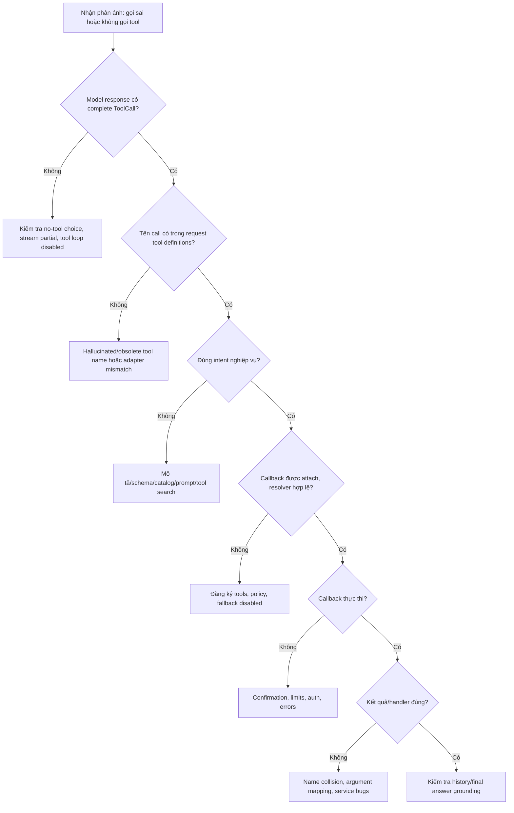
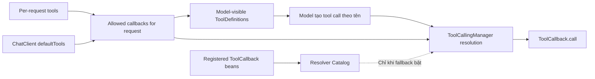

# Chẩn đoán sự cố

## Mô hình chọn nhầm công cụ hoặc tự tạo tên không tồn tại

Một ứng dụng Spring AI có ba công cụ `lookupOrder`, `estimateDelivery` và `changeDeliveryAddress`. Người dùng hỏi “Đơn ORD-100 khi nào đến?” nhưng mô hình lại yêu cầu `changeDeliveryAddress`, hoặc trả tool call tên `getOrderETA` dù tên này **không tồn tại trong danh sách công cụ của request**. Có khi mô hình chọn đúng tên nhưng callback không chạy; có khi tool chạy sai dịch vụ vì hai callbacks trùng tên. Các hiện tượng trông giống “mô hình chọn sai tool” nhưng nguyên nhân, trách nhiệm và cách sửa hoàn toàn khác nhau.

Bài trong module `SPRING_AI_TOOL_CALLING` tập trung chẩn đoán toàn bộ đường đi từ mô hình yêu cầu gọi công cụ qua `@Tool`/`ToolCallback`, JSON Schema arguments, `ToolContext`, `ToolCallingAdvisor`, `ToolCallingManager` và dịch vụ nghiệp vụ. Phạm vi **Spring AI 2.1.x** được đối chiếu với Spring AI 1.x/2.0.x khi có khác biệt; các ví dụ dùng cú pháp phù hợp Spring AI 2.x. Mục tiêu không phải “ép mô hình gọi tool bằng mọi giá”, mà là **gọi đúng công cụ, đúng phạm vi quyền, có kết quả xác minh, hoặc không gọi khi không đủ dữ kiện**.

Khi chẩn đoán, đừng kết luận “mô hình bịa tên” chỉ dựa vào final answer. Câu “Tôi đã gọi `getOrderETA`” trong văn bản có thể là lời nói sai của mô hình, không phải `AssistantMessage.ToolCall`. Hãy xem **model response có tool calls thực sự**, tập `ToolDefinition` được công bố cho model, tập callback được phép thực thi và audit của callback.

### 1. Phân biệt năm hiện tượng trước khi sửa

| Dấu hiệu nhìn thấy | Lỗi thực chất có thể là | Cần kiểm tra đầu tiên |
| --- | --- | --- |
| Mô hình gọi một tool **có tồn tại** nhưng sai mục đích | Sai quyết định lựa chọn (tool selection) | Mô tả tool, prompt, số lượng tool, user intent |
| Mô hình gọi một **tên không nằm trong hợp đồng đã gửi** | Hallucinated tool name / dữ liệu stream chưa hoàn chỉnh / adapter | Raw `ChatResponse`, danh sách tool names thực tế |
| Tool có bean trong Spring nhưng không chạy | Chưa gắn `ToolCallback` vào request; fallback tắt | `.tools(...)`/`.defaultTools(...)`, resolver |
| Tool có tên đúng nhưng chạy **sai handler** | Trùng tên khi merge local/MCP ở low-level path | `ToolDefinition.name()` của toàn bộ callbacks, cách merge |
| Model chọn đúng, callback chạy đúng, final answer nói sai | Sai diễn giải kết quả hoặc history | `ToolResponseMessage`, model round tiếp, result grounding |

Thêm hai lỗi dễ nhầm: **arguments sai schema** (tên công cụ đúng nhưng không deserialize được) và **quyền bị từ chối** (callback được chọn đúng nhưng service chủ động không thực thi). Cần ghi chúng là trạng thái riêng, không gộp vào “wrong tool”.

### 2. Sơ đồ xác định tầng lỗi



Đi theo thứ tự trong sơ đồ: đừng thay prompt trước khi xác minh callback đã được **công bố** và **đăng ký** đúng. Đừng bật fallback để “sửa” tên không tồn tại, bởi hành động ấy có thể làm tăng quyền cho request.

### 3. Hiểu ba tập tên: model-visible, executable và toàn cục

Với Spring AI 2.1, cần tách rõ:

- **Model-visible tool definitions:** danh sách tên/mô tả/JSON Schema gửi cùng request cho nhà cung cấp LLM.
- **Request-attached callbacks:** callbacks mà request cho phép thực thi, qua `.tools(...)`, `.defaultTools(...)` hoặc `ToolCallingChatOptions.toolCallbacks(...)`.
- **Application-wide resolver catalog:** các `ToolCallback` beans và công cụ từ một số `ToolCallbackProvider` beans mà `StaticToolCallbackResolver` có thể tìm theo tên; **MCP providers mặc định được loại khỏi resolver** để tránh liệt kê remote tools sớm.

Ba tập này **không luôn giống nhau**. Một `ToolCallback` bean có trong IoC container không đồng nghĩa model đã được giới thiệu tool đó. Ngược lại, model có thể phát một tool-call request theo tên do chính nó bịa dù tên đó không có trong definitions. Khi fallback bị tắt, request không được phép tự thực thi các callbacks nằm ngoài tập attach.



Đặt tên riêng cho các tập giúp đọc log:

```text
caseId=order-eta-001
modelVisibleNames=[lookupOrder, estimateDelivery]
attachedCallbackNames=[lookupOrder, estimateDelivery]
resolverCatalogNames=[lookupOrder, estimateDelivery, deleteOrder]
modelProposedName=getOrderETA
resolutionFallbackEnabled=false
callbackExecuted=false
classification=UNKNOWN_TOOL_NAME
```

Đây là **structured diagnostic event minh họa**; tránh log toàn bộ arguments, `ToolContext`, token, email hoặc kết quả nghiệp vụ nhạy cảm.

### 4. Đường gọi đúng trong Spring AI 2.x

Với `ChatClient`, tool loop mặc định nằm trong `ToolCallingAdvisor` (order `Ordered.HIGHEST_PRECEDENCE + 300`). Advisor nhận response model, kiểm tra `hasToolCalls()`, dùng `ToolCallingManager` thực thi callbacks rồi gửi `ToolResponseMessage` trở lại model khi cần.

```java
@Component
public class OrderTools {

    private final OrderService orders;

    public OrderTools(OrderService orders) {
        this.orders = orders;
    }

    @Tool(
        name = "lookupOrder",
        description = "Chỉ đọc trạng thái đơn hàng đã có mã orderId. Không đổi dữ liệu.")
    public OrderSummary lookupOrder(
            @ToolParam(description = "Mã đơn do người dùng cung cấp, ví dụ ORD-100")
            String orderId,
            ToolContext toolContext) {

        String tenantId = requireTrusted(toolContext, "tenantId");
        String userId = requireTrusted(toolContext, "userId");
        return orders.findVisibleOrder(tenantId, userId, orderId);
    }
}
```

`requireTrusted` là helper nghiệp vụ tự định nghĩa, phải từ chối nếu thiếu context đã xác thực. Spring AI không tự trao quyền bằng cách gọi `@Tool`. Tool names và schema được dùng cho **quyết định của model**; authorization dựa trên security context của ứng dụng.

Cấu hình request rõ ràng:

```java
ChatClient client = ChatClient.builder(chatModel)
    .defaultSystem("""
        Bạn chỉ được gọi công cụ có trong danh sách của request.
        Khi thiếu orderId, hãy hỏi bổ sung thay vì tự đoán.
        Không được báo đã đổi dữ liệu khi công cụ chưa thành công.
        """)
    .build();

String answer = client.prompt()
    .user("Kiểm tra đơn ORD-100")
    .tools(orderTools)
    .toolContext(Map.of(
        "tenantId", authenticatedTenantId,
        "userId", authenticatedUserId))
    .call()
    .content();
```

Đây là **hướng dẫn cho model**, không phải biện pháp bảo mật duy nhất. Nếu model đề nghị công cụ không được phép, `ToolCallingManager`/application policy phải **fail closed**; service vẫn kiểm tra quyền trên từng orderId.

### 5. Vì sao `@Tool` có thể không xuất hiện trước mô hình?

Một số nguyên nhân phổ biến:
1. Có method `@Tool` nhưng object chứa method **không được truyền vào `.tools(...)` hoặc `.defaultTools(...)`**.
2. Có `ToolCallback` bean nhưng developer chỉ inject service; callback không được gắn cho request.
3. Dùng `ToolCallbackProvider` động nhưng provider chưa được truyền vào request hoặc trả danh sách rỗng theo quyền.
4. `@Tool` đặt sai method hoặc tạo callbacks từ object không có method hợp lệ; `ToolCallbacks.from(...)` không tạo hợp đồng mong đợi.
5. Mô hình không hỗ trợ tool calling native hoặc request gửi option không phù hợp; provider adapter bỏ definitions/đổi chúng.
6. Đường code đang gọi `ChatModel.call()` thay vì `ChatClient.call()` và tưởng rằng tool đã được thực thi tự động.

Khác biệt giữa khai báo và attach:

```java
// Chỉ khai báo ToolCallback bean thì chưa đủ để model thấy nó.
@Bean
ToolCallback lookupTool(OrderLookupService service) {
    return FunctionToolCallback.builder("lookupOrder", service::lookup)
        .description("Tra cứu đơn hàng theo orderId")
        .inputType(OrderLookupRequest.class)
        .build();
}

// Đưa callback vào chính request cần sử dụng.
String result = chatClient.prompt()
    .user("Tra ORD-100")
    .tools(lookupTool)
    .call()
    .content();
```

`lookupTool` trong ví dụ là biến tham chiếu tới bean đã inject vào nơi gọi, không tự được tạo ra từ tên method. Spring AI 2.0 trở đi không còn cơ chế `toolNames(...)` với bare `Function` beans của thế hệ 1.x: hãy dùng `ToolCallback` thực sự hoặc object có `@Tool`.

### 6. `.tools(...)` và `.defaultTools(...)`: công bố nhiều hơn dự kiến

Trong Spring AI 2.1:

- `ChatClient.Builder.defaultTools(...)` gắn tool mặc định cho **mọi** request của client.
- `ChatClientRequestSpec.tools(...)` **append** tools vào defaults, **không thay thế**.
- Nếu dùng `ChatModel` low-level, `ToolCallingChatOptions.toolCallbacks(...)` từ request có thể **override** model-level defaults.
- Khi kết hợp `.tools(...)` và `.options(...)` trên `ChatClient`, cần hiểu precedence; cách gắn tool ngoài options được ưu tiên.

Ví dụ một tool quá rộng ở defaults có thể khiến mô hình chọn sai:

```java
ChatClient sharedClient = ChatClient.builder(model)
    .defaultTools(readTools, adminTools)
    .build();

// Đừng lầm rằng .tools(readTools) loại adminTools.
sharedClient.prompt()
    .user("Tra trạng thái đơn")
    .tools(readTools)
    .call();
```

Sửa bằng cách **không đặt tool rủi ro cao trong defaults**, tạo client cấu hình theo domain/risk tier hoặc chỉ attach callbacks đã được policy phê duyệt:

```java
ChatClient limitedClient = ChatClient.builder(model)
    .build();

String answer = limitedClient.prompt()
    .user(question)
    .tools(allowedReadCallbacks)
    .call()
    .content();
```

Kiểm tra danh sách merged names thực tế; một hệ thống có 100 tool mà request chỉ cần hai tool có thể tự tạo nhiễu cho model và tăng tỷ lệ gọi sai.

### 7. Khác biệt tên, ngữ nghĩa và schema

Spring AI sinh `ToolDefinition` gồm:
- `name()`: tên duy nhất trong tool set, thường mặc định là tên method Java nếu không đặt `@Tool(name=...)`.
- `description()`: mô tả công cụ **làm gì, khi nào nên dùng và khi nào không nên dùng**.
- `inputSchema()`: JSON Schema gồm required, type, description, enum; nên phù hợp dữ liệu user có thể cung cấp.

Ví dụ mô tả kém:

```java
@Tool(description = "Xử lý đơn hàng")
public String order(String id, String data) { ... }

@Tool(description = "Thao tác với giao hàng")
public String shipping(String id) { ... }
```

Hai tool dễ nhầm do phạm vi chồng lấn và tên tham số mơ hồ. Sửa theo **hợp đồng không chồng lấn**:

```java
@Tool(
    name = "lookupOrder",
    description = """
        CHỈ ĐỌC trạng thái đơn theo orderId đã có.
        Dùng khi người dùng hỏi đơn hàng hiện đang ở trạng thái nào.
        KHÔNG dùng để tính ETA hoặc sửa địa chỉ.
        """)
public OrderSummary lookupOrder(
        @ToolParam(description = "Mã đơn, ví dụ ORD-100")
        String orderId) { ... }

@Tool(
    name = "estimateDelivery",
    description = """
        Ước tính ngày giao cho đơn hàng và mã bưu chính.
        Dùng khi người dùng hỏi khi nào giao; KHÔNG sửa địa chỉ.
        Nếu chưa có orderId hoặc postalCode, cần hỏi bổ sung.
        """)
public DeliveryEstimate estimateDelivery(
        @ToolParam(description = "Mã đơn") String orderId,
        @ToolParam(description = "Mã bưu chính") String postalCode) { ... }
```

Nếu model gọi sai tool, kiểm tra cả *description* và input schema, không chỉ đổi tên. Nếu field `postalCode` bị đánh dấu required nhưng user không có, model có thể bịa giá trị thay vì hỏi; cân nhắc tách thành bước hỏi bổ sung hoặc chỉ công bố tool khi đủ dữ liệu. Ngược lại, đặt mọi field optional mà service đòi required cũng gây lỗi runtime.

### 8. Tại sao model lại phát tên hoàn toàn không tồn tại?

Nguyên nhân khả dĩ:

| Nguyên nhân | Chứng cứ | Hướng sửa |
| --- | --- | --- |
| Model tạo tên “hợp lý” từ ngôn ngữ user | Tool call `getOrderETA` nhưng definitions chỉ có `estimateDelivery` | Tool descriptions rõ; prompt nhấn dùng tên **nguyên văn**; test không hallucinate |
| History chứa tên tool cũ | Lượt trước dùng `getOrderETA`, code nay đổi tên | Cập nhật version session/catalog; không tự alias tới tool rủi ro |
| Provider adapter/cấu hình không gửi đầy đủ definitions | Payload outbound thiếu tool name | Kiểm tra adapter/override options/capability |
| MCP server đổi tên/prefix hoặc catalogue thay đổi | App callback tên `shipping_getEta`, model nghĩ tên `getEta` | Dùng tên **sau prefix thực tế**, quản lý catalogue revision |
| Streaming delta chưa đầy đủ | Partial `ToolCallPart` thiếu ID/name/arguments | Chờ complete call, không thực thi delta |
| Prompt injection trong tool result/tài liệu | Nguồn ngoài hướng model gọi `adminDelete` | Coi kết quả tool là dữ liệu không đáng tin, fail closed |
| Router/ToolSearch công khai tool khác giữa các vòng | Một tool chưa được cấp quyền hoặc chưa được reveal | Kiểm tra tool set từng iteration, policy và history |

Không có biện pháp prompt nào bảo đảm mô hình luôn tuân thủ. **Ranh giới thực thi** phải chỉ cho phép callback được attach/allowlisted, và phải xử lý tên không hợp lệ thành một kết quả lỗi an toàn thay vì đoán hoặc thực thi một tool gần giống.

### 9. Resolver fallback: “cứ tìm tool trùng tên trong ứng dụng” là bẫy bảo mật

`ToolCallbackResolver.resolve(toolName)` tìm callback theo tên. `StaticToolCallbackResolver` mặc định được auto-configure với các `ToolCallback` beans và một số providers, nhưng **không tự gắn** tool đó vào prompt. Từ **Spring AI 2.0.1**, khi model phát tool call không nằm trong tập callbacks đã attach, fallback sang resolver toàn ứng dụng **bị tắt mặc định**.

```properties
spring.ai.tools.resolution.fallback.enabled=false
```

Với manager tự dựng cũng có cấu hình:

```java
ToolCallingManager manager = ToolCallingManager.builder()
    .resolutionFallbackEnabled(false)
    .build();
```

Nếu bật fallback:

```java
// Không phải cách sửa an toàn mặc định.
ToolCallingManager manager = ToolCallingManager.builder()
    .toolCallbackResolver(resolver)
    .resolutionFallbackEnabled(true)
    .build();
```

…thì mô hình có thể yêu cầu một tool **không hề được attach cho request**, nhưng tool đó vẫn được chạy nếu resolver tìm thấy. Điều này đặc biệt nguy hiểm khi catalog có các tool ghi/xóa dữ liệu. **Không bật fallback chỉ để che lỗi đăng ký**, kể cả khi thông báo log nói “không tìm thấy tool”.

Tóm tắt kỳ vọng:

| Tool được attach? | Có trong resolver? | Fallback | Kết quả nên kỳ vọng |
| --- | --- | --- | --- |
| Có | Có hoặc không | Bất kỳ | Resolver request dùng attached callback |
| Không | Có | `false` | Không được thực thi |
| Không | Có | `true` | Có thể thực thi ngoài tập tools đã quảng bá — rủi ro |
| Không | Không | Bất kỳ | Không có callback hợp lệ để thực thi |

**Hợp đồng phân quyền** vẫn nằm ở application/business service; kể cả khi một callback được attach, model arguments vẫn không thể trao thêm quyền.

### 10. Không được tự sửa tên bằng fuzzy matching trong đường thực thi

Một cách “chữa cháy” dễ xuất hiện:

```text
Model proposes: getOrderETA
Available: estimateDelivery
Auto-correct: getOrderETA -> estimateDelivery
Execute immediately
```

Cách này không an toàn. Một tên gần `deleteOrder` có thể bị chuyển thành công cụ phá hủy; một tên cũ từng là read-only có thể đã được thay bằng tool ghi. Tên tool là **định danh của hợp đồng thực thi**, không phải một câu hỏi tìm kiếm có thể tự sửa lỗi mà không có kiểm soát.

Các giải pháp phù hợp hơn:

- **Không thực thi tool lạ**, ghi mã lỗi `UNKNOWN_TOOL_NAME` đã che dữ liệu.
- Nếu ứng dụng cần phục hồi, trả cho người dùng câu hỏi bổ sung hoặc hướng dẫn mô hình thử lại **với tập công cụ đang được công bố**, trong budget hữu hạn.
- Nếu đổi tên tool trong migration, dùng alias registry **tĩnh, có phiên bản, được review quyền**; alias phải ánh xạ tới đúng một callback cùng ngữ nghĩa/quyền, không sử dụng khoảng cách chuỗi.
- Tránh cho model quyền tự liệt kê toàn bộ resolver để “tìm” một tool gần giống.
- Khi cần progressive tool discovery, dùng cơ chế tool search được giới hạn bằng allowlist trước khi index, có tiêu chí relevance/threshold và kiểm thử quyền.

Có thể thử cải thiện prompt để model sử dụng đúng tên, nhưng đừng dựa vào prompt như biện pháp cuối cùng ngăn tool không được phép chạy.

### 11. Đặt guard ở ranh giới thực thi: so tên với allowlist của request

Trong **user-controlled tool loop**, ta có thể kiểm tra `AssistantMessage.ToolCall.name()` trước khi gọi `ToolCallingManager`. Khung minh họa:

```java
static Set<String> callbackNames(ToolCallback[] allowed) {
    return Arrays.stream(allowed)
        .map(cb -> cb.getToolDefinition().name())
        .collect(Collectors.toUnmodifiableSet());
}

static void validateNames(
        ChatResponse modelResponse,
        ToolCallback[] allowed) {

    Set<String> names = callbackNames(allowed);

    for (Generation generation : modelResponse.getResults()) {
        for (AssistantMessage.ToolCall call :
                generation.getOutput().getToolCalls()) {

            if (!names.contains(call.name())) {
                throw new UnknownToolNameException(
                    "Tool name not in request allowlist");
            }
        }
    }
}
```

`UnknownToolNameException` là exception nghiệp vụ tự định nghĩa. Không đưa tên lạ có thể chứa dữ liệu không đáng tin vào HTTP response/log thô. Nếu cần telemetry, chuẩn hóa và giới hạn độ dài, gắn mã chẩn đoán, không chép token/PII từ arguments.

Một manual loop sử dụng cùng allowlist:

```java
ToolCallback[] allowed = ToolCallbacks.from(orderTools);
ToolCallingChatOptions options = ToolCallingChatOptions.builder()
    .toolCallbacks(allowed)
    .build();

Prompt prompt = new Prompt(
    List.of(new UserMessage("Tra trạng thái ORD-100")), options);

ToolCallingManager manager = ToolCallingManager.builder()
    .resolutionFallbackEnabled(false)
    .build();

ChatResponse response = chatModel.call(prompt);

while (response.hasToolCalls()) {
    validateNames(response, allowed);  // Fail closed.

    ToolExecutionResult result =
        manager.executeToolCalls(prompt, response);

    if (result.returnDirect()) {
        // Ứng dụng đưa tool result trực tiếp cho caller,
        // không tạo thêm model round.
        break;
    }

    prompt = new Prompt(result.conversationHistory(), options);
    response = chatModel.call(prompt);
}
```

Đây là **khung phân nhánh logic**, chưa gồm timeout, max iterations, confirmation, metadata, final result conversion và xử lý lỗi an toàn. Một manual loop production phải bổ sung tất cả; nếu không cần quyền điều phối từng iteration, dùng `ChatClient` với `ToolCallingAdvisor` và để manager giới hạn callbacks theo request.

### 12. Cấu hình ChatClient đúng nhưng callback không chạy: kiểm tra advisor

Một lỗi khác hay bị quy nhầm cho model: model đã trả `ToolCall` hợp lệ, callback có trong request, nhưng không có execution. Trong Spring AI **2.x**, gọi `ChatModel.call(prompt)` trực tiếp chỉ trả model response, **không chạy tool loop tự động** như 1.x.

Đường `ChatClient` có thể bị tắt auto-registration:

```properties
# Đặt false chỉ khi ứng dụng thực sự muốn tự điều phối.
spring.ai.chat.client.tool-calling.enabled=false
```

Hoặc ở một request:

```java
ChatClientResponse raw = chatClient.prompt()
    .user("Tra ORD-100")
    .tools(orderTools)
    .advisors(AdvisorParams.toolCallingAdvisorAutoRegister(false))
    .call()
    .chatClientResponse();
```

Khi tắt advisor, model **vẫn có thể thấy definitions và phát tool calls**, nhưng callback không tự chạy. Caller phải lấy response và dùng `ToolCallingManager` tự thực thi. Nếu chỉ muốn log/metrics từng iteration, tạo advisor quan sát với `CallAdvisor`/`StreamAdvisor` ở order bên trong vòng thay vì tắt vòng mặc định.

`ToolAdvisor` là marker chỉ một advisor sở hữu vòng. Nếu một advisor logging tùy chỉnh vô tình implement marker nhưng không có loop, `DefaultChatClient` sẽ không thêm `ToolCallingAdvisor` mặc định. Kiểm tra chain thực tế, tránh đăng ký hai `ToolAdvisor` hay bỏ sót vòng do custom code.

### 13. Xung đột tên: một lỗi nguy hiểm hơn hallucination

Hai tool cùng `ToolDefinition.name()` có thể bắt nguồn từ local `@Tool` và MCP server, hoặc từ hai providers khác nhau.

Spring AI 2.1:
- `ChatClient.tools(...)`/`defaultTools(...)` **kiểm tra tên trùng sau khi merge** và có thể ném `IllegalStateException`, thay vì chạy nhầm.
- `ToolCallbacks.from(...)`/provider có thể từ chối trùng tên ngay lúc tạo callbacks (loại exception thay đổi theo bản Spring AI).
- Nếu ứng dụng **tự lắp `ToolCallingChatOptions` và gọi `ChatModel`/manager low-level**, validation merged list của `ChatClient` **không được chạy**. Callback đầu tiên cùng tên có thể thắng im lặng.

Đó là nguy cơ chọn sai handler ngay cả khi model **không hề chọn sai tên**.

```java
static void assertNoDuplicateNames(ToolCallback[] callbacks) {
    Map<String, Long> counts = Arrays.stream(callbacks)
        .collect(Collectors.groupingBy(
            cb -> cb.getToolDefinition().name(),
            Collectors.counting()));

    List<String> duplicates = counts.entrySet().stream()
        .filter(e -> e.getValue() > 1)
        .map(Map.Entry::getKey)
        .sorted()
        .toList();

    if (!duplicates.isEmpty()) {
        throw new IllegalStateException(
            "Duplicate tool names: " + duplicates);
    }
}
```

Dùng hàm này tại integration boundary trước khi gửi tool definitions. Có thể gọi `ToolCallingChatOptions.validateToolCallbacks(...)` theo API 2.1 để dùng validation của framework khi có sẵn. Với các callback có side effect, tốt nhất namespace tên theo domain: `orders_lookup`, `shipping_estimate`, `billing_createInvoice`, thay vì để tất cả tên `search` hoặc `update`.

### 14. MCP legacy và modern có cách đặt tên khác nhau

Khi tích hợp `SyncMcpToolCallbackProvider`/`AsyncMcpToolCallbackProvider`, tên tool mà model nhìn thấy có thể khác tên nguyên bản trên MCP server.

| Nguồn/kiểu kết nối | Tên tool từ server | Tên công bố thực tế có thể là |
| --- | --- | --- |
| Local `@Tool` | Tên Java/annotation | `lookupOrder` |
| Legacy MCP, không trùng | `search` | `search` |
| Legacy MCP, trùng hai connections | `search` ở hai server | `search` và `alt_1_search` |
| Legacy MCP, ký tự đặc biệt | `my-special-tool` | `my_special_tool` |
| MCP modern connection tên `tickets` | `search` | `tickets_search` |
| Custom prefix generator | `search` | Tên do generator định nghĩa |

MCP Client Starter dùng `DefaultMcpToolNamePrefixGenerator` cho legacy connections, tạo tên duy nhất **giữa các MCP connections**; nó không kiểm tra tên local `@Tool`. Với modern MCP (2026-07-28 protocol), tên mặc định là `<connection>_<tool>`, có filter/prefix generator riêng: `McpModernToolFilter` và `McpModernToolNamePrefixGenerator`. Không dùng một filter legacy rồi tưởng nó áp dụng cho modern connection.

Nếu tool `tickets_search` đã được gắn request mà model gọi `searchTickets`, đó là lệch tên; nhưng nếu app chỉ log tên server gốc `search` rồi kết luận model gọi lạ, là lỗi **telemetry/namespace**. Đối chiếu `getToolDefinition().name()` **sau mọi bước prefix, filter, provider resolution**.

Với MCP catalog động, chú ý vòng đời tool list, TTL/cache và scope caller: một shared MCP session có thể giữ danh sách tool được khám phá dưới danh tính khác, không phải phân vùng tenant. Tool discovery không thay thế quyền từng request ở MCP server.

### 15. MCP provider có nhưng model không thấy tool

MCP starter có thể tạo `SyncMcpToolCallbackProvider` bean, nhưng **không tự append nó vào mọi `ChatClient`**; việc eager listing tất cả remote tools bị hạn chế có chủ đích. Cần gắn tường minh:

```java
@Service
public class ShippingAssistant {

    private final ChatClient chatClient;
    private final SyncMcpToolCallbackProvider shippingTools;

    public ShippingAssistant(
            ChatClient chatClient,
            SyncMcpToolCallbackProvider shippingTools) {
        this.chatClient = chatClient;
        this.shippingTools = shippingTools;
    }

    public String askShipping(String question) {
        return chatClient.prompt()
            .user(question)
            .tools(shippingTools)
            .call()
            .content();
    }
}
```

Đoạn code minh họa giả định provider đã được lọc và caller có quyền với các tool bên trong. Trong hệ thống multi-tenant, không gắn một provider chứa mọi remote tools cho mọi user; lọc tool theo policy hoặc tạo client/service phù hợp, xác thực quyền tại MCP server.

Các bước chẩn đoán thực tế:
1. MCP connection có được khởi tạo và tool listing thành công không?
2. `toolcallback.enabled` có bật, provider có trả callbacks không?
3. Filter có vô tình loại hết tool không? Modern/legacy dùng filter đúng loại chưa?
4. Prefix/name generator làm đổi tên gì?
5. Request đã `.tools(provider)` hay chỉ inject bean mà không dùng?
6. Tool names sau merge có đụng local tool hoặc provider khác không?
7. MCP caller/credential có quyền gọi tool đó không?
8. Có cần per-user client/session thay vì shared discovery không?

Không sửa bằng cách bật resolver fallback: MCP providers bị loại khỏi resolver mặc định và fallback còn có thể tạo quyền thực thi ngoài request.

### 16. Streaming: tool-call fragment chưa phải lời gọi hoàn chỉnh

Một số model provider stream tên, ID, JSON arguments theo từng đoạn. Spring AI 2.1 biểu diễn chúng bằng `ToolCallPart` được đánh dấu partial. Những fragments này **không phải complete tool calls**; `AssistantMessage.getToolCalls()` và `ChatResponse.hasToolCalls()` bỏ qua chúng, nên `ToolCallingManager` không thực thi fragments.

```java
chatClient.prompt()
    .user("Tra cứu ORD-100")
    .tools(orderTools)
    .stream()
    .chatResponse()
    .subscribe(chunk -> chunk.getResults().forEach(result -> {
        for (MessagePart part : result.getOutput().getParts()) {
            if (part instanceof ToolCallPart toolPart
                    && StreamingParts.isPartial(part)) {
                AssistantMessage.ToolCall delta = toolPart.toolCall();
                progressUi.showToolProgress(
                    delta.id(), delta.name(), delta.arguments());
            }
        }
    }));
```

`progressUi` là UI service ví dụ. Chỉ hiển thị progress, **không gọi callback** ở đây. Fragments có thể chứa `name`/`id` tạm thời hoặc JSON chưa đầy đủ. Muốn kiểm tra model có gọi tool thật không, đợi complete `AssistantMessage.ToolCall` cuối iteration hoặc để `ToolCallingAdvisor` xử lý.

Nếu tự streaming manual loop, phải aggregate response model đúng cách trước khi `executeToolCalls`; không coi mỗi chunk như một lời gọi mới rồi tạo lỗi trùng ID và duplicate side effect.

### 17. Khi tên đúng nhưng arguments sai: đừng gọi đó là hallucinated tool

Model có thể chọn `estimateDelivery` đúng nhưng gửi:

```json
{
  "orderId": "ORD-100",
  "postalCode": 700000,
  "tenantId": "other-tenant"
}
```

Nếu contract yêu cầu `postalCode` là string, JSON trên có vấn đề **schema/type**; `tenantId` là một giá trị không tin cậy nằm trong arguments, không phải quyền thực thi. Kết quả thực hiện còn phụ thuộc validation và logic callback.

Đường phân loại:

1. Kiểm tra tool name có đúng `ToolDefinition.name()` không.
2. Parse JSON và validate required fields, types, enums, length/ranges, unknown keys.
3. Kiểm tra giá trị có **căn cứ trong user input/history** hay model tự bịa.
4. Kiểm tra scope business qua `ToolContext` và authenticated principal, **không** qua arguments.
5. Chỉ khi hợp lệ mới gọi service; nếu thiếu dữ kiện, nên để model hỏi bổ sung thay vì suy đoán.
6. Ghi `ARGUMENT_SCHEMA_ERROR` hoặc `MISSING_REQUIRED_INPUT` riêng khỏi `UNKNOWN_TOOL_NAME`.

Trong Java, có thể tận dụng validation trên DTO ở business boundary:

```java
public record DeliveryRequest(
    @NotBlank String orderId,
    @NotBlank String postalCode) {}

public DeliveryEstimate estimate(
        DeliveryRequest request, TrustedScope scope) {

    validator.validate(request).forEach(violation -> {
        throw new IllegalArgumentException("INVALID_ARGUMENTS");
    });

    return deliveryService.estimate(
        scope.tenantId(), request.orderId(), request.postalCode());
}
```

Ví dụ minh họa `TrustedScope`/`DeliveryService`/`validator` do ứng dụng cấp. Trong thực tế, tránh ném lỗi với raw payload; trả mã và thông báo an toàn. Không đưa xác thực tenant vào JSON Schema mà model được phép tự chọn.

### 18. Model trả lời luôn, không gọi công cụ dù tool đã được công bố

Ngược với hallucinated name là **bỏ qua tool cần thiết**. Trước khi kết luận model “không biết dùng tool”, hãy kiểm tra:

- Raw `ChatResponse.hasToolCalls()` có đúng `false` không? Hay chỉ có partial stream chunks?
- Request gửi đi có tool definitions không?
- Model/provider có hỗ trợ native tool calling, forced tool choice hoặc có tùy chọn disable tools không?
- User prompt có buộc cần dữ liệu *live* hay mô hình nghĩ có thể trả từ kiến thức đã học?
- Mô tả tool có giải thích “dùng để lấy trạng thái hiện tại” không?
- Nội dung đã được nạp từ Session Memory/RAG có làm model tin rằng có dữ liệu hiện tại nhưng thực ra cũ không?
- Tool đã từng bị lỗi/deny trong history và model đang tránh gọi lại vì thiếu hướng dẫn phục hồi hợp lý?

Ví dụ chính sách ở system prompt có thể nêu:

```text
Khi người dùng hỏi trạng thái ĐANG CÓ HIỆU LỰC của một đơn hàng,
hãy sử dụng lookupOrder nếu đã có orderId và caller có quyền.
Không suy ra trạng thái hiện tại chỉ từ kiến thức mô hình.
Nếu chưa có orderId, hỏi bổ sung. Không bịa orderId.
Nếu tool bị lỗi, nêu rõ không thể xác minh; không tự báo thành công.
```

Dùng forced tool choice (nếu adapter/provider hỗ trợ) cho workflow **chắc chắn** cần một tool cụ thể và đã có inputs, nhưng không ép tool cho mọi prompt. Ép gọi tool khi người dùng chỉ chào hoặc đang thiếu mã đơn có thể làm tăng hallucinated arguments.

### 19. Tool descriptions: so sánh trước và sau bằng dữ liệu, không theo cảm giác

Cải thiện mô tả tool là một thay đổi **hợp đồng model nhìn thấy**. Cần kiểm tra lại các câu dễ nhầm, không chỉ test một prompt demo.

| Trước khi sửa | Sau khi sửa | Điều muốn cải thiện |
| --- | --- | --- |
| `orderTool`: “Xử lý đơn hàng” | `lookupOrder`: “Chỉ đọc trạng thái hiện tại, không thay đổi dữ liệu” | Tách read/write |
| `deliveryTool`: “Giao hàng” | `estimateDelivery`: “Tính ETA cho orderId và postalCode” | Tách ETA/lookup |
| `update`: “Cập nhật thông tin” | `changeDeliveryAddress`: “Chỉ đổi địa chỉ khi user yêu cầu và được xác nhận” | Giảm gọi tool rủi ro |
| Không mô tả parameters | `@ToolParam(description=...)` cho mã đơn, mã bưu chính, optionality | Giảm arguments thiếu/sai |
| Tên “đẹp” nhưng nhiều nghĩa | Tên phân biệt domain + action rõ ràng | Giảm nhầm namespace |

Cần lưu baseline `toolSelectionAccuracy`, `noToolAccuracy`, `invalidNameRate` và `unsafeCallRate` trước/sau. Một prompt sửa giúp case “ETA” nhưng làm tăng gọi thừa trên case “chào hỏi” không phải cải thiện rõ ràng.

Nếu dùng nhiều model providers, giữ **cùng tool contract** khi so A/B. Đừng gán chênh lệch do riêng mô hình nếu cùng lúc đổi tool schema, descriptions hoặc memory.

### 20. Catalog quá lớn hoặc có tool gần nghĩa nhau

Khi hàng chục/hàng trăm tools được công bố cùng một lượt, model có thể:
- Không phân biệt các tên tương tự `search_customer`, `find_customer`, `lookup_client`.
- Chọn một tool có description ngắn mơ hồ thay vì tool đúng.
- “Hợp nhất” hai tên thành một tên mới `findCustomerOrders` không tồn tại.
- Bỏ qua required arguments của một tool nhiều tham số.
- Vượt budget token/context trước khi hiểu hết catalog.

Hướng sửa theo thứ tự:

1. Chia công cụ theo domain/workflow/risk tier và chỉ công bố tập **cần thiết cho request**.
2. Bỏ trùng ngữ nghĩa, hợp nhất những tool chỉ khác tên nhưng cùng chức năng.
3. Đặt tên rõ ràng, ổn định và mô tả “khi nào dùng/không dùng”.
4. Dùng tool catalog/version registry và preflight chống trùng.
5. Với tập lớn, cân nhắc `ToolSearchToolCallingAdvisor`/tool index để model tìm tool theo nhu cầu; vẫn phải enforce allowlist **trước** khi tìm và trước execution.
6. Đo recall/precision/no-tool accuracy trên bộ case, không chỉ đo số token tiết kiệm.

`ToolSearchToolCallingAdvisor` mở rộng `ToolCallingAdvisor` để progressive disclosure, không phải cơ chế authorization. Search index trả nhầm tool ngoài quyền vẫn phải bị chặn ở ứng dụng; tiêu chí relevance không được tự trao quyền.

### 21. Khi chuyển phiên bản Spring AI: nhận diện lỗi sai API

Một số bài hướng dẫn Spring AI 1.x có thể không áp dụng trực tiếp cho Spring AI 2.x.

| Phiên bản/đường gọi | Cơ chế | Hệ quả khi chẩn đoán |
| --- | --- | --- |
| Spring AI 1.x `ChatModel` | Tool loop thường chạy bên trong model implementation | Kỳ vọng tool tự chạy khi gọi model trực tiếp là đúng trong 1.x nhưng sai ở 2.x |
| Spring AI 2.x `ChatModel` | Chỉ trả raw tool-call response | Caller phải gọi `ToolCallingManager` và tiếp tục prompt |
| Spring AI 2.x `ChatClient` | `ToolCallingAdvisor` được auto-register nếu không bị tắt | Callback thực thi qua advisor loop |
| Spring AI 2.0.1+ | Resolver fallback mặc định `false` | Tool bean ngoài request không tự chạy |
| Spring AI 2.1.x | `.tools(...)`/`.defaultTools(...)` chấp nhận callbacks, providers, POJO `@Tool` | Không dùng bare `Function` + `toolNames(...)` của code cũ |
| Spring AI 2.1.x | Session Memory thay thế legacy ChatMemory đã deprecated | History tool-call/result trong nhiều turn có hợp đồng mới |

Nếu code nâng version nhưng vẫn gọi `toolNames("foo")`, phải chuyển sang `ToolCallback` explicit:

```java
ToolCallback callback = FunctionToolCallback.builder(
        "lookupOrder", orderService::lookup)
    .description("Tra đơn hàng theo orderId")
    .inputType(OrderLookupRequest.class)
    .build();

String answer = chatClient.prompt()
    .user("Tra ORD-100")
    .tools(callback)
    .call()
    .content();
```

Nếu phát sinh `IllegalArgumentException` khi `ToolCallbacks.from(...)`, kiểm tra object có `@Tool` thật hay không và các tên có bị trùng; trong Spring AI 2.x exception class từ `MethodToolCallbackProvider` đã thay đổi so với một số bản trước. Không áp dụng code retry cũ như thể callback “không tìm thấy” là lỗi mạng có thể tự thử lại vô hạn.

### 22. Session Memory và hội thoại cũ có thể làm model gọi tên cũ

Trong một chat kéo dài, model có thể đã thấy kết quả của tool `getOrderETA` ở turn trước nhưng catalog hiện tại đã đổi thành `estimateDelivery`. Nếu Session Memory lưu assistant tool-call/result messages, transcript cũ vẫn có thể chứa tên cũ. Điều đó **không làm tool cũ tự được cấp phép** ở turn mới.

Để tránh lỗi:
- Version hóa tool catalog và prompt; khi nâng cấp không tương thích, cân nhắc tạo session mới hoặc compaction/summarization có kiểm soát.
- Nếu cần migration, ánh xạ alias **tĩnh, giới hạn scope và cùng semantics**, xác minh history không chứa cặp ID bị mất.
- Khi nạp history, bảo toàn cặp `AssistantMessage.ToolCall.id()` và `ToolResponseMessage.ToolResponse.id()`; không đơn giản đổi tên một phía rồi để phía kia nguyên.
- Không lấy old tool name từ user/history rồi tự thêm callback vào allowlist của request.
- Với legacy `MessageChatMemoryAdvisor` bên ngoài loop, đừng giả định nó lưu đủ tool-call transcript như `SessionAdvisors` 2.1.
- Kiểm tra ranh giới tenant/session, bảo vệ khỏi history cũ của người khác.

Một câu hỏi tiếp nối “Nó bao giờ đến?” còn có thể bị chọn nhầm vì **tham chiếu mơ hồ** trong history, chứ không phải vì tool names. Nên kiểm thử multi-turn với cùng lịch sử khởi đầu và session được xác minh chủ sở hữu.

### 23. Khi callback không chạy: confirmation, limits và quyền có thể đã chặn

Một model tool-call request hợp lệ không bảo đảm callback sẽ được thực thi. Các điều kiện dừng/chặn hợp lệ gồm:

| Tình huống | Dấu hiệu | Kết quả đúng |
| --- | --- | --- |
| `@Tool(requiresConfirmation=true)` | Advisor tạm dừng, trả metadata yêu cầu duyệt | Chưa chạy side effect |
| Vượt `maxCallsPerTool`/`maxTotalToolCalls` | Limit breach/partial results | Không chạy call vượt limit, giữ kết quả trước đó |
| User/tenant không có quyền | Business service trả deny | Không có side effect; thông báo an toàn |
| Callback throw exception | Error processor/exception | Phân loại lỗi execution, không gọi nhầm tool khác |
| `returnDirect=true` | Tool chạy rồi trả caller | Không gọi model round tiếp khi mọi call trong batch direct |
| Stream bị hủy/timeout | Không có final reply | Trạng thái side effect có thể `UNKNOWN` |

Tool call limits mặc định trong Spring AI 2.1 là khoảng **40 lần mỗi tool trong turn và 150 lần tổng một turn** (có thể cấu hình). Giới hạn không rollback tool đã chạy; một batch có hai calls đầu thành công và call thứ ba bị chặn không nên được báo như “không có công cụ nào chạy”.

Nếu model báo “không gọi được tool” sau timeout, kiểm tra operation ledger/idempotency key trước khi retry lệnh ghi. **Tool-call ID của model không phải idempotency key** để chống thực thi nghiệp vụ trùng.

### 24. Quan sát đúng dữ liệu để không làm lộ secrets

Spring AI cung cấp observation `spring.ai.tool` qua Micrometer; có thông tin tool name, duration, tracing context. Raw tool arguments/results **không được đưa vào span attributes theo mặc định**. Bật tùy chọn chứa nội dung khi chưa có kiểm soát redaction có thể làm lộ dữ liệu nhạy cảm.

Ghi các trường an toàn, có giá trị chẩn đoán:

```json
{
  "caseRef": "eval-42",
  "traceRef": "c2ae41d1",
  "springAiVersion": "2.1.x",
  "modelRevision": "provider-model-rev",
  "requestToolNames": ["lookupOrder", "estimateDelivery"],
  "modelProposedToolName": "getOrderETA",
  "toolCallRef": "call-01",
  "resolutionFallback": false,
  "resolutionOutcome": "UNKNOWN_TOOL_NAME",
  "callbackExecuted": false,
  "toolSchemaRevision": "orders-v4"
}
```

Đây là event **minh họa**, không phải API tự sinh. Với tên tool do model đề xuất, phải giới hạn chiều dài/escape để chống log injection; nếu tên chứa PII hoặc ký tự điều khiển, lưu hash/truncated safe representation. Không ghi:
- Bearer tokens, API keys, raw security principal.
- Toàn bộ `ToolContext`, session history hay tool result chứa dữ liệu người dùng.
- JSON arguments có địa chỉ, email, số tài khoản hoặc secrets.
- Error `ex.getMessage()` thô có URL chứa token hoặc payload đầu vào.

Nếu cần phân tích đặc thù arguments, dùng sandbox synthetic test hoặc mã lỗi validation + field names đã allowlisted. Audit `MODEL_REQUESTED` phải tách với `CALLBACK_EXECUTED` và `SERVICE_COMMITTED`.

### 25. Test deterministic: model tự tạo tên không có trong allowlist

Không nên dùng LLM thật làm unit test cho chuyện “model có bịa tên hay không”: kết quả không ổn định. Hãy tạo một `ChatResponse` cố định và kiểm tra **guard không gọi callback**.

```java
static ChatResponse modelRequests(
        String callId, String name, String arguments) {

    AssistantMessage assistant = AssistantMessage.builder()
        .content("")
        .toolCalls(List.of(new AssistantMessage.ToolCall(
            callId, "function", name, arguments)))
        .build();

    return new ChatResponse(
        List.of(new Generation(assistant)));
}

static final class CountingTools {
    final AtomicInteger calls = new AtomicInteger();

    @Tool(name = "lookupOrder",
          description = "Chỉ đọc trạng thái đơn theo orderId.")
    String lookupOrder(
            @ToolParam(description = "Mã đơn") String orderId) {
        calls.incrementAndGet();
        return "SHIPPED";
    }
}

@Test
void unknownToolNameIsRejectedBeforeExecution() {
    CountingTools tools = new CountingTools();
    ToolCallback[] allowed = ToolCallbacks.from(tools);

    ChatResponse proposed = modelRequests(
        "call-x", "getOrderETA", "{\"orderId\":\"ORD-100\"}");

    assertThatThrownBy(() -> validateNames(proposed, allowed))
        .isInstanceOf(UnknownToolNameException.class);

    assertThat(tools.calls.get()).isZero();
}
```

Hàm `validateNames(...)` và exception ứng dụng đã giới thiệu ở mục 11. Test này xác minh chính sách ở **manual guard**, không khẳng định một version cụ thể của manager sẽ ném cùng exception khi không tìm thấy callback. Test integration riêng cần xác minh đường mặc định `fallback=false` cũng **không có side effect**; đừng gắn kỳ vọng vào chuỗi thông báo lỗi framework có thể thay đổi qua minor release.

Khi có tool name lạ, nên phân loại `UNKNOWN_TOOL_NAME` và trả lỗi đã chuẩn hóa; không dùng `getOrderETA` làm input cho một tool tìm kiếm callback toàn cục.

### 26. Test “gọi nhầm một tool hợp lệ” khác test “tên lạ”

Một model có thể chọn `changeDeliveryAddress` dù cả `changeDeliveryAddress` lẫn `estimateDelivery` đều tồn tại. Guard chỉ kiểm tra tên thuộc allowlist là **cần nhưng không đủ**. Phải có **oracle theo ý định nghiệp vụ**:

```java
record GoldToolDecision(
    String caseId,
    Set<String> permittedNames,
    Set<String> expectedNames,
    Set<String> forbiddenNames) { }

static void assertIntendedSelection(
        ChatResponse response, GoldToolDecision gold) {

    List<String> proposed = response.getResults().stream()
        .flatMap(g -> g.getOutput().getToolCalls().stream())
        .map(AssistantMessage.ToolCall::name)
        .toList();

    assertThat(proposed)
        .allMatch(gold.permittedNames()::contains)
        .containsAll(gold.expectedNames());

    assertThat(proposed)
        .noneMatch(gold.forbiddenNames()::contains);
}
```

Trong benchmark đầy đủ, `expectedNames` chỉ là một phần của gold predicate; với tool phụ thuộc, còn phải chấm arguments và quan hệ thứ tự. Ví dụ câu “ETA của ORD-100” thường kỳ vọng `estimateDelivery`, không nên đánh đồng một `lookupOrder` rồi suy đoán ETA là hoàn thành. Với “Chào bạn”, expected tool set rỗng và **no-tool accuracy** là tiêu chí quan trọng.

Khi model đề xuất **một tool hợp lệ nhưng bị policy cấm** cho caller, bảo vệ phải ở nhiều lớp: không attach callback từ đầu, validation trước execution và authorization trong business service. Một lỗi quyết định model không được trở thành lỗ hổng quyền.

### 27. Test duplicate tool names: lỗi cấu hình phải fail fast

Kiểm tra tool names của hai providers trước khi gọi model:

```java
@Test
void duplicateNamesFailBeforeCallingModel() {
    ToolCallback[] callbacks = new ToolCallback[] {
        callbackNamed("search", firstSearchHandler),
        callbackNamed("search", secondSearchHandler)
    };

    assertThatThrownBy(() -> assertNoDuplicateNames(callbacks))
        .isInstanceOf(IllegalStateException.class)
        .hasMessageContaining("search");

    verifyNoInteractions(chatModel);
}
```

Các helper `callbackNamed`, hai handlers và `chatModel` là test fixtures ứng dụng. Với `ChatClient`, nên có một integration test xác nhận framework từ chối merged local/MCP tool names trùng. Với manual `ChatModel`, test validation tường minh của ứng dụng quan trọng hơn, vì đường low-level có thể chọn callback đầu cùng tên **mà không báo lỗi**.

Để sửa, thay `search` bằng namespace rõ như `catalog_searchProduct` và `orders_searchOrder`. Không đổi tên runtime tùy theo thứ tự provider trả tool; tên model nhìn thấy cần ổn định theo contract revision.

### 28. Test resolver fallback: tool không attach phải không chạy

Một tình huống bắt buộc kiểm thử bảo mật:

```text
Available in global resolver:
    lookupOrder (read)
    deleteOrder (destructive)

Attached to request:
    lookupOrder

Model proposes:
    deleteOrder

Expected:
    callbackExecuted(deleteOrder) = false
    resolutionOutcome = NOT_ALLOWED_FOR_REQUEST
    no business side effect
```

Test cấp manager hoặc integration phải có `resolutionFallbackEnabled(false)` và một fake `deleteOrder` counter/ledger. Không chỉ assert manager “báo lỗi”; phải assert `deleteOrder` **chưa chạy**.

Nếu dự án chủ động bật fallback cho use case đặc biệt, cần thiết kế resolver chỉ chứa **allowlisted callbacks theo chính caller/request**, không dùng toàn bộ application-wide catalog. Cần test negative cho user chỉ có quyền đọc, tenant khác và tên tool rủi ro. Đừng đặt một công cụ destructive vào resolver chung rồi hy vọng prompt không bao giờ nhắc tới nó.

### 29. Test nhiều vòng, streaming và history

Một bộ test hiện thực nên bắt ít nhất các nhánh:

| Nhóm | Setup | Assertion |
| --- | --- | --- |
| Đúng một tool | Model phát `lookupOrder` đúng tên | Callback chạy đúng một lần; result khớp tool-call ID |
| Wrong-tool | Model phát `changeDeliveryAddress` cho câu ETA | Oracle báo sai; destructive callback không chạy |
| Invented name | Model phát `getOrderETA` | Bị chặn, không fuzzy-map hoặc fallback |
| No-tool | User chỉ chào hỏi | Không callback |
| Missing argument | Không có `orderId` trong user input | Hỏi bổ sung; không bịa mã |
| Invalid JSON | Name đúng, args sai syntax/type | Validation error, không chạy service |
| Two calls same name | Hai ID khác nhau | Hai responses đúng IDs; không merge thành một |
| Duplicate callback names | Local+MCP cùng tên | Fail fast trước execution |
| Wrong binding | Tool bean tồn tại nhưng request không attach | Không tự chạy khi fallback tắt |
| Dynamic tool catalog | MCP đổi prefix hoặc filter | Dùng tên sau khi resolve thực tế |
| Long catalog | Nhiều tool gần nghĩa nhau | So precision/recall với shortlist |
| Streaming fragments | ToolCallPart partial, sau đó complete | Không execute partial; một execution sau complete |
| Legacy session | History chứa tên tool cũ | Không cấp quyền tool cũ; migration an toàn |
| Confirmation | Model gọi tool cần duyệt | Chưa có side effect trước approval |
| Limit | Model cố lặp tool | Dừng đúng budget; giữ partial successes |
| Cross-tenant | Model đề nghị truy dữ liệu tenant B | Service từ chối; không lộ dữ liệu |
| Prompt injection | Tool result chứa hướng dẫn gọi admin tool | Không đổi allowlist/authorization |
| Unknown after timeout | Tool ghi đã commit nhưng model nghĩ lỗi | Dựa operation ledger, không retry mù |

Nên dùng **stub `ChatModel` và `ChatResponse` deterministic** cho unit/component. Một vài integration tests với provider thật để kiểm tra format tool definitions và provider tool calling capability là hợp lý, nhưng không thay unit test. Không yêu cầu LLM sinh đúng cùng tool names ở mọi lần rồi coi đó là test ổn định.

### 30. Bộ số liệu cần theo dõi sau khi sửa

Sau khi giảm mô tả mơ hồ hoặc tách catalog, cần biết có thật sự cải thiện hay chỉ che lỗi:

| Metric | Định nghĩa ngắn | Ý nghĩa |
| --- | --- | --- |
| `correctToolRate` | Số case chọn đúng tool / số case cần tool | Độ chính xác quyết định |
| `unknownToolNameRate` | Calls tên ngoài request contract / tổng calls đề xuất | Tên bịa/lệch catalog |
| `noToolAccuracy` | Case không cần tool và model không gọi / tổng no-tool cases | Tránh gọi thừa |
| `argumentValidityRate` | Calls tên hợp lệ, args parse/schema đúng / calls được thử | Tách lỗi arguments |
| `wrongHandlerExecutionCount` | Số executions tới callback không mong đợi | Hard gate, cần bằng 0 |
| `unauthorizedSideEffects` | Số nghiệp vụ trái quyền đã commit | Hard gate, cần bằng 0 |
| `callbackExecutionRate` | Calls hợp lệ được phép và đã thực thi / calls có quyền | Kiểm tra registration/execution |
| `modelRoundsPerTurn` | Số model calls trong một turn | Đo loop và chi phí |
| `toolLatencyMs`/`timeoutRate` | Độ trễ và tỉ lệ lỗi dịch vụ | Tránh quy mọi lỗi về model |
| `providerCompatibilityErrors` | Tool definitions không được provider chấp nhận | Đo adapter/capability |

Có thể so paired cases trước/sau với cùng dataset, prompt policy, version Spring AI và tool context. Nếu **đổi tool descriptions**, đó là thay đổi hợp đồng — phải ghi revision riêng. Nếu đồng thời đổi model, không thể kết luận nguyên nhân cải thiện chỉ do prompt hoặc tool descriptions.

Theo dõi các trường hợp **mô hình yêu cầu** tool trái quyền dù callback đã chặn, vì model quality và application safety là hai chiều độc lập.

### 31. Quy trình xử lý sự cố trong production

Khi nhận report “model chọn nhầm tool”:

1. **Khoanh vùng:** ghi request/trace reference đã che, phiên bản Spring AI, model/provider revision, session reference; xác định có side effect không.
2. **Kiểm tra bảo mật trước:** nếu có hành vi ghi sai, ngắt công cụ rủi ro bằng allowlist/policy và đối soát operation ledger.
3. **Chụp effective catalog:** liệt kê tool names, descriptions và schema revisions được attach thực sự vào request; không dựa vào bean count.
4. **Đọc model response:** phân biệt text claim với complete `AssistantMessage.ToolCall`; lấy tên và call ID.
5. **Phân loại:** unknown name, wrong existing tool, bad args, non-attached callback, duplicate, advisor off, denied, limit, partial stream, downstream execution hoặc history bug.
6. **Kiểm tra đường resolution:** fallback có đang tắt không? request-attached callback names có khớp tool definition không? Có MCP prefix/filter không?
7. **Tái hiện trên fixture:** cùng prompt, tool contract, scope, model settings và history hợp lệ; stub model cho nhánh lỗi cấu trúc.
8. **Sửa tầng đúng:** descriptions/schema/shortlist cho selection; callback wiring cho registration; namespace/validation cho collision; manager/authorization cho execution.
9. **Chạy regression matrix:** gồm no-tool, misselection, unknown names, multi-turn, side effects và cross-tenant.
10. **Triển khai có kiểm soát:** theo dõi tỷ lệ tên lạ/chọn sai, callbacks và p95 latency; có rollback nếu regression xuất hiện.

Không đổi production tool name ngay lập tức mà không tính ảnh hưởng tới session cũ, MCP consumers, prompts đã version hóa và test gold labels. Ưu tiên phát hành contract revision rõ ràng.

### 32. Checklist dành cho người triển khai

1. Biết chính xác `@Tool`/`ToolCallback` nào được attach vào từng request.
2. Xuất `ToolDefinition.name()`, `description()` và `inputSchema()` để kiểm tra contract.
3. Đảm bảo tên tools duy nhất trong tập local + MCP, cả đường manual.
4. Kiểm tra `.tools(...)` append defaults trên ChatClient, không tưởng nó thay thế.
5. Không tin có bean nghĩa là model được thấy tool.
6. Giữ `spring.ai.tools.resolution.fallback.enabled=false` trừ khi có thiết kế quyền riêng.
7. Không tự sửa tên bịa bằng fuzzy match tới tool destructive.
8. Có guard allowlist theo request và authorization trong business service.
9. Mô tả tool rõ khi nào nên/không nên dùng, tên/domain không chồng nghĩa.
10. Định nghĩa required/optional/schema phù hợp thông tin user có thể cung cấp.
11. Khi user thiếu ID, hỏi bổ sung; không bắt model bịa để thỏa required.
12. Đối chiếu provider support, payload schema/forced choice/streaming thực tế.
13. Với MCP, dùng tên sau prefix/filter; nhận diện legacy và modern.
14. Chỉ thực thi complete tool call, không chạy partial streaming chunks.
15. Phân biệt “model đề nghị”, “callback được phép”, “callback đã chạy” và “service đã commit”.
16. Kiểm tra `ToolCallingAdvisor` có chạy, hoặc manual loop đã thực thi đúng.
17. Test cả wrong tool tồn tại và unknown tool name, vì cách sửa khác nhau.
18. Kiểm thử confirmation, limits, lỗi upstream, `returnDirect` và history giữa nhiều turn.
19. Không ghi raw `ToolContext`/arguments/results nhạy cảm vào trace/log.
20. Đo selection/no-tool accuracy và số violations trước/sau khi thay đổi contract.

### Kết luận

Khi mô hình chọn nhầm công cụ hoặc tự tạo tên không tồn tại, hãy **chẩn đoán đúng ranh giới** thay vì chỉ chỉnh prompt. Một lỗi có thể nằm ở description/schema, danh sách tool được công bố, resolver fallback, trùng tên local–MCP, cách điều phối tool loop, streaming fragments, session history hoặc quyền nghiệp vụ. Công thức phục hồi an toàn là: **quan sát complete tool-call request → đối chiếu effective tool catalog → chỉ thực thi callback được attach và được phép → kiểm tra arguments/tenant → xác minh kết quả thực tế → chạy regression tests**.

Trong Spring AI 2.1.x, `ChatClient` với `ToolCallingAdvisor` cung cấp vòng thực thi chuẩn, `ToolCallbackResolver` hỗ trợ lookup có kiểm soát và MCP providers có tên/filter riêng. Không một cơ chế nào thay thế xác thực quyền của ứng dụng. Một mô hình chọn sai vẫn phải dẫn tới **lỗi được kiểm soát, không phải side effect sai**.

### Tài liệu tham khảo

- [Spring AI — Tool Calling: ToolDefinition, resolution, schema, local/MCP tools, streaming](https://docs.spring.io/spring-ai/reference/api/tools.html)
- [Spring AI — ToolCallingAdvisor, single ToolAdvisor, user-controlled loop](https://docs.spring.io/spring-ai/reference/api/tools/tool-calling-advisor.html)
- [Spring AI — ChatModel Tool Calling, manual tool orchestration](https://docs.spring.io/spring-ai/reference/api/tools/chatmodel-tool-calling.html)
- [Spring AI — ChatClient, tools và defaultTools](https://docs.spring.io/spring-ai/reference/api/chatclient.html)
- [Spring AI — MCP Client Boot Starter, name prefix/filter và client scope](https://docs.spring.io/spring-ai/reference/api/mcp/mcp-client-boot-starter-docs.html)
- [Spring AI — Tool Search và progressive tool disclosure](https://docs.spring.io/spring-ai/reference/api/tools/tool-search-tool.html)
- [Spring AI — Tool Calling Upgrade Notes (1.x → 2.0, fallback từ 2.0.1)](https://docs.spring.io/spring-ai/reference/upgrade-notes.html)
- [Spring AI — Session Memory và lịch sử nhiều turn](https://docs.spring.io/spring-ai/reference/api/session.html)
- [Spring AI — Tool Call Confirmation](https://docs.spring.io/spring-ai/reference/api/tools/tool-call-confirmation.html)

Các class `OrderService`, `OrderLookupRequest`, `TrustedScope`, `UnknownToolNameException`, `CountingTools`, `progressUi` và các helper kiểm thử trong bài là ví dụ của ứng dụng. Chúng minh họa cách chẩn đoán và kiểm tra an toàn; trước khi đưa vào code production cần đối chiếu chính xác imports/API của phiên bản Spring AI và thư viện provider đang sử dụng. Bài này chưa thay thế bước Content QA chuyên môn hoặc quá trình chạy build/test của dự án.


