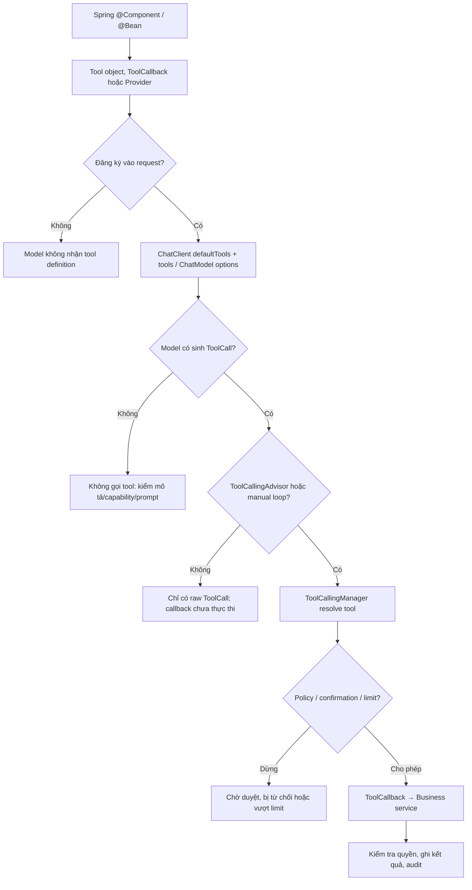

# Công cụ được tạo thành bean nhưng không có trong yêu cầu

Một tình huống phổ biến khi tích hợp Spring AI là Spring Boot khởi động bình thường, `@Component` hoặc `@Bean` của công cụ xuất hiện trong `ApplicationContext`, nhưng trợ lý vẫn không gọi công cụ. Trong trace của request, danh sách tool definitions trống; đôi khi mô hình trả lời bằng kiến thức tự có, đôi khi nó trả một tool call không thể giải quyết. Vấn đề thường **không nằm ở dependency injection**, mà nằm ở ranh giới giữa **bean đã được Spring tạo** và **tool thực sự được đính vào request gửi mô hình**.

Trong module `SPRING_AI_TOOL_CALLING`, `@Tool`, `ToolCallback`, JSON schema và `ToolContext` giúp ứng dụng công bố và thực thi khả năng nghiệp vụ. Tuy nhiên, mô hình chỉ nhìn thấy những định nghĩa được ứng dụng đăng ký cho lượt gọi tương ứng. Ứng dụng vẫn sở hữu việc chọn tool nào được phép xuất hiện, kiểm tra quyền lúc callback chạy, xử lý lỗi, confirmation và quan sát nhiều vòng gọi.

Bài học tập trung vào Spring AI **2.1.0** (các phiên bản 1.x/2.0 có khác biệt được chỉ ra riêng). Mục tiêu là chẩn đoán có chứng cứ từ Spring context đến request, phân biệt lỗi **không đăng ký**, **không được model chọn** và **được chọn nhưng không chạy**, rồi khắc phục mà không bật cơ chế truy xuất công cụ toàn cục gây rủi ro bảo mật.

## 1. Kết luận nhanh: bean có mặt không có nghĩa tool được công bố

Xét ví dụ:

```java
@Component
public class WeatherTools {

    @Tool(description = "Tra cứu nhiệt độ của thành phố")
    public String currentWeather(String city) {
        return "23 °C (dữ liệu mô phỏng)";
    }
}
```

Và một client được tạo như sau:

```java
@Service
public class WeatherAssistant {

    private final ChatClient client;

    public WeatherAssistant(ChatClient.Builder builder) {
        this.client = builder.build();
    }

    public String answer(String question) {
        return client.prompt()
                .user(question)
                .call()
                .content();
    }
}
```

`WeatherTools` có thể là bean hợp lệ, nhưng đoạn mã thứ hai **không đưa bean đó vào tool set** của `ChatClient`. `@Component` cho Spring biết tạo đối tượng; `@Tool` cung cấp metadata để Spring AI tạo callback **khi đối tượng được chuyển qua cơ chế đăng ký**; hai annotation này không tự động làm mọi request có tool definition.

Sửa theo hai cách chính: **đăng ký trên mỗi lượt** bằng `.tools(weatherTools)` hoặc **đăng ký mặc định cho một ChatClient cụ thể** bằng `.defaultTools(weatherTools)`. Việc lựa chọn còn phụ thuộc quyền hạn của caller và tính chất chỉ đọc/ghi của tool.

## 2. Phân biệt bốn tầng kiểm chứng

| Tầng | Câu hỏi | Cách kiểm chứng | Chỉ ra lỗi gì? |
|---|---|---|---|
| **Spring bean** | Đối tượng có tồn tại trong `ApplicationContext`? | `getBean(...)` / injection | Lỗi component scan, profile, condition |
| **ToolCallback** | Từ đối tượng có tạo ra định nghĩa tool hợp lệ không? | `ToolCallbacks.from(bean)`, kiểm `name` và `inputSchema` | Thiếu `@Tool`, factory sai, schema lỗi |
| **Request tool set** | Tool có được đính vào đúng request/model invocation không? | Kiểm `ToolCallingChatOptions.getToolCallbacks()` trước gửi model | Quên `.tools`/`.defaultTools`, override, sai client |
| **Execution path** | Model có yêu cầu tool và loop có chạy callback không? | `ChatResponse.hasToolCalls()`, spy callback, manager/trace | Model không chọn, advisor tắt, permission/limit/confirmation |

Một thao tác chẩn đoán nên đi **theo thứ tự từ trái sang phải**. Nếu request không hề chứa tool definition, việc sửa prompt kiểu “Bạn nhất định phải gọi tool” thường không giải quyết nguyên nhân gốc.

## 3. Sơ đồ đường đi của công cụ



Sơ đồ không hàm ý Spring Boot tự quét mọi `@Tool` bean rồi thêm vào `ChatClient`. Một tool có thể **hiện diện trong resolver** nhưng vẫn **không được phép xuất hiện hoặc thực thi** trong request vì fallback mặc định tắt.

## 4. Bước 1 — xác nhận bean ở đúng ApplicationContext

Nếu Spring không tạo được bean, không có gì để đưa vào request. Một số nguyên nhân:

- Class nằm ngoài component scan của Spring Boot.
- Chưa có `@Component` / `@Service` / `@Configuration` hay khai báo `@Bean` tương ứng.
- `@Profile`, `@ConditionalOnProperty`, `@ConditionalOnClass` không thỏa.
- Context của test slice không nạp bean như context production.
- Hai `ApplicationContext` khác nhau: parent/child, test context hoặc module triển khai riêng.
- Bean tạo thành proxy hoặc factory object khác loại bạn đang tìm.

Kiểm tra bằng injection mạnh hơn suy luận từ log “Created bean”:

```java
@SpringBootTest
class WeatherToolsBeanTest {

    @Autowired
    ApplicationContext applicationContext;

    @Test
    void weatherToolObjectExists() {
        assertThat(applicationContext
                .getBeansOfType(WeatherTools.class))
                .isNotEmpty();
    }
}
```

Có bean **chỉ chứng minh dependency injection thành công**. Đừng dừng chẩn đoán ở đây; tiếp tục kiểm tra callback và request tools.

## 5. Bước 2 — có thật sự có phương thức @Tool?

Một class được quản lý bởi Spring không mặc nhiên là một tool. Ví dụ:

```java
@Component
class CustomerService {
    public CustomerInfo getCustomer(String customerId) {
        return repository.find(customerId);
    }
}
```

Method này là business service bình thường; muốn công bố bằng cách khai báo thì thêm `@Tool` vào một wrapper phù hợp:

```java
@Component
public class CustomerLookupTools {

    private final CustomerService customers;

    public CustomerLookupTools(CustomerService customers) {
        this.customers = customers;
    }

    @Tool(name = "get_customer",
          description = "Chỉ đọc thông tin một khách hàng trong tenant hiện tại.")
    public CustomerView getCustomer(
            @ToolParam(description = "Mã khách hàng") String customerId,
            ToolContext context) {

        String tenantId = requireTrustedTenant(context);
        return customers.getCustomerForTenant(tenantId, customerId);
    }
}
```

`CustomerService`, `CustomerView` và `requireTrustedTenant` là mã ứng dụng minh họa. Không nhận `tenantId` từ model-generated JSON để tự trao quyền; `ToolContext` nên nhận dữ liệu đã xác thực từ server.

Một method có `@Tool` nhưng bị trỏ đến **bean khác instance**, không có trong tập được quét qua `ToolCallbacks.from(...)`, cũng không được công bố.

## 6. Bước 3 — kiểm tra ToolCallback được tạo

Spring AI cung cấp `ToolCallbacks.from(...)` chuyển object có phương thức `@Tool` thành mảng `ToolCallback`. Đây là phép kiểm tra độc lập trước khi gọi model:

```java
ToolCallback[] callbacks = ToolCallbacks.from(weatherTools);

assertThat(callbacks).hasSize(1);

assertThat(callbacks[0].getToolDefinition().name())
        .isEqualTo("currentWeather");

assertThat(callbacks[0].getToolDefinition().inputSchema())
        .contains("city");
```

`weatherTools` phải là đúng bean đã được inject. Nếu callback count là 0 hoặc factory báo lỗi, kiểm tra annotation, object được truyền, method signatures và phiên bản Spring AI. Nếu có nhiều `@Tool` methods, mỗi method được chuyển thành một callback tương ứng.

Một số lỗi chỉ xuất hiện khi callback factory xây schema: không suy luận mọi lỗi từ model/provider. Cần xem thông báo lỗi ở **thời điểm tạo callback** trước khi thử gửi request.

## 7. Ba cách thể hiện công cụ, một điểm đăng ký

Spring AI 2.1 hỗ trợ các kiểu đầu vào:

| Kiểu | Ví dụ | Cách đưa vào ChatClient |
|---|---|---|
| Object có phương thức `@Tool` | `WeatherTools` | `.tools(weatherTools)` |
| `ToolCallback` tạo tường minh | `FunctionToolCallback` / `MethodToolCallback` | `.tools(weatherCallback)` |
| `ToolCallbackProvider` | Provider cung cấp mảng callbacks | `.tools(provider)` |
| Array/collection phối hợp | Nhiều object và callbacks | `.tools(readTools, provider, callback)` |

`.tools(...)` và `.defaultTools(...)` nhận các kiểu tương ứng. Không cần ép mọi tool thành method annotation: nếu tool được tạo động hoặc đại diện dịch vụ ngoài, provider/callback có thể phù hợp hơn.

Tuy nhiên, **đăng ký dưới dạng bean** và **đính kèm vào request** là hai việc riêng biệt dù callback đã tồn tại.

## 8. Khắc phục cách A: .tools(...) trên mỗi request

Dùng khi quyền hoặc use case của từng request quyết định danh mục khả dụng:

```java
@RestController
class WeatherController {

    private final ChatClient chatClient;
    private final WeatherTools weatherTools;

    WeatherController(
            ChatClient.Builder builder,
            WeatherTools weatherTools) {
        this.chatClient = builder.build();
        this.weatherTools = weatherTools;
    }

    @GetMapping("/weather")
    String ask(@RequestParam String city) {
        return chatClient.prompt()
                .user("Nhiệt độ ở " + city + " thế nào?")
                .tools(weatherTools)
                .call()
                .content();
    }
}
```

Ở đây object được Spring inject và **được gắn trực tiếp vào request**. Nếu request đi qua một nhánh code khác không gọi `.tools(weatherTools)`, model ở nhánh đó vẫn không có định nghĩa.

Ưu điểm: dễ áp dụng whitelist, per-request permission, tenant filtering; tránh lộ tool ghi khi không cần. Tool ghi vẫn phải re-check authorization tại callback/service, không chỉ dựa vào danh mục đã gắn.

## 9. Khắc phục cách B: .defaultTools(...) khi tạo ChatClient

Nếu tool thật sự cần hiện diện trong **mọi request của một ChatClient cụ thể**, đăng ký tại builder:

```java
@Configuration(proxyBeanMethods = false)
class AssistantClientConfiguration {

    @Bean
    ChatClient weatherChatClient(
            ChatClient.Builder builder,
            WeatherTools weatherTools) {

        return builder
                .defaultTools(weatherTools)
                .build();
    }
}
```

`WeatherTools` vẫn phải là bean hoặc object hợp lệ; tuy nhiên khác biệt quyết định nằm ở lệnh `defaultTools(weatherTools)`. Các request được xây từ `weatherChatClient` sẽ có tool đó mà không cần lặp `.tools(...)`.

**Không dùng defaultTools cho mọi công cụ ghi nguy hiểm.** Nếu có `cancelOrder`, `transferMoney` hoặc `grantRole`, nên chỉ gắn chúng ở request/workflow đủ điều kiện. Một client dùng chung nhiều actor không nên có destructive defaults không thể tách theo quyền.

## 10. .tools() cộng với .defaultTools(), không thay thế

Trong `ChatClient` của Spring AI 2.1, request-level `.tools(...)` **bổ sung** vào client defaults. Ví dụ:

```java
ChatClient client = ChatClient.builder(chatModel)
        .defaultTools(publicFaqTools)
        .build();

String answer = client.prompt()
        .user(question)
        .tools(orderLookupTools)
        .call()
        .content();
```

Danh sách hiệu lực là **hợp** của hai nhóm trong request này. Đừng hiểu `.tools(orderLookupTools)` là “xóa mọi default rồi chỉ giữ order tool”. Điều này rất quan trọng khi phân quyền: tool ghi trong default có thể vẫn được công bố ở request chỉ đọc.

Ngược lại, nếu developer tạo một `ChatClient.builder(chatModel).build()` **khác** tại controller thay vì inject bean `client` cấu hình ở trên, defaults của client cũ không tự lan sang instance mới.

## 11. Nhiều ChatClient: cấu hình đúng client nhưng gọi sai instance

Một nguồn lỗi thường gặp:

```java
@Bean
ChatClient orderClient(
        ChatClient.Builder builder,
        OrderTools orderTools) {
    return builder.defaultTools(orderTools).build();
}
```

Nhưng handler lại viết:

```java
public OrderController(ChatModel chatModel) {
    this.client = ChatClient.create(chatModel); // Client khác, không có orderTools
}
```

Spring context có bean `orderClient`, nhưng request đi qua `ChatClient.create(...)` không dùng bean ấy. Cách sửa là inject **đúng instance**:

```java
public OrderController(@Qualifier("orderClient") ChatClient client) {
    this.client = client;
}
```

Khi có nhiều `ChatClient` hoặc nhiều `ChatModel`, dùng `@Qualifier`, constructor injection và integration test tại **đường request thật** để biết client nào được sử dụng. Không chỉ assert bean tồn tại trong configuration.

## 12. ChatClient.Builder auto-configured và builder tạo tay

Spring Boot có thể cung cấp `ChatClient.Builder` prototype-scoped. Builder được inject trong controller không tự nhận danh sách tool từ mọi `@Component` trong ứng dụng.

Các đoạn sau **không tương đương**:

```java
// Builder có thể nhận autoconfiguration/customizers của Spring Boot.
ChatClient clientA = injectedBuilder
        .defaultTools(weatherTools)
        .build();

// Builder dựng trực tiếp từ ChatModel, không tự nhận công cụ của clientA.
ChatClient clientB = ChatClient.builder(chatModel).build();

// Cũng là client mới, không kế thừa defaultTools của clientA.
ChatClient clientC = ChatClient.create(chatModel);
```

Khi tạo nhiều client cho nhiều model/provider, `ChatClientBuilderConfigurer` có thể giúp giữ customizers/observability từ Spring Boot auto-configuration. Nhưng **ngay cả khi customizers được áp dụng**, tool set vẫn cần được đăng ký đúng client/request theo chính sách.

## 13. ToolCallback bean: có trong resolver không có nghĩa trong request

Một biến thể khác:

```java
@Configuration
class WeatherToolConfiguration {

    @Bean
    ToolCallback currentWeatherTool(WeatherService weatherService) {
        return FunctionToolCallback.builder(
                    "currentWeather",
                    weatherService::getWeather)
                .description("Tra cứu thời tiết theo thành phố")
                .inputType(WeatherRequest.class)
                .build();
    }
}
```

`ToolCallback` bean có thể được đưa vào `StaticToolCallbackResolver` do Spring Boot auto-configure. Nhưng Spring AI 2.1 **không tự gắn toàn bộ callback beans vào mỗi ChatClient request**. Vẫn cần:

```java
@Bean
ChatClient weatherChatClient(
        ChatClient.Builder builder,
        ToolCallback currentWeatherTool) {

    return builder.defaultTools(currentWeatherTool).build();
}
```

Với bean là `ToolCallbackProvider` cũng vậy: provider có thể trả callbacks nhưng nếu không được gắn vào request/ChatClient, model không tự nhìn thấy chúng.

## 14. ToolCallbackProvider không được giải phóng nghĩa vụ đăng ký

Khi tool được tạo bởi một provider:

```java
@Bean
ToolCallbackProvider reportingProvider(ToolCallback reportCallback) {
    return ToolCallbackProvider.from(reportCallback);
}

@Bean
ChatClient reportingClient(
        ChatClient.Builder builder,
        ToolCallbackProvider reportingProvider) {

    return builder.defaultTools(reportingProvider).build();
}
```

`ToolCallbackProvider.getToolCallbacks()` trả mảng callbacks. Để chẩn đoán số tool thực, có thể kiểm:

```java
ToolCallback[] provided = reportingProvider.getToolCallbacks();

assertThat(provided)
        .extracting(c -> c.getToolDefinition().name())
        .contains("generateReport");
```

Ở ví dụ này, `reportCallback` phải thật sự có tool name `generateReport`; assertion chỉ đúng nếu fixture tạo callback tương ứng. Nếu provider trả mảng rỗng do cấu hình/kết nối, việc inject provider thành công vẫn không chứng minh có công cụ khả dụng.

## 15. Spring AI 2.x khác cách dùng Function bean của bản cũ

Một ví dụ cũ từ Spring AI 1.x có thể là:

```java
@Bean
Function<WeatherRequest, WeatherResponse> weatherFunction() {
    return weatherService::getWeather;
}
```

Sau đó code cũ dựa vào tên bean để model gọi qua `toolNames(...)` hoặc cơ chế Spring-bean function resolution. Với Spring AI 2.0+, `SpringBeanToolCallbackResolver` và `toolNames()` cũ đã bị loại bỏ. Một `Function` bean trần **không tự trở thành ToolCallback** trong request.

Cần chuyển sang callback tường minh:

```java
@Bean
ToolCallback weatherTool(WeatherService service) {
    return FunctionToolCallback.builder(
                "currentWeather",
                service::getWeather)
            .description("Xem thời tiết thành phố")
            .inputType(WeatherRequest.class)
            .build();
}
```

Rồi đính kèm `.tools(weatherTool)` hoặc `.defaultTools(weatherTool)`. Khi migrate, dùng tài liệu đúng version; đừng thử “sửa” bằng cách dùng lại API `defaultFunctions(...)` / `functions(...)` / `toolNames(...)` từ ví dụ 1.x.

## 16. ChatModel trực tiếp không đồng nghĩa ChatClient

Nếu application dùng API cấp thấp:

```java
ChatResponse response = chatModel.call(
        new Prompt("Thời tiết Hà Nội?"));
```

Thì không có danh sách tool được đính kèm, trừ khi `ChatModel` có model default options thích hợp. Dù model trả tool call, trong Spring AI 2.x `ChatModel` trực tiếp **không chạy callback tự động**.

Để gửi định nghĩa, dùng `ToolCallingChatOptions`:

```java
ToolCallback[] callbacks = ToolCallbacks.from(weatherTools);

ToolCallingChatOptions options =
        ToolCallingChatOptions.builder()
                .toolCallbacks(callbacks)
                .build();

Prompt prompt = new Prompt("Thời tiết Hà Nội?", options);
ChatResponse response = chatModel.call(prompt);

if (response.hasToolCalls()) {
    // Application phải gọi ToolCallingManager và tự xử lý history/loop.
}
```

Đây là ví dụ cho interface options phổ quát; một số provider triển khai model options cụ thể, nên cần kiểm tra builder/options type được provider sử dụng. Không suy luận từ việc model trả tool call rằng code `ChatModel.call(...)` đã thực thi tool.


## 17. Override semantics ở ChatModel có thể làm tool “biến mất”

`ChatClient` và `ChatModel` có semantics khác nhau khi kết hợp default tools với request tools:

| API | Cấu hình mặc định | Cấu hình ở request | Tool hiệu lực |
|---|---|---|---|
| `ChatClient` | `.defaultTools(a)` | `.tools(b)` | `a + b` |
| `ChatModel` | Model default `toolCallbacks(a)` | Request options `toolCallbacks(b)` | **`b` thay `a`** |
| `ChatModel` | Model default có tools | Request không override options | Có thể dùng defaults của model |
| `ChatModel` | Model default có tools | Request options override khác | Phải kiểm tra chính xác semantics của options/provider |

Ví dụ:

```java
// Giả sử model mặc định có 5 tool callbacks.
// Khi truyền request options dưới đây:
ToolCallingChatOptions requestOptions =
        ToolCallingChatOptions.builder()
                .toolCallbacks(ToolCallbacks.from(orderTools))
                .build();

ChatResponse response = chatModel.call(
        new Prompt("Tra cứu đơn hàng", requestOptions));
```

Model theo hợp đồng thấy tool callbacks của `requestOptions`, **không cộng 5 tool mặc định**. Nếu muốn giữ cả hai nhóm khi dùng `ChatModel`, hãy gộp danh sách tường minh trước khi tạo request options.

Đây là một nguyên nhân “tool có bean, có cả model default, nhưng biến mất trong lượt này” rất dễ bỏ sót khi chuyển từ `ChatClient` sang API cấp thấp.

## 18. Không đặt ToolCallback trong Prompt message rồi mong model nhận schema

Tool definition là metadata/options gửi đến provider, không phải chỉ một đoạn văn trong `SystemMessage`.

Ví dụ sau **không tương đương đăng ký tool**:

```java
ChatClient client = ChatClient.create(chatModel);

String answer = client.prompt()
        .system("Bạn có công cụ currentWeather(city). Hãy dùng khi cần.")
        .user("Thời tiết Đà Nẵng?")
        .call()
        .content();
```

Model có thể nhắc tên công cụ theo văn bản, nhưng provider **không nhận tool definition có JSON Schema tương ứng**. Cách đúng:

```java
String answer = client.prompt()
        .system("Nếu cần thời tiết mới nhất, dùng tool được cung cấp.")
        .user("Thời tiết Đà Nẵng?")
        .tools(weatherTools)
        .call()
        .content();
```

Prompt bổ trợ cho việc chọn tool, không thay đổi bề mặt API được gửi tới provider.

## 19. Một công cụ từ MCP server không tự có trong ChatClient

Spring AI MCP client có provider như `SyncMcpToolCallbackProvider` hoặc `AsyncMcpToolCallbackProvider`. Việc các bean ấy tồn tại và kết nối MCP server thành công **không đồng nghĩa công cụ MCP tự xuất hiện trong mọi ChatClient**.

Ví dụ khai báo tường minh:

```java
@Bean
ChatClient mcpChatClient(
        ChatClient.Builder builder,
        SyncMcpToolCallbackProvider mcpToolProvider) {

    return builder.defaultTools(mcpToolProvider).build();
}
```

Hoặc chỉ cung cấp cho request phù hợp:

```java
String answer = chatClient.prompt()
        .user(question)
        .tools(mcpToolProvider)
        .call()
        .content();
```

Spring AI 2.1 không tự nhét MCP providers vào `StaticToolCallbackResolver` mặc định vì việc liệt kê tools từ remote server có thể gây network round-trip ở startup. Vì vậy, nếu “MCP client kết nối được nhưng model không nhìn thấy tool”, hãy kiểm tra **provider có thực sự được đính vào request** và **remote provider trả callback nào** trước khi tìm lỗi ở model.

Nếu MCP server chưa sẵn sàng hoặc danh mục tool bị lọc theo kết nối/quyền, `getToolCallbacks()` có thể trả rỗng/lỗi. Không coi một MCP bean tồn tại là bằng chứng có thể gọi tool từ xa.

## 20. Đừng nhầm MCP server auto-registration với MCP client consumer

Hai đường khác nhau:

- **MCP server starter** có thể phát hiện `ToolCallback` beans hoặc `ToolCallbackProvider` beans để **công bố tool ra MCP clients**.
- **Ứng dụng dùng ChatClient để gọi model** phải đính kèm provider/callback mà model của request được phép thấy.

Một tool được một MCP server công bố thành công không có nghĩa `ChatClient` của ứng dụng khác tự dùng được nó. Phải có kết nối MCP client và danh mục callbacks đã đăng ký theo luồng của ứng dụng tiêu thụ.

Khi chẩn đoán, xác định chính xác đường: “Spring bean → MCP server” hay “MCP client provider → ChatClient → model”. Việc hai hệ thống đều dùng `ToolCallback` không loại bỏ bước cấu hình request.

## 21. ToolSearchToolCallingAdvisor cố ý không gửi catalog từ đầu

Một tình huống đặc biệt: bean và callbacks đã được đăng ký, nhưng trace của **model request đầu tiên** chỉ có `toolSearchTool`.

Nếu ứng dụng bật `ToolSearchToolCallingAdvisor`, đây có thể là hành vi **đúng thiết kế**, không phải lỗi. Với progressive tool disclosure:

1. Advisor lập chỉ mục công cụ theo session.
2. Lượt model đầu tiên chỉ được công bố công cụ tìm kiếm `toolSearchTool`.
3. Model yêu cầu tìm một capability.
4. `ToolIndex` trả định nghĩa phù hợp.
5. Advisor đưa tool được tìm thấy vào lượt sau.
6. Model mới gọi callback nghiệp vụ đó.

Nếu model không tìm thấy tool sau search, kiểm tra session ID, index strategy, query, tool name/description, top K, quyền và việc cache/eviction. **Không bật resolver fallback để sửa lỗi retrieval**, vì làm vậy có thể mở khả năng thực thi tool ngoài request whitelist.

## 22. ToolCallbackResolver fallback mặc định tắt

Spring AI 2.1 có `ToolCallbackResolver` tìm callback theo tên. Spring Boot thường cấu hình `StaticToolCallbackResolver` từ `ToolCallback` beans và `ToolCallbackProvider` beans (ngoại trừ nhóm MCP provider cần tránh eager remote discovery).

Tuy nhiên, từ Spring AI **2.0.1**, fallback thực thi công cụ vắng mặt trong request **mặc định là false**:

```yaml
spring:
  ai:
    tools:
      resolution:
        fallback:
          enabled: false
```

Khi false, model chỉ được thực thi công cụ thuộc tập callback của request. Bật `true` có thể cho phép manager phân giải theo tên một công cụ từ resolver **dù nó chưa được đính vào request**. Điều này rất nguy hiểm nếu resolver chứa công cụ xóa dữ liệu, cấp quyền hoặc chuyển tiền.

**Đây không phải cách nên dùng để “đưa bean vào model request”.** Resolver fallback liên quan đến **execution khi model gọi một tên chưa có trong request**, không tự sinh tool definitions để model nhìn thấy. Giải pháp chuẩn vẫn là gắn `.tools(...)`/`.defaultTools(...)` theo policy.

## 23. Model không chọn tool khác với model không biết tool

Giả sử đã xác minh `ToolCallingChatOptions.getToolCallbacks()` chứa `get_order_status`, nhưng model trả lời “Tôi không có thông tin”. Khi đó cần chẩn đoán **tool selection**, không phải bean registration.

Các nguyên nhân:

- Prompt không thực sự cần dữ liệu bên ngoài.
- Tên/description mơ hồ hoặc tương tự công cụ khác.
- Mô hình/provider/endpoint không hỗ trợ tool calling hoặc hỗ trợ một định dạng khác.
- Tool choice được cấu hình phía provider thành chế độ không dùng công cụ.
- Input schema quá phức tạp, bất hợp lệ hoặc có trường bắt buộc mà model không có dữ kiện.
- Prompt/history khiến model nhận định không cần gọi tool.
- Một custom advisor đã thay đổi options/danh sách tools theo iteration.
- Với progressive disclosure, model chưa tìm được tool qua `toolSearchTool`.

Quan sát hai dấu hiệu:

| Dấu hiệu | Hướng điều tra |
|---|---|
| Tool list gửi model **trống** | Wiring, client instance, options và advisor |
| Tool list **có**, nhưng `ChatResponse.hasToolCalls()==false` | Tool selection, model capabilities, prompt, schema |
| `hasToolCalls()==true`, callback count = 0 | Tool advisor/manager/confirmation/permission/limit |
| Callback count > 0, câu trả lời không dùng result | History, result conversion, `returnDirect`, final model response |

Không kết luận mọi trường hợp “model không gọi tool” là do Spring không tạo được bean.

## 24. ToolCallingAdvisor bị tắt: tool vẫn có trong request nhưng không chạy

`ChatClient` trong Spring AI 2.1 thường tự đăng ký `ToolCallingAdvisor`. Nếu tắt, mô hình vẫn có thể nhận tool definitions và trả raw tool calls, nhưng ứng dụng phải tự điều phối việc thực thi.

Các cách tắt:

```yaml
spring:
  ai:
    chat:
      client:
        tool-calling:
          enabled: false
```

Hoặc tại một request:

```java
ChatResponse raw = chatClient.prompt()
        .user("Kiểm tra trạng thái ORD-2048")
        .tools(orderTools)
        .advisors(AdvisorParams.toolCallingAdvisorAutoRegister(false))
        .call()
        .chatResponse();

if (raw.hasToolCalls()) {
    // Callback chưa chạy nếu không có user-controlled loop.
}
```

Đây là hành vi **có chủ đích** cho manual orchestration và evaluation. Khi gặp “bean có, tool call xuất hiện, không thấy kết quả”, kiểm tra advisor auto-registration và xem có mã `ToolCallingManager.executeToolCalls(...)` ở đường thủ công không.

Không bật cả auto loop và gọi manager lần nữa trên cùng response, vì có thể tạo double execution.

## 25. Tool metadata: tên và schema quyết định khả năng match

`@Tool` có `name` mặc định bằng tên method. Tên tool gửi provider phải **duy nhất trong tool set**. Nếu hai object đều có method `search` hoặc hai callbacks cùng `name`, việc kết hợp danh mục có thể bị từ chối hoặc gây nhầm lẫn.

Ví dụ nên đặt tên miền nghiệp vụ rõ ràng:

```java
@Tool(name = "order_lookup",
      description = "Chỉ đọc trạng thái một đơn hàng thuộc tenant hiện tại.")
public OrderView lookup(String orderId, ToolContext context) {
    // ...
}
```

Một số khác biệt phải kiểm:

- Java method là `currentWeather` nhưng `@Tool(name="getCurrentWeather")` đổi tool name.
- Model trả tên khác chữ hoa/chữ thường hoặc tên alias cũ.
- Input schema yêu cầu `city`, nhưng model trả `location`.
- Một method bị đổi tên khi deploy, conversation history vẫn dùng tên cũ.
- Một `ToolCallback` programmatic được build với name khác bean name.
- Danh mục gồm hai callbacks trùng tool name do nhiều provider.

**Tên bean không nhất thiết bằng tool name.** Kiểm trực tiếp `callback.getToolDefinition().name()` thay vì đoán từ `@Bean("...")`.

## 26. Công cụ được tạo theo điều kiện hoặc scope

Có trường hợp development chạy được nhưng test/prod không:

| Điều kiện | Triệu chứng | Khắc phục |
|---|---|---|
| `@Profile("dev")` | Production không tạo bean | Cấu hình profile, không tự bật dev tool ở production |
| `@ConditionalOnProperty` | Bean không xuất hiện khi thiếu property | Kiểm value/namespace/condition |
| Package ngoài `@SpringBootApplication` scan | Bean không được phát hiện | Đặt class đúng package hoặc explicit scan |
| Test `@WebMvcTest` không import config | Test context thiếu tool bean | Dùng `@SpringBootTest` hoặc import đúng bean |
| Request-scoped tool inject vào singleton | Thời điểm tạo/lifetime không phù hợp | Dùng đúng scope và proxy; truyền request context riêng |
| Lazy bean tạo khi đã build client | Client được build trước khi đăng ký tool object | Tạo client với bean/provider đã có hoặc đăng ký theo request |
| Client khác lấy từ một context khác | Cấu hình không đồng bộ | Inject đúng instance/context |

Không dùng global fallback hoặc scan toàn classpath như biện pháp sửa mặc định. Một bean bị intentionally disabled vì profile/security không nên được bypass để tool xuất hiện.

## 27. Bean được tạo nhưng MethodToolCallback không được build đúng

Khi không dùng `@Tool` mà dùng `MethodToolCallback`, cần cung cấp method và target object đúng:

```java
Method method = ReflectionUtils.findMethod(
        WeatherTools.class, "currentWeather", String.class);

MethodToolCallback callback = MethodToolCallback.builder()
        .toolDefinition(ToolDefinitions.builder(method)
                .description("Tra cứu thời tiết theo thành phố")
                .build())
        .toolMethod(method)
        .toolObject(weatherTools)
        .build();
```

Nếu instance method không có `toolObject(...)`, callback không thể được gọi đúng. Nếu chọn sai overload, schema/argument mapping có thể không đúng. Với dynamic tools, hãy ghi tên, description và JSON schema từ callback sau khi xây dựng.

`MethodToolCallback` vẫn cần được gắn vào `.tools(callback)` hoặc `.defaultTools(callback)`. Bean target object hợp lệ không thay thế bước ấy.

## 28. Trong GraalVM native image, bean có thêm một ý nghĩa khác

Tài liệu Spring AI 2.1 lưu ý: khi build GraalVM native image, class chứa `@Tool` methods nên là Spring bean (ví dụ `@Component`); nếu không, cần khai báo reflection hint như `@RegisterReflection(memberCategories = MemberCategory.INVOKE_DECLARED_METHODS)`.

Điều này **không đảo ngược quy tắc request registration**. Class là Spring bean có thể giúp khả năng reflection trong native image, nhưng developer vẫn cần đưa tool object/callback vào `ChatClient`/`ChatModel` options.

Nếu ứng dụng chạy JVM bình thường nhưng native binary không tạo được callback, kiểm tra AOT/reflection configuration và bản build native trước khi đổ lỗi cho provider.

## 29. Tool result xuất hiện trong log chưa chắc tool được gọi ở request này

Khi dùng Session Memory hoặc lịch sử hội thoại, một `ToolResponseMessage` từ lượt cũ có thể tồn tại trong prompt. Điều này không có nghĩa callback vừa chạy lại.

Tương tự, model có thể nói “Lần trước tôi đã dùng get_order_status” dựa trên context. Phân biệt:

- **Historical tool call/result**: message được replay để cung cấp context.
- **Current model tool request**: một `AssistantMessage.ToolCall` trong response mới.
- **Current callback dispatch**: manager/callback invocation thực sự ở request hiện tại.
- **Business commit**: domain operation đã hoàn tất.

Không dựa vào một chuỗi trong history để kết luận tool đang được gắn vào request **mới**. Kiểm tra options của model invocation mới và callback spy cho lượt hiện tại.

## 30. Cách kiểm tra tool definitions trong Prompt của model

Một phép thử đáng tin là dùng fake `ChatModel` để bắt `Prompt` mà `ChatClient` thực sự gửi. Mục đích là xác minh **request tools**, không đánh giá model có quyết định chọn tool hay không.

```java
ChatModel model = mock(ChatModel.class);
when(model.call(any(Prompt.class))).thenReturn(
        new ChatResponse(List.of(
                new Generation(new AssistantMessage("Không cần dùng tool.")))));

ChatClient client = ChatClient.builder(model).build();

client.prompt()
        .user("Tra cứu thời tiết hiện tại")
        .tools(weatherTools)
        .call()
        .content();

ArgumentCaptor<Prompt> captor = ArgumentCaptor.forClass(Prompt.class);
verify(model).call(captor.capture());

ChatOptions options = captor.getValue().getOptions();
assertThat(options).isInstanceOf(ToolCallingChatOptions.class);

List<ToolCallback> attached =
        ((ToolCallingChatOptions) options).getToolCallbacks();

assertThat(attached)
        .extracting(t -> t.getToolDefinition().name())
        .contains("currentWeather");
```

Đây là unit/integration sketch dùng JUnit 5 + Mockito + AssertJ; các import được lược bỏ. Nếu model mock trả final reply, advisor không chạy callback nên phép thử tập trung vào **tool set truyền cho model**. Nếu options của provider có kiểu cụ thể, nó thường implement `ToolCallingChatOptions`; hãy chọn đúng fake/provider adapter cho test.

Có thể thêm negative test: gọi cùng client **không** có `.tools(weatherTools)` và không có defaults, rồi assert danh sách tool của request không chứa `currentWeather`. Tránh giả định mock trả lời câu đúng là bằng chứng tool thực sự được đăng ký.


## 31. Kiểm thử phép cộng tools của ChatClient

Để phòng hồi quy, dùng **hai** tool callback với tên khác nhau và xác minh chúng cùng có mặt:

```java
ToolCallback weather = /* callback tên currentWeather */;
ToolCallback faq = /* callback tên getPublicFaq */;

ChatClient client = ChatClient.builder(fakeModel)
        .defaultTools(faq)
        .build();

client.prompt()
        .user("Cho tôi thời tiết")
        .tools(weather)
        .call()
        .content();

ArgumentCaptor<Prompt> promptCaptor =
        ArgumentCaptor.forClass(Prompt.class);

verify(fakeModel).call(promptCaptor.capture());

ToolCallingChatOptions effective =
        (ToolCallingChatOptions) promptCaptor.getValue().getOptions();

assertThat(effective.getToolCallbacks())
        .extracting(c -> c.getToolDefinition().name())
        .contains("getPublicFaq", "currentWeather");
```

`weather` và `faq` là fixtures dựng từ `FunctionToolCallback` hoặc `ToolCallbacks.from`. Fake model trả câu trả lời không yêu cầu tool. Test này chứng minh `ChatClient` gộp defaults và request tools; không cần model thật.

Với `ChatModel` options, viết test ngược: request `toolCallbacks(weather)` sẽ **thay thế** default callbacks ở model, theo contract của đường cấp thấp.

## 32. Test cả “không có tool” lẫn “không thực thi tool”

Hai phép thử có cùng kết quả callback count = 0 nhưng nguyên nhân khác nhau:

**Test A — thiếu request registration:**

```java
ChatClient client = ChatClient.builder(fakeModel).build();

client.prompt()
        .user("Tra thời tiết mới nhất")
        .call()
        .content();

assertThat(capturedToolNames()).doesNotContain("currentWeather");
verify(weatherService, never()).getWeather(any());
```

**Test B — đã đăng ký nhưng tắt execution loop:**

```java
ChatResponse raw = client.prompt()
        .user("Tra thời tiết mới nhất")
        .tools(weatherTools)
        .advisors(AdvisorParams.toolCallingAdvisorAutoRegister(false))
        .call()
        .chatResponse();

assertThat(capturedToolNames()).contains("currentWeather");
// Nếu fake model cố ý trả ToolCall:
assertThat(raw.hasToolCalls()).isTrue();
verify(weatherService, never()).getWeather(any());
```

`capturedToolNames()` là helper của test đọc options của `Prompt` đã capture, không phải API Spring AI mặc định. Test B cần script fake model trả một `AssistantMessage.ToolCall`; nếu fake model trả final text thì `hasToolCalls()` sẽ false dù tool đã được đăng ký.

Điểm muốn đo: **tool visibility** khác **tool execution**. Đừng chỉ xem callback spy rồi kết luận tool không có trong request.

## 33. Khi đã có tool call nhưng manager không tìm thấy callback

Giả sử raw response chứa:

```json
{
  "id": "call_700",
  "type": "function",
  "name": "lookupWeather",
  "arguments": "{\\"city\\":\\"Ha Noi\\"}"
}
```

Trong khi `ToolDefinition.name()` là `currentWeather`. Đây là **name mismatch**. Dù bean WeatherTools tồn tại, manager chỉ có thể resolve tool theo tên phù hợp trong callback set (hoặc resolver fallback nếu được bật có chủ đích).

Kiểm tra:

1. Tool names trong `Prompt` đã gửi model.
2. `AssistantMessage.ToolCall.name()` model trả về.
3. Tool names thực có trong `ToolCallback[]` của request.
4. Catalog version, alias và tool description.
5. Có hay không custom tool renaming/index layer.
6. Khi gọi manual manager, `Prompt` truyền vào có đúng tool options của chính lần model phát tool call đó không.

Không sửa bằng cách đổi `name` ngẫu nhiên trên callback khi có paused reply hoặc history còn dùng contract cũ; cần xử lý version/alias an toàn và không chạy destructive tool sai tên.

## 34. Đọc logs theo đúng điểm quan sát

Một sơ đồ log an toàn:

```text
STARTUP:
  toolBeanPresent=true
  toolCallbackNames=[currentWeather, getPublicFaq]

REQUEST:
  traceRef=abc...
  chatClientRef=weather-assistant
  attachedToolCount=1
  attachedToolNames=[currentWeather]

MODEL:
  toolCallCount=0
  finishReason=STOP

EXECUTION:
  callbackAttemptCount=0
  businessEffectCount=0
```

Từ dữ liệu trên kết luận: bean có, request có tool, model **không yêu cầu** tool. Không thể kết luận “đăng ký thất bại”.

Một log khác:

```text
REQUEST:
  attachedToolCount=0
  attachedToolNames=[]
MODEL:
  toolCallCount=0
```

Kết luận: trước hết sửa wiring/client/options; prompt engineering không giải quyết gốc.

Không log raw tool arguments/results hoặc prompt chứa PII và secrets. `spring.ai.tool` observations thường xuất hiện **khi tool thực thi**, không có span không đồng nghĩa tool không được gửi lên model. Tracing có sampling; nơi kiểm chứng hợp đồng tốt hơn là test capture `Prompt`.

## 35. Checklist chẩn đoán từ nhanh đến sâu

| Bước | Phép kiểm | Nếu fail |
|---|---|---|
| 1 | Bean có trong đúng `ApplicationContext`? | Component scan/condition/profile/context |
| 2 | Object có `@Tool` đúng method hoặc callback bean hợp lệ? | Thêm annotation/chỉnh factory |
| 3 | `ToolCallbacks.from(bean)` có definitions đúng tên/schema? | Sửa metadata, method/signature |
| 4 | Handler gọi đúng `ChatClient` instance đã cấu hình? | Constructor/`@Qualifier`/builder |
| 5 | Request thực tế có `.tools(...)` hoặc client có `.defaultTools(...)`? | Đăng ký đúng ở request |
| 6 | Có runtime options nào thay model defaults? | Gộp callbacks tường minh cho `ChatModel` |
| 7 | Có Tool Search advisor không? | Kiểm `toolSearchTool`/index/session |
| 8 | Prompt thật gửi provider có tool definitions? | Capture `Prompt`/options ở model boundary |
| 9 | Model có tạo `ToolCall` không? | Kiểm description, support, prompt/choice |
| 10 | `ToolCallingAdvisor` có tự chạy không? | Kiểm opt-out, property, custom advisor |
| 11 | Manager tìm đúng name và được phép gọi không? | Resolver, name collision, policy |
| 12 | Callback có trả result, error hoặc paused reply không? | Exception processor, confirmation, limit |
| 13 | Với tool ghi, có permission và idempotency không? | Không được chỉ “bật lên cho chạy” |

Đi từng bước làm giảm rủi ro chẩn đoán nhầm giữa wiring, model selection và execution. Một request “không có tool trong model options” nên được giải quyết ở bước 4–8, không ở tầng business callback.

## 36. Ba ví dụ chẩn đoán thực tế

### 36.1. OrderTools có @Component nhưng controller quên .tools()

**Triệu chứng:** `ApplicationContext.getBeansOfType(OrderTools.class)` có một bean; model chỉ trả câu trả lời chung, không có `get_order_status` tool definition.

**Nguyên nhân:** Controller build client mà không có `.defaultTools(orderTools)`, request cũng không gọi `.tools(orderTools)`.

**Sửa:** Inject `OrderTools` vào workflow read-only và đăng ký per-request; viết test capture `Prompt` để bảo đảm `get_order_status` hiện diện. Tránh đăng ký `cancel_order` làm default nếu cùng bean chứa method ghi; tách tool provider hoặc lọc callback theo quyền.

### 36.2. Function bean từ ví dụ Spring AI 1.x

**Triệu chứng:** `@Bean Function<WeatherRequest, WeatherResponse>` tồn tại nhưng provider không thấy bất kỳ tool nào. Developer tìm mã `toolNames("weatherFunction")` cũ.

**Nguyên nhân:** API bean-function name resolver không còn là cách đăng ký trong Spring AI 2.1.

**Sửa:** Tạo `FunctionToolCallback` bean với name, description, input type rồi gọi `.tools(callback)`. Test cả `callback.getToolDefinition()` và `Prompt.options`.

### 36.3. MCP provider đã kết nối nhưng tool chưa được khám phá

**Triệu chứng:** MCP client bean hoạt động, nhưng model request đầu không chứa tool MCP.

**Nguyên nhân có thể:** Provider chưa được gắn vào `ChatClient`; hoặc ứng dụng bật `ToolSearchToolCallingAdvisor` khiến lần đầu chỉ có `toolSearchTool`.

**Sửa:** Nếu dùng thường, gắn provider bằng `.tools(mcpProvider)`/`.defaultTools(mcpProvider)`. Nếu dùng Tool Search, kiểm index/session ID và search round trước khi yêu cầu tool nghiệp vụ. Trong mọi trường hợp, không bật global execution fallback để giả vờ tool đã được công bố.

## 37. Những anti-pattern cần tránh

| Anti-pattern | Vì sao sai | Phương án thay thế |
|---|---|---|
| “Có @Component thì mọi model thấy method” | Bean lifecycle ≠ tool registration | `.tools`/`.defaultTools` tường minh |
| “Thêm tên tool vào system prompt” | Không có provider tool schema | Đính kèm `ToolCallback` |
| “Bật fallback=true để sửa mất tool” | Có thể cho chạy destructive tool ngoài whitelist | Sửa đăng ký, giữ fallback false |
| “Đăng ký toàn bộ tools làm default” | Dễ lộ tool ghi và vi phạm quyền | Per-request catalog theo actor/workflow |
| “Test chỉ kiểm bean tồn tại” | Không biết request options | Capture `Prompt` và callback names |
| “Callback count=0 nghĩa tool vắng mặt” | Model có thể không chọn hoặc advisor tắt | Quan sát model tool calls và request tools riêng |
| “ToolCallbackProvider bean tự nạp vào ChatClient” | Provider cần được gắn rõ | Inject provider vào builder/request |
| “Dùng ChatModel rồi chờ auto loop” | 2.x không tự execute | ChatClient hoặc manual manager |
| “Model default tools và request tools luôn cộng” | Chỉ đúng ChatClient, không đúng ChatModel | Gộp tường minh khi dùng ChatModel |
| “MCP auto-config sẽ tự gửi tools cho model” | MCP server/client có role khác nhau | Kiểm đường provider→request |
| “Trace không có tool span nghĩa tool không có trong request” | Tool span chỉ xuất hiện khi execution và sampling có thể mất | Kiểm options/definitions |
| “Dùng một bean cho cả tool đọc và ghi ở mọi workflow” | Model có thể chọn hành động không phù hợp | Tách provider/whitelist, auth & confirmation |

## 38. Checklist trước khi xác nhận đã sửa lỗi

- `@Tool` methods hoặc `ToolCallback` definitions đúng tên, description và schema.
- Bean được Spring tạo trong **đúng** context/profile của ứng dụng đang phục vụ request.
- Callback factory `ToolCallbacks.from(...)` hoặc provider trả đúng danh sách nonempty.
- Request handler dùng đúng `ChatClient` và đúng `ChatClient.Builder` đã cấu hình.
- `.tools(...)` hoặc `.defaultTools(...)` được gắn ở tầng có quyền tương ứng.
- Nếu có nhiều `ChatClient`, có `@Qualifier` và test xác minh routing.
- Nếu dùng `ChatModel` trực tiếp, request options chứa callbacks và manual loop là chủ sở hữu execution.
- Đã xác minh sự khác nhau giữa `ChatClient` additive tools và `ChatModel` override defaults.
- Không nhầm Tool Search progressive disclosure là mất tool; index/session/search được cấu hình đúng.
- Không sử dụng global fallback để bypass whitelist; property vẫn false trừ khi có quyết định bảo mật đã review.
- Model/provider có khả năng tool calling và không bị tool-choice “none” theo cấu hình cụ thể.
- Tool name/callback name thống nhất; không trùng tên hoặc schema bất hợp lệ.
- Auto `ToolCallingAdvisor` không bị tắt ngoài ý muốn; nếu tắt thì có manual manager.
- Test fake ChatModel capture `Prompt` chứng minh definition được gửi.
- Test callback spy chứng minh execution chỉ xảy ra khi có tool call và policy cho phép.
- Tool ghi vẫn kiểm tra tenant, actor, trạng thái, confirmation, hạn mức và idempotency tại service.
- Telemetry chỉ ghi tool names/counts và correlation IDs đã làm sạch, không xuất dữ liệu bí mật.
- Sau sửa lỗi, chạy regression cho cả “có công cụ trong request” và “không cho công cụ nguy hiểm xuất hiện ngoài workflow”.

## 39. Tài liệu tham khảo

- [Spring AI 2.1 — Tool Calling](https://docs.spring.io/spring-ai/reference/api/tools.html): `@Tool`, `@ToolParam`, ba kiểu callback, cách đăng ký `.tools`/`.defaultTools`, fallback và MCP.
- [Spring AI 2.1 — ChatClient API](https://docs.spring.io/spring-ai/reference/api/chatclient.html): builder, auto-registration `ToolCallingAdvisor`, opt-out và customizers khi có nhiều model.
- [Spring AI 2.1 — ChatModel Tool Calling](https://docs.spring.io/spring-ai/reference/api/tools/chatmodel-tool-calling.html): tool callbacks trong request options, override semantics và vòng thủ công.
- [Spring AI 2.1 — Tool Search Tool](https://docs.spring.io/spring-ai/reference/api/tools/tool-search-tool.html): progressive tool disclosure, `toolSearchTool`, session index và cách công bố định nghĩa theo nhu cầu.
- [Spring AI 2.1 — Upgrade Notes](https://docs.spring.io/spring-ai/reference/upgrade-notes.html): thay đổi từ Spring AI 1.x/2.0, bỏ `toolNames`/SpringBeanToolCallbackResolver và thay cách gọi tools.
- [ToolCallingChatOptions Javadoc](https://docs.spring.io/spring-ai/docs/2.1.x/api/org/springframework/ai/model/tool/ToolCallingChatOptions.html): `getToolCallbacks()`, `getToolContext()` và merge/validation helpers.
- [ToolCallbackProvider Javadoc](https://docs.spring.io/spring-ai/docs/2.1.x/api/org/springframework/ai/tool/ToolCallbackProvider.html): contract `getToolCallbacks()` và factory `from(...)`.

**Kết luận:** “đã tạo Spring bean” chỉ chứng minh object nằm trong `ApplicationContext`; nó **không chứng minh công cụ đã được gửi vào model request**. Để sửa chính xác, đi theo chuỗi kiểm chứng **bean → ToolCallback → request tool set → model tool call → manager/callback**, phân biệt `ChatClient` và `ChatModel` cũng như Tool Search và MCP. Đăng ký tool tường minh ở nơi có quyền, kiểm tra request bằng fake model/captured `Prompt` và giữ nguyên authorization/idempotency tại execution boundary — không bật cơ chế fallback rộng chỉ để che lỗi wiring.
