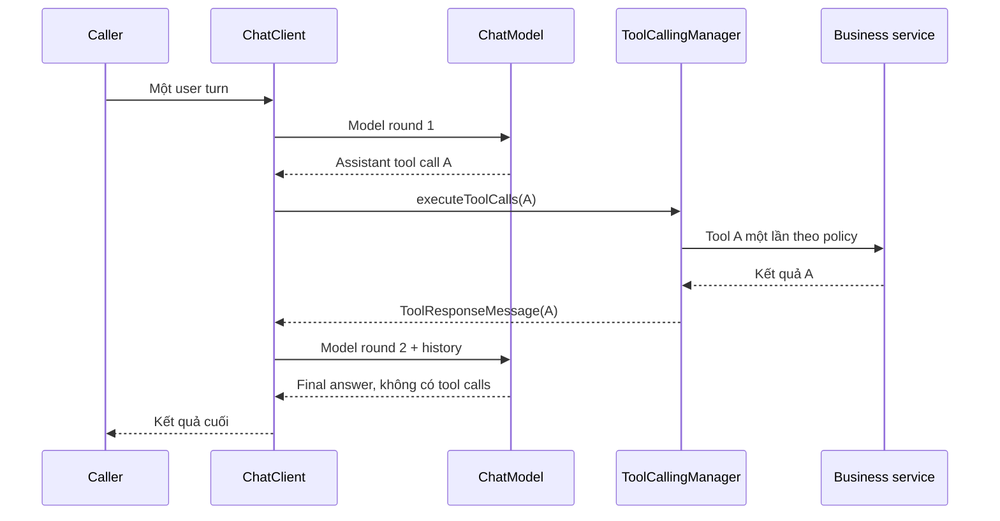
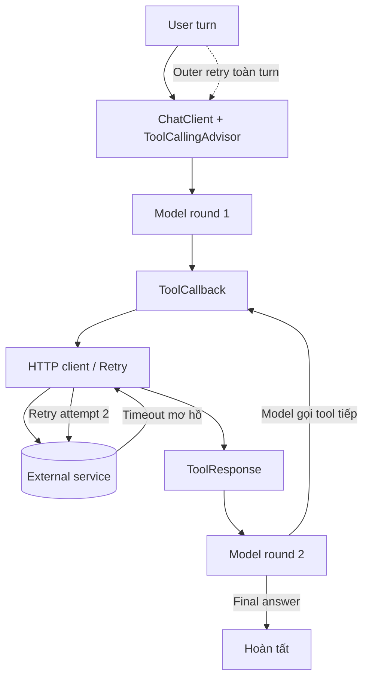
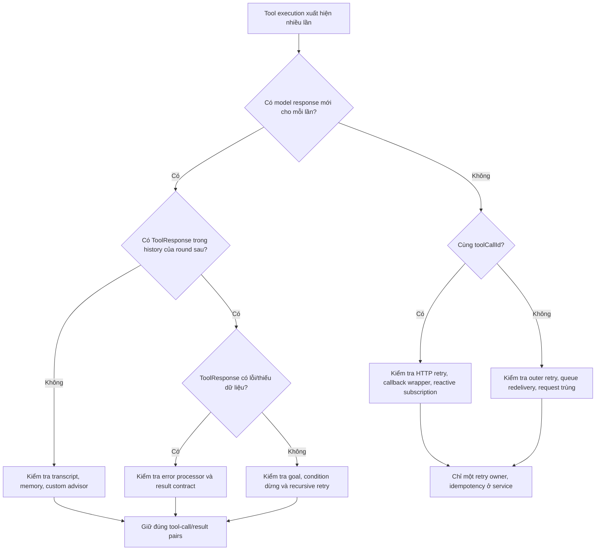
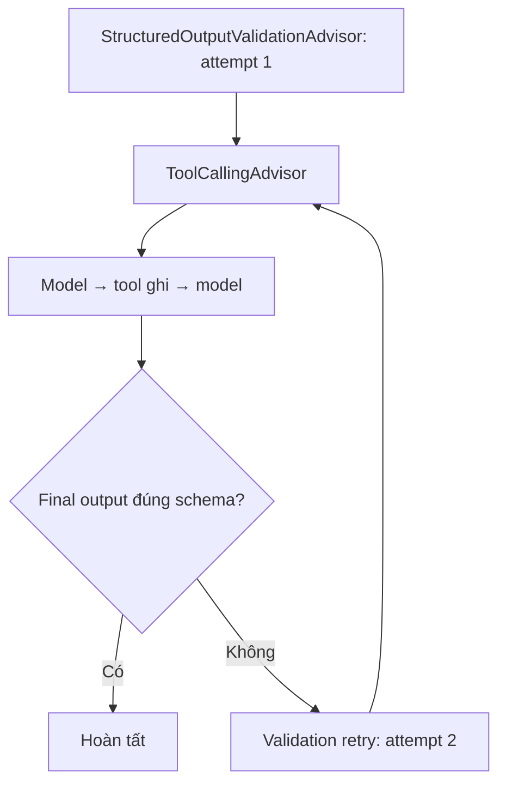
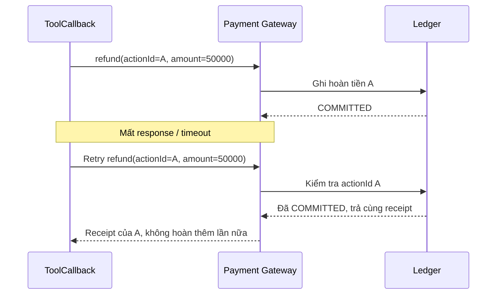

# Công cụ chạy lặp do cấu hình vòng lặp hoặc retry chồng nhau

Trong một ứng dụng Spring AI, cùng một công cụ xuất hiện nhiều lần trong log **chưa chắc là lỗi**. Mô hình có thể chủ động gọi lại tool để lấy dữ liệu mới; một response có thể chứa nhiều tool calls; HTTP client có thể retry sau timeout. Tuy nhiên, khi `createOrder`, `sendEmail` hay `refundOrder` được thực thi lặp ngoài dự kiến, hậu quả có thể là tạo giao dịch trùng, gửi thông báo nhiều lần, tăng chi phí token và làm sai trạng thái nghiệp vụ.

Bài thuộc chương **Chẩn đoán sự cố** của module `SPRING_AI_TOOL_CALLING`. Ta sẽ phân biệt **vòng model–tool**, **retry ở HTTP/SDK**, **retry toàn workflow**, **recursive advisor** và **resubscription của luồng reactive**; dùng trace để tìm lớp phát sinh bản sao; thiết kế một retry owner có giới hạn; chặn side effect trùng bằng idempotency, authorization và confirmation. Các ví dụ tập trung vào Spring AI **2.1.0**; với 1.x hoặc phiên bản khác cần đối chiếu API và cơ chế tool loop thực tế.

## 1. Bắt đầu bằng câu hỏi: “lặp ở lớp nào?”

| Hiện tượng | Đối tượng lặp | Dấu hiệu |
| --- | --- | --- |
| Model đề nghị `getOrderStatus` ở nhiều vòng | **Model tool loop** | Có model response mới và tool-call ID mới ở từng round |
| Một tool call nhưng adapter gọi API ba lần | **HTTP/SDK retry** | Cùng tool-call ID, nhiều outbound attempts |
| Tool response lỗi rồi model gọi lại | **Model tự lặp sau lỗi** | Có `ToolResponseMessage` chứa lỗi giữa hai rounds |
| Toàn bộ `chatClient.prompt().call()` chạy lại | **Outer retry** | Một turn được bắt đầu lại, có outer attempt mới |
| Một `Flux` bị subscribe hai lần | **Reactive resubscription** | Publisher thực hiện lại side effect ở subscription sau |
| Queue giao lại cùng event | **Message redelivery** | Cùng event/action ID nhưng delivery attempt khác |
| Hai calls trong cùng assistant response | **Một batch tool calls** | Có hai tool-call IDs cùng model round; không nhất thiết là retry |
| Advisor retry/validation gọi lại tool loop | **Nested recursive advisor** | Có validation attempt mới và toàn bộ downstream chain chạy lại |

**Đừng chỉ đếm số log `@Tool`**. Muốn biết là mô hình lặp, transport retry hay workflow phát lại, cần ghép mỗi lần thực thi với turn ID, model round, tool-call ID, execution attempt và business action ID.

## 2. Spring AI 2.x: một chủ sở hữu vòng model–tool

Với `ChatClient` trong Spring AI 2.1.0, `ToolCallingAdvisor` được đăng ký tự động theo mặc định. Nó gửi definitions tới model, nhận tool calls, giao `ToolCallingManager` thực thi các `ToolCallback`, nối tool responses vào lịch sử rồi gọi model tiếp. Vòng kết thúc khi model không phát tool calls, hoặc khi xảy ra return-direct, confirmation, giới hạn hay lỗi được xử lý theo policy.



Đây là **hai model rounds nhưng chỉ một tool execution**, hoàn toàn bình thường. Nếu tool A xuất hiện tiếp ở round 2, phải xem mô hình đã nhận gì ở tool result và có thật sự cần thêm thông tin không.

### Phân biệt Spring AI 1.x và 2.x

- Spring AI **1.x** có tool execution loop ở model implementation.
- Spring AI **2.x** chuyển vòng lặp tự động sang `ToolCallingAdvisor` của `ChatClient`.
- Gọi `ChatModel.call(prompt)` **trực tiếp** trong 2.x chỉ nhận raw response có tool calls, **không tự thực thi callback**. Muốn tool chạy phải dùng ChatClient hoặc viết manual loop.

Do đó, code copy từ tutorial 1.x cần kiểm tra lại. Ngược lại, đã dùng ChatClient điều phối tự động thì **không tự bọc thêm** một vòng model–tool bằng tay quanh cùng ChatClient.

## 3. Retry chồng tầng làm tăng số lần gọi downstream



Giả sử ví dụ **minh họa, không phải mặc định của Spring AI**:

- Retry toàn user turn tối đa **2** lần.
- Model gọi lại một tool tối đa **3** lần trong mỗi turn.
- HTTP client thử tới **3** lần với cùng request.

Số attempt tới downstream có thể lên đến **2 × 3 × 3 = 18**. Không có nghĩa 18 lần đều commit, nhưng nếu service đã ghi thành công rồi mất response, nhiều attempt có thể tạo side effect trùng. Việc retry chỉ exception mà không biết trạng thái commit là một rủi ro nghiêm trọng.

**Quy tắc:** mỗi lớp retry phải có mục đích, điều kiện, giới hạn và idempotency. Không để ba tầng đều retry cùng một action ghi chỉ vì một lời gọi có timeout.

## 4. Phân loại bằng trace, không suy từ số lần xuất hiện

```text
A. Model loop:
turn=t1 round=1 toolCall=c1 tool=sendEmail execution=1
turn=t1 round=2 toolCall=c2 tool=sendEmail execution=1

B. HTTP retry trong cùng callback:
turn=t1 round=1 toolCall=c1 tool=sendEmail httpAttempt=1 timeout
turn=t1 round=1 toolCall=c1 tool=sendEmail httpAttempt=2 success

C. Outer retry toàn turn:
turn=t1 outerAttempt=1 round=1 toolCall=c1 success
turn=t1 outerAttempt=2 round=1 toolCall=c2 success

D. Queue redelivery:
event=e42 delivery=1 businessAction=a9 success
event=e42 delivery=2 businessAction=a9 duplicate
```

Ở A có hai **ý định** của model; B là một ý định với nhiều attempts kỹ thuật; C là toàn workflow được thực hiện lại; D là cùng message được giao lại. Một metric tổng hợp `tool_call_count=4` không thể phân biệt chúng.

| Khóa quan sát | Scope | Dùng để làm gì? |
| --- | --- | --- |
| `correlationId` | Hành trình qua HTTP, model, tool, service | Ghép trace phân tán |
| `turnId` | Một lượt hỏi | Tách các user turns |
| `outerAttempt` | Lần thử của workflow/queue | Nhận biết retry toàn tác vụ |
| `modelRound` | Một lần gọi mô hình | Xác định model yêu cầu tool lại |
| `toolCallId` | Một tool call do model sinh | Ghép assistant call với tool response |
| `toolExecutionAttempt` | Một lần chạy callback/HTTP | Tách retry kỹ thuật |
| `businessActionId` | Hành động nghiệp vụ duy nhất | Idempotency/audit xuyên retry |
| `traceId/spanId` | Span giám sát | Tìm điểm lỗi hoặc chậm |

`toolCallId` **không phải business idempotency key đủ tin cậy**: một lần model được gọi lại có thể sinh ID khác dù đó vẫn là yêu cầu gửi cùng email hoặc hoàn cùng đơn. ID hành động phải thuộc backend và gắn với actor, resource, payload và approval theo hợp đồng nghiệp vụ.

## 5. Cây quyết định khi phát hiện tool chạy lặp



Khi tool **có side effect** đang lặp, ưu tiên xử lý theo thứ tự: **ngăn commit trùng → xác định attempt phát sinh ở đâu → sửa logic loop/retry → đo lại**. Đừng đổi model temperature hoặc viết prompt “không gọi lặp” trước khi xác minh lỗi có thực sự thuộc model.

### Checklist chẩn đoán trong 15 phút đầu

1. Xác định tool **đọc hay ghi**, có side effect có thể đã commit hay không.
2. Tìm `turnId`, `modelRound`, `toolCallId`, `attempt` và `businessActionId` trên log.
3. Đếm model requests **thực tế**, callback invocations, HTTP attempts và downstream commits riêng.
4. Kiểm tra tool response mà model nhận ở round trước: thành công, lỗi, rỗng, mất ID hay chưa có?
5. Kiểm tra advisor chain/order, vòng lặp thủ công, `@Retryable`, WebClient retry và outer job retry.
6. Nếu streaming, kiểm tra số subscribers/cancellation/resubscription và callback thực tế.
7. Chặn tạm tool ghi hoặc bật confirmation/idempotency guard trước khi thử tái hiện lỗi.
8. Tái hiện trong test với fake model, fake server và cùng failure sequence.

## 6. “Hai ToolCallingAdvisor” thường không phải thủ phạm

Spring AI 2.x có marker interface `ToolAdvisor`. `DefaultChatClient` bảo đảm **một** ToolAdvisor trong advisor chain:

- Nếu không custom, `ToolCallingAdvisor` mặc định được đăng ký tự động.
- Nếu thêm **một** custom `ToolAdvisor`, default được thay thế.
- Nếu thêm **hai** custom ToolAdvisor, chain **fail fast**, không lặng lẽ chạy cả hai.

Do đó, hiện tượng công cụ bị thực thi gấp đôi **không tự chứng minh** có hai ToolCallingAdvisor trong cùng ChatClient. Hãy kiểm tra retry ở tầng ngoài, custom recursive advisor, gọi tool qua đường khác hoặc code subscribe/dispatch trùng.

Ví dụ ChatClient bình thường, **không cần manual loop**:

```java
import org.springframework.ai.chat.client.ChatClient;
import org.springframework.ai.chat.model.ChatModel;

ChatClient chatClient = ChatClient.builder(chatModel).build();

String answer = chatClient.prompt()
        .user("Đơn ORD-742 đang ở đâu?")
        .tools(orderReadTools)
        .call()
        .content();
```

`orderReadTools` là POJO có `@Tool` và được ứng dụng phân quyền. Khi dùng cách này, không viết thêm code gọi lại `ToolCallingManager.executeToolCalls(...)` với cùng assistant tool calls của ChatClient.

Nếu thật sự cần manager tùy chỉnh:

```java
import org.springframework.ai.chat.client.advisor.ToolCallingAdvisor;
import org.springframework.ai.model.tool.ToolCallingManager;

ToolCallingManager manager = ToolCallingManager.builder().build();

ChatClient client = ChatClient.builder(chatModel)
        .defaultAdvisors(ToolCallingAdvisor.builder()
                .toolCallingManager(manager)
                .build())
        .build();
```

Đây là **thay thế một tool advisor**, không phải thêm hai. Manager dùng trong production phải giữ đầy đủ confirmation policy, error processor, tool-call limits và observation configuration cần thiết; đừng vô tình bỏ các bảo vệ có trong bean đã được Spring Boot cấu hình.

## 7. Structured-output validation/retry advisor có thể bao cả tool loop

Spring AI hỗ trợ recursive advisors dùng `CallAdvisorChain.copy(...)` để gọi lại chain downstream, ví dụ `StructuredOutputValidationAdvisor` retry khi kết quả không khớp JSON Schema.

Nếu validation advisor nằm **bên ngoài** `ToolCallingAdvisor`, một lần validation thất bại có thể chạy lại **cả tool loop**:



Với tool đọc, điều này thường làm tăng latency/chi phí. Với tool ghi, nếu action đã commit nhưng final answer không đúng format, validation retry có thể làm **tạo lại action**. Không sửa bằng cách chỉ tăng số attempts hoặc bắt model nói “đã hoàn thành” một cách chắc chắn.

Spring AI sắp advisor theo `getOrder()`: giá trị nhỏ hơn nằm ở **ngoài**; lớn hơn ở **trong** vòng. `ToolCallingAdvisor.DEFAULT_ORDER` là `Ordered.HIGHEST_PRECEDENCE + 300`. Khi troubleshooting, phải vẽ thứ tự advisor thực tế: retry, output validation, memory, RAG, metrics và custom tool advisor.

Biện pháp an toàn:

1. Không retry toàn turn chứa side effect khi chưa có idempotency.
2. Phân tách **prepare/validate/preview** và **execute**.
3. Nếu chỉ lỗi cấu trúc output, tạo lại **phần diễn giải** từ dữ liệu receipt đã có, không chạy lại tool ghi.
4. Nếu vẫn dùng recursive output validation, giới hạn attempts và test rằng một businessActionId chỉ có một commit.

## 8. Tool trả lỗi cho model: nguyên nhân vòng retry ngữ nghĩa

Theo tài liệu Spring AI 2.1, `DefaultToolExecutionExceptionProcessor` có thể đưa thông điệp của `RuntimeException` về model như tool result khi `spring.ai.tools.throw-exception-on-error=false` (mặc định). Model nhìn thấy lỗi có thể thử cùng tool lần nữa để “tự sửa”.

Ví dụ luồng:

```text
Round 1: model → getOrderStatus(orderId="ORD-742")
Tool result: "ERROR: connection timed out, please retry"
Round 2: model → getOrderStatus(orderId="ORD-742")
Tool result: "ERROR: connection timed out, please retry"
Round 3: model → getOrderStatus(orderId="ORD-742")
...
```

Trong ví dụ, sự lặp có thể là phản ứng **hợp lý theo thông điệp lỗi**, nhưng không phù hợp với ngân sách. Một lỗi xác thực hoặc nghiệp vụ không thể tự sửa bằng retry lại càng không nên được biểu diễn như một lỗi transient.

| Loại lỗi | Có nên retry tool? | Cách thông báo |
| --- | --- | --- |
| `VALIDATION_ERROR` | Thường không, trừ khi model có thể sửa arguments mà không đoán | Nêu field hợp lệ và giới hạn |
| `NOT_FOUND` cho ID xác định | Không dò ID khác nếu không được phép | Không tìm thấy/không được xác minh |
| `ACCESS_DENIED` | **Không** | Dừng truy cập, không lộ resource tồn tại |
| `RATE_LIMITED` | Có thể retry có backoff ở một tầng có ngân sách | Nêu tạm thời quá tải và giới hạn |
| `TIMEOUT` của tool chỉ đọc | Có thể retry có giới hạn | Dùng mã lỗi ổn định |
| `TIMEOUT` của tool ghi | **Không retry mù** vì commit có thể đã xảy ra | Trạng thái chưa rõ, tra receipt bằng action ID |
| `INTERNAL_ERROR` không xác định | Chỉ retry nếu đã phân loại transient | Không gửi stack trace/raw secrets tới model |

Để chuyển mọi tool exception ra application, Spring AI có thuộc tính:

```properties
spring.ai.tools.throw-exception-on-error=true
```

Điều này **không tự động giải quyết retry**, vì outer handler vẫn có thể retry cả ChatClient. Hãy xác định exception classification và retry owner ở đúng tầng. Với custom `ToolCallback`, dùng `ToolExecutionException` và `ToolExecutionExceptionProcessor` theo contract phiên bản đang dùng; không lộ lỗi nội bộ vào tool response.

## 9. Thiếu hoặc hỏng tool history khiến model “không biết đã làm”

Sau khi một tool được thực thi, round kế phải nhận đủ chuỗi:

```text
UserMessage
AssistantMessage(toolCalls=[call-1])
ToolResponseMessage(responses=[result-of-call-1])
AssistantMessage(final / next tool call)
```

Nếu custom advisor hoặc manual orchestration bỏ mất `ToolResponseMessage`, model có thể lặp tool vì không thấy kết quả. Ngược lại, duplicate memory writes có thể khiến model “nhìn” lịch sử không nhất quán và sinh thêm tool calls.

Trong Spring AI 2.1.0:

- `ToolCallingAdvisor` mặc định tự giữ **history của các rounds trong một turn**.
- Memory advisor **ngoài** tool loop thường chỉ thấy request ban đầu và final response.
- Memory advisor **trong** loop có thể giữ per-round messages; khi đó phải tránh cả memory và ToolCallingAdvisor cùng tự quản lý lịch sử.
- Với auto-registered ToolCallingAdvisor, Spring AI có cơ chế phát hiện `MemoryAdvisor` bên trong và điều chỉnh internal history; nếu tự tạo advisor thì có thể dùng `disableInternalConversationHistory()` theo hướng dẫn.
- Spring AI 2.1 khuyến nghị **Session Memory** thay cho `MessageChatMemoryAdvisor`/`ChatMemory` cũ đang deprecated.

**Không tự xóa một assistant tool call mà giữ riêng tool response**, hoặc gắn kết quả cho ID khác. Ngoài việc gây lặp, transcript sai có thể bị model provider từ chối.

Kiểm tra khi nghi memory gây lỗi: log một bản **tối thiểu và đã redacted** gồm message role, tool-call ID, tool name, tool-result code, thứ tự và round index. Không ghi raw prompt, tokens, PII hay toàn bộ tool payload khi chưa có quyền.

## 10. Streaming: subscribe lại có thể chạy lại toàn chuỗi

Trong Reactor, một `Flux`/`Mono` lạnh (cold publisher) thường bắt đầu công việc khi có subscriber. Nếu ứng dụng tạo một luồng từ `ChatClient.stream()` rồi gọi `subscribe()` hai lần, có thể có **hai model requests và hai vòng tool execution**, dù lập trình viên chỉ tạo một biến publisher.

Ví dụ **phản mẫu**, không nên áp dụng với tool có side effect:

```java
import reactor.core.publisher.Flux;

Flux<String> answer = chatClient.prompt()
        .user("Đơn ORD-742 có thể hủy không?")
        .tools(orderTools)
        .stream()
        .content();

answer.subscribe(uiSink::send);       // Subscription A
answer.subscribe(metricsSink::accept); // Subscription B: có thể chạy lại toàn luồng
```

Giải pháp dễ kiểm soát hơn: **một subscription** và quan sát trong chính pipeline đó:

```java
Flux<String> answer = chatClient.prompt()
        .user("Đơn ORD-742 có thể hủy không?")
        .tools(orderTools)
        .stream()
        .content()
        .doOnNext(chunk -> metricsSink.recordSafeChunkMetadata(chunk))
        .doOnError(error -> metricsSink.recordFailure(classify(error)))
        .doFinally(signal -> metricsSink.recordTerminalSignal(signal));

return answer; // WebFlux framework giữ quyền subscribe một lần để trả response.
```

`metricsSink` và `classify(...)` là thành phần do ứng dụng định nghĩa. Callback của `doOnNext` phải nhanh và không block event loop; xuất audit sang queue/scheduler có giới hạn khi cần. Nếu một response cần nhiều subscribers, phải thiết kế rõ multicast/cache cùng ranh giới actor/tenant, cancellation và retention; không thêm `.cache()` vô điều kiện lên kết quả chứa PII hoặc side effect.

### Retry ở Reactor có thể tái subscription

Một đoạn:

```java
Flux<String> retried = answer.retryWhen(
        reactor.util.retry.Retry.backoff(
                2, java.time.Duration.ofMillis(200)));
```

có thể **đăng ký lại toàn bộ publisher**, từ đó gọi lại model và các callbacks trước lỗi. Đó không phải retry riêng một HTTP GET vô hại. Với workflow chứa tool ghi, không bao `retryWhen(...)` quanh nguyên `ChatClient.stream()` nếu chưa có idempotency và phân loại lỗi rõ.

**Streaming tool-call arguments:** một số provider gửi JSON arguments dưới dạng nhiều delta/partial chunks. Partial chunk **không phải** một tool call hoàn chỉnh; `ToolCallingManager` chỉ thực thi khi có tool call hoàn chỉnh. Nếu tự viết stream loop, không gọi callback với từng delta rồi lại gọi khi aggregate xong, vì điều đó tạo duplicate từ chính application code.

## 11. Retry ở HTTP/SDK: không thể biết timeout có nghĩa là thất bại

Với công cụ chỉ đọc, retry GET sau lỗi mạng tạm thời có thể hợp lý. Với hành động ghi, timeout chỉ nói client **chưa nhận được response**, không chứng minh server chưa commit.



Nếu gateway không hỗ trợ idempotency hoặc tra cứu trạng thái theo action ID, **không tự động retry thao tác ghi** khi outcome chưa rõ. Dừng ở trạng thái `UNKNOWN`, đưa vào reconciliation queue và thông báo chưa thể xác minh. Dùng một refund ID do backend quản lý, không lấy tool-call ID làm khóa duy nhất.

### Phân chia retry owner

| Tầng | Nên được retry? | Điều kiện |
| --- | --- | --- |
| HTTP GET đọc dữ liệu | Có thể | Transient timeout/503/429, bounded backoff và deadline |
| HTTP POST tạo side effect | Chỉ khi idempotent | Giữ **cùng** action ID, payload hash và business authority |
| ToolCallback wrapper | Hạn chế | Không tự retry nếu HTTP client đã retry và không có lý do riêng |
| ToolCallingAdvisor/model round | Để model quyết định bước kế | Không dùng làm retry transport vô hạn |
| Whole ChatClient user turn | Tránh với tool ghi | Chỉ khi toàn workflow replay-safe |
| Queue consumer | Có thể bị redeliver | Inbox deduplication theo event/business ID |
| Recursive output validation | Có thể retry model output | Không chạy lại transaction đã commit |

Áp dụng nguyên tắc **một tầng sở hữu retry cho một loại lỗi**. Nếu Spring Retry `@Retryable` ở method tool đã retry, HTTP client lại có built-in retry, và outer workflow cũng retry, phải xác định tầng nào thực sự cần thiết; các tầng còn lại nên giới hạn hoặc tắt ở đường side effect.

## 12. Idempotency: bảo vệ commit trùng, không phải chỉ “đếm đủ lần”

Một token idempotency có giá trị khi **cùng business action** được yêu cầu lại từ các đường khác nhau. Thiết kế an toàn cần:

1. **Khóa từ backend:** tạo một `businessActionId` cho hành động cụ thể, ổn định qua outer retry, model retry và queue redelivery; không tin ID do model tự tạo.
2. **Scope rõ:** ít nhất actor/tenant, tool action, resource và phiên bản nghiệp vụ; có thể kết hợp request payload hash.
3. **Atomic claim:** hai callers đồng thời không cùng “nhìn thấy chưa có” rồi cùng chạy. Dùng unique constraint/transaction/conditional write thích hợp.
4. **Result replay:** nếu action đã `SUCCEEDED`, trả lại **receipt cũ**, không chạy lại.
5. **In-flight state:** nếu action đang `RUNNING`, chờ/tra cứu hoặc trả trạng thái rõ; không tạo lệnh thứ hai.
6. **Unknown outcome:** nếu downstream có thể đã commit nhưng response mất, reconciliation theo action ID trước khi retry.
7. **Payload mismatch:** cùng action ID với amount/recipient khác phải từ chối, không “sửa” ID để retry.

Một abstraction của ứng dụng:

```java
import java.util.function.Supplier;

public interface IdempotentActionStore {

    // Impl phải atomic và bền vững; unit fake không chứng minh tính atomic.
    <T> T executeOnce(
            String tenantId,
            String businessActionId,
            String requestFingerprint,
            Supplier<T> action);
}
```

Ví dụ service có quyền và idempotency:

```java
import java.math.BigDecimal;

public final class RefundService {

    private final RefundAuthorization authorization;
    private final IdempotentActionStore actionStore;
    private final PaymentPort payment;

    public RefundService(
            RefundAuthorization authorization,
            IdempotentActionStore actionStore,
            PaymentPort payment) {
        this.authorization = authorization;
        this.actionStore = actionStore;
        this.payment = payment;
    }

    public RefundReceipt executeApprovedRefund(
            AuthenticatedActor actor,
            ApprovedRefund approved) {
        // Kiểm tra actor, quyền trên đơn, approval và trạng thái mới nhất.
        authorization.check(actor, approved);

        String fingerprint = approved.orderId() + "|"
                + approved.amount().toPlainString() + "|"
                + approved.currency();

        return actionStore.executeOnce(
                actor.tenantId(),
                approved.businessActionId(),
                fingerprint,
                () -> payment.refund(
                        approved.businessActionId(),
                        approved.orderId(),
                        approved.amount(),
                        approved.currency()));
    }
}
```

`RefundAuthorization`, `ApprovedRefund`, `PaymentPort`, `RefundReceipt` và `AuthenticatedActor` là kiểu ứng dụng tự định nghĩa. `ApprovedRefund` phải được lưu/đối chiếu ở backend sau human confirmation, không chỉ là arguments do model sinh. Việc dùng `executeOnce(...)` trong ví dụ **không tự bảo đảm exactly-once** khi process crash giữa call tới payment và ghi receipt; cần gateway idempotency hoặc transaction/outbox/reconciliation phù hợp.

Nếu hai yêu cầu có cùng ID nhưng fingerprint khác, kho idempotency phải từ chối với lỗi ổn định. Nếu quyền đã bị thu hồi sau khi approval được lưu, service phải kiểm tra lại trước khi thực hiện; idempotency không thay thế authorization.

## 13. Giới hạn ToolCallingManager để dừng loop ngoài kiểm soát

Spring AI 2.1.0 giới hạn số tool calls trong **một user turn** qua `ToolCallingManager`. Mặc định của `DefaultToolCallingManager` là **40 lần/công cụ** và **150 lần tổng cộng/turn**, theo tài liệu 2.1.0. Có thể đặt thấp hơn theo nghiệp vụ.

```java
import org.springframework.ai.model.tool.ToolCallLimitBehavior;
import org.springframework.ai.model.tool.ToolCallingManager;

ToolCallingManager manager = ToolCallingManager.builder()
        .maxCallsPerTool(8)
        .maxCallsPerTool("searchOrders", 4)
        .maxCallsPerTool("executeApprovedRefund", 1)
        .maxTotalToolCalls(20)
        .onLimitExceeded(ToolCallLimitBehavior.THROW)
        .build();
```

Hoặc với Spring Boot:

```properties
spring.ai.tools.limits.max-calls-per-tool-default=8
spring.ai.tools.limits.max-calls-per-tool.searchOrders=4
spring.ai.tools.limits.max-calls-per-tool.executeApprovedRefund=1
spring.ai.tools.limits.max-total-tool-calls=20
spring.ai.tools.limits.on-limit-exceeded=THROW
```

Giới hạn trên là **call-count limits**, không phải model-round limits, HTTP retry limits, deadline hay giới hạn số commit. Lỗi từ HTTP retries trong một callback vẫn có thể tạo nhiều downstream attempts dù manager chỉ đếm **một** tool invocation.

### THROW hay RETURN_ERROR_RESPONSE?

| Cấu hình | Hành vi | Khi cân nhắc |
| --- | --- | --- |
| `THROW` | Manager ném `ToolCallLimitExceededException`, advisor tạo response cuối về limit; manual caller tự xử lý | Muốn **dừng chắc** đường auto-loop khi vượt budget |
| `RETURN_ERROR_RESPONSE` | Bỏ call vượt giới hạn, trả error tool result cho model | Muốn model giải thích thất bại; cần giới hạn model rounds/deadline thêm |

Với `RETURN_ERROR_RESPONSE`, model có thể tiếp tục đề nghị cùng tool vì nó vẫn nhận lỗi như một tool result; không xem đây là biện pháp tự kết thúc mọi loại loop. Khi xác định sự cố loop lặp ở sản xuất, thường nên ưu tiên `THROW`/fail-safe và một final error rõ thay vì để model thử vô hạn.

Mặc dù một action tool đã bị chặn bởi call limit, action khác trong batch có thể đã thành công trước khi lỗi xảy ra; Spring AI giữ metadata các tool responses từng thành công. Không giả định toàn batch được rollback nếu một call vượt hạn mức. Với nhiều tool calls trong một response, cần transaction policy riêng cho tác động liên quan.

## 14. Budget đa tầng: stop condition không chỉ là số tool calls

Một chiến lược dừng bền vững nên có nhiều giới hạn:

| Budget | Ví dụ chính sách | Ai thực thi |
| --- | --- | --- |
| Tool calls/turn | Không quá 20, tool ghi tối đa 1 | `ToolCallingManager` |
| Model rounds/turn | Ví dụ tối đa 6 | Custom advisor/orchestrator |
| Tổng thời gian | Ví dụ deadline 12 giây | Request orchestration/timeout |
| Downstream HTTP attempts | Ví dụ đọc tối đa 2–3, ghi 1 nếu không có idempotency | HTTP client/service adapter |
| Output/result size | Tối đa số bản ghi, KB hoặc token | Tool result converter/service |
| Token budget | Giới hạn tokens/cost theo workflow | App telemetry/budget guard |
| Queue deliveries | Max attempts + DLQ | Messaging infrastructure |
| Confirmation | Không execute trước approval | Tool-call confirmation + backend service |

Các con số chỉ **minh họa**. Budget cho tool ghi tài chính khác với tool đọc tìm kiếm. Khi chạm một giới hạn, trả trạng thái `STOPPED_LIMIT` hoặc `REVIEW_REQUIRED` có thể quan sát được; không lặng lẽ gọi model lần nữa với cùng dữ liệu lỗi.

**Deadline không làm rollback commit.** Nếu một request bị timeout sau khi payment gateway đã nhận hành động, việc cancel model stream hoặc HTTP request không có nghĩa remote side effect đã bị hủy. Dùng action receipt và reconciliation để xác định kết quả thật.

## 15. Điều kiện kết thúc: return-direct, confirmation và eligibility checker

Không phải lúc nào model cũng cần nhận lại kết quả tool và sinh thêm một câu trả lời. Spring AI 2.1.0 có một số điều kiện kết thúc/gián đoạn được xác định rõ:

### Return-direct

Khi `ToolMetadata.returnDirect=true`, tool result có thể được trả về caller mà không gửi thêm model round. Với method tool:

```java
import org.springframework.ai.tool.annotation.Tool;

class OrderReceiptTools {

    @Tool(
        description = "Trả biên nhận của một giao dịch đã xác minh",
        returnDirect = true)
    String getVerifiedReceipt(String actionId) {
        return receiptService.renderAuthorizedReceipt(actionId);
    }
}
```

`receiptService` phải kiểm tra quyền và định dạng output an toàn. Chỉ dùng return-direct khi **kết quả tool đã là câu trả lời cuối**; không dùng cho tool cần tổng hợp hoặc tham chiếu thêm nhiều kết quả. Nếu model trả **nhiều tool calls trong một response**, return-direct chỉ được áp dụng khi **mọi tool trong batch đều được đánh dấu returnDirect**. Nó không chặn việc model gọi cùng action nhiều lần ở các lượt khác hoặc HTTP client retry.

### Confirmation

Spring AI 2.1.0 hỗ trợ `@Tool(requiresConfirmation = true)` và `ToolCallConfirmationPolicy` của `ToolCallingManager`. Nếu **bất kỳ call** trong một batch yêu cầu duyệt, framework **tạm dừng cả batch trước khi thực thi**, trả paused reply để ứng dụng xin quyết định. Vì vậy, đây là một cơ chế chặn hành động trước side effect, không phải bằng chứng workflow đã hoàn tất.

Ứng dụng cần:

- Lưu paused reply và prompt trong server-side state có phiên bản, ràng buộc actor/tenant.
- Khi resume, có decision cho từng call; chống replay của cùng approval.
- Dùng manager tương ứng để thực thi và gửi kết quả về model.
- Bảo vệ mỗi action bằng idempotency ở service, vì retry API resume hoặc crash vẫn có thể xảy ra.

Đừng nhầm `returnDirect`, `requiresConfirmation` và `tool-call limit`: một cái trả tool result trực tiếp, một cái tạm dừng để duyệt, một cái giới hạn số lần thực thi.

### ToolExecutionEligibilityChecker

`ToolCallingAdvisor` có `ToolExecutionEligibilityChecker`: mặc định kiểm tra response có tool calls hay không. Đây là hook quyết định **có tiếp tục vòng tool hay không**, không phải một retry policy cho HTTP timeout.

```java
import org.springframework.ai.chat.client.advisor.ToolCallingAdvisor;

var advisor = ToolCallingAdvisor.builder()
        .toolExecutionEligibilityChecker(response ->
                response != null && response.hasToolCalls())
        .build();
```

Đây là hành vi mặc định được viết ra để minh họa. Nếu model/provider trả metadata đặc biệt hoặc custom orchestrator muốn thay đổi điều kiện, phải test rằng callback **không bị bỏ qua** hoặc chạy khi response thực tế không hợp lệ. Tắt eligibility để “hết lặp” có thể khiến người dùng không nhận được dữ liệu cần thiết và che giấu lỗi gốc.

## 16. Quan sát đúng vị trí của ToolCallingAdvisor

Một inner advisor có thể quan sát **mỗi model round**, trong khi outer advisor thường chỉ thấy một request ban đầu và response cuối. Với Spring AI, advisor chạy theo order: `ToolCallingAdvisor.DEFAULT_ORDER` là `Ordered.HIGHEST_PRECEDENCE + 300`; advisor có order lớn hơn như `+400` nằm **trong** vòng tool.

Ví dụ một observer tối giản chỉ cho đường blocking:

```java
import org.springframework.ai.chat.client.ChatClientRequest;
import org.springframework.ai.chat.client.ChatClientResponse;
import org.springframework.ai.chat.client.advisor.ToolCallingAdvisor;
import org.springframework.ai.chat.client.advisor.api.CallAdvisor;
import org.springframework.ai.chat.client.advisor.api.CallAdvisorChain;

final class RoundCountAdvisor implements CallAdvisor {

    private final SafeLoopMetrics metrics;

    RoundCountAdvisor(SafeLoopMetrics metrics) {
        this.metrics = metrics;
    }

    @Override
    public String getName() {
        return "RoundCountAdvisor";
    }

    @Override
    public int getOrder() {
        return ToolCallingAdvisor.DEFAULT_ORDER + 100;
    }

    @Override
    public ChatClientResponse adviseCall(
            ChatClientRequest request, CallAdvisorChain chain) {

        metrics.onModelRoundStarted(request.context());
        ChatClientResponse result = chain.nextCall(request);
        metrics.onModelRoundCompleted(request.context(), result);
        return result;
    }
}
```

`SafeLoopMetrics` là abstraction do ứng dụng viết; nó chỉ nhận metadata đã lọc. Observer trên **đếm model rounds**, không đếm HTTP attempts hoặc downstream commits. Muốn đo callback, dùng Micrometer tool observations hoặc decorator tại `ToolCallback`; Spring AI có observation `spring.ai.tool` cho tool execution. Với streaming, implement thêm `StreamAdvisor` đúng API, đừng coi mỗi chunk là một model round.

**Bảo vệ dữ liệu:** tránh log raw arguments/result chứa thông tin cá nhân, mã giao dịch, thẻ thanh toán hoặc access token. Có thể ghi hashed request fingerprint, tool name, error code, duration và IDs để phân tích retry. Nếu log cần phục vụ forensic, áp dụng masking và retention có phân quyền.

### Tách intent, execution và commit

| Event | Mốc | Không nên suy ra |
| --- | --- | --- |
| `TOOL_PROPOSED` | Model trả tool call | Tool đã được chạy |
| `TOOL_DISPATCHED` | Manager bắt đầu callback | Service đã commit |
| `HTTP_ATTEMPTED` | Client gửi request | Gateway đã nhận hoặc chưa |
| `TOOL_RESPONSE_CREATED` | Callback trả string/exception | Transaction thành công |
| `BUSINESS_COMMITTED` | Dữ liệu có receipt/commit xác thực | UI đã nhận response |
| `RESPONSE_DELIVERED` | Caller nhận được response | Không có retry khác ở bên ngoài |

Trường hợp “model chỉ đề nghị hai lần” khác hoàn toàn trường hợp “hai biên nhận được commit”; báo cáo sự cố nên thể hiện cả hai số liệu.

## 17. Điều tra tầng ngoài: API retry, scheduler và queue redelivery

Ngay cả khi Spring AI tool loop hoạt động đúng, một controller, API gateway, job scheduler hoặc message broker có thể làm gọi lại nguyên ChatClient request.

Các ví dụ:

- Frontend double-click hoặc gửi lại POST khi chưa nhận response; nếu backend không có request ID, tạo **hai turns** khác nhau.
- API gateway retry một request sau 502/504; request cũ có thể vẫn đang chạy và đã execute tool.
- Spring Retry `@Retryable` đặt quanh service gọi `ChatClient`; mỗi retry gọi lại toàn tool loop.
- Scheduled job chạy đồng thời trên hai replicas nếu lock không đủ chặt.
- Kafka/RabbitMQ message redelivery do consumer chưa ack sau khi callback đã commit.
- Một workflow engine retry task vì heartbeat/lease hết hạn trong khi worker cũ vẫn chạy.

Đối với request HTTP có side effect, ưu tiên một **client request key** hoặc **businessActionId** do backend xác minh. Với queue, nên có inbox deduplication theo event ID kết hợp idempotency của command. Không sửa lỗi bằng cách tắt redelivery/ack trước commit vì có thể làm mất giao dịch; thiết kế xử lý at-least-once bằng idempotency và cơ chế xác nhận phù hợp.

### Công việc đang chạy vẫn có thể commit sau timeout

Một lỗi hay gặp:

```text
T0 API gateway gửi request A
T1 Worker-1 gọi tool executeRefund(A)
T2 Client hết timeout và gateway retry request A
T3 Worker-2 gọi tool executeRefund(A) lần nữa
T4 Worker-1 commit
T5 Worker-2 commit nếu không có idempotency
```

Việc đặt timeout ngắn hơn không giải quyết nguyên nhân; nó còn có thể làm redelivery xảy ra thường xuyên hơn. Nếu service chưa hỗ trợ idempotency, tạm dừng đường thực thi side effect hoặc chuyển sang manual review khi outcome không rõ.

## 18. Trường hợp nhiều tool calls trong cùng một model response

Không được nhầm “batch có hai calls” với “retry hai lần”:

```json
{
  "toolCalls": [
    {"id":"call-a","name":"getOrderStatus",
     "arguments":{"orderId":"ORD-742"}},
    {"id":"call-b","name":"getOrderStatus",
     "arguments":{"orderId":"ORD-743"}}
  ]
}
```

Hai calls trên là hai hành động đọc **khác tài nguyên**, dù cùng tên tool. Nhưng nếu cả hai đều là `refundOrder(ORD-742, 50000)`, vấn đề không nằm ở số vòng: model đã đề nghị hai side effects giống nhau ngay **trong một batch**.

Ứng dụng phải:

1. Kiểm tra mọi call/arguments, không chỉ call đầu tiên.
2. Không giả định batch được thực thi tuần tự hay song song; hành vi có thể phụ thuộc implementation/provider, và phép ghi có dependency cần điều phối rõ.
3. Với tool ghi, dùng policy xác nhận, idempotency và kiểm tra trùng theo businessActionId trước commit.
4. Nếu cần transaction nhiều bước, tổ chức một command/service workflow có thể kiểm soát thay vì cho model tạo batch các lệnh ghi phụ thuộc nhau.
5. Giữ đúng `toolCallId` ↔ `ToolResponseMessage` cho mọi call, kể cả call bị từ chối.

Kết quả return-direct của một batch chỉ kết thúc vòng nếu mọi tool trong batch phù hợp. Với confirmation, một call yêu cầu phê duyệt có thể tạm dừng **cả batch** trước khi bất kỳ call nào chạy.

## 19. Ma trận kiểm thử tái hiện lỗi lặp

Kiểm thử nên tách **model simulation**, **callback execution** và **downstream attempts** để phân biệt ba nguyên nhân. Dùng fake `ChatModel` phát responses xác định thay vì phụ thuộc model thật; dùng fake HTTP server hoặc mock `PaymentPort` để kiểm soát timeout sau/before commit.

| Kịch bản | Setup | Kỳ vọng |
| --- | --- | --- |
| Một tool call, kết quả thành công | Model round 1 gọi tool, round 2 trả final | Callback chạy 1 lần |
| Model đề nghị cùng tool ở round tiếp | Hai model responses có tool calls | Có 2 intentions; callback chỉ chạy theo policy/limits |
| HTTP GET timeout lần đầu | Một toolCall ID, HTTP attempt 1 lỗi, 2 thành công | Một callback invocation, hai HTTP attempts |
| HTTP POST timeout **sau commit** | Gateway ghi trước khi mất response | Retry cùng action ID chỉ có **một** business commit |
| Outer validation advisor retry | Output final lần đầu sai schema | Phần format được retry; không thêm commit ghi |
| Bị mất ToolResponse trong history | Fake loop cố tình bỏ result | Test phát hiện missing pair thay vì cho chạy production |
| Inner memory ghi lặp | Hai history owners cùng append | History không chứa duplicated tool messages |
| Hai subscribers vào cold Flux | Hai subscriptions của cùng stream | Test phát hiện hai executions, sau sửa còn một |
| Tool call delta streaming | Arguments được chia thành nhiều chunks | Không callback nào chạy từ partial chunk |
| Hai calls đọc trong một batch | Hai IDs và hai order IDs | Hai kết quả đúng cặp, không coi là retry |
| Hai calls ghi giống nhau | Hai IDs nhưng cùng action nghiệp vụ | Idempotency chặn duplicate commit |
| Limit bị vượt | Model liên tục gọi cùng tool | Dừng theo policy, không vòng vô hạn |
| Confirmation bị replay | HTTP approve gửi hai lần | Chỉ một command commit/receipt |
| Queue redelivery | Cùng event ID được xử lý lại | Inbox/action store không commit trùng |
| Tenant khác truy cập lại | Same resource ID, actor khác | Authorization chặn, cache không lẫn dữ liệu |
| Return-direct | Tool result đã là final output | Không thêm model round nếu toàn batch return-direct |

Test phải assert **ba con số riêng**: số model calls, số lần `ToolCallback.call(...)` và số lần downstream **commit**. Chỉ verify method callback được gọi một lần không chứng minh payment service không thực hiện hai HTTP attempts. Chỉ đếm commit cũng không chứng minh loop không tăng chi phí và latency.

### Ví dụ unit test cho retry policy

Một quy tắc an toàn có thể được kiểm thử mà không gọi mô hình:

```java
enum OperationKind { READ, WRITE }
enum FailureCode { TIMEOUT, VALIDATION_ERROR, ACCESS_DENIED }

final class RetryPolicy {

    boolean mayRetry(
            OperationKind kind,
            FailureCode error,
            boolean stableIdempotencyKey,
            int attempt,
            int maxAttempts) {

        if (attempt >= maxAttempts
                || error == FailureCode.ACCESS_DENIED
                || error == FailureCode.VALIDATION_ERROR) {
            return false;
        }
        return error == FailureCode.TIMEOUT
                && (kind == OperationKind.READ || stableIdempotencyKey);
    }
}
```

```java
import static org.assertj.core.api.Assertions.assertThat;
import org.junit.jupiter.api.Test;

class RetryPolicyTest {

    private final RetryPolicy policy = new RetryPolicy();

    @Test
    void retriesTransientReadOnlyTimeoutWithinBudget() {
        assertThat(policy.mayRetry(
                OperationKind.READ, FailureCode.TIMEOUT,
                false, 1, 3)).isTrue();
    }

    @Test
    void neverRetriesWriteTimeoutWithoutStableKey() {
        assertThat(policy.mayRetry(
                OperationKind.WRITE, FailureCode.TIMEOUT,
                false, 1, 3)).isFalse();
    }

    @Test
    void deniesRetryAfterBudgetOrAccessDenied() {
        assertThat(policy.mayRetry(
                OperationKind.READ, FailureCode.TIMEOUT,
                true, 3, 3)).isFalse();

        assertThat(policy.mayRetry(
                OperationKind.READ, FailureCode.ACCESS_DENIED,
                true, 1, 3)).isFalse();
    }
}
```

Đây chỉ là **quy tắc quyết định attempt**, không thay thế idempotency store, payment reconciliation hay authorization. `stableIdempotencyKey=true` chỉ nên được set khi gateway/backend thực sự có cơ chế bảo vệ commit tương ứng; không chấp nhận giá trị boolean do model tự khai.

### Component test với fake model

Một bộ test cao hơn nên dựng fake model theo trình tự:

```text
Model response #1:
  AssistantMessage(toolCalls=[getOrderStatus("ORD-742"), id="c-1"])

Tool callback:
  trả {"status":"SHIPPED"}, toolResponseId="c-1"

Model response #2:
  AssistantMessage(finalAnswer="Đơn đang vận chuyển")

Assertions:
  modelRoundCount == 2
  callbackInvocationCount == 1
  toolResponseId == "c-1"
  no side-effect callback was invoked
```

Tạo một biến thể khác cho model gọi tool lần nữa sau một tool error, và biến thể outer advisor retry do output invalid. Mục tiêu là chứng minh **chính xác tầng nào làm call count tăng**. Với một action ghi, sử dụng mock service hoặc fake gateway giữ receipt đã commit; không test bằng giao dịch thật.

## 20. Quan sát production: metric nào xác định nguyên nhân?

Các số liệu có ích:

| Metric/signal | Ý nghĩa |
| --- | --- |
| `model_rounds_per_turn` | Model lặp do tool requests hoặc validation |
| `tool_intents_per_round` | Một model response phát bao nhiêu calls |
| `tool_callback_invocations` | Số lần manager thực thi callback |
| `downstream_http_attempts` | Số request thật ra ngoài |
| `downstream_commits` | Số giao dịch đã commit được xác minh |
| `idempotency_duplicate_suppressed` | Số lần replay được chặn |
| `outer_retry_attempts` | Tần suất retry toàn workflow |
| `reactive_subscriptions_per_turn` | Phát hiện double subscribe |
| `tool_call_limit_exceeded` | Loop chạm budget |
| `tool_result_errors_by_code` | Model có nhận lỗi khiến nó gọi lại không |
| `confirmation_paused/resumed` | Hành động tạm dừng và số lần resume |
| `unknown_outcome_count` | Side effect có thể đã commit nhưng chưa xác minh |

Để tránh nhầm metric, tính số attempts **theo một scope nhất quán**, không cộng cả model intents và tool invocations thành một tổng “tool calls”. Spring AI có Micrometer observation tên `spring.ai.tool` cho thực thi tool; có thể dùng thêm custom observation cho downstream transport và business commit. Không đưa raw arguments, prompt, tool results, token truy cập hay thông tin thanh toán vào metric labels.

### Khi nào bật DEBUG?

Spring AI hỗ trợ:

```properties
logging.level.org.springframework.ai=DEBUG
```

Chỉ bật có chọn lọc trong môi trường/trong thời gian phù hợp; kiểm tra log có dữ liệu nhạy cảm hay không, đặc biệt với tool arguments và kết quả nghiệp vụ. Trong production, ưu tiên structured events có masking và correlation ID thay vì ghi toàn bộ messages.

## 21. Playbook xử lý sự cố khi tool ghi đã chạy lặp

Nếu phát hiện `refundOrder` đã chạy nhiều lần, thực hiện các bước cụ thể:

1. **Khoanh vùng tác động:** xác định businessActionId, order ID, tenant, khoảng thời gian, các receipts; không dựa vào số log model.
2. **Ngăn commit tiếp:** tắt hoặc giới hạn tuyến execution nhạy cảm bằng feature flag/policy gate; cho phép thao tác read-only/tra cứu trạng thái tiếp tục nếu an toàn.
3. **Đối soát trạng thái:** hỏi hệ thống có thẩm quyền xem những lần nào thực sự commit; phân biệt `REQUESTED`, `COMMITTED`, `FAILED`, `UNKNOWN`.
4. **Giữ bằng chứng:** correlation IDs, attempt chain, exception codes, tool-call IDs, retry layer và phiên bản cấu hình. Mask PII/secrets.
5. **Phân loại nguyên nhân:** model lặp, advisor retry, HTTP retry, queue redelivery, resubscription hay API duplicate.
6. **Sửa ở đúng tầng:** bỏ nested retry không cần, sửa transcript, áp budget, tách formatter retry khỏi transaction và đặt idempotency bền vững.
7. **Kiểm thử hồi quy:** tái hiện timeout sau commit, concurrent duplicate, user retry, approval replay và streaming double subscription.
8. **Triển khai có kiểm soát:** quan sát duplicate-suppressed, commits-per-action, latency, call limits và lỗi mới. Với giao dịch đã tác động người dùng, thực hiện xử lý nghiệp vụ/đối soát theo quy trình công ty.

Không tự động gửi thêm lệnh hoàn tiền để “khắc phục” khi chưa có trạng thái đáng tin cậy; một retry mù có thể làm tăng thiệt hại.

## 22. Những cách sửa sai thường gặp

| Cách sửa thiếu an toàn | Vì sao không giải quyết gốc | Phương án tốt hơn |
| --- | --- | --- |
| Thêm prompt “đừng gọi tool hai lần” | Không ngăn HTTP retry/queue redelivery | Dò retry owner, idempotency và logs |
| Chỉ hạ temperature | Model có thể vẫn gọi lại nếu thiếu tool result | Sửa history/tool result và stop policy |
| Giảm max tool calls xuống 1 cho mọi tool | Cắt mất workflow đọc cần nhiều bước | Limits theo tool/risk và ngân sách toàn turn |
| Tắt toàn bộ retry hệ thống | Có thể làm tăng lỗi transient cho tool đọc | Giữ retry an toàn ở đúng tầng |
| Đặt `returnDirect=true` lên mọi tool | Bỏ bước model tổng hợp, chưa chặn duplicate HTTP | Chỉ áp dụng khi tool result đủ là câu trả lời cuối |
| Bắt mọi exception rồi trả “success” | Model/ứng dụng tưởng action đã commit | Error code chuẩn, không giả trạng thái |
| Thử lại POST với action ID mới | Biến một retry thành giao dịch mới | Giữ cùng idempotency key và payload hash |
| Tắt memory để “hết lặp” | Có thể mất context hợp lệ | Sửa ownership/history và giữ tool pairs |
| Dùng toolCallId làm khóa business duy nhất | Model phát ID mới qua outer retry | ID nghiệp vụ bền vững do backend kiểm soát |
| `Flux.cache()` cho mọi response | Rò dữ liệu và khó kiểm soát session | Một subscription hoặc multicast có scope |
| Chỉ log tool name | Không phân biệt intent, attempt và commit | Correlation, round, call ID, action ID |
| Retry khi không biết payment đã commit chưa | Giao dịch trùng | Reconciliation và UNKNOWN state |

## 23. Checklist triển khai phòng lỗi lặp

- [ ] Phân biệt **model round**, **tool-call batch**, **callback invocation**, **HTTP attempt** và **business commit**.
- [ ] Với Spring AI 2.x, xác nhận dùng một `ToolAdvisor` hoặc một manual loop do application sở hữu; không chồng nhiều cơ chế.
- [ ] Vẽ order/recursive boundary của retry, validation, RAG, memory và tool advisors.
- [ ] Không retry toàn user turn có side effect khi chưa có idempotency.
- [ ] Gắn `correlationId`, `turnId`, `modelRound`, `toolCallId`, `attempt` và `businessActionId`.
- [ ] Phân loại lỗi transient, validation, authorization và unknown outcome riêng.
- [ ] Không đưa thông báo “hãy thử lại” vô hạn cho model sau timeout của tool ghi.
- [ ] Giữ đầy đủ assistant tool calls và tool responses, khớp IDs.
- [ ] Với Spring AI memory bên trong vòng, bảo đảm chỉ một owner quản lý transcript.
- [ ] Không tạo subscription thứ hai từ cold ChatClient streaming publisher.
- [ ] Không thực thi tool từ partial streaming argument deltas.
- [ ] Đặt max calls per tool, total tool calls, model-round limit và request deadline.
- [ ] Dùng `THROW`/fail-safe khi cần dừng cứng; đánh giá kỹ `RETURN_ERROR_RESPONSE`.
- [ ] Tool ghi được bảo vệ bằng authorization, human confirmation và business idempotency.
- [ ] Khi timeout sau side effect, xác minh receipt thay vì retry mù.
- [ ] Test HTTP timeout trước/sau commit, output-validation retry, queue redelivery và concurrent duplicate.
- [ ] Đo model intents, callback invocations, downstream attempts và commits thành chỉ số riêng.
- [ ] Không log raw arguments/results, credentials hoặc PII vào traces không kiểm soát.

**Kết luận:** để chẩn đoán tool chạy lặp trong Spring AI, trước tiên phải xác định **ai đang lặp và ở ranh giới nào**. `ToolCallingAdvisor` có thể gọi model qua nhiều vòng là hành vi bình thường; HTTP retries, outer workflow retries, recursive validation và reactive resubscriptions mới là những nguồn dễ gây nhân số lần thực thi ngoài ý muốn. Giải pháp bền vững là giữ **một owner của mỗi loại retry**, lịch sử tool đầy đủ, ngân sách có điều kiện dừng, sự kiện trace rõ ràng và idempotency được thực thi ngay tại nguồn nghiệp vụ — không đặt niềm tin vào việc model “sẽ không gọi lần nữa”.

## Tài liệu tham khảo

- [Spring AI 2.1 — Tool Calling: vòng gọi và giới hạn ToolCallingManager](https://docs.spring.io/spring-ai/reference/api/tools.html)
- [Spring AI 2.1 — ToolCallingAdvisor: order, history, hooks, return-direct và confirmation](https://docs.spring.io/spring-ai/reference/api/tools/tool-calling-advisor.html)
- [Spring AI 2.1 — Recursive Advisors: retry và structured output validation](https://docs.spring.io/spring-ai/reference/api/advisors-recursive.html)
- [Spring AI 2.1 — ChatModel Tool Calling: vòng lặp thủ công](https://docs.spring.io/spring-ai/reference/api/tools/chatmodel-tool-calling.html)
- [Spring AI 2.1 — Tool Call Confirmation](https://docs.spring.io/spring-ai/reference/api/tools/tool-call-confirmation.html)
- [Spring AI 2.1 — Spring AI Observability](https://docs.spring.io/spring-ai/reference/observability/index.html)
- [Spring AI 2.1 — Session Memory](https://docs.spring.io/spring-ai/reference/api/session.html)
- [Project Reactor — Retry và retryWhen](https://projectreactor.io/docs/core/release/reference/coreFeatures/error-handling.html)
- [Spring Retry — Reference](https://docs.spring.io/spring-retry/reference/)
