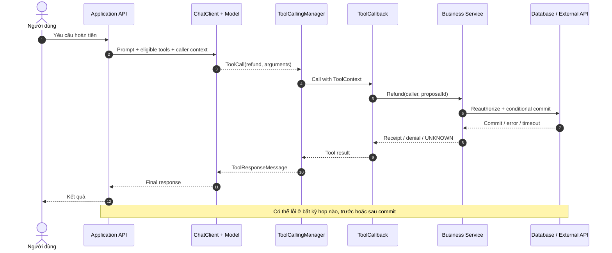
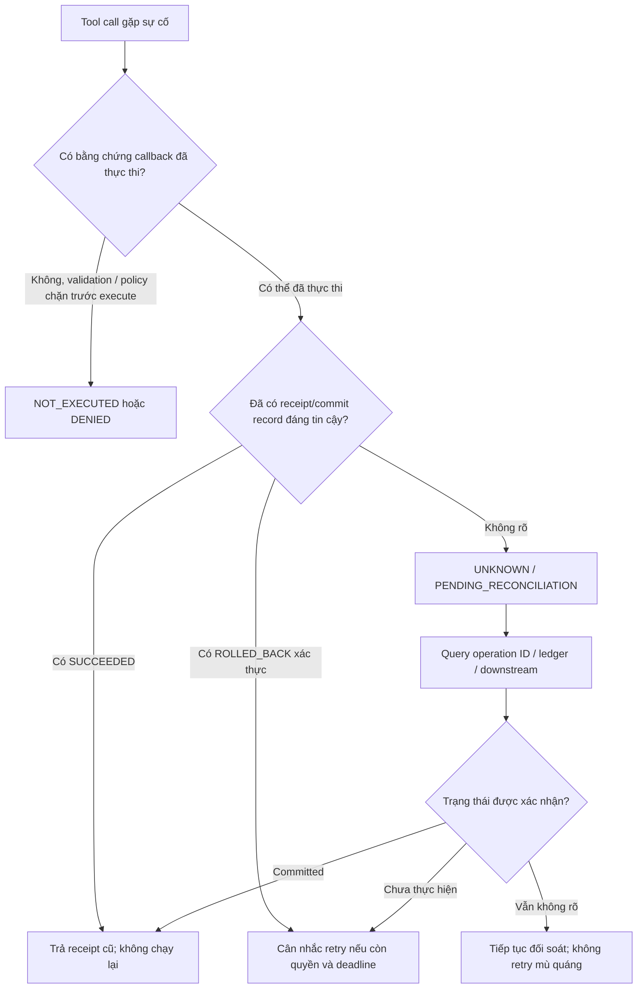
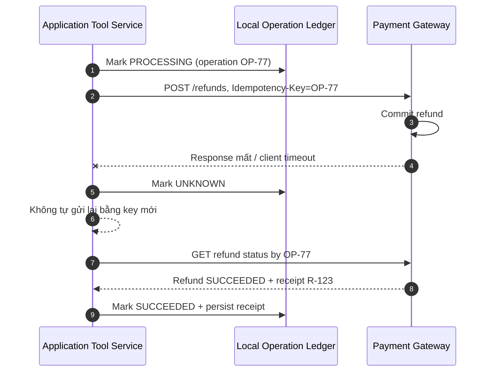
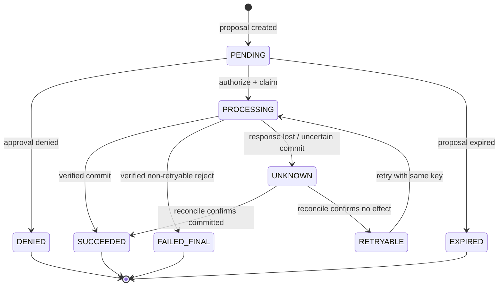
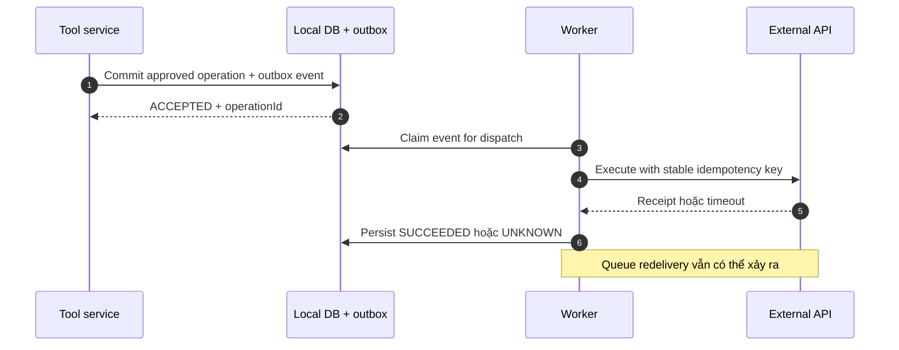

# Lỗi thiếu quyền, timeout và hành động đã chạy nhưng phản hồi bị mất

Trong Spring AI tool calling, mô hình có thể yêu cầu một công cụ tra cứu tài khoản, tạo đơn hàng hoặc hoàn tiền. `ToolCallingManager` thực thi `ToolCallback`, ứng dụng gọi dịch vụ nghiệp vụ và đưa kết quả trở lại mô hình. Một lỗi ở bất kỳ chặng nào có thể làm kết quả cuối không phản ánh chính xác điều gì đã xảy ra.

Ba tình huống dễ bị nhầm lẫn nhất là **thiếu quyền**, **timeout** và **hành động đã chạy nhưng phản hồi bị mất**. Thiếu quyền phải được từ chối, kể cả khi mô hình sinh arguments hợp lệ. Timeout chỉ có nghĩa một bên không nhận được kết quả đúng hạn, **không chứng minh thao tác chưa chạy**. Nếu giao dịch đã commit nhưng response bị thất lạc, retry thiếu kiểm soát có thể tạo thêm một side effect trái ý người dùng.

Trong module **SPRING_AI_TOOL_CALLING**, mô hình chỉ **đề xuất** công cụ và tham số; ứng dụng quyết định công cụ có được dùng, xác thực danh tính/quyền, thực thi, quan sát, xử lý lỗi và kiểm thử. Bài học dựa trên cơ chế Spring AI **2.1.0** như `@Tool`, `ToolCallback`, `ToolContext`, `ToolCallingAdvisor`, `ToolCallingManager`, `ToolExecutionExceptionProcessor` và `ToolCallConfirmation` để xây quy trình chẩn đoán tránh trả lời sai hoặc thực thi trùng.

Sau bài học, bạn có thể:

- Xác định lỗi thuộc authentication, authorization, validation, model, tool, downstream hay mất response.
- Phân biệt `DENIED`, `TIMED_OUT`, `FAILED`, `SUCCEEDED` và `UNKNOWN` theo **kết quả nghiệp vụ**.
- Giữ danh tính tin cậy trong `ToolContext` và kiểm tra quyền trên từng tài nguyên ở service.
- Biết khi nào nên trả thông điệp an toàn cho mô hình và khi nào phải dừng toàn bộ workflow.
- Dùng idempotency key, execution ledger và reconciliation khi đã mất phản hồi.
- Cấu hình timeout/deadline phù hợp từng tầng, không nhân nhiều lớp retry mù quáng.
- Giữ cặp tool request–tool response hợp lệ ngay cả khi có lỗi hoặc nhiều công cụ.
- Kiểm thử thiếu quyền, timeout trước/sau commit, confirmation replay và retry đồng thời.

## 1. Ba lỗi nhìn giống nhau nhưng không cùng bản chất

Giả sử người dùng hỏi: “Hoàn tiền 250.000 đồng cho khoản thanh toán PAY-77”.

| Điều người dùng thấy | Điều hệ thống có thể đã làm | Cách phản ứng đúng |
|---|---|---|
| “Không đủ quyền” | Policy đã chặn trước side effect | Dừng, không retry tự động; giải thích quyền cần thiết |
| “Hết thời gian chờ” khi đọc dữ liệu | GET chưa trả kết quả | Có thể retry có giới hạn nếu idempotent và còn deadline |
| “Hết thời gian chờ” khi hoàn tiền | Gateway có thể đã commit hoàn tiền | Đánh dấu `UNKNOWN`, tra cứu bằng operation ID, không hoàn lại lần nữa |
| “Không có phản hồi từ công cụ” | Tool có thể đã ghi DB rồi nhưng tool result bị mất | Đọc durable receipt/ledger; resume bằng kết quả đã xác minh |
| “Phê duyệt thất bại” | Có thể chỉ mất response khi resume | Kiểm tra pause/operation state trước khi cho phép phê duyệt lại |

Điểm mấu chốt: **thành công/thất bại của lời gọi HTTP hoặc tool protocol không nhất thiết bằng thành công/thất bại của giao dịch nghiệp vụ**.

## 2. Đường đi và vị trí có thể xảy ra lỗi



Chẩn đoán bằng cách xác định **hop nào lỗi** và **bên nào có thẩm quyền xác nhận trạng thái**. Nếu HTTP client timeout ở chặng gọi model, điều đó khác với payment gateway timeout. Nếu callback trả `DENIED` vì quyền, việc model tiếp tục nói “đã hoàn tiền” là một lỗi tổng hợp câu trả lời, không phải bằng chứng giao dịch thành công.

## 3. Phân lớp trạng thái: kỹ thuật và nghiệp vụ

Một outcome nên có hai chiều:

| Technical status | Business outcome | Ví dụ |
|---|---|---|
| `OK` | `SUCCEEDED` | Hoàn tiền đã commit, có receipt |
| `OK` | `DENIED` | Service chạy được nhưng policy từ chối |
| `OK` | `NOT_FOUND` | Tài nguyên không tồn tại trong phạm vi được phép |
| `ERROR` | `NOT_EXECUTED` | Lỗi schema trước khi callback chạy |
| `TIMEOUT` | `UNKNOWN` | Gateway có thể đã xử lý nhưng không trả response |
| `ERROR` | `ROLLED_BACK` | Transaction local rollback được xác nhận |
| `OK` | `ALREADY_PROCESSED` | Retry nhận lại receipt từ ledger |
| `PENDING` | `IN_PROGRESS` | Worker đã claim operation và đang xử lý |

`NOT_EXECUTED` và `ROLLED_BACK` là nhận định **có bằng chứng**. Đừng gán hai trạng thái này chỉ vì client ném `SocketTimeoutException` hay HTTP `504`. Timeout không đủ dữ kiện để nói side effect chưa xảy ra.

## 4. Sổ tay xử lý nhanh khi có lỗi



Trước khi làm bất kỳ bước nào, xác định loại tool **chỉ đọc**, **tạo proposal**, **ghi thay đổi** hay **high-impact**. Cùng một lỗi timeout có thể được xử lý rất khác nhau tùy side effect.

## 5. Phân biệt authentication và authorization

**Authentication** trả lời “caller là ai?”, còn **authorization** trả lời “caller có được làm hành động đó trên tài nguyên cụ thể đó không?”.

Các ví dụ:

- Không có phiên đăng nhập hợp lệ: lỗi `UNAUTHENTICATED`.
- Người dùng có quyền `payments:read` nhưng không có `payments:refund`: `FORBIDDEN_ACTION`.
- Có `payments:refund` nhưng payment thuộc tenant khác: `RESOURCE_NOT_VISIBLE`.
- Có quyền và đúng tenant nhưng khoản thanh toán đã được hoàn: `ALREADY_REFUNDED` hoặc `CONFLICT` tùy hợp đồng.
- Có quyền lúc tạo proposal nhưng đã bị thu hồi khi resume: phải **từ chối tại thời điểm thực thi**.

Đừng tin câu “tôi là quản trị viên” trong prompt hay `tenantId`, `role`, `isAdmin` do mô hình tự tạo trong arguments. Một ID hợp lệ nhưng thuộc người khác vẫn phải bị từ chối (BOLA/IDOR).

## 6. Dùng `ToolContext` chuyển danh tính tin cậy

`ToolContext` của Spring AI cho phép ứng dụng đưa metadata vào callback mà **không đưa cho mô hình như tool arguments**.

```java
public record CallerContext(
        String userId,
        String tenantId,
        Set<String> authorities) {

    public CallerContext {
        Objects.requireNonNull(userId);
        Objects.requireNonNull(tenantId);
        authorities = Set.copyOf(authorities);
    }

    public boolean has(String authority) {
        return authorities.contains(authority);
    }
}
```

`CallerContext` là DTO của **ứng dụng**, được tạo từ `Authentication` đã xác minh. `ToolContext` không tự biến dữ liệu thành đáng tin: nếu lấy caller từ JSON mà client tự gửi, nó vẫn không đáng tin.

```java
@Service
public class PaymentAssistant {

    private final ChatClient client;
    private final PaymentTools paymentTools;

    public PaymentAssistant(
            ChatClient.Builder builder,
            PaymentTools paymentTools) {
        this.client = builder.build(); // Không đăng ký default write tools.
        this.paymentTools = paymentTools;
    }

    public String answer(String question, CallerContext verifiedCaller) {
        return client.prompt()
            .user(question)
            .tools(paymentTools)
            .toolContext(Map.of("caller", verifiedCaller))
            .call()
            .content();
    }
}
```

`ChatClient.prompt().tools(...)` **bổ sung** vào `defaultTools(...)`, không thay thế. Với client chung, không đặt tool ghi có quyền cao thành mặc định. Trong Spring AI 2.x, resolution fallback bị tắt mặc định; không bật lại chỉ để model gọi được tool ngoài tập công cụ hợp lệ của request.

## 7. Quyền phải kiểm tra ở resource-level

Một service có thể có quyền chức năng nhưng không được phép đọc hoặc ghi một payment cụ thể. Ví dụ:

```java
@Service
public class PaymentQueryService {

    private final PaymentRepository payments;
    private final PaymentPolicy policy;

    @Transactional(readOnly = true)
    public PaymentView getVisible(
            CallerContext caller,
            String paymentId) {

        if (!caller.has("payments:read")) {
            throw new AccessDeniedException("Not permitted");
        }

        Payment payment = payments
            .findByIdAndTenantId(paymentId, caller.tenantId())
            .orElseThrow(PaymentNotVisibleException::new);

        policy.requireCanRead(caller, payment);
        return PaymentView.fromVisibleFields(payment);
    }
}
```

Phương thức repository và policy là thành phần nghiệp vụ của ứng dụng. `findByIdAndTenantId` cần query đúng entity/schema thực tế.

Có thể trả cùng thông báo `NOT_FOUND` cho “không tồn tại” và “không được xem” để tránh làm lộ sự tồn tại của tài nguyên, nếu policy bảo mật yêu cầu. Không hiển thị ID khách hàng khác hoặc lý do nội bộ trong thông báo cho mô hình.

## 8. Cắt lỗi thiếu quyền trước side effect

Một `@Tool` adapter nên mỏng, kiểm tra caller trước khi gọi service:

```java
@Component
public class PaymentTools {

    private final PaymentWorkflow workflow;

    public PaymentTools(PaymentWorkflow workflow) {
        this.workflow = workflow;
    }

    @Tool(
        name = "payments_execute_refund",
        description = "Thực hiện proposal hoàn tiền đã được phê duyệt.",
        requiresConfirmation = true
    )
    public RefundResult executeRefund(
            @ToolParam(description = "Mã proposal lưu phía server")
            String proposalId,
            ToolContext toolContext) {

        Object value = toolContext.getContext().get("caller");
        if (!(value instanceof CallerContext caller)) {
            throw new AccessDeniedException("Trusted caller missing");
        }

        return workflow.executeApprovedProposal(caller, proposalId);
    }
}
```

`executeApprovedProposal` cần:

1. Nạp proposal từ storage của ứng dụng, kiểm tra tenant/owner.
2. Xác thực approver và quyền hoàn tiền hiện tại.
3. Kiểm tra proposal còn hiệu lực, nội dung/digest đã phê duyệt và payment chưa đổi trạng thái.
4. Áp dụng idempotency và transaction/conditional update.
5. Trả receipt hoặc trạng thái không được thực hiện.

Không chỉ gắn `requiresConfirmation=true` rồi tin tool đã được phép chạy. Confirmation yêu cầu phê duyệt, **không** thay thế authorization, freshness và idempotency.

## 9. Spring Security method security không đủ nếu thiếu resource check

Spring Security cho phép `@PreAuthorize` tại service boundary khi đã bật `@EnableMethodSecurity`:

```java
@Configuration
@EnableMethodSecurity
class MethodSecurityConfig {}

@Service
class RefundApplicationService {

    @PreAuthorize("hasAuthority('payments:refund')")
    public RefundReceipt execute(String proposalId) {
        // Vẫn phải kiểm tra tenant, payment owner,
        // trạng thái, phiên bản và approval trước khi ghi.
        return executeAuthorizedProposal(proposalId);
    }
}
```

`@PreAuthorize` chỉ kiểm tra authority trong ví dụ, chưa kiểm tra từng payment. Cần policy resource-specific ở service và transaction boundary.

Lưu ý Spring method security dựa trên proxy: gọi nội bộ `this.execute(...)` có thể bỏ qua interceptor. Với async execution, không suy đoán `SecurityContext` tự theo thread. Các job/resume dài hạn phải **xác thực quyền hiện tại**, không tái sử dụng vô thời hạn một principal cũ.

## 10. Mã lỗi an toàn: 401, 403, 404 và lỗi tool

| Tình huống API | HTTP status thường dùng | Tool outcome gợi ý |
|---|---|---|
| Chưa đăng nhập/hết phiên | `401 Unauthorized` | `UNAUTHENTICATED` |
| Có danh tính nhưng thiếu quyền | `403 Forbidden` | `PERMISSION_DENIED` |
| Resource không hiện hữu trong phạm vi caller | `404 Not Found` | `RESOURCE_NOT_VISIBLE` |
| Business rule không cho thực hiện | `409 Conflict` hoặc `422` tùy API | `BUSINESS_REJECTED` |
| Session/approval đã hết hạn | `409` hoặc `410 Gone` theo hợp đồng | `EXPIRED` |
| Quá nhiều yêu cầu | `429 Too Many Requests` | `RATE_LIMITED` |
| Service downstream không sẵn sàng | `503 Service Unavailable` | `DEPENDENCY_UNAVAILABLE` |

Đây là cách thiết kế HTTP API của ứng dụng, không phải mã trạng thái mà Spring AI tự tạo cho mọi `ToolCallback`. Một tool có thể trả DTO `DENIED` trong một HTTP response `200` ở phía assistant, miễn nội dung không tuyên bố hành động đã thực hiện.

Không “sửa” thiếu quyền bằng việc tăng quyền service account hoặc tự đổi `tenantId` theo arguments. Nếu user thật sự thiếu quyền, phải hướng dẫn quy trình cấp quyền ngoài AI, không thử các ID khác.

## 11. `ToolExecutionExceptionProcessor` có thể đổi exception thành lời cho mô hình

Theo tài liệu Spring AI 2.1.0, exception của tool được bọc trong `ToolExecutionException` và đưa tới `ToolExecutionExceptionProcessor`. Processor có thể trả một **chuỗi thông báo** cho mô hình hoặc ném tiếp để application xử lý.

`DefaultToolExecutionExceptionProcessor` mặc định có hành vi:

- Với `RuntimeException`: chuyển message của exception thành chuỗi tool result cho mô hình.
- Với checked exception và `Error`: ném tiếp thay vì biến thành message.
- Nếu cấu hình `spring.ai.tools.throw-exception-on-error=true`: tool errors được ném lên để caller xử lý.

```properties
# Chọn chính sách fail-fast ở application boundary khi phù hợp:
spring.ai.tools.throw-exception-on-error=true
```

Cờ này không tự viết response JSON an toàn. Khi fail-fast, application vẫn phải bắt lỗi ở ranh giới phù hợp, phân loại và tránh trả stack trace/secret.

**Nguy cơ mặc định:** exception như `AccessDeniedException("User A is not owner of payment PAY-77")` có thể đưa chi tiết nhạy cảm vào model context. Đừng ném raw messages chứa thông tin riêng hoặc connection string. Với dữ liệu nhạy cảm, dùng custom `ToolExecutionExceptionProcessor` hoặc xử lý ở service rồi trả trạng thái được chuẩn hóa.

## 12. Kết quả lỗi có cấu trúc và thông điệp được kiểm soát

Một tool envelope đơn giản cho tình huống chẩn đoán:

```java
public record ToolOutcome<T>(
        String status,
        String code,
        String message,
        T data,
        String operationId) {

    public static <T> ToolOutcome<T> denied() {
        return new ToolOutcome<>(
            "NOT_EXECUTED",
            "RESOURCE_NOT_ACCESSIBLE",
            "Bạn không được phép thực hiện thao tác này.",
            null, null
        );
    }

    public static <T> ToolOutcome<T> unknown(String operationId) {
        return new ToolOutcome<>(
            "UNKNOWN",
            "RESULT_UNCONFIRMED",
            "Chưa xác định giao dịch đã hoàn tất hay chưa. Không gửi lại lệnh mới.",
            null, operationId
        );
    }
}
```

`ToolOutcome` là DTO do ứng dụng tự định nghĩa, không phải API Spring AI. Model có thể dùng `message` để thông báo cho user; **quyết định retry** phải do application/service kiểm soát, không dựa vào model tự phán đoán.

Nếu tool bị từ chối, không trả `success:true` chỉ để giữ lời thoại “mượt”. Nếu outcome `UNKNOWN`, đừng nói “giao dịch thất bại” hoặc “đã thành công” khi chưa có xác nhận.

## 13. Khi nào dùng exception, khi nào dùng business outcome?

| Loại lỗi | Cách biểu diễn thường hợp lý | Ai quyết định tiếp tục? |
|---|---|---|
| User không có quyền | Domain outcome `DENIED` hoặc sanitized access exception | Application policy |
| Tài nguyên không tồn tại | `NOT_FOUND` với dữ liệu tối thiểu | Application/model có thể hỏi lại ID nếu an toàn |
| Tham số JSON sai schema | Validation error; không gọi service | Framework/application |
| Business rule từ chối | `BUSINESS_REJECTED`, không retry tự động | Application/user |
| Timeout tool đọc | Transient technical error, có thể retry giới hạn | Application retry policy |
| Timeout tool ghi | `UNKNOWN` cho tới khi đối soát | Execution service |
| Database deadlock trước commit | Exception và rollback; retry bounded khi an toàn | Transaction/application |
| Provider model rate limit | Technical error với backoff | Model adapter/application |
| Callback ném `Error`/bug nghiêm trọng | Fail-fast, cảnh báo vận hành | Application/on-call |

Không nên biến mọi exception thành cùng một chuỗi “Tool failed” nếu điều đó khiến vận hành không phân biệt lỗi thiếu quyền với lỗi mạng. Có thể mã hóa reason code ở telemetry/audit trong khi giữ thông điệp gửi mô hình an toàn.

## 14. Phân loại timeout theo điểm phát sinh

Timeout không phải một điểm duy nhất:

```text
Incoming request deadline
  ├─ Model provider HTTP: acquire/connect/read/overall
  ├─ ToolCallingManager loop
  │   ├─ Tool callback validation/authorization
  │   ├─ Downstream pool acquire
  │   ├─ TCP connect / TLS handshake
  │   ├─ Backend response timeout
  │   ├─ Database lock/query timeout
  │   └─ External transaction confirmation timeout
  └─ Final model round / HTTP response to user
```

Ví dụ: `ToolCallback` xử lý 200 ms, nhưng trước đó HTTP client phải chờ pool connection 5 giây. Khi nhìn thấy `spring.ai.tool` span 5,2 giây, không thể kết luận service nghiệp vụ tự chạy 5,2 giây. Cần xem pool acquire metrics và downstream traces.

**Timeout ở model provider** có thể xảy ra trước khi model trả tool calls hoặc khi đang trả streaming response. **Timeout ở tool backend** có thể xảy ra sau khi đã thực hiện side effect. Cần log giai đoạn chính xác và operation ID.

## 15. Timeout không đồng nghĩa rollback

Ví dụ payment gateway nhận lệnh hoàn 250.000 đồng:



Tại thời điểm timeout, không có đủ bằng chứng để nói gateway chưa xử lý. Nếu retry bằng **operation ID mới**, gateway có thể tạo thêm một khoản hoàn tiền.

Với API có downstream idempotency hỗ trợ thật, retry cùng key có thể an toàn theo hợp đồng nhà cung cấp; vẫn cần giới hạn attempts và kiểm tra rằng key tồn tại trong thời hạn nhận diện của gateway.

## 16. Bảng quyết định retry theo side effect

| Hoạt động | Lỗi | Retry tự động? | Điều kiện |
|---|---|---|---|
| GET trạng thái đơn | Connect timeout trước nhận response | Có thể | Bounded retry, caller còn quyền, deadline còn |
| Search không có side effect | `503` tạm thời | Có thể | Backoff/jitter, có retry budget |
| Create proposal | Timeout | Tùy | Nếu lưu proposal/hold, cần idempotency hoặc truy cứu ID |
| Chuyển tiền/hoàn tiền | Timeout sau gửi request | **Không mù quáng** | Kiểm tra operation status, same downstream key |
| Đổi trạng thái bằng SQL | Optimistic lock conflict | Không replay approval cũ | Đề xuất lại trên version mới |
| Thiếu quyền | `403` | Không | Không thử role/tenant khác |
| Validation invalid | `400` | Không | Cần dữ liệu đầu vào hợp lệ |
| Rate limit | `429` | Có thể | `Retry-After`, retry budget và deadline |
| Gateway trả `5xx` | Không chắc | Chỉ khi outcome an toàn | `5xx` cũng có thể xảy ra sau commit |
| Client mất response HTTP cuối | Unknown | Kiểm tra ledger | Không tạo side effect thứ hai |

Tránh retry chồng tầng ở HTTP client, tool adapter, advisor và worker. Tổng attempts có thể tăng theo tích số lần retry, làm pool và backend quá tải.

## 17. Thiết kế deadline và timeout ngân sách

Một request AI có thể dùng nhiều model rounds và tool calls. Giả sử overall deadline là 30 giây, model round đầu tốn 12 giây, tool A tốn 8 giây và model round cuối tốn 12 giây; tổng đã vượt deadline.

```text
remainingBudget = overallDeadline - monotonicNow
if remainingBudget <= 0:
    stop before starting a new optional step
else:
    stepTimeout = min(configuredStepTimeout, remainingBudget)
```

Deadline tổng và thời gian chờ kết nối/response không thay thế nhau. Đừng đặt `30s` cho **mỗi** tool và **mỗi** model call rồi kỳ vọng toàn workflow hoàn tất trong 30 giây.

Với tác vụ ghi, khi deadline hết **sau khi side effect đã được gửi**, cần lưu trạng thái `UNKNOWN`/`PENDING` và để job reconciliation tiếp tục độc lập với HTTP response. Không dùng cancel của client làm quyết định rollback.

## 18. Streaming và callback bất đồng bộ

Với `ChatClient.stream()`, model có thể phát nhiều chunks của cùng một call, không phải nhiều lời gọi độc lập. Những tình huống cần phân biệt:

- Mất stream **trước** khi model đưa tool call hoàn chỉnh: có thể chưa có callback nào chạy.
- Mất stream **sau** khi tool call được execute: callback có thể đã tạo side effect.
- Client đóng SSE trong lúc callback đang chạy: cancellation của stream không đảm bảo external API dừng hoặc rollback.
- Tool-call arguments được stream từng mảnh: không parse partial JSON làm một command để chạy sớm.

Với Reactor/`WebClient`, timeout và cancel cần được gắn với subscription và terminal signal, không chỉ thời điểm tạo `Flux` lazy. Không block Reactor event loop bằng `.block()` hoặc chờ semaphore đồng bộ khi ở reactive pipeline.

Trong log, phân biệt `STREAM_CANCELLED`, `MODEL_TIMEOUT` và `TOOL_RESULT_UNKNOWN`; không gom tất cả thành “assistant failed”.

## 19. Mất phản hồi ở đâu quyết định cách khôi phục

Một hệ thống có thể mất phản hồi tại nhiều vị trí khác nhau:

| Điểm mất phản hồi | Bằng chứng sẵn có | Việc cần làm |
|---|---|---|
| Mô hình chưa trả tool call | Không có tool call trong history | Kiểm tra model transport, retry theo policy model |
| Tool call đã được tạo nhưng chưa dispatch | Có tool-call ID, không có execution record | Xác minh callback thật sự chưa chạy rồi mới quyết định tiếp |
| Callback bị từ chối trước khi ghi | Có `DENIED` hoặc audit quyết định | Không retry; xử lý quyền |
| DB local commit nhưng HTTP tool result mất | Có ledger/receipt `SUCCEEDED` | Replay receipt, không commit lại |
| External service commit nhưng response mất | Local `UNKNOWN`, remote có operation ID | Tra cứu status/reconcile |
| Tool response đã về model nhưng final answer mất | Có tool history và result, client HTTP timeout | Trả cached final nếu có; tránh phát lại side effect |
| Assistant reply có nhiều tools, một tool thất bại | Có kết quả từng call | Xử lý partial outcome; không coi cả batch thất bại hoàn toàn |

Không xác định outcome chỉ bằng exception class. Ví dụ `ReadTimeoutException` của HTTP client không nói request đã tới server hay chưa, và càng không chứng minh side effect chưa commit.

## 20. Operation ID phải ổn định qua retry

Với tool ghi, nên tạo **business operation ID** phía server và lưu cùng proposal/command. Khi retry hoặc khi model gọi lại cùng proposal, dùng **cùng operation ID**.

```text
tenantId / actionType / operationId

tenant-08 / payments_execute_refund / refund-op-77
```

Không dùng duy nhất `toolCallId` của model làm idempotency key, vì mô hình có thể tạo call ID mới cho cùng một ý định. Không dùng mỗi `conversationId` làm key, vì một cuộc hội thoại có nhiều hành động hợp lệ.

Đặc biệt:

- Một lần retry của cùng operation giữ nguyên key.
- Một hành động mới có chủ ý cần key mới, kể cả arguments giống nhau.
- Một key đã dùng với arguments khác phải bị từ chối bằng conflict.
- Key cần scope theo tenant/action để tránh hai tenant vô tình va nhau.
- Không để model hoặc browser tự tạo “key mới để thử lại” sau timeout.

## 21. Execution ledger lưu trạng thái đáng tin cậy

Một execution ledger có thể ghi:

| Field | Ý nghĩa |
|---|---|
| `tenant_id`, `action_type`, `operation_id` | Khóa xác định một ý định |
| `command_fingerprint` | Hash của command đã chuẩn hóa và được phê duyệt |
| `status` | `PROCESSING`, `SUCCEEDED`, `FAILED_FINAL`, `UNKNOWN` |
| `result_json`/`receipt_id` | Kết quả đã xác nhận để replay |
| `external_operation_id` | ID để tra cứu trạng thái downstream |
| `attempt_count`, `updated_at` | Phục vụ chẩn đoán và giới hạn retry |
| `lease_until` | Hỗ trợ worker recovery nếu dùng asynchronous execution |
| `policy_version` | Phiên bản policy/approval gắn với hành động |

Các trạng thái này là **thiết kế của ứng dụng**, không phải enum của Spring AI.



Tránh tự chuyển `UNKNOWN` thành `RETRYABLE` chỉ vì lease hết hạn hoặc retry timer đến. **Lease hết hạn không chứng minh giao dịch chưa chạy**.

## 22. Dùng unique constraint để chặn hai thực thi đồng thời

Ví dụ PostgreSQL:

```sql
CREATE TABLE business_operation (
    tenant_id            text NOT NULL,
    action_type          text NOT NULL,
    operation_id         text NOT NULL,
    command_fingerprint  char(64) NOT NULL,
    status               text NOT NULL,
    receipt_json         jsonb,
    external_operation_id text,
    updated_at           timestamptz NOT NULL DEFAULT CURRENT_TIMESTAMP,
    PRIMARY KEY (tenant_id, action_type, operation_id)
);
```

```sql
INSERT INTO business_operation (
    tenant_id, action_type, operation_id,
    command_fingerprint, status
)
VALUES (
    :tenantId, :actionType, :operationId,
    :fingerprint, 'PROCESSING'
)
ON CONFLICT (tenant_id, action_type, operation_id)
DO NOTHING;
```

Với `ON CONFLICT DO NOTHING`, số dòng được thêm là 1 cho claim mới và 0 khi key đã tồn tại. Nếu 0:

1. Tải ledger record trong **phạm vi tenant/action** đã xác thực.
2. So fingerprint; khác fingerprint thì `IDEMPOTENCY_KEY_REUSED`.
3. Nếu `SUCCEEDED`, reauthorize trước khi trả receipt nhạy cảm.
4. Nếu `PROCESSING`, trả `IN_PROGRESS` hoặc chờ bounded.
5. Nếu `UNKNOWN`, chuyển sang đối soát, không phát lệnh khác.

**Không** dùng `SELECT` rồi `INSERT` mà không có unique constraint/atomic claim, vì hai request đồng thời đều có thể thấy “chưa tồn tại”. In-memory `synchronized` không chặn được request chạy trên pod khác.

## 23. Giao dịch local: commit hiệu lực và receipt cùng nhau

Với thay đổi chỉ trong cùng một database, có thể bảo vệ claim, cập nhật nghiệp vụ và receipt trong **một transaction**.

```java
@Service
public class LocalOrderExecutionService {

    private final OperationLedger ledger;
    private final OrderRepository orders;
    private final OrderPolicy policy;

    // Constructor injection được lược bỏ cho ngắn gọn.

    @Transactional
    public OrderReceipt execute(
            String proposalId,
            CallerContext caller) {

        ApprovedOrderProposal proposal = loadApprovedProposalFor(
            caller, proposalId);

        policy.requireCanExecute(caller, proposal);
        String operationId = proposal.operationId();

        ClaimResult claim = ledger.tryClaim(
            caller.tenantId(), "orders_execute_change",
            operationId, proposal.fingerprint());

        if (claim instanceof ClaimResult.Conflict) {
            throw new IdempotencyKeyReusedException();
        }
        if (claim instanceof ClaimResult.Completed done) {
            return done.receipt();
        }
        if (claim instanceof ClaimResult.InProgress) {
            throw new ActionInProgressException(operationId);
        }

        // Sau claim mới, kiểm tra version và cập nhật trong transaction.
        int affected = orders.updateIfVersionMatches(
            proposal.orderId(), caller.tenantId(),
            proposal.expectedVersion(), proposal.newStatus());

        if (affected != 1) {
            throw new StaleProposalException();
        }

        OrderReceipt receipt = new OrderReceipt(
            operationId, proposal.orderId(), proposal.newStatus());

        ledger.markSucceeded(operationId, receipt);
        return receipt;
    }
}
```

Đây là **sườn thiết kế**, không phải code có thể biên dịch độc lập: `OperationLedger`, `ClaimResult`, `ApprovedOrderProposal` và phương thức repository là abstractions của ứng dụng. Một implementation đúng phải định nghĩa atomic claim thực sự bằng unique key và kiểm tra scope/transaction; nhánh `Completed` phải xác thực quyền trước khi trả receipt; proposal status cũng phải được ghi phù hợp.

Với local transaction, nếu update sai version ném `RuntimeException`, Spring mặc định rollback cả claim. Nếu commit thành công nhưng HTTP response sau đó mất, request sau đọc ledger `SUCCEEDED` và trả receipt cũ mà **không cập nhật order lần nữa**.

## 24. Ranh giới rollback của Spring

`@Transactional` ở Spring bảo vệ các resources tham gia transaction đó. Nó **không** rollback được một email đã gửi hoặc giao dịch đã commit ở ngân hàng.

Theo mặc định, `@Transactional` rollback khi `RuntimeException` hoặc `Error` thoát khỏi transactional method. Checked exception không mặc nhiên rollback, trừ khi cấu hình rollback rule. Lỗi cũng có thể xuất hiện lúc `flush` hoặc commit, sau khi method đã chạy gần xong.

Khi transaction thất bại:

- Không bắt `OptimisticLockException` rồi tiếp tục dùng cùng transaction để ghi `SUCCEEDED`.
- Nếu cần ghi `FAILED`/`STALE` sau rollback, thực hiện ở **transaction riêng** sau khi transactional method thoát và rollback hoàn tất.
- Không giữ transaction mở suốt quá trình mô hình suy luận hoặc chờ người dùng phê duyệt.
- Không bọc lời gọi HTTP tới remote side effect trong local DB transaction rồi giả định có atomic commit xuyên hai hệ thống.
- Tránh tự gọi `this.execute()` làm bỏ qua Spring proxy cho `@Transactional`.

## 25. Dịch vụ ngoài: timeout nên đưa về `UNKNOWN`

Khi callback gọi payment gateway, có thể dùng một service wrapper:

```java
public record RefundExecutionView(
    String status,
    String code,
    String operationId,
    String receiptId) {

    public static RefundExecutionView unknown(String operationId) {
        return new RefundExecutionView(
            "UNKNOWN", "PENDING_RECONCILIATION",
            operationId, null);
    }
}
```

Một thuật toán ở tầng ứng dụng:

```text
1. Load server-side approved proposal; reauthorize on payment.
2. Derive stable operationId and canonical command fingerprint.
3. Atomic claim operation and persist PROCESSING.
4. Call remote gateway with stable idempotency key.
5. If gateway returns authoritative SUCCESS:
     persist receipt and SUCCEEDED.
6. If gateway returns authoritative business rejection:
     persist FAILED_FINAL.
7. If HTTP timeout or connection lost after request may be sent:
     persist UNKNOWN, schedule reconciliation.
8. On retry/resume with same operationId:
     query ledger; never use a new idempotency key.
```

Trong đường remote, bước 3 thường commit **trước** khi gọi gateway. Nếu không, process chết sau gateway commit có thể khiến local claim cũng rollback, làm việc recovery khó hơn. Có thể dùng outbox event và worker để bảo đảm ý định gọi remote được lưu bền vững.

Việc ghi `UNKNOWN` cần một transaction sau timeout; nếu fail trong cùng transaction đã rollback, trạng thái đó có thể không được lưu. Do đó, thiết kế rõ các ranh giới transaction, không chỉ thêm một câu `ledger.setUnknown(...)` vào khối `catch`.

## 26. Khi downstream có hoặc không có idempotency API

Hai trường hợp rất khác nhau:

**Downstream có idempotency key.** Gửi cùng key ổn định cho cùng command, lưu operation/receipt ID, dùng API status khi có. Nếu provider công bố thời hạn giữ key, key local phải được lưu đủ lâu; sau khi provider quên key, retry cũ có thể lại tạo effect.

**Downstream không có idempotency key.** Cần business reference duy nhất nếu provider hỗ trợ, query state trước retry, hoặc quy trình đối soát thủ công. Không thể bảo đảm “exactly-once remote effect” chỉ bằng DB unique key local nếu sau gateway commit, response/ack bị mất.

Nếu API bên ngoài có khả năng “thành công nhưng không trả response” mà không có key hay status query, hệ thống nên giữ operation ở `UNKNOWN` cho đến khi có bằng chứng. Không tự đánh dấu `FAILED` chỉ để giải phóng hàng đợi.

## 27. Outbox/inbox hỗ trợ khôi phục khi worker chết

Một outbox pattern có thể bảo đảm thay đổi trạng thái local và ý định gửi lệnh nằm cùng transaction:



Outbox không tự ngăn external side effect chạy lại. Consumer cần inbox/deduplication khi có message redelivery; API ngoài vẫn cần idempotency hoặc reconciliation. Với lease, phải phân biệt “worker cũ không trả heartbeat” và “effect chắc chắn chưa xảy ra”.

## 28. Confirmation trong Spring AI 2.1.0 và khả năng replay

`@Tool(requiresConfirmation = true)` yêu cầu Spring AI pause trước khi thực thi một tool call cần approval. Nếu trong một assistant response có nhiều tool calls và một call cần confirmation, **không call nào trong response đó chạy trước khi decisions được cung cấp**.

Ứng dụng nhận paused reply:

```java
ChatResponse reply = chatClient.prompt()
    .user("Hoàn tiền cho giao dịch PAY-77")
    .call()
    .chatResponse();

List<String> awaiting = ToolCallDecisions.awaitingDecision(reply);
if (!awaiting.isEmpty()) {
    // Lưu reply và prompt tương ứng ở server-side storage.
    // Hiển thị các call chờ quyết định cho approver có thẩm quyền.
}
```

Khi resume, dùng `ToolCallDecisions` có quyết định cho **mọi tool call** trong reply và:

```java
ToolExecutionResult result = toolCallingManager.executeToolCalls(
    storedPrompt, storedReply, verifiedDecisions);
```

**Giới hạn chính thức:** Spring AI không tự xác thực approver và **không chống replay**. Gọi `executeToolCalls(...)` hai lần với cùng quyết định có thể chạy callback hai lần. Ứng dụng phải giữ workflow state/approval ledger và idempotency trong service.

Không nhận paused reply từ browser để execute: attacker có thể đổi tên tool/arguments. Đừng tạo một approval mới trên proposal cũ khi đã `UNKNOWN`; phải tra cứu operation cũ trước.

## 29. Thông điệp khi “đã chạy nhưng chưa nhận phản hồi”

Câu trả lời tốt không khẳng định điều chưa được xác minh:

| Trạng thái server | Thông điệp cho người dùng |
|---|---|
| `DENIED` | “Bạn không có quyền thực hiện thao tác này.” |
| `NOT_EXECUTED` (đã xác minh) | “Thao tác chưa được thực hiện. Vui lòng kiểm tra dữ liệu đầu vào.” |
| `PROCESSING` | “Yêu cầu đang được xử lý. Bạn có thể kiểm tra trạng thái bằng mã tham chiếu.” |
| `UNKNOWN` | “Chưa xác nhận được kết quả. Hệ thống đang kiểm tra, vui lòng không gửi lại một yêu cầu mới.” |
| `SUCCEEDED` | “Thao tác đã hoàn tất. Mã xác nhận: …” |
| `FAILED_FINAL` | “Thao tác không được thực hiện vì điều kiện nghiệp vụ …” |
| `STALE` | “Dữ liệu đã thay đổi; cần xem và xác nhận đề xuất mới.” |

Thông điệp `UNKNOWN` nên có một mã tham chiếu từ server, không tiết lộ secret. Nếu trạng thái có thể thay đổi sau đó, ứng dụng nên cung cấp status endpoint hoặc workflow notification; không bắt người dùng gửi một **lệnh mới** để “kiểm tra xem có thành công không”.

Đừng cho phép mô hình tự thay amount hoặc recipient rồi “thử lại cho chắc”. Chỉ service có bằng chứng mới được quyết định retry cùng operation key.

## 30. Nhiều tool calls: lỗi một cái không làm mất kết quả cái khác

Ví dụ mô hình phát cùng lúc:

1. `orders_get_status` — thành công.
2. `payments_execute_refund` — `UNKNOWN` vì gateway timeout.
3. `notifications_send_email` — bị từ chối quyền.

Cần giữ **kết quả theo từng tool call ID**, không gộp cả batch thành “thất bại hoàn toàn” hoặc “thành công toàn bộ”.

Một response có thể gồm:

```json
[
  {"toolCallId":"call-order","status":"SUCCEEDED","data":{"state":"SHIPPED"}},
  {"toolCallId":"call-refund","status":"UNKNOWN","operationId":"refund-op-77"},
  {"toolCallId":"call-email","status":"NOT_EXECUTED","code":"PERMISSION_DENIED"}
]
```

Đây là **biểu diễn nghiệp vụ minh họa**, không phải dạng JSON nội bộ bắt buộc của Spring AI. Trong lịch sử model, `ToolResponseMessage` phải có kết quả phù hợp cho từng tool call mà mô hình yêu cầu theo protocol provider.

Một tool `UNKNOWN` không được bị thực thi lại chỉ vì model “muốn đủ ba kết quả”. Khi công cụ có side effect chưa xác minh, dừng hoặc giới hạn chuỗi hành động phụ thuộc cho tới khi reconciliation xong.

Nếu trong cùng batch có call yêu cầu confirmation, Spring AI 2.1.0 pause **cả batch** trước khi thực thi. Khi resume, ứng dụng phải xử lý từng decision; không dùng approval cho call A làm quyền chạy call B.

## 31. Không tái dùng tool response sai định danh

Tool call ID giúp ghép `AssistantMessage.ToolCall` với tool result, nhưng không phải business operation key ổn định. Nếu model sinh lại cùng hành động với ID mới:

```text
Model response 1:
  toolCallId=call-17, proposalId=P-42

Model response 2:
  toolCallId=call-29, proposalId=P-42
```

Đây là **hai lời gọi model khác nhau**, nhưng có thể là **cùng một ý định nghiệp vụ P-42**. Application service cần trả receipt cũ cho call-29 mà không tạo effect thứ hai.

Đừng tự loại bỏ tool result cho call-29 khỏi conversation chỉ vì ledger thấy duplicate. Model provider có thể yêu cầu mọi tool call trong assistant reply phải có tool response tương ứng. Giao thức hội thoại và idempotency nghiệp vụ là hai trách nhiệm riêng.

## 32. Observability: nhận biết lỗi xảy ra ở đâu

Spring AI tích hợp Micrometer observations, trong đó các span thường dùng:

| Observation | Ý nghĩa |
|---|---|
| `spring.ai.chat.client` | Lượt gọi ChatClient |
| `spring.ai.advisor` | Hoạt động của advisor |
| `gen_ai.client.operation` | Một lần gọi mô hình |
| `spring.ai.tool` | Một lần thực thi tool |

Khi có lỗi, đo thêm:

- `app.ai.request.outcome`: `SUCCESS`, `PARTIAL`, `DENIED`, `UNKNOWN`.
- `app.tool.business.outcome` theo tên tool và mã kết quả hữu hạn.
- `app.operation.reconciled`: số operation chuyển `UNKNOWN` thành kết quả đã xác minh.
- `app.retry.attempts` và `app.retry.exhausted` theo loại lỗi.
- Latency theo model, tool, downstream, pool acquire và DB lock.
- Số `ToolCallLimitExceededException` nếu tool loop bị chặn do vượt hạn mức.

Những tên `app.*` là **metrics ứng dụng tự đặt**, không phải metric có sẵn của Spring AI.

## 33. Log/audit tối thiểu để truy vết giao dịch

Một log sự kiện đủ dùng cho phân tích sự cố mà không in payload nhạy cảm:

```json
{
  "event": "tool.execution.outcome",
  "requestKey": "req-e3f2",
  "toolName": "payments_execute_refund",
  "operationRef": "refund-op-77",
  "technicalStatus": "TIMEOUT",
  "businessOutcome": "UNKNOWN",
  "errorCode": "DOWNSTREAM_RESPONSE_MISSING",
  "retryAttempt": 1,
  "elapsedMs": 8100
}
```

Tùy quy định, `operationRef` nên lưu trong audit store có quyền và retention riêng; metric labels không được dùng những ID cá biệt như `requestKey`, `toolCallId`, user ID hoặc payment ID vì cardinality và privacy.

Spring AI mặc định **không** xuất prompt/completion và tool arguments/results vào observations. Giữ các cấu hình bảo vệ thông tin:

```properties
spring.ai.chat.client.observations.log-prompt=false
spring.ai.chat.client.observations.log-completion=false
spring.ai.chat.observations.log-prompt=false
spring.ai.chat.observations.log-completion=false
spring.ai.tools.observations.include-content=false
```

Không bật content logging để tìm một giao dịch thanh toán cụ thể mà không có cơ chế redaction và kiểm soát truy cập. Secret hoặc dữ liệu khách hàng có thể lộ vào logs/traces.

## 34. Lập bản đồ nguyên nhân theo trace

Khi một user báo “tôi nhấn hoàn tiền rồi bị timeout”, thứ tự truy tìm là:

1. Xác minh caller, thời điểm, `requestId` hoặc workflow ID (không cần hỏi mật khẩu/token).
2. Mở trace cho request, tìm tool name và `toolCallId`.
3. Xác định tool callback **đã bắt đầu** hay chỉ model đề xuất tool.
4. Tìm business `operationId` từ server-side proposal, không chỉ tool-call ID.
5. Đọc execution ledger trạng thái hiện tại.
6. Kiểm tra transaction commit/rollback evidence.
7. Với remote effect, tra cứu downstream operation ID/receipt.
8. Chỉ sau khi có bằng chứng mới phân loại `SUCCEEDED`, `NOT_EXECUTED` hoặc `UNKNOWN`.
9. Kiểm tra retry history để phát hiện đã có lệnh trùng được gửi.
10. Ghi kết quả đối soát và phản hồi người dùng theo policy.

Một trace không có `spring.ai.tool` span **không tự chứng minh** callback chưa chạy: tracing có thể bị sampling, context propagation mất hoặc exporter lỗi. Ledger và audit là bằng chứng nghiệp vụ có thẩm quyền hơn.

## 35. Chiến lược kiểm thử: cố ý làm đứt phản hồi

Một số lỗi chỉ xảy ra khi timing không thuận lợi. Unit test chỉ kiểm tra exception text không chứng minh cơ chế recovery hoạt động. Cần test theo ba lớp:

| Lớp test | Mục tiêu | Công cụ phù hợp |
|---|---|---|
| Unit test | Phân loại lỗi, quyền, trạng thái, retry decision | JUnit 5, Mockito, AssertJ, fake clock |
| Integration test | Transaction rollback/commit, ledger, concurrency, response lost | Spring Boot Test, PostgreSQL Testcontainers, HTTP stub |
| Tool calling test | Model gọi tool, callback lỗi, history và confirmation | Fake `ChatModel`, `ToolCallingManager`, tool stub |
| Fault-injection test | Lỗi đúng **trước/sau commit** hoặc đúng lúc retry | Test proxy, barrier/latch, scripted gateway |
| End-to-end monitoring test | Trace, audit, outcome và response to user | Fake model/provider, test observation registry |

Khi dùng Testcontainers PostgreSQL, test đúng cơ chế `ON CONFLICT` hoặc optimistic locking của database production. Đừng kỳ vọng H2 mặc nhiên tái hiện mọi hành vi khóa, isolation và transaction của PostgreSQL.

## 36. Test thiếu quyền: không có side effect

Một test đơn vị/service cần xác nhận quyền bị chặn **trước khi** gọi downstream hoặc cập nhật database:

```java
@Test
void deniesRefundOfOtherTenantPayment() {
    CallerContext caller = new CallerContext(
        "user-a", "tenant-a", Set.of("payments:refund"));

    when(proposals.findByIdAndTenantId("P-B", "tenant-a"))
        .thenReturn(Optional.empty());

    assertThatThrownBy(() ->
        refundService.executeApprovedProposal(caller, "P-B")
    ).isInstanceOf(ProposalNotVisibleException.class);

    verifyNoInteractions(paymentGateway);
    verifyNoInteractions(refundWriter);
}
```

`ProposalNotVisibleException`, `RefundService`, `proposals` và `refundWriter` là lớp/fixture của ứng dụng; snippet minh họa một assertion có ý nghĩa, không phải test code hoàn chỉnh của Spring AI.

Kiểm thử thêm trường hợp user **cùng tenant nhưng không phải owner**. Xác minh count/search/receipt không làm lộ tài nguyên bị cấm. Với callback, tạo `ToolContext` không chứa caller và kiểm tra fail closed, thay vì fallback sang quyền của service account.

## 37. Test timeout **trước khi request được gửi**

Dùng HTTP client stub hoặc fail DNS/connect để mô phỏng connection không được thiết lập. Với tool đọc idempotent:

- Service bắt lỗi connect timeout hoặc pool acquire timeout.
- Chính sách retry bounded được áp dụng theo deadline.
- Nếu hết budget, tool trả `DEPENDENCY_UNAVAILABLE` hoặc exception kỹ thuật đã được chuẩn hóa.
- Không có bản ghi side effect được tạo.
- Không đưa stack trace hoặc API credential vào tool result.

Với tool ghi, chỉ đánh dấu `NOT_EXECUTED` khi transport hoặc execution layer **có bằng chứng** request chưa thể tới bên nhận, ví dụ lỗi validation trước send. Một số connection errors có thể xảy ra sau khi một phần bytes được gửi, vì vậy classifier phải dựa vào semantics của client, không chỉ nhìn một tên exception.

## 38. Test timeout **sau khi local DB commit**

Kịch bản:

```text
1. Nhận command operation=OP-77.
2. Service commit order change + operation SUCCEEDED trong một transaction.
3. HTTP boundary hoặc test proxy cố ý làm mất response.
4. Client retry cùng operation ID.
5. Service đọc ledger, trả receipt cũ.
6. Assert order version/side effect chỉ tăng một lần.
```

Nếu test ném exception **trong** transaction trước commit, Spring có thể rollback. Nó không kiểm thử tình huống “commit đã xảy ra nhưng response bị mất”. Fault hook phải đặt **sau khi commit thành công, trước khi gửi response tới client**.

Ví dụ integration test dạng fixture:

```java
@Test
void retryAfterLostHttpResponseReplaysCommittedReceipt() {
    String operationId = "OP-77";
    CallerContext caller = authorizedCaller();

    OrderReceipt committed = orderFacade.execute(operationId, caller);

    // Test harness giả lập response bị mất SAU khi facade đã commit.
    simulatedTransport.dropResponseFor(operationId);

    OrderReceipt retryResult = orderFacade.execute(operationId, caller);

    assertThat(retryResult.receiptId()).isEqualTo(committed.receiptId());
    assertThat(orderChangeRepository.countByOperationId(operationId))
        .isEqualTo(1);
}
```

Snippet này minh họa assertion; `simulatedTransport` là fixture. Để test end-to-end thật, đặt fault proxy ngay tại HTTP response boundary và dùng client retry qua cùng API.

## 39. Test remote đã commit nhưng client bị timeout

Scripted gateway đóng kết nối sau khi tạo receipt:

```java
@Test
void remoteCommitThenLostResponseBecomesReconciledSuccess() {
    String operationId = "refund-OP-77";

    gatewayFake.commitRefundButDropResponse(operationId);

    RefundExecutionView initial =
        refundFacade.execute("proposal-77", authorizedCaller());

    assertThat(initial.status()).isEqualTo("UNKNOWN");
    assertThat(operationLedger.status(operationId))
        .isEqualTo(OperationStatus.UNKNOWN);

    reconciliationJob.reconcile(operationId);

    assertThat(operationLedger.status(operationId))
        .isEqualTo(OperationStatus.SUCCEEDED);
    assertThat(operationLedger.receiptId(operationId))
        .isEqualTo(gatewayFake.receiptFor(operationId));

    assertThat(gatewayFake.committedRefunds(operationId))
        .isEqualTo(1);
}
```

`gatewayFake`, `refundFacade`, `reconciliationJob` là abstractions/test doubles của ứng dụng. Test phải giữ trạng thái gateway fake **đã commit** sau khi timeout. Nếu fake luôn timeout **trước** khi xử lý, nó bỏ lỡ đúng failure mode nguy hiểm nhất.

Thêm test reconciliation khi gateway trả “chưa có operation”: chỉ cho retry nếu API thật cung cấp bằng chứng đáng tin rằng lệnh chưa xử lý hoặc retry bằng cùng downstream idempotency key được hỗ trợ.

## 40. Test confirmation replay

Fake model trả paused reply cho tool `requiresConfirmation=true`. Sau đó:

1. `ToolCallDecisions.awaitingDecision(reply)` chứa key chờ duyệt.
2. Trước approval, assert callback chưa chạy.
3. Server lưu paused reply, approver đã xác thực cung cấp decision.
4. `ToolCallingManager.executeToolCalls(...)` thực thi một lần.
5. Replay cùng reply/decision do client retry.
6. Assert business ledger chỉ có **một** `SUCCEEDED` và một effect.

Ứng dụng có thể từ chối replay ngay ở approval ledger, hoặc callback/service lũy đẳng trả kết quả cũ. Cả hai tầng nên tồn tại: việc chặn ở workflow không thể thay thế idempotency khi callback được gọi qua đường khác.

Kiểm thử thêm `DENY`: không có callback side effect, vẫn có tool response thể hiện từ chối theo đúng tool call ID. Đừng gửi lại một reply bị pause đã được giải quyết mà không bảo đảm history có cặp request/result hợp lệ.

## 41. Test cạnh tranh đồng thời và nhiều tool call

Hai HTTP requests cùng thực hiện `OP-77` có thể chạy trên hai JVM hoặc hai threads. Test cần **database thật**:

- Dùng barrier để cả hai cùng tới bước claim.
- Có unique constraint hoặc atomic CAS trên operation ID.
- Chỉ một request ghi được effect; request còn lại nhận `IN_PROGRESS` hoặc receipt đã có.
- Khi operation cuối là `SUCCEEDED`, tổng số receipt/transaction rows là 1.
- Không dùng chỉ `synchronized` trong một instance làm bằng chứng đúng cho nhiều instance.

Với hai `ToolCall` cùng proposal trong một assistant reply:

```text
ToolCall(call-1, refund, proposal=P-77)
ToolCall(call-2, refund, proposal=P-77)
```

Model conversation vẫn cần **hai tool responses** được ghép đúng `call-1` và `call-2`, nhưng business side effect chỉ được commit một lần nhờ ledger. Test phải kiểm tra **cả history protocol lẫn hiệu lực nghiệp vụ**, không chỉ response string.

## 42. Bộ ma trận kiểm thử sự cố

| # | Kịch bản | Kết quả cần assert |
|---|---|---|
| 1 | Thiếu authentication | Callback không chạy |
| 2 | Có role nhưng sai tenant | Service từ chối, không lộ resource |
| 3 | Cùng tenant nhưng sai owner | Từ chối tại resource policy |
| 4 | Quyền bị thu hồi trong lúc chờ approval | Không commit khi resume |
| 5 | Arguments sai schema | Không gọi nghiệp vụ, error an toàn |
| 6 | Tool callback ném runtime exception | Exception processor xử lý đúng policy, không lộ secret |
| 7 | Tool callback ném checked exception | Không giả định được chuyển thành tool result như RuntimeException |
| 8 | Pool acquire timeout trước gửi | Không có side effect |
| 9 | Model provider timeout trước tool call | Không có callback execution |
| 10 | Backend GET timeout | Retry bounded hoặc báo tạm lỗi |
| 11 | Local DB rollback | Không có effect, không có SUCCEEDED |
| 12 | Response mất sau local commit | Replay receipt, effect duy nhất |
| 13 | Remote commit rồi mất response | UNKNOWN, reconcile thành SUCCEEDED |
| 14 | Remote chưa xử lý được xác minh | Retry cùng key nếu policy cho phép |
| 15 | Gateway timeout nhiều lần | Không tạo operation key mới |
| 16 | Hai requests trùng đồng thời | Unique ledger chỉ cho một effect |
| 17 | Confirmation ALLOW replay | Không thực hiện lại side effect |
| 18 | Confirmation DENY | Không có callback ghi dữ liệu |
| 19 | Hai tool calls trong batch, một DENIED | Giữ từng tool result đúng ID |
| 20 | Tool A thành công, tool B UNKNOWN | Câu trả lời thể hiện partial result |
| 21 | Streaming cancel khi callback đang chạy | Không tự kết luận đã rollback |
| 22 | Model gọi lại cùng proposal bằng toolCallId mới | Business idempotency vẫn hoạt động |
| 23 | Worker chết sau remote commit | Recovery qua ledger/status query |
| 24 | Sai fingerprint với operation ID cũ | Conflict, không effect mới |
| 25 | Dữ liệu resource đổi version | Stale proposal, yêu cầu phê duyệt lại |

Không chỉ assert test trả HTTP 200 hoặc tool result có `"error"`. Xác minh **state cuối**, **số side effects**, **permission boundary**, **operation ledger**, **tool history** và **message gửi người dùng**.

## 43. Runbook theo loại cảnh báo

| Cảnh báo/sự cố | Bước đầu | Bước tiếp theo | Điều cần tránh |
|---|---|---|---|
| `PERMISSION_DENIED` tăng | Kiểm tra policy version và deployment | Phân loại quyền thật/sai cấu hình | Nới quyền toàn hệ thống vì model không hoàn thành tác vụ |
| `MODEL_TIMEOUT` tăng | Xem model latency, quota, retries | Kiểm tra provider/transport, fallback hợp lệ | Retry không giới hạn |
| `TOOL_TIMEOUT` tăng | Xem tool span/pool/backends | Phân biệt GET và write | Coi mọi timeout là chưa chạy |
| `UNKNOWN` tăng | Xem operation ledger và downstream | Chạy reconciliation có kiểm soát | Phát lại lệnh với key mới |
| `DUPLICATE_COMMIT` bị phát hiện | Chặn thêm effect, xác định operation keys | Điều tra idempotency/unique constraint | Chỉ sửa câu trả lời của model |
| `TOOL_RESPONSE_MISSING` | Xác minh tool execution và history | Khôi phục receipt từ ledger rồi nối history hợp lệ | Lấy giả một tool result để model tin |
| `APPROVAL_REPLAY` | Kiểm tra paused reply, approver, decision ledger | Chặn thực thi trùng, audit | Cho phép lần replay tạo proposal mới |
| `EXCEPTION_MESSAGE_LEAK` | Tắt content logging và cô lập dữ liệu | Sửa processor, rà soát log/traces | Chỉ sửa prompt mà không thay exception path |

Runbook nên lưu rõ **owner của từng subsystem**: nhóm model integration, nhóm tool/service nghiệp vụ, nhóm security và nhóm SRE. Khi giao dịch tiền tệ ở trạng thái `UNKNOWN` kéo dài, chuyển sang quy trình đối soát có kiểm toán thay vì để chatbot tự quyết định hoàn tiền lần nữa.

## 44. Những sai lầm thường gặp

| Sai lầm | Hậu quả | Cách đúng |
|---|---|---|
| “Model đã gọi tool nên chắc đã thực thi” | Nhầm proposal với side effect | Dựa vào callback execution và ledger |
| “Timeout nghĩa là giao dịch thất bại” | Retry tạo double charge/refund | Dùng UNKNOWN + status query |
| “Tool trả HTTP 200 nên thành công” | Business DENIED/UNKNOWN bị che | Tách technical/business outcomes |
| “Có quyền gọi tool nên xem được mọi ID” | BOLA/IDOR | Resource-level authorization |
| Gửi `tenantId` do model chọn tới backend | Truy cập sai tenant | Trusted caller trong ToolContext |
| Thả raw `AccessDeniedException` message vào model | Lộ owner/payment/secret | Sanitize ToolExecutionExceptionProcessor |
| Bật `throw-exception-on-error=true` rồi không handle | Request 500 không có thông điệp an toàn | Map lỗi ở application boundary |
| Retry toàn batch khi một tool lỗi | Lặp side effect tool khác đã thành công | Xử lý từng call và idempotency |
| Dùng toolCallId làm operation ID duy nhất | Model gọi lại bằng ID mới | Server business operation ID |
| Chỉ dùng in-memory lock | Multi-pod vẫn race | DB unique constraint/CAS |
| Để approval sống mãi | Quyền/version có thể đổi | Expiry + reauthorize + revalidate |
| Tin client gửi paused reply | Replay/tamper arguments | Server-side paused reply store |
| Giữ một transaction qua external HTTP | Tưởng rollback được ngân hàng | Outbox/ledger + reconciliation |
| Log toàn prompt/arguments/results | Lộ thông tin nhạy cảm | Mặc định content logging off |
| Trả “đã thành công” khi ledger UNKNOWN | Sai sự thật, gây hậu quả | Thông báo đang xác minh |

## 45. Checklist khi triển khai

- Phân loại mỗi tool thành read-only, proposal, write hoặc high-impact.
- Danh tính caller do backend xác thực và chuyển qua `ToolContext`; không lấy từ model.
- Mỗi callback/service kiểm tra resource-level authorization và trạng thái hiện tại.
- Không để tool có quyền cao thành `defaultTools` của client chung.
- Hiểu hành vi `ToolExecutionExceptionProcessor` và thiết kế lỗi an toàn cho model.
- Tách technical status, business outcome và operation status.
- Có timeout riêng cho model, pool acquire, connect, response và workflow deadline.
- Đặt retry budget; không retry quyền/validation/business rejection.
- Với side effect, tạo operation ID ổn định, fingerprint và ledger duy nhất theo scope.
- Với local DB effect, bảo đảm commit effect/receipt/ledger nguyên tử.
- Với remote effect, dùng downstream idempotency key, outbox và reconciliation.
- Không chuyển `UNKNOWN` thành `FAILED` hoặc `RETRYABLE` nếu thiếu bằng chứng.
- Khi confirmation pause/resume, lưu reply ở server, xác thực approver và chặn replay.
- Với multi-tool response, trả result cho từng tool call ID; không làm mất history.
- Ghi audit/trace đủ để tra cứu mà không chứa secret, tài khoản hoặc PII không cần thiết.
- Kiểm thử timeout trước và sau commit, duplicate/race, role revocation, approval replay và partial success.
- Có runbook để xử lý các operation UNKNOWN đang chờ đối soát.

## 46. Ghi nhớ

- **Thiếu quyền** là một quyết định policy: không được tự sửa arguments hoặc tăng quyền để model hoàn thành yêu cầu.
- **Timeout** là một quan sát của caller về thời gian chờ; không tự xác nhận hiệu lực nghiệp vụ.
- **Đã chạy nhưng mất response** cần durable receipt/ledger và reconciliation, không tạo lệnh mới tùy tiện.
- Mô hình chỉ đề xuất tool call; ứng dụng chịu trách nhiệm xác thực, thực thi và quản lý side effect.
- `ToolContext` giúp chuyển metadata tin cậy không qua model; callback phải tái kiểm tra quyền từng tài nguyên.
- Spring AI 2.1.0 có exception processor và confirmation gate, nhưng không tự kiểm tra quyền hay chống replay.
- Giữ idempotency key theo business operation, không chỉ theo tool call ID.
- Một request có thể có nhiều tool results và partial outcomes; lịch sử phải ghép đúng mỗi tool request.
- Khi bằng chứng còn thiếu, **`UNKNOWN` là một trạng thái hợp lệ và cần thiết**, không phải lỗi cần che giấu.

Khi gặp một yêu cầu Spring AI bị lỗi, hãy tìm bằng chứng ở đúng ranh giới: **mô hình đã đề xuất gì, callback nào thật sự bắt đầu, service đã xác thực quyền ra sao, database/downstream đã commit chưa và kết quả nào được lưu bền vững**. Chỉ kết luận thành công hay thất bại khi có nguồn dữ liệu có thẩm quyền xác nhận. Với giao dịch chưa rõ, ưu tiên an toàn, đối soát và thông báo minh bạch hơn việc retry một hành động có thể đã chạy.

## Tài liệu tham khảo

- [Spring AI 2.1.0 — Tool Calling, Tool Context và Exception Handling](https://docs.spring.io/spring-ai/reference/api/tools.html)
- [Spring AI 2.1.0 — Tool Call Confirmation, Replay và Security](https://docs.spring.io/spring-ai/reference/api/tools/tool-call-confirmation.html)
- [Spring AI 2.1.0 — Observability](https://docs.spring.io/spring-ai/reference/observability/index.html)
- [Spring Framework — Declarative Transaction Management](https://docs.spring.io/spring-framework/reference/data-access/transaction/declarative.html)
- [Spring Framework — Rolling Back a Declarative Transaction](https://docs.spring.io/spring-framework/reference/data-access/transaction/declarative/rolling-back.html)
- [PostgreSQL — INSERT ... ON CONFLICT](https://www.postgresql.org/docs/current/sql-insert.html)
- [OWASP API Security — Broken Object Level Authorization](https://owasp.org/API-Security/editions/2023/en/0xa1-broken-object-level-authorization/)
