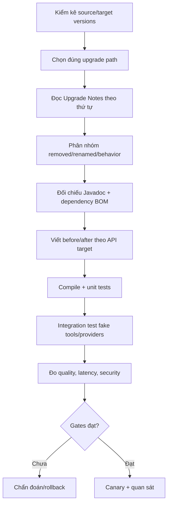
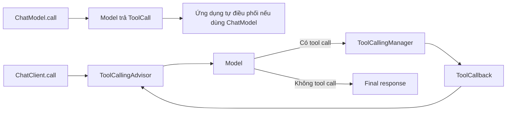
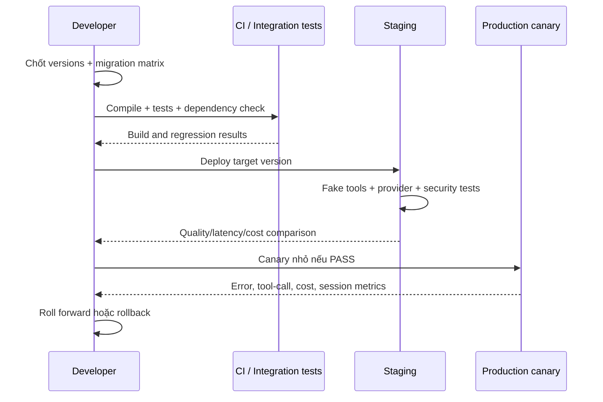

# Đọc migration guide và đối chiếu API đúng phiên bản Spring AI

Spring AI thay đổi nhanh theo các dòng phiên bản: cùng một ví dụ Tool Calling có thể sử dụng `ChatModel` tự thực thi tool trong 1.x, nhưng trên 2.x lại cần `ToolCallingAdvisor` hoặc một vòng điều phối do ứng dụng tự viết. Một đoạn mã cũ dùng `toolNames(...)`, `ToolCallAdvisor`, `internalToolExecutionEnabled(...)` hoặc `tools(Consumer<ToolSpec>)` có thể không còn biên dịch, hoặc biên dịch nhưng chạy khác trước. Vì vậy, **đọc migration guide phải đi cùng việc kiểm tra API đúng phiên bản đã khóa trong dependency graph**.

Bài này thuộc chương **Nâng cấp** của module **SPRING_AI_TOOL_CALLING**. Mục tiêu của module là giúp ứng dụng nhận yêu cầu gọi công cụ từ mô hình bằng `@Tool`, `ToolCallback`, JSON Schema và `ToolContext`, thực thi theo nhiều vòng, kiểm tra quyền, xử lý lỗi và kiểm thử an toàn. Do đó, việc nâng cấp không chỉ là sửa tên class; phải xác minh *tool nào được cung cấp, tool nào có thể thực thi, ai chịu trách nhiệm vòng lặp và kết quả nào được đưa lại cho mô hình*.

Các ví dụ trong bài dùng **Spring AI 2.1.0** làm phiên bản đích để giải thích. Khi dự án đang dùng 1.x, 2.0.x, milestone hoặc snapshot khác, cần đọc phần nâng cấp nối tiếp tương ứng. Không suy luận rằng một API ở tài liệu `main`, `SNAPSHOT` hoặc bài viết cũ chắc chắn có trong phiên bản bạn đã cài.

Sau bài học, bạn có thể:

- Xác định chính xác phiên bản Spring AI/Boot và các artifact có hiệu lực trong build.
- Chọn đúng chuỗi migration guide, reference và Javadoc theo phiên bản.
- Đối chiếu các thay đổi Tool Calling giữa 1.x → 2.0 → 2.1.
- Sửa cách đăng ký `@Tool`, `ToolCallback`, `ToolCallingAdvisor`, `ToolContext` và cấu hình tool.
- Nhận biết các API bị đổi tên, loại bỏ, deprecated và các thay đổi hành vi mặc định.
- Kiểm tra tương thích với memory, streaming, tool limits, exception và provider.
- Viết regression tests chứng minh tools vẫn được chọn, phân quyền và thực thi đúng.
- Lập kế hoạch rollout/rollback có thể kiểm tra thay vì nâng cấp “đồng loạt rồi sửa lỗi”.

## 1. Vì sao cùng một bài hướng dẫn có thể sai trên dự án của bạn?

Trong Spring AI, code sample có thể đúng tại thời điểm tài liệu được viết nhưng không đúng trên một phiên bản khác.

| Hiện tượng | Nguyên nhân thường gặp | Cách xử lý |
| --- | --- | --- |
| `ToolCallAdvisor` không tìm thấy | API 2.x dùng `ToolCallingAdvisor` | Đọc phần rename trong upgrade notes |
| Tool call được model trả về nhưng callback không chạy | 2.x `ChatModel.call(...)` không tự chạy tool loop | Chuyển sang `ChatClient` hoặc tự điều phối |
| `toolNames(...)` không còn | Mô hình đăng ký bare Function bean theo tên đã bị loại bỏ | Định nghĩa `ToolCallback` hoặc POJO `@Tool` tường minh |
| `internalToolExecutionEnabled(...)` báo lỗi | Tùy chọn đã bị xóa trong 2.0 | Đưa trách nhiệm vòng lặp lên advisor/manager |
| `.tools(spec -> ...)` không biên dịch | `ChatClient.ToolSpec` Consumer API bị bỏ | Dùng `.tools(...)` và `.toolContext(...)` riêng |
| Tool bean có trong context nhưng không chạy khi gọi tên | Resolver fallback tắt mặc định từ 2.0.1 | Đính kèm callback vào request thay vì bật fallback rộng |
| Tool-call message bị mất trong history | Memory advisor/repository không giữ tool traffic | Kiểm tra advisor order và Session Memory |
| Tool call stream bị xem là chưa đầy đủ | 2.1 phân biệt partial `ToolCallPart` với complete call | Chỉ thực thi/chấm call hoàn chỉnh |
| Dashboard token usage tăng sau upgrade | 2.0.3 cộng dồn usage toàn tool loop | Đối chiếu lại ngữ nghĩa của metric |

Một lỗi nâng cấp có thể là **compile-time** hoặc **behavioral**. Compile pass không chứng minh security policy và tool loop còn đúng. Đặc biệt, hành vi mặc định có thể đổi mà không bắt bạn sửa một dòng Java nào.

## 2. Xác định ba lớp phiên bản trước khi đọc tài liệu

Đừng hỏi chung “Spring AI phiên bản mới làm thế nào?”. Hãy ghi chính xác:

1. **Source version**: dự án đang chạy phiên bản Spring AI nào, kể cả patch/milestone/RC.
2. **Target version**: phiên bản muốn nâng đến, chẳng hạn `2.1.0`.
3. **Runtime/build stack**: Spring Boot, Java, Maven/Gradle, provider SDK và các module MCP/vector/session.

Ví dụ một migration ticket:

```yaml
migration:
  springAiFrom: "1.1.x"
  springAiTo: "2.1.0"
  sourceFramework: "Spring Boot version in current build"
  targetFramework: "Spring Boot version verified for target line"
  javaVersion: "Verified with target Spring Boot"
  toolCallingStyle: "ChatClient + @Tool and ToolCallback"
  memoryStyle: "MessageChatMemoryAdvisor"
  providers:
    - "OpenAI-compatible chat"
  acceptanceTests:
    - "Tool selection and arguments"
    - "Multi-round execution"
    - "Tenant authorization"
    - "Timeout and exception handling"
```

`1.1.x` trong ví dụ là dòng nguồn, không phải chỉ định một artifact cụ thể. Khi triển khai, phải thay bằng phiên bản đã resolve thật.

Về nền tảng, **hướng dẫn nâng cấp Spring AI 2.1 nêu sử dụng Spring Boot 4.2 cùng Spring AI 2.1; Spring AI 2.0 gắn với dòng Boot 4.1**. Trang Getting Started cũng ghi Spring AI 2.0.x hỗ trợ Boot 4.0.x và 4.1.x. Với sản phẩm thật, hãy kiểm tra release/compatibility notes của **target patch** và Spring Boot, không sao chép phiên bản Boot từ một bài cũ.

## 3. Chọn đúng bộ tài liệu, đừng chỉ đọc một link

Mỗi nguồn trả lời một câu hỏi khác nhau:

| Tài liệu | Dùng để kiểm tra | Có thể bỏ sót |
| --- | --- | --- |
| **Upgrade Notes** | Breaking change, deprecated, removed, changed defaults | Chi tiết API của từng class |
| **Upgrading to 2.0 / 2.1** | Hướng di chuyển, thứ tự xử lý và ví dụ trước–sau | Các patch changes xuất hiện sau release |
| **Reference đúng release** | Cách sử dụng thành phần ở phiên bản đích | Ngữ nghĩa API ở phiên bản nguồn |
| **Javadoc đúng artifact version** | Method signature, constructor, parameter, return type, deprecated marker | Hành vi hệ thống end-to-end |
| **Release tag/changelog** | Thay đổi của đúng patch, M/RC/stable | Ví dụ hoàn chỉnh của ứng dụng |
| **Resolved dependency tree** | JAR thực sự có trên classpath | Ý định của file pom hoặc gradle |
| **Integration/regression tests** | Ứng dụng của bạn còn hoạt động không | Mọi trường hợp chưa được test |

Nguồn chính thức nên bắt đầu từ:

- [Spring AI Upgrade Notes](https://docs.spring.io/spring-ai/reference/upgrade-notes.html)
- [Spring AI 2.1.0 Tool Calling](https://docs.spring.io/spring-ai/reference/api/tools.html)
- [Spring AI 2.1.0 ToolCallingAdvisor](https://docs.spring.io/spring-ai/reference/api/tools/tool-calling-advisor.html)
- [Spring AI Getting Started](https://docs.spring.io/spring-ai/reference/getting-started.html)
- [Spring AI API/Javadoc](https://docs.spring.io/spring-ai/docs/2.1.x/api/)

Một ví dụ quan trọng về việc kiểm tra **mã phiên bản ngay trong code block**: trang Getting Started khi được tham chiếu ở thời điểm soạn bài hiển thị tiêu đề Spring AI 2.1.0, nhưng đoạn minh họa BOM có thể vẫn đặt `2.0.0`. Vì thế, **header “2.1.0” không tự thay thế số phiên bản ghi trong dependency snippet**. Khi muốn dùng 2.1.0, hãy nhập đúng `spring-ai-bom:2.1.0` và đối chiếu artifact có trên Maven Central.

Đối với link `/2.1-SNAPSHOT/`, hiểu rằng đây là tài liệu của nhánh đang phát triển, không tự dùng để chứng minh một API đã có trong **2.1.0 stable**. Hãy ưu tiên Upgrade Notes/reference được gắn nhãn stable; nếu chỉ có hướng dẫn snapshot, đối chiếu tiếp Javadoc và thư viện thực tế.

## 4. Quy trình đọc migration guide theo từng bước



Chi tiết các bước:

1. Chốt một source release và target release, không dùng từ “latest” làm version selector trong bản build.
2. Đọc **toàn bộ các đoạn upgrade** giữa chúng: từ 1.1.x phải đi qua thay đổi 2.0.0 rồi 2.0.1/2.0.3 và 2.1.0.
3. Lập danh sách các API bị xóa/đổi tên và các hành vi mặc định đổi.
4. Kiểm tra từng claim bằng Javadoc phiên bản đích hoặc dependency thật.
5. Sửa các call sites nhỏ nhất trước, không refactor toàn hệ thống đồng thời.
6. Kiểm tra tool schemas, vòng lặp, security/context, memory và failures.
7. So sánh chất lượng và hiệu năng với baseline, rồi mới chấp nhận rollout.

Các thay đổi công cụ nguy hiểm nhất thường là thay đổi **hành vi**: một tool có thể không chạy khi trước đây đã chạy, hoặc một memory repository có thể không giữ message cần thiết.

## 5. Quản lý dependency bằng BOM và đúng Spring Boot line

Spring AI cung cấp Maven BOM để quản lý phiên bản các module Spring AI thuộc cùng release. Spring Boot parent/BOM quản lý các dependency lõi của Boot; hai tầng cần tương thích.

Ví dụ Maven cho **Spring AI 2.1.0**:

```xml
<dependencyManagement>
    <dependencies>
        <dependency>
            <groupId>org.springframework.ai</groupId>
            <artifactId>spring-ai-bom</artifactId>
            <version>2.1.0</version>
            <type>pom</type>
            <scope>import</scope>
        </dependency>
    </dependencies>
</dependencyManagement>

<dependencies>
    <dependency>
        <groupId>org.springframework.ai</groupId>
        <artifactId>spring-ai-starter-model-openai</artifactId>
    </dependency>
</dependencies>
```

`spring-ai-starter-model-openai` là ví dụ starter cho OpenAI. Nếu dùng Anthropic/Ollama/Bedrock hoặc provider khác, thay bằng starter được liệt kê trong tài liệu phiên bản đích. Không tự thêm version riêng cho từng Spring AI module nếu BOM đã quản lý chúng, trừ khi có chủ đích và đã kiểm chứng compatibility.

Ví dụ Gradle dùng native BOM:

```groovy
dependencies {
    implementation platform("org.springframework.ai:spring-ai-bom:2.1.0")
    implementation "org.springframework.ai:spring-ai-starter-model-openai"
}
```

Các lệnh dùng trong **dự án thử nghiệm riêng** để xác minh version (không phải thao tác của worker viết bài này):

```bash
# Maven: kiểm tra dependencies thực sự resolve
mvn dependency:tree -Dincludes=org.springframework.ai

# Maven: kiểm tra effective POM sau parent/BOM và profiles
mvn help:effective-pom

# Gradle: dependency graph của runtime
./gradlew dependencies --configuration runtimeClasspath

# Gradle: vì sao một module có phiên bản hiện tại
./gradlew dependencyInsight --dependency spring-ai-core \
  --configuration runtimeClasspath
```

Không đọc dependency tree bằng cách đoán từ `pom.xml`: transitive dependencies, profiles, BOM import order và overrides có thể làm effective version khác với dự kiến. Khi gặp `NoSuchMethodError` hoặc `ClassNotFoundException` dù source biên dịch, kiểm tra runtime classpath trước khi đổi code.

## 6. Starter/artifact IDs đã thay đổi qua các đời

Các dự án từ thời Spring AI 0.x/1.x có thể còn các artifact names kiểu cũ:

| Kiểu cũ | Kiểu mới |
| --- | --- |
| `spring-ai-openai-spring-boot-starter` | `spring-ai-starter-model-openai` |
| `spring-ai-{model}-spring-boot-starter` | `spring-ai-starter-model-{model}` |
| `spring-ai-{store}-store-spring-boot-starter` | `spring-ai-starter-vector-store-{store}` |
| `spring-ai-mcp-{type}-spring-boot-starter` | `spring-ai-starter-mcp-{type}` |
| `spring-ai-spring-boot-autoconfigure` (monolithic) | Các artifact auto-config phân tách theo component |

Khi đổi starter, ngoài việc build thành công cần xác nhận Spring Boot thật sự tạo đúng `ChatModel`, `ToolCallingManager`, `ChatClient.Builder`, `ToolCallbackResolver` và các Bean cần thiết. Nếu cấu hình custom `@Bean` thì kiểm tra thứ tự/điều kiện `@ConditionalOnMissingBean` vì auto-configuration có thể thay đổi.

Đừng xem việc artifact tồn tại trên Maven Central là bằng chứng rằng nó tương thích với mọi dòng Boot hoặc mọi module còn lại.

## 7. Bảng mốc quan trọng cho Tool Calling

| Chủ đề | Spring AI 1.x | Spring AI 2.0.x | Spring AI 2.1.0 |
| --- | --- | --- | --- |
| Vòng tool calling trong `ChatModel` | Nhiều provider có internal loop | Internal loop bị loại bỏ | Giữ kiến trúc không internal loop |
| `ChatClient` tool loop | Cách triển khai cũ | `ToolCallingAdvisor` trong advisor chain | Tiếp tục hỗ trợ |
| Tên advisor | `ToolCallAdvisor` xuất hiện ở code 1.x | `ToolCallingAdvisor` | `ToolCallingAdvisor` |
| Callback API | Có giai đoạn legacy `FunctionCallback`, sau đó `ToolCallback` | Deprecated legacy FunctionCallback bị loại bỏ | `ToolCallback` |
| Named Function bean lookup | `SpringBeanToolCallbackResolver` / `toolNames` ở code cũ | Bị loại bỏ | Đính kèm `ToolCallback` tường minh |
| Tool context | Có những thuộc tính lịch sử hội thoại cũ | Lịch sử không tự vào `ToolContext` | Dùng context riêng của ứng dụng |
| Resolve tool bean không gắn request | Tùy cách làm cũ | Tắt fallback mặc định từ 2.0.1 | Tắt mặc định |
| Conversation memory | `ChatMemory` | Memory advisor có vị trí mới | `ChatMemory` deprecated; Session Memory là hướng mới |
| Ordered message parts | Message API trước đó | Message API cũ | `MessagePart` có thứ tự và streaming parts |
| Tool call limits | Thay đổi theo release | 2.0.3 thêm mặc định 40/150 | Giữ giới hạn trong tool manager |
| Tool confirmation | Tùy app tự triển khai | Chưa có API confirmation tương ứng | `requiresConfirmation` và confirmation workflow |

Bảng này là **bản đồ để biết cần tra phần nào**, không thay thế kiểm tra từng patch/RC. Một số API như `ToolCallback` đã được giới thiệu từ dòng 1.x, nên không nên viết “2.0 là lần đầu Spring AI có ToolCallback”.

## 8. Thay đổi trọng tâm: ChatModel không còn tự thực thi tool

Trong Spring AI 1.x, một số ứng dụng gọi `ChatModel.call(prompt)` với tools và dựa vào internal tool loop của model implementation. Trong 2.0+, vòng này bị loại bỏ: `ChatModel.call(prompt)` chỉ trả phản hồi model chứa tool-call request, **không tự gọi callback**.

Mô hình hành vi:



Đường nâng cấp thường dùng:

```java
// Kiểu 2.x khuyến nghị: ChatClient điều phối.
ChatClient client = ChatClient.create(chatModel);

String response = client.prompt()
        .user("Kiểm tra trạng thái đơn ORD-42")
        .tools(new OrderTools(orderService))
        .call()
        .content();
```

Trong đó:

```java
public final class OrderTools {

    private final OrderService orderService;

    public OrderTools(OrderService orderService) {
        this.orderService = orderService;
    }

    @Tool(description = "Tra cứu trạng thái đơn hàng theo mã")
    public OrderSummary lookupOrder(String orderId) {
        return orderService.findAuthorizedSummary(orderId);
    }
}
```

Mô hình chỉ tạo arguments; service phía ứng dụng vẫn kiểm tra principal/tenant/resource. Ví dụ ngắn minh họa API target, không thay thế mẫu authorization hoàn chỉnh.

Nếu vẫn dùng `ChatModel` trực tiếp vì cần custom orchestration, phải gọi `ToolCallingManager.executeToolCalls(prompt, response)`, thêm `ToolResponseMessage` vào history và gọi model tiếp có điều kiện dừng. Không gọi một lần `chatModel.call(prompt)` rồi mong callback tự chạy.

## 9. Bỏ internalToolExecutionEnabled và chọn đường điều phối

Một số code Spring AI 1.x có:

```java
// Kiểu cũ, KHÔNG còn hợp lệ trong Spring AI 2.0+.
ToolCallingChatOptions options = ToolCallingChatOptions.builder()
        .internalToolExecutionEnabled(false)
        .build();
```

`internalToolExecutionEnabled` đã bị loại bỏ cùng cơ chế internal loop. Không thay nó bằng cờ tương tự trên một provider-specific `ChatOptions`.

Chọn một trong hai chiến lược:

| Mục đích | Chiến lược |
| --- | --- |
| Tool calling thông thường, nhiều lượt | `ChatClient` + `ToolCallingAdvisor` (tự đăng ký) |
| Cần kiểm soát toàn bộ loop | `ChatModel` trực tiếp + `ToolCallingManager` |
| Muốn thu model tool calls mà không chạy tool | Tắt auto-registration theo request |
| Tool cần confirmation | Dùng confirmation workflow của manager/advisor 2.1 |
| Tự phát triển recursive advisor | Chỉ có một `ToolAdvisor` giữ quyền điều phối |

Ví dụ tắt auto tool execution cho một request để đọc ý định model:

```java
ChatResponse rawResponse = chatClient.prompt()
        .user("Tra cứu đơn ORD-42")
        .tools(orderTool)
        .advisors(AdvisorParams.toolCallingAdvisorAutoRegister(false))
        .call()
        .chatResponse();

if (rawResponse != null && rawResponse.hasToolCalls()) {
    List<AssistantMessage.ToolCall> requested =
            rawResponse.getResult().getOutput().getToolCalls();
    // Ứng dụng quyết định cách xử lý; callback chưa tự chạy.
}
```

Đừng tắt advisor để “sửa lỗi” rồi quên triển khai vòng xử lý tool ở tầng khác. Nó sẽ làm ứng dụng nhận yêu cầu gọi tool mà không trả kết quả cho người dùng.

## 10. Đổi ToolCallAdvisor thành ToolCallingAdvisor

Với mã 1.x có tạo advisor trực tiếp:

```java
// Cũ (1.x)
var advisor = ToolCallAdvisor.builder().build();
```

Thành:

```java
// Đích (2.x)
var advisor = ToolCallingAdvisor.builder().build();
```

Tuy nhiên, trong `ChatClient` 2.x, `ToolCallingAdvisor` đã được **auto-register** theo cơ chế chuẩn. Vì vậy, ứng dụng thông thường không cần thêm advisor thủ công:

```java
ChatClient chatClient = ChatClient.builder(chatModel)
        .defaultTools(new OrderTools(orderService))
        .build();
```

Nếu đăng ký custom `ToolCallingAdvisor`, phải kiểm soát invariant chỉ có **một** `ToolAdvisor` trong advisor chain. Có thể dùng builder/bean được framework hỗ trợ hoặc tắt auto-registration rồi gắn custom advisor. Một custom advisor điều phối tool loop nên implement marker `ToolAdvisor`; một advisor chỉ quan sát không nên nhận marker này.

Giá trị mặc định `ToolCallingAdvisor.DEFAULT_ORDER` là `Ordered.HIGHEST_PRECEDENCE + 300`. Khi đổi advisor order, phải xem thành phần memory hoặc observability nằm **bên trong/bên ngoài loop**, không chỉ sửa số cho compile pass.

## 11. FunctionCallback legacy sang ToolCallback

Nếu dự án có code legacy:

```java
// Dạng FunctionCallback cũ, không dùng ở 2.x.
FunctionCallback callback = FunctionCallback
        .builder()
        .function("lookupOrder", function)
        .build();
```

Trong Spring AI 2.x, có thể dùng `FunctionToolCallback`:

```java
public record LookupOrderRequest(String orderId) {}

FunctionToolCallback callback =
        FunctionToolCallback.builder("lookupOrder", orderService::lookup)
                .description("Tra cứu trạng thái đơn hàng theo mã")
                .inputType(LookupOrderRequest.class)
                .build();
```

Hoặc dùng phương thức có `@Tool` nếu đang sở hữu code Java:

```java
public class OrderTools {
    private final OrderService service;

    public OrderTools(OrderService service) {
        this.service = service;
    }

    @Tool(description = "Tra cứu trạng thái đơn hàng theo mã")
    public OrderSummary lookupOrder(
            @ToolParam(description = "Mã đơn hàng") String orderId,
            ToolContext toolContext) {

        return service.lookupAuthorized(
                orderId, toolContext.getContext());
    }
}
```

`ToolContext` là kênh dữ liệu nội bộ, không nằm trong tool JSON Schema gửi mô hình; đừng lấy role/tenant do mô hình tự tạo làm bằng chứng xác thực. Dùng service policy đọc actor/tenant từ context đã được server tạo và validate.

Không gọi `FunctionToolCallback.builder(...)` bằng một tên trùng callback khác. Tool names phải duy nhất trong tập tool gửi model, và JSON Schema cần khớp đúng input DTO.

## 12. Bỏ SpringBeanToolCallbackResolver và toolNames()

Ví dụ 1.x đăng ký bare `Function` bean rồi chỉ gọi tên:

```java
// Cũ: không còn hỗ trợ theo kiểu này trong 2.x.
@Bean
Function<LookupOrderRequest, OrderSummary> lookupOrder() {
    return request -> orderService.lookup(request.orderId());
}

// chatClient.prompt().toolNames("lookupOrder").call();
```

Trong 2.x, định nghĩa `ToolCallback` bean tường minh:

```java
@Configuration(proxyBeanMethods = false)
class OrderToolConfiguration {

    @Bean
    ToolCallback lookupOrderTool(OrderService service) {
        return FunctionToolCallback.builder(
                "lookupOrder",
                (LookupOrderRequest request) ->
                        service.lookup(request.orderId()))
                .description("Tra cứu trạng thái đơn hàng")
                .inputType(LookupOrderRequest.class)
                .build();
    }
}
```

Và inject/đính kèm trong request:

```java
String answer = chatClient.prompt()
        .user("Kiểm tra đơn ORD-42")
        .tools(lookupOrderTool)
        .call()
        .content();
```

`ToolCallbackResolver` có thể biết các `ToolCallback` bean trong application context, nhưng **biết tool không đồng nghĩa tool được phép chạy ở mọi request**. Từ 2.0.1 fallback tắt mặc định; việc tồn tại bean không tự quảng bá hoặc cấp quyền thực thi.

## 13. ChatClient.ToolSpec Consumer API đã bị loại bỏ

Một kiểu code cũ:

```java
// Cũ: ToolSpec Consumer không còn.
chatClient.prompt()
        .tools(spec -> spec.callbacks(myCallback)
                .context("tenantId", "acme"))
        .call()
        .content();
```

Trong 2.x, tách đăng ký tool và context:

```java
String answer = chatClient.prompt()
        .user(question)
        .tools(myCallback)
        .toolContext(Map.of(
                "tenantId", trustedTenantId,
                "actorId", trustedActorId))
        .call()
        .content();
```

`ChatClient.Builder.defaultTools(...)` thêm tool cho mọi request tạo từ client, còn `.tools(...)` ở request **cộng thêm**, không thay thế default tools. Nếu default set chứa tool có side effect, việc gọi `.tools(readOnlyTool)` không thu hẹp quyền. Khi nâng cấp cần kiểm thử cả hai lớp.

## 14. ChatModel options khác ChatClient tools precedence

Trong Spring AI 2.x, cần phân biệt:

- `ChatClient`: `defaultTools(...)` cộng với request `tools(...)`.
- `ChatModel` trực tiếp: `Prompt.options` nếu được truyền thì **thay thế** model default options; ứng dụng phải hợp nhất tools/options nếu cần.
- Resolver fallback: là một cơ chế **khác**, có thể tìm callback không nằm trong request khi được bật.

Bảng:

| Cấu hình | Kết quả cần kiểm thử |
| --- | --- |
| ChatClient default `lookupOrder` + request `shipping` | Có cả hai tool definitions |
| ChatClient default `deleteOrder` + request `lookupOrder` | `deleteOrder` vẫn ở request, rủi ro lớn |
| ChatModel default options có tool A, prompt có options B | Tool options từ prompt thay thế defaults |
| Callback bean tồn tại, không đính kèm request, fallback tắt | Không được thực thi bằng resolver fallback |
| Callback bean tồn tại, fallback bật | Có thể phân giải và thực thi ngoài request, cần allowlist/security |

Đây là thay đổi hành vi có thể làm sai chính sách quyền ngay cả khi code biên dịch. Test phải kiểm tra tool definitions được gửi model và tool callback thực sự có thể được chạy.

## 15. Resolution fallback mặc định tắt từ 2.0.1

Trước khi mặc định bị thay đổi, `DefaultToolCallingManager` có thể tìm callback không có trong request từ `ToolCallbackResolver` toàn ứng dụng. Từ 2.0.1, callback gắn qua `.tools(...)`, `.defaultTools(...)` hoặc `ToolCallingChatOptions.toolCallbacks(...)` mới là tập được thực thi theo mặc định.

```properties
# Mặc định trong Spring AI 2.1.0
spring.ai.tools.resolution.fallback.enabled=false
```

Có thể bật lại để tương thích hành vi cũ:

```properties
spring.ai.tools.resolution.fallback.enabled=true
```

**Không nên bật toàn cục chỉ để làm regression test pass.** Resolver mặc định có thể biết các tool được đăng ký dưới dạng bean mà request hiện tại không được phép dùng. Đường di chuyển an toàn là đính kèm callback rõ ràng ở request theo actor/tenant/resource policy.

Nếu thật sự cần fallback, phải giới hạn `ToolCallbackResolver` bằng allowlist và kiểm tra quyền lại trong callback/service. Việc model biết một tên tool không phải bằng chứng user có quyền gọi nó.

## 16. ToolContext không còn tự mang conversation history

Trong các thay đổi 2.0, `ToolContext.TOOL_CALL_HISTORY` và `ToolContext.getToolCallHistory()` đã bị loại bỏ. Lịch sử hội thoại không còn được tự điền vào `ToolContext`.

Lý do: callback nên xử lý arguments và ngữ cảnh nghiệp vụ do ứng dụng truyền; việc giữ history thuộc trách nhiệm của advisor/session layer.

Thay cách truy xuất history từ `ToolContext` bằng:

- `ToolCallingAdvisor` hoặc Session Memory để quản lý vòng hội thoại.
- `ToolContext` chỉ chứa actor/tenant/correlation/credential handle an toàn và được xác thực.
- Nếu callback cần dữ kiện nghiệp vụ, hãy truyền dưới dạng tham số có schema hoặc tìm từ server-owned state sau khi kiểm tra quyền.

```java
String result = chatClient.prompt()
        .user(question)
        .tools(orderTool)
        .toolContext(Map.of(
                "actorId", authenticatedActor.id(),
                "tenantId", authenticatedActor.tenantId()))
        .call()
        .content();
```

Không tạo một `Map` chứa toàn bộ chat history rồi đặt vào `ToolContext` để “khôi phục hành vi cũ”: dễ tăng memory không kiểm soát, rò dữ liệu và phá ranh giới trách nhiệm.

## 17. Memory advisor order thay đổi và Session Memory 2.1

Từ 2.0, `MessageChatMemoryAdvisor` mặc định order `HIGHEST_PRECEDENCE + 200`, nằm **ngoài** `ToolCallingAdvisor` order `+300`. Kết quả:

- Memory advisor đọc history một lần trước tool loop.
- ToolCallingAdvisor tự giữ history đầy đủ cho các model rounds bên trong loop.
- Repository chỉ nhận user message cuối và assistant final response; không thấy các intermediate tool messages.

Nếu đặt memory advisor **bên trong** loop (order lớn hơn `+300`), repository cần hỗ trợ lưu `AssistantMessage` chứa tool calls và `ToolResponseMessage`. Không phải mọi `ChatMemoryRepository` đều hỗ trợ.

Trong **2.1.0**, `ChatMemory`, `MessageWindowChatMemory`, `ChatMemoryRepository` và các adapter liên quan được đánh dấu **deprecated**, dự kiến loại bỏ ở 3.0.0. Định hướng thay thế là **Session Memory**, dùng event log và view/compaction theo turn.

Ví dụ hướng tiếp cận mới:

```java
ChatClient chatClient = ChatClient.builder(chatModel)
        .defaultAdvisors(
                SessionAdvisors.builder(sessionService).build())
        .build();
```

Trong request, truyền session ID do server quản lý:

```java
String answer = chatClient.prompt()
        .user(question)
        .advisors(SessionAdvisors.session(sessionId))
        .tools(orderTool)
        .call()
        .content();
```

`SessionAdvisors` phối hợp `SessionMemoryAdvisor` bên trong loop và `SessionTurnAdvisor` bên ngoài, giúp lưu đúng tool messages và các trường hợp `returnDirect`. Khi di chuyển persisted history, cần kế hoạch chuyển dữ liệu, kiểm tra thứ tự tool-call/tool-response và quyền truy cập session; không chỉ thay class name.

## 18. MessageParts mới ở Spring AI 2.1

`AssistantMessage` và `UserMessage` trong 2.1 giữ nội dung ở danh sách `MessagePart` có thứ tự, như `TextPart`, `ReasoningPart`, `ToolCallPart`, `ToolResultPart`, `MediaPart` và `UnknownPart`.

Những getter quen thuộc `getText()`, `getMedia()`, `getToolCalls()` vẫn tồn tại, nhưng là view trên ordered parts. Lưu ý:

- `getToolCalls()` và `getMedia()` trả danh sách **không thể sửa trực tiếp**; dùng builder thay vì `.add()` trên getter.
- Equality/hash của message tính cả parts; test so sánh message có media có thể thay đổi.
- Streaming có partial parts; `AssistantMessage.hasToolCalls()` và `getToolCalls()` bỏ qua partial `ToolCallPart`.
- Một custom model stream tool arguments cần phát cả **complete tool-call part** ở đúng index, không chỉ các deltas.
- Lưu message chỉ bằng text có thể làm mất reasoning/tool/media parts cần thiết để replay.

Ví dụ đọc tool calls một cách an toàn:

```java
ChatResponse response = chatClient.prompt()
        .user(question)
        .advisors(AdvisorParams.toolCallingAdvisorAutoRegister(false))
        .call()
        .chatResponse();

if (response != null && response.hasToolCalls()) {
    for (AssistantMessage.ToolCall call
            : response.getResult().getOutput().getToolCalls()) {
        audit.recordRequestedTool(call.id(), call.name());
    }
}
```

Không tính một partial delta là một callback execution mới hoặc tự khôi phục call từ chuỗi JSON chưa hoàn chỉnh.

## 19. Tool call limits, usage và behavior changes trong 2.0.3/2.1

Khi đi lên phiên bản 2.0.3, `DefaultToolCallingManager` đặt giới hạn mặc định:

- **40 lần gọi cho mỗi tên tool trong một turn**.
- **150 lần gọi tool tổng trong một turn**.

Các giới hạn này được giữ trong dòng 2.1.0. Có thể điều chỉnh qua `ToolCallingManager.builder().maxCallsPerTool(...)`, `maxTotalToolCalls(...)` và các property `spring.ai.tools.limits.*` nếu nghiệp vụ đã đánh giá an toàn.

Ngoài ra, `ToolCallingAdvisor` tích lũy usage của **mọi model calls** trong tool loop thay vì chỉ phản ánh usage của lần gọi cuối. Khi nâng cấp, dashboard hoặc unit tests đếm tokens có thể tăng dù ứng dụng không thực hiện nhiều work hơn. Kiểm tra định nghĩa metric/usage trước khi báo cáo chi phí tăng.

```java
ToolCallingManager manager = ToolCallingManager.builder()
        .maxCallsPerTool(20)
        .maxTotalToolCalls(60)
        .build();
```

Không phải mọi `maxModelCalls` đều là tùy chọn của `ToolCallingManager`; quản lý tổng model rounds là một ngân sách riêng của orchestration. Khi đặt limits, test cả lỗi, retry, tool batch và điều kiện dừng.

## 20. Tool confirmation là tính năng mới của Spring AI 2.1

Spring AI 2.1 có `@Tool(requiresConfirmation = true)` và chính sách confirmation của manager. Với tool nhạy cảm:

```java
public class OrderActionTools {

    private final OrderService orderService;

    public OrderActionTools(OrderService orderService) {
        this.orderService = orderService;
    }

    @Tool(
        description = "Hủy đơn hàng sau khi có xác nhận",
        requiresConfirmation = true)
    public CancellationResult cancelOrder(String orderId) {
        return orderService.cancelAuthorized(orderId);
    }
}
```

Khi model yêu cầu tool cần confirmation, `ToolCallingAdvisor` tạm dừng trước khi chạy bất kỳ call nào trong batch đó. Ứng dụng đọc response (không chỉ `content()`), hiển thị yêu cầu phê duyệt, rồi xử lý decisions theo `ToolCallingManager`.

Ứng dụng vẫn phải:

- Xác thực người được phép duyệt và kiểm tra quyền trên tài nguyên.
- Giữ paused reply trong server-owned store, không tin phiên bản client tự gửi lại.
- Chặn replay/duplicate execution; dùng idempotency key.
- Xử lý batch nếu vừa có tool nhạy cảm vừa có tool chỉ đọc.
- Cân nhắc Session Memory để lưu đầy đủ lịch sử trước và sau pause.

Nếu đang ở 2.0.x, không sao chép `requiresConfirmation` và API decision của 2.1 mà không kiểm tra tồn tại trong đúng target artifact.

## 21. Thay đổi OpenAI strict mode trong 2.0.3/2.1

Theo Upgrade Notes, `OpenAiChatModel` ở nhánh 2.0.3 không còn mặc định gửi tool schema với `strict(true)`; mặc định trở thành **non-strict**. Lý do: JSON Schema generator với optional parameters không thỏa hợp đồng strict cũ nếu xử lý theo cách trước đó.

Nếu muốn bật lại strict:

```java
OpenAiChatOptions options = OpenAiChatOptions.builder()
        .strict(true)
        .build();
```

Khi bật, Spring AI có xử lý nullable/required cho optional parameters phù hợp với strict mode của OpenAI. Test toàn bộ `@ToolParam(required = false)`, `@Nullable`, enum và nested DTOs trên provider/version đích. Đừng xem việc bật strict là thay thế validation phía server hoặc authorization.

Nếu code cũ đang dựa vào strict mặc định mà không cấu hình, hành vi chọn arguments có thể thay đổi sau upgrade dù tên tool không đổi.

## 22. Các thay đổi ngoài tool API vẫn có thể ảnh hưởng tool calling

Một nâng cấp thực tế còn liên quan:

| Khu vực | Ví dụ thay đổi | Cần kiểm tra |
| --- | --- | --- |
| Chat options | `ChatModel#getDefaultOptions()` deprecated, ưu tiên `getOptions()` | Custom model wrappers và unit tests |
| Properties | Tiền tố `.options.` của model properties được làm phẳng ở 2.0 | `application.yml` và binding |
| Provider SDK | Anthropic 2.1 dùng Java SDK 3.x, API/headers thay đổi | Proxy, interceptor, authentication, HTTP logs |
| MCP SDK | Spring AI 2.0 dùng MCP Java SDK 2.x, tool input validation thay đổi | MCP tool schemas/handlers |
| Spring Boot | Dòng Boot và dependency stack phải phù hợp target | Auto-config, HTTP client, security |
| Media API | `Media.Builder.data(Object)` chuyển sang overload có kiểu trong 2.1 | Custom multimodal tools |
| Observability | Tool span names/attributes khác các bản trước | Dashboards/tracing queries |
| Streaming | Message aggregation và tool-call partial parts đổi | Streaming UI, aggregators, memory |
| Session persistence | ChatMemory deprecated; session stores mới | Conversation replay và migrations |

Một ứng dụng chỉ dùng `@Tool` cơ bản có thể không cần sửa nhiều Java code, nhưng vẫn bị lỗi nếu provider SDK đổi authentication header, schema strict, HTTP timeout hoặc MCP server-side validation.

## 23. Cách đối chiếu API bằng Javadoc và nguồn chính thức

Ví dụ khi gặp lời khuyên “hãy dùng `ToolCallAdvisor`”, hãy xác minh theo chuỗi sau:

1. Mở Upgrade Notes và tìm `ToolCallAdvisor` trong đoạn 1.x → 2.0.
2. Mở Javadoc của **đúng target version** và tìm `ToolCallingAdvisor`.
3. Kiểm tra package, builder methods, return types, deprecated markers.
4. So với file import/code hiện tại.
5. Xác minh JAR mà build đã resolve chứa class ấy.
6. Viết test chạy advisor chain để chắc chắn không có duplicate `ToolAdvisor`.

Trên JVM, compile errors thường có nhiều loại:

| Lỗi | Chẩn đoán ưu tiên |
| --- | --- |
| `cannot find symbol ToolCallAdvisor` | Class đã đổi tên, kiểm tra migration note |
| `cannot find symbol internalToolExecutionEnabled` | Method đã bị bỏ |
| `cannot find symbol toolNames` | API name-based legacy không tồn tại |
| `NoSuchMethodError` lúc runtime | Trộn JAR versions hoặc binary incompatibility |
| `ClassNotFoundException` | Thiếu starter/module hoặc dependency exclusion |
| `No qualifying bean of type ChatModel` | Provider starter/properties/auto-config chưa đúng |
| `duplicate ToolAdvisor` | Tool advisor thủ công và auto-registration xung đột |
| Model trả tool call nhưng không có execution | Dùng `ChatModel` trực tiếp hoặc opt-out advisor |
| Lịch sử tool không tương thích provider | Message parts bị mất hoặc memory ngoài loop |

Không giải quyết `NoSuchMethodError` bằng cách bỏ qua test hoặc disable tool calling. Kiểm tra dependency resolution và target Javadoc trước.

## 24. Lập bảng API migration ngay trong công việc nâng cấp

Một bảng thực tế có thể gồm các cột:

| API/behavior cũ | Hướng ở target 2.x/2.1 | Bằng chứng cần xác minh |
| --- | --- | --- |
| `ToolCallAdvisor` | `ToolCallingAdvisor` | Upgrade Notes + Javadoc |
| `FunctionCallback` legacy | `ToolCallback` / `FunctionToolCallback` | API đúng artifact |
| `toolNames(...)` | `.tools(callback)` | Test tool definition + dispatch |
| `tools(Consumer<ToolSpec>)` | `.tools(...)` + `.toolContext(...)` | Compile + context test |
| `internalToolExecutionEnabled` | ChatClient advisor hoặc custom manager loop | Multi-round integration test |
| `ChatModel.call` tự loop | Chỉ raw model result; app điều phối | Test callback không tự chạy |
| Implicit resolver fallback | Request-attached tools; fallback off | Authorization/security test |
| `ToolContext` chứa history | Advisor/Session Memory quản lý history | Conversation replay test |
| `MessageChatMemoryAdvisor` | Session Memory (khuyến nghị ở 2.1) | Persistence round-trip |
| Streaming partial call execution | Complete tool call mới thực thi | Streaming test |
| Message tools với mutable getter list | Immutable view + builder parts | Serialization/equality tests |

Ghi thêm **source version / target version**, mức độ nghiêm trọng, owner và kết quả kiểm thử. Nếu một API chỉ deprecated chứ chưa removed, không cần sửa tất cả ngay trong cùng release, nhưng nên tránh viết code mới dựa vào API sẽ bị bỏ trong 3.0.

## 25. Unit test bắt đúng vấn đề tool loop sau upgrade

Với model fake trả một `AssistantMessage` có tool call `lookup_order` và callback fake, test nên chứng minh:

- Khi dùng `ChatClient` auto tool advisor, callback được chạy đúng một lần và model nhận `ToolResponseMessage`.
- Khi dùng `ChatModel` trực tiếp, callback **không** tự chạy.
- Tool name/arguments đúng, không tạo dữ kiện còn thiếu.
- Authorization từ `ToolContext` được kiểm tra trước side effect.
- Tool callback bị từ chối không chạy dù model yêu cầu đúng tên.

Ví dụ skeleton minh họa:

```java
@Test
void chatClientExecutesToolThroughAdvisor() {
    // fakeModel: round 1 yêu cầu lookup_order(call-1),
    // round 2 đọc ToolResponseMessage rồi trả kết luận.
    ChatClient client = ChatClient.builder(fakeModel)
            .defaultTools(fakeLookupOrderCallback)
            .build();

    String answer = client.prompt()
            .user("Trạng thái đơn ORD-42")
            .call()
            .content();

    verify(fakeLookupOrderCallback, times(1))
            .call(anyString(), any(ToolContext.class));

    assertThat(answer).contains("SHIPPED");
}
```

`fakeModel`/`fakeLookupOrderCallback` là fixture test do ứng dụng xây. Có thể cần điều chỉnh mock khi tool runner dùng overload khác; mục tiêu chính là xác minh hành vi, không phải “copy paste test này vào mọi project”.

Test complementary cho direct `ChatModel`:

```java
@Test
void directChatModelDoesNotAutoExecuteTools() {
    ChatResponse response = fakeModel.call(promptWithToolDefinition);

    assertThat(response.hasToolCalls()).isTrue();
    verifyNoInteractions(fakeBusinessService);
}
```

Đừng dùng callback production trong các test có side effect. Với fake model, luôn đặt số model rounds tối đa để test không bị lặp vô hạn nếu orchestration sai.

## 26. Integration tests: kiểm tra vòng lặp, memory và lỗi

Một danh sách cases cần có sau nâng cấp:

| Case | Assertion |
| --- | --- |
| Không cần tool | Model trả lời, callback không chạy |
| Một tool call | Callback chạy đúng một lần và response được đưa lại model |
| Nhiều tool calls cùng response | Số lần thực thi đúng, tool call IDs không bị trộn |
| Nhiều vòng liên tiếp | Model nhận đầy đủ tool history trước round tiếp theo |
| Tool không gắn request | Fallback off ngăn callback ngoài request |
| Tool vượt quyền | Service từ chối trước khi gọi hệ thống nghiệp vụ |
| Thiếu required arguments | Hỏi làm rõ/validation từ chối, không bịa input |
| Tool trả lỗi/timeout | Không đánh dấu thành công giả, không lộ exception |
| Tool `returnDirect` | Trả đúng result cho caller, bỏ round model khi điều kiện thỏa |
| Tool confirmation | Pause trước khi chạy batch, resume chỉ khi duyệt |
| Giới hạn tool calls | Đúng behavior khi vượt per-tool/total limits |
| Streaming partial deltas | Không chạy callback chỉ vì nhận partial |
| Session memory | Lưu và đọc lại tool-call request/result đúng thứ tự |
| Token usage | Không đếm trùng khi lấy cumulative usage |
| Restart | Session/tool history replay được trên store đích |

Tất cả case có side effect phải chạy bằng fake tool hoặc sandbox. Khi thay đổi behavior mặc định, cần test cả trường hợp **không được** thực thi tool; chỉ test happy path là chưa đủ.

## 27. Những sai lầm thường gặp khi đọc migration guide

- Chỉ nhìn code trên blog không ghi phiên bản, rồi sao chép vào target 2.1.
- Lấy ví dụ ở trang `SNAPSHOT` và mặc nhiên nghĩ stable có API đó.
- Đọc đúng target reference nhưng bỏ qua **Upgrade Notes** về hành vi cũ.
- Bỏ qua patch changes như fallback disabled và token usage accumulation.
- Dựa vào tên artifact mà không kiểm tra dependency tree.
- Vừa nâng cấp Spring AI vừa thay model/provider/SDK mà không tách biến kiểm thử.
- Bật resolver fallback rộng để vá một tool name cũ.
- Chuyển sang `ChatClient` nhưng giữ nguyên một custom loop bên ngoài, gây gọi tool trùng.
- Dùng `ChatModel` trực tiếp và ngạc nhiên khi tool không chạy.
- Nghĩ `ToolContext` là nơi lưu conversation history như trước.
- Chuyển memory repository nhưng không test tool response round-trip.
- Chỉ compile, không chấm tool-selection/argument correctness sau nâng cấp.
- Tự sửa security policy hoặc tắt confirmation để làm regression pass.
- Không lập kế hoạch rollback khi phiên bản mới có behavior khác.

## 28. Quy trình rollout và rollback an toàn



Điều kiện trước rollout:

1. Build đã xác nhận effective Spring AI/Boot versions.
2. Tool definitions, args schema và callback execution đều pass.
3. Không có tool ngoài quyền được thực thi.
4. Không có phản hồi lỗi làm lộ dữ liệu nhạy cảm.
5. Tool-call limits/confirmation/defaults được kiểm thử rõ.
6. Session memory và persisted history tương thích hoặc có migration plan.
7. Task success, p95 latency và chi phí không suy giảm vượt ngưỡng được duyệt.
8. Rollback path tương thích dữ liệu lưu hoặc có chiến lược phục hồi.

Nếu chuyển persistent chat memory sang Session Memory, **rollback binary** có thể không đọc cùng định dạng dữ liệu mới; cần thử đường rollback trên staging và cân nhắc migration có thể đảo ngược hoặc dual-read có kiểm soát. Không giả định chỉ cần đổi version trong BOM là quay lại hoàn toàn trạng thái cũ.

## 29. Checklist đối chiếu API đúng phiên bản

- [ ] Chốt source/target Spring AI release chính xác; không ghi đơn giản “mới nhất”.
- [ ] Chốt Spring Boot và Java target phù hợp theo hướng dẫn chính thức.
- [ ] Dùng Spring AI BOM của target; không trộn nhiều phiên bản module.
- [ ] Kiểm tra dependency tree/effective POM hoặc Gradle dependencyInsight.
- [ ] Đọc Upgrade Notes đầy đủ cho tất cả bước giữa hai phiên bản.
- [ ] Đối chiếu reference/Javadoc của đúng target trước khi thay method.
- [ ] Không lấy API chỉ có ở SNAPSHOT làm chứng cứ của stable release.
- [ ] Đổi `ToolCallAdvisor`/`FunctionCallback`/`toolNames`/`ToolSpec` legacy khi cần.
- [ ] Không dựa vào `ChatModel` tự chạy tool loop trên Spring AI 2.x.
- [ ] Biết rõ `ChatClient` tự tạo `ToolCallingAdvisor` và single ToolAdvisor invariant.
- [ ] Kiểm tra `defaultTools`, request `tools` và fallback policy.
- [ ] Không chuyển actor/tenant/credential từ model arguments vào `ToolContext`.
- [ ] Xem lại ChatMemory advisor order và kế hoạch Session Memory nếu target 2.1.
- [ ] Test `MessagePart`/streaming complete call và tool response persistence.
- [ ] Đối chiếu default tool-call limits, cumulative usage và OpenAI strict setting.
- [ ] Test no-tool, multi-tool, multi-round, timeout, authorization, confirmation.
- [ ] Chạy quality/latency/cost baseline trước và sau upgrade.
- [ ] Có canary, monitoring và rollback plan; không tắt security để làm test pass.

## Những điểm cần nhớ

- **Migration guide là bản đồ thay đổi, Javadoc và dependency tree là bằng chứng API tồn tại.**
- Spring AI 2.x chuyển tool-loop responsibility ra khỏi `ChatModel`; dùng `ChatClient` với `ToolCallingAdvisor` hoặc tự điều phối qua `ToolCallingManager`.
- `ToolCallback` là API ổn định của hệ tool 2.x; các dạng `FunctionCallback`, bare Function `toolNames` cũ bị loại bỏ.
- `ChatClient.tools(...)` cộng thêm vào defaults, không thu hẹp default set. Resolver fallback tắt mặc định từ 2.0.1.
- `ToolContext` chứa ngữ cảnh do ứng dụng cung cấp, không tự mang conversation history.
- Spring AI 2.1.0 thêm ordered `MessagePart`, Session Memory và confirmation; `ChatMemory` deprecated.
- Partial streaming tool calls không được thực thi; chỉ complete calls mới hợp lệ.
- Kiểm tra thay đổi mặc định của limits, usage aggregation và provider-specific strict/schema.
- Chỉ compile pass chưa đủ: cần regression tests cho tool selection, arguments, authorization, memory và error handling.
- Nâng cấp thành công nghĩa là **hành vi nghiệp vụ và an toàn vẫn đúng** trên phiên bản mới, không phải chỉ hết lỗi import.

## Tài liệu tham khảo

- [Spring AI — Upgrade Notes (stable)](https://docs.spring.io/spring-ai/reference/upgrade-notes.html)
- [Spring AI — Getting Started và BOM](https://docs.spring.io/spring-ai/reference/getting-started.html)
- [Spring AI 2.1.0 — Tool Calling](https://docs.spring.io/spring-ai/reference/api/tools.html)
- [Spring AI 2.1.0 — ToolCallingAdvisor](https://docs.spring.io/spring-ai/reference/api/tools/tool-calling-advisor.html)
- [Spring AI 2.1.0 — ChatModel Tool Calling](https://docs.spring.io/spring-ai/reference/api/tools/chatmodel-tool-calling.html)
- [Spring AI 2.1.0 — Tool Call Confirmation](https://docs.spring.io/spring-ai/reference/api/tools/tool-call-confirmation.html)
- [Spring AI 2.1.0 — Session Memory](https://docs.spring.io/spring-ai/reference/api/session.html)
- [Spring AI 2.1.x — API/Javadoc](https://docs.spring.io/spring-ai/docs/2.1.x/api/)
- [Spring AI — Source releases/tags](https://github.com/spring-projects/spring-ai/releases)

Các thay đổi và ví dụ được trình bày theo tài liệu Spring AI 2.1.0 và Upgrade Notes chính thức tại thời điểm soạn. Những đoạn mã cũ được ghi **“Cũ”** chỉ có tác dụng nhận diện migration, không dùng trực tiếp trong dự án 2.1.0. Khi áp dụng thật, đối chiếu thêm phiên bản Spring Boot, provider SDK, dependency graph và kết quả test trên môi trường của ứng dụng; không suy đoán tính tương thích từ một ví dụ khác phiên bản.
