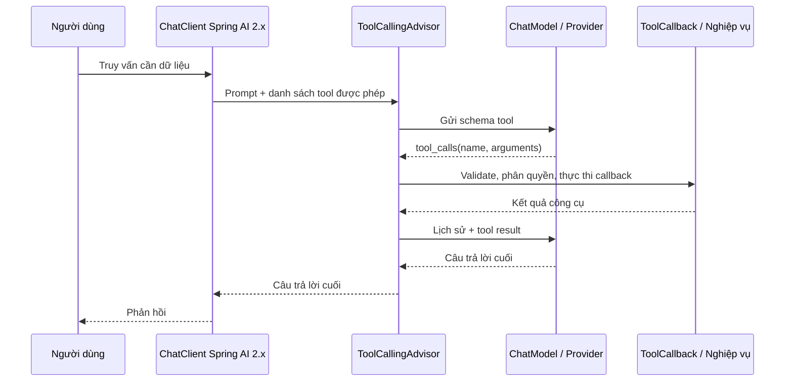

# Phân biệt API FunctionCallback kế thừa và ToolCallback

Khi nâng cấp một ứng dụng Spring AI đã viết từ các bản milestone hoặc dòng 1.x, bạn có thể gặp những đoạn mã dùng `FunctionCallback`, `FunctionCallback.builder()`, `defaultFunctions(...)`, `functions(...)` hoặc khai báo một `Function` bean rồi gọi qua tên. Nếu sao chép nguyên vẹn vào ứng dụng **Spring AI 2.1.0**, các loại/method cũ có thể không còn tồn tại hoặc không còn được tìm thấy. Việc thay bằng `ToolCallback` cần đi kèm kiểm tra **tên công cụ, JSON Schema, cách đăng ký, ngữ cảnh, phân quyền và vòng lặp thực thi**.

Bài thuộc chương **Nâng cấp** của module **SPRING_AI_TOOL_CALLING**. Mục tiêu là nhận biết chính xác API kế thừa và API hiện hành, chọn giữa `@Tool`, `FunctionToolCallback`, `MethodToolCallback`, chuyển cách đăng ký sang `ChatClient.tools(...)` và tránh các lỗi hay phát sinh khi thay đổi phiên bản. Mốc API đích của ví dụ mới là **Spring AI 2.1.0**; mã “trước” chỉ phục vụ đối chiếu lịch sử và **không được dùng để biên dịch trên 2.1.0**.

## 1. Phân biệt tên gọi và quá trình thay đổi phiên bản

“Function calling” và “tool calling” đều nói đến cách mô hình **đề xuất** ứng dụng gọi một công cụ với những đối số nhất định. Từ “function” trong tài liệu cũ không có nghĩa mô hình trực tiếp thực thi một hàm Java. Chính ứng dụng Spring AI nhận yêu cầu, xác định callback, kiểm tra quyền, thực thi mã nghiệp vụ rồi gửi kết quả cho mô hình.

Dòng thời gian cần nhớ:

| Giai đoạn | Tình trạng API | Điều cần làm |
| --- | --- | --- |
| Các bản Spring AI đời đầu, trước khi chuyển API | `FunctionCallback` và các phương thức `functions(...)`/`defaultFunctions(...)` là cách phổ biến để mô tả và đăng ký callback. | Khi bảo trì mã cũ, phải xác nhận chính xác phiên bản dependency trước khi sửa. |
| **Spring AI 1.0** (bắt đầu giai đoạn chuyển đổi ở các bản milestone) | `ToolCallback` xuất hiện để thay `FunctionCallback`; một thời gian có API cũ được đánh dấu `@Deprecated`/cơ chế tương thích. | Chuyển dần code sang `ToolCallback`, `@Tool` và `tools(...)`; đừng dựa vào hỗ trợ tạm thời. |
| **Spring AI 2.0** | Tài liệu nâng cấp công bố **loại bỏ** các kiểu/phương thức `FunctionCallback` đã deprecated; bỏ cơ chế tìm `Function` bean theo tên bằng `SpringBeanToolCallbackResolver` và `toolNames(...)`. | Đăng ký `ToolCallback` tường minh hoặc đối tượng có `@Tool`; thay API cũ trước khi nâng dependency. |
| **Spring AI 2.1.0** | Dùng mô hình `ToolCallback` nhất quán; `ChatClient` điều phối lời gọi qua `ToolCallingAdvisor` và `ToolCallingManager`. | Kiểm tra lại callback, công cụ được phép, schema, quyền, xử lý lỗi và luồng nhiều lượt. |

Trong Javadoc của một số **bản milestone 1.0**, `FunctionCallback` được đánh dấu deprecated và `ToolCallback` từng xuất hiện như một subinterface. Đó là chi tiết chuyển tiếp ở phiên bản cũ: **không diễn giải rằng Spring AI 2.1 vẫn cung cấp interface `FunctionCallback` để kế thừa hoặc ép kiểu**. Tài liệu chính thức của 2.0/2.1 coi đây là API đã loại bỏ.

Điều quan trọng khác: `java.util.function.Function<T,R>` vẫn là **functional interface của Java** và vẫn được dùng để cài đặt một `FunctionToolCallback`. “Xóa `FunctionCallback`” không có nghĩa “không còn dùng được `Function` của Java”.

## 2. Cấu trúc callback mới khác gì?

Một `ToolCallback` đại diện cho **toàn bộ công cụ** với định nghĩa gửi tới model và mã thực thi trong ứng dụng:

```java
public interface ToolCallback {
    ToolDefinition getToolDefinition();
    ToolMetadata getToolMetadata();
    String call(String toolInput);
    String call(String toolInput, ToolContext toolContext);
}
```

Đây là **chữ ký khái niệm rút gọn** để thấy trách nhiệm của interface; ở mã nguồn Spring AI 2.1, một số method có default implementation và tham số nullable. Đừng tự viết lại interface này trong dự án.

| Thành phần | Vai trò |
| --- | --- |
| `ToolDefinition.name()` | Tên tool duy nhất trong tập được cấp cho model, phải khớp tên model trả về. |
| `ToolDefinition.description()` | Mô tả khi nào model nên gọi tool, ảnh hưởng tới chọn công cụ. |
| `ToolDefinition.inputSchema()` | JSON Schema định nghĩa đối số cho model. |
| `ToolMetadata` | Metadata thực thi, ví dụ `returnDirect`. |
| `call(toolInput, toolContext)` | Thực thi tool với JSON từ model và ngữ cảnh ứng dụng đáng tin cậy. |
| `ToolCallResultConverter` | Chuyển đối tượng Java thành chuỗi kết quả để gửi lại model. |

Ba cách định nghĩa tool đang được tài liệu Spring AI 2.1.0 khuyến nghị:

- **`@Tool` + `@ToolParam`:** bạn sở hữu method và muốn khai báo gần mã nghiệp vụ, ít boilerplate.
- **`FunctionToolCallback`:** bạn có `Function`, `Supplier`, `Consumer` hoặc tham chiếu method và muốn tạo tool theo cách lập trình.
- **`MethodToolCallback`:** bạn có method cần phát hiện qua reflection hoặc muốn chủ động tạo `ToolDefinition` từ một method.

Ba cách trên cùng tạo ra hoặc cung cấp **`ToolCallback`**, đi qua một đường điều phối Spring AI. Việc chọn cách nào dựa vào mã nguồn có sẵn và mức kiểm soát, không phải khác biệt khả năng suy luận của model.

## 3. Bảng ánh xạ API: đọc mã cũ và thay đúng chỗ

| API/kiểu cũ | API hiện hành cho Spring AI 2.1.0 | Lưu ý |
| --- | --- | --- |
| `FunctionCallback` | `ToolCallback` | Interface cũ bị loại bỏ trong 2.0. |
| `FunctionCallback.builder().function(name, fn)` | `FunctionToolCallback.builder(name, fn)` | Vẫn dùng Java `Function` làm implementation nếu thích hợp. |
| `FunctionCallback.builder().method(...)` | `MethodToolCallback.builder()` hoặc `@Tool` | Với instance method cần `toolMethod` và `toolObject`. |
| `FunctionCallingOptions` | `ToolCallingChatOptions` | Nhóm options dùng cơ chế tool mới; kiểm tra thêm options cụ thể từng provider. |
| `FunctionCallingOptions.builder().functionCallbacks(...)` | `ToolCallingChatOptions.builder().toolCallbacks(...)` | Truyền callback đã xây dựng tường minh. |
| `ChatClient.Builder.defaultFunctions(...)` | `ChatClient.Builder.defaultTools(...)` | Default tool áp dụng cho mọi request của client; cân nhắc quyền. |
| `ChatClient.prompt().functions(...)` | `ChatClient.prompt().tools(...)` | Cấp theo từng request. |
| `@Bean Function<Request,Response>` + `toolNames("name")` | `@Bean ToolCallback` hoặc bean chứa method `@Tool` + `.tools(callback)` | **Không dùng `toolNames(...)`** để đăng ký tên bean trong 2.x. |
| `SpringBeanToolCallbackResolver` | `ToolCallbackResolver` hiện hành + callback được đăng ký rõ ràng | Không trông đợi resolver cũ tự biến mọi Function bean thành tool. |
| `ToolCallAdvisor` ở một số bản 1.x | `ToolCallingAdvisor` | Bản 2.x quản lý vòng lặp ở tầng `ChatClient`. |

**Bẫy tài liệu:** hướng dẫn migration được giữ ở trang Spring AI 1.0 đôi khi nói `ToolCallingChatOptions.builder().toolNames(...)` như bước chuyển tiếp. Trang nâng cấp **2.0/2.1** ghi rõ `toolNames()` và cơ chế phân giải bean theo tên đã bị loại bỏ. Khi viết mã đích 2.1, hãy truyền `toolCallbacks(...)` hoặc `ChatClient.tools(...)` với callback thực tế. Đừng lấy ví dụ của bản 1.0 rồi mặc định nó còn hợp lệ.

## 4. Chuyển một FunctionCallback cũ thành FunctionToolCallback

### 4.1. Đoạn mã lịch sử

Ví dụ được rút gọn từ mẫu migration cũ; chỉ nên dùng để **tìm nơi cần thay**:

```java
// LEGACY: không biên dịch với Spring AI 2.1.0.
FunctionCallback callback = FunctionCallback.builder()
    .function("lookupInventory", inventoryService::lookup)
    .description("Tra số lượng còn lại theo SKU")
    .inputType(InventoryRequest.class)
    .build();

String answer = chatClient.prompt()
    .user("Còn bao nhiêu SKU-8473?")
    .functions(callback) // API cũ
    .call()
    .content();
```

### 4.2. Mẫu Spring AI 2.1.0

Ở phiên bản mới, định nghĩa callback bằng `FunctionToolCallback.builder(name, function)`, cung cấp `inputType` để framework sinh JSON Schema rồi gắn callback tường minh vào request. Dưới đây là ví dụ đọc dữ liệu tối giản; `InventoryService` cần triển khai thật trong ứng dụng:

```java
import org.springframework.ai.chat.client.ChatClient;
import org.springframework.ai.chat.model.ChatModel;
import org.springframework.ai.tool.ToolCallback;
import org.springframework.ai.tool.function.FunctionToolCallback;
import org.springframework.context.annotation.Bean;
import org.springframework.context.annotation.Configuration;
import org.springframework.stereotype.Service;

record InventoryRequest(String sku) {}
record InventoryResult(String sku, int available) {}

interface InventoryService {
    InventoryResult lookup(InventoryRequest request);
}

@Configuration(proxyBeanMethods = false)
class InventoryToolConfiguration {

    @Bean
    ToolCallback lookupInventoryTool(InventoryService inventoryService) {
        return FunctionToolCallback
            .builder("lookupInventory", inventoryService::lookup)
            .description("Tra số lượng tồn kho theo mã SKU")
            .inputType(InventoryRequest.class)
            .build();
    }

    @Bean
    ChatClient inventoryChatClient(ChatModel chatModel) {
        return ChatClient.create(chatModel);
    }
}

@Service
class InventoryAssistant {
    private final ChatClient chatClient;
    private final ToolCallback lookupInventoryTool;

    InventoryAssistant(ChatClient chatClient, ToolCallback lookupInventoryTool) {
        this.chatClient = chatClient;
        this.lookupInventoryTool = lookupInventoryTool;
    }

    String ask(String question) {
        return chatClient.prompt()
            .user(question)
            .tools(lookupInventoryTool)
            .call()
            .content();
    }
}
```

**Ý nghĩa của từng thay đổi:**

1. Giữ `name = "lookupInventory"` để model và tracing không phải thay đổi tên vô cớ.
2. `.inputType(InventoryRequest.class)` giúp sinh schema cho đối số JSON. Kiểm tra `getToolDefinition().inputSchema()` sau khi đổi DTO/annotation.
3. `@Bean ToolCallback` làm tool có thể inject và được biết tới bởi resolver; **không tự động có nghĩa tool được cấp vào mọi prompt**.
4. `.tools(lookupInventoryTool)` đưa tool vào **request hiện tại**. Chỉ một tool đọc được cấp; không đưa các tool cập nhật/ghi dữ liệu vào toàn bộ client.
5. `ChatClient` và `ToolCallingAdvisor` xử lý vòng model → callback → kết quả → model khi model đề xuất gọi công cụ.

Nếu trong dự án có nhiều bean `ChatClient` hoặc nhiều bean `ToolCallback`, cần dùng tên bean/`@Qualifier` phù hợp; ví dụ này giả định mỗi loại chỉ có một bean cần inject. Với dữ liệu cần phân quyền tenant, không chỉ dùng một `Function<Request,Result>` không có ngữ cảnh xác thực; xem lựa chọn `@Tool` kèm `ToolContext` bên dưới.

## 5. Thay method-style FunctionCallback bằng @Tool hoặc MethodToolCallback

### 5.1. Ưu tiên @Tool khi bạn chỉnh được source

`@Tool` khai báo công cụ ngay trên method. `@ToolParam` bổ sung mô tả và trạng thái required của đối số; `ToolContext` mang danh tính/ngữ cảnh server, **không đưa các giá trị trong đó vào schema gửi model**.

```java
import java.util.Map;
import org.springframework.ai.tool.ToolContext;
import org.springframework.ai.tool.annotation.Tool;
import org.springframework.ai.tool.annotation.ToolParam;
import org.springframework.stereotype.Component;

record AuthenticatedCaller(String userId, String tenantId) {}

interface OrderService {
    String getStatusAuthorized(AuthenticatedCaller caller, String orderId);
}

@Component
class OrderTools {
    private final OrderService orders;

    OrderTools(OrderService orders) {
        this.orders = orders;
    }

    @Tool(name = "readOrderStatus",
          description = "Tra cứu trạng thái đơn hàng được phép xem")
    public String readOrderStatus(
            @ToolParam(description = "Mã đơn hàng") String orderId,
            ToolContext context) {

        if (context == null) {
            throw new SecurityException("Missing trusted tool context");
        }
        Object value = context.getContext().get("caller");
        if (!(value instanceof AuthenticatedCaller caller)
                || caller.userId() == null || caller.tenantId() == null) {
            throw new SecurityException("Missing trusted identity");
        }
        if (orderId == null || orderId.isBlank()) {
            throw new IllegalArgumentException("Order ID is required");
        }
        // Domain service kiểm tra quyền trên đơn hàng thật, không chỉ tenant ở prompt.
        return orders.getStatusAuthorized(caller, orderId);
    }
}
```

Bên tiếp nhận request phải xác thực trước, tạo `AuthenticatedCaller` từ security context đáng tin, rồi truyền tới tool:

```java
String answer = chatClient.prompt()
    .user("Trạng thái đơn ORD-19?")
    .tools(orderTools)
    .toolContext(Map.of("caller", authenticatedCaller))
    .call()
    .content();
```

Những biến `chatClient`, `orderTools` và `authenticatedCaller` ở snippet sử dụng được cung cấp bởi lớp ứng dụng/controller; chỉ cần giữ bảo đảm caller được xác thực ở server. **Không bao giờ lấy `userId`, `tenantId`, role hoặc quyền trực tiếp từ câu do mô hình sinh**.

Khi nâng từ callback cũ, kiểm tra lại tên tool mặc định: nếu không đặt `@Tool(name = ...)`, framework có thể dùng tên method. Đổi tên phương thức có thể âm thầm đổi tên tool đối với model và các bài test. Đặt tên ổn định, đủ ý nghĩa; chỉ đổi sang tên phiên bản mới khi thay đổi hợp đồng thực sự không tương thích.

### 5.2. Dùng MethodToolCallback khi cần reflection

Nếu phải wrap method từ một thư viện hoặc cần thao tác định nghĩa tại runtime, dùng `MethodToolCallback`. Bản 2.1 tạo `ToolDefinition` từ `Method` bằng `ToolDefinitions`:

```java
import java.lang.reflect.Method;
import org.springframework.ai.tool.ToolCallback;
import org.springframework.ai.tool.method.MethodToolCallback;
import org.springframework.ai.tool.support.ToolDefinitions;
import org.springframework.util.ReflectionUtils;

// orderTools là instance đã được DI; không tạo instance mới mất dependencies.
Method method = ReflectionUtils.findMethod(
    OrderTools.class, "readOrderStatus", String.class, ToolContext.class);
if (method == null) {
    throw new IllegalArgumentException("Tool method not found");
}

ToolCallback callback = MethodToolCallback.builder()
    .toolDefinition(ToolDefinitions.builder(method)
        .description("Tra cứu trạng thái đơn hàng được phép xem")
        .build())
    .toolMethod(method)
    .toolObject(orderTools)
    .build();

chatClient.prompt()
    .user("Trạng thái đơn ORD-19?")
    .tools(callback)
    .toolContext(Map.of("caller", authenticatedCaller))
    .call()
    .content();
```

Khi method là **instance method**, `.toolObject(orderTools)` là bắt buộc; với `static` method thì không. So với builder cũ `FunctionCallback.builder().method(...)`, cơ chế mới tách rõ định nghĩa và method đích. Để code dễ bảo trì, dùng `@Tool` trực tiếp khi có quyền sửa method; chọn builder khi thực sự cần kiểm soát programmatic.

Một số ví dụ migration thời 1.0 dùng `ToolDefinition.builder(toolMethod)`; trang API Spring AI 2.1 dùng `ToolDefinitions.builder(method)`. Vì vậy phải theo **docs đúng phiên bản target**, không trộn chữ ký giữa các hướng dẫn.

## 6. Chuyển đăng ký bằng tên bean sang callback tường minh

Một pattern lịch sử trong Spring AI 1.x:

```java
// CŨ: chỉ để nhận diện code cần migrate.
@Bean
@Description("Tra thời tiết theo thành phố")
Function<WeatherRequest, WeatherResult> currentWeather() {
    return weatherService::getCurrent;
}

chatClient.prompt()
    .toolNames("currentWeather")  // cơ chế này bị loại bỏ trong 2.0
    .call();
```

Trong Spring AI 2.1, **một `Function` bean thông thường không phải tự động là một tool**. Thay bằng một `ToolCallback` bean có tên, mô tả, input type cụ thể rồi đưa callback vào `tools(...)` (ví dụ ở mục 4). Spring AI có `ToolCallbackResolver` để tìm những tool callback đã đăng ký, nhưng đừng nhầm nó với `SpringBeanToolCallbackResolver` kế thừa tự biến `Function` bean thành công cụ.

Cảnh báo an toàn khi migrate:

- `.defaultTools(...)` đăng ký công cụ vào **mọi** yêu cầu từ client đó. `.tools(...)` ở từng request **cộng thêm**, không loại bỏ các default tool.
- Spring AI 2.1 sử dụng `ToolCallbackResolver` để tra cứu khi được cấu hình phù hợp, nhưng đường thực thi bình thường chỉ nên sử dụng những tool đã gắn vào request; thuộc tính `spring.ai.tools.resolution.fallback.enabled` mặc định **false** từ 2.0.1.
- Không bật fallback toàn cục để “chữa cháy” lỗi gọi tên cũ; nếu resolver có tool nhiều quyền, làm vậy có thể mở rộng khả năng thực thi ngoài allowlist.
- Một tool tên trùng giữa các nguồn local/MCP có thể gây nhầm định tuyến; kiểm tra danh sách tool được công bố và tên duy nhất.
- Bean được đăng ký có thể được resolver phát hiện, nhưng điều đó **không thay thế** kiểm tra quyền trong callback và service nghiệp vụ.

Với các tool chỉ đọc dữ liệu công khai, `defaultTools(...)` có thể hợp lý. Với tool cập nhật đơn, thanh toán, gửi email hoặc có quyền theo người dùng, hãy cấp theo request và kiểm tra lại quyền ở thời điểm thực thi.

## 7. Đổi callback không đủ: vòng lặp thực thi chuyển vị trí

Đây là thay đổi độc lập nhưng dễ bị bỏ sót khi nâng cấp đồng thời API callback và Spring AI major version:



Trong **Spring AI 1.x**, mỗi `ChatModel` từng có vòng lặp thực thi tool nội bộ. Từ **2.0**, vòng lặp này được chuyển ra `ToolCallingAdvisor` trong `ChatClient`. Vì vậy:

| Lời gọi sau nâng cấp | Hành vi của Spring AI 2.1.0 | Kiểm tra bắt buộc |
| --- | --- | --- |
| `ChatClient.prompt().tools(callback).call().content()` | `ToolCallingAdvisor` thông thường điều phối callback và gọi lại model nếu cần. | Callback thực sự chạy, kết quả được đưa lại model và không gọi quá hạn mức. |
| `ChatModel.call(promptWithTools)` | Trả về phản hồi **thô** của model, có thể chứa yêu cầu tool; không tự thực thi. | Kiểm tra `ChatResponse.hasToolCalls()` và tự quản lý `ToolCallingManager`/history nếu sử dụng mức thấp. |
| `ChatClient` với advisor tự động bị tắt | Tool call có thể được gửi/nhận nhưng không tự chạy vòng lặp. | Có cơ chế thủ công rõ ràng, hoặc bật advisor khi phù hợp. |
| `ChatClient` có `defaultTools(...)` và request có `tools(...)` | Hai tập công cụ được hợp nhất. | Không vô tình cấp tool không phù hợp quyền. |

**Đừng kết luận “FunctionToolCallback mới bị lỗi” chỉ vì `ChatModel.call()` trả về tool call nhưng không chạy callback**. Đó có thể là khác biệt kiến trúc của 2.x. Với ứng dụng nghiệp vụ thông thường, `ChatClient` là lối tích hợp đơn giản hơn; khi tự điều phối vòng lặp, cần xử lý thứ tự message, id tool call, kết quả và điều kiện dừng.

## 8. Khả năng của ToolCallback không chỉ là thay tên interface

Một cuộc migration đúng phải bảo toàn hành vi nghiệp vụ và kiểm tra những thành phần mà API mới làm rõ:

### JSON Schema và kiểu đầu vào

`FunctionToolCallback.builder(...).inputType(Request.class)` xây dựng schema từ kiểu `Request`; `@Tool` cũng sinh schema từ chữ ký method và annotation. Kiểm tra thực tế:

```java
ToolCallback callback = /* bean đã xây dựng ở mục 4 */;
var definition = callback.getToolDefinition();

String name = definition.name();
String description = definition.description();
String inputSchema = definition.inputSchema();

// Trong contract test: so sánh name, schema đã chuẩn hóa với bản được duyệt.
// Không lấy JSON Schema do LLM tự suy đoán làm chuẩn.
```

Chuyển tên thuộc tính, đổi `String` thành `Long`, thêm thuộc tính required hoặc thay enum là thay đổi hợp đồng có thể khiến mô hình sinh đối số sai. `@ToolParam(required = false)` hoặc `@Nullable` thể hiện đối số tùy chọn; đừng tạo schema optional nhưng callback lại bắt buộc. Khi đổi kiểu dữ liệu/hành vi không tương thích, có thể duy trì song song tool name `..._v1` và `..._v2` trong một giai đoạn.

### Kết quả và metadata

`ToolCallback` trả về một `String` đưa lại cho model; các callback built-in có thể chuyển đổi return object qua `ToolCallResultConverter`. Mặc định kết quả thường được chuyển bằng Jackson; kiểm tra JSON thực tế và các trường có thể nhạy cảm.

`ToolMetadata` cho phép điều chỉnh `returnDirect`: khi true, có thể trả kết quả trực tiếp cho caller thay vì gửi qua vòng model. `@Tool(returnDirect = true)` là lựa chọn tương đương cho declarative tools. Không mặc định thay đổi này trong migration nếu luồng trước đó cần model tổng hợp kết quả.

### Context và quyền

Một yêu cầu tool do mô hình sinh là **input không đáng tin cậy**. Đối số phải được parse, validate, giới hạn và phân quyền theo thông tin phía server. `ToolContext` truyền dữ liệu ngoài prompt (như tenant, người dùng, requestId) tới callback mà không đẩy các giá trị ấy cho model. Mọi thao tác ghi cần kiểm tra quyền, trạng thái bản ghi, xác nhận người dùng và idempotency ở tầng service; `description` hay system prompt không thay thế cơ chế này.

### Lỗi và quan sát

Tool có thể không được gọi vì provider/model không hỗ trợ, tên không khớp, schema bị từ chối, callback không được cấp hoặc advisor không chạy. Spring AI quan sát tool calls qua Micrometer với tên `spring.ai.tool`; trong production chỉ log tên tool, correlation ID, outcome, thời gian và lý do lỗi đã rút gọn. Không ghi thẳng API key, prompt nhạy cảm, đối số chứa dữ liệu cá nhân hay kết quả chưa làm sạch.

## 9. Quy trình migration có thể triển khai và rollback

**Pha 1 — Kiểm kê.** Tìm trong mã nguồn các từ khóa `FunctionCallback`, `FunctionCallingOptions`, `defaultFunctions`, `.functions(`, `toolNames(`, `SpringBeanToolCallbackResolver`, `ToolCallAdvisor`. Đánh dấu từng tool name, input schema, output, quyền và nơi được gọi. Với cuộc hội thoại lưu trạng thái, kiểm tra cả lịch sử tool call đang chờ.

**Pha 2 — Thay định nghĩa.** Dùng `FunctionToolCallback` cho Java functions, `@Tool` cho method do dự án sở hữu, `MethodToolCallback` cho reflection; đưa input schema và result converter qua contract test. Giữ tên tool cũ nếu hợp đồng chưa thay đổi để giảm rủi ro.

**Pha 3 — Thay cách cấp công cụ.** Bỏ `functions(...)`/`defaultFunctions(...)` và `toolNames(...)`; inject đối tượng callback hoặc bean method tool và sử dụng `tools(...)`/`defaultTools(...)` có chủ đích. Xác nhận từng role/request nhìn thấy đúng allowlist, đặc biệt khi có MCP/local tool cùng tên.

**Pha 4 — Kiểm tra vòng lặp.** Chuyển điểm gọi nghiệp vụ chính qua `ChatClient` nếu trước đây ứng dụng dựa vào vòng lặp nội bộ của `ChatModel`. Với orchestration tự viết, xác minh `hasToolCalls()`, `ToolCallingManager`, lịch sử tool responses, retry/timeout và dừng vòng.

**Pha 5 — Phát hành.** Dùng staging có model/provider và API version tương đương môi trường thật, chạy contract tests, canary và quan sát tỷ lệ chọn đúng tool, lỗi schema, từ chối quyền, độ trễ. Giữ khả năng rollback cấu hình/model và callback tương thích; thay đổi cấu trúc dữ liệu phá hủy phải trì hoãn tới khi hết nhu cầu rollback.

Không cần duy trì song song Java `FunctionCallback` cũ trên classpath 2.1.0: nó đã bị loại bỏ. Nếu cần hỗ trợ các client hoặc workflow chưa nâng cấp, tạo một tầng adapter riêng bảo toàn **hợp đồng tool** (tên, schema, kết quả), và để ứng dụng Spring AI 2.1 dùng kiểu mới.

## 10. Các lỗi thường gặp khi thực hiện nâng cấp

| Biểu hiện | Nguyên nhân có thể | Hướng xử lý |
| --- | --- | --- |
| `Cannot resolve symbol FunctionCallback` | Kiểu kế thừa không còn trong Spring AI 2.x. | Chuyển sang `ToolCallback` và builder phù hợp, không ép thêm dependency cũ để “vá”. |
| `defaultFunctions/functions/toolNames cannot be resolved` | API đăng ký cũ bị loại bỏ. | Dùng `defaultTools/tools`; đăng ký callback tường minh. |
| Model trả yêu cầu tool, callback không chạy | Gọi `ChatModel` trực tiếp, tắt advisor, hoặc callback không gắn vào request. | Kiểm tra `ChatClient`/`ToolCallingAdvisor`, tập tool và đường điều phối. |
| `No ToolCallback found for tool name` | Tên tool trong response không trùng callback được phép, hoặc dựa vào resolver cũ. | Kiểm tra `name()`, request allowlist và phiên bản/hội thoại; không mở fallback toàn cục. |
| HTTP 400 do schema hoặc model tự sinh sai arguments | DTO/schema thay đổi, provider giới hạn JSON Schema hoặc mô tả thiếu rõ. | Chụp schema từ callback, thu nhỏ cấu trúc, kiểm thử đúng model/endpoint. |
| Hai tool cùng tên | Chuyển đổi tạo callback cũ và mới chồng tên. | Đặt tên duy nhất hoặc chỉ công bố một phiên bản mỗi request; kiểm tra danh sách trước khi chạy. |
| Tool chạy được nhưng dữ liệu sai tenant | Dựa vào input do model sinh thay vì danh tính server. | Truyền context đáng tin và kiểm tra tài nguyên trong domain service. |
| Ngoại lệ không được xử lý như trước | Luồng tool và `ToolExecutionExceptionProcessor` khác logic catch cũ. | Xem exception policy của 2.1, kiểm thử lỗi backend và không trả bí mật cho model. |
| Test cũ bắt `IllegalStateException` từ `ToolCallbacks.from(...)` nhưng không còn bắt được | Spring AI 2.x thay một số lỗi provider/callback trùng thành `IllegalArgumentException`. | Cập nhật test theo bảng upgrade notes, không che lỗi cấu hình. |
| Chạy tool lặp lại sau timeout/retry | Thiếu idempotency và điều kiện dừng; advisor/chính sách retry đổi. | Giới hạn vòng, đặt idempotency key, theo dõi trace và không retry mù thao tác ghi. |

## 11. Ma trận kiểm thử và bài thực hành

Hãy thử migrate một tool `lookupInventory` trong ứng dụng demo, rồi kiểm tra các trường hợp dưới đây. Không cần gọi dịch vụ có side effect để đánh giá khả năng tool calling.

| Kiểm thử | Cách kiểm tra | Kỳ vọng |
| --- | --- | --- |
| **Compile trên 2.1.0** | Không còn import `FunctionCallback` hoặc gọi `functions/defaultFunctions/toolNames`. | Code mới biên dịch với BOM/starter cùng version. |
| **Đúng hợp đồng** | Kiểm tra `getToolDefinition().name()/inputSchema()`. | Tên tool ổn định, schema đúng request DTO. |
| **Đường gọi happy path** | Model hỏi tồn kho SKU giả, callback tăng bộ đếm gọi và trả số giả. | Callback được gọi, model sử dụng kết quả; không tự bịa số. |
| **Không cần tool** | Hỏi lời chào khi tool tồn kho được cấp. | Model không bị bắt buộc gọi tool không cần thiết. |
| **Input không hợp lệ** | SKU rỗng, sai kiểu, payload ngoài schema. | Callback/domain validate và từ chối có kiểm soát. |
| **Phân quyền** | Yêu cầu đọc đơn không thuộc tenant; gửi lời nhắc bỏ qua quy tắc. | Domain từ chối dù model yêu cầu tool. |
| **Nhiều tool/multi-turn** | Tra hai dữ liệu giả rồi tổng hợp; có lịch sử lời gọi. | Điều phối đúng từng lượt, đủ kết quả, có giới hạn dừng. |
| **Streaming** | Chạy cùng kịch bản qua `ChatClient.stream()`. | Các tool call được hoàn tất và thực thi với provider hỗ trợ. |
| **Lỗi backend** | Tool ném lỗi timeout/không tìm thấy. | Lỗi được xử lý theo chính sách, không tiết lộ thông tin nhạy cảm. |
| **Default/allowlist** | Client có default tool và request gắn thêm tool; thử thiếu quyền. | Hiểu rõ hai tập được hợp nhất; không cấp tool ghi ngoài ý muốn. |
| **Rollback** | Giả lập mô hình không hỗ trợ schema mới hoặc callback mới trả lỗi. | Có thể quay lại adapter/contract đã được kiểm chứng. |

Bài thực hành có thể làm từng bước: (1) đánh dấu API cũ trong một snippet; (2) thay bằng `FunctionToolCallback`; (3) chuyển sang `@Tool`; (4) thêm `ToolContext` và kiểm tra quyền; (5) so sánh `ToolDefinition`, quan sát số lần callback chạy và kết quả trả về. Nếu chỉ thay tên phương thức và ví dụ biên dịch nhưng model không gọi đúng tool, migration vẫn chưa hoàn tất về mặt hành vi.

## 12. Checklist trước khi kết luận nâng cấp thành công

- [ ] Xác định nguồn code Spring AI cũ thuộc phiên bản nào; biết API nào chỉ tồn tại trong bản milestone/1.x.
- [ ] Không còn dùng `FunctionCallback` trong mã đích Spring AI 2.1.0; dùng `ToolCallback`/`@Tool` theo tình huống.
- [ ] Đã thay `FunctionCallback.builder().function(...)` bằng `FunctionToolCallback.builder(name, function)`.
- [ ] Method-based callback có đúng method/instance, hoặc đã chuyển sang `@Tool`.
- [ ] `FunctionCallingOptions`, `functions(...)` và `defaultFunctions(...)` được đổi sang API tool mới.
- [ ] Đã loại bỏ cách giải quyết `Function` bean bằng `toolNames(...)`; truyền callback thực tế.
- [ ] Phân biệt `java.util.function.Function` với interface `FunctionCallback` cũ.
- [ ] Đã xác minh tên tool, description, JSON input schema, kết quả, returnDirect và error policy.
- [ ] `ChatClient` điều phối tool phù hợp 2.1; nếu gọi `ChatModel` trực tiếp, có vòng lặp do ứng dụng kiểm soát.
- [ ] `ToolContext` chứa danh tính đáng tin, callback/domain validate đối số và phân quyền cho mỗi lần gọi.
- [ ] Đã chạy contract test, mock provider test, thử với model thực tế và kiểm tra các trường hợp lỗi/streaming.
- [ ] Có trace/audit an toàn, giới hạn số lượt gọi, phương án xử lý rollback và quy trình chấm dứt hỗ trợ contract cũ.

## Tài liệu tham khảo chính thức

- [Spring AI 2.1.0 — Upgrade Notes](https://docs.spring.io/spring-ai/reference/upgrade-notes.html): `FunctionCallback` → `ToolCallback`, cách đăng ký bean, `toolNames` bị loại bỏ và vòng lặp công cụ trong 2.x.
- [Spring AI 1.0 — Migrating from FunctionCallback to ToolCallback API](https://docs.spring.io/spring-ai/reference/1.0/api/tools-migration.html): ví dụ lịch sử cho builders, `FunctionCallingOptions` và `ChatClient`.
- [Spring AI 2.1.0 — Tool Calling](https://docs.spring.io/spring-ai/reference/api/tools.html): `@Tool`, `FunctionToolCallback`, `MethodToolCallback`, `ToolCallback`, `ToolContext`, resolver và metadata.
- [Spring AI 2.1.0 — ChatModel Tool Calling](https://docs.spring.io/spring-ai/reference/api/tools/chatmodel-tool-calling.html): điều phối thủ công khi gọi `ChatModel`.
- [Spring AI 1.0.0-M6 API — FunctionCallback (deprecated)](https://docs.spring.io/spring-ai/docs/1.0.0-M6/api/org/springframework/ai/model/function/FunctionCallback.html): ví dụ xác nhận trạng thái API kế thừa theo phiên bản.

