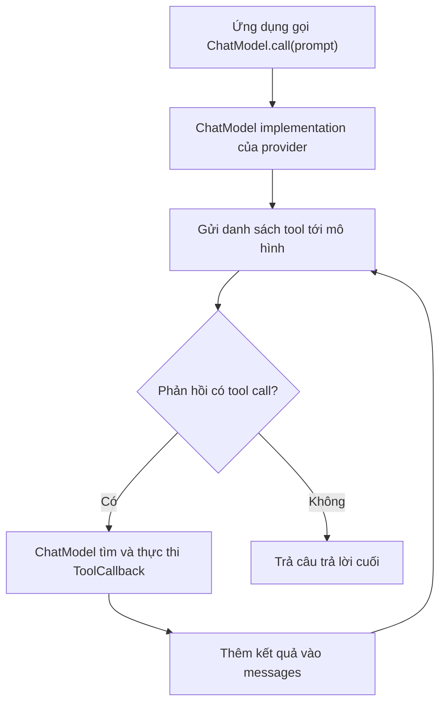
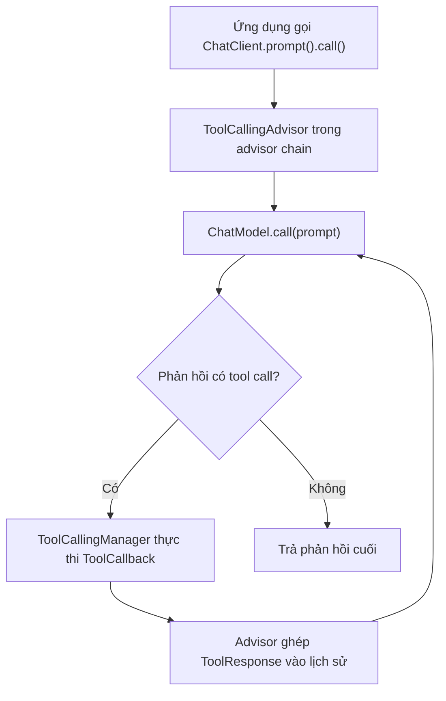

# Chuyển từ vòng lặp bên trong ChatModel 1.x sang cơ chế 2.x

> **Chương:** Nâng cấp  
> **Module:** `SPRING_AI_TOOL_CALLING`  
> **Mốc đối chiếu:** Spring AI **1.1.x → 2.0.x → 2.1.0** (bản stable 2.1.0, tháng 11/2026).
>
> Bài học tập trung vào vòng lặp tool calling trong ứng dụng Java: cách `@Tool`, `ToolCallback`, JSON Schema, `ToolContext`, quyền thực thi, lịch sử hội thoại, nhiều lượt gọi, lỗi và kiểm thử thay đổi khi chuyển từ kiến trúc `ChatModel` 1.x sang 2.x.

## 1. Mục tiêu học tập

Hoàn thành bài này, bạn có thể:

1. Giải thích được **đúng điểm thay đổi kiến trúc**: vòng lặp tự thực thi bên trong `ChatModel` 1.x đã bị loại bỏ; `ChatClient` 2.x điều phối qua `ToolCallingAdvisor`, hoặc ứng dụng tự điều phối khi dùng `ChatModel` cấp thấp.
2. Nhận diện mã 1.x sẽ **biên dịch lỗi** và mã vẫn biên dịch nhưng **đổi hành vi** sau nâng cấp.
3. Chuyển một chức năng có `@Tool`/`ToolCallback` sang `ChatClient` 2.x mà vẫn duy trì `ToolContext`, kiểm tra quyền, xử lý nhiều tool call và câu trả lời cuối.
4. Tự điều phối với `ToolCallingManager` khi thực sự cần một orchestrator tùy biến; xử lý lịch sử hội thoại và `returnDirect` đúng cách.
5. Kiểm chứng đường gọi blocking/streaming, quyền truy cập, retry, giới hạn vòng lặp và quan sát sau nâng cấp.

## 2. Khái niệm: mô hình yêu cầu, ứng dụng thực thi

Người dùng đặt câu hỏi: “Đơn ORD-108 đang giao đến đâu?”. Ứng dụng cho phép mô hình thấy định nghĩa công cụ `get_order_status`, gồm tên, mô tả và JSON Schema của đầu vào `orderId`. Mô hình có thể trả yêu cầu gọi công cụ, ví dụ:

```json
{
  "name": "get_order_status",
  "arguments": "{\"orderId\":\"ORD-108\"}"
}
```

Đây là **hình dung logic**; cấu trúc phản hồi thực của từng provider có thể khác. Mô hình **không tự gọi** repository, REST API hay database. Ứng dụng phải tìm `ToolCallback` tương ứng, kiểm tra tham số và quyền, thực thi công cụ, đưa kết quả trở lại mô hình rồi tiếp tục cho tới khi có câu trả lời cuối.

**Câu hỏi khi nâng cấp:** lớp nào sở hữu chu trình “nhận tool call → chạy callback → thêm tool result → gọi lại model”?

### Spring AI 1.x: vòng lặp ở mỗi ChatModel



Trong Spring AI 1.x, `ChatModel` thực hiện vòng lặp nội bộ theo mặc định khi chế độ thực thi tool nội bộ được bật. `ChatClient` có thể là façade cho đường gọi này, nhưng vòng lặp vẫn nằm trong model implementation. Có các tùy chọn như `internalToolExecutionEnabled` để điều khiển đường tự động hoặc tự quản lý.

### Spring AI 2.x: vòng lặp ở advisor hoặc ứng dụng



Với `ChatClient` 2.x, `DefaultChatClient` tự đăng ký **một** `ToolCallingAdvisor` trừ khi tắt rõ ràng; advisor này gọi `ToolCallingManager` để thực thi. Nếu gọi `ChatModel.call(prompt)` hoặc `ChatModel.stream(prompt)` **trực tiếp**, chúng chỉ gửi tool definitions và trả phản hồi thô của mô hình, **không chạy** tool call.

Đó là thay đổi **hành vi và trách nhiệm**, không phải chỉ đổi tên API. Nâng dependency lên 2.x mà giữ đường `ChatModel.call(...)` cũ có thể tạo ra “AI đòi gọi tool nhưng database không được truy vấn”.

## 3. Bảng đối chiếu 1.x và 2.x

| Khía cạnh | Spring AI 1.x | Spring AI 2.x (đối chiếu 2.1.0) | Việc cần làm |
| --- | --- | --- | --- |
| Ai chạy vòng tool? | Bên trong `ChatModel` của provider | `ToolCallingAdvisor` của `ChatClient` hoặc vòng lặp do ứng dụng tự viết | Chọn **một chủ sở hữu vòng lặp** |
| `ChatModel.call(prompt)` có tool | Có thể tự thực thi và gọi lại mô hình | Trả yêu cầu tool call, **không thực thi** | Chuyển lên `ChatClient` hoặc tự dùng `ToolCallingManager` |
| `ChatModel.stream(prompt)` | Có thể dùng vòng lặp nội bộ | Phản hồi streaming cấp thấp, không tự chạy tool | Dùng `ChatClient.stream()` hoặc quản lý/aggregate stream theo vòng |
| `internalToolExecutionEnabled` | Được dùng để bật/tắt vòng nội bộ | **Đã xóa** khỏi `ToolCallingChatOptions`/options provider và property cũ | Bỏ setter/property |
| `ToolExecutionEligibilityPredicate` | Extension point cũ gắn với model/options | **Đã xóa**, dùng `ToolExecutionEligibilityChecker` của advisor khi cần | Chuyển logic quyết định sang advisor |
| `ToolCallback`, `@Tool` | Định nghĩa và thực thi công cụ | Tiếp tục được dùng, chuyển tới `ToolCallingManager` | Giữ contract, kiểm tra schema/names |
| Bean `Function` + `toolNames(...)` | Từng có cơ chế resolve theo tên | `SpringBeanToolCallbackResolver` và `toolNames()` đã xóa | Đăng ký `ToolCallback` tường minh/`@Tool` |
| Memory/advisor | Thường chỉ thấy user/final assistant khi tool loop ở model | Advisor order quyết định memory nằm ngoài hay trong tool loop | Kiểm tra lịch sử và không ghi tool transcript trùng |
| Observability | Quan sát qua model/tool cũ | Có observation ở tool/advisor, nhiều vòng trong advisor chain | Kiểm tra trace, số lần gọi và mức tiêu thụ token |
| Dừng vòng lặp | Tùy provider/model loop | Advisor/model manager có API rõ ràng và tool call limits ở 2.1 | Đặt giới hạn phù hợp, xử lý khi vượt hạn |
| `returnDirect` | Có khái niệm kết quả trực tiếp | Advisor dừng và trả tool result trực tiếp khi đáp ứng điều kiện | Kiểm tra ứng dụng không mong luôn có câu trả lời do LLM tổng hợp |

**Lưu ý phiên bản:** thay đổi cốt lõi “bỏ vòng lặp trong `ChatModel`” được tài liệu chính thức ghi ở phần **Upgrading to 2.0.0**. Những đặc tính bổ sung của **2.1.0** (chẳng hạn tool call limits mặc định, thay đổi usage, session memory) cần kiểm tra riêng, không gộp nhầm vào 2.0.0.

## 4. Nâng cấp nhanh: chuyển đường trực tiếp từ ChatModel sang ChatClient

### 4.1. Ví dụ “trước” điển hình ở 1.x

Đoạn dưới biểu thị cách dùng cũ; **không dùng để biên dịch trên 2.x**:

```java
// Spring AI 1.x — minh họa mã cũ đang dựa vào model tự chạy tool.
ToolCallback[] callbacks = ToolCallbacks.from(new OrderTools(orderService));

ChatOptions options = ToolCallingChatOptions.builder()
    .toolCallbacks(callbacks)
    .internalToolExecutionEnabled(true) // XÓA trong 2.x
    .build();

ChatResponse response = chatModel.call(
    new Prompt("Trạng thái đơn ORD-108?", options)
);

// Trong 1.x với vòng nội bộ: thường đã là câu trả lời cuối.
String answer = response.getResult().getOutput().getText();
```

Nếu giữ `chatModel.call(...)` trên 2.x sau khi bỏ `internalToolExecutionEnabled(...)`, đoạn code có thể chạy nhưng trả một `ChatResponse` với `hasToolCalls() == true`. Không có thao tác gọi `OrderTools` xảy ra. Đọc `getText()` của kết quả đó có thể ra rỗng hoặc không phải câu trả lời người dùng mong muốn.

### 4.2. Ví dụ “sau” ưu tiên ở 2.1.0

```java
import java.util.Map;
import org.springframework.ai.chat.client.ChatClient;
import org.springframework.ai.chat.model.ChatModel;
import org.springframework.ai.tool.ToolContext;
import org.springframework.ai.tool.annotation.Tool;
import org.springframework.ai.tool.annotation.ToolParam;

record OrderStatus(String orderId, String state) {}

interface OrderService {
    // Implementation phải xác thực tenant và quyền xem đơn.
    OrderStatus findForUser(String tenantId, String userId, String orderId);
}

final class OrderTools {
    private final OrderService orderService;

    OrderTools(OrderService orderService) {
        this.orderService = orderService;
    }

    @Tool(
        name = "get_order_status",
        description = "Tra trạng thái một đơn hàng mà người dùng có quyền xem. " +
                      "Không tạo, sửa hoặc hủy đơn."
    )
    public OrderStatus getOrderStatus(
            @ToolParam(description = "Mã đơn, ví dụ ORD-108")
            String orderId,
            ToolContext toolContext) {

        if (orderId == null || !orderId.matches("ORD-[0-9]{1,12}")) {
            throw new IllegalArgumentException("Mã đơn không hợp lệ");
        }
        Object tenant = toolContext.getContext().get("tenantId");
        Object user = toolContext.getContext().get("userId");
        if (!(tenant instanceof String tenantId) || tenantId.isBlank()
                || !(user instanceof String userId) || userId.isBlank()) {
            throw new SecurityException("Thiếu danh tính đã xác thực");
        }
        return orderService.findForUser(tenantId, userId, orderId);
    }
}

final class OrderAssistant {
    private final ChatClient chatClient;
    private final OrderTools orderTools;

    OrderAssistant(ChatModel chatModel, OrderService orderService) {
        this.chatClient = ChatClient.create(chatModel);
        this.orderTools = new OrderTools(orderService);
    }

    String ask(String question, String authenticatedTenant, String authenticatedUser) {
        // Danh tính phải do backend xác thực, không lấy từ lời nhắn của mô hình.
        return chatClient.prompt()
            .user(question)
            .tools(orderTools)
            .toolContext(Map.of(
                "tenantId", authenticatedTenant,
                "userId", authenticatedUser))
            .call()
            .content();
    }
}
```

**Kỳ vọng trên 2.1.0:**

1. `ChatClient` gửi schema của `get_order_status` cho mô hình.
2. Nếu mô hình yêu cầu tool, `ToolCallingAdvisor` phát hiện phản hồi chứa tool call.
3. `ToolCallingManager` phân giải callback, chuyển JSON thành `orderId` và gọi Java method cùng `ToolContext`.
4. Service xác thực quyền, truy vấn đơn và trả `OrderStatus`.
5. Advisor đưa kết quả vào lịch sử, gọi lại model và cuối cùng `.content()` trả câu trả lời.

Tái sử dụng một `ChatClient` có cấu hình ổn định giữa các request là hợp lý; mỗi lời gọi `.prompt()` tạo request spec riêng. Không giữ `tenantId`/`userId` ở field của `OrderTools`; `ToolContext` nên được tạo mới với dữ liệu phía server cho mỗi request, và service tiếp tục kiểm tra quyền trên tài nguyên.

**Điểm cần nhớ:** Mặc dù ví dụ cũ có thể đã gọi `ChatClient` thay vì `ChatModel`, việc nâng cấp không nhất thiết đòi đổi mọi call site. Đường `ChatClient.prompt().tools(...).call()` vẫn là lối dùng khuyến nghị; cần kiểm tra chỗ nào đang tùy biến vòng lặp, thứ tự advisor, default tools và quan sát.

## 5. Bên trong ToolCallingAdvisor: những gì đã chuyển chỗ

`ToolCallingAdvisor` là một **recursive advisor** trong advisor chain; mỗi lượt có tool call sẽ tái nhập phần chain ở phía sau advisor. Mặc định nó quản lý lịch sử đầy đủ của lượt hiện tại:

```text
user prompt
  → model response: tool_call(get_order_status, {"orderId":"ORD-108"})
  → callback result: {"orderId":"ORD-108","state":"IN_TRANSIT"}
  → model response: "Đơn ORD-108 đang vận chuyển."
```

Thông tin tool call và tool result phải xuất hiện trong messages khi gọi lại model. Nếu chỉ gửi chuỗi kết quả tool mà bỏ assistant tool request trước đó, một số provider sẽ từ chối hoặc mô hình không biết kết quả thuộc lời gọi nào.

Đối tượng cần phân biệt:

| Thành phần | Vai trò |
| --- | --- |
| `ToolDefinition` | Tên/mô tả/`inputSchema`; giúp mô hình biết có thể yêu cầu gì |
| `ToolCallback` | Hợp đồng Java để thực thi một công cụ |
| `ToolCallingManager` | Tra công cụ, thực thi callback, chuyển lỗi/kết quả, trả `ToolExecutionResult` |
| `ToolCallingAdvisor` | Điều phối lượt model → tool → model, quản lý history và điểm dừng |
| `ChatClient` | Cửa vào cấp cao, chạy advisor chain |
| `ChatModel` | Gọi provider một lần (blocking/streaming), trả phản hồi thô |
| `ToolContext` | Dữ liệu ứng dụng truyền trực tiếp tới callback, không để mô hình tạo |

Spring AI 2.1.0 áp dụng quy tắc **một `ToolAdvisor` trong chain**. `DefaultChatClient` tự dùng advisor mặc định, hoặc nhận một advisor công cụ tùy biến thay thế. Không tự chèn hai `ToolCallingAdvisor` rồi kỳ vọng tool được chạy “hai tầng”; cấu hình như vậy có thể bị từ chối khi xây chain.

Khi cần log hoặc điều chỉnh trước/sau mỗi vòng, hãy xem các hook của `ToolCallingAdvisor`: `doInitializeLoop`, `doBeforeCall`, `doAfterCall`, `doFinalizeLoop` và các bản dành cho stream. Đa số ứng dụng chỉ cần cấu hình advisor hoặc thêm advisor khác tại thứ tự phù hợp.

## 6. Khi buộc dùng ChatModel trực tiếp: vòng lặp tự quản lý

Một thư viện hạ tầng, workflow engine hoặc orchestrator riêng có thể không muốn dùng `ChatClient`. Khi đó phải **tự viết vòng lặp đầy đủ**. Mẫu blocking sau rút từ tài liệu Spring AI 2.1.0 và minh họa cơ chế chính:

```java
// Các kiểu liên quan:
// ChatModel, ChatOptions, ToolCallingChatOptions, Prompt, ChatResponse,
// ToolCallback, ToolCallbacks, ToolCallingManager, ToolExecutionResult

ToolCallback[] callbacks = ToolCallbacks.from(new OrderTools(orderService));
ChatOptions options = ToolCallingChatOptions.builder()
    .toolCallbacks(callbacks)
    .build();

ToolCallingManager manager = ToolCallingManager.builder().build();
Prompt prompt = new Prompt("Trạng thái đơn ORD-108?", options);

ChatResponse response = chatModel.call(prompt);

while (response.hasToolCalls()) {
    ToolExecutionResult result = manager.executeToolCalls(prompt, response);

    if (result.returnDirect()) {
        // Trả kết quả tool trực tiếp cho tầng API theo contract ứng dụng.
        // Không gọi mô hình thêm một lượt.
        handleDirectToolResult(result.conversationHistory());
        break;
    }

    // Bao gồm user, assistant tool-call request và tool response.
    prompt = new Prompt(result.conversationHistory(), options);
    response = chatModel.call(prompt);
}

if (!response.hasToolCalls()) {
    String finalAnswer = response.getResult().getOutput().getText();
    deliverToCaller(finalAnswer);
}
```

`handleDirectToolResult(...)` và `deliverToCaller(...)` là hàm giả lập tại biên ứng dụng; đoạn này diễn tả vòng lặp, không phải một phương thức Java độc lập có thể chạy nguyên vẹn. Trong sản phẩm thật, đặt **một đường trả kết quả duy nhất** cho cả trường hợp `returnDirect` và câu trả lời cuối. Với `ToolContext`, chọn kiểu options/context phù hợp hoặc đưa nó vào `Prompt` theo API của đường chạy cấp thấp; đừng giả định context từ `ChatClient` được truyền vào đường `ChatModel`.

Làm rõ các trường hợp:

- `response.hasToolCalls()` là kiểm tra trước khi chạy công cụ. Tool call có thể mang nhiều yêu cầu trong **cùng một phản hồi**; để `ToolCallingManager` quyết định từng callback.
- `manager.executeToolCalls(prompt, response)` cung cấp `ToolExecutionResult`. `conversationHistory()` là danh sách messages cho vòng tiếp theo; không tự chép đúng mỗi tool result.
- Nếu `result.returnDirect() == true`, không nên hỏi lại mô hình. Với một đợt gồm nhiều tool, chỉ return-direct khi **tất cả** công cụ trong đợt được đánh dấu như vậy.
- Vòng lặp phải có tiêu chí dừng khi không còn tool call, giới hạn tổng lượt/timeout, xử lý lỗi và kiểm soát quyền. `ToolCallingManager` 2.1 có hạn mức tool calls, nhưng ứng dụng vẫn phải giới hạn tổng số model round-trip, ngân sách token/thời gian và retry.
- Khi tự điều phối, bạn phải tự giữ đúng session context, history, quan sát và hành vi khi tool không tồn tại. Đừng dựa vào hiệu ứng của advisor chain mà bạn đã bỏ qua.

### 6.1. Nếu cần “raw tool call” nhưng vẫn dùng ChatClient

Khi muốn kiểm tra/duyệt tool call trước khi chạy, Spring AI 2.x có thể **tắt đăng ký tự động cho từng request**:

```java
ChatClientResponse raw = chatClient.prompt()
    .user("Kiểm tra đơn ORD-108")
    .tools(orderTools)
    .advisors(AdvisorParams.toolCallingAdvisorAutoRegister(false))
    .call()
    .chatClientResponse();

ChatResponse response = raw.chatResponse();
if (response != null && response.hasToolCalls()) {
    // Kiểm tra, phê duyệt hoặc tự điều phối bằng ToolCallingManager.
}
```

`AdvisorParams` thuộc Spring AI advisor API; thêm imports tương ứng trong mã ứng dụng. Tránh dùng `.content()` làm dấu hiệu nhận biết tool call vì nó chỉ lấy text và có thể rỗng khi mô hình trả yêu cầu gọi công cụ. Có thể tắt tự đăng ký ở cấp application bằng:

```properties
spring.ai.chat.client.tool-calling.enabled=false
```

Đây là cấu hình ảnh hưởng mọi `ChatClient` được auto-configure, cần cân nhắc trước khi dùng. Trong trường hợp thông thường, **giữ advisor mặc định** và chỉ tự quản lý khi yêu cầu nghiệp vụ thật sự cần.

## 7. Thứ tự advisor, memory và lịch sử hội thoại

Đây là một khác biệt kiến trúc dễ bị bỏ sót. Trong 1.x, khi vòng lặp ẩn ở `ChatModel`, memory advisor phía ngoài thường chỉ nhìn thấy cặp user/final assistant; nó không nhìn thấy từng tool request/result. Với 2.x, **thứ tự advisor** quyết định lịch sử nào được quan sát/lưu.

- **Memory ngoài vòng lặp:** load history một lần trước khi gọi tool, persist user/final assistant khi vòng kết thúc. Đây là hành vi gần nhất với cách 1.x hoạt động.
- **Memory trong vòng lặp:** có thể ghi các lượt assistant tool-call và tool response. Repository phải serialize được đầy đủ message types; nếu không, lịch sử có thể hỏng.
- `ToolCallingAdvisor` mặc định tự duy trì lịch sử giữa các vòng; nếu advisor memory ở trong vòng và cũng lưu, phải tránh ghi trùng. `DefaultChatClient` có cơ chế tự điều chỉnh đối với memory advisor nhận diện được khi auto-register; khi tự dựng advisor, cần xem `disableInternalConversationHistory()`.

**Mốc 2.1.0:** `ChatMemory` và `MessageChatMemoryAdvisor` được đánh dấu *deprecated* để chuyển sang **Session API**. Khi nâng cấp dài hạn, nên xem session memory và semantics lưu conversation thay vì tiếp tục đầu tư sâu vào API sắp bỏ. Với cùng một session, ứng dụng cần quản lý hai request đến đồng thời để tránh xen kẽ lịch sử; việc chuyển vòng lặp sang advisor **không tự xử lý** thứ tự turn của cùng một hội thoại.

### 7.1. Không chạy sai advisor hai lần

Spring AI 2.x cho phép advisor khác chạy **bên trong** hoặc **bên ngoài** vòng lặp. Nếu đặt retry, logging, RAG hay permission advisor ở vị trí chưa cân nhắc, code nâng cấp có thể thực thi nhiều lần trên mỗi vòng model thay vì chỉ một lần trên toàn request. Kiểm tra thứ tự thật của advisor chain và nêu rõ thao tác nào là *per-turn* và thao tác nào là *per-model-call*.

## 8. Nâng cấp API và cấu hình liên quan

### 8.1. Xóa cờ điều khiển vòng lặp ở model

**Trước (1.x):**

```java
ToolCallingChatOptions.builder()
    .toolCallbacks(callbacks)
    .internalToolExecutionEnabled(false)
    .build();
```

**Sau (2.x, nếu muốn tự quản lý):**

```java
ToolCallingChatOptions.builder()
    .toolCallbacks(callbacks)
    .build();
```

Dù cờ cũ là `true` hay `false`, 2.x đều không còn nhận nó. Thuộc tính `spring.ai.<provider>.chat.internal-tool-execution-enabled` cũng đã bị xóa. Đường chạy trực tiếp qua `ChatModel` luôn là cấp thấp; đường tự động qua `ChatClient` dùng advisor.

### 8.2. Thay bean Function + toolNames cũ

Trong mã 1.x, một `Function` bean có thể được giải quyết bằng tên qua `toolNames("currentWeather")`. 2.x đã xóa `SpringBeanToolCallbackResolver` cho cơ chế đó và xóa `toolNames()`. Đăng ký công cụ rõ ràng:

```java
@Bean
ToolCallback getWeatherTool(WeatherService service) {
    return FunctionToolCallback.builder(
            "get_weather",
            (WeatherRequest input) -> service.getWeather(input.city()))
        .description("Lấy thông tin thời tiết theo tên thành phố")
        .inputType(WeatherRequest.class)
        .build();
}

record WeatherRequest(String city) {}
```

Sau đó đưa callback vào `.tools(getWeatherTool)` hoặc `.defaultTools(getWeatherTool)` theo chính sách truy cập. `@Tool` vẫn là lựa chọn đơn giản khi sở hữu phương thức Java; cả hai cuối cùng tạo `ToolCallback`. Không giả định bean `Function` thông thường sẽ được model tự phát hiện nữa.

### 8.3. Default tools và quyền thực thi

Trong `ChatClient`, `.tools(...)` ở request **bổ sung** vào `.defaultTools(...)` ở client; nó không tự loại các tool mặc định. Khi cần danh mục theo vai trò, chọn tool ở **từng request**, tránh đăng ký mặc định các thao tác nhạy cảm rồi kỳ vọng bỏ chúng khỏi request spec sẽ ẩn chúng.

Trong `ChatModel` cấp thấp, danh sách tool callbacks ở request options có thể **thay thế** danh sách mặc định trên model (khác `ChatClient`). Hãy kiểm tra hành vi này khi chuyển các công cụ từ provider options sang `ChatClient`.

Spring AI 2.1.0 cũng siết việc chạy tool không có trong request: khả năng fallback sang resolver ứng dụng khi model gọi tên chưa được đính kèm bị tắt mặc định. Không tạo một đường “gọi bất kỳ bean nào bằng tên” làm lại chức năng cũ.

## 9. Lỗi, retry, giới hạn và tác dụng phụ

Chuyển vị trí vòng lặp có thể thay đổi **nơi lỗi được quan sát** và **số lần gọi lại**. Ví dụ tool `reserve_inventory` ghi giữ hàng: một model turn có thể yêu cầu nhiều lần, hoặc ứng dụng retry sau timeout. Nâng cấp phải bảo đảm hành động không bị chạy hai lần ngoài ý muốn.

### 9.1. Hạn mức có ở 2.1.0

`DefaultToolCallingManager` trong 2.1.0 đặt ngưỡng mặc định:

| Giới hạn | Mặc định | Phạm vi |
| --- | ---: | --- |
| Số lần gọi **một tool** | **40** | Một user turn |
| Tổng số tool call | **150** | Một user turn |

Có thể điều chỉnh bằng `ToolCallingManager.builder().maxCallsPerTool(...)`, `.maxTotalToolCalls(...)` hoặc các `spring.ai.tools.limits.*` properties được tài liệu hỗ trợ. Đây không phải giới hạn số HTTP request đồng thời, quota provider hoặc số model round-trip. Bộ đếm giới hạn dựa vào tool response history của turn, không phải một biến mutable dùng chung trên manager, nên manager có thể được chia sẻ an toàn theo contract đó.

Khi vượt hạn mức, advisor có cơ chế trả phản hồi mang finish reason/metadata theo hành vi `ToolCallLimitExceededException`. Ứng dụng cần nhận diện trường hợp này và thông báo dừng có kiểm soát. Một số tool có thể đã hoàn thành trước khi đợt gọi vượt giới hạn; không tự retry toàn bộ lô nếu có tác dụng phụ.

### 9.2. Tránh trả chi tiết lỗi nội bộ cho mô hình

Mặc định `DefaultToolExecutionExceptionProcessor` có thể chuyển message của `RuntimeException` thành tool result cho mô hình. Nếu message chứa token, SQL, tenant hoặc nội dung khách hàng, đó là rủi ro lộ thông tin. Cấu hình:

```properties
spring.ai.tools.throw-exception-on-error=true
```

để chuyển lỗi ra tầng caller xử lý (cần thiết kế cách ánh xạ lỗi phù hợp), hoặc triển khai processor trả thông điệp đã làm sạch. Mọi callback vẫn phải kiểm tra JSON input, tenant/user từ `ToolContext`, quyền nghiệp vụ, timeout và trạng thái giao dịch.

### 9.3. Xác nhận hành động

Spring AI 2.1.0 có `@Tool(requiresConfirmation = true)` và cơ chế `ToolCallConfirmationPolicy` cho tool cần người phê duyệt. Khi vòng lặp tạm dừng, ứng dụng nhận yêu cầu chờ quyết định; advisor không giữ trạng thái pause trong bộ nhớ nội bộ. Phải lưu prompt/response liên quan nếu cần phục hồi sau restart. Với lệnh tác dụng phụ, phối hợp confirmation, authorizer ở service và idempotency key; không coi prompt “hãy hỏi trước” là chính sách thực thi đủ tin cậy.

## 10. Streaming trong 2.x: kiểm tra cả đầu ra từng mảnh

Nâng cấp từ `ChatModel.stream(prompt)` 1.x sang 2.x có tác động rõ: stream cấp model **không** tự điều phối tool loop. Dùng:

```java
Flux<String> stream = ChatClient.create(chatModel)
    .prompt()
    .user("Kiểm tra tình trạng đơn ORD-108")
    .tools(new OrderTools(orderService))
    .stream()
    .content();
```

`Flux` ở đây là `reactor.core.publisher.Flux`. Với `.stream().content()`, UI nhận nội dung text cuối/sau các lượt model; nếu muốn quan sát tiến độ tool call, cần stream `ChatResponse`/parts hoặc dùng observation/hook. Các **partial tool-call argument deltas** có thể được stream như những phần chưa hoàn chỉnh; **đừng thực thi callback từ mỗi mảnh JSON**. Chỉ chạy khi hoàn tất yêu cầu tool và có `hasToolCalls()` hợp lệ.

Nếu tự dùng `ChatModel.stream(prompt)`, cần kết tập các chunk thành `ChatResponse` trước khi kiểm tra `hasToolCalls()` (tài liệu 2.1 minh họa `MessageAggregator`). Sau mỗi lần thực thi tool lại phải tạo prompt với đầy đủ history và mở một stream model mới. Việc nối văn bản chunk thuần túy không đủ để tái tạo assistant tool call và tool result.

## 11. Kịch bản kiểm thử migration

Không thể chứng minh nâng cấp thành công chỉ bằng “server khởi động” hoặc “model sinh được câu trả lời”. Cần kiểm tra kết quả end-to-end và số lần callback được thực thi.

| Test case | Đường 1.x kỳ vọng | Đường 2.x cần xác nhận |
| --- | --- | --- |
| User hỏi thông tin cần 1 tool | `ChatModel.call` gọi tool rồi trả câu trả lời | `ChatClient` gọi đúng callback đúng **một** lần, trả câu trả lời cuối |
| User cần hai tool liên tiếp | Vòng nội bộ gọi nhiều lượt | Advisor lặp đủ số lượt, tool result được đưa vào history |
| Gọi trực tiếp `ChatModel` | Thường có auto-execution nếu bật internal | `hasToolCalls() == true`; **callback chưa chạy** nếu ứng dụng chưa tự gọi manager |
| Input thiếu/sai kiểu | Lớp callback xử lý lỗi | JSON Schema/deserialization và kiểm tra domain vẫn chặn dữ liệu sai |
| User không có quyền | Không được chạy chức năng cấm | Tool không được đính kèm hoặc service từ chối; `ToolContext` gắn đúng principal |
| Model đòi tool không được đăng ký | Không được gọi service nhạy cảm | Không cho fallback chạy công cụ ngoài danh sách đã cấp |
| Tool trả `returnDirect` | Không gọi thêm model nếu kết quả trực tiếp | Advisor dừng đúng; không giả định luôn có final text do LLM tạo |
| Model lặp yêu cầu tool vô hạn | Có thể chạy rất lâu | Hạn mức manager + tổng deadline dừng vòng hợp lệ |
| Tool phát lỗi SQL/HTTP | Lỗi không lộ dữ liệu nội bộ | Processor không truyền stack trace/credential sang LLM |
| Streaming có tool calls | Kết quả xuất ra theo stream cũ | Không chạy từ partial delta; stream 2.x có vòng lặp hoàn chỉnh |
| Memory ghi hội thoại | User/final assistant đúng | Không trùng user message hoặc lưu tool transcript lẻ |
| Retry một tool ghi | Có thể lặp hành động | Idempotency đảm bảo chỉ ghi đúng một lần |

### 11.1. Kiểm thử tối thiểu bằng fake Tool

Ví dụ về một kiểm thử nên làm: dùng callback đếm số lần thực thi `AtomicInteger`; fake `ChatModel` trả một `ChatResponse` chứa tool request ở vòng đầu và câu trả lời ở vòng thứ hai. Khi chạy `ChatClient`, kiểm tra callback đếm đúng 1, và input model vòng thứ hai có **cặp** assistant tool request/tool response; khi chạy `ChatModel` trực tiếp, kiểm tra callback đếm bằng 0 trước khi ứng dụng gọi manager. Không cần gọi API LLM thật để xác minh sự khác biệt cơ chế.

Sau kiểm thử đơn vị, dùng một provider thật cho test integration để phát hiện cách trả tool call và schema khác nhau; đừng cố dựa vào câu trả lời ngôn ngữ tự nhiên duy nhất để suy việc tool thực sự đã chạy.

### 11.2. Quan sát sau triển khai

Theo dõi trace/correlation ID của toàn chuỗi `HTTP → ChatClient → ChatModel → ToolCallingAdvisor → ToolCallingManager → business service`; đo số model round-trip, tool call count, latency, token usage và tỷ lệ dừng vượt hạn. Spring AI 2.1.0 cộng dồn `Usage` của các lần gọi model trong vòng lặp ở `ToolCallingAdvisor`; những dashboard/test trước đó chỉ mong số token của lượt cuối cần cập nhật.

Giới hạn log chứa input/tool result, vì dữ liệu trả về có thể có thông tin khách hàng và bí mật. Kiểm tra tên observation/spans khi nâng cấp, tránh giữ cảnh báo dựa vào nhãn 1.x đã đổi.

## 12. Lộ trình nâng cấp thực hành

1. **Khoanh vùng code 1.x:** tìm `chatModel.call(`/`chatModel.stream(` đi kèm tool callbacks, `internalToolExecutionEnabled`, `toolNames`, resolver tùy biến và các vòng while đang tự thực thi tool.
2. **Chọn API theo mục đích:** với chat/RAG/agent thông thường, chuyển lên `ChatClient`; với workflow engine chủ động giữ loop, ở lại `ChatModel` nhưng dùng `ToolCallingManager`.
3. **Loại bỏ API đã xóa:** bỏ cờ `internalToolExecutionEnabled` và property tương ứng, thay resolver bean `Function` bằng `ToolCallback`/`@Tool` rõ ràng; đưa custom eligibility logic vào `ToolCallingAdvisor` khi cần.
4. **Gắn đúng quyền:** chọn tool theo role/request; truyền tenant/user qua `ToolContext` đáng tin, xác thực trong service; không để prompt hoặc schema quyết định quyền.
5. **Kiểm tra history:** kiểm thử assistant tool call ↔ tool response pairing, thứ tự advisor/memory, hai turn cùng session, `returnDirect` và stream.
6. **Bảo vệ hệ thống:** thiết lập limit, deadline, error policy, idempotency và observability thích hợp; xác định khi nào cần phê duyệt thao tác.
7. **Chạy kiểm thử chuyển đổi:** test cấp logic với fake model, sau đó integration với provider và load/concurrency test cho các tool có state; so sánh số callback, side effects, latency và token usage trước/sau.
8. **Triển khai có kiểm soát:** chạy canary hoặc một nhóm traffic, theo dõi tỷ lệ tool call success, lỗi phân quyền, tool limit exceeded và retry; có phương án rollback dependency khi phát hiện tương thích chưa đạt.

## 13. Những nhầm lẫn thường gặp

**“Bỏ `internalToolExecutionEnabled(true)` là xong.”** Không đúng. `ChatModel` 2.x không còn vòng lặp tự chạy; cần chuyển lên `ChatClient` hoặc tự điều phối.

**“Cứ có `@Tool` là Java method chạy khi model yêu cầu.”** `@Tool` chỉ tạo định nghĩa và callback. Model trả yêu cầu; `ToolCallingManager` cùng orchestrator mới thực thi.

**“`ChatClient` 2.x luôn trả nội dung text.”** Với mặc định và tool hợp lệ, nó chạy vòng lặp; nhưng có thể gặp `returnDirect`, lỗi, giới hạn hoặc opt-out. `ChatModel` trực tiếp có thể trả tool-call response mà không có final text.

**“Cần tự thêm một `ToolCallingAdvisor` cho mỗi tool.”** Advisor quản lý toàn bộ vòng lặp. `DefaultChatClient` tự đăng ký một advisor; thêm trùng `ToolAdvisor` có thể gây lỗi.

**“Memory sẽ tự lưu đúng mọi tool response.”** Cần xem thứ tự advisor, khả năng lưu loại message và session concurrency; không nhân đôi transcript khi bật cả internal history và memory trong vòng.

**“Nâng lên 2.1 là hết trách nhiệm kiểm tra quyền.”** Tool calling ở mọi phiên bản đều cần ứng dụng xác thực, giới hạn, chống retry trùng và kiểm tra đầu vào. Model chỉ đề xuất hành động.

## 14. Tài liệu tham khảo đã đối chiếu

1. [Spring AI 2.1.0 — Upgrading to 2.0.0 / Tool Calling](https://docs.spring.io/spring-ai/reference/upgrade-notes.html): phần **Removed: Internal Tool Execution Loop in ChatModel**, `internalToolExecutionEnabled`, `ToolExecutionEligibilityChecker`, `SpringBeanToolCallbackResolver`/`toolNames()`, thay đổi auto-registration và API migration.
2. [Spring AI 1.1.x — Tool Calling](https://docs.spring.io/spring-ai/reference/1.1/api/tools.html): đường gọi lịch sử, `@Tool`, `ChatModel`, cơ chế thực thi tool nội bộ.
3. [Spring AI 2.1.0 — Tool Calling](https://docs.spring.io/spring-ai/reference/api/tools.html): kiến trúc `ToolCallingAdvisor` + `ToolCallingManager`, JSON Schema, `ToolContext`, result conversion, exception processing, limits, streaming và observability.
4. [Spring AI 2.1.0 — ChatModel Tool Calling](https://docs.spring.io/spring-ai/reference/api/tools/chatmodel-tool-calling.html): `ChatModel` không tự thực thi; mẫu vòng lặp `hasToolCalls()` / `executeToolCalls()` / `conversationHistory()`; khác biệt default vs request tools.
5. [Spring AI 2.1.0 — ToolCallingAdvisor](https://docs.spring.io/spring-ai/reference/api/tools/tool-calling-advisor.html): auto-registration, một `ToolAdvisor` duy nhất, builder, hook, memory và opt-out theo request.
6. [Spring AI 2.1.0 — Session API](https://docs.spring.io/spring-ai/reference/api/session/chat-client.html): session memory và các lưu ý về turn đồng thời.

**Phạm vi xác minh:** Bài này dùng tài liệu chính thức Spring AI **2.1.0** tại thời điểm soạn. Các đoạn Java “trước” được trình bày để nhận diện mã 1.x; đoạn low-level và kiểm thử là mẫu minh họa cần bổ sung imports, adapter, service và dependency thực. Không có bước chạy build/Content QA chuyên môn trong giai đoạn viết bài.

