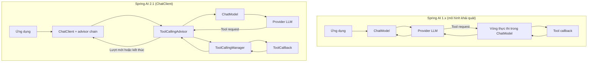
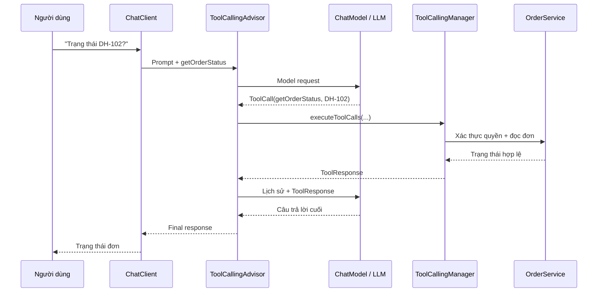

# Phân biệt ToolCallAdvisor ở phiên bản trước và ToolCallingAdvisor

Trong module **SPRING_AI_TOOL_CALLING**, ứng dụng cung cấp cho mô hình các công cụ nghiệp vụ bằng `@Tool`, `ToolCallback`, schema đầu vào và `ToolContext`. Khi nâng cấp Spring AI, tên của advisor điều phối vòng gọi công cụ thay đổi từ **`ToolCallAdvisor` sang `ToolCallingAdvisor`**. Tuy nhiên, đổi tên class chỉ là một phần của thay đổi lớn hơn: từ Spring AI 2.0, vòng thực thi tool không còn nằm trong từng `ChatModel` mà được đưa vào chuỗi advisor của `ChatClient`.

Bài học thuộc chương **Nâng cấp**, tập trung vào **Spring AI 1.x → 2.0 → 2.1.0**. Mục tiêu là đọc đúng mã cũ, chọn đường di trú ít thay đổi nhất, không tạo hai vòng thực thi hoặc làm thất lạc lịch sử tool call, đồng thời bảo toàn quyền truy cập và kiểm soát lỗi của ứng dụng.

Sau bài này, bạn sẽ:

- Nhận diện đúng chức năng, quan hệ kế thừa và trạng thái deprecated của hai class.
- Phân biệt đường gọi `ChatModel` trực tiếp với `ChatClient` ở Spring AI 2.1.
- Sửa cấu hình advisor theo cơ chế tự đăng ký và chỉ dùng một `ToolAdvisor` trong một chuỗi.
- Kiểm tra lịch sử hội thoại, các phiên bản API đã xóa và điều kiện dừng của vòng tool calling sau nâng cấp.

## 1. Kết luận phải nắm trước khi sửa mã

**`ToolCallingAdvisor` là tên API nên dùng trong Spring AI 2.1.0.** Class cũ `org.springframework.ai.chat.client.advisor.ToolCallAdvisor` vẫn có trong Javadoc 2.1.0 dưới dạng **subclass của `ToolCallingAdvisor`**, được đánh dấu `@Deprecated(since = "2.0.0", forRemoval = true)`. Nó được giữ để tương thích trong giai đoạn chuyển đổi; tài liệu cảnh báo sẽ loại bỏ ở bản sau.

Vì vậy có hai kết luận khác nhau:

1. **Mã chỉ dùng tên cũ có thể vẫn biên dịch trên 2.1.0**, tùy những API khác trong chain có còn hay không. Không nên nói “class `ToolCallAdvisor` bị xóa ngay ở 2.0/2.1”.
2. **Mã mới và mã đang di trú phải chuyển sang `ToolCallingAdvisor`** để không còn phụ thuộc lớp tương thích có kế hoạch loại bỏ.

Đây là **rename của advisor quản lý vòng lặp**, không phải việc đổi tên `@Tool` thành `@ToolCalling`, không phải nâng cấp riêng SDK OpenAI và cũng không làm thay đổi tên công cụ mà mô hình nhìn thấy.

## 2. Dòng thời gian thay đổi

| Giai đoạn | Vị trí thực thi tool | Advisor và hành vi liên quan |
| --- | --- | --- |
| **Spring AI 1.x** | Phần lớn `ChatModel` của provider có vòng gọi tool bên trong model; `chatModel.call(prompt)` có thể tự gọi callback rồi gọi lại model | Có tên `ToolCallAdvisor` trong các phiên bản sử dụng advisor điều phối; việc xử lý tool còn phụ thuộc đường gọi |
| **Spring AI 2.0 (giai đoạn nâng cấp)** | Bỏ vòng tự thực thi trong `ChatModel`, đưa vòng vào advisor hoặc bộ điều phối của ứng dụng | `ToolCallAdvisor` đổi tên thành `ToolCallingAdvisor`; tên cũ được giữ như alias/subclass deprecated |
| **2.0.0-M7 → RC2** | `ChatClient` tự thêm advisor khi nhận tool, sau đó thay đổi để luôn tự đăng ký nếu chưa tắt | Ở M7, cơ chế tự đăng ký phụ thuộc việc cấp tool trên request; từ RC2, advisor được đăng ký mặc định để còn xử lý tool được thêm động bởi advisor khác |
| **Spring AI 2.1.0** | `ToolCallingAdvisor` là đường điều phối mặc định của `ChatClient`; `ChatModel` trực tiếp chỉ trả tool requests | `ToolCallAdvisor` vẫn deprecated; có `ToolAdvisor` marker, cơ chế lịch sử và giới hạn tool call, cùng cải tiến quản lý memory/session |

**Không suy ra rằng “1.x có `ToolCallAdvisor` thì 2.1 chỉ cần thay import”.** Trong 2.1, nghĩa của `ChatModel.call(...)`, vị trí memory advisor, cách đăng ký callback, cách nhận kết quả streaming và điều kiện dừng đều có điểm cần kiểm tra.

## 3. Cùng nhiệm vụ, vòng đời thực thi khác nhau

### 3.1. Bức tranh ở mức kiến trúc



Ở cả hai phiên bản, mô hình **chọn** công cụ và sinh tham số, còn ứng dụng **thực thi**. Trong Spring AI 2.1, `ToolCallingAdvisor` làm việc với `ToolCallingManager` để tìm callback tương ứng, chạy công cụ và thêm kết quả vào lịch sử; advisor tiếp tục gọi mô hình nếu phản hồi còn tool calls. Đường `.call()` và `.stream()` đều được hỗ trợ.

Ngược lại, trong Spring AI 2.1:

```java
// Chỉ minh họa điểm khác biệt về lifecycle:
ChatResponse response = chatModel.call(prompt);

if (response.hasToolCalls()) {
    // Model đã YÊU CẦU tool, chưa có nghĩa callback đã được chạy.
    // Phải dùng ChatClient/ToolCallingAdvisor hoặc tự điều phối ToolCallingManager.
}
```

Điểm này thường gây regression sau nâng cấp: chương trình vẫn nhận được object `ChatResponse` nên kiểm thử sơ sài tưởng thành công, nhưng thao tác nghiệp vụ phía sau chưa chạy.

### 3.2. Đối chiếu trực tiếp hai class

| Khía cạnh | `ToolCallAdvisor` (tên cũ) | `ToolCallingAdvisor` (tên chuẩn 2.1) |
| --- | --- | --- |
| Tên đầy đủ | `org.springframework.ai.chat.client.advisor.ToolCallAdvisor` | `org.springframework.ai.chat.client.advisor.ToolCallingAdvisor` |
| Trạng thái ở **2.1.0** | Deprecated từ 2.0.0, `forRemoval=true` | API được tài liệu hướng dẫn sử dụng |
| Quan hệ class | Kế thừa `ToolCallingAdvisor`, có builder tương thích bị deprecated | Class cơ sở của vòng tool calling |
| Vai trò | Tương thích mã đã dùng tên cũ | Điều phối lời gọi mô hình → tool → mô hình |
| Giao diện quan trọng | Kế thừa `CallAdvisor`, `StreamAdvisor`, `ToolAdvisor` | Thực thi `CallAdvisor`, `StreamAdvisor`, `ToolAdvisor` |
| Cách sử dụng lâu dài | Cần thay trong mã đang nâng cấp | Để `ChatClient` tự đăng ký, hoặc tự cấu hình có chủ đích |
| Có tự cấp quyền tool? | Không | Không |

`@Tool`, `ToolCallback` và `ToolContext` thuộc **lớp định nghĩa / thực thi công cụ**, khác với advisor điều phối. Một method gắn `@Tool` không tự trở thành advisor, và advisor không tự làm thay authorization, validation, timeout hay quota.

## 4. Ví dụ di trú đơn giản nhất: bỏ đăng ký advisor thủ công

Giả sử trợ lý đọc trạng thái đơn hàng. Công cụ Java có thể giữ nguyên:

```java
import org.springframework.ai.tool.annotation.Tool;
import org.springframework.ai.tool.annotation.ToolParam;

public final class OrderTools {
    private final OrderService orders;

    public OrderTools(OrderService orders) {
        this.orders = orders;
    }

    @Tool(name = "getOrderStatus",
          description = "Tra trạng thái đơn hàng đã được xác thực")
    public String getOrderStatus(
            @ToolParam(description = "Mã đơn hàng") String orderId) {
        // OrderService phải kiểm tra quyền sở hữu tài nguyên trước khi trả dữ liệu.
        return orders.readStatusForCurrentUser(orderId);
    }
}
```

`OrderService` là service giả định để minh họa ranh giới nghiệp vụ. `@Tool` chỉ xuất tên, mô tả và schema cho model. Kiểm tra quyền đối với **đơn cụ thể** phải được thực hiện dựa trên identity tin cậy, không dựa trên tham số do model tự khẳng định.

### 4.1. Mã cũ có thể gặp

```java
// Kiểu sử dụng tên advisor cũ (tham khảo khi đọc code Spring AI trước 2.0).
var advisor = ToolCallAdvisor.builder().build();

var client = ChatClient.builder(chatModel)
    .defaultAdvisors(advisor)
    .build();
```

Nếu chuyển tên class mà vẫn giữ toàn bộ cấu hình thủ công trong ứng dụng không cần customize, mã sẽ khó bảo trì hơn. Spring AI 2.1 có cơ chế tự đăng ký advisor cho `ChatClient`.

### 4.2. Mã khuyến nghị ở 2.1

```java
import org.springframework.ai.chat.client.ChatClient;

ChatClient client = ChatClient.create(chatModel);

String answer = client.prompt()
    .user("Đơn DH-102 đang ở đâu?")
    .tools(new OrderTools(orderService))
    .call()
    .content();
```

Ở đây `ChatClient` **tự có `ToolCallingAdvisor`** (nếu chưa bị tắt). Khi mô hình trả yêu cầu gọi `getOrderStatus`, advisor sử dụng `ToolCallingManager` để thực thi tool và gọi lại mô hình. Không phải đăng ký `ToolCallAdvisor` hoặc `ToolCallingAdvisor` một cách tường minh trong đường đi thông thường.

**Không cần đổi tên method `getOrderStatus`, thay đổi schema Java hoặc viết thêm tool callback chỉ để phục vụ rename của advisor.** Nếu hệ thống còn dùng API bean name cũ như `.toolNames(...)`, phần đó lại thuộc một thay đổi API khác và phải di trú riêng.

## 5. Trường hợp cần tự cấu hình `ToolCallingAdvisor`

Mặc định phù hợp phần lớn ứng dụng. Cần advisor tự cấu hình khi thực sự cần quản lý bộ thực thi công cụ riêng, điều kiện tiếp tục vòng lặp hoặc vị trí tương tác với memory/observability.

### 5.1. Dùng builder mới với manager có giới hạn

```java
import org.springframework.ai.chat.client.ChatClient;
import org.springframework.ai.chat.client.advisor.ToolCallingAdvisor;
import org.springframework.ai.model.tool.ToolCallingManager;

ToolCallingManager manager = ToolCallingManager.builder()
    .maxCallsPerTool(3)
    .maxTotalToolCalls(8)
    .build();

ToolCallingAdvisor advisor = ToolCallingAdvisor.builder()
    .toolCallingManager(manager)
    .build();

ChatClient client = ChatClient.builder(chatModel)
    .defaultAdvisors(advisor)
    .build();
```

Đây là **chủ động cấp advisor duy nhất**, không phải yêu cầu thêm advisor thứ hai lên trên bản mặc định. Trong Spring AI 2.1, `DefaultChatClient` kiểm tra marker `ToolAdvisor` để quyết định tự đăng ký: khi chuỗi đã có một advisor thuộc loại này, framework sử dụng advisor đã cấp và không tự tạo thêm cái thứ hai. Nếu cấu hình **hai `ToolAdvisor` tùy chỉnh**, framework chặn từ khi tạo chain vì có thể thực thi cùng tool hai lần.

`maxCallsPerTool` và `maxTotalToolCalls` là giới hạn *số tool call trong một turn*. Chúng không tự tạo timeout cho dịch vụ ngoài, không thay quota theo tenant và không giới hạn số token. Với hành động có tác dụng phụ, vẫn cần xác thực quyền, idempotency, retry có kiểm soát và ghi audit.

> Tên import và chữ ký builder trong ví dụ là của Spring AI 2.1; nếu đang nâng cấp từ một mốc milestone/RC cụ thể, cần đối chiếu BOM và Javadoc đúng mốc đó. Đừng đoán rằng class đã bị xóa chỉ vì IDE cảnh báo deprecated.

### 5.2. Tắt tự đăng ký theo request để tự điều phối

Khi ứng dụng cần kiểm tra hoặc phê duyệt từng yêu cầu trước khi tool chạy, có thể tắt vòng tự động trên **một request**:

```java
import org.springframework.ai.chat.client.advisor.api.AdvisorParams;

var response = client.prompt()
    .user("Kiểm tra đơn DH-102")
    .tools(new OrderTools(orderService))
    .advisors(AdvisorParams.toolCallingAdvisorAutoRegister(false))
    .call()
    .chatResponse();

if (response != null && response.hasToolCalls()) {
    // Ứng dụng quyết định cho phép, từ chối hoặc điều phối tool
    // bằng ToolCallingManager rồi gửi ToolResponse cho model.
}
```

Tắt tự đăng ký vẫn **gửi mô tả công cụ cho model**; mô hình có thể yêu cầu gọi tool, nhưng app phải xử lý. `AdvisorParams.toolCallingAdvisorAutoRegister(false)` là cờ điều khiển cơ chế tự thêm advisor, **không phải cơ chế phân quyền**. Khi trả `ChatResponse` với tool calls mà không thực thi, không được trình bày nó như câu trả lời cuối.

Spring Boot cũng có tùy chọn phạm vi **ChatClient được auto-configure**:

```yaml
spring:
  ai:
    chat:
      client:
        tool-calling:
          enabled: false
```

Thuộc tính `spring.ai.chat.client.tool-calling.enabled=false` tắt auto-registration toàn cục đối với `ChatClient` được Boot cấu hình. Chỉ dùng khi ứng dụng chủ động cung cấp vòng xử lý riêng; nếu cần mặc định cho hầu hết yêu cầu, opt-out theo request thường rõ nghĩa hơn.

## 6. Tránh hiểu sai “đổi tên là đủ”

| Mã cũ / giả định cũ | Điều xảy ra ở Spring AI 2.1 | Hành động |
| --- | --- | --- |
| `ToolCallAdvisor.builder()` | Vẫn có thể chạy nhờ subclass deprecated | Thay bằng `ToolCallingAdvisor.builder()`, hoặc bỏ advisor thủ công nếu không cần |
| `chatModel.call(prompt)` với tools tự thực thi | `ChatModel` chỉ trả tool-call request | Dùng `ChatClient` hoặc tự quản lý vòng bằng `ToolCallingManager` |
| `.internalToolExecutionEnabled(true/false)` | Thuộc tính đã xóa khỏi `ToolCallingChatOptions` và provider options | Bỏ hẳn; chọn framework-controlled hoặc user-controlled |
| Cấp tool bằng `.toolNames("name")` / `SpringBeanToolCallbackResolver` | Không còn API resolve tên bean ngầm | Cấp trực tiếp `ToolCallback` hoặc object chứa `@Tool` |
| `FunctionCallback` legacy | Đã bị thay thế và các API deprecated bị loại bỏ | Dùng `ToolCallback`, `FunctionToolCallback`, `MethodToolCallback` |
| `.tools(t -> ... )` theo `ToolSpec` cũ | Consumer API đã bị bỏ | `.tools(toolCallback)`, `.tools(toolObject)`; context cấp bằng `.toolContext(...)` |
| `streamToolCallResponses(true)` | Tùy chọn bị loại bỏ ở 2.0 vì stream thiếu cặp tool response | Quan sát mỗi vòng bằng advisor đặt **bên trong** loop, hoặc tự điều phối |
| Cấu hình advisor trong builder rồi đăng ký thủ công thêm lần nữa | Có thể vi phạm yêu cầu một `ToolAdvisor` | Giữ đúng một nơi sở hữu vòng lặp |

Không phải hàng nào cũng xuất phát trực tiếp từ rename; đây là **những chỗ thường cùng xuất hiện trong module tool calling lúc nâng cấp**. Từng thay đổi có nguyên nhân riêng, nên nên xử lý và kiểm thử tách biệt để tìm lỗi nhanh hơn.

## 7. Advisor chain, marker `ToolAdvisor` và lịch sử hội thoại

### 7.1. Vị trí advisor quyết định bạn nhìn thấy gì

`ToolCallingAdvisor` là **recursive advisor**: khi model yêu cầu công cụ, nó gọi lại phần chain nằm **sau** mình. Advisor ở **ngoài** vòng thấy một lượt user request và kết quả cuối; advisor ở **trong** vòng thấy từng lượt gọi mô hình.

```text
Thứ tự order nhỏ hơn chạy bên ngoài (bao quanh) order lớn hơn

Memory/Logging OUTSIDE    (HIGHEST_PRECEDENCE + 200)
    ToolCallingAdvisor    (HIGHEST_PRECEDENCE + 300)
        Auditing INSIDE   (HIGHEST_PRECEDENCE + 400)
            ChatModel -> Provider
```

Ví dụ một advisor quan sát đặt *sau* `ToolCallingAdvisor` trong thứ tự chain có thể ghi metrics cho từng vòng gọi model, nhưng cần che đối số và kết quả tool. Nếu đặt *trước* tool advisor, nó chủ yếu thấy request ban đầu và câu trả lời cuối. Mặc định `ToolCallingAdvisor.DEFAULT_ORDER` là `Ordered.HIGHEST_PRECEDENCE + 300`.

### 7.2. `ToolAdvisor` là marker, không phải callback

`ToolCallingAdvisor` thực thi cả `CallAdvisor`, `StreamAdvisor` và marker `ToolAdvisor`. Marker báo cho `DefaultChatClient` rằng chain đã có thành phần **sở hữu vòng thực thi tool**. Một advisor ghi log thông thường không nên implement `ToolAdvisor` vì không thực thi tool. Chỉ advisor tự viết thực sự quản lý vòng đời tool call mới implement marker này; nếu chỉ cần ghi log, có thể dùng advisor quan sát.

Khi cần mở rộng sâu, `ToolCallingAdvisor` cung cấp protected hooks cho blocking và streaming:

| Hook | Thời điểm | Ví dụ |
| --- | --- | --- |
| `doInitializeLoop` / `doInitializeLoopStream` | Một lần trước vòng | Khởi tạo trạng thái scope của cuộc gọi |
| `doBeforeCall` / `doBeforeStream` | Trước mỗi lượt model | Lọc danh sách tool được phép |
| `doAfterCall` / `doAfterStream` | Sau phản hồi mỗi lượt | Audit tên tool yêu cầu |
| `doFinalizeLoop` / `doFinalizeLoopStream` | Một lần khi kết thúc | Tổng hợp usage/metrics |
| `doGetNextInstructionsForToolCall` | Khi chuẩn bị lượt tiếp | Tùy biến cách đưa lịch sử tool vào prompt |

Các hook làm thay đổi hành vi thực thi, nên việc tự viết subclass cần kiểm thử cả `.call()` và `.stream()`. Với logic nhỏ như thống kê latency, advisor quan sát thường đủ và ít rủi ro hơn việc thay vòng lặp.

### 7.3. Hệ quả đối với memory ở 2.1

Ở cấu hình thông thường, `ToolCallingAdvisor` **tự giữ lịch sử các lượt tool trong một vòng** và chuyển lịch sử đó sang lần gọi model kế tiếp. Điều này không có nghĩa mọi `ChatMemoryRepository` đều lưu được `ToolResponseMessage`.

Với `MessageChatMemoryAdvisor` legacy, order mặc định nhỏ hơn order tool advisor (thường `HIGHEST_PRECEDENCE + 200`), nên nó ở **ngoài vòng** và chỉ ghi cặp hội thoại user/final assistant. Nếu đặt memory advisor *trong vòng* để lưu tool request/response, phải bảo đảm backend hỗ trợ loại message đó và tránh hai thành phần cùng quản lý lịch sử; khi cấp `ToolCallingAdvisor` thủ công, dùng `disableInternalConversationHistory()` nếu memory bên trong đã quản lý các lượt. Khi dùng auto-registration, framework có cơ chế phát hiện `MemoryAdvisor` phù hợp để xử lý trường hợp này.

**Thay đổi thêm ở Spring AI 2.1:** `ChatMemory` và `MessageChatMemoryAdvisor` được đánh dấu deprecated, hướng sang **session memory**. `SessionMemoryAdvisor` chạy bên trong vòng tool calling theo cấu hình mặc định và quản lý lịch sử theo turn. Do đó không nên máy móc áp dụng khuyến nghị memory của 1.x/2.0 vào 2.1 mà không xác định đang dùng legacy chat memory hay session memory.

## 8. Một kịch bản kiểm tra từ đầu đến cuối

Giả sử người dùng hỏi: “Tra trạng thái DH-102 rồi cho biết có thể hủy được không?”. Trợ lý có `getOrderStatus` (đọc) và `cancelOrder` (ghi). Hành vi mong muốn:

1. Ứng dụng xác thực người dùng, chỉ cấp tool có quyền thực thi cho request; `getOrderStatus` kiểm tra đơn thuộc người dùng.
2. `ChatClient` đưa tool definitions cho mô hình; `ToolCallingAdvisor` tự điều phối khi model chọn `getOrderStatus`.
3. `ToolCallingManager` thực thi callback với đối số được validate và ngữ cảnh xác thực đáng tin, nhận trạng thái đơn.
4. Advisor thêm tool result vào lịch sử và gọi lại model. Model trả lời có thể hủy hay không theo quy tắc nghiệp vụ đã xác minh.
5. `cancelOrder` không được thực thi chỉ vì model nhắc tới nó trong lời giải thích; nếu người dùng thực sự yêu cầu hủy, ứng dụng cần kiểm tra quyền và điều kiện, xử lý xác nhận/phê duyệt nếu quy trình yêu cầu.



Sơ đồ mô tả trường hợp thông thường. Provider có thể trả nhiều tool call trong một phản hồi, từ chối gọi công cụ hoặc báo lỗi; cần giới hạn số lượt, timeout, quota và không để mô hình vượt quyền thực thi. Trong 2.1, `ToolCallingManager` có giới hạn tool call mặc định; ứng dụng thường cần trần thấp hơn cho các tác vụ nghiệp vụ.

## 9. Kiểm thử hồi quy cho migration

Kiểm thử trên **đúng phiên bản Spring AI 2.1.x đang triển khai**; không cần API thật cho các trường hợp kiểm tra điều phối. Dùng `ToolCallback` giả tăng counter, model giả trả lần đầu tool call và lần sau câu trả lời, sau đó đối chiếu số lượt thực thi.

| Tình huống | Điều kiện cần xác minh |
| --- | --- |
| Mã cũ dùng `ToolCallAdvisor.builder()` | Mã mới dùng `ToolCallingAdvisor` hoặc không cấu hình advisor thủ công; không còn cảnh báo deprecated |
| `ChatClient` có tool, auto-registration bật | Callback chạy đúng số lần dự kiến; có final response |
| `ChatModel.call(...)` trực tiếp | Chỉ nhận tool call, **không** có callback tự chạy |
| Tự cấp một `ToolCallingAdvisor` | Chỉ có một thành phần sở hữu loop; không thực thi lặp ngoài ý muốn |
| Hai custom `ToolAdvisor` | Chain fail fast thay vì chạy tool hai lần |
| Per-request opt-out | Không có callback chạy tự động; response còn tool call cho ứng dụng tự xử lý |
| Tool được thêm động bởi advisor | `ToolCallingAdvisor` auto-registered vẫn xử lý request hợp lệ |
| Model gọi liên tiếp nhiều vòng | Tool response ở vòng đầu được chuyển đúng vào vòng sau; kết thúc khi hết tool calls |
| Streaming | Tool call và câu trả lời hoàn tất được gom/quan sát theo đúng stream contract |
| Memory ở ngoài vòng | Chỉ ghi phần hội thoại cuối; không ghi tool message vào repository không hỗ trợ |
| Memory/session ở trong vòng | Không có lịch sử trùng, thứ tự tool call → tool response hợp lệ |
| Tool đòi quyền nhưng model cung cấp orderId của người khác | Service từ chối; không trả dữ liệu nhạy cảm |
| Tool báo timeout / quota / callback lỗi | Không lặp vô hạn, có kết quả lỗi có kiểm soát và quan sát được |

Không chỉ assert chuỗi câu trả lời. Nên đếm **request tới model, tool-call request, callback thực thi, tool result, số vòng và finish reason**; như vậy lỗi “model sinh tool call nhưng callback không chạy” sẽ được phát hiện ngay.

### Những lỗi thường gặp khi nâng cấp

**1. “IDE vẫn nhận `ToolCallAdvisor` nên cứ giữ mã cũ.”** Nó được giữ để tương thích và bị đánh dấu `forRemoval=true`. Hãy chuyển API mới trong lần nâng cấp hiện tại.

**2. “Chỉ thay import là xong.”** Các thay đổi ở `ChatModel`, `internalToolExecutionEnabled`, `toolNames` và memory có thể khiến hệ thống sai hành vi dù biên dịch được.

**3. “Đăng ký cả hai advisor để bảo đảm luôn gọi tool.”** Một chain chỉ nên có **một** thành phần `ToolAdvisor` sở hữu vòng. Tăng số advisor không làm tăng độ tin cậy.

**4. “Tắt auto-registration có nghĩa cấm model yêu cầu tool.”** Không đúng. Tool definitions vẫn có thể được gửi tới model; ứng dụng phải xử lý hoặc từ chối yêu cầu.

**5. “Vòng được framework quản lý nên không cần giới hạn.”** Cần trần tool call, timeout, quota, điều kiện dừng và idempotency ở lớp nghiệp vụ.

**6. “ToolContext có đầy đủ chat history.”** `ToolContext` là ngữ cảnh ứng dụng cấp cho callback; lịch sử hội thoại được advisor/session quản lý và đưa tới **model**, không tự động được cung cấp nguyên vẹn cho phương thức Java.

## 10. Trình tự di trú có thể áp dụng cho dự án thật

1. **Chốt baseline:** Xác định Spring AI BOM thực tế, starter provider, cách gọi `ChatClient`/`ChatModel` và test hiện hành trước khi thay mã.
2. **Thay tên:** Chuyển `ToolCallAdvisor` → `ToolCallingAdvisor`. Nếu không có cấu hình riêng, để `ChatClient` tự đăng ký advisor.
3. **Dọn API cũ:** Loại bỏ `internalToolExecutionEnabled`, `toolNames`/`SpringBeanToolCallbackResolver` và `streamToolCallResponses`; chuyển callback và cách cấp `ToolContext` theo API mới.
4. **Xác định chủ vòng lặp:** Dùng `ChatClient` mặc định, một `ToolAdvisor` tùy chỉnh, hoặc tự điều phối bằng `ToolCallingManager`. Không để hai chủ vòng chạy cùng lúc.
5. **Xác định memory:** Kiểm tra đang dùng `MessageChatMemoryAdvisor` legacy hay `SessionMemoryAdvisor`; bảo đảm tool message được lưu đúng cách và không nhân đôi lịch sử.
6. **Đặt ranh giới nghiệp vụ:** Validate schema, kiểm tra quyền theo tài nguyên ở service, giới hạn tool call, timeout, quota và bảo vệ hành động ghi.
7. **Kiểm thử cả đường đồng bộ và streaming:** Xác minh có tool call, có thực thi đúng một lần, có tool result và có câu trả lời cuối; đo số lượt model/tool và xử lý lỗi.

Đổi từ `ToolCallAdvisor` sang `ToolCallingAdvisor` là bước nhỏ về tên gọi nhưng là dấu hiệu của việc chuyển từ **vòng thực thi nằm trong model** sang **vòng thực thi có thể quan sát và điều khiển ở advisor chain**. Trong Spring AI 2.1.0, cơ chế mặc định của `ChatClient` đã xử lý vòng đó; ứng dụng tập trung cấu hình công cụ, kiểm soát quyền và điều kiện dừng, rồi mở rộng advisor khi thật sự cần can thiệp từng lượt.

### Tài liệu đối chiếu

- [Spring AI 2.1.0 — Upgrade Notes](https://docs.spring.io/spring-ai/reference/upgrade-notes.html): mục *Renamed: ToolCallAdvisor → ToolCallingAdvisor*, bỏ vòng trong `ChatModel`, đăng ký tự động, xóa `internalToolExecutionEnabled` và các API liên quan.
- [Spring AI 2.1.0 — Javadoc ToolCallAdvisor](https://docs.spring.io/spring-ai/docs/current/api/org/springframework/ai/chat/client/advisor/ToolCallAdvisor.html): lớp tương thích kế thừa `ToolCallingAdvisor`, deprecated từ 2.0.0, `forRemoval=true`.
- [Spring AI 2.1.0 — ToolCallingAdvisor](https://docs.spring.io/spring-ai/reference/api/tools/tool-calling-advisor.html): vòng đời, builder, marker `ToolAdvisor`, hook, order và user-controlled mode.
- [Spring AI 2.1.0 — Tool Calling](https://docs.spring.io/spring-ai/reference/api/tools.html): cách tạo/cấp công cụ, xử lý vòng lặp và memory.
- [Spring AI 2.1.0 — Chat Client API](https://docs.spring.io/spring-ai/reference/api/chatclient.html): `ChatClient` auto-registration, thay đổi cách cấp tools và cấu hình advisor.
- [Spring AI 2.1.0 — Session Memory, ChatClient Integration](https://docs.spring.io/spring-ai/reference/api/session/chat-client.html): memory chạy trong vòng tool calling và điều phối lịch sử theo turn.
- [Spring Team, 15/06/2026 — Tool Calling in Spring AI 2.0: A Composable, Agentic Architecture](https://spring.io/blog/2026/06/15/spring-ai-composable-tool-calling/): giải thích động cơ chuyển vòng tool calling sang advisor chain.
