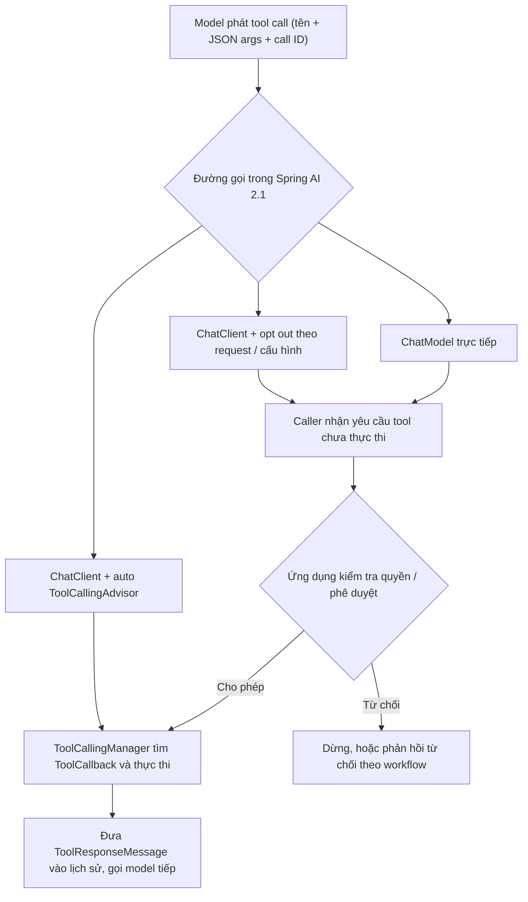

# Đối chiếu cơ chế tắt tự thực thi và thuộc tính đã thay đổi

> **Chương:** Nâng cấp · **Module:** SPRING_AI_TOOL_CALLING · **Mốc đối chiếu:** Spring AI **1.0.x → 2.0.x → 2.1.0 GA** (phát hành 20/11/2026). Nội dung tập trung vào việc mô hình **đề nghị gọi công cụ** qua `@Tool` / `ToolCallback` và ứng dụng **quyết định có thực thi** bằng `ToolCallingManager`. Khi áp dụng vào dự án thật, khóa phiên bản Spring AI BOM, Spring Boot, nhà cung cấp model và đọc release notes của đúng bản.

## 1. Vấn đề nâng cấp cần giải quyết

Giả sử ứng dụng có công cụ xem đơn hàng `getOrderStatus` và công cụ tạo yêu cầu hoàn tiền `requestRefund`. Ở Spring AI 1.x, đội phát triển dùng:

```java
// CÚ PHÁP SPRING AI 1.x — KHÔNG DÙNG ĐỂ BIÊN DỊCH TRÊN 2.x
ChatOptions options = ToolCallingChatOptions.builder()
        .toolCallbacks(ToolCallbacks.from(orderTools))
        .internalToolExecutionEnabled(false)
        .build();

ChatResponse response = chatModel.call(new Prompt("Xem đơn 42", options));
// Model có thể yêu cầu tool; ứng dụng tự kiểm tra rồi mới thực thi.
```

Sau khi nâng lên 2.x, dòng `internalToolExecutionEnabled(false)` báo lỗi biên dịch. Nếu chỉ xóa dòng này rồi chuyển toàn bộ lời gọi sang `ChatClient` mà không xem lại luồng nghiệp vụ, `ToolCallingAdvisor` có thể **tự chạy tool** trước khi ứng dụng kịp hỏi người dùng. Còn nếu vẫn gọi thẳng `ChatModel` như cũ, tool lại **không được chạy tự động**, kể cả từng có cấu hình `internalToolExecutionEnabled(true)`.

Cả hai biểu hiện đều bắt nguồn từ **đổi chủ thể sở hữu vòng lặp**, không phải lỗi của `@Tool`, JSON schema, `ToolContext` hay mô hình. Mục tiêu của bài là xác định đúng điểm tắt, đúng thuộc tính và đúng trách nhiệm thực thi ở từng phiên bản.

**Sau bài học, bạn có thể:** phân biệt “không đưa tool cho model” với “đưa tool nhưng không tự chạy”, chuyển một workflow phê duyệt từ 1.x sang 2.1, cập nhật property/API bị xóa, bảo toàn lịch sử khi tự chạy tool, và viết kiểm thử chứng minh callback chưa bị thực thi ngoài ý muốn.

## 2. Cơ chế thực thi thay đổi từ 1.x sang 2.x

| Hành vi | Spring AI 1.x | Spring AI 2.0.x và 2.1.0 |
| --- | --- | --- |
| Ai quản lý vòng lặp tool mặc định? | Từng triển khai `ChatModel` có vòng lặp nội bộ; gọi model với tool có thể chạy callback rồi gọi model tiếp. | `ToolCallingAdvisor` ở chuỗi advisor của `ChatClient`; dùng `ToolCallingManager` để thực thi và gửi kết quả về model. |
| Muốn caller tự điều phối? | `ToolCallingChatOptions.internalToolExecutionEnabled(false)` rồi kiểm tra `ChatResponse`. | **Không còn flag**. Gọi `ChatModel` trực tiếp, hoặc tắt **tự đăng ký advisor** trên `ChatClient`. |
| `ChatModel.call(prompt)` / `stream(prompt)` | Theo mặc định có thể chạy vòng tool ở chính model. | Trả phản hồi thô và yêu cầu tool; **không tự chạy callback**. |
| `ChatClient.call()` / `stream()` có khai báo tools | Hành vi phụ thuộc vòng lặp trong model và cấu hình 1.x. | Tự đăng ký `ToolCallingAdvisor` (trừ khi opt out) và chạy các vòng đến khi không còn tool call. |
| Điều kiện tiếp tục chạy tool | `ToolExecutionEligibilityPredicate` có kiểm tra flag và `hasToolCalls()`. | `ToolExecutionEligibilityChecker` của `ToolCallingAdvisor`, mặc định xét `response != null && response.hasToolCalls()`. |
| Điều khiển vòng lặp | Tùy flag và logic ở tầng model/caller. | Có thể dùng advisor mặc định, tùy biến advisor hoặc tự điều phối từng vòng qua `ToolCallingManager`. |



Mô hình chỉ sinh *ý định* gọi tool cùng đối số; ứng dụng Java giữ quyền chạy service, xác thực quyền và chịu trách nhiệm tác động ngoài hệ thống. Cấu hình tắt tự thực thi **không phải cơ chế phân quyền**: callback vẫn phải kiểm tra tenant, vai trò, tài nguyên, hạn mức và chống chạy lặp.

## 3. Phân biệt bốn tình huống thường bị lẫn

| Tình huống | Model có thấy định nghĩa tool? | Callback có tự chạy? | Mục đích |
| --- | --- | --- | --- |
| `ChatClient` mặc định + `.tools(...)` | Có | **Có**, nếu model yêu cầu và advisor chấp nhận | Hỏi dữ liệu, workflow đã được cho phép. |
| `ChatClient` + `AdvisorParams.toolCallingAdvisorAutoRegister(false)` | Có | **Không**, nếu không có `ToolAdvisor` khác tự chạy | Đọc yêu cầu tool, kiểm tra hoặc xin phê duyệt. |
| `ChatModel` trực tiếp + `ToolCallingChatOptions.toolCallbacks(...)` | Có | **Không** | Tích hợp orchestrator riêng / caller tự chạy vòng lặp. |
| Không cung cấp công cụ cho request, hoặc provider được yêu cầu không chọn tool | Không, hoặc model được yêu cầu không gọi | Không có tool call hợp lệ để thực thi | Tắt *khả năng gọi* cho một request, tùy khả năng provider. |

**Điểm phân biệt:** tắt `ToolCallingAdvisor` nghĩa là **tắt việc Spring AI tự thực thi**, không tự xóa schema khỏi request. Model vẫn có thể trả `ChatResponse` chứa tool calls. Nếu muốn model **không thấy** công cụ rủi ro, đừng đăng ký công cụ ấy trong request (và kiểm tra cả danh sách tool mặc định) hoặc dùng lựa chọn tool của provider nếu được hỗ trợ. Cũng không nên dựa duy nhất vào prompt “đừng dùng công cụ”: đó không phải rào chắn thực thi.

“Tool call được model phát” và “tool đã chạy thành công” là hai sự kiện khác nhau. Chỉ log được tool name / input không chứng minh đã có một lần gọi service.

## 4. Tắt tự thực thi trên đúng một request của `ChatClient`

Spring AI 2.0+ dùng **`AdvisorParams.toolCallingAdvisorAutoRegister(false)`** để vô hiệu hóa **tự đăng ký** `ToolCallingAdvisor` cho một request:

```java
import org.springframework.ai.chat.client.ChatClient;
import org.springframework.ai.chat.client.ChatClientResponse;
import org.springframework.ai.chat.client.AdvisorParams;
import org.springframework.ai.chat.model.ChatResponse;

// Giả sử chatClient và orderTools được ứng dụng inject/cấu hình.
ChatClientResponse envelope = chatClient.prompt()
        .user("Cho biết trạng thái đơn hàng 42")
        .tools(orderTools)
        .advisors(AdvisorParams.toolCallingAdvisorAutoRegister(false))
        .call()
        .chatClientResponse();

ChatResponse raw = envelope.chatResponse();
if (raw != null && raw.hasToolCalls()) {
    // Ở thời điểm này request tool mới là đề nghị của model.
    // Chưa gọi ToolCallingManager => chưa chạy business service.
    var requested = raw.getResult().getOutput().getToolCalls();
    // Chuyển requested tới bước kiểm tra quyền và phê duyệt của ứng dụng.
}
```

Các tên `chatClient`, `orderTools` là đối tượng có sẵn; đoạn mã minh họa **bước thu nhận yêu cầu**, chưa xử lý callback. Với chế độ tự điều phối, ưu tiên `.chatClientResponse()` hoặc `.chatResponse()` để đọc `hasToolCalls()`; gọi `.content()` có thể chỉ thấy văn bản (thậm chí rỗng) và bỏ qua cấu trúc tool calls.

Lưu ý phạm vi của flag:

- Đây là **chặn auto-registration theo request**, không phải cờ toàn cục lưu trên một `ChatModel`.
- Nếu ứng dụng **đã tự thêm** một `ToolCallingAdvisor`/`ToolAdvisor` thực thi tool vào chuỗi advisor, tắt auto-registration không tự gỡ advisor đó. Phải kiểm tra chuỗi advisor đang được sử dụng; Spring AI chỉ cho phép một `ToolAdvisor` chủ trì vòng lặp.
- `.tools(...)` vẫn cung cấp tool definitions và callback cho request. Phần quyết định có chạy chúng hay không do caller nắm sau phản hồi.
- Khi gọi API streaming, đọc/tổng hợp phản hồi hoàn chỉnh của lượt trước khi quyết định thực thi: chunk đối số `ToolCallPart` còn *partial* không phải một tool call có thể chạy.

## 5. Tắt tự đăng ký `ToolCallingAdvisor` theo cấu hình ứng dụng

Với **`ChatClient` được Spring Boot auto-configure**, thuộc tính của 2.x là:

```properties
# Spring AI 2.0+ / 2.1.0: mặc định true
spring.ai.chat.client.tool-calling.enabled=false
```

Biểu diễn YAML tương đương:

```yaml
spring:
  ai:
    chat:
      client:
        tool-calling:
          enabled: false
```

Khi cờ này là `false`, `ToolCallingAdvisor` không tự đăng ký cho các request đi qua **ChatClient do auto-configuration tạo**; định nghĩa tool vẫn có thể được gửi đến model. Người gọi phải xử lý tool requests nếu muốn tiếp tục. Vì thế property phù hợp với hệ thống **luôn dùng orchestrator bên ngoài**, không nên bật/tắt tùy tiện giữa các môi trường nếu team nghĩ cùng một request sẽ tự chạy.

**Quan trọng về scope:** thuộc tính nói trên áp dụng cho nhánh auto-configured `ChatClient`. Nếu code chủ động tạo `ChatClient.create(chatModel)` hoặc builder riêng, kiểm tra cách client đó tạo chuỗi advisor; khi cần bảo đảm một request không tự thực thi, dùng `AdvisorParams.toolCallingAdvisorAutoRegister(false)` và kiểm tra có advisor thực thi được thêm thủ công hay không. Một giá trị trong `application.yml` **không thể thay thế** việc kiểm tra cấu hình runtime thực tế.

### 5.1. Đừng coi cờ “tắt tự thực thi” là khóa quyền

Chẳng hạn hôm nay property tắt advisor; ngày mai một endpoint khác thêm advisor bằng code hoặc gọi `ToolCallingManager` trực tiếp. Khi đó tool vẫn chạy nếu service cho phép. Hãy giới hạn tool theo user/request, xác thực ở service, cấm thao tác nguy hiểm theo nghiệp vụ, và ghi audit riêng cho *tool requested / approved / executed / failed*.

## 6. Dùng `ChatModel` trực tiếp: không có vòng nội bộ ở 2.x

Với Spring AI 2.1, cả `ChatModel.call(prompt)` và `ChatModel.stream(prompt)` chỉ gửi yêu cầu đến provider và trả kết quả. Không cần và không thể gọi `internalToolExecutionEnabled(false)` nữa.

```java
import org.springframework.ai.chat.model.ChatModel;
import org.springframework.ai.chat.model.ChatResponse;
import org.springframework.ai.chat.prompt.ChatOptions;
import org.springframework.ai.chat.prompt.Prompt;
import org.springframework.ai.model.tool.ToolCallingChatOptions;
import org.springframework.ai.tool.ToolCallback;
import org.springframework.ai.support.ToolCallbacks;

// orderTools là đối tượng chứa phương thức @Tool do ứng dụng tạo hoặc inject.
ToolCallback[] callbacks = ToolCallbacks.from(orderTools);
ChatOptions options = ToolCallingChatOptions.builder()
        .toolCallbacks(callbacks)
        .build();

ChatResponse raw = chatModel.call(new Prompt(
        "Cho biết trạng thái đơn hàng 42", options));

if (raw != null && raw.hasToolCalls()) {
    // Model đã yêu cầu công cụ; callback chưa được Spring AI tự thực thi.
    var calls = raw.getResult().getOutput().getToolCalls();
    // Lúc này có thể kiểm tra, từ chối hoặc chuyển vào workflow chờ duyệt.
}
```

**Ý nghĩa:** `toolCallbacks(...)` là cách khai báo cho model biết tool nào *có thể được yêu cầu*, không phải lệnh “hãy thực thi callback ngay”. Khi tự tổ chức vòng lặp, ứng dụng sẽ gọi `ToolCallingManager.executeToolCalls(prompt, response)` sau bước kiểm tra.

Với `ChatModel`, nếu default options đã chứa 5 tool nhưng prompt có `toolCallbacks(...)` chỉ định 1 tool, danh sách tool trong runtime options **thay thế** defaults. Ngược lại, `ChatClient.prompt().tools(...)` thường **bổ sung** vào `ChatClient.builder().defaultTools(...)`. Cần kiểm tra quy tắc ưu tiên khi nâng cấp nếu bạn dùng tool allowlist: một tool rủi ro đã đăng ký ở `defaultTools` vẫn có thể xuất hiện dù request chỉ thêm tool an toàn khác.

## 7. Điều phối thủ công khi cần quyền phê duyệt

Một hệ thống nghiệp vụ có thể cần đọc yêu cầu tool, xác minh role/tenant, ghi nhận phê duyệt rồi mới chạy. Với `ChatModel` mức thấp, ý tưởng cơ bản là:

```java
// Khung một phương thức dịch vụ — đã có chatModel, options và approvalPolicy.
// approvalPolicy là chính sách do ứng dụng định nghĩa, không phải class Spring AI.
ToolCallingManager manager = ToolCallingManager.builder().build();
Prompt prompt = new Prompt("Tra đơn 42 và đề xuất bước tiếp theo", options);

for (int round = 0; round < 8; round++) {
    ChatResponse response = chatModel.call(prompt);
    if (response == null) {
        throw new IllegalStateException("Không nhận được phản hồi model");
    }
    if (!response.hasToolCalls()) {
        // Đã có câu trả lời cuối; ứng dụng trả output cho caller.
        break;
    }

    var requests = response.getResult().getOutput().getToolCalls();
    if (!approvalPolicy.allAllowed(requests)) {
        // Tạm dừng hoặc trả thông báo từ chối theo quy trình nghiệp vụ.
        // Không gọi executeToolCalls khi còn yêu cầu chưa được duyệt.
        break;
    }

    ToolExecutionResult result = manager.executeToolCalls(prompt, response);
    if (result.returnDirect()) {
        // Trả kết quả tool trực tiếp từ result.conversationHistory();
        // không gửi thêm một lượt model.
        break;
    }
    prompt = new Prompt(result.conversationHistory(), options);
}
// Khi vòng lặp kết thúc vì hạn mức, phải báo lỗi riêng; tránh im lặng trả kết quả cũ.
```

Các `ChatModel`, `ToolCallingManager`, `ToolExecutionResult`, `Prompt` là API Spring AI; `approvalPolicy` là đối tượng ví dụ do ứng dụng viết. Đoạn trên minh họa **các nhánh điều khiển**; bản production cần trạng thái trả về rõ ràng cho: hoàn tất, từ chối, returnDirect, timeout và vượt ngân sách vòng, cùng cách chuyển trường hợp từ chối thành thông điệp nhất quán.

**Khi model gọi nhiều tool trong một phản hồi**, phải xem **toàn bộ batch** trước khi cho `executeToolCalls` chạy; phê duyệt từng tên tool mà bỏ qua đối số có thể làm lọt thao tác ngoài phạm vi. `ToolExecutionResult.conversationHistory()` bảo toàn message yêu cầu tool, từng call ID và `ToolResponseMessage` tương ứng. Đừng tự ghép mọi kết quả thành một chuỗi không ID. Với `returnDirect`, kết quả trả thẳng chỉ khi các tool trong batch **đều** khai báo `returnDirect=true`.

Đừng để chỉ một model trả `hasToolCalls()==true` khiến vòng lặp chạy vô hạn. Kiểm tra hạn mức vòng ở tầng dịch vụ, timeout và retry chỉ cho thao tác idempotent; Spring AI 2.1 bổ sung hạn mức mặc định 40 lần cho **mỗi tool** và 150 lần **tổng cộng mỗi lượt người dùng** ở `ToolCallingManager`. Các giới hạn này không thay cho bước phê duyệt.

### 7.1. Khi cần tạm dừng cho người dùng xác nhận

Không phải mọi trường hợp chờ xác nhận đều cần vô hiệu hóa advisor. Spring AI 2.1 có hỗ trợ **Tool Call Confirmation** để `ToolCallingAdvisor` tạm dừng vòng gọi khi `ToolCallingManager` báo cần xác nhận. Với luồng phê duyệt thông thường, nên khảo sát `@Tool(requiresConfirmation = true)` hoặc metadata tương ứng trước khi tự viết vòng thủ công. Nếu business cần can thiệp rất sâu vào từng lượt, tự điều phối vẫn là một lựa chọn rõ ràng.

## 8. Bảng migration API và thuộc tính

Bảng sau tập trung vào thay đổi ảnh hưởng trực tiếp đến **tắt tự thực thi, đăng ký tool và điều khiển vòng lặp**. Phần lớn breaking changes được đưa vào **2.0** và tiếp tục có hiệu lực ở **2.1**; 2.1 có thêm giới hạn tool và chính sách liên quan.

| Trước khi nâng cấp | Spring AI 2.0+/2.1.0 | Ảnh hưởng / cách sửa |
| --- | --- | --- |
| `.internalToolExecutionEnabled(false)` / `true` | **Đã xóa** khỏi `ToolCallingChatOptions` và options từng provider | Xóa dòng builder. Dùng `ChatClient` + advisor hoặc `ChatModel`/`ChatClient` opt out để tự điều phối. |
| `spring.ai.<provider>.chat.internal-tool-execution-enabled` | **Đã xóa** | Xóa property theo provider; đây không phải alias của property mới. |
| Không có công tắc auto advisor độc lập | `spring.ai.chat.client.tool-calling.enabled` (mặc định `true`) | Tắt auto-registration cho `ChatClient` auto-configured bằng `false`. |
| Không có cờ opt out theo request ở nhánh advisor mới | `AdvisorParams.toolCallingAdvisorAutoRegister(false)` | Tắt auto-registration ở **một request**; kiểm tra advisor được cài thủ công. |
| `ToolExecutionEligibilityPredicate` / `DefaultToolExecutionEligibilityPredicate` | **Đã xóa** | Dùng `ToolExecutionEligibilityChecker` trong `ToolCallingAdvisor.Builder`, hoặc bean do Boot nhận; không còn hook tương đương ở `ChatModel`. |
| `ToolCallAdvisor` | `ToolCallingAdvisor` | Đổi tên class/import và nơi cấu hình advisor. |
| `SpringBeanToolCallbackResolver`, `.toolNames(...)`, `toolBeanDefinitionNames` | **Đã xóa** | Khai báo `ToolCallback` bean hoặc `@Tool` object, truyền qua `.tools(...)` / `.toolCallbacks(...)`. |
| `FunctionCallback`, `FunctionCallingOptions`, `.functions(...)` | API legacy **đã xóa** | Dùng `ToolCallback`, `FunctionToolCallback`, `ToolCallingChatOptions` và `.tools(...)`. |
| `.streamToolCallResponses(...)` trong advisor builder | **Đã xóa** | Dùng advisor quan sát **bên trong** vòng lặp hoặc tự điều phối để phát tiến độ. |
| `spring.ai.chat.client.tool-calling.stream-tool-call-responses` và `spring.ai.chat.client.tool-search-advisor.stream-tool-call-responses` | **Đã xóa**, cấu hình cũ có thể bị bỏ qua | Xóa các property; không đổi tên thành một flag streaming khác. |
| `.tools(Consumer<ToolSpec>)` / `.defaultTools(Consumer<ToolSpec>)` | **Đã xóa** | Truyền `@Tool` object, `ToolCallback`, `ToolCallbackProvider` trực tiếp; truyền ngữ cảnh qua `toolContext(...)`. |
| `ChatOptions.copy()` / `*Options.fromOptions(...)` | **Đã xóa** (options immutable) | Dùng `original.mutate().…​.build()`; không sửa trực tiếp collection của options. |
| Tự đăng ký advisor ở request khi hệ thống đã auto-add | `ChatClient` tự đăng ký một `ToolCallingAdvisor` | Xóa đăng ký trùng; nếu viết advisor sở hữu vòng tool riêng, dùng marker `ToolAdvisor`. |
| Không có hạn mức mặc định đối với số call | Spring AI 2.1: hạn mức mặc định của `ToolCallingManager` | Theo dõi vượt hạn mức, chỉnh qua `spring.ai.tools.limits.*` hoặc builder khi cần, thiết kế idempotency. |

**Lưu ý thuộc tính phiên bản:** ở Spring AI 2.1, `ChatOptions` và các options provider mang tính **immutable**, builder dùng `mutate()` để tạo bản mới. Các property model provider cũng có những thay đổi riêng (ví dụ prefix `.options` được làm phẳng); không nên kết luận nâng cấp tool thành công chỉ vì các property đã bind mà không lỗi. Với OpenAI, `strict` của tool schema ở 2.1 mặc định `false` (có thể bật `OpenAiChatOptions.builder().strict(true)`); `strict` là kiểm tra schema của provider, **không** phải công tắc thực thi tool.

### 8.1. Tùy biến điều kiện chạy tool của advisor

Trong 2.1, điều kiện mặc định là phản hồi có ít nhất một tool call. Khi có nhu cầu provider cụ thể, có thể dùng:

```java
// Có thể đưa vào cấu hình Spring dưới dạng bean nếu dùng auto-config.
@Bean
ToolExecutionEligibilityChecker toolExecutionEligibilityChecker() {
    return response -> response != null && response.hasToolCalls();
}
```

Trong trường hợp này ví dụ trả về **đúng điều kiện mặc định**; mục đích là chỉ ra extension point mới. Đừng sử dụng so sánh cứng `finishReason == "tool_calls"` để quyết định quyền thực thi: provider có thể dùng finish reason khác, hoặc trả reason bình thường nhưng vẫn kèm tool calls. Checker chỉ điều khiển điều kiện tiếp tục vòng lặp; **việc cấp quyền cho từng tool vẫn phải nằm trong ứng dụng**.

### 8.2. Vì sao `streamToolCallResponses` bị xóa?

Tùy chọn cũ đưa **yêu cầu tool** ra ngoài luồng nhưng không đưa ra **thông điệp kết quả tool** tương ứng, có nguy cơ làm chat memory ghi một chuỗi thiếu nửa sau. Vì thế Spring AI đã loại bỏ tùy chọn này. Để quan sát từng vòng, đặt một `CallAdvisor`/`StreamAdvisor` có order **lớn hơn** `ToolCallingAdvisor.DEFAULT_ORDER` (mặc định `Ordered.HIGHEST_PRECEDENCE + 300`) để nó nằm bên trong vòng lặp; hoặc dùng cách tự điều phối.

Trong 2.1, các mảnh `ToolCallPart` **partial** ở streaming không phải call đã hoàn chỉnh; `ChatResponse.hasToolCalls()` không tính chúng. Khi tự điều phối stream, cần tổng hợp trọn lượt qua `MessageAggregator` (cho `ChatModel`) hoặc `ChatClientMessageAggregator` (cho `ChatClient`) trước khi thực thi. Việc UI nhận delta của JSON đối số không chứng minh callback đã chạy.

## 9. Cấu hình mẫu khi di chuyển từ Spring AI 1.x

**Trước — ứng dụng muốn tự phê duyệt tool qua `ChatModel`:**

```java
// Ví dụ cho Spring AI 1.x
ChatOptions oldOptions = ToolCallingChatOptions.builder()
    .toolCallbacks(ToolCallbacks.from(orderTools))
    .internalToolExecutionEnabled(false)
    .build();
ChatResponse raw = chatModel.call(new Prompt(question, oldOptions));
```

**Sau — Spring AI 2.1, giữ cách dùng `ChatModel` trực tiếp:**

```java
ToolCallback[] tools = ToolCallbacks.from(orderTools);
ChatOptions newOptions = ToolCallingChatOptions.builder()
    .toolCallbacks(tools)
    .build();
ChatResponse raw = chatModel.call(new Prompt(question, newOptions));
// Không chạy callback tự động; ứng dụng xem hasToolCalls(), kiểm tra và thực thi.
```

**Sau — muốn giữ `ChatClient` để có advisor khác nhưng tự thực thi tool:**

```java
ChatClientResponse pending = chatClient.prompt()
    .user(question)
    .tools(orderTools)
    .advisors(AdvisorParams.toolCallingAdvisorAutoRegister(false))
    .call()
    .chatClientResponse();
// Kiểm tra pending.chatResponse().hasToolCalls(), xác nhận quyền;
// sau đó dùng ToolCallingManager, lưu history và quyết định lượt kế tiếp.
```

**Sau — ứng dụng muốn dùng vòng tự động được Spring AI quản lý:**

```java
String answer = chatClient.prompt()
    .user("Kiểm tra trạng thái đơn hàng 42")
    .tools(orderTools)
    .toolContext(java.util.Map.of("tenantId", tenantId))
    .call()
    .content();
```

Với `ToolContext`, lấy `tenantId` từ ngữ cảnh bảo mật đã xác thực, không lấy từ JSON do model tự bịa. Nếu chuyển từ thủ công sang tự động, nên giới hạn danh sách tool được phép theo từng request và chỉ cung cấp tool tác động sau khi workflow đã cấp quyền. Nếu cần người xác nhận, kết hợp `requiresConfirmation` và chính sách service.

## 10. Kiểm thử hành vi sau nâng cấp

Đừng chỉ kiểm tra bản mới biên dịch. Dùng fake/stub `ChatModel` phát ra phản hồi có tool call **biết trước** và một callback ghi `AtomicInteger`; so sánh số lượt model, số lần callback, lịch sử và đường trả lời. Đây là ma trận kiểm thử tối thiểu:

| Kịch bản | Hành vi cần khẳng định |
| --- | --- |
| 1.x + `internalToolExecutionEnabled(false)` | Callback không được chạy trước khi caller gọi `ToolCallingManager`. Dùng làm baseline migration. |
| 2.1 `ChatClient` mặc định với `.tools(...)` | Khi model yêu cầu tool hợp lệ, callback chạy đúng một lần cho mỗi call đã được điều phối, mô hình nhận tool result và hoàn tất. |
| 2.1 `ChatClient` + opt out theo request | `ChatResponse.hasToolCalls() == true` nhưng callback counter vẫn **0**. |
| 2.1 auto-configured `ChatClient` + global property `false` | Callback counter vẫn **0**; request vẫn đưa tool definitions cho model khi đã đăng ký. |
| 2.1 `ChatModel.call(prompt)` với tool callbacks | Nhận yêu cầu tool thô, callback counter **0**; không kỳ vọng câu trả lời cuối đã tổng hợp. |
| Explicit `ToolCallingAdvisor` có sẵn, sau đó thêm opt out | Phát hiện advisor vẫn hiện diện và điều chỉnh cấu hình; không giả định opt out tự gỡ advisor thủ công. |
| Hai tool trong cùng một phản hồi, một tool rủi ro chưa duyệt | Không gọi `executeToolCalls` cho batch chưa được duyệt; chưa có tác động phụ. |
| Tool đã duyệt và `ToolCallingManager` chạy | Callback chạy, `ToolResponseMessage` đúng call ID, history có đủ request/response của tool. |
| Một tool `returnDirect=true` nhưng tool khác không có | Không dừng vòng ngay vì không phải **tất cả** tool cùng returnDirect. |
| Stream trả mảnh JSON chưa hoàn chỉnh | Không thực thi trên partial chunk; chỉ chạy sau khi phản hồi tổng hợp có call hoàn chỉnh và được duyệt. |
| Vượt số vòng / timeout / tool lỗi | Dừng rõ ràng, không nuốt lỗi, không tự chạy lại tool có tác dụng phụ. |
| Tool tên trùng hoặc không được cấp cho user | Chặn theo registry/allowlist; không chọn nhầm callback khi nhiều nguồn tool nhập chung. |

### 10.1. Gợi ý kiểm thử số lần gọi callback

Ở bộ test, dùng một fake tool có side effect an toàn, chẳng hạn:

```java
class CountingTools {
    private final java.util.concurrent.atomic.AtomicInteger invocations =
            new java.util.concurrent.atomic.AtomicInteger();

    @Tool(description = "Trả số lần công cụ đã được gọi")
    int getCount() {
        return invocations.incrementAndGet();
    }

    int invocationCount() {
        return invocations.get();
    }
}
```

Tạo `ChatModel` stub trả một `AssistantMessage` có tool call `getCount`, rồi gọi lần lượt với `ChatClient` mặc định, opt out và `ChatModel` trực tiếp. Assertions về **counter bằng 0 hoặc 1** là bằng chứng hành vi; đừng viết một test chỉ kiểm tra config string `enabled=false`. Trên streaming, kiểm tra cả trường hợp nhận partial trước complete để tránh tool chạy hai lần.

### 10.2. Chẩn đoán khi behavior khác mong đợi

| Triệu chứng | Nguyên nhân có khả năng | Kiểm tra đầu tiên |
| --- | --- | --- |
| Biên dịch lỗi `internalToolExecutionEnabled` / `toolNames` | API đã xóa ở 2.x | Đọc upgrade notes đúng bản; thay bằng `toolCallbacks` / `AdvisorParams`. |
| Đã xóa flag nhưng tool không chạy | Đang gọi `ChatModel` trực tiếp | Chuyển sang `ChatClient` auto hoặc tự gọi `ToolCallingManager`. |
| Đã đặt global `enabled=false` nhưng tool vẫn chạy | Client được tạo thủ công, hoặc đã có advisor thực thi tool | Kiểm tra bean/client thực tế, advisor chain, nơi gọi `executeToolCalls`. |
| Opt out rồi gọi `.content()` thấy trống | Model đang yêu cầu tool, không có text cuối | Đọc `ChatResponse.hasToolCalls()` / `getToolCalls()`. |
| Tool chạy hai lần hoặc có hai vòng advisor | Tự thêm `ToolCallingAdvisor` vào client đã auto-register | Giữ một `ToolAdvisor` sở hữu vòng lặp, xem marker và order. |
| Request có tool call nhưng không tìm được callback | Tool registration sai, mất `ToolCallback`, tên trùng | Kiểm tra danh sách callback và tool name; đừng mở toàn bộ catalog để chữa. |
| Stream memory có request tool nhưng thiếu response | Phụ thuộc `streamToolCallResponses` cũ / custom observer sai thứ tự | Xóa property cũ, đặt observer bên trong vòng lặp hoặc tự quản lý history. |
| Tiếp tục gọi vô hạn | Checker quá rộng, chưa có số vòng/time budget | Kiểm tra `hasToolCalls()`, giới hạn manager và timeout. |

## 11. Checklist review PR nâng cấp

1. Khóa BOM Spring AI/Boot, xác nhận 1.x hay 2.x, kiểm tra provider/model còn hỗ trợ tool calling.
2. Xóa `internalToolExecutionEnabled` và property theo provider; quyết định rõ **ai sở hữu vòng lặp** trong từng endpoint.
3. Khi dùng `ChatClient` tự động, rà soát các tool rủi ro trong `defaultTools` và `tools`; không dùng global flag thay quyền nghiệp vụ.
4. Khi muốn caller phê duyệt, dùng `AdvisorParams.toolCallingAdvisorAutoRegister(false)` hoặc `ChatModel` trực tiếp; đọc response chứa tool calls trước khi gọi `ToolCallingManager`.
5. Chuyển `toolNames` / bare `Function` bean, `ToolCallAdvisor`, `streamToolCallResponses`, `ToolSpec` và options legacy theo bảng migration.
6. Cấu hình `ToolExecutionEligibilityChecker` chỉ khi thật cần; giữ kiểm tra quyền, schema, `ToolContext` và xác nhận riêng ở service.
7. Kiểm tra cả `call()` và `stream()`, batch nhiều tool, `returnDirect`, lỗi, giới hạn vòng, idempotency và lịch sử tool-call IDs.
8. Quan sát theo trace ID, tool call ID, tên tool, quyết định phê duyệt và trạng thái chạy; che đối số/kết quả nhạy cảm và không log bí mật.

## 12. Tài liệu chính thức đối chiếu

1. [Spring AI 1.0.9 — Tool Calling](https://docs.spring.io/spring-ai/reference/1.0/api/tools.html) — hành vi `ChatModel` 1.x và `internalToolExecutionEnabled(false)`.
2. [Spring AI 2.1.0 — Upgrade Notes](https://docs.spring.io/spring-ai/reference/upgrade-notes.html) — mục nâng cấp từ 1.x lên 2.0: loại flag, tool loop, predicate, resolver, streaming property; mục 2.1: giới hạn tool và thay đổi options.
3. [Spring AI 2.1.0 — Tool Calling](https://docs.spring.io/spring-ai/reference/api/tools.html) — auto advisor, opt out, `ToolCallback`, `ToolContext`, cấu hình result và quyền thực thi.
4. [Spring AI 2.1.0 — ToolCallingAdvisor](https://docs.spring.io/spring-ai/reference/api/tools/tool-calling-advisor.html) — marker `ToolAdvisor`, advisor order, tắt auto-registration và hook để quan sát vòng lặp.
5. [Spring AI 2.1.0 — ChatModel Tool Calling](https://docs.spring.io/spring-ai/reference/api/tools/chatmodel-tool-calling.html) — raw model response, `ToolCallingManager`, cách truyền tool và chạy vòng thủ công.
6. [Spring AI 2.0 — Tool Calling in Spring AI 2.0](https://spring.io/blog/2026/06/15/spring-ai-composable-tool-calling/) — lý do chuyển tool loop vào advisor chain.
7. [Spring AI 2.1.0 GA](https://spring.io/blog/2026/11/20/spring-ai-2-1-0-GA-available-now/) — mốc phiên bản và các thay đổi liên quan streaming/tool calling.

**Ghi nhớ:** trong Spring AI 2.1, việc “tắt tự thực thi” là **tắt đường tự chạy của `ToolCallingAdvisor` trên `ChatClient`**, hoặc **dùng `ChatModel` trực tiếp** vốn không có vòng lặp nội bộ. Điều này vẫn để model đề nghị tool; caller quyết định có chạy hay từ chối. Những thuộc tính đã xóa phải được xử lý theo migration guide, còn quyền thực thi thật luôn phải kiểm soát tại ứng dụng và service.

