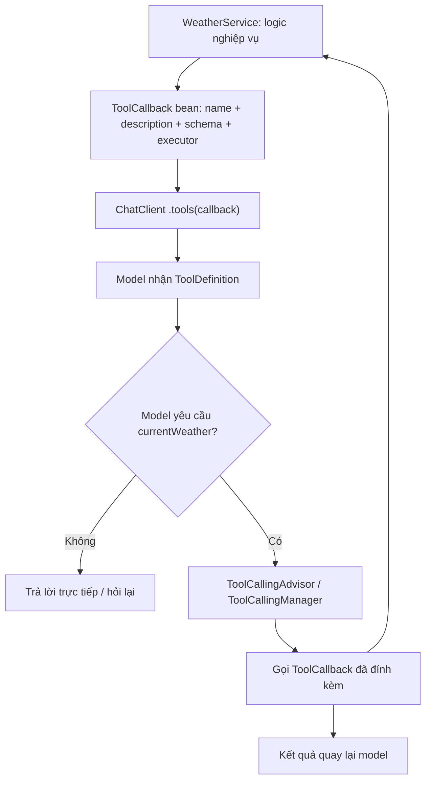

# Chuyển hàm bean phân giải theo tên sang đăng ký callback tường minh khi cần

> **Chương:** Nâng cấp  
> **Module:** `SPRING_AI_TOOL_CALLING` — yêu cầu mô hình gọi công cụ từ ứng dụng Spring AI; ứng dụng Java quản lý đăng ký, thực thi, dữ liệu đầu vào, quyền và lỗi.  
> **Phạm vi phiên bản:** Từ Spring AI **1.x** lên **2.0/2.1**, tập trung API đang dùng trong **Spring AI 2.1.0**. Những đoạn ghi “trước” là mã cũ để đối chiếu, **không dùng nguyên xi trên 2.1**.

## Mục tiêu học tập

Sau bài này, bạn có thể:

1. Nhận diện code cũ dùng `@Bean Function<...>` hoặc `Supplier`/`Consumer` rồi truyền tên bằng `toolNames(...)`.
2. Giải thích vì sao Spring AI 2.1 yêu cầu một công cụ được khai báo dưới dạng `ToolCallback` hoặc phương thức `@Tool` thay vì kỳ vọng bean hàm tự trở thành tool.
3. Viết lại bean hàm cũ thành `FunctionToolCallback` có tên, mô tả và schema đầu vào tường minh; cấp cho `ChatClient` đúng phạm vi bằng `.tools(...)`.
4. Phân biệt **tên bean Spring**, **tên tool mà model nhìn thấy** và **tên dùng để phân giải trong `ToolCallbackResolver`**.
5. Chọn đúng trường hợp dùng callback tường minh, `@Tool` hay resolver động; biết những rủi ro khi bật fallback phân giải theo tên.
6. Kiểm chứng migration bằng hành vi chọn tool, đối số, quyền, số lần thực thi và lỗi phiên bản.

## 1. Vấn đề cũ: bean hàm được tìm theo tên

Trong nhiều ứng dụng Spring AI 1.x, một thao tác nghiệp vụ được gói trong bean Java có kiểu `Function<Input, Output>`, `Supplier<Output>` hoặc `Consumer<Input>`. Ứng dụng đăng ký bean vào Spring context và đưa **tên** cho AI thông qua `toolNames(...)`. Cơ chế phân giải cũ dựa vào `SpringBeanToolCallbackResolver` để tìm bean và biến nó thành công cụ.

Ví dụ mang tính **lịch sử, theo Spring AI 1.x**:

```java
// MÃ CŨ — MINH HỌA, KHÔNG BIÊN DỊCH VỚI SPRING AI 2.1

@Bean
@Description("Get the current weather for a city")
Function<WeatherRequest, WeatherResponse> currentWeather(
        WeatherService weatherService) {
    return weatherService::getWeather;
}

// Ứng dụng cũ tham chiếu bằng tên bean:
chatClient.prompt()
    .user("Thời tiết hiện tại ở Hà Nội?")
    .toolNames("currentWeather")  // API đã bị loại bỏ từ 2.0
    .call()
    .content();
```

Cách này khiến một string vừa đóng vai trò tra cứu bean, vừa gián tiếp quyết định tool được cung cấp. Khi refactor tên bean, đổi API hoặc mở rộng nhiều nguồn tool, ứng dụng dễ mắc lỗi khó nhận diện: tên trỏ sai, không rõ schema được tạo thế nào, hoặc một bean có mặt trong Spring context nhưng không nên được cấp cho một request.

**Thay đổi phiên bản quan trọng:**

- Spring AI **1.x**: cách phân giải bean hàm theo tên từng được hỗ trợ. Trước khi lên 2.x, mã cũ có thể dùng `toolNames(...)` hoặc các API mang tên `functions(...)`.
- Spring AI **2.0.0**: bỏ `SpringBeanToolCallbackResolver` và `toolNames(...)`; loại bỏ các API `FunctionCallback` cũ đã deprecated. Các công cụ phải được mô tả bằng `ToolCallback` hoặc đối tượng chứa phương thức `@Tool`.
- Spring AI **2.0.1 trở đi, gồm 2.1.0**: khả năng fallback tìm `ToolCallback` theo tên **không đính kèm vào request** mặc định **tắt** (`spring.ai.tools.resolution.fallback.enabled=false`).
- Spring AI **2.1.0**: `ChatClient` tự điều phối vòng tool calling qua `ToolCallingAdvisor` trong cấu hình thông thường; khi dùng `ChatModel` trực tiếp, ứng dụng phải tự xử lý chuỗi yêu cầu/đáp ứng công cụ.

Vì vậy đây không chỉ là đổi một tên phương thức. Cần **khai báo chính xác công cụ được nhìn thấy và được thực thi trong từng yêu cầu**.

## 2. Bản đồ trước/sau khi nâng cấp

| Thành phần | Cách cũ cần nhận diện | Cách dùng trong Spring AI 2.1 |
|---|---|---|
| Bean đại diện tool | `@Bean Function<I,O>` được truy ra theo tên | `@Bean ToolCallback`, hoặc object có `@Tool` |
| Cấp cho model | `.toolNames("currentWeather")` | `.tools(currentWeatherCallback)` |
| Công cụ mặc định | `defaultFunctions(...)` hoặc tên hàm trong API cũ | `defaultTools(...)` cho các công cụ thực sự luôn cần |
| Callback tường minh | `FunctionCallback` legacy | `FunctionToolCallback`, `MethodToolCallback` hoặc triển khai `ToolCallback` |
| Tên và schema | Có thể dựa quá nhiều vào tên bean/annotation | Chỉ định tên tool, `description`, `inputType` / schema |
| Phân giải động | `SpringBeanToolCallbackResolver` cho bean hàm | `ToolCallbackResolver` cho **ToolCallback** được đăng ký |
| Thực thi tool | Một số đường đi tự lặp bên trong `ChatModel` 1.x | Ưu tiên `ChatClient`/`ToolCallingAdvisor`; `ChatModel` trực tiếp cần loop riêng |
| Phạm vi cho phép | Khó kiểm soát nếu chỉ dựa tên trong context | Allowlist theo request, kèm xác thực/ủy quyền tại Java handler |

**Quyết định migration:** Bạn **không nhất thiết phải thay đổi nghiệp vụ** `weatherService.getWeather(...)`. Hãy thay **lớp biên giới với AI**: từ đăng ký bean hàm rồi tìm theo tên sang tạo callback có định nghĩa tường minh và đưa callback vào request có chủ đích.

## 3. Mô hình vận hành mới: tách Spring bean khỏi AI tool

Cần hiểu ba khái niệm có thể trùng tên nhưng không đồng nhất:

1. **Tên bean:** định danh đối tượng trong Spring DI; ví dụ `weatherToolBean` do `@Bean("weatherToolBean")` tạo. Dùng để inject bean bằng `@Qualifier` hoặc tên biến.
2. **Tên AI tool:** giá trị truyền làm đối số đầu tiên của `FunctionToolCallback.builder("currentWeather", ...)`. Đây là tên trong `ToolDefinition` mà model dùng khi yêu cầu gọi công cụ.
3. **Tên tra cứu callback:** `ToolCallbackResolver.resolve("currentWeather")` tra theo **tên AI tool**, không có nghĩa là tra một `Function` bean bất kỳ tên `currentWeather`.



**Đăng ký một `ToolCallback` bean không đồng nghĩa tự động quảng bá nó cho mọi model request.** Bean đó được hệ thống phân giải callback biết tới, nhưng cách dùng dễ dự đoán nhất là **truyền đối tượng callback cụ thể** vào `.tools(...)` hoặc `.defaultTools(...)`. Đó chính là thay đổi có ích cho an toàn: người thiết kế request quyết định những công cụ nào được sử dụng.

## 4. Chuyển đổi đầy đủ: từ `Function` bean sang `FunctionToolCallback`

Giả sử nghiệp vụ hiện hữu có interface và DTO sau:

```java
// DTO của dự án, dùng chung cho nghiệp vụ và schema input.
public record WeatherRequest(String city) {}
public record WeatherResponse(String city, String condition, double temperatureC) {}

public interface WeatherService {
    WeatherResponse getWeather(WeatherRequest request);
}
```

Mã sau là **cách đăng ký trong Spring AI 2.1.0**:

```java
import org.springframework.ai.tool.ToolCallback;
import org.springframework.ai.tool.function.FunctionToolCallback;
import org.springframework.context.annotation.Bean;
import org.springframework.context.annotation.Configuration;

@Configuration(proxyBeanMethods = false)
class WeatherToolConfiguration {

    @Bean("weatherToolBean")
    ToolCallback weatherToolBean(WeatherService weatherService) {
        return FunctionToolCallback.builder(
                    "currentWeather", weatherService::getWeather)
            .description(
                "Tra cứu thời tiết hiện tại của thành phố do người dùng cung cấp. " +
                "Chỉ gọi khi cần dữ liệu thời tiết mới nhất.")
            .inputType(WeatherRequest.class)
            .build();
    }
}
```

Trong ví dụ này:

- `weatherToolBean` là **Spring bean name**; `currentWeather` là **AI tool name**. Hai tên khác nhau là hợp lệ và được chủ ý làm rõ.
- `weatherService::getWeather` giữ nguyên nghiệp vụ. Bạn có thể dùng một `Function<WeatherRequest, WeatherResponse>` sẵn có thay cho method reference.
- `description(...)` nêu công dụng và điều kiện dùng. Mô hình xem mô tả này khi cân nhắc gọi tool.
- `inputType(WeatherRequest.class)` giúp tạo **JSON schema đầu vào** cho trường `city`. Nó không thay thế validation ở Java: mã thành phố rỗng, tên địa danh không hợp lệ hoặc yêu cầu vượt quyền vẫn phải được xử lý.
- Callback chuyển JSON do model gửi thành DTO, gọi hàm Java và đưa kết quả về vòng hội thoại theo API Spring AI.

Tiếp theo, inject callback và **cấp phát ở đúng request**:

```java
import org.springframework.ai.chat.client.ChatClient;
import org.springframework.ai.tool.ToolCallback;
import org.springframework.beans.factory.annotation.Qualifier;
import org.springframework.stereotype.Service;

@Service
class WeatherAssistant {

    private final ChatClient chatClient;
    private final ToolCallback weatherTool;

    WeatherAssistant(
            ChatClient.Builder builder,
            @Qualifier("weatherToolBean") ToolCallback weatherTool) {
        this.chatClient = builder
            .defaultSystem("""
                Bạn là trợ lý thời tiết. Khi cần thời tiết hiện tại của
                thành phố được nêu rõ, hãy sử dụng currentWeather.
                Nếu người dùng chưa cho biết thành phố, hãy hỏi lại.
                Không suy đoán thời tiết hiện tại từ trí nhớ mô hình.
                """)
            .build();
        this.weatherTool = weatherTool;
    }

    String answer(String question) {
        return chatClient.prompt()
            .user(question)
            .tools(weatherTool)    // Cấp AI tool này cho yêu cầu hiện tại
            .call()
            .content();
    }
}
```

**Điều kiện môi trường:** ứng dụng phải có `ChatModel` và các Spring AI starter/phụ thuộc tương ứng đã cấu hình; `WeatherService` cần một implementation thật hoặc stub. Mỗi Java `public record` và `public interface` trên phải được đặt trong file nguồn Java hợp lệ theo quy tắc của ngôn ngữ; các khối mã ở đây tách ra để người học nhìn rõ trách nhiệm. Ví dụ không tự tạo một dịch vụ thời tiết hoặc credential.

### Khi nào dùng `defaultTools(...)`?

Nếu mọi yêu cầu của **chính client này** đều là hội thoại thời tiết, có thể đăng ký callback ở builder:

```java
ChatClient weatherOnlyClient = builder
    .defaultTools(weatherTool)
    .build();
```

Đối với trợ lý có nhiều chức năng hoặc tool thay đổi dữ liệu, nên cấp từng callback ở `.tools(...)` theo request/role/tình huống. Theo API 2.1, `.tools(...)` **cộng vào** `.defaultTools(...)`; nó **không ghi đè** danh sách mặc định. Vì vậy, muốn tránh gửi tool nhạy cảm cho request không liên quan thì đừng đưa tool đó vào defaults từ đầu.

## 5. Nếu bean `Function` cũ còn được hệ thống khác dùng thì sao?

Không nhất thiết xóa bean hàm Java đang phục vụ những consumer **không liên quan AI**. Có thể giữ nó và khai báo **một bean `ToolCallback` riêng** bao bọc lại:

```java
import java.util.function.Function;

import org.springframework.ai.tool.ToolCallback;
import org.springframework.ai.tool.function.FunctionToolCallback;
import org.springframework.beans.factory.annotation.Qualifier;
import org.springframework.context.annotation.Bean;
import org.springframework.context.annotation.Configuration;

@Configuration(proxyBeanMethods = false)
class SharedWeatherConfiguration {

    // Bean hàm phục vụ code Java bình thường; tự nó không thành AI tool.
    @Bean("weatherFunction")
    Function<WeatherRequest, WeatherResponse> weatherFunction(
            WeatherService service) {
        return service::getWeather;
    }

    // Ranh giới AI tường minh: xác định tên tool, mô tả và schema.
    @Bean("weatherCallback")
    ToolCallback weatherCallback(
            @Qualifier("weatherFunction")
            Function<WeatherRequest, WeatherResponse> function) {
        return FunctionToolCallback.builder("currentWeather", function)
            .description("Tra cứu thời tiết hiện tại theo thành phố")
            .inputType(WeatherRequest.class)
            .build();
    }
}
```

Đây là **một phương án thay thế** cho cấu hình ở mục 4, **không đăng ký cả hai ví dụ cùng lúc** với tên tool `currentWeather`. Nếu vô tình có hai callback cùng tên AI tool, sẽ phát sinh xung đột. Mọi nơi từng gọi `weatherFunction.apply(request)` vẫn có thể tiếp tục sử dụng logic Java như trước; các nhánh liên quan ChatClient chỉ inject `weatherCallback`.

Tương tự, với `Supplier` hoặc `Consumer`, cách chuyển là tạo `FunctionToolCallback` bằng overload tương ứng, mô tả ý nghĩa kết quả hoặc tác động và kiểm tra schema. Đừng suy rằng tên class hoặc generic type tự cung cấp mô tả nghiệp vụ đầy đủ.

## 6. Lựa chọn `@Tool` hoặc `MethodToolCallback` khi phù hợp

Bạn không phải gói mọi thao tác thành `Function`. Cách phù hợp phụ thuộc vào khả năng sửa lớp nghiệp vụ và nhu cầu tùy biến:

| Cách định nghĩa | Dùng khi | Lưu ý |
|---|---|---|
| `@Tool` trên phương thức | Bạn sở hữu lớp/method và muốn code gọn, truyền `ToolContext` vào handler | Tên mặc định là tên method; bổ sung `@ToolParam`, phân quyền trong handler |
| `FunctionToolCallback.builder(...)` | Bạn đã có `Function`/method reference/lambda, cần định nghĩa AI tool rõ ràng | Phải cung cấp tên, mô tả, `inputType` đúng; có overload cho `BiFunction` với `ToolContext` |
| `MethodToolCallback.builder(...)` | Cần tạo callback từ method qua reflection, hoặc không sửa annotation của lớp sở hữu | Phải cung cấp `ToolDefinition`, `Method` và object đích với instance method |
| Tự triển khai `ToolCallback` | Cần proxy tích hợp đặc thù hoặc cơ chế chuyển đổi riêng | Tăng trách nhiệm schema, lỗi, input/output và quan sát |

Ví dụ khai báo bằng phương thức:

```java
import org.springframework.ai.tool.annotation.Tool;
import org.springframework.ai.tool.annotation.ToolParam;
import org.springframework.stereotype.Component;

@Component
class WeatherTools {

    private final WeatherService service;

    WeatherTools(WeatherService service) {
        this.service = service;
    }

    @Tool(
        name = "currentWeather",
        description = "Tra cứu thời tiết hiện tại khi có tên thành phố")
    WeatherResponse currentWeather(
            @ToolParam(description = "Tên thành phố cần tra cứu")
            String city) {
        return service.getWeather(new WeatherRequest(city));
    }
}

// Ở request cần chức năng thời tiết:
chatClient.prompt()
    .user("Thời tiết hiện tại ở Hà Nội?")
    .tools(weatherTools)   // weatherTools là bean của class ở trên
    .call()
    .content();
```

Đây cũng là phương án thay thế: **chọn một cách đăng ký tool `currentWeather` trong cùng request**, tránh đưa đồng thời cả `WeatherTools` và callback mang tên `currentWeather`. Nếu cần truyền danh tính/tenant nội bộ đến method, `@Tool` có thể nhận thêm `ToolContext` và ứng dụng chuyển giá trị đã xác thực qua `.toolContext(...)`; dữ liệu đó không do model tự sinh.

## 7. Phân giải theo tên vẫn tồn tại trong 2.1 — nhưng khác hẳn bean-hàm cũ

Spring AI 2.1 vẫn có interface:

```java
public interface ToolCallbackResolver {
    ToolCallback resolve(String toolName); // Có thể trả về null nếu không tìm thấy.
}
```

`StaticToolCallbackResolver` của cơ chế auto-configuration biết các **bean `ToolCallback`** và callback từ một số `ToolCallbackProvider`. Việc tra cứu này không làm hồi sinh khả năng tìm các **bare `Function` beans** bằng `toolNames(...)`: API và resolver cũ đã bị bỏ.

Thực tế nên ưu tiên hai luồng:

- **Cấp callback cụ thể:** inject bean rồi gọi `.tools(weatherCallback)`. Đây là con đường đơn giản, rõ ràng và kiểm soát được phạm vi.
- **Chọn callback động:** ứng dụng có một allowlist theo role/tenant và cần chọn một số công cụ ở runtime. Khi đó có thể gọi `ToolCallbackResolver.resolve(...)` **trong mã ứng dụng**, kiểm tra kết quả và đưa chính callback đã được phép vào request.

Ví dụ ý tưởng cho router động:

```java
// Chỉ là phần lõi lựa chọn trong một service đã có chatClient/resolver.
// Danh sách được cho phép phải lấy từ policy tin cậy phía server.
Set<String> allowedToolNames = Set.of("currentWeather");

String toolName = "currentWeather"; // Do logic ứng dụng chọn.
if (!allowedToolNames.contains(toolName)) {
    throw new SecurityException("Tool không được phép");
}

ToolCallback selected = toolCallbackResolver.resolve(toolName);
if (selected == null) {
    throw new IllegalStateException("Không tìm thấy ToolCallback hợp lệ");
}

String reply = chatClient.prompt()
    .user("Thời tiết hiện tại ở Hà Nội?")
    .tools(selected)
    .call()
    .content();
```

Điểm mấu chốt: **router của ứng dụng** chọn callback hợp lệ *trước* khi gọi model. Chuỗi `toolName` không nên lấy trực tiếp từ text người dùng hay tên do model tự tuyên bố mà bỏ qua chính sách quyền.

### Cẩn trọng với `spring.ai.tools.resolution.fallback.enabled`

Trong Spring AI **2.1.0**, mặc định là:

```properties
# Mặc định false từ Spring AI 2.0.1, nên đặt rõ để dễ review.
spring.ai.tools.resolution.fallback.enabled=false
```

Với `false`, `ToolCallingManager` chỉ thực thi callback đã **đính kèm vào request**. Nếu chủ động đặt `true`, khi model yêu cầu một tool không nằm trong danh sách request, framework có thể tìm callback cùng tên qua `ToolCallbackResolver` rồi thực thi. Điều này mở rộng phạm vi thực thi ngoài allowlist request, đặc biệt nguy hiểm nếu resolver biết tool có tác động thay đổi dữ liệu.

| Cấu hình | Model đã được gửi định nghĩa tool? | Tool không đính kèm request có thể thực thi qua resolver? |
|---|---|---|
| `.tools(callback)` + fallback `false` | Có | Không cần fallback; chính callback đó đã nằm trong request |
| Không `.tools(callback)` + fallback `false` | Không | **Không**, chỉ có bean trong context là chưa đủ |
| Không `.tools(callback)` + fallback `true` | Không mặc định | Có thể nếu model phát ra tên chính xác và resolver tìm được; **không dùng làm cơ chế giới thiệu tool cho model** |
| Callback `defaultTools(...)` | Có trên mọi request của client đó | Đã đính kèm mặc định, tùy chính sách của client |

Fallback **không giải quyết lỗi migration** của mã `@Bean Function` cũ: nó phân giải `ToolCallback`, không khôi phục `toolNames(...)` hay `SpringBeanToolCallbackResolver`. Trong đa số ứng dụng, giữ `false` và đưa callback được phép vào request là cách rõ ràng hơn.

## 8. Những thay đổi ngoài callback khi từ 1.x lên 2.1

Việc đổi cách đăng ký tool thường đi cùng thay đổi vòng điều phối; nếu chỉ sửa `FunctionToolCallback` nhưng giữ kỳ vọng cũ, test vẫn có thể sai.

**ChatClient và ChatModel.** Trong Spring AI 2.x, `ChatClient` thường tự đăng ký `ToolCallingAdvisor`, cho model phản hồi tool call, thực thi công cụ, đưa kết quả trở lại model cho đến khi có câu trả lời cuối. `ChatModel.call(...)` trực tiếp không tự thực thi vòng đó; ứng dụng phải xây vòng lặp qua `ToolCallingManager` nếu muốn. Đọc tool call ở tầng thấp và không chạy callback sẽ khiến lỗi bị hiểu nhầm là “tool không được tìm thấy”.

**Tên trùng.** Trong 2.1, `ChatClient` kiểm tra tên tool trùng trong tập callback đã gộp và có thể báo `IllegalStateException`. Khi tự ghép options và gọi thẳng `ChatModel`, cơ chế kiểm tra này có thể không chạy; callback trùng tên dẫn đến phân giải không như mong muốn. Cần đặt tên khác biệt (đặc biệt nếu kết hợp tool local và MCP) và xác minh tập tool trước thực thi.

**Hợp nhất danh sách.** `.tools(...)` thêm vào `.defaultTools(...)`. Chỉ chuyển từ `defaultFunctions(...)` sang `defaultTools(...)` mà không xem xét role có thể vô tình cấp quá nhiều khả năng cho mọi request. Không đặt tool ghi/xóa/hoàn tiền làm default của một client dùng chung chỉ để giữ hành vi cũ.

**Đối số không tin cậy.** JSON schema giúp model tạo cấu trúc đúng; nó không xác thực người dùng hay quyền nghiệp vụ. Tránh đưa tenant ID, token hoặc user ID từ prompt làm tham số do model kiểm soát. Hãy truyền context đã xác thực vào Java handler bằng `ToolContext` khi cần, rồi kiểm tra quyền trên từng tài nguyên.

**Thực thi lại và chi phí.** Khi callback làm thay đổi dữ liệu, cần xử lý idempotency, timeout, xác nhận thao tác và giới hạn tool call; model có thể đề nghị nhiều lượt. Thay đổi API callback không tự giải quyết logic giao dịch.

## 9. Quy trình migration từng bước trong một dự án

### Bước 1 — Kiểm kê điểm nối AI cũ

Tìm các vị trí dùng `toolNames(...)`, `SpringBeanToolCallbackResolver`, `FunctionCallback`, `defaultFunctions(...)`, `functions(...)`, `@Bean Function`/`Supplier`/`Consumer` liên quan AI. Phân biệt bean hàm còn phục vụ consumer Java khác và bean chỉ dùng làm AI tool. Ghi lại tên tool cũ, mô tả, DTO, service và quyền cần thiết.

### Bước 2 — Chọn chiến lược thay thế

- Nếu hàm đang dùng method reference: tạo `FunctionToolCallback`.
- Nếu sở hữu method và cần `ToolContext`/tham số tường minh: cân nhắc `@Tool`.
- Nếu bắt buộc kiểm soát definition và invocation qua reflection: dùng `MethodToolCallback`.
- Nếu một `Function` bean còn được dùng ở nơi khác: giữ nguyên bean Java đó và tạo **thêm** bean `ToolCallback` bao bọc, không để mã AI phụ thuộc vào tên function bean.

### Bước 3 — Kiểm tra hợp đồng callback

Xác định **AI tool name** duy nhất, `description` mô tả khi nào nên gọi, `inputType`/JSON schema đúng thuộc tính và required/optional, cách chuyển kết quả và cách ném/báo lỗi. Ví dụ `WeatherRequest.city` phải cho phép model gửi cấu trúc JSON hợp lệ; nhưng cần xử lý thành phố rỗng hoặc không tồn tại trong service.

### Bước 4 — Cấp phát callback có chủ đích

Thay `.toolNames("currentWeather")` bằng `.tools(weatherTool)`; nếu ứng dụng cần mặc định, chỉ đặt tool an toàn và phù hợp vào `.defaultTools(...)`. Đối với yêu cầu theo role/tenant, tạo allowlist server-side trước khi chọn callback. Giữ `resolution.fallback.enabled=false` trừ khi có lý do cụ thể được đánh giá bảo mật.

### Bước 5 — Chuyển vòng điều phối nếu cần

Nếu mã cũ gọi `ChatModel` rồi trông đợi model tự chạy function, chuyển sang `ChatClient` hoặc hiện thực vòng riêng qua `ToolCallingManager`. Tránh để cùng một yêu cầu vừa được `ToolCallingAdvisor` xử lý vừa bị code custom chạy callback thêm lần nữa.

### Bước 6 — Kiểm chứng rồi loại bỏ đường cũ

Sau khi chạy test thích hợp ở bước riêng của dự án, bỏ các lời gọi API cũ, điều kiện fallback rộng và cấu hình trùng tên không còn cần thiết. Quan sát số lần gọi, input/output được kiểm soát, lỗi và latency. Không đánh giá migration chỉ bằng việc ứng dụng compile hoặc model trả lời văn bản hợp lý.

## 10. Ma trận kiểm thử hành vi cần có

| Ca kiểm thử | Điều kiện | Kỳ vọng |
|---|---|---|
| M1: định nghĩa | Spring khởi tạo `weatherToolBean` | Bean là `ToolCallback`, tool name = `currentWeather`; schema chứa `city` |
| M2: đính kèm | Request gọi `.tools(weatherTool)` | Model nhận đúng tool definition và description |
| M3: cần tra cứu | “Thời tiết hiện tại ở Hà Nội?” | Model có thể đề nghị `currentWeather` với đúng thành phố; Java chỉ chạy nếu yêu cầu hợp lệ |
| M4: không cần tool | “Khái niệm nhiệt độ cảm nhận là gì?” | Có thể trả lời trực tiếp, không gọi API thời tiết vô ích |
| M5: thiếu tham số | “Thời tiết lúc này ra sao?” | Hỏi lại thành phố, không tự bịa giá trị |
| M6: không đính kèm | Client không có defaults, request không `.tools(...)`, fallback `false` | `ToolCallback` bean tồn tại nhưng không tự thực thi |
| M7: tên sai | Router tìm `unknownTool` | Resolver trả `null` hoặc ứng dụng báo lỗi rõ ràng; không tự chọn tool khác |
| M8: tên trùng | Hai callback cùng AI tool name | Tập tool qua `ChatClient` bị từ chối; không âm thầm chọn tool sai |
| M9: quyền | Yêu cầu tra cứu dữ liệu khác tenant khi dùng tool nghiệp vụ nhạy cảm | Handler chặn theo danh tính và quyền thật, dù model đã đề nghị |
| M10: lỗi dịch vụ | Weather API timeout/503 | Trả thông báo phù hợp và log trace; không tạo dữ liệu thời tiết giả |
| M11: fallback mở nhầm | Chỉ cấu hình bean, bật resolver fallback toàn cục | Đánh giá rằng callback chưa đính kèm vẫn có thể bị gọi qua tên; kiểm tra chặn và tắt lại |
| M12: vòng thực thi | `ChatModel` trực tiếp hoặc `ChatClient` | Xác nhận công cụ được thực thi đúng một lần mỗi lời gọi có chủ đích, không chạy trùng |

Phép kiểm tra cấp callback không nhất thiết cần gọi model thật: có thể dùng callback với `WeatherService` giả hoặc kiểm tra `getToolDefinition()` để xác nhận tên, mô tả, schema; dùng mô hình stub cho các ca chọn tool; dùng integration test có kiểm soát khi cần kiểm tra provider cụ thể.

**Ví dụ kiểm tra contract ở mức callback (ý tưởng JUnit):**

```java
// Với weatherTool được inject từ Spring context:
ToolDefinition definition = weatherTool.getToolDefinition();

assertEquals("currentWeather", definition.name());
assertTrue(definition.description().contains("thời tiết"));
assertTrue(definition.inputSchema().contains("city"));

// Với fake WeatherService không gọi mạng:
String result = weatherTool.call("{\"city\":\"Hà Nội\"}");
assertTrue(result.contains("Hà Nội"));
```

Đoạn test trên minh họa các assert cần có, không phải một lớp test hoàn chỉnh; nó giả định stub trả về thành phố tương ứng. Để kiểm thử chính xác theo version và runtime thực tế, triển khai class test trong quy trình kiểm thử của dự án, không phụ thuộc một kết quả ngẫu nhiên từ model.

## 11. Những lỗi thường gặp và cách chẩn đoán

**“Thêm `@Bean Function` nhưng model không thấy tool.”** Đây là hành vi phù hợp 2.1: một bean `Function` thông thường không được coi là tool có thể gọi bằng tên qua API đã bỏ. Hãy khai báo `ToolCallback`/`@Tool` và đính kèm callback đúng request.

**“Bật `spring.ai.tools.resolution.fallback.enabled=true` để `toolNames(...)` chạy lại.”** Không có tác dụng phục hồi API bị xóa; đồng thời có thể mở đường thực thi tool ngoài danh sách request. Hãy sửa code sang callback rõ ràng.

**“Đã có bean `weatherToolBean` nên gọi `.tools("weatherToolBean")`.”** `.tools(...)` nhận công cụ/callback/provider, không phải tên bean để thực hiện cách phân giải `Function` 1.x. Phải inject đối tượng callback thực, ví dụ với `@Qualifier("weatherToolBean")`. Tên mà model biết là `currentWeather` nếu bạn đã đặt tên đó trong builder.

**“Tôi đổi bean method từ `currentWeather` sang `weatherToolBean` nên tool đổi tên theo.”** Không tự động: tên AI tool là tên truyền vào `FunctionToolCallback.builder(...)`; kiểm tra `getToolDefinition().name()`.

**“Tôi đưa cả callback cũ lẫn mới vào request để dự phòng.”** Nếu cùng AI tool name, sẽ xung đột. Nếu khác tên nhưng cùng side effect, model có thể chọn tool không mong muốn. Cần chuyển đổi theo từng điểm gọi và loại bỏ callback trùng.

**“Sau nâng cấp `ChatModel.call(...)` không chạy tool nữa.”** Đây là thay đổi kiến trúc từ 2.0, không phải lỗi `FunctionToolCallback`. Sử dụng `ChatClient` với `ToolCallingAdvisor` hoặc vòng gọi thủ công qua `ToolCallingManager`.

**“Model đã chọn đúng tool nên đủ an toàn.”** Model không có quyền quyết định phân quyền nghiệp vụ. Validator và chính sách tại Java handler vẫn cần thiết để xử lý đối số, tenant, xác nhận hành động và dữ liệu nhạy cảm.

## 12. Checklist hoàn tất migration

- [ ] Mã sản phẩm không còn gọi `toolNames(...)`, `SpringBeanToolCallbackResolver` hoặc `FunctionCallback` bị loại bỏ.
- [ ] Mỗi công cụ AI được định nghĩa bằng `ToolCallback` hoặc `@Tool` và có AI tool name duy nhất.
- [ ] Tên bean Spring và tên AI tool được hiểu rõ; injection có `@Qualifier` khi cần.
- [ ] Có `description` giúp model biết khi nào cần gọi; schema phản ánh DTO thực tế.
- [ ] Request chỉ đính kèm callback cần thiết; rà `defaultTools(...)` và resolver fallback.
- [ ] Phân quyền và xác thực input vẫn diễn ra trong ứng dụng/handler, không dựa vào system prompt.
- [ ] Đã phân biệt `ChatClient` và `ChatModel` trực tiếp để tránh bỏ qua hoặc thực thi lặp tool call.
- [ ] Test tên/schema, request có/không có tool, lỗi tên, tên trùng, lỗi dịch vụ và quyền vượt phạm vi.
- [ ] Đã ghi nhận thay đổi hành vi quan sát được: callback thực thi, đối số, kết quả, latency và giới hạn vòng gọi.

## Câu hỏi tự kiểm tra

1. Vì sao `@Bean Function<WeatherRequest, WeatherResponse>` và `.toolNames("currentWeather")` không còn là phương án hợp lệ trên Spring AI 2.1?
2. Trong ví dụ `@Bean("weatherToolBean")` và `FunctionToolCallback.builder("currentWeather", ...)`, tên nào xuất hiện với mô hình?
3. Tại sao tồn tại một `ToolCallback` bean trong ApplicationContext chưa đủ để bảo đảm model thấy nó ở request?
4. Nếu cần giữ bean `Function` cho consumer Java cũ, làm thế nào để bổ sung AI tool mà không phá những consumer đó?
5. Bật fallback phân giải theo tên khác gì việc đưa callback vào `.tools(...)`?
6. Khi thay từ `ChatModel` trực tiếp sang `ChatClient`, cần kiểm tra gì để tránh lặp hoặc bỏ qua việc thực thi tool?

## Tài liệu tham khảo

1. [Spring AI 2.1.0 — Upgrade Notes](https://docs.spring.io/spring-ai/reference/upgrade-notes.html), các mục **Upgrading to 2.0.0 / Removed: `SpringBeanToolCallbackResolver` and `toolNames()`** và **Tool Resolution Fallback Disabled by Default** (thay đổi từ 2.0.1).
2. [Spring AI 2.1.0 — Tool Calling](https://docs.spring.io/spring-ai/reference/api/tools.html): `@Tool`, `FunctionToolCallback`, `MethodToolCallback`, callback beans, cách truyền tools, resolver và schema.
3. [Spring AI 2.1.0 — Chat Client API](https://docs.spring.io/spring-ai/reference/api/chatclient.html): cấu hình `ChatClient`, `.tools(...)`, `.defaultTools(...)` và vòng advisor.
4. [Spring AI 2.1.0 — ChatModel Tool Calling](https://docs.spring.io/spring-ai/reference/api/tools/chatmodel-tool-calling.html): dùng `ToolCallingManager` khi tự điều phối model tầng thấp.
5. [Spring AI — `FunctionToolCallback` Java API](https://docs.spring.io/spring-ai/docs/2.1.x/api/org/springframework/ai/tool/function/FunctionToolCallback.html): các builder overload và phương thức `call(...)`.

*Ghi chú thực hành:* các interface `WeatherService` và DTO trong bài là ví dụ đơn giản hóa. Migration hoàn tất khi tool được khai báo và cấp phát bằng callback tường minh, các đường phân giải cũ được thay thế, quyền nghiệp vụ được giữ vững và hành vi gọi tool đã được xác minh trên đúng provider/model mà dự án sử dụng.

