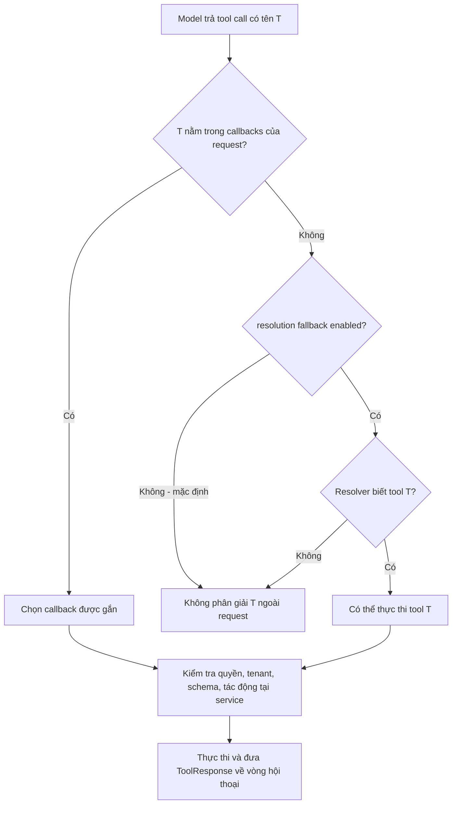
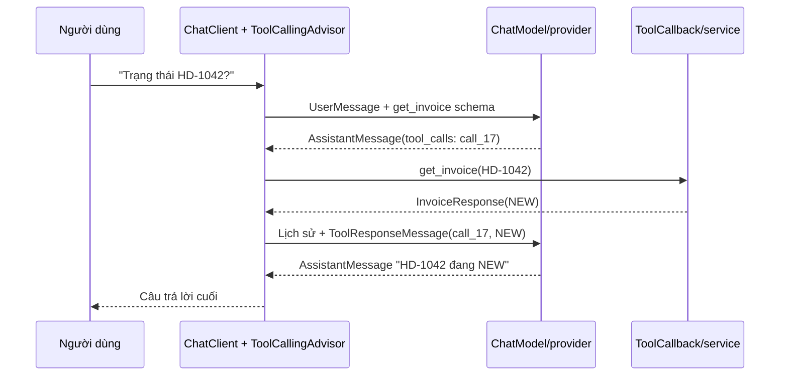

# Kiểm tra thay đổi về ghép tập công cụ, fallback và lịch sử

> **Chương:** Nâng cấp · **Mô-đun:** **SPRING_AI_TOOL_CALLING** · **Mốc đối chiếu:** từ Spring AI **1.1.x** qua **2.0.0**, **2.0.1** đến **2.1.0**. Nội dung dựa trên tài liệu chính thức cho nhánh **2.1.0 stable**. Ba vùng phải kiểm tra khi nâng cấp là **danh mục tool thực sự công bố và được phép chạy**, **cơ chế phân giải tool không có trong request**, và **lịch sử assistant/tool được lưu, ghép, phát lại**.

## 1. Tình huống nâng cấp dễ mắc lỗi

Ứng dụng trợ lý kế toán có ba công cụ:

- `get_invoice`: chỉ đọc hóa đơn, người dùng thường được phép.
- `export_invoice`: xuất hóa đơn sau khi kiểm tra quyền xuất.
- `delete_invoice`: xóa hóa đơn, cần quyền quản trị và xác nhận.

Trước khi nâng cấp, nhóm khai báo `get_invoice` là tool mặc định, mỗi màn hình bổ sung `export_invoice` qua `.tools(...)`. Nhóm cũng có một `ToolCallback` bean cho `delete_invoice` để dùng ở quy trình quản trị. Khi chuyển Spring AI 2.1, xuất hiện các hiện tượng:

1. Màn hình chỉ định `export_invoice`, nhưng mô hình vẫn thấy `get_invoice`. Người viết code tưởng `.tools(...)` sẽ thay thế defaults.
2. Tool `delete_invoice` có trong Spring context nhưng một thử nghiệm gọi theo tên lại không được thực thi. Người vận hành bật “fallback” để khôi phục chức năng cũ, vô tình mở đường cho tên tool ngoài danh sách của request.
3. Một lượt gọi tool chạy thành công, nhưng sang lượt hội thoại sau không thấy tool call và kết quả trong memory; hoặc khi ghép lịch sử thủ công, provider từ chối do có assistant tool call mà thiếu tool response.

Ba biểu hiện cùng nằm tại **ranh giới giữa catalog, chính sách thực thi và vòng hội thoại**. HTTP 200 hay phản hồi văn bản nghe hợp lý không chứng minh những ranh giới đó đúng.

Sau bài học, bạn có thể:

1. Xác định chính xác tool nào đi từ `ChatClient`/`ChatModel` tới mô hình và tool nào `ToolCallingManager` được phép chạy.
2. Phát hiện việc **ghép** `.defaultTools()` với `.tools()`, đối chiếu quy tắc **ghi đè** ở `ChatModel` và kiểm tra xung đột tên.
3. Kiểm chứng `ToolCallbackResolver`/fallback theo đúng mốc phiên bản, không làm lộ các tool nhạy cảm.
4. Kiểm tra lịch sử tool call qua `ToolCallingAdvisor`, legacy `ChatMemory` và `Session Memory` 2.1, kể cả retry, streaming và lưu JDBC.
5. Xây dựng các phép thử hồi quy độc lập với sự ngẫu nhiên của mô hình.

## 2. Bản đồ thay đổi theo phiên bản

Đừng gộp mọi thay đổi vào nhãn “2.1”: một số ranh giới đã chuyển từ **2.0.0**, còn thay đổi fallback mặc định có mốc **2.0.1**.

| Mốc | Thay đổi ảnh hưởng bài này | Cần kiểm tra khi nâng cấp |
| --- | --- | --- |
| **1.1.x → 2.0.0** | Vòng tool được chuyển khỏi từng `ChatModel` sang `ToolCallingAdvisor` ở `ChatClient`; `ChatModel.call()` trả raw tool-call request | Các caller dùng `ChatModel` trực tiếp có còn tự thực thi tool không; thứ tự advisor/memory |
| **1.1.x → 2.0.0** | Bỏ `internalToolExecutionEnabled`, `toolNames(...)` và `SpringBeanToolCallbackResolver`; dùng `ToolCallback` hoặc đối tượng có `@Tool` | Loại bỏ API cũ; không dựa vào bean `Function` thông thường để phân giải bằng tên |
| **2.0.0 → 2.0.1** | `spring.ai.tools.resolution.fallback.enabled` mặc định **false** | Tool trong resolver nhưng không gắn vào request không được thực thi qua fallback |
| **2.0.x → 2.1.0** | `Session Memory` mới, log event và lưu tool transcript; `ChatMemory`/`MessageChatMemoryAdvisor` deprecated | Phân biệt khả năng lưu tool messages theo repository; kiểm tra replay, compaction, session ID |
| **2.0.x → 2.1.0** | `MessagePart` sắp thứ tự nội dung; partial `ToolCallPart` trong streaming; giới hạn gọi tool mặc định 40/tool/lượt, 150 tổng/lượt | Không tự thực thi fragment streaming; cập nhật logic truy cập message/usage/giới hạn |

Các quy tắc `ChatClient` **cộng defaults + request tools** và `ChatModel` **request override model defaults** là **hành vi cần xác nhận ở 2.1.0**, không nên gán tùy tiện là “thay đổi bắt đầu ở 2.1”. Tài liệu tham khảo: [1], [2], [3].

## 3. Ghép tập công cụ ở `ChatClient`

### 3.1. `.defaultTools(...)` và `.tools(...)` được **ghép**, không thay thế

Giả sử:

```java
import org.springframework.ai.chat.client.ChatClient;
import org.springframework.ai.tool.annotation.Tool;

final class InvoiceReadTools {
    @Tool(name = "get_invoice", description = "Đọc trạng thái hóa đơn theo mã.")
    public String getInvoice(String invoiceId) {
        return "INVOICE_FOUND:" + invoiceId;
    }
}

final class InvoiceExportTools {
    @Tool(name = "export_invoice", description = "Xuất hóa đơn được phép truy cập.")
    public String exportInvoice(String invoiceId) {
        return "EXPORT_REQUESTED:" + invoiceId;
    }
}

// chatModel là bean ChatModel đã cấu hình.
ChatClient client = ChatClient.builder(chatModel)
    .defaultTools(new InvoiceReadTools())
    .build();

String answer = client.prompt()
    .user("Đọc hóa đơn HD-1042, sau đó xuất nếu được phép.")
    .tools(new InvoiceExportTools())
    .call()
    .content();
```

Ở `ChatClient` 2.1, tập định nghĩa tool cuối được đưa tới model gồm **`get_invoice` và `export_invoice`**. Thêm `.tools(...)` **không xóa** công cụ đã khai báo ở `.defaultTools(...)`. Ngay cả khi prompt chỉ muốn xuất hóa đơn, tool đọc vẫn nằm trong catalog mà model nhìn thấy. Nếu tool mặc định có tác dụng phụ hoặc có phạm vi quyền rộng, hành vi này rất đáng kiểm tra. [1]

Đây là **ghép theo danh mục**, không bảo đảm mô hình sẽ gọi cả hai tool; việc model chọn tool vẫn phụ thuộc model/provider/prompt. Phải kiểm tra **cả catalog gửi đi** và **số lần callback thật sự chạy**.

Cách dùng cho ứng dụng nhiều vai trò: chỉ đặt các tool an toàn **với mọi request của cùng client** trong `defaultTools`; lấy danh mục công cụ được phép từ authorization của server và thêm qua `.tools(...)` trong request. Nếu cần catalog **chỉ** gồm một nhóm đã được cấp quyền, hãy dùng client được xây với defaults tương ứng hoặc không có defaults; đừng giả định `.tools(...)` xóa mặc định.

### 3.2. Nguồn tool được ghép: annotation, callback, provider, MCP

`ChatClient.tools(...)`/`defaultTools(...)` nhận kết hợp các loại: đối tượng chứa phương thức `@Tool`, `ToolCallback`, `ToolCallbackProvider` và collection/array. Local tool và MCP tool cùng được chuyển về `ToolCallback`. MCP provider **không tự động được thêm vào danh mục `ChatClient`** chỉ vì có kết nối MCP; hãy inject `SyncMcpToolCallbackProvider` và gắn rõ ràng vào `.tools(mcpProvider)` hoặc `.defaultTools(mcpProvider)`. [1]

Một catalog thực tế có thể là:

```text
MODEL_VIEWS:
  ChatClient.defaultTools(): get_invoice, list_currencies
  ChatClient.tools():        export_invoice, mcp_search_order
  ---------------------------------------------------------
  Catalog của request:     get_invoice, list_currencies,
                           export_invoice, mcp_search_order

EXECUTION_AUTHORITY:
  Chỉ những callback được gắn vào request (fallback=false)
  + validation schema + authorization ở lớp nghiệp vụ
```

**Phân biệt công bố và cấp quyền:** Một tool nằm trong catalog mới là *được mô hình biết đến*. Quyền đọc/xóa dữ liệu còn phải được thực thi ở callback/service với principal, tenant, target object và xác nhận thao tác. `ToolContext` chuyển dữ liệu tin cậy tới tool mà không gửi các giá trị đó cho mô hình; không dùng role/tenant do mô hình tự truyền làm nguồn quyền. [1]

### 3.3. Kiểm tra trùng tên sau khi ghép

Vấn đề phát sinh khi một `@Tool` local và một công cụ MCP remote đều tên `get_invoice`. `DefaultMcpToolNamePrefixGenerator` xử lý tên trùng **giữa các MCP server**, nhưng không thể tự nhận biết trùng với local `@Tool`.

Ở `ChatClient` 2.1, khi đi qua `.tools(...)`/`.defaultTools(...)`, **danh sách đã ghép được kiểm tra**, và nếu hai `ToolCallback` trùng tên thì request báo `IllegalStateException`, thay vì âm thầm gọi sai. **Khi đi thẳng qua `ChatModel.call()` với `ToolCallingChatOptions` tự ghép, kiểm tra đó không tự chạy**; giải tool theo tên có thể chọn callback đứng đầu nếu tên trùng. Đây là khác biệt quan trọng của hai đường API. [1]

Hướng xử lý:

- Đặt tên rõ namespace, ví dụ `local_get_invoice` và `mcp_finance_get_invoice`, hoặc lọc bớt tool qua `McpToolFilter`.
- Kiểm tra **tên sau khi ghép** ngay khi cấu hình và trước khi chuyển cho model; với đường `ChatModel` tự xây catalog, gọi `ToolCallingChatOptions.validateToolCallbacks(...)` theo API 2.1.
- Thử riêng xung đột local + local, local + MCP và MCP + MCP; đừng dựa vào thứ tự provider trả tool.

**Không dùng “callback đầu tiên thắng” làm quy tắc nghiệp vụ**. Một lần đảo thứ tự config/server có thể đổi công cụ được thực thi mà không có cảnh báo.

## 4. `ChatModel` có quy tắc ghi đè khác với `ChatClient`

Với `ChatModel` cấp thấp, nếu model builder có options mặc định chứa `ToolCallback[] defaults` và request gửi `ToolCallingChatOptions.toolCallbacks(requestTools)` thì **danh sách request thay thế hẳn defaults**. Muốn giữ cả hai phải tự hợp nhất. [2]

Ví dụ cấu hình options cho một request:

```java
import org.springframework.ai.chat.model.ChatResponse;
import org.springframework.ai.chat.prompt.ChatOptions;
import org.springframework.ai.chat.prompt.Prompt;
import org.springframework.ai.model.tool.ToolCallingChatOptions;
import org.springframework.ai.tool.ToolCallback;
import org.springframework.ai.tool.ToolCallbacks;

ToolCallback[] onlyInvoiceExport = ToolCallbacks.from(new InvoiceExportTools());

ChatOptions requestOptions = ToolCallingChatOptions.builder()
    .toolCallbacks(onlyInvoiceExport)
    .build();

// Giả định chatModel được tạo trước đó với default tool "get_invoice".
ChatResponse raw = chatModel.call(
    new Prompt("Xuất hóa đơn HD-1042", requestOptions));

// Raw response có thể chứa yêu cầu tool, nhưng ChatModel không tự gọi callback.
boolean requested = raw.hasToolCalls();
```

**Kỳ vọng:** request đến provider chỉ có `export_invoice`, **không** có `get_invoice` từ default model options. `raw.hasToolCalls()` kiểm tra có *đề nghị* gọi tool; callback không tự chạy. Nếu cần thêm tool mặc định, hãy ghép rõ ràng vào `List<ToolCallback>` rồi set request options và kiểm tra tên.

| Tình huống ở Spring AI 2.1 | Tập tool tới model | Ai chạy tool? |
| --- | --- | --- |
| `ChatClient.defaultTools(A,B)`, request không thêm tool | `A,B` | `ToolCallingAdvisor` (mặc định) |
| `ChatClient.defaultTools(A,B)` và `.tools(C)` | `A,B,C`; trùng tên bị chặn | `ToolCallingAdvisor` |
| `ChatModel` có defaults `A,B`, request options `C` | **Chỉ `C`** | **Caller** phải chạy `ToolCallingManager` |
| `ChatModel` có defaults `A,B`, request options vắng tool override | `A,B` (nếu cấu hình builder giữ defaults) | **Caller** |
| `ToolCallbackResolver` biết `D`, request chỉ `A`, fallback mặc định tắt | Mô hình chỉ được công bố `A` | `D` **không** được fallback thực thi |

Điểm dễ bỏ sót: `ChatClient` sử dụng request-level options đưa xuống `ChatModel`, vì vậy tool đã ghép ở client có thể **ghi đè** default tool callbacks đặt trên instance `ChatModel`. Nếu ứng dụng chuyển từ gọi `ChatModel` sang `ChatClient`, phải kiểm tra nơi khai báo catalog thật, tránh ngộ nhận model-level defaults luôn xuất hiện.

## 5. Fallback là cơ chế **thực thi tool ngoài danh sách request**

### 5.1. `ToolCallbackResolver` không đồng nghĩa với tool được công bố

`ToolCallbackResolver` có hợp đồng:

```java
public interface ToolCallbackResolver {
    @Nullable
    ToolCallback resolve(String toolName);
}
```

Spring AI có `StaticToolCallbackResolver` mặc định, có thể biết các `ToolCallback` bean và callback được `ToolCallbackProvider` cung cấp (trừ trường hợp MCP cần cơ chế riêng). Resolver có thể trả tool theo tên khi `ToolCallingManager` được cấu hình cho phép. **Việc có bean trong Spring context không tự đưa tool vào request** và cũng không mặc nhiên cấp quyền chạy nó. [1]

Luồng quyết định:



Từ **Spring AI 2.0.1** và vẫn đúng ở **2.1.0**, fallback này mặc định **false**:

```yaml
spring:
  ai:
    tools:
      resolution:
        fallback:
          enabled: false
```

Muốn tương thích hành vi cũ có thể bật `spring.ai.tools.resolution.fallback.enabled=true` hoặc khi tự xây manager gọi `ToolCallingManager.builder().resolutionFallbackEnabled(true)`. **Đây là lựa chọn có ý nghĩa cấp quyền**, vì tất cả tên tool có trong resolver trở thành ứng viên thực thi nếu mô hình trả tên tương ứng, dù request không gắn tool đó. [1][3]

**Vì sao mô hình có thể gọi tool không công bố?** Nó có thể sinh tên công cụ do lịch sử cũ còn chứa, do prompt injection, do suy diễn/hallucination, hoặc vì controller tự gửi tool-call request sai. Việc không công bố `D` làm giảm khả năng model biết tên, **không phải hàng rào an toàn** khi bật fallback.

### 5.2. Quy tắc kiểm thử fallback

Tạo hai callback `read_invoice` (được gắn vào request) và `delete_invoice` (chỉ đăng ký với resolver). Dùng fake provider hoặc một `ChatResponse` kiểm soát được sinh lời gọi `delete_invoice`, thay vì hy vọng mô hình tự đoán tên đó.

| Thiết lập | Đề nghị `delete_invoice` | Kết quả mong đợi |
| --- | --- | --- |
| Fallback **false** (mặc định), không đính `delete_invoice` | Có | Manager **không** gọi callback `delete_invoice`; ứng dụng xử lý lỗi/unknown tool |
| Fallback **true**, resolver có `delete_invoice` | Có | Resolver có thể chọn `delete_invoice`; test có thể thấy callback được gọi **nếu không có guard nghiệp vụ** |
| Fallback **false**, request đã đính `delete_invoice` | Có | Callback được chọn theo request, nhưng service vẫn phải kiểm tra role/approval |
| Fallback **true**, resolver không biết tên | Có | Không có callback hợp lệ để thực thi, xử lý lỗi |

Đừng dùng một probe chỉ có câu hỏi văn bản “hãy gọi delete_invoice” để chứng minh fallback được khóa: model có thể tự từ chối tạo structured tool call. Kiểm tra **thực thi** bằng callback counter/mocking và response có cấu trúc.

Nếu phải bật fallback vì yêu cầu backward compatibility, giới hạn resolver theo namespace/tenant/tập tool cho phép, triển khai lớp authorization ngay trước side effect, thêm kiểm thử các tool nhạy cảm và nêu rõ lý do lựa chọn trong thay đổi cấu hình. Cách đơn giản, dễ kiểm soát hơn vẫn là **giữ false và đính tool theo từng request**.

## 6. Lịch sử mà `ToolCallingAdvisor` tự tạo trong một lượt

Ở 2.0+, `ChatClient` mặc định có `ToolCallingAdvisor`: gửi messages cùng tool definitions, nhận `AssistantMessage` chứa tool calls, đưa cho `ToolCallingManager` thực thi, thêm `ToolResponseMessage` rồi gọi model tiếp cho tới khi không còn tool call. Điều này vẫn xảy ra với `.call()` và `.stream()`. [1][4]



Dấu vết trong **một lần chạy** cần đầy đủ cặp:

```text
[UserMessage]     Trạng thái HD-1042?
[AssistantMessage] tool_calls = [(id=call_17, name=get_invoice, args=...)]
[ToolResponseMessage] responses = [(id=call_17, result=...)]
[AssistantMessage] HD-1042 đang NEW
```

Cặp `tool call id` ↔ `tool result id` là bắt buộc về mặt giao thức; nếu model gọi nhiều tool trong cùng một phản hồi thì cần trả kết quả cho **tất cả** các call có liên quan. `ToolCallingAdvisor` giữ lịch sử nội bộ trong vòng lặp theo mặc định, nhưng **điều đó không đồng nghĩa tự lưu toàn bộ các round trong kho hội thoại lâu dài**.

### 6.1. Di chuyển từ vòng gọi cũ ở `ChatModel`

Spring AI 1.x có internal tool execution trong `ChatModel`. Sang 2.0+, `ChatModel.call()` trả `ChatResponse` chứa tool requests mà **không thực thi**. Nếu code cũ dùng trực tiếp `ChatModel`, sau nâng cấp có thể quan sát callback count bằng 0 dù `response.hasToolCalls() == true`. Chuyển sang `ChatClient` hoặc tự viết vòng:

```java
import org.springframework.ai.model.tool.ToolCallingManager;
import org.springframework.ai.model.tool.ToolExecutionResult;
import org.springframework.ai.chat.model.ChatResponse;
import org.springframework.ai.chat.prompt.Prompt;

// chatModel, options, prompt được dựng ở caller.
ToolCallingManager manager = ToolCallingManager.builder().build();
ChatResponse response = chatModel.call(prompt);

while (response.hasToolCalls()) {
    ToolExecutionResult executed = manager.executeToolCalls(prompt, response);
    if (executed.returnDirect()) {
        // Trả kết quả tool cho caller theo contract ứng dụng.
        break;
    }
    prompt = new Prompt(executed.conversationHistory(), options);
    response = chatModel.call(prompt);
}
```

Phần này minh họa **đường low-level** theo docs 2.1; vòng tự quản lý phải bổ sung quota, timeout, quyền, ghi vết, dừng theo nghiệp vụ, xử lý nhiều tool và cả nhánh `returnDirect`. 2.0 bỏ `internalToolExecutionEnabled`; không thêm lại property này vào cấu hình 2.1. [2][3]

Nếu tắt advisor bằng `spring.ai.chat.client.tool-calling.enabled=false`, `ChatClient` vẫn có thể gửi tool definitions nhưng sẽ **không tự thực thi** tool; cần vòng thực thi của ứng dụng. Đừng suy từ việc callback không được gọi rằng model không hỗ trợ tool calling. [1]

## 7. Tại sao lịch sử sau mỗi lần hỏi lại khác lịch sử trong một vòng tool?

Có hai câu hỏi độc lập:

1. **Loop history:** model cần thấy các tool-call requests và results trong **cùng lượt** để sinh câu trả lời cuối.
2. **Persistent memory/history:** khi người dùng hỏi tiếp ở **lượt sau**, hệ thống có giữ cặp tool call/result trước đó để cung cấp lại cho model không?

Với `MessageChatMemoryAdvisor` cũ ở 2.0/2.1, thứ tự advisor ảnh hưởng điều gì được ghi. `ToolCallingAdvisor.DEFAULT_ORDER` là `Ordered.HIGHEST_PRECEDENCE + 300`; `MessageChatMemoryAdvisor` mặc định ở `+200` (nằm **ngoài** loop):

- Nạp lịch sử một lần trước loop.
- Chỉ lưu **UserMessage đầu vào và AssistantMessage cuối cùng**.
- Không nhìn thấy các round tool call và tool response giữa chừng. Đây là hành vi mặc định có chủ ý vì nhiều `ChatMemoryRepository` không lưu đầy đủ tool messages.

Nếu đặt memory advisor **bên trong** loop (order lớn hơn `ToolCallingAdvisor.DEFAULT_ORDER`, ví dụ `+400`), nó có thể thấy các round và lưu transcript. Với `ToolCallingAdvisor` tự đăng ký, `DefaultChatClient` tự tắt lịch sử nội bộ của loop khi phát hiện memory advisor bên trong để tránh ghi trùng. Nếu tự tạo advisor thủ công, phải dùng `.disableInternalConversationHistory()` tương ứng. [1][4]

```text
MessageChatMemoryAdvisor @ +200 (outside)
  ToolCallingAdvisor @ +300
    ChatModel call #1 -> tool calls
    tool results
    ChatModel call #2 -> final answer
=> Memory thường chỉ lưu user + final answer.

ToolCallingAdvisor @ +300
  MessageChatMemoryAdvisor @ +400 (inside)
    ChatModel call #1 -> tool calls [persist]
    tool results [persist]
    ChatModel call #2 -> final answer [persist]
=> Có thể giữ full transcript NẾU repository hỗ trợ.
```

**Bẫy JDBC:** `JdbcChatMemoryRepository` cũ **lọc bỏ** `AssistantMessage` có tool calls và `ToolResponseMessage` khi ghi, không thông báo lỗi ở API. Do đó có thể thấy cuộc trò chuyện bình thường nhưng khi restart thì mất các tool round. Với persistence JDBC cần đầy đủ tool history, chuyển sang **Session Memory + JDBC SessionRepository** của 2.1. [5]

## 8. Spring AI 2.1: `Session Memory` lưu phiên và các lượt tool theo event

`Session Memory` 2.1 dùng `SessionService`, `SessionRepository`, `SessionEvent` kiểu append-only. `SessionMemoryAdvisor` chạy **bên trong** loop để đọc view và lưu các messages; `SessionTurnAdvisor` nằm **bên ngoài** để quản lý turn, compaction và những trường hợp loop kết thúc không có round model kế tiếp (ví dụ `returnDirect`). Dùng `SessionAdvisors` để có **cả hai**. [6][7]

Ví dụ tham chiếu:

```java
import org.springframework.ai.chat.client.ChatClient;
import org.springframework.ai.chat.model.ChatModel;
import org.springframework.ai.session.SessionService;
import org.springframework.ai.session.advisor.SessionAdvisors;

// Đặt trong một lớp cấu hình Spring @Configuration.
@Bean
ChatClient invoiceChatClient(ChatModel chatModel, SessionService sessionService) {
    return ChatClient.builder(chatModel)
        .defaultAdvisors(SessionAdvisors.builder(sessionService).build())
        .build();
}

// Một request từ server, sessionId đã được xác thực thuộc người dùng/tenant.
String answer = invoiceChatClient.prompt()
    .user("Trạng thái hóa đơn HD-1042? Hãy dùng get_invoice.")
    .tools(new InvoiceReadTools())
    .advisors(SessionAdvisors.session(sessionId))
    .call()
    .content();
```

**Lưu ý:** `@Bean`/`@Configuration` cần import Spring tương ứng và `sessionId` phải được server xác định; đoạn trích là minh họa cấu hình, không phải một file Java chạy độc lập. Một starter cho JDBC Session Memory là `org.springframework.ai:spring-ai-starter-model-session-jdbc`; cần `DataSource` và migration/schema phù hợp. Không dùng repository in-memory để xác minh khả năng khôi phục qua restart. [6]

### 8.1. Cặp tool call/result và compaction

Trong 2.1, session giữ event log; `EventFilter` quyết định event được đọc vào prompt, `MessageFilter` quyết định message có được lưu hay không. Tool calls và tool results **được lưu theo cặp** để tránh lịch sử bất hợp lệ. Window/compaction giữ nguyên ranh giới turn, và read guard loại các cặp tool thiếu kết quả khỏi **prompt được phát lại**, trong khi raw log vẫn có thể giữ các event ban đầu. Không xóa tool results khỏi log rồi hy vọng provider vẫn chấp nhận lịch sử có assistant tool calls. [6][7]

Nếu lần chạy trước dừng sau khi lưu assistant tool call nhưng không lưu result, `SessionTurnAdvisor` có thể ghi kết quả đánh dấu **chưa có kết quả được ghi** khi người dùng mở một turn mới. **Đây không phải bằng chứng tool chưa tạo side effect**. Đối với thao tác ghi dữ liệu, hãy đối soát qua action ledger/transaction idempotency trước khi chạy lại. [7]

### 8.2. Không chạy đồng thời nhiều lượt trên cùng `sessionId`

Docs 2.1 nêu giới hạn **một call đang chạy trên mỗi session**: nếu hai lượt dùng cùng session chạy đồng thời, các event có thể xen kẽ, hoặc một call đánh dấu tool chưa có kết quả của call kia; điều này gây hai tool result cho một call id. Ứng dụng cần tuần tự hóa request theo `sessionId` (queue, lease/lock theo session), nhất là khi có xác nhận thao tác hoặc tool chạy lâu. [7]

Một session id phải được gắn với principal/tenant ở backend, không được dùng chung cố định cho nhiều người. Nếu thiếu session ID, `SessionMemoryAdvisor` báo `IllegalStateException` thay vì âm thầm gộp lịch sử của nhiều người.

## 9. Replay lịch sử đúng cấu trúc và chú ý `MessagePart` 2.1

Spring AI 2.1 biểu diễn nội dung `AssistantMessage` và `UserMessage` theo danh sách có thứ tự `MessagePart` (như `TextPart`, `ToolCallPart`, `MediaPart`). `getText()`, `getToolCalls()` là view; các collection trả về có thể không sửa trực tiếp được. Một số code cũ lấy `assistant.getToolCalls().add(...)` sẽ lỗi hoặc làm hỏng giả định. Hãy sử dụng builder/`mutate()`/`part(...)` theo API thay vì sửa mutable list. [3]

### 9.1. Trong streaming, partial tool call không phải lời gọi có thể chạy

Khi provider hỗ trợ stream arguments, Spring AI 2.1 có `ToolCallPart` đánh dấu **partial**. Fragment có thể chỉ là `{"invoiceId":"` — chưa phải JSON hoàn chỉnh. `AssistantMessage.getToolCalls()` và `hasToolCalls()` bỏ qua fragment partial; `ToolCallingManager` chỉ thực thi khi có tool call hoàn chỉnh. `MessageAggregator` không đưa partial vào transcript memory. [1][3]

**Phép thử:** stream một tool có đối số JSON được chia thành nhiều chunks; xác nhận counter của callback chỉ tăng **khi complete tool call xuất hiện**, và lịch sử không có tool-call fragment chưa khép.

### 9.2. Replay provider phải giữ quan hệ và thứ tự

Giả sử provider trả hai tool calls:

```json
{
  "role": "assistant",
  "tool_calls": [
    {"id": "call_a", "type": "function",
     "function": {"name": "get_invoice", "arguments": "{\"invoiceId\":\"HD-1042\"}"}},
    {"id": "call_b", "type": "function",
     "function": {"name": "get_invoice", "arguments": "{\"invoiceId\":\"HD-2048\"}"}}
  ]
}
```

Lượt tiếp theo phải chứa assistant message với cả hai calls và tool results cho **`call_a` và `call_b`**, không trộn id. Đừng chỉ đưa câu trả lời văn bản “đã tra cứu xong” vào lịch sử. Với `ChatModel` tự điều phối, dùng `ToolExecutionResult.conversationHistory()` từ manager để tạo `Prompt` mới thay vì tự nối chuỗi tên tool/result vào `UserMessage`. [2]

**Khi đổi catalog giữa các lượt:** lịch sử có thể chứa tên tool đã dùng ở quá khứ dù request hiện tại không còn quyền dùng tool đó. Session memory cho model *biết chuyện đã xảy ra*, **không cấp lại quyền**. Hãy tính lại tập tool theo quyền **mỗi request** và giữ fallback tắt. Nếu đổi tên tool khi nâng cấp, cần kiểm thử replay lịch sử cũ: assistant có thể nhắc tới tên cũ, nhưng ứng dụng không được tự thực thi lại công cụ đã bị thu hồi.

## 10. Thiết kế bộ kiểm thử hồi quy theo thứ tự ưu tiên

Để kiểm tra nâng cấp đáng tin cậy, tách hai lớp:

1. **Kiểm thử xác định** (fake `ChatModel`, callback spy/stub): assert danh sách `ToolDefinition` gửi tới provider, manager thực thi callback nào, lịch sử gồm loại message gì và thứ tự ra sao. Không phụ thuộc mô hình có quyết định gọi tool hay không.
2. **Kiểm thử thực tế** (provider/model đang dùng): kiểm tra model trả structured `tool_calls`, truyền đối số, nhận `ToolResponseMessage`, kết thúc vòng, cả non-streaming/streaming. Kết quả có thể dao động; lặp theo cấu hình cố định và thống kê.

| ID | Đường | Tình huống | PASS cần thấy |
| --- | --- | --- | --- |
| **C01** | ChatClient | `defaultTools(A,B)` và `tools(C)` | Catalog `A,B,C`; không mất `A,B` |
| **C02** | ChatModel | Default callbacks `A,B`, request callbacks `C` | Model chỉ nhận `C` |
| **C03** | ChatClient | Local `A` và MCP `A` cùng tên | Lỗi `IllegalStateException`, không chạy tool nào |
| **C04** | ChatModel | Tự ghép hai `A` trùng tên | Kiểm tra bằng `validateToolCallbacks(...)` và từ chối trước provider |
| **F01** | ToolCallingManager | Callback `D` chỉ có trong resolver, fallback false | `D` không bị thực thi |
| **F02** | ToolCallingManager | Cùng setup nhưng fallback true | Có thể resolve `D`; kiểm thử quyền nghiệp vụ vẫn từ chối nếu không được phép |
| **F03** | Spring context | Có `ToolCallback` bean `D` nhưng không gắn request | `D` không tự xuất hiện trong tool definitions |
| **H01** | ChatClient | Model sinh một tool call rồi trả final | Lịch sử vòng có `assistant tool call → matching result → final` |
| **H02** | ChatMemory legacy | `MessageChatMemoryAdvisor` ở ngoài loop | Chỉ user/final answer được persist; không giả định có tool rounds |
| **H03** | JDBC ChatMemory legacy | Lưu assistant tool call + tool response | Quan sát giới hạn: tool messages bị lọc; lập kế hoạch chuyển Session Memory |
| **H04** | Session Memory JDBC | Hai round tool, restart app | Đọc lại event log đầy đủ, tool calls/results ghép id đúng |
| **H05** | Session Memory | `returnDirect` hoặc breached tool limit | Tool results phù hợp được `SessionTurnAdvisor` lưu dù không có round model tiếp |
| **H06** | Session Memory | Cửa sổ lịch sử/compaction cắt giữa một lượt | Prompt không có tool call mồ côi |
| **H07** | Session Memory | Hai request đồng thời dùng cùng `sessionId` | Application lock/queue ngăn trùng/xen kẽ |
| **H08** | Streaming 2.1 | Tool call được stream theo nhiều `ToolCallPart` partial | Không thực thi fragment; chỉ thực thi complete call đúng một lần |
| **U01** | Manual ChatModel | `chatModel.call()` trả `hasToolCalls()=true` | Callback không chạy cho đến khi `ToolCallingManager` được gọi |
| **U02** | Quyền/upgrade | Session nhắc tool `D` đã bị thu hồi | `D` không xuất hiện trong catalog và không chạy qua fallback |

**Cách lập bằng chứng:** với mỗi ca lưu Spring AI version, Spring Boot version, model/provider version, effective tool names, fallback setting, advisor list/order, session storage type, tool callback counter, danh sách message types/call ids, mã lỗi và timestamp. Không log nguyên văn token/PII hoặc tool arguments nhạy cảm.

## 11. Ví dụ kiểm tra catalog và ngăn mở rộng quyền

Một “bài test bằng mắt” tốt là đối chiếu ba lớp **requested/exposed/executed**:

```text
Request authenticated:  tenant=T1, role=STAFF, intent="đọc hóa đơn"
Request tools allowed:  get_invoice
Model advertised tools: get_invoice
Model requested tool:   get_invoice("HD-1042")
Manager selected:        get_invoice
Business auth:           T1 có quyền đọc HD-1042
Tool actually executed:  get_invoice, count=1
Conversation history:    assistant(call_x) -> tool(call_x) -> final
```

Nếu một log thể hiện `Manager selected: delete_invoice` dù `Request tools allowed` chỉ có `get_invoice`, cần kiểm tra fallback hoặc danh mục tool đã ghép sai. Nếu model advertised vẫn có `delete_invoice`, xem `defaultTools` của client hoặc callback/provider được thêm không đúng role. Nếu model requested `get_invoice` nhưng callback count=0, xem `ChatModel` đang được gọi trực tiếp hay `ToolCallingAdvisor` bị tắt.

Với tác động ghi/xóa, không mặc nhiên an toàn khi đã có schema đúng: tool phải tự xác thực quyền, xác nhận và chống thực thi trùng, kể cả khi model đã từng được cấp quyền ở lượt trước. **Memory lưu lại lịch sử, không giữ hộ authorization.**

### Checklist kiểm tra theo thành phần

| Thành phần | Kiểm tra |
| --- | --- |
| `ChatClient` | `defaultTools`, `tools` tại call site, kiểm tra trùng tên, tool advisor có chạy không |
| `ChatModel` | Model default callbacks, request options override, raw `ChatResponse.hasToolCalls()` |
| `ToolCallingManager` | Danh sách request callbacks, fallback flag, resolver, callback được chọn, lỗi unknown tool |
| `ToolCallbackResolver` | Tool bean/provider nào có thể phân giải, filter theo role/tenant, MCP namespace |
| `ToolContext` | Principal, tenant, request scope từ server, không phải args do model tự bịa |
| `MessageChatMemoryAdvisor` | Order ngoài/bên trong loop, repository nào hỗ trợ tool messages |
| `SessionAdvisors` | Cả memory + turn advisor, session ID per user, JDBC persistence và compaction |
| `Provider adapter` | Tool call ids, args JSON, assistant/tool message sequence, streaming parts |

## 12. Triệu chứng và cách khoanh vùng

| Triệu chứng sau nâng cấp | Nguyên nhân thường gặp | Cách xác minh |
| --- | --- | --- |
| Tool mặc định vẫn xuất hiện khi thêm `.tools(...)` | ChatClient **cộng thêm** tool theo request | Quan sát danh sách `ToolDefinition` gửi xuống model; xây client riêng nếu cần catalog nhỏ hơn |
| Tool default của `ChatModel` biến mất | Request options **thay thế** model defaults | So `ToolCallingChatOptions` của request và defaults; tự ghép nếu cần |
| Lỗi trùng tên khi thêm MCP | Local/MCP cùng tool name; ChatClient validate full list | Đổi tên/prefix, lọc MCP tool; test `IllegalStateException` |
| Low-level gọi sai callback khi có trùng tên | `ChatModel`/manager tự ghép chưa validate | Gọi `validateToolCallbacks`, namespace; không dựa thứ tự callback |
| Bean có tool nhưng bị báo unknown | Fallback mặc định false; tool chưa gắn request | Gắn rõ `.tools(...)` hoặc options của request |
| Tool ngoài request bất ngờ được chạy | Fallback bật hoặc callback được thêm vào defaults/catalog | Kiểm tra `spring.ai.tools.resolution.fallback.enabled` và effective tool list |
| `ChatModel.hasToolCalls()` được viết trong code cũ | Gọi sai đối tượng; method là `ChatResponse.hasToolCalls()` | Đọc `ChatResponse` và dùng manager để chạy tool |
| Lượt sau không nhớ tool từng gọi | Legacy memory ở ngoài loop, hoặc repository lọc messages | Kiểm tra advisor order và `JdbcChatMemoryRepository` |
| Replay gặp “tool message without matching tool call” | History cắt giữa round hoặc mất `ToolResponseMessage` | Dùng Session Memory/JDBC và compaction giữ turn; không ghép thủ công rời rạc |
| Đang stream mà chỉ thấy JSON fragment | Partial `ToolCallPart` | Chờ complete tool call; không chạy callback từ chunk |
| Session xuất hiện hai kết quả cùng tool id | Hai call chạy song song một `sessionId` hoặc replay thiếu kiểm soát | Tuần tự hóa per-session và đối soát side effect |
| Trước đây một lượt dùng 200 tool calls, nay bị dừng | Spring AI 2.1 giới hạn mặc định 40/tool và 150 tổng | Kiểm tra `spring.ai.tools.limits.*`; tối ưu vòng lặp trước khi tăng trần |

Với lỗi lịch sử hoặc provider, ưu tiên lấy **message types + tool-call IDs + vị trí advisor** từ trace/log được che dữ liệu, thay vì chỉ xem câu trả lời cuối. Trạng thái thực thi side effect phải được kiểm tra ở dịch vụ nguồn sự thật hoặc action ledger.

## 13. Thứ tự thực hiện nâng cấp có kiểm soát

1. **Chốt baseline cũ.** Ghi đúng artifact phiên bản, các nơi gọi `ChatClient`/`ChatModel`, danh sách callback mặc định/theo request, callback beans, MCP providers, cấu hình fallback, memory backend và advisor order. Phân loại từng tool theo quyền và side effect.
2. **Sửa API không còn hợp lệ.** Bỏ `.internalToolExecutionEnabled(...)`, `.toolNames(...)`, `SpringBeanToolCallbackResolver`, chuyển sang `ToolCallback`/`@Tool`; chuyển `ToolCallAdvisor` sang `ToolCallingAdvisor` nếu app cấu hình tên cũ. Không khởi chạy vòng tool hai lần.
3. **Kiểm chứng catalog trước hành vi model.** Chạy C01–C04 bằng fake model/callback spy. Log effective names, lỗi trùng tên và điểm tiêm providers; tránh thay đổi quyền khi chỉ định tool theo vai trò.
4. **Giữ fallback false trong lần chuyển.** Chạy F01–F03 để bảo đảm tên tool không gắn request không thể tạo side effect. Nếu tồn tại use case legacy phụ thuộc fallback, thay bằng đăng ký tool rõ ràng hoặc resolver có chính sách rất hẹp và test riêng.
5. **Đổi đường thực thi đúng.** Cho `ChatClient` điều phối với advisor tự đăng ký; nếu dùng `ChatModel` trực tiếp, tự làm vòng `ToolCallingManager` và lưu đúng `conversationHistory()`, kết quả `returnDirect` và lỗi.
6. **Chuyển memory khi cần transcript đầy đủ.** Dùng `SessionAdvisors` + JDBC SessionRepository ở 2.1, cấp session ID chính xác cho từng người, kiểm tra resume và giới hạn một call đang chạy mỗi session.
7. **Chạy regression suite.** Thử call/stream, tool call đơn/nhiều, unknown tool, duplicate, fallback, round trip, retention/session restart, provider errors, giới hạn vòng và hai request đồng thời. So sánh với baseline và review mọi thay đổi catalog.
8. **Theo dõi sau deploy.** Có metrics/sự kiện cho `tool_request_count`, `tool_executed_count`, `unknown_tool_count`, `duplicate_tool_name_failure`, `fallback_resolve_attempt`, `session_replay_error`, `unanswered_tool_result` và log correlation ID đã che dữ liệu. Giữ khả năng quay lại cấu hình/catalog cũ theo quy trình triển khai của hệ thống, nhưng không bật fallback rộng chỉ để bỏ lỗi.

### Bài tập đánh giá

Một `ChatClient` có `.defaultTools(get_invoice, delete_invoice)`; endpoint nhân viên gọi `.tools(export_invoice)`. `delete_invoice` cũng tồn tại trong resolver; `SessionMemoryAdvisor` được cấu hình và phiên người dùng từng gọi `delete_invoice` khi còn là quản trị viên.

**Hỏi:** Sau khi nhân viên bị hạ quyền, thay đổi nào cần làm để chắc chắn tool xóa không bị gọi?

**Lời giải:** `.tools(export_invoice)` **không** xóa `delete_invoice` khỏi defaults. Trước hết phải tách client/catalog theo role, gỡ tool xóa khỏi mọi request của nhân viên, đặt fallback false, xác thực lại quyền ở chính callback/service, và không xem tool name còn trong session là quyền hợp lệ. Session Memory có thể vẫn giữ nội dung lượt xóa cũ vì là lịch sử, nhưng một yêu cầu mới không được phép thực thi hành động xóa.

**Câu hỏi tự kiểm tra:** `JdbcChatMemoryRepository` cũ lưu UserMessage và câu trả lời cuối, vậy đã “migrated thành công” một trợ lý tool calling chưa? **Chưa**, nếu yêu cầu sản phẩm là tiếp tục từ đầy đủ tool transcript qua restart. Cần test lưu/đọc assistant tool call và matching result, hoặc chuyển sang Session Memory JDBC.

## 14. Tài liệu chính thức để đối chiếu

Các tham chiếu sau dùng bản **Spring AI 2.1.0 stable**; khi chạy trên bản mới hơn, kiểm tra thêm release notes/changelog của bản được triển khai.

1. **Spring AI 2.1 — Tool Calling:** https://docs.spring.io/spring-ai/reference/api/tools.html — `ChatClient` tool merging, MCP, xung đột tên, resolver/fallback, advisor/memory.
2. **Spring AI 2.1 — ChatModel Tool Calling:** https://docs.spring.io/spring-ai/reference/api/tools/chatmodel-tool-calling.html — semantics default/per-request, low-level manager và `conversationHistory()`.
3. **Spring AI 2.1 — Upgrade Notes:** https://docs.spring.io/spring-ai/reference/upgrade-notes.html — mốc 2.0.0, 2.0.1, 2.1.0, các API loại bỏ và streaming message parts.
4. **Spring AI 2.1 — ToolCallingAdvisor:** https://docs.spring.io/spring-ai/reference/api/tools/tool-calling-advisor.html — cấu hình, advisor order, conversation history, hooks.
5. **Spring AI 2.1 — Chat Memory:** https://docs.spring.io/spring-ai/reference/api/chat-memory.html — deprecation và `JdbcChatMemoryRepository` không lưu tool messages.
6. **Spring AI 2.1 — Session Memory:** https://docs.spring.io/spring-ai/reference/api/session.html — append-only event log, SessionService/Repository, JDBC starter.
7. **Spring AI 2.1 — ChatClient Integration for Session:** https://docs.spring.io/spring-ai/reference/api/session/chat-client.html — SessionAdvisors, tool-call integrity, một lượt trên mỗi session và xử lý tool call chưa có kết quả.

> **Phạm vi:** Bài học minh họa cơ chế và bài kiểm thử nâng cấp. Các class `InvoiceReadTools`/`InvoiceExportTools` chỉ trả chuỗi giả lập; chúng không phải dịch vụ hóa đơn thật. Không có thay đổi catalog, fallback hay memory nào tự thay thế xác thực người dùng, phân quyền nghiệp vụ, chống retry side effect hoặc xác minh trạng thái hệ thống ngoài.
