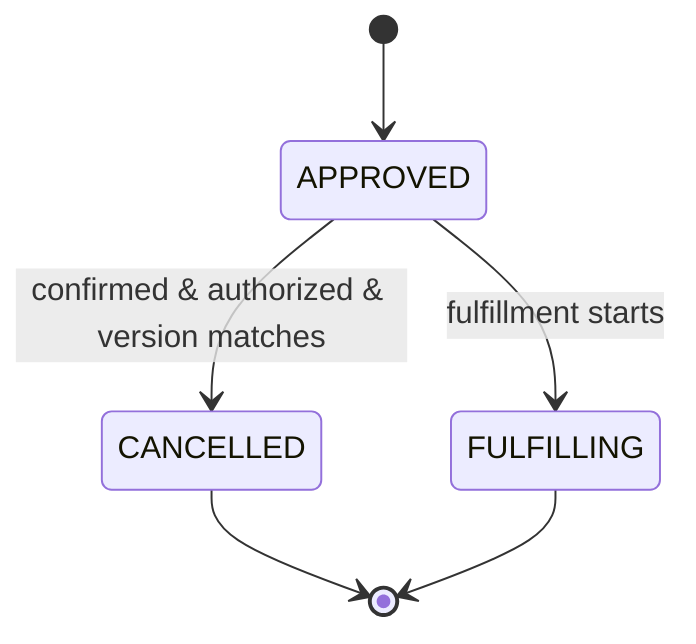
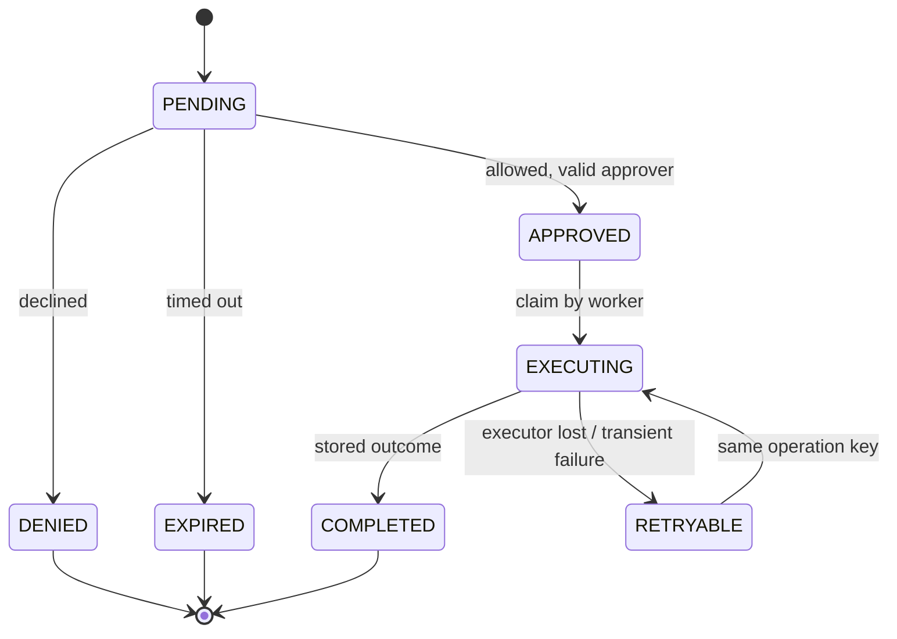
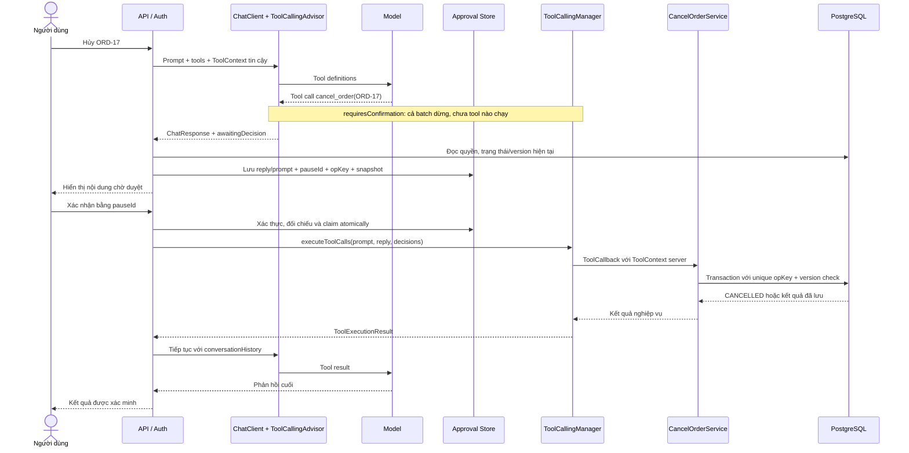

# Thực hiện hành động thay đổi trạng thái với xác nhận và khóa lũy đẳng

## 1. Mục tiêu bài thực hành tổng hợp

Ứng dụng **SPRING_AI_TOOL_CALLING** cho phép mô hình ngôn ngữ đề xuất một thao tác nghiệp vụ qua `@Tool` hoặc `ToolCallback`. Với thao tác làm thay đổi trạng thái, chẳng hạn hủy đơn hàng, việc model gọi đúng tool mới chỉ là **đề nghị thực thi**: backend phải xác thực quyền, nhận xác nhận hợp lệ, bảo đảm cập nhật một lần và trả kết quả dựa trên dữ liệu đã ghi.

Bài capstone này xây dựng một luồng **“Hủy đơn hàng ORD-17”** từ yêu cầu tự nhiên đến kết quả cuối. Điểm trọng tâm là kết hợp hai cơ chế độc lập:

- **Xác nhận trước thực thi (confirmation):** Người có thẩm quyền duyệt đúng hành động, đúng đối tượng và phiên bản dữ liệu đã xem. Spring AI 2.1 hỗ trợ tạm dừng vòng tool calling để ứng dụng lấy quyết định.
- **Khóa lũy đẳng (idempotency key):** Cùng một hành động logic, khi được gọi lại vì timeout, người dùng bấm hai lần, callback chạy lại hoặc tiến trình khởi động lại, chỉ tạo **một** chuyển trạng thái nghiệp vụ. Khóa do backend sinh, ràng buộc với hành động và được lưu bền vững.

Sau bài này, bạn cần có khả năng:

1. Tạo một tool thay đổi trạng thái có `requiresConfirmation = true` và nhận `ToolContext` từ request đã xác thực.
2. Nhận biết và lưu `ChatResponse` đang chờ phê duyệt; hiển thị bản xem trước có căn cứ thay vì cho model tự mô tả hậu quả.
3. Thực thi phê duyệt theo kiểu **một lần duy nhất**, kiểm lại quyền và chống sửa dữ liệu đã chờ duyệt.
4. Cài đặt lũy đẳng dựa trên **ràng buộc duy nhất + transaction**; xử lý va chạm khóa, gọi đồng thời và timeout sau commit.
5. Tiếp tục hội thoại với `ToolCallingManager.executeToolCalls(...)` theo API Spring AI 2.1, rồi kiểm thử cả đường đồng ý, từ chối và lỗi.

**Phạm vi:** Ví dụ dùng Java, Spring AI **2.1.0**, Spring Boot, PostgreSQL và JUnit 5. Các lớp `OrderRepository`, `ApprovalRepository`, `ActionRepository`, `AuthorizationService` trong phần minh họa là thành phần nghiệp vụ **do ứng dụng tự xây**. SQL, giao dịch, bảng lưu duyệt, trạng thái và idempotency **không được Spring AI tạo tự động**. Đoạn code trình bày các ranh giới quan trọng, không phải một dự án hoàn chỉnh có thể copy rồi chạy ngay.

## 2. Bài toán và tiêu chí nghiệm thu

Người dùng đã đăng nhập nhắn:

> Hủy đơn ORD-17 giúp tôi.

Dữ liệu được quản lý bởi hệ thống đơn hàng:

| Thuộc tính | Giá trị ban đầu |
|---|---|
| Tenant từ session | `tenant-A` |
| Người yêu cầu | `user-42` |
| Đơn hàng | `ORD-17` |
| Trạng thái | `APPROVED` |
| Phiên bản bản ghi | `7` |
| Quyền | `CANCEL_ORDER` trên chính `ORD-17` |
| Trạng thái đích | `CANCELLED` |
| Bước bắt buộc | Xác nhận rõ ràng trước thay đổi |

**Yêu cầu thành công:** Người dùng được xem trước “Hủy ORD-17, trạng thái APPROVED, phiên bản 7”; chỉ sau khi một người được phép nhấn xác nhận, hệ thống đổi `APPROVED → CANCELLED`, tăng `version` từ 7 lên 8 và tạo một sự kiện nghiệp vụ. Nếu cùng yêu cầu bị gửi lặp với **cùng idempotency key**, trả lại kết quả đã lưu, không tăng version và không phát thêm sự kiện.

**Các điều kiện không được phép:** Hủy khi người dùng từ chối; dùng tenant do model sinh; hủy đơn của tenant khác; hủy theo ảnh chụp đã cũ; thực thi hai lần khi có hai request đồng thời; bỏ qua xác nhận vì người dùng viết “đã duyệt” trong prompt; và thông báo “đã hủy” khi cơ sở dữ liệu chưa xác nhận thao tác.

### 2.1. Hai trạng thái phải được quản lý riêng

Trạng thái **đơn hàng** thuộc dịch vụ nghiệp vụ:



Trạng thái **yêu cầu phê duyệt** thuộc ứng dụng điều phối:



Trong ứng dụng thật, trạng thái `APPROVED` của **đơn hàng** và `APPROVED` của **phê duyệt** là hai enum/đối tượng khác nhau. Phê duyệt thành công **chưa** khẳng định đơn đã được hủy; cập nhật thực tế có thể thất bại do hết hạn, mất quyền hoặc version đã đổi.

## 3. Ranh giới tin cậy của lời gọi



**Bảng phân trách nhiệm:**

| Thành phần | Được quyền quyết định | Không được dựa vào |
|---|---|---|
| Model | Gợi ý chọn `cancel_order` và điền `orderId` theo lời người dùng | Quyền, tenant, trạng thái thực tế, khóa lũy đẳng |
| `ToolCallingAdvisor` / `ToolCallingManager` | Tạm dừng nhóm tool call và dispatch callback theo quyết định Spring AI 2.1 | Lưu approval lâu dài, giao dịch DB, quyền nghiệp vụ |
| API xác nhận | Xác thực người duyệt, kiểm scope, thời hạn, lưu trạng thái và khóa | Chuỗi “tôi đồng ý” trong prompt |
| `ToolContext` | Chuyển thông tin tin cậy tới callback mà model không thấy | Dữ liệu trực tiếp do client/model tự đặt |
| Dịch vụ nghiệp vụ | Kiểm quyền trên tài nguyên, phiên bản, transaction, lũy đẳng | Chỉ lời mô tả tool hoặc kết quả `allow` |
| Kho dữ liệu | Ràng buộc duy nhất, locking, lưu kết quả đã commit | Biến `synchronized` trong một instance ứng dụng |

**Ghi nhớ:** Confirmation và idempotency bảo vệ hai rủi ro khác nhau. Xác nhận xử lý **“có được làm?”**; lũy đẳng xử lý **“làm lại có gây thêm tác dụng phụ?”**. Phải có cả hai.

## 4. Bước 1 — Định nghĩa tool thay đổi trạng thái

`ToolContext` truyền dữ liệu được server thiết lập tới method tool; các giá trị context không được gửi cho model. Với action thay đổi trạng thái, chỉ nên để model sinh đối số cần thiết như mã đơn, không đưa khóa lũy đẳng, tenant hoặc bằng chứng phê duyệt vào JSON Schema đầu vào.

```java
record CancelResult(String orderId, String outcome, long version) {}

final class OrderActionTools {
    private final CancelOrderService service;

    OrderActionTools(CancelOrderService service) {
        this.service = service;
    }

    @Tool(
        name = "cancel_order",
        description = "Hủy đơn hàng có mã do người dùng cung cấp, sau khi được xác nhận",
        requiresConfirmation = true
    )
    public CancelResult cancel(
            @ToolParam(description = "Mã đơn người dùng muốn hủy") String orderId,
            ToolContext toolContext) {

        Map<String, Object> context = toolContext.getContext();

        String tenantId = requiredString(context, "tenantId");
        String actorId = requiredString(context, "actorId");
        String approvalId = requiredString(context, "approvalId");
        String operationKey = requiredString(context, "operationKey");
        long expectedVersion = requiredLong(context, "expectedVersion");

        // Dịch vụ PHẢI kiểm quyền và trạng thái grant, không tin việc
        // method này chỉ có thể được gọi bởi một manager đã xin duyệt.
        return service.cancelOnce(
            tenantId, actorId, approvalId, operationKey,
            orderId, expectedVersion
        );
    }

    private static String requiredString(Map<String, Object> map, String key) {
        Object value = map.get(key);
        if (!(value instanceof String text) || text.isBlank()) {
            throw new SecurityException("MISSING_TRUSTED_CONTEXT");
        }
        return text;
    }

    private static long requiredLong(Map<String, Object> map, String key) {
        Object value = map.get(key);
        if (!(value instanceof Long number)) {
            throw new SecurityException("MISSING_TRUSTED_CONTEXT");
        }
        return number;
    }
}
```

`CancelOrderService` là dịch vụ của ứng dụng. Việc ví dụ dùng `requiredLong` bắt buộc request builder đưa `Long` vào context, tránh ép kiểu thiếu kiểm soát. Đừng lấy `approvalId` từ model và cũng đừng suy ra idempotency key chỉ từ `orderId`: hai lần hủy ở hai workflow khác nhau là **hai ý định khác nhau** và phải được phân biệt.

Spring AI 2.1 cũng cho phép đặt yêu cầu xác nhận qua `ToolMetadata.builder().requiresConfirmation(true)` cho `FunctionToolCallback`, hoặc `ToolCallConfirmationPolicy` cho tool không sửa được annotation (chẳng hạn tool MCP). Ở capstone này ta chọn `@Tool` để giao diện rõ và dễ kiểm thử.

**Kiểm tra sớm:** Từ `ToolCallbacks.from(new OrderActionTools(...))`, xác nhận `ToolDefinition.inputSchema()` chứa `orderId` kiểu chuỗi, bắt buộc; không có `tenantId`, `approvalId` hay `operationKey`. Đây là sự phân tách quan trọng giữa đầu vào do model dự đoán và dữ liệu tin cậy của ứng dụng.

## 5. Bước 2 — Lưu yêu cầu chờ phê duyệt và hiển thị đúng hành động

Spring AI 2.1 có hành vi cụ thể: nếu **một** call trong phản hồi model đòi confirmation, `ToolCallingManager` dừng **cả nhóm call trong phản hồi**, chưa chạy call nào. `ToolCallingAdvisor` trả `ChatResponse` có metadata chờ quyết định. Dùng `ToolCallDecisions.awaitingDecision(reply)` để phát hiện.

```java
ChatResponse reply = chatClient.prompt()
    .user("Hãy hủy đơn ORD-17")
    .tools(orderActionTools)
    .toolContext(Map.of(
        "tenantId", authenticatedTenantId,
        "actorId", authenticatedUserId
    ))
    .call()
    .chatResponse();

List<String> awaiting = ToolCallDecisions.awaitingDecision(reply);

if (!awaiting.isEmpty()) {
    AssistantMessage pausedMessage = reply.getResult().getOutput();
    List<String> keys = ToolCallDecisions.toolCallKeys(pausedMessage);

    // Capstone chỉ hỗ trợ một thao tác ghi trong một pause.
    if (keys.size() != 1
        || !pausedMessage.getToolCalls().get(0).name().equals("cancel_order")) {
        throw new IllegalStateException("UNSUPPORTED_APPROVAL_BATCH");
    }

    // API kiểm quyền, đọc trạng thái/version thật và lưu toàn bộ
    // prompt/conversation + reply + key đúng thứ tự ở server.
    approvalService.createPending(
        authenticatedTenantId,
        authenticatedUserId,
        originalConversation,
        reply
    );
}
```

`originalConversation` và `approvalService` là thành phần ứng dụng tự xây. Chúng phải lưu **lịch sử mà model đã trả lời**, bao gồm những lượt tool trước đó nếu có; nếu advisor quản lý memory khác, cần chọn cách lưu phù hợp như mục 10.

### 5.1. Một bản ghi phê duyệt cần giữ những gì?

Ứng dụng lưu trong kho server mà client không chỉnh sửa được:

| Dữ liệu | Vai trò |
|---|---|
| `pauseId` (UUID) | Khóa tra cứu approval; trả về client để gửi quyết định |
| `tenantId`, `requesterId`, `requiredApprover`/policy | Ràng buộc chủ thể có quyền duyệt |
| `toolName`, `orderId` và fingerprint | Khóa cứng hành động và đối tượng hiển thị |
| `expectedVersion`, `displayState` | Xác định snapshot nghiệp vụ đã xem |
| `operationKey` do server sinh **một lần** | Khóa lũy đẳng dùng xuyên suốt mọi retry/resume |
| `originalConversation`, `pausedReply` và tool-call keys | Dùng đúng response gốc khi tiếp tục vòng tool |
| `state`, `expiresAt`, `approvedBy`, `claimedAt` | Quản lý pending/deny/expire/replay |
| `createdAt`, `policyVersion`, `schemaVersion` | Audit và kiểm thay đổi chính sách |

Trước khi tạo bản ghi, backend parse đối số tool call bằng schema whitelist, tìm đơn thật theo tenant, kiểm quyền xem/cancel và lấy trạng thái/version hiện tại. Nếu request không hợp lệ hoặc chưa được phép, không phát hành approval; trả lỗi chuẩn hóa.

Người dùng thấy một biểu mẫu như sau, dữ liệu lấy **từ backend**, không lấy từ câu trả lời suy đoán của model:

```text
YÊU CẦU XÁC NHẬN
Hành động: Hủy đơn hàng
Mã đơn: ORD-17
Trạng thái hiện tại: APPROVED
Phiên bản: 7
Người thực hiện: user-42
Hết hạn duyệt: 10 phút kể từ khi tạo yêu cầu

[Nút Từ chối] [Nút Xác nhận hủy]
```

`10 phút` là TTL minh họa do ứng dụng chọn. Request từ giao diện chỉ gửi `pauseId` và quyết định allow/deny; **không** được gửi lại tool name, tool args, tenant, version hay operation key để backend tin và thực thi. Một trang xác nhận được mở bằng link có thể bị stale; backend phải kiểm tra lại thông tin từ kho và DB ngay khi người dùng nhấn nút.

### 5.2. Khi có nhiều tool call trong một phản hồi

Framework yêu cầu **một `ToolCallDecision` cho mỗi call** khi resume, kể cả call đọc không đòi xác nhận. Để làm capstone dễ kiểm soát, ta từ chối batch có nhiều tool call và yêu cầu user/model tách hành động. Đây là **quy tắc ứng dụng**, không phải hạn chế bắt buộc của Spring AI.

Nếu dự án cho phép batch, UI phải hiển thị từng call theo `ToolCallDecisions.toolCallKeys(message)`, lưu thứ tự response gốc, xin quyết định cho từng call, và bảo đảm **mỗi action ghi có operation key riêng**. Không dùng một `ToolContext.operationKey` chung cho nhiều thao tác ghi khác nhau.

## 6. Bước 3 — Khóa lũy đẳng bền vững ở database

### 6.1. Định nghĩa lũy đẳng theo nghiệp vụ

Với `K` là idempotency key, `F` là fingerprint yêu cầu và `R` là kết quả sau commit:

- `execute(K, F)` lần đầu hợp lệ: kiểm quyền, phiên bản, cập nhật một lần, lưu `R`.
- `execute(K, F)` lần sau: nếu đã commit, trả **cùng kết quả `R`**; không cập nhật lại.
- `execute(K, F2)` với `F2 ≠ F`: báo `IDEMPOTENCY_KEY_CONFLICT`; tuyệt đối không “sửa” operation cũ thành action mới.
- Hai request đồng thời cùng `K, F`: phải được đồng bộ bằng **ràng buộc duy nhất/locking ở database**, không chỉ Java lock trong một pod.
- Hai key khác nhau cùng muốn hủy một đơn: điều kiện version/trạng thái nghiệp vụ vẫn bảo vệ tài nguyên; không cho phép phát hai sự kiện hủy thành công.

Khóa lũy đẳng có thể là UUID ngẫu nhiên được server sinh khi tạo approval; namespace gắn tenant và loại hành động qua fingerprint. Đừng dùng tool-call ID từ model làm khóa duy nhất: model/provider có thể tạo ID rỗng hoặc trùng, trong khi một lần resume và nhiều lần retry phải chia sẻ **cùng** khóa ứng dụng đã lưu.

### 6.2. Schema PostgreSQL minh họa

```sql
CREATE TABLE demo_orders (
    tenant_id      TEXT NOT NULL,
    order_id       TEXT NOT NULL,
    state          TEXT NOT NULL,
    version        BIGINT NOT NULL,
    PRIMARY KEY (tenant_id, order_id)
);

CREATE TABLE approval_requests (
    pause_id        UUID PRIMARY KEY,
    tenant_id       TEXT NOT NULL,
    requester_id    TEXT NOT NULL,
    order_id        TEXT NOT NULL,
    expected_version BIGINT NOT NULL,
    operation_key   UUID NOT NULL UNIQUE,
    state           TEXT NOT NULL,
    expires_at      TIMESTAMPTZ NOT NULL,
    approved_by     TEXT,
    -- conversation/reply phải được lưu an toàn; có thể lưu ở store khác.
    conversation_ref TEXT NOT NULL,
    reply_ref        TEXT NOT NULL
);

CREATE TABLE idempotent_actions (
    tenant_id      TEXT NOT NULL,
    operation_key  UUID NOT NULL,
    action_name    TEXT NOT NULL,
    request_hash   TEXT NOT NULL,
    status         TEXT NOT NULL,
    response_json  JSONB,
    created_at     TIMESTAMPTZ NOT NULL DEFAULT now(),
    updated_at     TIMESTAMPTZ NOT NULL DEFAULT now(),
    PRIMARY KEY (tenant_id, operation_key)
);

CREATE TABLE outbox_events (
    event_id       UUID PRIMARY KEY,
    tenant_id      TEXT NOT NULL,
    operation_key  UUID NOT NULL UNIQUE,
    event_type     TEXT NOT NULL,
    payload_json   JSONB NOT NULL,
    created_at     TIMESTAMPTZ NOT NULL DEFAULT now()
);
```

Chỉ tạo bảng trong database bài tập/test. Schema là **mẫu giải thích**, production cần thêm CHECK constraint/foreign key, index, audit, chính sách mã hóa, retention và migration theo quy trình riêng. Việc outbox có `UNIQUE(operation_key)` là ví dụ cho một sự kiện “đã hủy đơn” trên mỗi operation thành công; không được áp dụng bừa khi mỗi operation cần phát nhiều loại event.

### 6.3. Transaction đổi trạng thái đúng một lần

Tất cả bước dưới đây thuộc **một transaction PostgreSQL**, cùng connection:

1. Kiểm tra approval `APPROVED/EXECUTING` hợp lệ, chưa hết hạn và khớp tenant, actor, order, expected version; kiểm lại quyền trên đơn thực tế. Nếu chưa được phép, **dừng trước thao tác ghi**. Phần cấp grant phải đi qua transition CAS để chống hai worker claim một approval.
2. Tính `fingerprint = SHA-256(tenantId, actionName, actorId, orderId, expectedVersion)` bằng biểu diễn có phân tách/canonicalization; không hash chuỗi nối mơ hồ. Không đưa secrets vào log.
3. Thử `INSERT idempotent_actions(tenant_id, operation_key, action_name, request_hash, status='PROCESSING') ON CONFLICT DO NOTHING`, rồi `SELECT ... FOR UPDATE` trên chính hàng khóa đó. Request trùng sẽ chờ transaction đầu commit hoặc rollback.
4. Nếu key tồn tại với fingerprint khác, trả 409. Nếu cùng fingerprint và `SUCCEEDED` (hoặc kết quả terminal khác đã được lưu), trả `response_json`, **không** chạy cập nhật/emit event thêm.
5. Nếu mới, khóa đơn bằng hàng của tenant và thực hiện chuyển `APPROVED → CANCELLED` có điều kiện `version = expectedVersion`. Nếu không khớp, lưu kết quả `STALE_STATE`/`CONFLICT` theo chính sách, **không** phát event thành công.
6. Nếu update thành công, chèn một `outbox_events` và ghi kết quả `SUCCEEDED` vào `idempotent_actions`. **COMMIT** rồi mới phản hồi caller.

Một câu SQL bảo vệ cạnh tranh trạng thái:

```sql
UPDATE demo_orders
SET state = 'CANCELLED',
    version = version + 1
WHERE tenant_id = :tenant_id
  AND order_id = :order_id
  AND state = 'APPROVED'
  AND version = :expected_version
RETURNING order_id, state, version;
```

Nếu `RETURNING` không có hàng, operation **không được** báo thành công. Phải phân biệt “đơn không tồn tại/không có quyền” với “state/version đã thay đổi” ở lớp nghiệp vụ mà không lộ tài nguyên khác tenant.

Minh họa khung service, các hàm repository là **pseudocode API nghiệp vụ**:

```java
@Transactional
public CancelResult cancelOnce(
        String tenantId, String actorId, String approvalId,
        String operationKey, String orderId, long expectedVersion) {

    Approval grant = approvals.requireGrantedAndClaimed(
        approvalId, tenantId, actorId, orderId,
        operationKey, expectedVersion
    );
    authorization.requireCanCancel(actorId, tenantId, orderId);

    String fingerprint = fingerprintOf(
        tenantId, "cancel_order", actorId, orderId, expectedVersion
    );

    // INSERT ... ON CONFLICT DO NOTHING; SELECT ... FOR UPDATE.
    ActionRow action = actions.insertOrLock(
        tenantId, operationKey, "cancel_order", fingerprint
    );

    if (!action.requestHash().equals(fingerprint)) {
        throw new IdempotencyConflictException("KEY_REUSED_FOR_ANOTHER_ACTION");
    }
    if (action.isTerminal()) {
        return action.storedResult(); // Replay: không sửa đơn.
    }

    // Mọi UPDATE/INSERT bên dưới ở cùng transaction.
    CancelResult result = orders.cancelIfApprovedAndVersionMatches(
        tenantId, orderId, expectedVersion
    );

    if ("CANCELLED".equals(result.outcome())) {
        outbox.insertOnce(tenantId, operationKey, "ORDER_CANCELLED", result);
    }

    actions.complete(tenantId, operationKey, result);
    return result; // Transaction commit xong mới gửi kết quả ra network.
}
```

Ở production, `insertOrLock` phải phân biệt **mới tạo** và **đang xử lý từ một transaction khác**: nếu operation chưa terminal do một workflow bất đồng bộ, trả `IN_PROGRESS` hoặc có cơ chế takeover an toàn, tuyệt đối không cho hai executor cùng sửa đơn. `grant` phải ràng buộc trạng thái phê duyệt và chính operation, không chỉ kiểm tra record tồn tại.

**Không gọi API mạng bên ngoài trong transaction dài.** Nếu hủy đơn thực tế ở hệ thống khác, dùng outbox/event hoặc API downstream có hỗ trợ idempotency key; timeout sau khi gửi lệnh ra ngoài phải chuyển thành `UNKNOWN` và **đối soát** theo `operationKey` trước retry. Transaction local không thể tự bảo đảm exactly-once trên một dịch vụ bên ngoài không tham gia giao dịch.

### 6.4. Kết quả bền vững khi phản hồi bị mất

Giả sử DB đã commit `CANCELLED`, nhưng kết nối HTTP rớt trước khi client nhận được phản hồi. Khi callback chạy lại:

- `operationKey` vẫn lấy từ bản ghi approval trước đó.
- Database trả `response_json` của lần đầu; version của đơn vẫn 8.
- Outbox không chèn sự kiện thứ hai.
- Backend/ứng dụng trình bày kết quả xác minh đã lưu; **không dùng model tự đoán** là thao tác thành công.

Nếu một key đã dùng cho `ORD-17` mà lần retry gửi `ORD-18`, fingerprint khác nên trả conflict thay vì chuyển đơn thứ hai.

## 7. Bước 4 — Nhận quyết định và tiếp tục vòng Spring AI 2.1

### 7.1. Quy trình API xác nhận

Ví dụ API ứng dụng:

```text
POST /api/approvals/{pauseId}/decision
Authorization: Bearer <session token của người đã đăng nhập>
Content-Type: application/json

{"allow": true}
```

Backend **không nhận** `tenantId`, `operationKey`, `toolCallId` hoặc `orderId` từ body để điều khiển thực thi. Với quyết định allow:

1. Lấy `pauseId` từ URL, tìm bản ghi trong kho server; xác thực lại người duyệt, tenant và quyền trên tài nguyên.
2. Kiểm tra `expiresAt`, action/tool name, fingerprint và expectedVersion; nếu đơn đã đổi, dừng và yêu cầu tạo yêu cầu mới. Không dùng version cũ để thực hiện thay đổi khi người dùng chưa thấy trạng thái mới.
3. Chuyển trạng thái `PENDING → APPROVED` theo compare-and-swap/transaction; ghi `approvedBy` và thời điểm. Nếu đã `DENIED/EXPIRED/COMPLETED` thì không cho phép chuyển lại.
4. Worker claim `APPROVED → EXECUTING`; nếu crash giữa chừng, lease/quy trình khôi phục có thể chạy lại **cùng operation key**, với service lũy đẳng bảo đảm hành động chỉ một lần.
5. Tạo `ToolContext` tin cậy với tenant, actor, approval ID, operation key và expected version từ record đã lưu; thực thi manager với **bản phản hồi gốc**.
6. Lưu kết quả `COMPLETED` cùng trạng thái nghiệp vụ; nếu caller rớt kết nối, lần đọc tiếp theo trả kết quả bền vững đã lưu.

Với quyết định deny, khóa và đặt `DENIED`, **không cấp grant thực thi** và chuyển decision `deny` thành tool result để model giải thích hành động không được thực hiện. Nếu hết hạn, đặt `EXPIRED` và không cấp phép, kể cả model yêu cầu lại.

### 7.2. Ví dụ API resume đúng chữ ký Spring AI 2.1

Theo tài liệu 2.1, ứng dụng phải cung cấp **một quyết định cho mỗi tool call**. Trong ví dụ capstone chỉ cho **một** call ghi trên một phản hồi, nên ta có thể dùng một `allow(key)` hoặc `deny(key)`:

```java
// Các đối tượng StoredPause, ApprovalGrant và load... là của ứng dụng.
StoredPause stored = approvalRepository.loadServerOwned(pauseId);
ApprovalGrant grant = approvalService.authorizeAndClaim(stored, caller, allow);

ChatResponse pausedReply = stored.pausedReply();
List<String> keys = ToolCallDecisions.toolCallKeys(
    pausedReply.getResult().getOutput()
);

if (keys.size() != 1
    || !"cancel_order".equals(
        pausedReply.getResult().getOutput().getToolCalls().get(0).name())) {
    throw new IllegalStateException("UNSUPPORTED_APPROVAL_BATCH");
}
String callKey = keys.get(0);

ToolCallDecisions decisions = ToolCallDecisions.of(
    allow
        ? ToolCallDecision.allow(callKey)
        : ToolCallDecision.deny(callKey, "Người dùng đã từ chối hủy đơn.")
);

// Đã kiểm và lưu ở backend: không lấy context từ request body.
ToolCallingChatOptions options = ToolCallingChatOptions.builder()
    .toolCallbacks(ToolCallbacks.from(orderActionTools))
    .toolContext(Map.of(
        "tenantId", grant.tenantId(),
        "actorId", grant.actorId(),
        "approvalId", grant.approvalId(),
        "operationKey", grant.operationKey(),
        "expectedVersion", Long.valueOf(grant.expectedVersion())
    ))
    .build();

Prompt originalPrompt = new Prompt(stored.conversation(), options);
ToolExecutionResult result = toolCallingManager.executeToolCalls(
    originalPrompt, pausedReply, decisions
);

// Cách minh họa khi ứng dụng tự giữ toàn bộ conversation.
ChatResponse finalReply = chatClient.prompt()
    .messages(result.conversationHistory())
    .call()
    .chatResponse();
```

**Giải thích các điểm dễ sai:**

- `stored.pausedReply()` và `stored.conversation()` phải do **server lưu trước khi xin duyệt**, không dùng object model/client dựng lại sau khi nhận decision.
- `ToolCallDecisions.toolCallKeys(...)` giải quyết trường hợp provider trả tool-call ID thiếu hoặc trùng: khi đó khóa có thể là `#0`/`#1`. Không sửa thứ tự các call trên phản hồi đã lưu.
- `ToolCallingManager.executeToolCalls(prompt, reply, decisions)` chỉ chạy **những call được allow**; call deny tạo tool result từ chối. Khi resume, manager không xét lại confirmation policy, vì vậy **backend bắt buộc tự kiểm grant**.
- Manager chỉ thực thi call được cung cấp trong **tool callbacks của prompt**; không tự lấy tool từ fallback resolver khi resume. Cần kiểm allowlist và bảo đảm tập tool được phép đúng chính sách.
- Nếu không có `ToolContext` chứa approval grant, callback tự chặn. Ngay cả khi đủ context, service vẫn kiểm lại quyền và trạng thái phê duyệt ở database.
- Khi `result.returnDirect() == true` và mọi call đều được allow + `returnDirect=true`, có thể trả kết quả trực tiếp theo API tương ứng. Ví dụ không dùng `returnDirect` và tiếp tục model để diễn giải kết quả.
- Mã trên thể hiện đường **ứng dụng giữ conversation**. Với Session API hoặc memory advisor, phải áp dụng cách khôi phục history tương ứng; không mù quáng gửi cả lịch sử hai lần làm model nhận tool result trùng.
- Sau khi có quyết định, nếu lượt chat tiếp theo lại tự đề nghị tool ghi, vòng gọi sẽ yêu cầu confirmation mới. Đừng mặc định duyệt một lần cho mọi đề nghị mới.

### 7.3. Lưu ý đặc biệt khi dùng streaming và memory

`content()` trên phản hồi tạm dừng thường rỗng. Với blocking cần `chatResponse()`/`chatClientResponse()` để đọc metadata. Với `stream().chatResponse()`, metadata chờ duyệt ở **chunk cuối**, không nhất thiết có trong phản hồi tổng hợp; đừng coi mảnh `ToolCallPart` chưa hoàn chỉnh là lời gọi có thể thực thi.

Một turn có thể đã chạy các tool đọc trước khi đến call ghi cần duyệt. Nếu memory advisor nằm **ngoài** vòng tool (mặc định trong cấu hình truyền thống), những vòng trước đó có thể không có trong lịch sử ứng dụng nhận để resume. Spring AI 2.1 mô tả cách đặt memory **trong** vòng tool để giữ toàn bộ các lượt; với Session API cần kiểm tra khả năng lưu và phục hồi đúng `AssistantMessage`, `ToolResponseMessage`. Lịch sử hỏng có thể khiến provider từ chối request tiếp theo.

Nếu người dùng bắt đầu turn mới mà không phản hồi approval, không resume approval cũ nữa. Hòa giải các call pending (deny hoặc kết quả trung tính tùy chiến lược hội thoại); `SessionTurnAdvisor` của Spring AI 2.1 có cơ chế tạo kết quả trung tính cho pending call khi chuyển turn mới. Khả năng này không thay thế state machine phê duyệt của ứng dụng.

## 8. Bước 5 — Kiểm thử chứng minh hai bất biến

Tách test thành hai lớp: **callback/schema + nghiệp vụ offline** (không gọi LLM) và **luồng tích hợp với ChatClient/ToolCallingManager**. Không dùng kết quả lời nói của model làm oracle cho số lần thay đổi trạng thái.

### 8.1. Kiểm thử schema và trusted context

```java
@Test
void cancelToolDoesNotAskModelForTrustedFields() throws Exception {
    ToolCallback callback = ToolCallbacks.from(
        new OrderActionTools(mock(CancelOrderService.class))
    )[0];

    assertThat(callback.getToolDefinition().name()).isEqualTo("cancel_order");
    assertThat(callback.getToolMetadata().requiresConfirmation()).isTrue();

    JsonNode schema = new ObjectMapper()
        .readTree(callback.getToolDefinition().inputSchema());

    assertThat(schema.path("properties").has("orderId")).isTrue();
    assertThat(schema.path("properties").has("tenantId")).isFalse();
    assertThat(schema.path("properties").has("approvalId")).isFalse();
    assertThat(schema.path("properties").has("operationKey")).isFalse();
    assertThat(schema.path("required").toString()).contains("orderId");
}

@Test
void missingGrantDoesNotReachService() {
    CancelOrderService service = mock(CancelOrderService.class);
    ToolCallback callback = ToolCallbacks.from(new OrderActionTools(service))[0];

    assertThatThrownBy(() -> callback.call(
        "{\"orderId\":\"ORD-17\"}",
        new ToolContext(Map.of("tenantId", "tenant-A", "actorId", "user-42"))
    )).isInstanceOf(RuntimeException.class);

    verifyNoInteractions(service);
}
```

Do `MethodToolCallback` có thể bọc exception, test trên nên kiểm ranh giới không có side effect; không phụ thuộc duy nhất vào chuỗi thông báo exception. Với Spring AI 2.1, `ToolExecutionExceptionProcessor` mặc định có thể gửi thông điệp của `RuntimeException` tới model. Phải chuẩn hóa lỗi công khai, không để stack trace, token hay dữ liệu khách hàng xuất hiện trong thông điệp.

### 8.2. Kiểm thử transaction bằng PostgreSQL thực

Không thể chứng minh ràng buộc khóa duy nhất, isolation và locking chỉ bằng một mock repository. Dùng môi trường PostgreSQL test (ví dụ Testcontainers) và kiểm tra **số hàng, version, outbox event**.

```java
@Test
void sameOperationKeyOnlyCancelsOnce() {
    // Fixture: ORD-17 state APPROVED, version 7; grant hợp lệ.
    String key = "1c53e4f1-9ed1-4e6b-90f2-f0b708604c64";

    CancelResult first = service.cancelOnce(
        "tenant-A", "user-42", approvalId, key, "ORD-17", 7L
    );
    CancelResult replay = service.cancelOnce(
        "tenant-A", "user-42", approvalId, key, "ORD-17", 7L
    );

    assertThat(first).isEqualTo(replay);
    assertThat(orderRepository.currentState("tenant-A", "ORD-17"))
        .isEqualTo("CANCELLED");
    assertThat(orderRepository.version("tenant-A", "ORD-17"))
        .isEqualTo(8L);
    assertThat(outboxRepository.countByOperationKey(key)).isEqualTo(1);
}
```

Test này giả định service **kiểm grant và quyền trước khi xử lý replay**. Trong production, quyền bị thu hồi sau commit có thể khiến API không trả chi tiết kết quả đã lưu; chính sách đọc kết quả lại phải rõ và an toàn.

### 8.3. Ma trận kiểm thử capstone

| Mã | Kịch bản | Kết quả bắt buộc |
|---|---|---|
| CP-01 | Model đề nghị `cancel_order` | Có paused reply, chưa gọi backend |
| CP-02 | Cùng reply có tool đọc + tool cần duyệt | **Cả nhóm** chưa có call nào chạy |
| CP-03 | Người dùng chọn **Từ chối** | Không đổi state, không outbox; model nhận kết quả deny |
| CP-04 | Người duyệt hợp lệ, state/version đúng | Một update và một outbox event |
| CP-05 | Vai trò không có quyền hủy | Tool không được expose; service/API vẫn từ chối |
| CP-06 | Đơn thuộc tenant khác | Không lộ dữ liệu hoặc tạo side effect |
| CP-07 | Client sửa `orderId` trong body xác nhận | Backend bỏ qua; dùng reply đã lưu |
| CP-08 | Response chờ duyệt đã bị thay/sai signature | Từ chối resume, không thực thi |
| CP-09 | Approval quá hạn hoặc đã DENIED | Không thể chuyển sang APPROVED |
| CP-10 | Bấm xác nhận hai lần cùng `pauseId` | Claim một lần, side effect một lần |
| CP-11 | Hai worker cùng xử lý `operationKey` | DB serialize; một kết quả, một update |
| CP-12 | Replay cùng key và fingerprint | Trả kết quả đã commit; version không đổi thêm |
| CP-13 | Cùng key nhưng đổi order/action/version | `IDEMPOTENCY_KEY_CONFLICT` |
| CP-14 | Hai key khác nhau cùng hủy một đơn | Chỉ một update phù hợp state/version; call sau conflict |
| CP-15 | Order chuyển sang FULFILLING trước khi duyệt | Không hủy theo snapshot cũ; cần yêu cầu mới |
| CP-16 | DB commit xong nhưng HTTP timeout | Replay cùng key thấy SUCCEEDED; không tạo event thứ hai |
| CP-17 | Dịch vụ ngoài trả timeout sau side effect | Đối soát `operationKey`, không retry mù |
| CP-18 | Callback gọi thiếu `ToolContext` tin cậy | Từ chối trước khi chạm service |
| CP-19 | Provider trả tool-call ID rỗng/trùng | Dùng keys theo vị trí và response gốc |
| CP-20 | Streaming partial JSON rồi complete | Không chạy từ partial; nhận pause ở chunk cuối |
| CP-21 | Lỗi nghiệp vụ hoặc callback | Không phát lộ bí mật qua tool result/log |
| CP-22 | Khởi động lại khi approval đang chờ | Phục hồi được pause từ kho server |
| CP-23 | Worker chết sau claim trước phản hồi | Recovery dùng **cùng key**, xác định được terminal state |
| CP-24 | Người dùng gửi turn mới, bỏ pause cũ | Không resume pause cũ; lịch sử tool result hợp lệ |

Các ca `CP-03` đến `CP-18` và `CP-23` liên quan đến quyền hoặc tính duy nhất của side effect nên là **cổng chặn triển khai**. Ngưỡng nghiêm ngặt: **0 lần thực thi khi chưa được phép**, **0 cập nhật vượt quyền**, **không quá một chuyển trạng thái cho một action hợp lệ** và **0 event lặp** theo operation key.

### 8.4. Diễn tập hai request đồng thời

Dùng `CountDownLatch`/`ExecutorService` hoặc test đa tiến trình với một PostgreSQL dùng chung; khởi động ít nhất hai transaction đồng thời cùng key. Assertion cuối phải đọc **DB đã commit**, không chỉ đếm callback:

- `demo_orders.version = 8` sau khi cả hai hoàn thành;
- `idempotent_actions` có đúng một hàng cho `(tenant-A, K)`;
- `outbox_events` có đúng một `ORDER_CANCELLED` cho `K`;
- Cả hai request nhận cùng kết quả terminal hoặc một request được thông báo `IN_PROGRESS` để đọc lại; không request nào cập nhật lần thứ hai.

Mở rộng test với hai key khác nhau để chứng minh **điều kiện state/version** chặn chuyển trạng thái thứ hai, ngay cả khi dedupe theo key không áp dụng.

## 9. Vận hành: timeout, retry, quan sát và dọn dữ liệu chờ duyệt

### 9.1. Phân biệt ba kiểu kết quả

| Kết quả | Ý nghĩa | Hành động |
|---|---|---|
| `SUCCEEDED` | DB đã commit kết quả và outbox | Trả kết quả từ kho, không gọi lại |
| `DENIED/EXPIRED/CONFLICT` | Không thực thi chuyển trạng thái | Trả lý do an toàn; cần phê duyệt mới nếu phù hợp |
| `UNKNOWN/IN_PROGRESS` | Không biết chắc downstream đã chạy hoặc executor đang xử lý | Truy vấn theo key, chờ/đối soát; không retry mù |

**Timeout không đồng nghĩa thất bại.** Nếu HTTP bị ngắt sau commit, ứng dụng phải đọc `idempotent_actions`. Nếu tác dụng phụ nằm ở API bên ngoài, hệ thống phải dùng idempotency key được dịch vụ đó tôn trọng hoặc cơ chế đối soát bền vững; không thể đạt “exactly once” chỉ nhờ `@Tool(requiresConfirmation=true)`.

### 9.2. Log và metric phù hợp

Gắn `traceId`, `requestId`, `pauseId`, `operationKey`, tên tool, kết quả xác nhận và mã trạng thái nghiệp vụ vào log có kiểm soát quyền truy cập. Tránh log full tool args, session token, dữ liệu PII hoặc phản hồi khách hàng. Không dùng `operationKey`/`tenantId` làm metric label có cardinality lớn.

Metrics ứng dụng gợi ý: `tool_confirmation_pending`, `tool_confirmation_denied_total`, `idempotency_replay_total`, `idempotency_conflict_total`, `business_state_transition_total` và `pending_approval_oldest_age_seconds`. Kết hợp observation Spring AI cho `ChatClient`, model và tool với trace của DB/HTTP.

### 9.3. Quy tắc cleanup an toàn

- Approval `PENDING` quá `expiresAt`: dùng cập nhật trạng thái có điều kiện sang `EXPIRED`; không xóa trong lúc có claim/executor.
- Approval `COMPLETED/DENIED/EXPIRED`: chỉ xóa conversation/paused reply sau khi hết cửa sổ retry/resume, không còn lease và chính sách retention cho phép.
- **Không xóa idempotency record và outbox quá sớm**: nếu xóa key rồi một retry cũ tới, ứng dụng có thể xử lý như tác vụ mới. Thời hạn lưu khóa phải dài hơn cửa sổ retry, timeout và hồi phục.
- Không xóa bản ghi đơn hàng, audit bắt buộc hay dữ liệu pháp lý chỉ vì approval đã kết thúc.
- Cleanup theo batch, kiểm owner/lease, có retry idempotent và nhật ký đối soát; không dùng thời gian tạo đơn thuần làm điều kiện xóa.

## 10. Những điểm khác biệt phiên bản và cạm bẫy

- **Spring AI 2.1.0 mới có Tool Call Confirmation.** Nếu dự án dùng 2.0.x hoặc 1.x, không thể dùng nguyên API `ToolCallDecisions`/`requiresConfirmation` như bài này mà không kiểm tra tương thích.
- **`ChatClient` và `ChatModel` khác đường thực thi.** Spring AI 2.x đưa vòng gọi tool vào `ToolCallingAdvisor` của `ChatClient`; gọi `ChatModel` trực tiếp chỉ nhận yêu cầu tool và ứng dụng tự điều phối.
- **Không tự resume bằng cách gửi lại prompt “hãy hủy”.** Cần dùng `pausedReply` gốc, `ToolCallingManager.executeToolCalls(...)` và cặp tool call/tool result hợp lệ.
- **Không lấy `content()` làm tín hiệu xác nhận.** Dùng metadata của `ChatResponse`; streaming cần kiểm chunk cuối.
- **Không dùng Java `synchronized` hoặc cache theo pod để đảm bảo lũy đẳng.** Nhiều instance và crash sẽ vô hiệu hóa cách này; dùng kho bền vững với unique key, transaction và đối soát.
- **Không dùng confirmation thay kiểm quyền.** Người dùng có thể duyệt nhưng đã mất quyền; service vẫn phải kiểm lại.
- **Không coi idempotency là “hủy nhiều lần vẫn có trạng thái CANCELLED”.** Dù state cuối giống nhau, hệ thống có thể gửi nhiều email, xuất nhiều hóa đơn hoặc ghi nhiều event. Kiểm cả outbox và side effect.
- **Không tin tool-call ID là idempotency key.** Key do ứng dụng sinh cho một ý định nghiệp vụ; ID của provider chỉ để nối tool call/result trong phản hồi.

## 11. Bài tập mở rộng và tiêu chí bàn giao

Khi đã làm được luồng cơ bản, hãy mở rộng theo các bước:

1. Thêm lệnh `suspend_subscription` có quyền riêng và chính sách chỉ xác nhận khi gói cước trả phí; dùng `ToolCallConfirmationPolicy` kết hợp metadata.
2. Cho phép batch gồm hai thao tác ghi, mỗi thao tác có `operationKey` và decision riêng; kiểm trùng tool-call IDs trong cùng phản hồi.
3. Đưa thực thi callback ra worker/job bất đồng bộ, xây recovery khi worker chết sau commit mà chưa đánh dấu approval `COMPLETED`.
4. Đặt event vào outbox và xây publisher idempotent; mô phỏng publisher gửi event rồi mất ACK.
5. Chuyển một endpoint sang streaming, xác minh cùng các bất biến bảo mật và lũy đẳng của blocking.

Checklist nghiệm thu dự án capstone:

- [ ] Có tài liệu state machine của đơn và approval, phân biệt rõ thời điểm “đã duyệt” và “đã commit”.
- [ ] Tool `cancel_order` có schema tối giản, `requiresConfirmation=true` và chỉ nhận identity/operation key từ context tin cậy.
- [ ] API lưu nguyên paused reply, gắn thời hạn, kiểm quyền và snapshot/version khi quyết định.
- [ ] Resume bằng `ToolCallDecisions`/`ToolCallingManager` của Spring AI 2.1, bảo toàn tool-call order và conversation.
- [ ] Database có unique key, request fingerprint, transaction, conditional update, result replay và outbox.
- [ ] Có test 24 trường hợp; đặc biệt các ca double-click, concurrency, timeout sau commit và resume trái phép.
- [ ] Các số liệu quan sát và runbook chỉ ra cách điều tra `UNKNOWN`, không tự retry thao tác ghi.
- [ ] Có chứng cứ “một action được duyệt = nhiều nhất một chuyển trạng thái thực” từ dữ liệu DB, không từ lời model.

## 12. Câu hỏi tự kiểm tra

1. Vì sao chỉ đặt `@Tool(requiresConfirmation = true)` mà không lưu `operationKey` tại server vẫn có nguy cơ thực hiện lặp?
2. Vì sao `operationKey` và `approvalId` không nên nằm trong JSON Schema mà model nhìn thấy?
3. Điều gì ngăn hai pod cùng lúc hủy `ORD-17` khi nhận hai request giống nhau?
4. Khi order đã sang `FULFILLING` trước khi người dùng nhấn xác nhận, check nào ngăn hủy theo thông tin cũ?
5. Vì sao Spring AI tạm dừng cả nhóm tool call khi chỉ một call cần xác nhận, và điều đó ảnh hưởng tới số lần đọc/ghi ra sao?
6. Nếu người dùng từ chối, lịch sử hội thoại cần chứa loại kết quả tool nào để provider tiếp tục an toàn?
7. Khi mất phản hồi HTTP sau commit, service phân biệt retry với hành động mới theo thông tin nào?
8. Tại sao chạy thành công `cancelOnce` một lần trong unit test chưa đủ chứng minh tính lũy đẳng ở production?

## Tài liệu tham khảo

- [Spring AI 2.1 — Tool Call Confirmation](https://docs.spring.io/spring-ai/reference/api/tools/tool-call-confirmation.html): `@Tool(requiresConfirmation)`, pause, `ToolCallDecisions`, `executeToolCalls`, streaming và memory.
- [Spring AI 2.1 — Tool Calling](https://docs.spring.io/spring-ai/reference/api/tools.html): `@Tool`, `ToolCallback`, JSON Schema, `ToolContext`, giới hạn và exception.
- [Spring AI 2.1 — ToolCallingAdvisor](https://docs.spring.io/spring-ai/reference/api/tools/tool-calling-advisor.html): vòng tool calling, advisor registration và vòng nhiều lượt.
- [Spring AI 2.1 — ChatModel Tool Calling](https://docs.spring.io/spring-ai/reference/api/tools/chatmodel-tool-calling.html): đường low-level khi ứng dụng tự điều phối.
- [Spring Framework — Transaction Management](https://docs.spring.io/spring-framework/reference/data-access/transaction.html): `@Transactional`, ranh giới và rollback giao dịch.
- [PostgreSQL — Unique Constraints](https://www.postgresql.org/docs/current/ddl-constraints.html): unique key và ràng buộc dữ liệu.
- [PostgreSQL — Explicit Locking](https://www.postgresql.org/docs/current/explicit-locking.html): `SELECT FOR UPDATE` và tranh chấp đồng thời.
