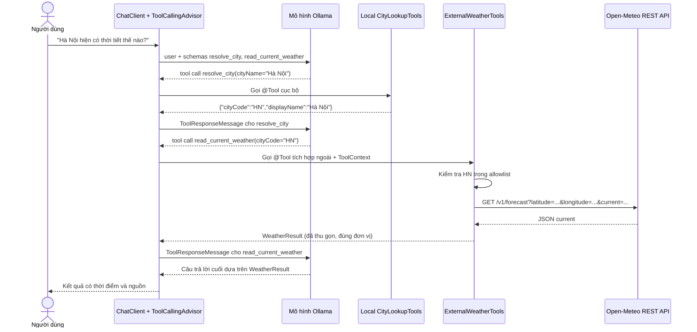

# Kết hợp công cụ cục bộ với một dịch vụ ngoài hoặc MCP

> **Chương:** Thực hành tổng hợp · **Mô-đun:** SPRING_AI_TOOL_CALLING · **Phiên bản tham chiếu:** Spring AI **2.1.0** trên Spring Boot **4.2**. Bài thực hành có hai lựa chọn tích hợp: **bài chính dùng REST API ngoài** để chạy được với một dịch vụ công khai; **bài mở rộng thay tool REST bằng một MCP server**. Cả hai đều ghép với một tool cục bộ trong cùng một lượt hội thoại.

## 1. Đề bài, đầu ra và phạm vi

Xây dựng trợ lý tiếng Việt trả lời câu hỏi: “**Hà Nội hiện có nhiệt độ, độ ẩm và lượng mưa bao nhiêu?**”. Ứng dụng phải:

1. Dùng tool **cục bộ** `resolve_city` để chuyển tên thành phố người dùng viết thành **mã thành phố chuẩn** trong một danh mục cho phép.
2. Dùng tool **tích hợp ngoài** `read_current_weather` với mã chuẩn đó để gọi **Open-Meteo Forecast API** và đọc dữ liệu thời tiết hiện tại.
3. Đưa kết quả tool về mô hình qua vòng tool calling của `ChatClient`; câu trả lời cuối ghi rõ **thành phố, thời điểm dữ liệu, nhiệt độ °C, độ ẩm % và lượng mưa mm**. Nếu dịch vụ ngoài lỗi, phải nói chưa lấy được dữ liệu; không bịa số liệu.
4. Chứng minh bằng log/counter rằng **hai tool thực sự được gọi**, chứ không chỉ có lời văn mô phỏng gọi tool.
5. Có đường thử âm tính, xử lý lỗi, giới hạn phạm vi công cụ và điểm mở rộng để thay REST tool bằng MCP.

Các con số thời tiết trong bài **không được cố định trước**: chúng thay đổi theo thời điểm, model nguồn và tình trạng của dịch vụ ngoài. Ví dụ ở đây **không thao tác ghi/xóa dữ liệu**, nhưng vẫn áp dụng nguyên tắc kiểm tra input, giới hạn truy cập mạng và che thông tin nhạy cảm.

### Điều kiện hoàn thành

| Hạng mục | Chứng cứ cần có |
| --- | --- |
| Tool cục bộ | `resolve_city("Hà Nội")` cho `cityCode="HN"`; input lạ bị từ chối |
| Tool dịch vụ ngoài | Chỉ dùng `cityCode` thuộc allowlist để truy vấn Open-Meteo; chuyển dữ liệu JSON sang kiểu rõ ràng |
| Tích hợp Spring AI | `ChatClient` công bố **cả hai** tool; quan sát được assistant tool call, tool result và final answer |
| Lỗi | HTTP 429/5xx, timeout hoặc JSON thiếu field dẫn tới kết quả `UNAVAILABLE`, không có số giả |
| Bảo vệ | Không cho mô hình quyết định URL, host hoặc tọa độ tùy ý; fallback resolver tắt |
| Kiểm chứng | Test unit cho danh mục và adapter; test tích hợp với HTTP fake; live smoke test khi có Ollama và mạng |

## 2. Kiến trúc: mô hình đề nghị, ứng dụng thực thi



**Các tầng trách nhiệm khác nhau:**

- `@Tool` và `@ToolParam` tạo tên, mô tả và JSON schema mà mô hình nhìn thấy.
- `ChatClient` trong Spring AI 2.1 đăng ký `ToolCallingAdvisor` để điều phối nhiều lượt: mô hình trả **yêu cầu**, `ToolCallingManager` chọn `ToolCallback` rồi **ứng dụng** thực thi, trả kết quả cho mô hình. Mô hình **không có quyền truy cập RestClient hoặc bean Spring**. [1]
- `CityCatalog` quyết định dữ liệu nào ứng dụng cho phép; `ExternalWeatherTools` giữ URL cố định, tạo request HTTP, phân loại lỗi và thu gọn dữ liệu trả về.
- `ToolContext` mang thông tin do server tạo, ví dụ `requestId`, principal hoặc tenant, tới phương thức tool **mà không gửi nó vào prompt của mô hình**. [1]

**Điểm cần hiểu:** lời nhắc khuyến khích mô hình dùng cả hai tool nhưng **không bảo đảm** model chọn đúng trình tự. Khi việc dùng tool A trước B là ràng buộc nghiệp vụ bắt buộc, ứng dụng phải điều phối hoặc kiểm tra ràng buộc đó ở backend; prompt là tín hiệu lựa chọn, không phải cơ chế cấp quyền.

## 3. Chuẩn bị môi trường Spring AI 2.1

Bài chính cần JDK tương thích **Spring Boot 4.2** (tối thiểu Java 17; các snippet dùng record và switch expression), Maven, Spring Boot 4.2, Spring AI BOM 2.1.0, một mô hình Ollama **đã tải và có khả năng structured tool calling**, cùng kết nối HTTPS tới Open-Meteo. Spring AI 2.1.0 GA phát hành ngày 20/11/2026 và được xây trên Spring Boot 4.2. [2]

### 3.1. Khai báo dependency

Ví dụ `pom.xml` tối giản cho nhánh REST (trong một **dự án thực hành riêng**, không phải file do bài này tự sinh trong repository):

```xml
<project xmlns="http://maven.apache.org/POM/4.0.0"
         xmlns:xsi="http://www.w3.org/2001/XMLSchema-instance"
         xsi:schemaLocation="http://maven.apache.org/POM/4.0.0
                             https://maven.apache.org/xsd/maven-4.0.0.xsd">
  <modelVersion>4.0.0</modelVersion>
  <parent>
    <groupId>org.springframework.boot</groupId>
    <artifactId>spring-boot-starter-parent</artifactId>
    <version>4.2.0</version>
    <relativePath/>
  </parent>
  <groupId>edu.example</groupId>
  <artifactId>weather-tool-capstone</artifactId>
  <version>1.0.0</version>
  <properties>
    <java.version>21</java.version>
  </properties>

  <dependencyManagement>
    <dependencies>
      <dependency>
        <groupId>org.springframework.ai</groupId>
        <artifactId>spring-ai-bom</artifactId>
        <version>2.1.0</version>
        <type>pom</type>
        <scope>import</scope>
      </dependency>
    </dependencies>
  </dependencyManagement>

  <dependencies>
    <dependency>
      <groupId>org.springframework.boot</groupId>
      <artifactId>spring-boot-starter-webmvc</artifactId>
    </dependency>
    <dependency>
      <groupId>org.springframework.ai</groupId>
      <artifactId>spring-ai-starter-model-ollama</artifactId>
    </dependency>
    <dependency>
      <groupId>org.springframework.boot</groupId>
      <artifactId>spring-boot-starter-test</artifactId>
      <scope>test</scope>
    </dependency>
  </dependencies>
  <build>
    <plugins>
      <plugin>
        <groupId>org.springframework.boot</groupId>
        <artifactId>spring-boot-maven-plugin</artifactId>
      </plugin>
    </plugins>
  </build>
</project>
```

Với Spring Boot 4, dùng `spring-boot-starter-webmvc` (tên `spring-boot-starter-web` cũ vẫn tồn tại nhưng đã deprecated); HTTP/Jackson được dependency management của Boot quản lý. Không ép nhiều phiên bản Spring AI lẻ khác nhau; quản lý bằng **BOM 2.1.0**. Maven plugin Spring Boot trong `pom.xml` hỗ trợ chạy ứng dụng demo bằng `mvn spring-boot:run` khi code và môi trường đã sẵn sàng.

### 3.2. Cấu hình Ollama và phạm vi tool

```yaml
spring:
  ai:
    model:
      chat: ollama
    ollama:
      base-url: http://localhost:11434
      chat:
        model: qwen3:8b
        temperature: 0
    tools:
      resolution:
        fallback:
          enabled: false
      observations:
        include-content: false
```

`qwen3:8b` là **lựa chọn minh họa**, không bảo đảm máy đã tải được hoặc tất cả phiên bản runtime của model sẽ chọn tool như mong muốn. Kiểm tra `ollama list`, dùng model có hỗ trợ tool calling và thay model ID đúng với máy; tải trước nếu cần (`ollama pull qwen3:8b`). `spring.ai.model.chat` là khóa chọn model chat ở thế hệ starter Spring AI hiện tại; `spring.ai.ollama.chat.enabled` đã bị loại bỏ. [3]

**Quy tắc an toàn:** `spring.ai.tools.resolution.fallback.enabled=false` (mặc định từ 2.0.1) ngăn thực thi tool ngoài tập được đính vào request chỉ vì resolver biết tên. Vẫn phải kiểm tra quyền ở business service khi mở rộng bài này sang dữ liệu riêng tư. [1]

### 3.3. Kiểm chứng API ngoài độc lập với LLM

Open-Meteo dùng `GET https://api.open-meteo.com/v1/forecast` với `latitude`, `longitude` và tham số `current`. Bộ trường hiện tại gồm `temperature_2m`, `relative_humidity_2m`, `precipitation`; `current.time` chỉ thời điểm dữ liệu có hiệu lực, `current.interval` là khoảng tổng hợp (giây). Dữ liệu `precipitation` biểu thị tổng lượng trong khoảng tương ứng, **không phải xác suất mưa và không phải dự báo cả ngày**. [4]

```bash
curl -sS "https://api.open-meteo.com/v1/forecast?latitude=21.0285&longitude=105.8542&current=temperature_2m,relative_humidity_2m,precipitation&timezone=Asia%2FHo_Chi_Minh"
```

Một kết quả có dạng (số giả **chỉ để mô tả cấu trúc**):

```json
{
  "latitude": 21.0,
  "longitude": 105.9,
  "utc_offset_seconds": 25200,
  "timezone": "Asia/Ho_Chi_Minh",
  "current_units": {
    "time": "iso8601",
    "interval": "seconds",
    "temperature_2m": "°C",
    "relative_humidity_2m": "%",
    "precipitation": "mm"
  },
  "current": {
    "time": "2026-11-27T20:00",
    "interval": 900,
    "temperature_2m": 24.8,
    "relative_humidity_2m": 78,
    "precipitation": 0.0
  }
}
```

Không lấy `24.8` làm dự báo thực tế. Với request khác thời điểm, API có thể trả giá trị/`interval` khác. Mục tiêu smoke test là endpoint **trả JSON đúng schema** và đơn vị hợp lệ, không kiểm tra con số phải cố định.

## 4. Xây dựng tool cục bộ: `resolve_city`

Tool đầu tiên chuẩn hóa tên người dùng thành mã trong danh mục giới hạn. Danh mục giữ tọa độ **ở server**, không tin tọa độ do model tự điền.

```java
// CityCatalog.java
package edu.example.weather;

import java.text.Normalizer;
import java.util.Locale;
import org.springframework.stereotype.Service;

record CityInfo(String code, String displayName, double latitude, double longitude) {}

@Service
public class CityCatalog {

    CityInfo byName(String input) {
        if (input == null || input.isBlank()) {
            throw new IllegalArgumentException("Thiếu tên thành phố");
        }
        String key = Normalizer.normalize(input.trim(), Normalizer.Form.NFD)
            .replaceAll("\\p{M}", "")
            .toLowerCase(Locale.ROOT)
            .replace('đ', 'd')
            .replace('.', ' ')
            .replaceAll("\\s+", " ");

        return switch (key) {
            case "ha noi", "hanoi" ->
                new CityInfo("HN", "Hà Nội", 21.0285, 105.8542);
            case "ho chi minh", "tp ho chi minh", "sai gon", "hcm" ->
                new CityInfo("HCM", "TP. Hồ Chí Minh", 10.8231, 106.6297);
            default -> throw new IllegalArgumentException(
                "Thành phố chưa có trong danh mục");
        };
    }

    CityInfo byCode(String input) {
        if (input == null) {
            throw new IllegalArgumentException("Thiếu cityCode");
        }
        return switch (input.trim().toUpperCase(Locale.ROOT)) {
            case "HN" -> byName("Hà Nội");
            case "HCM" -> byName("Hồ Chí Minh");
            default -> throw new IllegalArgumentException(
                "cityCode không nằm trong danh mục");
        };
    }
}
```

```java
// CityLookupTools.java
package edu.example.weather;

import org.slf4j.Logger;
import org.slf4j.LoggerFactory;
import org.springframework.ai.tool.annotation.Tool;
import org.springframework.ai.tool.annotation.ToolParam;
import org.springframework.stereotype.Component;

record CityMatch(String cityCode, String displayName) {}

@Component
public class CityLookupTools {

    private static final Logger log =
        LoggerFactory.getLogger(CityLookupTools.class);
    private final CityCatalog cities;

    public CityLookupTools(CityCatalog cities) {
        this.cities = cities;
    }

    @Tool(name = "resolve_city",
          description = "Chuyển tên thành phố Việt Nam sang cityCode hợp lệ " +
                        "để dùng cho tool read_current_weather.")
    public CityMatch resolveCity(
        @ToolParam(description = "Tên thành phố người dùng nói, ví dụ Hà Nội")
        String cityName
    ) {
        CityInfo city = cities.byName(cityName);
        log.info("tool=resolve_city city={} status=OK", city.code());
        return new CityMatch(city.code(), city.displayName());
    }
}
```

**Tại sao tách hai lớp?** `CityCatalog` là logic nghiệp vụ thuần để test độc lập. `CityLookupTools` là lớp adapter Spring AI công bố chức năng qua `@Tool`. Schema công bố chỉ cần `cityName`, kết quả có `cityCode`. Mô hình không nhận quyền quyết định nguồn dữ liệu ngoài.

Ví dụ gọi `resolve_city("Hà Nội")` phải trả JSON tool-result tương đương:

```json
{"cityCode":"HN","displayName":"Hà Nội"}
```

Trường hợp “Đà Nẵng” hiện **không** có trong danh mục là lỗi dữ liệu hợp lệ của bài thực hành. Có thể mở rộng danh mục theo nhu cầu, nhưng không nên silently gán thành một thành phố khác.

## 5. Viết adapter cho dịch vụ ngoài: `read_current_weather`

Khác với tool local, tool ngoài chịu rủi ro mạng, timeouts, HTTP 429/5xx và dữ liệu không đầy đủ. Đặt toàn bộ xử lý HTTP trong adapter, chỉ trả **kết quả rút gọn có kiểu** cho mô hình.

### 5.1. Cấu hình `RestClient` với timeout

```java
// ExternalHttpConfiguration.java
package edu.example.weather;

import org.springframework.context.annotation.Bean;
import org.springframework.context.annotation.Configuration;
import org.springframework.http.client.SimpleClientHttpRequestFactory;
import org.springframework.web.client.RestClient;

@Configuration
public class ExternalHttpConfiguration {

    @Bean
    RestClient openMeteoClient(RestClient.Builder builder) {
        SimpleClientHttpRequestFactory requestFactory =
            new SimpleClientHttpRequestFactory();
        requestFactory.setConnectTimeout(2000); // ms
        requestFactory.setReadTimeout(5000);    // ms

        return builder
            .baseUrl("https://api.open-meteo.com")
            .requestFactory(requestFactory)
            .build();
    }
}
```

URL base được **cố định trong server**. Nếu nhận URL trực tiếp từ mô hình rồi `RestClient.get()` gọi tùy ý, ứng dụng có thể bị **SSRF** đến địa chỉ nội bộ/metadata service. Tách host và tọa độ ra khỏi các đối số tool là hàng rào rõ ràng, dễ kiểm thử.

### 5.2. DTO chỉ đọc trường cần thiết

```java
// OpenMeteoResponse.java
package edu.example.weather;

import com.fasterxml.jackson.annotation.JsonIgnoreProperties;
import com.fasterxml.jackson.annotation.JsonProperty;

@JsonIgnoreProperties(ignoreUnknown = true)
record OpenMeteoResponse(Current current) {

    @JsonIgnoreProperties(ignoreUnknown = true)
    record Current(
        String time,
        Integer interval,
        @JsonProperty("temperature_2m") Double temperatureC,
        @JsonProperty("relative_humidity_2m") Integer humidityPercent,
        Double precipitation
    ) {}
}

record WeatherResult(
    String status,
    String cityCode,
    String city,
    String observedAt,
    String timezone,
    Double temperatureC,
    Integer relativeHumidityPercent,
    Double precipitationMm,
    Integer intervalSeconds,
    String message
) {}
```

`@JsonIgnoreProperties(ignoreUnknown = true)` giúp DTO không phụ thuộc các metadata/field khác trong phản hồi, còn kiểm tra null bảo đảm ứng dụng không tự gán giá trị mặc định 0 cho trường API bị thiếu. `current_units` được biết từ contract API và request giữ đơn vị mặc định Celsius/%/mm; nếu thay `temperature_unit` hoặc `precipitation_unit` thì phải cập nhật cả mapper và mô tả đơn vị trong tool result.

### 5.3. Tool gọi REST và trả lỗi có kiểm soát

```java
// ExternalWeatherTools.java
package edu.example.weather;

import org.slf4j.Logger;
import org.slf4j.LoggerFactory;
import org.springframework.ai.chat.model.ToolContext;
import org.springframework.ai.tool.annotation.Tool;
import org.springframework.ai.tool.annotation.ToolParam;
import org.springframework.stereotype.Component;
import org.springframework.web.client.RestClient;
import org.springframework.web.client.RestClientException;

@Component
public class ExternalWeatherTools {

    private static final Logger log =
        LoggerFactory.getLogger(ExternalWeatherTools.class);

    private final CityCatalog cities;
    private final RestClient openMeteoClient;

    public ExternalWeatherTools(CityCatalog cities, RestClient openMeteoClient) {
        this.cities = cities;
        this.openMeteoClient = openMeteoClient;
    }

    @Tool(name = "read_current_weather",
          description = "Lấy thời tiết hiện tại từ Open-Meteo theo cityCode " +
                        "HN hoặc HCM do resolve_city trả về. " +
                        "Không nhận URL hay tọa độ tự do.")
    public WeatherResult readCurrentWeather(
        @ToolParam(description = "Mã thành phố chuẩn, HN hoặc HCM")
        String cityCode,
        ToolContext toolContext
    ) {
        String requestId = (String) toolContext.getContext().get("requestId");
        if (requestId == null || requestId.isBlank()) {
            throw new IllegalStateException("Thiếu requestId do server cấp");
        }

        CityInfo city = cities.byCode(cityCode); // Allowlist bắt buộc
        try {
            OpenMeteoResponse payload = openMeteoClient.get()
                .uri(uri -> uri.path("/v1/forecast")
                    .queryParam("latitude", city.latitude())
                    .queryParam("longitude", city.longitude())
                    .queryParam("current",
                        "temperature_2m,relative_humidity_2m,precipitation")
                    .queryParam("timezone", "Asia/Ho_Chi_Minh")
                    .build())
                .retrieve()
                .body(OpenMeteoResponse.class);

            OpenMeteoResponse.Current current =
                payload == null ? null : payload.current();

            if (current == null || current.time() == null
                    || current.temperatureC() == null
                    || current.humidityPercent() == null
                    || current.precipitation() == null
                    || current.interval() == null) {
                return unavailable(city, "Thiếu trường dữ liệu thời tiết");
            }

            log.info("tool=read_current_weather requestId={} city={} status=OK",
                requestId, city.code());
            return new WeatherResult(
                "OK", city.code(), city.displayName(),
                current.time(), "Asia/Ho_Chi_Minh",
                current.temperatureC(), current.humidityPercent(),
                current.precipitation(), current.interval(), null
            );
        }
        catch (RestClientException ex) {
            // Không ghi response body, token, URL chứa thông tin riêng tư.
            log.warn("Weather upstream failed requestId={} city={} type={}",
                requestId, city.code(), ex.getClass().getSimpleName());
            return unavailable(city, "Dịch vụ thời tiết tạm thời không khả dụng");
        }
    }

    private WeatherResult unavailable(CityInfo city, String safeMessage) {
        return new WeatherResult(
            "UNAVAILABLE", city.code(), city.displayName(),
            null, "Asia/Ho_Chi_Minh", null, null, null, null, safeMessage
        );
    }
}
```

**Ý nghĩa kỹ thuật:**

- `ToolContext` là tham số đặc biệt, **không xuất hiện trong JSON Schema gửi mô hình**. Caller phải cung cấp context qua `ChatClient.toolContext(...)`; thiếu request ID khiến method dừng. Nếu thay request ID bằng actor/tenant, lấy chúng từ **session xác thực của server**, không từ câu trả lời hay input do mô hình tạo. [1]
- `cityCode` nằm trong JSON Schema để mô hình có thể dùng kết quả `resolve_city`. Nhưng **validation server-side** vẫn phải chạy mỗi lần gọi; tool không cho đưa tọa độ và URL tùy ý.
- Ở nhánh HTTP lỗi, trả cấu trúc có `status=UNAVAILABLE` và các số `null` để mô hình có tín hiệu lỗi đáng tin. Không trả `0 mm`, vì 0 là **một số liệu thực tế khác hoàn toàn “không biết”**.
- `RestClientException` bao gồm nhiều lỗi HTTP/transport; cách xử lý trên **không retry**, phù hợp lab chỉ đọc. Với hệ thống thực, chỉ retry có giới hạn và chính sách theo HTTP status, timeout và quota; nếu tool có side effect, cần idempotency và đối soát.
- `@Tool` **không tự phát HTTP request**; chính mã Java trong phương thức `readCurrentWeather` thực hiện request. Spring AI chỉ làm cầu nối giữa model tool request và callback.

## 6. Ghép hai tool trong một lượt `ChatClient`

Tạo ứng dụng Java tối giản chạy một câu hỏi cố định:

```java
// WeatherAssistantApplication.java
package edu.example.weather;

import java.util.Map;
import java.util.UUID;
import org.springframework.ai.chat.client.ChatClient;
import org.springframework.ai.chat.model.ChatModel;
import org.springframework.boot.CommandLineRunner;
import org.springframework.boot.SpringApplication;
import org.springframework.boot.autoconfigure.SpringBootApplication;
import org.springframework.context.annotation.Bean;

@SpringBootApplication
public class WeatherAssistantApplication {

    public static void main(String[] args) {
        SpringApplication.run(WeatherAssistantApplication.class, args);
    }

    @Bean
    ChatClient weatherChatClient(ChatModel chatModel) {
        return ChatClient.create(chatModel);
    }

    @Bean
    CommandLineRunner demo(
        ChatClient weatherChatClient,
        CityLookupTools localTools,
        ExternalWeatherTools externalTools
    ) {
        return args -> {
            String requestId = UUID.randomUUID().toString();

            String answer = weatherChatClient.prompt()
                .system("""
                    Bạn trả lời tiếng Việt bằng dữ liệu từ công cụ.
                    Khi hỏi thời tiết hiện tại tại một thành phố:
                    (1) gọi resolve_city với tên người dùng đưa;
                    (2) lấy cityCode vừa trả về và gọi read_current_weather;
                    (3) chỉ dùng số liệu có status=OK, nêu thời điểm,
                        múi giờ, °C, %, mm;
                    (4) nếu status=UNAVAILABLE, báo chưa lấy được dữ liệu.
                    Không tự tạo số, không suy diễn dự báo ngày mai từ
                    dữ liệu current, không gọi công cụ ngoài phạm vi.
                    """)
                .user("Hà Nội hiện tại bao nhiêu độ, độ ẩm và lượng mưa?")
                .tools(localTools, externalTools)
                .toolContext(Map.of("requestId", requestId))
                .call()
                .content();

            System.out.println("Request ID: " + requestId);
            System.out.println("Answer: " + answer);
        };
    }
}
```

Với mô hình có khả năng tool calling và đường mạng bình thường, chuỗi quan sát mong đợi:

```text
1. assistant tool_call: resolve_city({"cityName":"Hà Nội"})
2. application callback: CityLookupTools.resolveCity
3. tool result: {"cityCode":"HN","displayName":"Hà Nội"}
4. assistant tool_call: read_current_weather({"cityCode":"HN"})
5. application callback: ExternalWeatherTools.readCurrentWeather
6. HTTP GET Open-Meteo /v1/forecast (server cấp tọa độ)
7. tool result: WeatherResult(status="OK", ...)
8. assistant final: trích thông tin và thời điểm từ WeatherResult
```

Đây là **kỳ vọng để kiểm tra**, không phải log được thu từ máy của người học. Một số model sẽ gọi hai tool trong cùng một phản hồi, gọi tuần tự, hoặc bỏ sót một tool. Điều quan trọng là kiểm tra **tool_calls/callback executions thực tế**, không đoán từ câu trả lời cuối.

### Khi cần bảo đảm thứ tự chặt chẽ

Bài dùng prompt để hướng dẫn chọn tool. Với dịch vụ nghiệp vụ cần chắc chắn qua bước chuẩn hóa/authorization, hãy chuyển **quy tắc bắt buộc** vào ứng dụng: controller chuẩn hóa input bằng `CityCatalog` rồi chỉ công bố tool thời tiết với `cityCode` đã cấp; hoặc tạo một orchestration service thực hiện chuỗi `resolve → fetch` và trả kết quả như **một tool**. Không để mô hình tự quyết định thứ tự nếu việc bỏ qua `resolve_city` có hậu quả an toàn. Tool `read_current_weather` ở ví dụ vẫn độc lập kiểm tra allowlist, vì vậy không thể bị ép gọi URL lạ khi model bỏ qua bước 1.

## 7. Có thực sự “kết hợp” hay chỉ trả câu chữ tưởng tượng?

Một câu cuối như “Hà Nội 25 độ” **không chứng minh** đã sử dụng Open-Meteo. Để kết luận PASS cần ít nhất:

- Ở biên Spring AI: nhận structured tool calls (tên, id và arguments) và `ToolResponseMessage` tương ứng.
- Ở tool local: counter/log `resolve_city` tăng đúng lúc, `cityCode` được chuẩn hóa.
- Ở adapter ngoài: counter/log `read_current_weather` và một HTTP request outbound được quan sát; response DTO được kiểm tra.
- Ở kết quả: final answer chỉ dùng dữ liệu `status=OK`, có thời điểm/đơn vị, hoặc thông báo `UNAVAILABLE` nếu lỗi.
- Ở bảo mật: model không thể đổi host từ `api.open-meteo.com` sang URL khác bằng cách truyền argument.

**Sơ đồ bằng chứng theo correlation ID:**

```text
requestId=demo-001
  chat request      tool definitions=[resolve_city,read_current_weather]
  model tool call   id=call-a name=resolve_city args.cityName="Hà Nội"
  local callback    name=resolve_city result.cityCode="HN"
  model tool call   id=call-b name=read_current_weather args.cityCode="HN"
  remote adapter    cityCode="HN" host=api.open-meteo.com httpStatus=200
  tool response     id=call-b status=OK observedAt=...
  final answer      has city, observedAt, temperatureC, humidity%, mm
```

Dấu `requestId` của bài này do **server** tạo. `tool_call_id` do provider/model tạo để nối tool request với tool result; không dùng nó làm idempotency key duy nhất cho thao tác thay đổi dữ liệu.

### Đọc log/trace an toàn

Spring AI 2.1 cung cấp observation cho tool execution, thường có tên tool và tool-call ID. `spring.ai.tools.observations.include-content` mặc định **false** để tránh ghi nguyên đối số/kết quả; bài thực hành giữ false. Nếu cần chẩn đoán, log có cấu trúc **tên tool, mã thành phố, duration, mã lỗi, requestId**, không ghi nguyên prompt, credential hoặc response chứa dữ liệu nhạy cảm. [1]

## 8. Ca lỗi cần làm trong bài chính

| Ca | Cách tạo tình huống | PASS |
| --- | --- | --- |
| L1 — Thành phố hỗ trợ | Hỏi “Hà Nội” | `resolve_city` ra `HN`, adapter nhận `HN`, có dữ liệu hợp lệ |
| L2 — Bí danh | Hỏi “Sài Gòn” | Chuẩn hóa thành `HCM`, không dùng Hà Nội |
| L3 — Không hỗ trợ | Hỏi “Đà Nẵng” trước khi thêm catalog | Tool báo chưa có thành phố, không tự chọn một thành phố khác |
| R1 — Timeout | Adapter trỏ fake server chậm hơn 5 giây | `UNAVAILABLE`; các trường nhiệt độ/độ ẩm/lượng mưa là null |
| R2 — HTTP lỗi | Fake server trả 429 hoặc 503 | Không rò raw response body; final answer giải thích nguồn đang lỗi |
| R3 — JSON thiếu field | Fake trả `current` thiếu `temperature_2m` | Không biến null thành 0; kết quả `UNAVAILABLE` |
| R4 — Dữ liệu hợp lệ | Fake trả nhiệt độ 29.0, ẩm 70, mưa 0.2, interval 900 | DTO giữ đúng giá trị và thời điểm; câu trả lời dùng đúng đơn vị |
| S1 — Đầu vào lạ | Model đề nghị `cityCode=http://127.0.0.1` | Backend từ chối; không có HTTP request ra host đó |
| S2 — Tool không công bố | Model đề nghị `delete_database` | Callback không tồn tại/không được thực thi, fallback giữ false |
| T1 — Tool selection | Model trả lời theo trí nhớ mà không gọi tool | Trượt tiêu chí thực hành dù câu chữ nghe hợp lý |
| T2 — Nhiều lượt | Model gọi `resolve_city` rồi `read_current_weather` | Tool result khớp từng call id; không mất dữ liệu trong vòng lặp |

**Nên chia test hai lớp.** Test adapter local/HTTP fake là **xác định**: assert DTO, request URI, số lần gọi, timeout và allowlist mà không dùng LLM. Live test với Ollama là **xác suất**: lặp lại và ghi tỷ lệ model chọn đúng tool, số lượt, thời gian/ lỗi; không viết một unit test chờ model “tự nhiên” quyết định để khẳng định API Spring AI đúng.

### Ví dụ unit test cho danh mục

```java
package edu.example.weather;

import static org.assertj.core.api.Assertions.*;

import org.junit.jupiter.api.Test;

class CityCatalogTest {

    private final CityCatalog cities = new CityCatalog();

    @Test
    void normalizesKnownCity() {
        assertThat(cities.byName("Hà Nội").code()).isEqualTo("HN");
        assertThat(cities.byName("Sai Gon").code()).isEqualTo("HCM");
    }

    @Test
    void rejectsUnlistedCityOrCode() {
        assertThatThrownBy(() -> cities.byName("Đà Nẵng"))
            .isInstanceOf(IllegalArgumentException.class);
        assertThatThrownBy(() -> cities.byCode("http://localhost"))
            .isInstanceOf(IllegalArgumentException.class);
    }
}
```

Đối với adapter HTTP, thay `RestClient` thật bằng `MockRestServiceServer` hoặc một HTTP fake server ở test để tái tạo chính xác 200/429/503/timeout/body lỗi. Phải kiểm tra request chỉ chứa đường dẫn `/v1/forecast`, host cố định và tọa độ đến từ `CityCatalog`. Tránh gọi API công khai trong unit test; bài tập live smoke test là một tầng riêng.

## 9. Nhánh mở rộng: thay tool REST bằng một MCP server

Bài chính đã thỏa yêu cầu **tool cục bộ + dịch vụ ngoài**. Để thực hành **tool cục bộ + MCP**, thay `ExternalWeatherTools` bằng tool được công bố bởi một **MCP server** tin cậy. Cùng `ChatClient` có thể nhận local object `@Tool` và `SyncMcpToolCallbackProvider` trong một lệnh `.tools(...)` vì Spring AI ánh xạ cả hai sang `ToolCallback`. [1], [5]

### 9.1. MCP server chạy độc lập

Tạo **một ứng dụng Spring Boot khác** phục vụ MCP trên cổng 8091. Chọn starter WebMVC:

```xml
<dependency>
  <groupId>org.springframework.ai</groupId>
  <artifactId>spring-ai-starter-mcp-server-webmvc</artifactId>
</dependency>
```

Cấu hình phía MCP server:

```yaml
server:
  port: 8091
spring:
  ai:
    mcp:
      server:
        name: trusted-weather
        version: 1.0.0
        protocol: STREAMABLE
```

MCP server có thể bọc lại chính `CityCatalog` và HTTP adapter an toàn trong một phương thức `@McpTool`. Đây là **chương trình riêng**; client sẽ không tự sinh server chỉ bằng việc khai báo URL. Ví dụ phần công bố tool:

```java
import org.springframework.ai.mcp.annotation.McpTool;
import org.springframework.ai.mcp.annotation.McpToolParam;
import org.springframework.stereotype.Component;

@Component
public class WeatherMcpEndpoint {

    private final WeatherService weatherService; // Service do bạn tự viết

    public WeatherMcpEndpoint(WeatherService weatherService) {
        this.weatherService = weatherService;
    }

    @McpTool(description = "Read current weather for HN or HCM only")
    public WeatherResult remoteCurrentWeather(
        @McpToolParam(description = "Allowlisted city code: HN or HCM")
        String cityCode
    ) {
        return weatherService.readAllowedCity(cityCode);
    }
}
```

`WeatherService` và `readAllowedCity` là **API nghiệp vụ giả định** cần triển khai bằng adapter từ phần 5 (hoặc một service đọc dữ liệu khác). Nếu triển khai cùng class/record từ ứng dụng khác, phải quản lý dependency chung và không tạo vòng gọi HTTP tự tham chiếu. `@McpTool` phía **server** khác với `@Tool` phía **client cục bộ**; đừng import nhầm.

**An ninh MCP:** các starter MCP server HTTP **không tự thêm xác thực/phân quyền cho endpoint**. Trước khi mở mạng hoặc đưa vào production, yêu cầu TLS, xác thực, phân quyền trên từng tool, giới hạn mạng và chống truy cập chéo tenant. Chỉ bind localhost ở lab không đủ bảo đảm tuyệt đối nếu trình duyệt có thể gửi request hoặc có DNS rebinding. [6]

### 9.2. Thêm MCP client và kết nối

Trong **ứng dụng trợ lý**, thêm dependency:

```xml
<dependency>
  <groupId>org.springframework.ai</groupId>
  <artifactId>spring-ai-starter-mcp-client</artifactId>
</dependency>
```

Cấu hình ví dụ **Streamable HTTP** theo giao thức legacy mặc định của Spring AI 2.1, kết nối với server lab ở `http://localhost:8091/mcp`:

```yaml
spring:
  ai:
    mcp:
      client:
        enabled: true
        type: SYNC
        request-timeout: 20s
        toolcallback:
          enabled: true
        streamable-http:
          connections:
            weather:
              url: http://localhost:8091
              endpoint: /mcp
```

`spring.ai.mcp.client.streamable-http.connections.[name].url` là **base URL**, `endpoint` là suffix (mặc định `/mcp`). Cấu hình này chỉ làm việc nếu có MCP server tương ứng đang chạy và hỗ trợ đúng transport/protocol. Nếu server chỉ hỗ trợ SSE cũ hoặc MCP “modern” khác revision, không được tự giả định nó tương thích. Tài liệu 2.1 còn hỗ trợ protocol `MODERN` (MCP 2026-07-28) khi cấu hình rõ `protocol: MODERN`; bài này chủ động dùng `STREAMABLE` truyền thống để giữ lab đơn giản. [5]

### 9.3. Ghép tool local với MCP provider

Ở client, Spring AI auto-configure `SyncMcpToolCallbackProvider`. **Các MCP tool không tự được gắn vào mọi request của `ChatClient`**, vì listing tool có thể phải đi qua mạng. Phải thêm provider rõ ràng:

```java
import org.springframework.ai.chat.client.ChatClient;
import org.springframework.ai.mcp.SyncMcpToolCallbackProvider;
import java.util.Map;
import java.util.UUID;

// Các biến được Spring inject vào bean/controller/runner:
String text = weatherChatClient.prompt()
    .system("""
        Khi hỏi thời tiết, gọi resolve_city trước.
        Sau đó gọi remoteCurrentWeather của MCP server
        với cityCode đã được chuẩn hóa; trả lời từ dữ liệu tool.
        """)
    .user("Hà Nội bây giờ có nhiệt độ và lượng mưa bao nhiêu?")
    .tools(localCityTools, mcpTools)
    .toolContext(Map.of("requestId", UUID.randomUUID().toString()))
    .call()
    .content();
```

Trong snippet trên, `weatherChatClient` là `ChatClient` đã cấu hình, `localCityTools` là `CityLookupTools`, `mcpTools` là bean `SyncMcpToolCallbackProvider`; chúng phải được tiêm từ Spring. Nếu MCP server đặt tên tool `remoteCurrentWeather` thì prompt dùng đúng tên đã được **discovery**; nếu có prefix do cơ chế tránh trùng MCP, cần kiểm tra tên thật từ `mcpTools.getToolCallbacks()` và điều chỉnh prompt.

**Lưu ý phiên bản:** Spring AI 2.1.0 dùng import `org.springframework.ai.mcp.SyncMcpToolCallbackProvider` như tài liệu API công khai; tránh dùng package cũ hoặc ví dụ Spring AI 1.x để nhập. Nếu sử dụng MCP server riêng, xác minh version SDK/protocol, tên tool và schema qua công cụ kiểm tra MCP trước khi chạy ChatClient.

### 9.4. Trùng tên, phân quyền và context qua MCP

- Đặt tên khác nhau cho local `resolve_city` và remote `remoteCurrentWeather`. `DefaultMcpToolNamePrefixGenerator` xử lý trùng tên giữa **các MCP server**, nhưng không biết tên tool local; danh sách ghép qua `ChatClient.tools(...)` sẽ kiểm tra xung đột và có thể báo `IllegalStateException`. [1]
- Dùng `McpToolFilter` để chỉ cho phép những MCP tool cần thiết; việc một server có `delete_file` hay `execute_command` không có nghĩa trợ lý thời tiết được phép thấy chúng. Không đưa toàn bộ provider không kiểm soát vào `defaultTools` của client dùng chung nhiều vai trò.
- `ToolContext` phía client không mặc định tương đương principal phía MCP server. 2.1 có `ToolContextToMcpMetaConverter` và các hook truyền auth phù hợp transport; **không đưa bearer token vào arguments do mô hình tạo**. Đối với multi-user, xác minh chính sách phiên MCP và truyền identity per request vì client MCP thường là bean dùng chung. [5]
- Nếu cần side effect ở MCP server, policy/approval/idempotency phải kiểm tra **bên server MCP** và lớp nghiệp vụ; mô hình có thể yêu cầu nhưng không tự cấp quyền.
- Nếu MCP server sập, phân biệt lỗi **discover tools / connect** với lỗi **call tool**. Cần trường `UNAVAILABLE` hay thông báo an toàn tương đương và không bịa dữ liệu.

### Hai biến thể có cùng mục tiêu nhưng ranh giới khác nhau

| Khía cạnh | Local + REST tool | Local + MCP tool |
| --- | --- | --- |
| Tool thứ hai được khai báo ở đâu? | `@Tool` trong ứng dụng trợ lý | `@McpTool` trên MCP server, client nhận `ToolCallback` qua provider |
| Ai giữ HTTP API key? | Adapter ứng dụng | MCP server hoặc auth layer của MCP, không nằm trong model |
| Giao thức giữa hai dịch vụ | HTTP REST ứng dụng tự định nghĩa | MCP tools/list, tools/call và transport đã chọn |
| Discovery tool | Biên dịch/bean local | MCP server công bố danh mục; provider lấy khi dùng |
| Lỗi phổ biến | HTTP 429/503, parsing và retry | Kết nối/phiên/protocol, tool listing, schema/tool name, lỗi từ remote |
| Kiểm soát quyền | Trong adapter/service | Filter client **và** authorization MCP server |
| Kiểm thử | MockRestServiceServer/HTTP fake | MCP test server/transport fake, xác minh listing & tools/call |

## 10. Bộ tiêu chí chấm bài và cách trình bày kết quả

Một capstone có thể được xem là hoàn thành khi có **bằng chứng**, không chỉ có mã nguồn:

| Tiêu chí | Trọng số gợi ý | Bằng chứng |
| --- | ---: | --- |
| Thiết kế schema và danh mục local đúng | 20% | Input “Hà Nội”/“Sài Gòn” được chuẩn hóa; input ngoài allowlist bị từ chối |
| Adapter REST hoặc MCP hoạt động | 20% | Outbound invocation và mapper/tool result đúng, không có endpoint/URL từ model |
| Vòng tool calling | 20% | Có tool_calls và ToolResponseMessage cho **hai tool**, final answer có thời điểm/đơn vị |
| Xử lý lỗi và an toàn | 20% | Không có số giả khi lỗi, timeout, fallback=false, không lộ token/context |
| Test & quan sát | 20% | Unit/integration độc lập model, log/counter thực thi, test live và báo cáo nguyên nhân |

**Mẫu báo cáo thực hành:**

```text
Runtime: Spring Boot 4.2.x / Spring AI 2.1.0
Provider/model: Ollama + <model-id thực tế>
Adapter: Open-Meteo REST (hoặc MCP server + transport/protocol)
Case: "Hà Nội hiện tại..."
Local tool name/calls: resolve_city / <count>
External tool name/calls: read_current_weather / <count>
Tool-call IDs & pairing: <đúng/sai>
External status: <HTTP code hoặc MCP result status>
Payload schema validated: <PASS/FAIL>
Final answer source/time/units: <PASS/FAIL>
Sensitive data leaked: <có/không>
Outcome: PASS / FAIL / BLOCKED
Blocker/reason: <mô tả>
```

Mức tối thiểu để PASS end-to-end: hai callback thực sự chạy ít nhất một lần trong kịch bản yêu cầu, chúng tạo một chuỗi dữ liệu hợp lệ, model dùng số từ kết quả thật, và các ca âm tính không đi ra ngoài allowlist. **Không có con số “0.0 mm” khi upstream lỗi**. Nếu mô hình trả lời trực tiếp mà không gọi tool, đó là **FAIL của kịch bản tích hợp tool** dù câu trả lời trông có vẻ đúng.

## 11. Khả năng mở rộng thành hệ thống nghiệp vụ

Bài thời tiết chỉ đọc nên có thể chạy lại tương đối an toàn. Khi thay bằng `getCustomerInfo` local + `createShipment` trên REST/MCP, phải bổ sung:

1. **Phân quyền theo request:** xác định principal/tenant từ server trước khi gắn `.tools(...)`; `ToolContext` truyền dữ liệu tin cậy. Không dùng `userId`/`tenantId` do model tự tạo để cấp quyền.
2. **Schema có giới hạn:** `@ToolParam` mô tả và giúp model tạo arguments, nhưng backend vẫn kiểm tra giá trị/ràng buộc quyền; không dùng tên tool động từ model để chọn endpoint tùy ý.
3. **Xác nhận cho side effect:** thao tác gửi, ghi/xóa phải có chấp thuận phù hợp; Spring AI 2.1 có cơ chế tool call confirmation nhưng backend phải ràng buộc phê duyệt với actor/action cụ thể.
4. **Idempotency và đối soát:** retry một HTTP call sau timeout **không chứng minh bên ngoài chưa thực thi**; dùng action ID bền vững, provider idempotency key hoặc quy trình reconciliation.
5. **Giới hạn vòng và thời gian:** tối đa số tool calls, deadline end-to-end, timeout từng upstream, circuit breaker khi cần; không để model gọi tool lặp vô hạn.
6. **Nhật ký bền vững và session:** trace giúp xem chuỗi gọi; với nghiệp vụ thay đổi dữ liệu cần action ledger để chứng minh side effect. Session Memory 2.1 hỗ trợ lưu tool transcript nhưng không thay transaction nghiệp vụ.
7. **Bảo vệ công cụ MCP:** filter danh mục, chống trùng tên, kiểm tra authentication riêng ở MCP server, duy trì tenant isolation, giới hạn nguồn network và dữ liệu trả về.

Với `ChatModel.call()` trực tiếp ở Spring AI 2.1, mô hình **chỉ trả yêu cầu gọi tool**, không tự thực thi. Muốn điều phối phải dùng `ChatClient` (như bài) hoặc vòng `ToolCallingManager` của ứng dụng. Không đem ví dụ `internalToolExecutionEnabled(false)` từ Spring AI 1.x sang bản 2.1. [1], [7]

## 12. Câu hỏi và bài tập mở rộng

1. Model bỏ qua `resolve_city`, gọi thẳng `read_current_weather("HN")` rồi kết quả vẫn đúng. Theo tiêu chí bắt buộc của bài, đó là PASS hay FAIL? **FAIL đối với yêu cầu quan sát cả hai tool**, nhưng backend vẫn an toàn vì remote tool có allowlist. Nếu thứ tự là quy tắc bắt buộc, chuyển điều phối sang server.
2. Open-Meteo trả `current.temperature_2m=0`. Có nên trả “không có dữ liệu”? **Không**: 0 °C là giá trị hợp lệ; thiếu dữ liệu phải nhận biết bằng null/trạng thái lỗi.
3. Open-Meteo trả `precipitation=0.2`, `interval=900`. Có được diễn giải “xác suất mưa 20% hôm nay” không? **Không**: đó là tổng lượng mưa (mm) theo khoảng 900 giây; không phải probability.
4. MCP server có tool `execute_shell` và `remoteCurrentWeather`. Có nên đưa provider nguyên vẹn cho mọi request? **Không**; lọc tool, kiểm tra quyền ở server và tránh catalog mặc định quá rộng.
5. Cần chạy thử mà không có Internet hoặc Ollama. Làm sao tách lỗi? Viết unit test cho `CityCatalog`, dùng HTTP fake với `RestClient` để kiểm chứng adapter và ghép bằng fake `ChatModel` có kịch bản tool calls xác định; ghi riêng trạng thái **BLOCKED** cho live test, không tuyên bố đã gọi API thật.
6. Một client MCP được dùng chung cho nhiều người nhưng server lưu trạng thái theo phiên MCP. Điều gì có thể sai? Các yêu cầu của người dùng khác nhau có thể dùng cùng session server-side. Cần thiết kế truyền identity per request, kiểm tra session scope và cách server phân quyền, nhất là khi dùng dữ liệu riêng tư.

**Bài nâng cao:** thêm tool local `convert_temperature` để đổi °C sang °F; yêu cầu mô hình dùng `resolve_city` → `read_current_weather` → `convert_temperature`. Mỗi bước cần có dữ liệu và số lần gọi được kiểm chứng. Đừng dùng phép toán model tự nghĩ để giả mạo đã thực thi tool chuyển đổi.

## 13. Tài liệu đối chiếu

Các tham chiếu đã được đối chiếu với tài liệu công khai tại thời điểm soạn; đường dẫn nguồn giúp kiểm tra khi thay model, transport hoặc phiên bản.

1. **Spring AI 2.1.0 — Tool Calling**: https://docs.spring.io/spring-ai/reference/api/tools.html — `@Tool`, `ToolContext`, `ToolCallback`, `ChatClient.tools`, MCP tools và `ToolCallingAdvisor`.
2. **Spring AI 2.1.0 GA**: https://spring.io/blog/2026/11/20/spring-ai-2-1-0-GA-available-now/ — mốc GA, Spring Boot 4.2 và điểm thay đổi 2.1.
3. **Spring AI 2.1.0 — Ollama Chat**: https://docs.spring.io/spring-ai/reference/api/chat/ollama-chat.html — starter, `spring.ai.ollama.chat.model` và cấu hình provider.
4. **Open-Meteo — Forecast API**: https://open-meteo.com/en/docs — `/v1/forecast`, biến `current`, `time`, `interval` và đơn vị; cần kiểm tra điều kiện dùng thương mại trước khi đưa vào dịch vụ thương mại.
5. **Spring AI 2.1.0 — MCP Client Boot Starter**: https://docs.spring.io/spring-ai/reference/api/mcp/mcp-client-boot-starter-docs.html — starter, `SyncMcpToolCallbackProvider`, Streamable HTTP, tool filter và context.
6. **Spring AI 2.1.0 — MCP Server Boot Starter**: https://docs.spring.io/spring-ai/reference/api/mcp/mcp-server-boot-starter-docs.html — `@McpTool`, `STREAMABLE` và yêu cầu bảo vệ endpoint.
7. **Spring AI 2.1.0 — ChatModel Tool Calling**: https://docs.spring.io/spring-ai/reference/api/tools/chatmodel-tool-calling.html — raw tool calls, `ToolCallingManager`, cơ chế low-level.

> **Ranh giới của bài mẫu:** Các class Java, cấu hình và các bản ghi weather JSON ở trên là **hướng dẫn triển khai và kết quả kỳ vọng**. Chúng không phải bằng chứng đã chạy trên máy người học. Khi thực hành, cần ghi kết quả thực tế của phiên bản runtime, mô hình và dịch vụ ngoài tương ứng, rồi đối chiếu tiêu chí PASS/FAIL.
