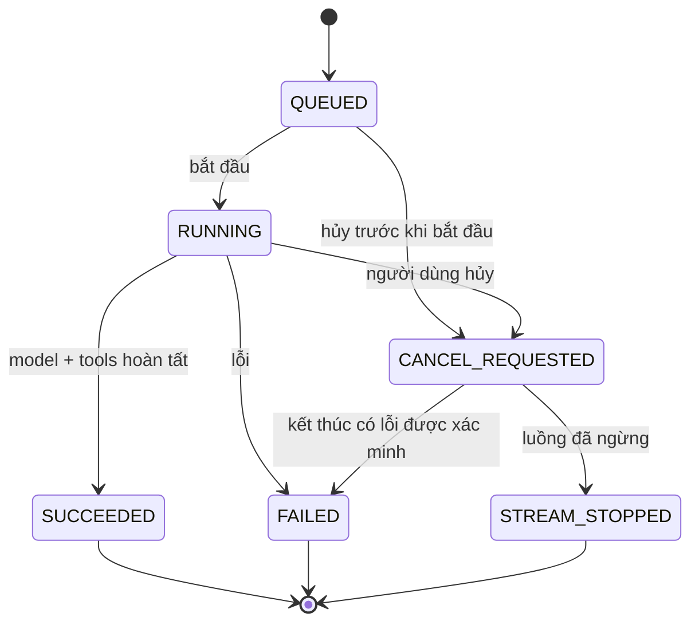

# Hiển thị tiến trình qua streaming và xử lý việc hủy yêu cầu

Một trợ lý nghiệp vụ dùng Spring AI Tool Calling có thể mất vài giây đến hàng chục giây để chọn công cụ, truy vấn hệ thống ngoài rồi tổng hợp câu trả lời. Nếu giao diện chỉ hiển thị vòng quay chờ, người dùng không biết ứng dụng còn làm việc hay đã treo. Ngược lại, khi người dùng nhấn **Dừng**, việc đóng cửa sổ hoặc ngắt luồng hiển thị **không đồng nghĩa** các callback, HTTP requests hay thao tác nghiệp vụ đã dừng.

Bài thực hành tổng hợp này xây một luồng hỗ trợ tra cứu đơn hàng với **streaming tiến trình**, **nội dung câu trả lời hiển thị dần**, **nút hủy** và **quản lý vòng đời của một lần chạy**. Mô hình chỉ quyết định gọi `@Tool` hoặc `ToolCallback`; ứng dụng chịu trách nhiệm thực thi công cụ, bảo vệ `ToolContext`, kiểm tra quyền, đặt deadline, ghi sự kiện tiến trình và quyết định thế nào là “đã hủy”.

Các ví dụ hướng đến Spring AI **2.1.0**, Spring WebFlux/Reactor và Java 21. Đây là một capstone theo các khối có thể ghép thành ứng dụng thật; những interface `ActorResolver`, `OrderQueryService` và `RunRegistry` là thành phần nghiệp vụ cần tự triển khai. Trọng tâm của bài là **hợp đồng thực thi và hủy đúng**, không phải tạo một demo chỉ có chữ chạy trên màn hình.

## 1. Kết quả thực hành cần đạt

Người dùng hỏi: “Cho tôi biết đơn ORD-42 đang ở trạng thái nào”. UI phải thấy tiến trình ở các mốc có ý nghĩa:

```text
[10:00:01] STARTED          Đã tiếp nhận yêu cầu
[10:00:02] TOOL_STARTED     Đang tra cứu đơn hàng
[10:00:03] TOOL_COMPLETED   Đã nhận dữ liệu đơn hàng
[10:00:04] ANSWER_DELTA     Đơn ORD-42 đang...
[10:00:04] ANSWER_DELTA     ... được vận chuyển.
[10:00:04] COMPLETED       Đã hoàn tất
```

Nếu người dùng nhấn **Dừng** trong lúc chờ, UI phải ngừng cập nhật nội dung và server nhận tín hiệu yêu cầu hủy. Một request hủy đã được chấp nhận **chưa đủ để kết luận mọi công việc phía server đã dừng hoặc được hoàn tác**.

Tiêu chí nghiệm thu:

| Hạng mục | Điều kiện PASS |
| --- | --- |
| Hiển thị streaming | Có sự kiện bắt đầu, các bước nghiệp vụ, text deltas và một kết thúc được phân loại |
| Danh tính mỗi lần chạy | Có `runId` do server cấp, không dùng ID mô hình tự tạo |
| Hủy từ giao diện | Có cơ chế hủy subscription và endpoint báo cancel theo `runId` |
| Quyền | Người dùng không thể hủy run của người/tenant khác |
| Tool | Kiểm tra cờ hủy trước và sau khi gọi service |
| Kết quả | Sau khi hủy không hiển thị nhầm là hoàn thành thành công |
| Lỗi | Timeout/denied/provider error được chuẩn hóa; không lộ raw arguments, token hay stack trace |
| Tài nguyên | Không giữ vô hạn connection, registry entry, thread hoặc SSE buffer |
| Kiểm thử | Có kiểm thử race cancel–complete, mất kết nối, tool chậm và authorization |

Để giảm rủi ro, bài dùng **công cụ chỉ đọc**. Không minh họa việc hủy một thanh toán, gửi email hoặc xóa dữ liệu bằng cách giả định reactive cancellation sẽ rollback giao dịch.

## 2. Phân biệt streaming văn bản, streaming tool call và tiến trình nghiệp vụ

Spring AI có các luồng quan sát khác nhau:

| Luồng | Nguồn | Có thể dùng để hiển thị |
| --- | --- | --- |
| Văn bản câu trả lời | `chatClient.prompt().stream().content()` | Những đoạn text hiển thị cho người dùng |
| Đầy đủ model chunks | `.stream().chatResponse()` | Metadata và message parts khi cần |
| Partial tool-call deltas | `ToolCallPart` được đánh dấu partial ở model response | Tín hiệu model đang *soạn* lời gọi công cụ; không phải execution |
| Công cụ bắt đầu/kết thúc | Ứng dụng phát từ callback/service | Tiến trình nghiệp vụ đã được xác nhận |
| HTTP/DB progress | Adapter nghiệp vụ có instrumentation | Chỉ phát những mốc có ý nghĩa và không nhạy cảm |

Trong Spring AI 2.1.0, một `ToolCallPart` partial chỉ chứa một phần arguments mà mô hình đang sinh; `AssistantMessage.hasToolCalls()` và `getToolCalls()` **không** xem partial là tool call hoàn chỉnh. `ToolCallingManager` không được thực thi một lời gọi chỉ vì có partial delta. Một số provider không gửi partials hoặc gửi khác nhau, nên UI **không được phụ thuộc** vào chúng để biết callback đã chạy.

Quan trọng: `.stream().content()` chỉ cung cấp text deltas, không kèm mọi sự kiện `TOOL_STARTED` hoặc `TOOL_COMPLETED`. Nếu muốn tiến trình nghiệp vụ, ứng dụng phải phát nó riêng từ callback, advisor hoặc service; không tự suy ra “đang tra cứu” chỉ vì model trả một mảnh tên tool.

## 3. Kiến trúc triển khai

```mermaid
flowchart TD
    U[UI: gửi câu hỏi] --> P[POST /assistant/stream]
    P --> R[RunRegistry: runId + actor + tenant]
    R --> X[Flux SSE: STARTED + tiến trình + answer chunks]
    P --> C[ChatClient.stream]
    C --> M[ToolCallingAdvisor: model rounds]
    M --> T[@Tool: lookup_order]
    T --> A[Authorization + cancellation token]
    A --> G[Order service / HTTP API]
    G --> T
    T --> E[ProgressReporter: TOOL_COMPLETED]
    E --> X
    M --> X
    X --> UI[UI: hiển thị tiến trình/text]

    UI -->|Nút Dừng| STOP[POST /assistant/runs/id/cancel]
    STOP --> R
    R --> Z[CancellationToken + Disposable]
    Z --> C
    Z --> T
```

Các thành phần giữ trách nhiệm riêng:

- **Controller:** xác thực người dùng, nhận câu hỏi, trả SSE và endpoint cancel.
- **RunRegistry:** ánh xạ `runId` đến actor/tenant, trạng thái, token và subscription; kiểm soát tuổi thọ.
- **CancellationToken:** tín hiệu hủy hợp tác cho callback và service.
- **ProgressReporter:** xuất mốc tiến trình an toàn; không xuất raw arguments hoặc kết quả nhạy cảm.
- **ChatClient:** stream text và quản lý tool loop thông qua `ToolCallingAdvisor`.
- **Domain service:** kiểm tra quyền với tài nguyên và tuân thủ deadline/timeout.

Mỗi run có state riêng. Không đặt `currentRun` hoặc `currentCancellationToken` trong singleton `@Tool` bean vì nhiều user có thể gọi cùng lúc.

## 4. Chọn giao thức: SSE và một endpoint cancel

Spring WebFlux có thể trả `Flux<ServerSentEvent<T>>` qua response `text/event-stream`. SSE phù hợp với luồng **server → client** gồm text và trạng thái ngắn. Nút hủy là hành động **client → server**, do đó dùng thêm HTTP POST.

Thiết kế endpoint:

| Endpoint | Method | Mục đích |
| --- | --- | --- |
| `/api/assistant/stream` | POST | Gửi question trong body, nhận SSE |
| `/api/assistant/runs/{runId}/cancel` | POST | Yêu cầu hủy run thuộc người dùng hiện tại |
| `/api/assistant/runs/{runId}` | GET, tùy chọn | Xem state cuối nếu kết nối SSE đã đóng |

Không đặt nội dung câu hỏi, access token hoặc dữ liệu nhạy cảm vào URL query string để tránh xuất hiện trong proxy logs, browser history và metrics. `EventSource` native chỉ thuận tiện cho HTTP GET; nếu muốn POST kèm JSON body, dùng `fetch` với SSE parser hoặc thư viện phù hợp.

### Một sự kiện SSE có cấu trúc

```json
{
  "runId": "53fd6c0b-2baf-4c03-a983-5bd22a253bc3",
  "type": "TOOL_STARTED",
  "message": "Đang tra cứu đơn hàng"
}
```

Nên giới hạn tập `type`:

| Event type | Khi phát | Dữ liệu hiển thị |
| --- | --- | --- |
| `STARTED` | Server đăng ký run, chuẩn bị model call | Run ID và mô tả chung |
| `TOOL_STARTED` | Callback thật bắt đầu và chuẩn bị truy vấn | Tên tác vụ đã kiểm soát |
| `TOOL_COMPLETED` | Callback nhận/validate kết quả | “Đã nhận dữ liệu” |
| `ANSWER_DELTA` | Có text chunk từ model | Text hợp lệ cho người dùng |
| `COMPLETED` | Toàn bộ run thực sự hoàn tất và được chấp nhận | Không kèm raw tool result |
| `CANCEL_REQUESTED` | Server tiếp nhận yêu cầu dừng | Đây chưa phải bằng chứng downstream dừng |
| `STREAM_STOPPED` | Reactive output đã dừng | Không hàm ý side effect được rollback |
| `ERROR` | Lỗi an toàn, đã được phân loại | Mã lỗi, thông báo ngắn |

Không đặt một biến `percentComplete` tùy ý (ví dụ 80%) nếu không biết thực sự đã hoàn tất bao nhiêu việc. Với model/provider không cung cấp tiến độ đo được, **hiển thị từng giai đoạn** trung thực hơn một thanh tiến độ phần trăm giả.

## 5. Khởi tạo model và tool loop

Spring AI 2.1.0 tự đăng ký `ToolCallingAdvisor` với `ChatClient` theo cấu hình thông thường. Advisor này hỗ trợ cả `call()` và `stream()`, thực thi tool qua `ToolCallingManager` rồi gửi tool result về model cho vòng tiếp theo.

Ví dụ cấu hình:

```java
@Configuration(proxyBeanMethods = false)
class AssistantConfiguration {

    @Bean
    ChatClient assistantChatClient(ChatModel chatModel) {
        return ChatClient.builder(chatModel).build();
    }
}
```

Không thêm một `ToolCallingAdvisor` thứ hai chỉ để “có streaming”; cấu hình bình thường đã có tool loop. Nếu cần quan sát model/tool-call chunks **bên trong** loop, có thể thêm một `StreamAdvisor` thông thường có order lớn hơn `ToolCallingAdvisor.DEFAULT_ORDER` (mặc định `Ordered.HIGHEST_PRECEDENCE + 300`). Ví dụ `+400` nhìn thấy từng vòng nhưng **không** được biến thành `ToolAdvisor` thứ hai.

Khi streaming, đừng gọi `block()` trên Netty event-loop để chờ model hoặc service. Tool execution qua Spring AI vẫn có thể dùng callback imperative/blocking; bố trí những thao tác có thể block trên scheduler phù hợp và sử dụng timeout/deadline.

## 6. DTO cho request và các event

```java
public record AskRequest(String question) {
}

public record RunEvent(
        UUID runId,
        String type,
        String message) {
}

public record CancelReceipt(
        UUID runId,
        String status) {
}

public record Actor(
        UUID actorId,
        UUID tenantId) {
}
```

Đây là hợp đồng ứng dụng tự định nghĩa. Giới hạn kích thước `question` tại controller/service (ví dụ số ký tự và token) trước khi cấp phát run. Server phải xác định `Actor` từ principal đã xác thực; không cho request body chứa `actorId`, `tenantId` hoặc `userConfirmed=true`.

Event `ANSWER_DELTA` có thể chứa text thực sự trả cho người dùng; khác với logs/metrics, SSE gửi nội dung cho caller đã xác thực. Cần áp dụng cùng chính sách dữ liệu/authorization như response thông thường.

## 7. Trạng thái run và ý nghĩa của “hủy”

Chọn state machine không đánh đồng ngắt luồng với rollback:



Các trạng thái:

- `QUEUED`: run được tạo nhưng chưa bắt đầu.
- `RUNNING`: model/tool loop đang hoạt động.
- `CANCEL_REQUESTED`: server nhận tín hiệu hủy, đang yêu cầu dừng.
- `STREAM_STOPPED`: subscription đã dừng; **có thể còn callback blocking hoặc API bên ngoài chưa phản hồi**.
- `SUCCEEDED`: có kết quả hoàn chỉnh và không bị hủy trước điểm kết thúc.
- `FAILED`: lỗi kỹ thuật/nghiệp vụ đã phân loại.

Nếu ứng dụng thực hiện side effect, cần trạng thái riêng như `OUTCOME_UNKNOWN` khi bị hủy/timeout sau lúc request ghi đã gửi đi. Không tự báo `CANCELLED_AND_ROLLED_BACK` nếu không có bằng chứng giao dịch đã hoàn tác.

Quy tắc tranh chấp: nếu `SUCCEEDED` được chốt trước request cancel, cancel trả `ALREADY_FINISHED`; nếu cancel thắng race, callback không được ghi đè thành `SUCCEEDED` chỉ vì vừa trả result.

## 8. CancellationToken hợp tác

Một token đơn giản:

```java
public final class CancellationToken {

    private final AtomicBoolean cancelled = new AtomicBoolean(false);

    public void requestCancel() {
        cancelled.set(true);
    }

    public boolean isCancelled() {
        return cancelled.get();
    }

    public void checkNotCancelled() {
        if (cancelled.get()) {
            throw new CancellationException("Run cancellation requested");
        }
    }
}
```

Token chỉ cho code của ứng dụng biết phải dừng ở **điểm an toàn**. Nó không tự gửi interrupt đến mọi thread, không tự đóng JDBC connection hoặc HTTP call đang chạy và không hoàn tác side effect.

Đặt `checkNotCancelled()`:

1. Trước khi gọi model/downstream.
2. Trước khi truy vấn hoặc thay đổi tài nguyên.
3. Sau khi một HTTP/DB call trở về và trước khi dùng kết quả.
4. Trước khi ghi output vào session/memory hoặc phát thành công.
5. Trong vòng lặp xử lý nhiều item, theo chu kỳ hợp lý.

Không dùng busy-spin hoặc polling liên tục; điểm kiểm tra nên gần những ranh giới công việc có ý nghĩa.

## 9. RunHandle giữ state, token và subscription theo từng run

Đây là khung state machine có xử lý race cancel–complete bằng CAS. Registry không dùng run ID như bằng chứng người dùng có quyền; quyền được kiểm tra tại phương thức cancel.

```java
public enum RunState {
    QUEUED,
    RUNNING,
    CANCEL_REQUESTED,
    STREAM_STOPPED,
    SUCCEEDED,
    FAILED
}

public final class RunHandle {

    private final UUID id = UUID.randomUUID();
    private final Actor owner;
    private final CancellationToken token = new CancellationToken();
    private final AtomicReference<RunState> state =
            new AtomicReference<>(RunState.QUEUED);
    private final AtomicReference<Disposable> subscription =
            new AtomicReference<>();

    public RunHandle(Actor owner) {
        this.owner = owner;
    }

    public UUID id() {
        return id;
    }

    public Actor owner() {
        return owner;
    }

    public CancellationToken token() {
        return token;
    }

    public RunState state() {
        return state.get();
    }

    public boolean start() {
        return state.compareAndSet(RunState.QUEUED, RunState.RUNNING);
    }

    public boolean complete() {
        return state.compareAndSet(RunState.RUNNING, RunState.SUCCEEDED);
    }

    public boolean fail() {
        return state.compareAndSet(RunState.RUNNING, RunState.FAILED);
    }

    public void markStreamStopped() {
        state.compareAndSet(
                RunState.CANCEL_REQUESTED, RunState.STREAM_STOPPED);
    }

    public RunState requestCancel() {
        for (;;) {
            RunState previous = state.get();

            if (previous == RunState.SUCCEEDED
                    || previous == RunState.FAILED
                    || previous == RunState.STREAM_STOPPED
                    || previous == RunState.CANCEL_REQUESTED) {
                return previous;
            }

            if (state.compareAndSet(
                    previous, RunState.CANCEL_REQUESTED)) {

                token.requestCancel();

                Disposable upstream = subscription.get();
                if (upstream != null) {
                    upstream.dispose();
                }
                return RunState.CANCEL_REQUESTED;
            }
        }
    }

    public void attachSubscription(Disposable upstream) {
        if (!subscription.compareAndSet(null, upstream)) {
            upstream.dispose();
            throw new IllegalStateException("Subscription already attached");
        }

        // Cancel có thể đến trước khi subscribe() trả về Disposable.
        if (token.isCancelled()) {
            upstream.dispose();
        }
    }
}
```

Các trạng thái cuối là trạng thái của **run/stream**, không phải bảo đảm về kết quả các side effects bên ngoài. `AtomicReference` giúp không có kết quả giả `SUCCEEDED` sau khi `CANCEL_REQUESTED` đã được ghi, nhưng vẫn cần xác minh kết quả thực tế từ hệ thống ngoài nếu từng gửi tác vụ ghi.

Registry nên dùng `ConcurrentHashMap<UUID, RunHandle>` hoặc lưu trữ tương đương; mỗi request chỉ có một handle. Trong production, registry phải có **TTL, giới hạn active runs per user, dọn subscription và chính sách chống chạy song song cùng session**. Nếu triển khai đa instance, in-memory map chỉ thấy run trong một instance: cần routing sticky session hoặc điều phối cancel qua distributed store/message bus.

## 10. ToolContext chuyển run handle từ server đến callback

Không truyền cancellation token, actor hoặc tenant từ model arguments. `ToolContext` là ngữ cảnh do ứng dụng gắn vào request và không xuất vào JSON Schema cho mô hình.

```java
public interface ProgressReporter {
    void publish(String eventType, String safeMessage);
}

public final class RunContextKeys {
    public static final String RUN = "runHandle";
    public static final String REPORTER = "progressReporter";

    private RunContextKeys() {}
}
```

Khi bắt đầu model stream:

```java
chatClient.prompt()
        .user(question)
        .tools(orderTools)
        .toolContext(Map.of(
                RunContextKeys.RUN, runHandle,
                RunContextKeys.REPORTER, reporter))
        .stream()
        .content();
```

Không log toàn bộ `ToolContext`. Handle có thể chứa state, actor ID hoặc references nội bộ; reporter có thể giữ đối tượng SSE output. Các object này là implementation detail, không dành cho model hoặc logs.

## 11. Công cụ @Tool phát sự kiện ở ranh giới nghiệp vụ

Tool chỉ đọc đơn hàng:

```java
@Component
public class OrderTools {

    private final OrderQueryService queryService;
    private final OrderAccessPolicy accessPolicy;

    public OrderTools(
            OrderQueryService queryService,
            OrderAccessPolicy accessPolicy) {
        this.queryService = queryService;
        this.accessPolicy = accessPolicy;
    }

    @Tool(
        name = "lookup_order",
        description = "Tra cứu trạng thái một đơn hàng theo mã. "
                + "Chỉ đọc và không sửa dữ liệu."
    )
    public OrderSummary lookupOrder(
            @ToolParam(description = "Mã đơn hàng đã được người dùng cung cấp")
            String orderId,
            ToolContext toolContext) {

        RunHandle run = (RunHandle) toolContext.getContext()
                .get(RunContextKeys.RUN);

        ProgressReporter reporter = (ProgressReporter) toolContext
                .getContext().get(RunContextKeys.REPORTER);

        if (run == null || reporter == null) {
            throw new IllegalStateException("Missing trusted tool context");
        }

        run.token().checkNotCancelled();

        // Kiểm tra quyền trước khi đọc order hoặc gọi API ngoài.
        accessPolicy.requireCanReadOrder(run.owner(), orderId);
        run.token().checkNotCancelled();

        reporter.publish("TOOL_STARTED", "Đang tra cứu đơn hàng");

        try {
            OrderSummary summary = queryService.findSummary(
                    run.owner().tenantId(), orderId);

            run.token().checkNotCancelled();
            reporter.publish("TOOL_COMPLETED", "Đã nhận dữ liệu đơn hàng");
            return summary;
        }
        catch (CancellationException cancelled) {
            // Không biến cancellation thành kết quả thành công.
            throw cancelled;
        }
        catch (RuntimeException failure) {
            reporter.publish("TOOL_FAILED", "Không tra cứu được đơn hàng");
            throw failure;
        }
    }
}
```

`OrderSummary` là DTO tối thiểu do service tạo. Tool không gửi `orderId`, email, raw SQL, raw HTTP body hoặc access token trong event tiến trình. Error message cho SSE và model phải được chuẩn hóa ở lớp service; `TOOL_FAILED` không tự động thay thế cơ chế xử lý exception của Spring AI.

Nếu `queryService.findSummary(...)` là lời gọi **blocking**, cờ hủy chỉ được kiểm tra trước và sau lời gọi. Để giảm thời gian chờ dừng, adapter cần timeout và tốt nhất hỗ trợ cancellation ở API client tương ứng. Tuy nhiên, dù đã dispose reactive subscription, lời gọi blocking đang ở giữa công việc vẫn có thể tiếp tục.

## 12. Tạo SSE và đưa event từ callback vào cùng một luồng

Một cách dựng bài thực hành là dùng `Flux.create(...)` làm cầu nối cho **sự kiện callback + text deltas**. Nó cho phép bên phát sự kiện bất đồng bộ gọi `FluxSink.next(...)`, và WebFlux trả từng event đến client.

Ví dụ khung service (phụ thuộc vào `RunRegistry` và `SafeErrorClassifier` do ứng dụng định nghĩa):

```java
@Service
public class AssistantRunService {

    private final ChatClient chatClient;
    private final OrderTools orderTools;
    private final RunRegistry registry;
    private final SafeErrorClassifier errorClassifier;

    public AssistantRunService(
            ChatClient chatClient,
            OrderTools orderTools,
            RunRegistry registry,
            SafeErrorClassifier errorClassifier) {
        this.chatClient = chatClient;
        this.orderTools = orderTools;
        this.registry = registry;
        this.errorClassifier = errorClassifier;
    }

    public Flux<RunEvent> stream(Actor actor, String question) {

        return Flux.create(sink -> {
            RunHandle run = registry.create(actor);

            // Khi caller disconnect/error: yêu cầu dừng nếu chưa terminal.
            sink.onDispose(run::requestCancel);

            if (!run.start()) {
                sink.complete();
                return;
            }

            sink.next(event(run, "STARTED", "Đã tiếp nhận yêu cầu"));

            ProgressReporter reporter = (type, message) -> {
                if (!run.token().isCancelled() && !sink.isCancelled()) {
                    sink.next(event(run, type, message));
                }
            };

            Disposable upstream = chatClient.prompt()
                    .user(question)
                    .tools(orderTools)
                    .toolContext(Map.of(
                            RunContextKeys.RUN, run,
                            RunContextKeys.REPORTER, reporter))
                    .stream()
                    .content()
                    .subscribeOn(Schedulers.boundedElastic())
                    .doFinally(signal -> {
                        if (signal == SignalType.CANCEL) {
                            run.markStreamStopped();
                        }
                    })
                    .subscribe(
                            text -> {
                                if (!text.isBlank()
                                        && !run.token().isCancelled()
                                        && !sink.isCancelled()) {
                                    sink.next(event(
                                            run, "ANSWER_DELTA", text));
                                }
                            },
                            error -> {
                                if (run.token().isCancelled()) {
                                    run.markStreamStopped();
                                }
                                else if (run.fail()) {
                                    sink.next(event(
                                            run, "ERROR",
                                            errorClassifier.safeCode(error)));
                                }
                                sink.complete();
                            },
                            () -> {
                                if (run.complete()) {
                                    sink.next(event(
                                            run, "COMPLETED", "Đã hoàn tất"));
                                }
                                else {
                                    run.markStreamStopped();
                                }
                                sink.complete();
                            });

            run.attachSubscription(upstream);
        }, FluxSink.OverflowStrategy.ERROR);
    }

    private RunEvent event(
            RunHandle run, String type, String message) {

        return new RunEvent(run.id(), type, message);
    }

    public CancelReceipt cancel(UUID runId, Actor actor) {
        RunHandle run = registry.requireOwned(runId, actor);
        RunState state = run.requestCancel();
        return new CancelReceipt(runId, state.name());
    }
}
```

Lưu ý của khung minh họa:

- `Flux.create` là bridge giữa callback imperative và reactive stream; `FluxSink.OverflowStrategy.ERROR` được dùng để **fail** khi downstream không theo kịp, thay vì buffer vô hạn. Production cần thêm giới hạn tổng số event, kích thước text, active runs và monitoring overflow.
- `subscribeOn(Schedulers.boundedElastic())` giúp tránh thực hiện công việc có thể block trên Netty event-loop khi subscribe. Nó không làm mọi hoạt động trong callback tự nhiên trở thành non-blocking.
- `onDispose` cũng chạy khi stream hoàn tất/lỗi, không chỉ khi client ngắt. `RunHandle.requestCancel()` đã bảo vệ terminal states nên gọi lại trên `SUCCEEDED`/`FAILED` không làm chúng biến thành canceled.
- Event `COMPLETED` chỉ được phát sau khi `run.complete()` thắng race với cancel. Nếu cancel thắng, code không phát thành công giả.
- Model streaming, callback và HTTP client có semantics cancellation riêng. `upstream.dispose()` gửi tín hiệu cancel cho reactive chain; **không bảo đảm** mọi downstream blocking work đã dừng.
- Khi `FluxSink` đóng do overflow/error, cleanup phải chạy; ứng dụng cần lưu kết quả terminal và dọn registry theo TTL. Không xóa run ngay trước khi client có thể hỏi trạng thái cuối.
- Trong code production cần thiết kế **single terminal signal**, error classifier, limits và retry-safe publisher để không tạo run trùng khi HTTP client tự reconnect.

`RunRegistry.create` nên chặn tạo run nếu actor vượt hạn mức đồng thời. `requireOwned` phải kiểm tra actor và tenant được xác thực. `SafeErrorClassifier.safeCode` chỉ trả những mã hữu hạn như `UPSTREAM_TIMEOUT`, `TOOL_UNAVAILABLE` hoặc `INTERNAL_ERROR`; không gửi raw exception.

## 13. Controller WebFlux trả Server-Sent Events

```java
@RestController
@RequestMapping("/api/assistant")
public class AssistantController {

    private final AssistantRunService runs;
    private final ActorResolver actors;

    public AssistantController(
            AssistantRunService runs,
            ActorResolver actors) {
        this.runs = runs;
        this.actors = actors;
    }

    @PostMapping(
        path = "/stream",
        produces = MediaType.TEXT_EVENT_STREAM_VALUE
    )
    public Flux<ServerSentEvent<RunEvent>> stream(
            @RequestBody AskRequest request,
            Authentication authentication) {

        Actor actor = actors.requireAuthenticated(authentication);
        validateQuestion(request.question());

        return runs.stream(actor, request.question())
                .map(event -> ServerSentEvent.<RunEvent>builder(event)
                        .event(event.type())
                        .build());
    }

    @PostMapping(path = "/runs/{runId}/cancel")
    public CancelReceipt cancel(
            @PathVariable UUID runId,
            Authentication authentication) {

        Actor actor = actors.requireAuthenticated(authentication);
        return runs.cancel(runId, actor);
    }

    private void validateQuestion(String question) {
        if (question == null
                || question.isBlank()
                || question.length() > 4_000) {
            throw new ResponseStatusException(
                    HttpStatus.BAD_REQUEST, "Invalid question");
        }
    }
}
```

Với ứng dụng WebFlux thuần, `RunRegistry` và `cancel` phải thực hiện kiểm tra rất nhanh, không gọi JDBC/HTTP blocking trực tiếp trên event-loop. Nếu repository dùng JDBC hoặc secret service blocking, chuyển phần đó sang scheduler thích hợp. Spring WebFlux hỗ trợ reactive controller trả `Flux<ServerSentEvent<?>>` và gửi event dần.

Bảo đảm HTTPS, session/cookie authentication hoặc bearer authentication, CSRF protection phù hợp với loại client và origin policy của ứng dụng. Endpoint cancel phải idempotent: nhấn Dừng nhiều lần không tạo thêm tác dụng; với run không thuộc actor hiện tại trả 404/403 theo chính sách tránh tiết lộ ID tồn tại.

## 14. Phía client: đọc SSE từ POST và nút Dừng

Native `EventSource` dùng GET; ở đây dùng `fetch` POST và một SSE parser hỗ trợ stream. Ví dụ dùng thư viện `@microsoft/fetch-event-source` (cần cài qua npm trong dự án frontend; đây không phải dependency Spring AI):

```javascript
import { fetchEventSource } from "@microsoft/fetch-event-source";

let activeRunId = null;
let controller = null;

async function ask(question) {
  activeRunId = null;
  controller = new AbortController();

  await fetchEventSource("/api/assistant/stream", {
    method: "POST",
    headers: { "Content-Type": "application/json" },
    body: JSON.stringify({ question }),
    signal: controller.signal,

    async onopen(response) {
      if (!response.ok) {
        throw new Error("Could not open assistant stream");
      }
    },

    onmessage(message) {
      const event = JSON.parse(message.data);

      if (event.type === "STARTED") {
        activeRunId = event.runId;
        showStatus("Đã bắt đầu");
      }
      else if (event.type === "TOOL_STARTED") {
        showStatus(event.message);
      }
      else if (event.type === "TOOL_COMPLETED") {
        showStatus(event.message);
      }
      else if (event.type === "ANSWER_DELTA") {
        appendAnswerText(event.message);
      }
      else if (event.type === "COMPLETED") {
        showStatus("Hoàn tất");
      }
      else if (event.type === "ERROR") {
        showStatus("Không thể hoàn tất yêu cầu");
      }
    },

    onerror(error) {
      // Không tự reconnect/replay POST tạo run mới.
      throw error;
    }
  });
}

async function stop() {
  const runId = activeRunId;

  // Gửi yêu cầu hủy tới server nếu đã nhận runId.
  if (runId) {
    try {
      await fetch(
        "/api/assistant/runs/" + encodeURIComponent(runId) + "/cancel",
        { method: "POST" }
      );
    }
    catch (error) {
      // Server có thể chưa nhận cancel; transport abort vẫn có ích.
      showStatus("Đã ngắt hiển thị; trạng thái server chưa xác nhận");
    }
  }

  // Ngắt luồng ở browser và tránh nhận thêm text.
  if (controller) {
    controller.abort();
  }
}
```

Khi frontend dùng cookie-based auth, cấu hình CSRF token theo chính sách; với bearer token, không nhúng token vào event data hoặc logs. Thư viện SSE có thể tự reconnect khi gặp lỗi, nên cần vô hiệu replay không chủ ý đối với POST bắt đầu run; code trên `onerror` ném lỗi để dừng tự retry.

Trong UX thực tế, nút Stop nên ưu tiên ngắt ngay việc render và gửi cancel request bất đồng bộ. Nếu `cancel` endpoint phản hồi chậm, không bắt người dùng chờ nó để dừng UI; hiển thị trạng thái **“Đã yêu cầu dừng”** rồi truy vấn lại run status nếu cần. Đoạn mẫu trình bày hai hành động nối tiếp để dễ thấy trình tự, không buộc UX sản phẩm phải chờ cancel HTTP hoàn tất mới abort.

## 15. Hủy ở browser, ở Flux và trong callback khác nhau thế nào?

Ba lớp này có hợp đồng riêng:

| Tầng | Thao tác | Bảo đảm thực tế |
| --- | --- | --- |
| Browser | `AbortController.abort()` | Dừng client fetch/reader và không nhận thêm SSE từ request đó |
| Reactor subscription | `Disposable.dispose()` hoặc hủy downstream | Gửi tín hiệu cancellation trên publisher chain |
| Application callback | `CancellationToken.checkNotCancelled()` | Dừng hợp tác ở các điểm kiểm tra token |
| HTTP/DB adapter | Timeout hoặc cancel API client phù hợp | Cố gắng chấm dứt I/O nếu thư viện hỗ trợ |
| External service | API status/idempotency/compensation | Cần xác minh kết quả thật của tác vụ ngoài |

Không thể khẳng định `Flux.cancel()` lập tức interrupt mọi Java method đang chạy. Spring AI `ToolCallingManager` thực thi callback Java qua đường imperative; có thể có đoạn blocking không lắng nghe token. Nếu tool gửi lệnh ghi đã được đối tác chấp nhận, việc caller dừng stream không hoàn tác lệnh đó.

Trong capstone read-only, có thể hủy việc chờ rồi bỏ kết quả khi token đã canceled. Với tool ghi, cần **confirmation, idempotency key, kiểm tra transaction status và chính sách bồi hoàn**; nếu chưa biết kết quả, hiển thị “Không xác định trạng thái xử lý” thay vì “Đã hoàn tác”.

## 16. Reactor doFinally, doOnCancel và cleanup

Reactor cung cấp `doFinally(SignalType)` để ghi nhận stream kết thúc vì `ON_COMPLETE`, `ON_ERROR` hay `CANCEL`. Ví dụ:

```java
Flux<String> observed = chatClient.prompt()
        .user(question)
        .stream()
        .content()
        .doOnCancel(token::requestCancel)
        .doFinally(signal -> {
            if (signal == SignalType.CANCEL) {
                meterRegistry.counter(
                        "app.ai.stream.terminations",
                        "outcome", "cancelled"
                ).increment();
            }
        });
```

Chỉ dùng metric labels dạng enum có cardinality thấp. Không đặt `runId`, actor ID, tenant ID, prompt hoặc raw tool arguments làm metric tags.

`doFinally` không nên chứa mã blocking hoặc I/O dài; dùng nó để kích hoạt cleanup an toàn và ghi telemetry ngắn. Với tài nguyên quản lý theo subscription, Reactor có `Flux.using(...)`/`usingWhen(...)` để đảm bảo cleanup cả khi cancel.

Chú ý: một cancel từ endpoint có thể làm publisher upstream nhận `CANCEL`, trong khi SSE output phía client nhận sự kiện hoàn tất hoặc bị đóng ở tầng khác. Hãy ghi **cả lý do yêu cầu hủy ở registry** và **signal của pipeline**, không đoán trạng thái thực thi chỉ từ một signal.

## 17. Tiến trình “model chọn tool” và advisor quan sát vòng lặp

Nếu muốn hiển thị sớm hơn `TOOL_STARTED`, có thể thêm `StreamAdvisor` thông thường ở phía **trong** `ToolCallingAdvisor` với order `Ordered.HIGHEST_PRECEDENCE + 400`:

```java
public final class ToolPlanningObserver implements StreamAdvisor {

    private final ToolPlanAuditSink audit;

    public ToolPlanningObserver(ToolPlanAuditSink audit) {
        this.audit = audit;
    }

    @Override
    public String getName() {
        return "ToolPlanningObserver";
    }

    @Override
    public int getOrder() {
        return Ordered.HIGHEST_PRECEDENCE + 400;
    }

    @Override
    public Flux<ChatClientResponse> adviseStream(
            ChatClientRequest request,
            StreamAdvisorChain chain) {

        return chain.nextStream(request)
                .doOnNext(chunk -> audit.observeSafeParts(
                        request.context(), chunk));
    }
}
```

`ToolPlanAuditSink.observeSafeParts` là helper ứng dụng: chỉ đọc những message parts hoàn chỉnh/partial được framework cung cấp và chỉ phát tên tool đã qua allowlist, **không** chuyển raw `ToolCallPart.arguments` đến UI. Advisor này chỉ quan sát, không được implement marker `ToolAdvisor` thứ hai. Đăng ký nó cùng `ChatClient` để giữ loop chuẩn.

Đừng chuyển toàn bộ model chunks thành UI messages một cách mù quáng: có thể lộ reasoning parts, raw arguments hoặc nội dung chưa được xác minh. Progress “model đang soạn lời gọi tool” cũng **không đồng nghĩa callback đã thực thi**; phát `TOOL_STARTED` từ callback mới có ý nghĩa đó.

## 18. Backpressure và chống tràn bộ nhớ

SSE client có thể đọc chậm hoặc mất mạng, trong khi model và tool liên tục phát events. Nếu không giới hạn, buffer có thể tăng vô hạn.

Chính sách tối thiểu:

- Giới hạn kích thước text deltas/events, tổng số events và tổng số bytes một run.
- Chỉ cho số lượng run đồng thời phù hợp theo actor và hệ thống.
- Dùng buffer có giới hạn; khi vượt, lỗi có kiểm soát và yêu cầu dừng upstream.
- Không rơi mất các event terminal cần thiết mà vẫn giả định client nhận đủ.
- Không ghi raw tool result vào event queue để “đảm bảo debug”.
- Gộp các trạng thái lặp hoặc heartbeat không cần thiết.
- Đặt deadline cho model/tool/HTTP và tối đa số vòng tool calling.

`FluxSink.OverflowStrategy.ERROR` trong ví dụ ưu tiên kết thúc lỗi thay vì giữ bộ nhớ tăng không giới hạn. Với production có yêu cầu delivery bền vững, dùng hàng đợi bounded và store/replay có ACK/deduplication; **không** xem một SSE stream transient là message queue bền vững.

## 19. Hủy khi mất kết nối và khi người dùng bấm Stop

Chính sách cần được quyết định rõ:

**Phương án A — cancel-on-disconnect (bài này):** khi browser đóng stream, `FluxSink.onDispose` yêu cầu hủy. Phù hợp với tác vụ đọc nhanh, có thể bỏ dở.

**Phương án B — detached background job:** UI đóng stream nhưng job tiếp tục chạy trên server; người dùng có thể mở lại trang và theo dõi bằng run ID. Khi đó **không** được dùng `onDispose` để hủy job, phải có lifecycle/queue độc lập và endpoint `GET status/events` hỗ trợ replay/last event ID.

Hai phương án không nên trộn tùy tiện. Nếu người dùng nhấn Stop cho một background job, cancel endpoint cần kiểm tra owner/tenant và ra lệnh hủy; việc đóng SSE một mình chỉ ngắt người đăng ký.

Đối với bài này, mất kết nối được xem là yêu cầu hủy hiển thị và xử lý đọc còn lại, nhưng không bảo đảm hoàn tác bất kỳ thao tác nào đã được gửi ra ngoài.

## 20. Hủy trùng lặp và race condition

Các tình huống phải được kiểm thử:

| Tình huống | Quy tắc |
| --- | --- |
| Stop hai lần | Lần sau nhận trạng thái hiện tại, không tạo một hủy mới |
| Stop trước khi subscription được attach | Token đã canceled; `attachSubscription` dispose subscription mới |
| Stop cùng lúc model hoàn thành | CAS chỉ cho một bên thắng, không có cả COMPLETED lẫn canceled success |
| Stop sau `SUCCEEDED` | Trả `SUCCEEDED`/`ALREADY_FINISHED`; không đổi thành canceled |
| Tool gọi xong khi token canceled | Callback không trả result như thành công; không phát COMPLETED |
| Server error trùng lúc cancel | Chính sách state machine ưu tiên outcome đã chốt, không ghi chồng |
| Tool chậm nhưng không hợp tác | Ghi `CANCEL_REQUESTED/STREAM_STOPPED`, cảnh báo in-flight còn tồn tại |
| Client reconnect vô tình | Không tạo thêm run/side effects nếu không được yêu cầu |
| Nhiều UI tabs | Mỗi run có owner và lifecycle riêng; cancellation được kiểm tra |

Ngay cả với CAS, **thứ tự events nhận ở UI** có thể khác thứ tự tác vụ thực thi nếu nhiều producer phát đồng thời. Muốn ordering/replay chặt, dùng sequence ID do server cấp **tại điểm ghi sự kiện tuần tự** và bounded store. Không cho frontend suy luận status cuối từ timestamp hoặc một message text tự do.

## 21. Session Memory và yêu cầu hủy giữa tool call

Trong Spring AI 2.1.0, `ToolCallingAdvisor` tự giữ history cho các model rounds. Nếu dùng session memory, cần xem dữ liệu nào đã ghi trước khi stream bị hủy.

Một run có thể bị hủy sau khi model đã tạo tool call nhưng trước khi callback trả result. Nếu không quản lý, persisted history có thể chứa tool call **chưa được trả lời**, dẫn đến lỗi hoặc diễn giải nhầm ở turn sau.

Các nguyên tắc:

1. Không ghi `COMPLETED` vào session chỉ vì model đã bắt đầu stream.
2. Đánh dấu run bị hủy và lưu trạng thái audit riêng.
3. Không bịa `ToolResponseMessage` có kết quả thành công cho callback chưa chạy xong.
4. Nếu có unanswered tool call, xử lý theo cơ chế session/tool-loop đã được kiểm tra ở đúng phiên bản.
5. Không cho hai turn chạy song song trong cùng session nếu session store không hỗ trợ coordination.
6. Với side-effect tools, xác minh status thực ở service trước khi resume/retry sau cancel.

Spring AI 2.1 Session Memory có cơ chế xử lý open/unanswered tool calls khi mở turn mới, nhưng ứng dụng vẫn phải serialize calls theo session và không dùng nó làm bảo đảm rollback đối với công việc đã được gửi ra ngoài.

## 22. Quyền, privacy và prompt injection trong tiến trình

UI progress cũng là một kênh dữ liệu và cần bảo vệ:

- Không đưa raw `ToolContext`, credential, email, mã khách hàng hoặc full tool result vào `TOOL_STARTED`.
- Không tin tên event, nội dung message hoặc “phần trăm” do model hoặc API bên ngoài đề xuất.
- Chỉ dùng message tiến trình cố định do ứng dụng sở hữu; nếu hiển thị text ngoài, xử lý như dữ liệu không đáng tin.
- Không cho client truyền `tenantId` hoặc `actorId` trong cancel request để tự xác nhận quyền.
- Không cho frontend gửi tên tool tự do rồi yêu cầu server thực thi.
- Chống XSS: khi hiển thị `ANSWER_DELTA`, dùng text rendering hoặc sanitizer phù hợp, không nối raw HTML vào `innerHTML`.
- Bảo vệ SSE bằng HTTPS và authorization tương tự các API khác.
- Ghi metrics theo tool category/outcome, không dùng run ID hoặc order ID làm label.

Tool result có thể chứa prompt injection, nhưng nó không được trở thành lệnh điều khiển cancellation, tạo tool mới hoặc tăng quyền. Cả nút Stop lẫn tool authorization đều thuộc application policy, không do mô hình quyết định.

## 23. Quan sát latency và kết quả hủy

Theo dõi:

| Metric ứng dụng gợi ý | Ý nghĩa |
| --- | --- |
| `app.ai.run.started` | Số run bắt đầu theo category |
| `app.ai.run.completed` | Số run hoàn tất |
| `app.ai.run.cancel.requested` | Số yêu cầu hủy được chấp nhận |
| `app.ai.run.stream.stopped` | Số reactive streams đã dừng sau hủy |
| `app.ai.run.failed` | Số run lỗi |
| `app.ai.run.duration` | End-to-end time theo outcome |
| `app.ai.tool.duration` | Callback duration và loại công cụ |
| `app.ai.cancel.latency` | Từ cancel request đến khi stream dừng |
| `app.ai.run.active` | Số run còn hoạt động |
| `app.ai.sse.overflow` | Số lần client đọc chậm gây overflow |

Đây là metric names **do ứng dụng tự định nghĩa**, không phải Spring AI built-in. Spring AI có `spring.ai.chat.client`, `gen_ai.client.operation` và `spring.ai.tool` observations hữu ích để truy vết model rounds và tool execution.

Không dùng `runId`, `actorId`, prompt hoặc raw results làm metric labels. Trong audit có ACL, có thể giữ run ID và policy outcome để điều tra race. Một cancel được request nhưng pipeline còn đang thực thi nên xuất hiện trong **cả hai metric** `cancel.requested` và `active` cho đến khi có trạng thái terminal phù hợp.

## 24. Kiểm thử bằng Reactor StepVerifier

Không cần gọi model thật để kiểm thử hợp đồng cancellation của Reactor.

```java
@Test
void downstreamCancellationTriggersCleanup() {
    AtomicBoolean cancelled = new AtomicBoolean(false);

    Flux<String> stream = Flux.create(sink -> {
        sink.onCancel(() -> cancelled.set(true));
        sink.next("STARTED");
        // Chưa complete, đợi client cancel.
    });

    StepVerifier.create(stream)
            .expectNext("STARTED")
            .thenCancel()
            .verify();

    assertThat(cancelled).isTrue();
}
```

Test này xác minh **Reactor cancel signal**, chưa chứng minh HTTP request hay callback nghiệp vụ đã dừng. Vì thế cần integration test bổ sung.

Một test cho state machine:

```java
@Test
void completionCannotWinAfterCancellationWasAccepted() {
    Actor actor = new Actor(
            UUID.fromString("aaaaaaaa-aaaa-aaaa-aaaa-aaaaaaaaaaaa"),
            UUID.fromString("bbbbbbbb-bbbb-bbbb-bbbb-bbbbbbbbbbbb"));

    RunHandle run = new RunHandle(actor);

    assertThat(run.start()).isTrue();
    assertThat(run.requestCancel())
            .isEqualTo(RunState.CANCEL_REQUESTED);

    assertThat(run.complete()).isFalse();
    assertThat(run.state())
            .isEqualTo(RunState.CANCEL_REQUESTED);
}
```

Và test sau khi run hoàn tất:

```java
@Test
void cancellingFinishedRunDoesNotChangeSuccess() {
    RunHandle run = new RunHandle(testActor());

    assertThat(run.start()).isTrue();
    assertThat(run.complete()).isTrue();

    assertThat(run.requestCancel()).isEqualTo(RunState.SUCCEEDED);
    assertThat(run.state()).isEqualTo(RunState.SUCCEEDED);
}
```

`testActor()` là fixture test. Đối với `AssistantRunService`, dùng fake `ChatModel` và fake `OrderTools` (không có side effect) để tạo một pipeline có thể điều khiển bằng latch/scheduler, sau đó test hủy giữa các bước.

## 25. Ma trận integration test cho capstone

| Tình huống | Kỳ vọng |
| --- | --- |
| Model trả text, không gọi tool | `STARTED → ANSWER_DELTA → COMPLETED` |
| Model gọi một tool chỉ đọc | Có `TOOL_STARTED`, `TOOL_COMPLETED` rồi answer |
| Model gọi nhiều tools | Không nhầm run IDs và thứ tự sự kiện quan trọng |
| Model phát partial `ToolCallPart` | Không chạy callback khi arguments chưa hoàn chỉnh |
| User cancel ngay sau STARTED | Không phát success giả; token/Disposable nhận tín hiệu |
| User cancel khi HTTP đang chờ | Stream dừng; downstream hợp tác/timeout; không báo rollback |
| User cancel sau completed | Nhận kết quả “đã xong”; không thay state |
| User nhấn Stop hai lần | Idempotent, không có lỗi phụ |
| User tenant B cancel run tenant A | Bị từ chối, run A không thay đổi |
| Browser disconnect đột ngột | `onDispose` kích hoạt cancel-on-disconnect |
| SSE client đọc chậm | Có giới hạn buffer; không OOM |
| Provider timeout hoặc 429 | `ERROR` với mã an toàn, không lộ raw body |
| Tool trả thông tin nhạy cảm | Progress không chứa PII/token |
| Prompt injection trong tool result | Không đổi quyền, không tự sinh event/control giả |
| Duplicate POST do reconnect | Không tự lặp thao tác |
| Hai run đồng thời | Không trộn token/progress giữa người dùng |
| Session có unanswered tool calls | Turn sau không dùng dữ liệu giả hoặc state không nhất quán |

Các test mất kết nối nên sử dụng `WebTestClient`/test HTTP server để thật sự mở SSE, nhận STARTED, ngắt client và xác minh registry. Test callback blocking dùng latch và timeout có kiểm soát; không dùng sleep dài làm phép kiểm tra duy nhất.

## 26. Bài tập triển khai từng bước

1. Tạo `ChatClient` với tool calling chuẩn và một `@Tool` chỉ đọc đơn hàng.
2. Viết `AskRequest`, `RunEvent`, `CancelReceipt`; chỉ phát `STARTED`, `ANSWER_DELTA` và `COMPLETED` trước.
3. Dựng endpoint POST SSE và dùng fetch-based SSE parser trên UI.
4. Bổ sung `CancellationToken` và state machine có CAS.
5. Tạo registry với ownership/tenant check và endpoint cancel.
6. Truyền `RunHandle` và `ProgressReporter` vào `ToolContext`.
7. Phát `TOOL_STARTED`/`TOOL_COMPLETED` từ callback đã xác thực và validate dữ liệu.
8. Hủy reactive subscription bằng `Disposable` và check token trước/sau service.
9. Chuẩn hóa `ERROR`, timeout và loại trừ việc phát `COMPLETED` khi cancel thắng.
10. Giới hạn buffering, run lifetime, active requests và event size.
11. Thêm metrics/tracing và audit an toàn.
12. Chạy ma trận test, sửa race và chỉ triển khai production sau khi đạt chất lượng/bảo mật.

### Tình huống mở rộng

- Thêm một tool `get_shipping_status` để thử hai callback độc lập.
- Thêm `ToolPlanningObserver` bên trong loop để hiển thị “model đang chuẩn bị tra cứu” nhưng không lộ arguments.
- Thêm status endpoint để UI xác minh server state sau khi đã abort.
- Thử detached background job và giải thích vì sao `onDispose` không được hủy job trong chế độ này.
- Với tool có side effect, thiết kế confirmation/idempotency và trạng thái `OUTCOME_UNKNOWN` thay vì coi cancel là rollback.

## 27. Checklist nghiệm thu cuối

- [ ] Giao thức SSE có event type ổn định và phân biệt STARTED/TOOL/ANSWER/ERROR/COMPLETED.
- [ ] Mỗi run có ID do server cấp; cancel endpoint kiểm tra actor và tenant.
- [ ] UI không hiển thị raw tool-call arguments hoặc result nhạy cảm như progress.
- [ ] `.stream().content()` dùng cho text; progress nghiệp vụ được phát riêng.
- [ ] Partial tool-call delta không bị thực thi hay coi là callback đã chạy.
- [ ] Token hủy là per-run, không nằm trong singleton shared mutable state.
- [ ] `Disposable.dispose()` và `onDispose` được nối tới cancel-on-disconnect đúng cách.
- [ ] Callback kiểm tra token trước và sau service; HTTP/DB có timeout độc lập.
- [ ] Race cancel–complete không tạo hai terminal outcomes.
- [ ] Stop sau completed và Stop lặp lại đều idempotent.
- [ ] Hủy stream không bị mô tả thành hoàn tác side effect.
- [ ] SSE có giới hạn backpressure, thời gian và tài nguyên.
- [ ] Session/memory không lưu tool result thành công giả khi run bị hủy.
- [ ] Đã test lỗi provider, tenant isolation, prompt injection và không rò dữ liệu.
- [ ] Có metrics latency, cancel requested, stream stopped và active runs.
- [ ] Có kế hoạch cleanup TTL, multi-instance routing và restart behavior.

## Những điểm cần nhớ

- **Streaming câu trả lời** và **streaming tiến trình công cụ** là hai nguồn event khác nhau.
- `ChatClient.stream().content()` trả text deltas; `ToolCallingAdvisor` xử lý tool loop, còn callback/service phải phát mốc tiến trình nghiệp vụ.
- Partial `ToolCallPart` trong Spring AI 2.1.0 không phải tool call hoàn chỉnh và không được thực thi.
- Nút Dừng phải quản lý cả **client subscription** lẫn **server-owned run/cancellation token**.
- `Flux cancel`/`Disposable.dispose()` không đồng nghĩa Java callback blocking đã dừng hoặc thao tác ngoài đã rollback.
- Dùng CAS/state machine để tránh `COMPLETED` sau khi cancel được chấp nhận.
- Quyền hủy phải dựa trên principal/tenant, không dựa vào việc client biết run ID.
- Tiến trình không được lộ arguments, `ToolContext` hoặc raw kết quả API; log/metrics cũng cần che dữ liệu.
- Một SSE stream transient không phải một background-job queue có khả năng resume; muốn chạy nền cần thiết kế tách biệt.
- Test race, disconnect, timeout và authorization quan trọng ngang với việc nhìn thấy text streaming trên UI.

## Tài liệu tham khảo

- [Spring AI 2.1.0 — Tool Calling và streaming tool-call arguments](https://docs.spring.io/spring-ai/reference/api/tools.html)
- [Spring AI 2.1.0 — ToolCallingAdvisor và observing tool loop](https://docs.spring.io/spring-ai/reference/api/tools/tool-calling-advisor.html)
- [Spring AI 2.1.0 — ChatClient streaming API](https://docs.spring.io/spring-ai/reference/api/chatclient.html)
- [Spring AI 2.1.0 — Session Memory/ChatClient integration](https://docs.spring.io/spring-ai/reference/api/session/chat-client.html)
- [Spring WebFlux — Controller return types/SSE](https://docs.spring.io/spring-framework/reference/web/webflux/controller/ann-methods/return-types.html)
- [Project Reactor — doFinally, cancellation và resource cleanup](https://projectreactor.io/docs/core/release/reference/coreFeatures/error-handling.html)
- [Project Reactor — Reference Guide](https://projectreactor.io/docs/core/release/reference/)
- [Spring AI 2.1.0 — Observability](https://docs.spring.io/spring-ai/reference/observability/index.html)

Bài thực hành sử dụng các API Spring AI 2.1.0 và Reactor/WebFlux phổ biến; các class `RunHandle`, `RunRegistry`, `ActorResolver`, `ProgressReporter` và `SafeErrorClassifier` là thiết kế ứng dụng minh họa. Khi triển khai thực tế, cần kiểm tra dependency versions, cơ chế threads/providers, bảo mật authentication/session và khả năng cancel của downstream client. **Không được khẳng định thao tác bên ngoài đã dừng hoặc được hoàn tác chỉ vì người dùng đã ngắt stream.**
