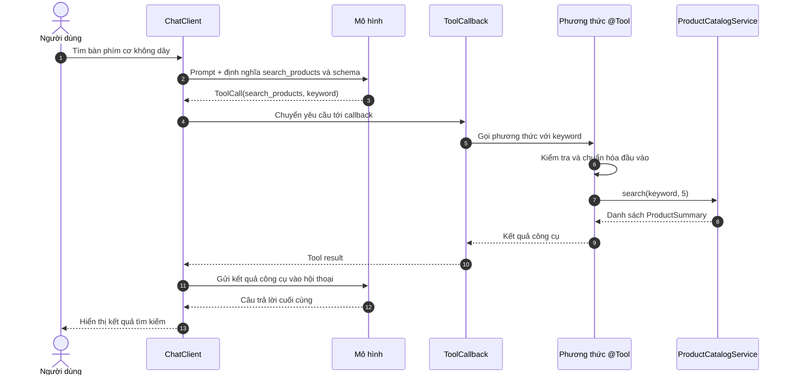

# Khai báo phương thức bằng @Tool

Trong Spring AI, cách trực tiếp để tạo một công cụ cho mô hình ngôn ngữ là đánh dấu một phương thức Java bằng annotation `@Tool`. Annotation giúp Spring AI mô tả phương thức thành một công cụ có tên, mô tả và schema đầu vào. Khi mô hình chọn công cụ đó và sinh đối số, Spring AI chuyển yêu cầu tới phương thức Java đã đăng ký để ứng dụng thực thi.

Mô hình chỉ đề xuất công cụ cùng các đối số. Phương thức Java mới là nơi gọi service, đọc dữ liệu hoặc thực hiện hành động. Vì vậy, khi tạo công cụ đầu tiên, hãy chọn một thao tác nghiệp vụ nhỏ, dễ kiểm tra và ít tác động phụ, chẳng hạn tìm kiếm sản phẩm hoặc tra cứu trạng thái đơn hàng.

Sau bài học, bạn có thể:

- Viết một phương thức Java có `@Tool` và mô tả rõ chức năng của nó.
- Dùng `@ToolParam` để giải thích tham số và hình thành schema đầu vào.
- Đăng ký đối tượng công cụ với `ChatClient` hoặc chuyển nó thành `ToolCallback`.
- Giải thích cách Spring AI thực thi phương thức và gửi kết quả về mô hình.
- Truyền dữ liệu ứng dụng qua `ToolContext`, đồng thời giữ xác thực và phân quyền ở phía máy chủ.

## 1. `@Tool` biến phương thức Java thành một công cụ có thể được lựa chọn

Một phương thức Java thông thường chỉ được gọi khi mã ứng dụng gọi nó. Khi phương thức được đánh dấu `@Tool` và được đăng ký vào một lượt hội thoại, Spring AI có thể cung cấp định nghĩa của phương thức cho mô hình. Định nghĩa này cho mô hình biết:

- **Tên công cụ:** định danh ổn định mà mô hình có thể yêu cầu.
- **Mô tả công cụ:** giải thích công cụ làm gì, khi nào nên dùng và giới hạn của nó.
- **Schema đầu vào:** mô tả các tham số mà mô hình cần tạo, bao gồm tên, kiểu dữ liệu, mô tả và trường bắt buộc.

Ví dụ, nếu ứng dụng cung cấp công cụ `search_products`, mô hình có thể chọn công cụ đó khi người dùng hỏi “Tìm giúp tôi một bàn phím cơ không dây”. Nó sẽ tạo đối số tương ứng với từ khóa tìm kiếm. Mô hình không tự truy cập kho sản phẩm; ứng dụng nhận yêu cầu rồi gọi phương thức Java.

`@Tool` không phải annotation tạo REST endpoint và cũng không làm cho phương thức tự động được công khai với mọi hội thoại. Nó khai báo một khả năng mà ứng dụng có thể lựa chọn cung cấp cho mô hình ở từng lượt gọi.

## 2. Viết công cụ đầu tiên

Giả sử ứng dụng có `ProductCatalogService` phụ trách tìm kiếm sản phẩm. Ta tạo một lớp adapter chứa phương thức công cụ. Phương thức này chỉ đọc dữ liệu và trả về một danh sách kết quả giới hạn.

```java
import java.util.List;

import org.springframework.ai.tool.annotation.Tool;
import org.springframework.ai.tool.annotation.ToolParam;
import org.springframework.stereotype.Component;

@Component
public class ProductCatalogTools {

    private final ProductCatalogService catalogService;

    public ProductCatalogTools(ProductCatalogService catalogService) {
        this.catalogService = catalogService;
    }

    @Tool(
        name = "search_products",
        description = "Tìm sản phẩm trong danh mục theo từ khóa. "
            + "Chỉ đọc thông tin sản phẩm và trả về tối đa 5 kết quả. "
            + "Dùng công cụ này khi người dùng muốn tìm hoặc so sánh sản phẩm."
    )
    public List<ProductSummary> searchProducts(
            @ToolParam(description = "Từ khóa hoặc tên sản phẩm cần tìm")
            String keyword) {

        if (keyword == null || keyword.isBlank()) {
            throw new IllegalArgumentException("Từ khóa tìm kiếm không được để trống");
        }

        String normalizedKeyword = keyword.strip();
        if (normalizedKeyword.length() > 80) {
            throw new IllegalArgumentException("Từ khóa tìm kiếm quá dài");
        }

        return catalogService.search(normalizedKeyword, 5);
    }
}
```

`ProductCatalogService` là service nghiệp vụ đã có trong ứng dụng. Hợp đồng tối thiểu của nó trong ví dụ là `search(String keyword, int limit)`, trả về danh sách `ProductSummary`. Kiểu trả về chỉ chứa những trường cần thiết cho câu trả lời:

```java
import java.math.BigDecimal;

public record ProductSummary(
    String productId,
    String name,
    BigDecimal price,
    String currency,
    boolean available
) {}
```

Đây là cách tổ chức nên dùng: lớp có `@Tool` nhận yêu cầu từ Spring AI, kiểm tra đầu vào ở mức phù hợp rồi gọi service. Service tiếp tục chịu trách nhiệm truy vấn dữ liệu và thực thi quy tắc nghiệp vụ. Không nên đưa toàn bộ logic truy cập dữ liệu, tính giá hoặc phân quyền vào phần mô tả công cụ.

## 3. Viết tên và mô tả công cụ rõ ràng

Trong ví dụ, `name = "search_products"` đặt tên công cụ rõ ràng và ổn định. Nếu không khai báo tên riêng, Spring AI có thể suy ra tên từ phương thức theo quy tắc của framework; khai báo tường minh giúp tránh phụ thuộc vào cách đổi tên phương thức Java sau này.

Mô tả trong `@Tool` là thông tin quan trọng để mô hình chọn đúng công cụ. Mô tả nên trả lời được ba câu hỏi:

1. Công cụ thực hiện việc gì?
2. Trường hợp nào nên sử dụng công cụ?
3. Công cụ có giới hạn hoặc tác động nào cần biết?

So sánh hai mô tả sau:

| Mô tả yếu | Mô tả tốt hơn |
|---|---|
| `Tìm sản phẩm` | `Tìm sản phẩm trong danh mục theo từ khóa; chỉ đọc dữ liệu và trả về tối đa 5 kết quả. Dùng khi người dùng muốn tìm hoặc so sánh sản phẩm.` |
| `Xử lý đơn hàng` | `Tra cứu trạng thái của một đơn hàng theo mã; không thay đổi trạng thái đơn hàng.` |

Mô tả quá ngắn khiến nhiều công cụ có chức năng gần nhau trở nên khó phân biệt. Mô tả cũng không nên chứa chỉ thị mâu thuẫn với quyền thực tế của ứng dụng. Dù mô hình đọc mô tả và chọn công cụ, ứng dụng vẫn phải kiểm soát việc thực thi.

Tên công cụ nên duy nhất trong tập công cụ được cung cấp ở một lượt gọi. Tránh đổi tên liên tục hoặc dùng những tên chung như `run`, `process` hay `execute` khi có thể mô tả đúng nghiệp vụ cụ thể.

## 4. Dùng `@ToolParam` để mô tả đầu vào

Các tham số của phương thức tạo nên schema mà mô hình dùng để sinh đối số. Trong ví dụ, phương thức chỉ nhận `keyword`, còn `@ToolParam` giải thích ý nghĩa của trường đó.

Schema được framework tạo ra có cấu trúc tương đương với ví dụ rút gọn sau:

```json
{
  "type": "object",
  "properties": {
    "keyword": {
      "type": "string",
      "description": "Từ khóa hoặc tên sản phẩm cần tìm"
    }
  },
  "required": ["keyword"]
}
```

Schema cho mô hình biết cần gửi một chuỗi `keyword`. Nó giúp định dạng yêu cầu có cấu trúc và giảm sự mơ hồ. Schema không xác nhận từ khóa hợp lệ theo nghiệp vụ, không bảo đảm dữ liệu tồn tại và cũng không cấp quyền truy cập.

Với một phương thức có nhiều tham số, hãy mô tả từng tham số bằng `@ToolParam`:

```java
@Tool(
    name = "find_orders",
    description = "Tìm các đơn hàng theo trạng thái và khoảng thời gian."
)
public List<OrderSummary> findOrders(
        @ToolParam(description = "Trạng thái đơn hàng cần tìm, ví dụ PAID hoặc SHIPPED")
        OrderStatus status,
        @ToolParam(description = "Số ngày tính ngược từ hiện tại, tối đa 30")
        int withinDays) {

    if (withinDays < 1 || withinDays > 30) {
        throw new IllegalArgumentException("withinDays phải nằm trong khoảng 1 đến 30");
    }
    return orderService.findOrders(status, withinDays);
}
```

Ví dụ trên minh họa cách khai báo nhiều đối số, enum và giới hạn miền giá trị. `OrderStatus` là kiểu enum của ứng dụng và `OrderSummary` là DTO kết quả. Service vẫn cần kiểm tra các quy tắc nghiệp vụ liên quan.

Tên thuộc tính trong schema thường được lấy từ tên tham số Java. Hãy bật lưu tên tham số khi biên dịch để framework có thể đọc đúng tên thay vì những tên tổng quát như `arg0`.

Với Maven, có thể cấu hình `maven-compiler-plugin` như sau:

```xml
<plugin>
    <groupId>org.apache.maven.plugins</groupId>
    <artifactId>maven-compiler-plugin</artifactId>
    <configuration>
        <parameters>true</parameters>
    </configuration>
</plugin>
```

Với Gradle:

```groovy
tasks.withType(JavaCompile).configureEach {
    options.compilerArgs.add("-parameters")
}
```

`@ToolParam` nên có mô tả ngắn, cụ thể và hướng tới người tạo đối số. Tránh dùng mô tả như “giá trị đầu vào” hoặc lặp lại tên trường mà không giải thích ý nghĩa.

## 5. Đăng ký công cụ với `ChatClient`

Một đối tượng có phương thức `@Tool` chỉ trở thành công cụ khả dụng khi ứng dụng đưa đối tượng đó vào lượt gọi. Với `ChatClient`, có thể truyền đối tượng qua `.tools(...)`:

```java
import org.springframework.ai.chat.client.ChatClient;
import org.springframework.stereotype.Service;

@Service
public class ProductAssistant {

    private final ChatClient chatClient;
    private final ProductCatalogTools productCatalogTools;

    public ProductAssistant(
            ChatClient chatClient,
            ProductCatalogTools productCatalogTools) {
        this.chatClient = chatClient;
        this.productCatalogTools = productCatalogTools;
    }

    public String answer(String question) {
        return chatClient.prompt()
            .user(question)
            .tools(productCatalogTools)
            .call()
            .content();
    }
}
```

Ví dụ giả định ứng dụng đã cấu hình và cung cấp bean `ChatClient`. Khi người dùng hỏi về sản phẩm, `.tools(productCatalogTools)` đưa các phương thức `@Tool` trong đối tượng này vào tập công cụ của lượt gọi. Mô hình có thể chọn `search_products` nếu cần tra cứu.

Việc đăng ký theo từng yêu cầu giúp ứng dụng giới hạn công cụ theo ngữ cảnh. Một luồng hỏi đáp về danh mục có thể nhận `ProductCatalogTools`; một luồng hỗ trợ đơn hàng có thể nhận các công cụ tra cứu đơn hàng. Chỉ cung cấp những khả năng thật sự cần cho tác vụ đó.

Không nên hiểu `@Component` là tự động công khai mọi phương thức của bean với mô hình. `@Component` giúp Spring quản lý đối tượng và dependency; `.tools(...)` mới là thao tác đưa đối tượng vào lượt hội thoại trong ví dụ này.

## 6. Từ phương thức `@Tool` đến `ToolCallback`

Ở lớp thực thi, Spring AI dùng abstraction `ToolCallback` để biểu diễn một công cụ có định nghĩa và hành vi gọi. Nếu muốn đăng ký callback một cách tường minh, có thể chuyển đối tượng chứa các phương thức `@Tool` bằng `ToolCallbacks.from(...)`:

```java
import org.springframework.ai.tool.ToolCallback;
import org.springframework.ai.tool.ToolCallbacks;

ToolCallback[] callbacks = ToolCallbacks.from(productCatalogTools);

String answer = chatClient.prompt()
    .user("Tìm bàn phím cơ không dây")
    .toolCallbacks(callbacks)
    .call()
    .content();
```

`ToolCallbacks.from(...)` đọc các phương thức được đánh dấu `@Tool` và tạo callback tương ứng. `.toolCallbacks(...)` đăng ký những callback đó cho lượt gọi. Đây là cách truyền cùng một nhóm công cụ ở dạng abstraction mà Spring AI dùng trong quá trình điều phối.

Hai cách `.tools(productCatalogTools)` và `.toolCallbacks(callbacks)` đều có thể dùng để cung cấp công cụ. Hãy chọn cách phù hợp với cách tổ chức ứng dụng; không cần đăng ký lặp cùng một công cụ theo cả hai cách trong một lượt.

## 7. Điều gì xảy ra khi mô hình gọi công cụ?

Khi thực hiện một lượt gọi có công cụ, luồng xử lý khái quát như sau:



Các bước chính:

1. `ChatClient` gửi nội dung người dùng cùng định nghĩa các công cụ được đăng ký cho mô hình.
2. Mô hình quyết định có cần công cụ hay không. Nếu cần, nó tạo tool call gồm tên công cụ và đối số theo schema.
3. Spring AI phân giải tên công cụ tới callback tương ứng và chuyển đối số cho callback.
4. Callback gọi phương thức Java. Phương thức kiểm tra đầu vào rồi gọi service nghiệp vụ.
5. Kết quả được chuyển lại thành tool response trong lịch sử hội thoại.
6. Mô hình đọc kết quả và tạo câu trả lời cuối cùng hoặc yêu cầu một công cụ khác.

Vì vậy, phản hồi đầu tiên chứa tool call chưa phải lúc nào cũng là nội dung để hiển thị cho người dùng. Với cách gọi tiêu chuẩn qua `ChatClient`, Spring AI điều phối việc thực thi công cụ và tiếp tục trao đổi với mô hình trước khi trả nội dung cuối cùng từ `.content()`.

## 8. Truyền dữ liệu ứng dụng qua `ToolContext`

Có những thông tin phương thức cần dùng nhưng mô hình không nên tự tạo, ví dụ mã tenant lấy từ phiên đăng nhập, principal đã xác thực hoặc correlation ID. Không thêm những giá trị này thành tham số công khai trong schema chỉ để mô hình gửi lại.

Spring AI cung cấp `ToolContext` để chuyển dữ liệu do ứng dụng cung cấp tới phương thức công cụ. Ví dụ, công cụ tra cứu đơn hàng có thể nhận `orderId` từ mô hình và `tenantId` từ context:

```java
import org.springframework.ai.chat.model.ToolContext;
import org.springframework.ai.tool.annotation.Tool;
import org.springframework.ai.tool.annotation.ToolParam;
import org.springframework.stereotype.Component;

@Component
public class OrderTools {

    private final OrderQueryService orderQueryService;

    public OrderTools(OrderQueryService orderQueryService) {
        this.orderQueryService = orderQueryService;
    }

    @Tool(
        name = "get_order_status",
        description = "Tra cứu trạng thái một đơn hàng theo mã trong tenant hiện tại. "
            + "Chỉ đọc thông tin đơn hàng, không thay đổi trạng thái."
    )
    public OrderStatusView getOrderStatus(
            @ToolParam(description = "Mã đơn hàng cần tra cứu") String orderId,
            ToolContext toolContext) {

        String tenantId = (String) toolContext.getContext().get("tenantId");
        if (tenantId == null || tenantId.isBlank()) {
            throw new IllegalStateException("Thiếu tenant context");
        }

        return orderQueryService.findStatus(orderId, tenantId);
    }
}
```

Ứng dụng lấy tenant từ principal hoặc phiên đã xác thực rồi truyền vào lượt gọi:

```java
String answer = chatClient.prompt()
    .user("Đơn hàng ORD-2026-001 đang ở trạng thái nào?")
    .toolContext(Map.of("tenantId", authenticatedTenantId))
    .tools(orderTools)
    .call()
    .content();
```

Trong schema gửi cho mô hình, `orderId` là đối số công khai. `tenantId` được truyền trong `ToolContext` do ứng dụng tạo nên không phải trường mà mô hình cần sinh. Service vẫn phải xác minh quyền xem đơn hàng cụ thể; biết tenant không đồng nghĩa người dùng được phép đọc mọi tài nguyên trong tenant đó.

Không đưa mật khẩu, access token hoặc bí mật không cần thiết vào context. Chỉ truyền dữ liệu tối thiểu cần cho lần gọi và tạo context riêng theo yêu cầu, tránh dùng nhầm context giữa các phiên hoặc tenant.

## 9. Chọn kiểu tham số và kiểu trả về phù hợp

Schema là giao diện giữa mô hình và phương thức. Hãy ưu tiên kiểu đơn giản và có ý nghĩa nghiệp vụ:

| Kiểu | Cách dùng phù hợp | Lưu ý |
|---|---|---|
| `String` | Từ khóa, mã định danh, tên thành phố | Kiểm tra rỗng, độ dài và định dạng |
| Số nguyên/số thực | Số lượng, giới hạn, khoảng giá | Kiểm tra min/max và giá trị biên |
| `boolean` | Bật/tắt một tùy chọn rõ nghĩa | Mô tả chính xác ý nghĩa của `true` và `false` |
| `enum` | Trạng thái hoặc loại lựa chọn có tập giá trị hữu hạn | Kiểm tra các trạng thái có hợp lệ với nghiệp vụ hiện tại |
| DTO/record | Nhóm nhiều trường có cấu trúc | Chỉ công bố trường cần thiết, mô tả từng trường |

Kiểu trả về cũng cần được thiết kế cho mô hình đọc. Nên trả DTO hoặc record nhỏ, có tên trường dễ hiểu. Tránh trả trực tiếp entity JPA, đối tượng chứa quan hệ lazy, dữ liệu nội bộ, thông tin cá nhân không liên quan hoặc toàn bộ kết quả truy vấn không giới hạn.

Nếu kết quả lớn, hãy giới hạn số bản ghi hoặc chỉ trả các trường tóm tắt. Mô hình không cần toàn bộ bản ghi sản phẩm nếu người dùng chỉ hỏi vài lựa chọn phù hợp.

## 10. Kiểm tra đầu vào, quyền và tác động của công cụ

Mô hình có thể sinh đối số sai, thiếu hoặc không phù hợp. `@ToolParam` và schema giúp tạo đúng hình dạng dữ liệu, nhưng phương thức và service vẫn phải kiểm tra đầu vào thật.

Với công cụ tìm kiếm sản phẩm, cần giới hạn độ dài từ khóa và số kết quả. Với công cụ tra cứu đơn hàng, cần xác thực mã đơn, tenant và quyền đọc. Với công cụ thay đổi dữ liệu, cần kiểm tra trạng thái hiện tại, quyền thực hiện, điều kiện phê duyệt và khả năng chống lặp.

Một số nguyên tắc thiết kế:

- Chỉ đăng ký công cụ cần thiết cho tác vụ hiện tại.
- Bắt đầu với công cụ chỉ đọc để kiểm chứng schema và luồng thực thi.
- Đặt kiểm tra quyền trong lớp service hoặc lớp bảo vệ phía máy chủ; không dựa vào lời nhắc hoặc quyết định của mô hình.
- Không ghép trực tiếp chuỗi do mô hình tạo vào SQL, shell command, đường dẫn filesystem hoặc URL nội bộ.
- Với thao tác ghi, xóa, thanh toán hay gửi thông báo, cần quy trình xác nhận/phê duyệt phù hợp và cơ chế idempotency.
- Giới hạn timeout, số kết quả, kích thước dữ liệu trả về và số vòng gọi công cụ.

Mô tả công cụ có thể giúp mô hình hiểu phạm vi, nhưng không phải ranh giới bảo mật. Mã Java và service phải thực thi các quy tắc đó mỗi lần callback được gọi.

## 11. Xử lý lỗi trong phương thức công cụ

Các lỗi thường gặp gồm tham số không hợp lệ, không tìm thấy dữ liệu, không đủ quyền và service phụ trợ bị gián đoạn. Hãy phân biệt các loại lỗi để ứng dụng có thể phản hồi đúng:

| Tình huống | Xử lý đề xuất |
|---|---|
| Đối số rỗng hoặc sai định dạng | Từ chối trước khi gọi service và ghi nhận lỗi đầu vào |
| Không tìm thấy dữ liệu | Trả kết quả rỗng hoặc lỗi nghiệp vụ theo hợp đồng của công cụ |
| Không đủ quyền | Dừng thao tác; không tiết lộ dữ liệu hoặc chi tiết nội bộ |
| Service timeout | Áp dụng timeout và retry có giới hạn nếu thao tác an toàn để lặp |
| Lỗi không mong đợi | Ghi chi tiết kỹ thuật trong log có kiểm soát; không đưa stack trace hoặc bí mật vào kết quả công cụ |

Không bắt mọi exception rồi trả về chuỗi “Thành công”. Nếu phương thức không thực hiện được, kết quả phải phản ánh thất bại để mô hình không trình bày sai rằng thao tác đã hoàn tất. Với dữ liệu giao dịch quan trọng, ứng dụng nên xác nhận trạng thái từ service hoặc hệ thống nguồn trước khi khẳng định kết quả.

## 12. Kiểm thử công cụ đầu tiên

Hãy kiểm thử từng lớp để biết lỗi nằm ở schema, phương thức hay service.

**Kiểm thử đơn vị phương thức `@Tool`:** gọi trực tiếp phương thức với từ khóa hợp lệ, chuỗi rỗng, chuỗi quá dài và dữ liệu biên. Xác nhận service nhận đúng từ khóa đã chuẩn hóa và giới hạn kết quả.

**Kiểm thử service:** xác nhận truy vấn đúng, tenant được giới hạn, người dùng không có quyền bị từ chối và dữ liệu trả về không chứa trường nhạy cảm.

**Kiểm thử hợp đồng công cụ:** kiểm tra tên công cụ, mô tả, tên trường, kiểu dữ liệu và trường bắt buộc mà Spring AI tạo ra. Đặc biệt chú ý tên tham số khi biên dịch Java.

**Kiểm thử tích hợp với `ChatClient`:** dùng mô hình giả hoặc phản hồi mẫu để xác nhận mô hình có thể yêu cầu đúng công cụ, callback gọi đúng phương thức, kết quả được gửi trở lại hội thoại và câu trả lời cuối phản ánh dữ liệu trả về.

Một ma trận kiểm thử cơ bản:

| Ca kiểm thử | Kết quả mong đợi |
|---|---|
| Câu hỏi cần tìm sản phẩm | Mô hình yêu cầu `search_products` với `keyword` hợp lệ |
| Câu hỏi không liên quan danh mục | Công cụ không bị gọi nếu không cần thiết |
| Từ khóa rỗng hoặc quá dài | Phương thức từ chối đầu vào |
| Service không có kết quả | Mô hình nhận được kết quả rỗng và diễn giải phù hợp |
| Callback gặp lỗi | Không tạo câu trả lời giả rằng tìm kiếm thành công |
| Người dùng khác tenant | Service không trả dữ liệu ngoài phạm vi được phép |

Không chỉ kiểm tra trường hợp mô hình chọn đúng công cụ. Cần kiểm tra cả trường hợp mô hình không cần công cụ, chọn sai đối số hoặc yêu cầu thao tác mà người dùng không có quyền.

## 13. Các lỗi thường gặp khi khai báo `@Tool`

| Lỗi | Nguyên nhân và cách khắc phục |
|---|---|
| Mô hình không nhìn thấy công cụ | Đối tượng chưa được truyền vào `.tools(...)` hoặc callback chưa được đăng ký cho lượt gọi |
| Mô hình chọn nhầm công cụ | Tên hoặc mô tả quá chung; viết mô tả nêu rõ mục đích, điều kiện sử dụng và giới hạn |
| Schema có tên tham số như `arg0` | Tên tham số Java không được giữ khi biên dịch; bật tùy chọn `-parameters` |
| Đối số sai định dạng | Mô tả tham số chưa đủ rõ hoặc kiểu dữ liệu quá rộng; dùng kiểu cụ thể và xác thực phía máy chủ |
| Công cụ trả quá nhiều dữ liệu | Trả entity hoặc danh sách không giới hạn; dùng DTO tóm tắt và giới hạn kết quả |
| Người dùng đọc được dữ liệu của tenant khác | Quyền chỉ dựa vào đối số mô hình; lấy context từ phiên đã xác thực và kiểm tra quyền trong service |
| Phương thức có tác động phụ bị gọi lặp | Thiếu phê duyệt và idempotency; thiết kế kiểm soát trước khi thực thi thao tác ghi |

## 14. Ghi nhớ

- `@Tool` đánh dấu phương thức Java có thể được Spring AI công bố cho mô hình khi ứng dụng đăng ký đối tượng chứa phương thức đó.
- Tên và mô tả trong `@Tool` giúp mô hình nhận diện đúng khả năng; mô tả phải cụ thể và phản ánh đúng giới hạn thực tế.
- `@ToolParam` mô tả các đối số. Schema giúp định dạng yêu cầu nhưng không thay thế xác thực và phân quyền.
- `.tools(...)` truyền đối tượng chứa phương thức `@Tool`; `ToolCallbacks.from(...)` có thể chuyển các phương thức đó thành `ToolCallback` để đăng ký bằng `.toolCallbacks(...)`.
- `ToolContext` mang dữ liệu do ứng dụng cung cấp, chẳng hạn tenant đã xác thực, tách biệt với đối số mô hình sinh.
- Phương thức công cụ gọi service nghiệp vụ; service chịu trách nhiệm về quyền, quy tắc và tính toàn vẹn dữ liệu.

Khi tạo công cụ tiếp theo, hãy bắt đầu bằng một thao tác nhỏ và xác định rõ đầu vào, đầu ra, quyền cần có cùng tác động phụ. Sau đó viết `@Tool`, mô tả tham số bằng `@ToolParam`, đăng ký công cụ đúng lượt gọi và kiểm thử cả trường hợp thành công lẫn trường hợp bị từ chối.
