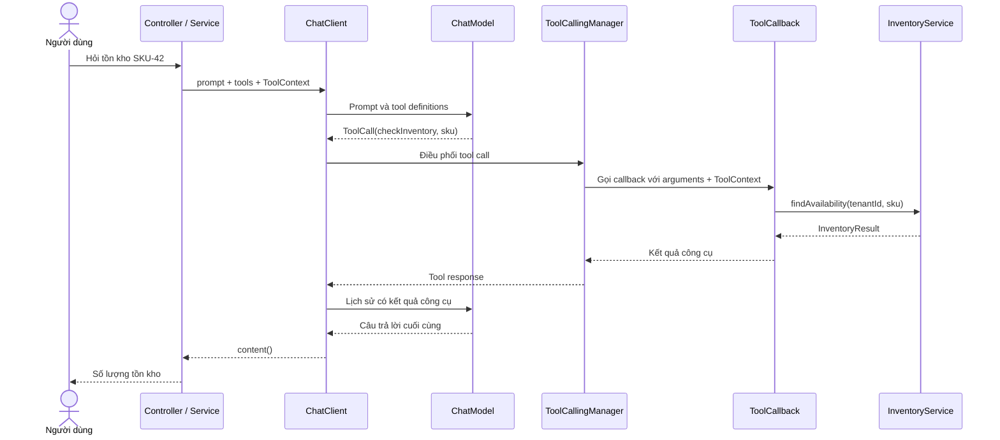

# Đưa công cụ vào một yêu cầu ChatClient

`ChatClient` là API fluent của Spring AI để xây dựng prompt và gửi yêu cầu đến `ChatModel`. Khi cần dữ liệu nghiệp vụ hoặc cần thực hiện một hành động, ứng dụng có thể đưa các công cụ vào đúng yêu cầu bằng `.tools(...)`. Mô hình nhìn thấy tên, mô tả và schema đầu vào của công cụ; ứng dụng giữ phần thực thi thông qua `ToolCallback` và các service nghiệp vụ.

Bài học này sử dụng một ví dụ tra cứu tồn kho. Người dùng hỏi số lượng của một mã hàng; mô hình quyết định có cần gọi `checkInventory` hay không; ứng dụng thực thi công cụ trong phạm vi tenant đã xác thực rồi gửi kết quả cho mô hình để tạo câu trả lời. Cách tích hợp này minh họa trách nhiệm cốt lõi của Spring AI: mô hình yêu cầu, ứng dụng xác thực và thực thi.

## 1. Từ một prompt thông thường đến prompt có công cụ

Một yêu cầu `ChatClient` thông thường chỉ gửi nội dung hội thoại đến mô hình:

```java
String answer = chatClient.prompt()
        .user("Giải thích mã hàng SKU-42 dùng để làm gì.")
        .call()
        .content();
```

Mô hình chỉ có thể suy luận từ prompt và kiến thức đã học. Nếu câu hỏi cần số lượng tồn kho hiện tại, nó không thể tự truy cập cơ sở dữ liệu nội bộ. Ta cần mô tả một công cụ để mô hình có thể yêu cầu ứng dụng truy vấn dịch vụ tồn kho:

```java
String answer = chatClient.prompt()
        .user("Hiện còn bao nhiêu sản phẩm SKU-42 trong kho?")
        .tools(inventoryTools)
        .call()
        .content();
```

`.tools(inventoryTools)` đưa các công cụ được định nghĩa trong `inventoryTools` vào phạm vi của yêu cầu này. Spring AI chuyển định nghĩa công cụ cho mô hình. Nếu mô hình chọn gọi một công cụ, Spring AI điều phối callback, nhận kết quả, bổ sung kết quả vào lịch sử trao đổi và tiếp tục gọi mô hình để lấy câu trả lời cuối cùng.

Điểm quan trọng là mô hình không được cấp kết nối database hay quyền gọi trực tiếp `InventoryService`. Nó chỉ trả về một yêu cầu gọi công cụ cùng các đối số. Mã trong ứng dụng mới là nơi thực thi thao tác.

## 2. Khai báo công cụ bằng @Tool

Ví dụ dưới đây định nghĩa công cụ đọc số lượng tồn kho. `@Tool` cung cấp tên và mô tả để mô hình hiểu khi nào nên sử dụng; tham số Java trở thành schema đầu vào.

```java
import org.springframework.ai.tool.annotation.Tool;
import org.springframework.ai.tool.annotation.ToolParam;
import org.springframework.ai.tool.ToolContext;
import org.springframework.stereotype.Component;

@Component
public class InventoryTools {

    private final InventoryService inventoryService;

    public InventoryTools(InventoryService inventoryService) {
        this.inventoryService = inventoryService;
    }

    @Tool(
        name = "checkInventory",
        description = "Tra cứu số lượng có thể bán của một mã hàng trong kho của tenant hiện tại. Dùng khi người dùng hỏi về tồn kho hiện tại."
    )
    public InventoryResult checkInventory(
            @ToolParam(description = "Mã SKU chính xác của sản phẩm") String sku,
            ToolContext toolContext) {

        String tenantId = (String) toolContext.getContext().get("tenantId");
        return inventoryService.findAvailability(tenantId, sku);
    }
}
```

`InventoryService` và `InventoryResult` là kiểu của ứng dụng. Service nên trả về một kết quả nghiệp vụ nhỏ, rõ nghĩa, chẳng hạn SKU, số lượng có thể bán và thời điểm cập nhật. Không nên trả về toàn bộ entity database hoặc các trường nội bộ không cần cho câu trả lời.

`ToolContext` là tham số đặc biệt do Spring AI truyền khi thực thi. Nó không phải tham số do mô hình sinh ra và không được đưa vào JSON schema mà mô hình nhìn thấy. Ở ví dụ này, `sku` là dữ liệu mô hình được phép đề xuất; `tenantId` là ngữ cảnh tin cậy do ứng dụng cung cấp.

### Viết mô tả và schema dễ dùng

Spring AI tạo JSON Schema từ chữ ký phương thức. Với ví dụ trên, schema có dạng khái quát như sau:

```json
{
  "type": "object",
  "properties": {
    "sku": {
      "type": "string",
      "description": "Mã SKU chính xác của sản phẩm"
    }
  },
  "required": ["sku"]
}
```

`@ToolParam` cho phép mô tả định dạng, miền giá trị và trạng thái bắt buộc của tham số. Mặc định, tham số được xem là bắt buộc. Nếu một giá trị có thể vắng mặt, hãy khai báo rõ:

```java
@Tool(
    description = "Tìm sản phẩm theo tên hoặc mã SKU"
    )
public List<ProductSummary> searchProducts(
        @ToolParam(description = "Từ khóa tìm kiếm", required = false) String keyword,
        @ToolParam(description = "Mã SKU chính xác nếu người dùng đã cung cấp", required = false) String sku) {
    return productService.search(keyword, sku);
}
```

Chỉ đánh dấu tham số là optional khi service thực sự xử lý được trường hợp đó. Nếu mô hình bị buộc cung cấp một giá trị mà người dùng chưa hề nói, nó có thể đoán. Mô tả công cụ nên trả lời được ba câu hỏi: công cụ làm gì, dùng trong tình huống nào và đối số cần theo định dạng nào.

## 3. Đưa công cụ vào ChatClient

Với Spring Boot, ứng dụng thường inject `ChatClient.Builder`, sau đó tạo `ChatClient` trong service. Công cụ cũng được inject như một Spring bean để nó sử dụng được các service nghiệp vụ.

```java
import java.util.Map;
import org.springframework.ai.chat.client.ChatClient;
import org.springframework.stereotype.Service;

@Service
public class InventoryAssistant {

    private final ChatClient chatClient;
    private final InventoryTools inventoryTools;

    public InventoryAssistant(
            ChatClient.Builder chatClientBuilder,
            InventoryTools inventoryTools) {
        this.chatClient = chatClientBuilder.build();
        this.inventoryTools = inventoryTools;
    }

    public String answer(String question, String authenticatedTenantId) {
        return chatClient.prompt()
                .system("Trả lời dựa trên dữ liệu công cụ khi câu hỏi cần tồn kho hiện tại. Nếu không có dữ liệu, hãy nói rõ.")
                .user(question)
                .tools(inventoryTools)
                .toolContext(Map.of("tenantId", authenticatedTenantId))
                .call()
                .content();
    }
}
```

`authenticatedTenantId` trong ví dụ là giá trị lấy từ principal hoặc ngữ cảnh bảo mật đã xác thực ở tầng web/service. Trong ứng dụng thực tế, không lấy tenant từ nội dung câu hỏi, prompt hay đối số do mô hình tạo. Nếu một request không có tenant hợp lệ, ứng dụng phải từ chối trước khi gửi yêu cầu hoặc trước khi thực thi công cụ.

Khi muốn công cụ chỉ tồn tại cho một nghiệp vụ, truyền nó bằng `.tools(...)` ngay tại request như trên. Spring AI cũng hỗ trợ `defaultTools(...)` khi xây dựng client để cung cấp các công cụ dùng chung cho nhiều request. Chỉ đưa các công cụ thực sự phù hợp vào mặc định; công cụ có quyền ghi dữ liệu, thanh toán hoặc xóa dữ liệu nên được cấp theo từng luồng và theo chính sách quyền hạn.

## 4. @Tool, ToolCallback và ToolDefinition phối hợp ra sao?

`@Tool` là cách khai báo tiện lợi ở tầng phương thức. Khi nhận một instance có các phương thức được đánh dấu, Spring AI tạo các `ToolCallback` tương ứng. `ToolCallback` là abstraction thống nhất chứa định nghĩa công cụ và logic thực thi.

Ba thành phần có trách nhiệm khác nhau:

| Thành phần | Trách nhiệm |
| --- | --- |
| `@Tool` và `@ToolParam` | Khai báo tên, mô tả và schema của phương thức công cụ |
| `ToolDefinition` | Biểu diễn tên, mô tả và JSON Schema mà mô hình nhận được |
| `ToolCallback` | Nhận đối số đã được mô hình tạo và gọi logic thực thi của ứng dụng |

Có thể yêu cầu Spring AI tạo callback tường minh bằng `ToolCallbacks.from(...)`:

```java
ToolCallback[] callbacks = ToolCallbacks.from(inventoryTools);
```

Ứng dụng cũng có thể tự tạo `MethodToolCallback` hoặc `FunctionToolCallback` khi cần đăng ký động, bọc một function hoặc kiểm soát schema và metadata ở mức thấp hơn. Với một công cụ phương thức thông thường, `@Tool` thường là điểm bắt đầu dễ đọc nhất.

Một `ToolCallback` tùy chỉnh triển khai hai nhóm hành vi: cung cấp `ToolDefinition`/metadata cho Spring AI và xử lý `call(...)` để thực thi. Chữ ký callback có thể nhận JSON đầu vào cùng `ToolContext`. Dù dùng callback tạo tự động hay tự triển khai, mã thực thi vẫn phải gọi service nghiệp vụ và kiểm tra quyền.

## 5. Điều gì xảy ra khi gọi .call()?

Khi ứng dụng gọi `.call()`, Spring AI bắt đầu một chu trình có thể gồm nhiều lượt trao đổi giữa mô hình và công cụ:

1. `ChatClient` gửi prompt cùng định nghĩa các công cụ đã đăng ký đến `ChatModel`.
2. Mô hình trả lời bằng nội dung văn bản hoặc yêu cầu gọi một hay nhiều công cụ.
3. Nếu có tool call, bộ điều phối của Spring AI tìm `ToolCallback` tương ứng và chuyển các đối số đến callback.
4. Callback chạy logic ứng dụng và trả kết quả.
5. Spring AI đưa kết quả công cụ vào lịch sử hội thoại và gửi lịch sử đó lại cho mô hình.
6. Mô hình có thể yêu cầu thêm công cụ hoặc tạo câu trả lời cuối cùng.
7. Khi chu trình kết thúc, `.content()` trả về nội dung văn bản của câu trả lời cho caller.



Với luồng `ChatClient` thông thường, ứng dụng không cần tự đọc tool call rồi gọi callback bằng tay. `ToolCallingManager` đảm nhiệm việc tìm và thực thi callback; advisor điều phối chu trình này tùy theo phiên bản Spring AI. Ở các bản mới, `ToolCallingAdvisor` là thành phần trong advisor chain của `ChatClient`. Tên và cấu hình chi tiết có thể khác giữa các major version, vì vậy cần đối chiếu tài liệu đúng với dependency đang dùng.

## 6. Một yêu cầu có thể gọi nhiều công cụ

Mô hình có thể yêu cầu nhiều công cụ trong một lượt nếu câu hỏi cần nhiều nguồn dữ liệu. Ví dụ, câu hỏi "Đơn hàng ORD-42 đã được gửi chưa và còn thiếu sản phẩm nào?" có thể cần một công cụ đọc đơn hàng và một công cụ đọc tồn kho.

Spring AI liên kết từng yêu cầu gọi với callback theo tên công cụ, thực thi từng yêu cầu và đưa các kết quả trở lại lịch sử. Ứng dụng cần bảo đảm từng callback kiểm tra quyền trên đúng tài nguyên. Nếu các thao tác độc lập và phiên bản/provider hỗ trợ, chúng có thể được thực thi theo chiến lược phù hợp; không nên giả định thứ tự hoàn tất luôn giống thứ tự mô hình yêu cầu.

Khi mô hình nhận kết quả, nó có thể quyết định gọi thêm công cụ. Vì vậy một câu `.call().content()` có thể che giấu nhiều vòng tool call ở bên trong. Hãy giới hạn số vòng, thời gian thực thi và chi phí nếu ứng dụng cho phép các chuỗi hành động dài.

## 7. Phân biệt dữ liệu mô hình gửi và ToolContext

Có hai luồng dữ liệu đi vào công cụ:

- **Tool arguments:** các trường trong schema mà mô hình có thể tạo, ví dụ `sku` hoặc `orderId`.
- **ToolContext:** dữ liệu ứng dụng gắn vào request, ví dụ `tenantId`, `userId`, correlation ID hoặc request scope đã xác thực.

`ToolContext` không được gửi cho mô hình. Công cụ có thể đọc nó qua tham số `ToolContext` để áp dụng phạm vi dữ liệu đúng tenant:

```java
@Tool(description = "Đọc thông tin khách hàng trong tenant hiện tại")
public CustomerSummary getCustomer(
        @ToolParam(description = "ID khách hàng") Long customerId,
        ToolContext toolContext) {

    String tenantId = (String) toolContext.getContext().get("tenantId");
    return customerService.findVisibleCustomer(tenantId, customerId);
}
```

Việc truyền `tenantId` qua `ToolContext` giúp tránh để mô hình tự quyết định tenant. Tuy nhiên, bản thân `ToolContext` không tự xác thực hay cấp quyền. Service vẫn phải kiểm tra người dùng có quyền đọc khách hàng đó, tenant có khớp và bản ghi có tồn tại hay không. Cũng không đưa token, mật khẩu hoặc credential vào context nếu callback không thực sự cần chúng.

## 8. Xử lý lỗi và công cụ có side effect

Callback có thể gặp lỗi nghiệp vụ như không tìm thấy SKU, hoặc lỗi hạ tầng như timeout khi gọi dịch vụ tồn kho. Ứng dụng cần quyết định lỗi nào có thể trả về cho mô hình dưới dạng kết quả có kiểm soát và lỗi nào phải được ném lên để tầng gọi xử lý.

Ví dụ kết quả lỗi nghiệp vụ:

```json
{
  "ok": false,
  "code": "SKU_NOT_FOUND",
  "message": "Không tìm thấy mã hàng được yêu cầu."
}
```

Không trả stack trace, SQL, token hay dữ liệu nội bộ trong kết quả công cụ. Có thể tùy chỉnh `ToolExecutionExceptionProcessor` để chuyển exception thành thông điệp an toàn hoặc ném exception cho caller. Hành vi mặc định và property cấu hình xử lý lỗi thay đổi theo phiên bản; hãy kiểm tra tài liệu tương ứng thay vì dựa vào giả định.

Với công cụ chỉ đọc, như tra cứu tồn kho, rủi ro side effect thấp hơn. Với công cụ tạo đơn hàng, gửi email, hoàn tiền hoặc xóa dữ liệu, cần thêm kiểm tra quyền, giới hạn giá trị, xác nhận người dùng trước hành động quan trọng và idempotency key ở tầng nghiệp vụ. `tool_call_id` chỉ liên kết một lần gọi của mô hình; nó không thay thế idempotency key và không chứng minh người dùng đã đồng ý.

Có thể dùng `returnDirect` khi kết quả công cụ cần trả thẳng cho caller thay vì gửi lại mô hình để diễn giải. Chỉ chọn cách này khi ứng dụng chủ ý muốn kết thúc vòng suy luận tại kết quả công cụ; mặc định, kết quả được gửi lại mô hình để tạo câu trả lời tự nhiên.

## 9. Kiểm thử tích hợp ChatClient và công cụ

Không nên chỉ kiểm tra rằng mô hình đã trả về một đoạn văn bản. Hãy kiểm tra cả việc công cụ có được đưa vào request, callback có được gọi đúng và quyền truy cập có được áp dụng.

| Trường hợp | Điều cần xác minh |
| --- | --- |
| Hỏi dữ liệu hiện tại | Callback được gọi và câu trả lời dùng kết quả callback |
| Câu hỏi không cần công cụ | Công cụ không bị gọi ngoài ý muốn |
| Thiếu hoặc sai SKU | Schema/validation hoặc service trả lỗi nghiệp vụ có kiểm soát |
| Tenant khác | Service từ chối truy cập dữ liệu ngoài tenant |
| Callback timeout | Lỗi được chuyển đúng theo chính sách, không lộ chi tiết nội bộ |
| Nhiều tool call | Mỗi callback nhận đúng đối số và kết quả tương ứng |
| Công cụ ghi dữ liệu | Có kiểm tra quyền, xác nhận và idempotency phù hợp |
| Công cụ không được cấp cho request | Mô hình không thể thực thi callback đó |

Có thể unit test `InventoryTools` bằng cách mock `InventoryService`, truyền `ToolContext` chứa tenant thử nghiệm và xác minh service nhận đúng tenant cùng SKU. Integration test cho `ChatClient` nên dùng model giả hoặc stub provider để kiểm tra chu trình tool call mà không phát sinh chi phí hay thao tác lên dữ liệu thật.

Ví dụ unit test ở mức phương thức:

```java
Map<String, Object> context = Map.of("tenantId", "tenant-test");
ToolContext toolContext = new ToolContext(context);

InventoryResult result = inventoryTools.checkInventory("SKU-42", toolContext);

verify(inventoryService).findAvailability("tenant-test", "SKU-42");
assertThat(result).isNotNull();
```

Đoạn test minh họa việc truyền ngữ cảnh và đối số đến service; constructor của `ToolContext`, kiểu kết quả và cách mock phụ thuộc phiên bản Spring AI cùng cấu trúc ứng dụng.

## 10. Các lỗi tích hợp thường gặp

| Biểu hiện | Nguyên nhân thường gặp | Hướng kiểm tra |
| --- | --- | --- |
| Mô hình không gọi công cụ | Tool chưa được thêm vào request, mô tả mơ hồ hoặc model/provider không hỗ trợ tool calling | Kiểm tra `.tools(...)`, mô tả và khả năng của model |
| Không tìm thấy callback | Tên tool trùng, callback chưa được tạo hoặc đăng ký sai | Kiểm tra tên trong `ToolDefinition` và tập callback của request |
| Đối số không phân tích được | Schema và kiểu dữ liệu không rõ hoặc JSON không hợp lệ | Kiểm tra `@ToolParam`, required/optional và kiểu tham số |
| Công cụ truy vấn sai tenant | Lấy tenant từ arguments hoặc context chưa được xác thực | Truyền tenant từ principal đáng tin cậy và kiểm tra trong service |
| Kết quả không phù hợp câu hỏi | Tool trả quá nhiều, thiếu đơn vị hoặc không có thời điểm dữ liệu | Thiết kế DTO kết quả rõ nghĩa, có đơn vị và timestamp |
| Vòng gọi kéo dài | Công cụ trả kết quả không đủ hoặc prompt không giới hạn hành vi | Giới hạn vòng gọi, timeout và kích thước kết quả |

## 11. Checklist trước khi đưa vào ứng dụng

- [ ] Phương thức công cụ có `@Tool` và mô tả rõ mục đích sử dụng.
- [ ] Từng tham số có kiểu, mô tả và required/optional phù hợp.
- [ ] Công cụ được truyền vào đúng request qua `.tools(...)` hoặc được cấu hình mặc định có chủ đích.
- [ ] Logic thực thi nằm trong service nghiệp vụ và có thể kiểm thử độc lập.
- [ ] Danh tính, tenant và quyền lấy từ ngữ cảnh tin cậy của ứng dụng.
- [ ] Dùng `ToolContext` cho dữ liệu không cần gửi đến mô hình.
- [ ] Lỗi được xử lý an toàn; kết quả không chứa bí mật hoặc dữ liệu nội bộ.
- [ ] Công cụ có side effect được bảo vệ bằng xác nhận và idempotency phù hợp.
- [ ] Đã kiểm thử trường hợp không gọi tool, gọi một tool, gọi nhiều tool và lỗi callback.
- [ ] Đã xác nhận provider/model đang dùng hỗ trợ tool calling.

## Tài liệu tham khảo

- [Spring AI 1.0 — Tool Calling](https://docs.spring.io/spring-ai/reference/1.0/api/tools.html)
- [Spring AI — Chat Client API](https://docs.spring.io/spring-ai/reference/api/chatclient.html)
- [Spring AI — Tool Calling bản hiện hành](https://docs.spring.io/spring-ai/reference/api/tools.html)

Khi tích hợp, hãy đối chiếu cú pháp với phiên bản Spring AI đang được khai báo trong ứng dụng. Ý tưởng không đổi: `ChatClient` đưa định nghĩa công cụ vào yêu cầu, mô hình quyết định có cần gọi, `ToolCallback` thực thi trong ứng dụng và kết quả được đưa trở lại chu trình hội thoại.
