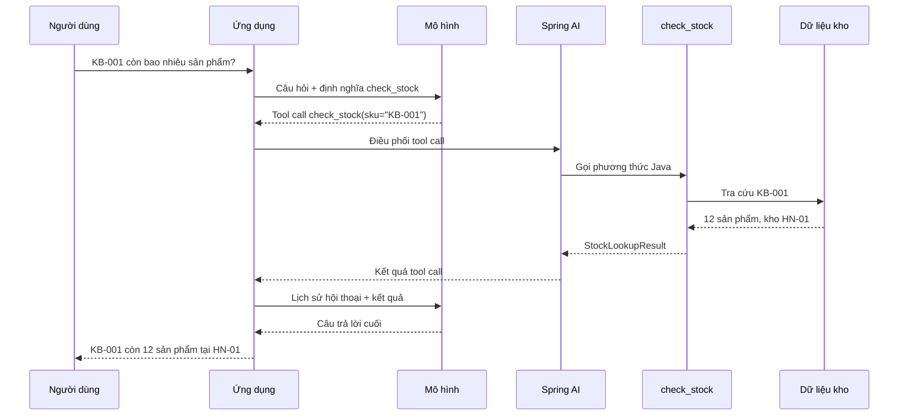

# Đặt câu hỏi cần dữ liệu từ công cụ và quan sát luồng thực thi

Một trợ lý AI chỉ có thể trả lời dựa trên thông tin trong prompt, lịch sử hội thoại và kiến thức mà mô hình đã học. Khi câu hỏi cần dữ liệu hiện tại của hệ thống, chẳng hạn số lượng hàng còn trong kho, ứng dụng phải cung cấp một công cụ để mô hình yêu cầu tra cứu. Mô hình quyết định công cụ nào phù hợp và tạo tham số; ứng dụng thực thi công cụ, lấy dữ liệu thật rồi gửi kết quả lại cho mô hình để tạo câu trả lời.

Trong bài này, bạn sẽ tạo công cụ chỉ đọc `check_stock`, đặt câu hỏi cần dữ liệu tồn kho và quan sát phương thức Java được gọi. Ví dụ dùng Spring AI 2.x, `ChatClient` và một kho dữ liệu giả lập trong bộ nhớ để tập trung vào luồng tool calling. Khi kết nối cơ sở dữ liệu thật, phần service có thể được thay bằng repository hoặc API nghiệp vụ.

Sau bài học, bạn có thể:

- Nhận biết câu hỏi nào cần công cụ để lấy dữ liệu từ ứng dụng.
- Khai báo một phương thức Java bằng `@Tool` và mô tả đầu vào bằng `@ToolParam`.
- Đăng ký công cụ cho một request `ChatClient`.
- Quan sát thời điểm công cụ được gọi, tham số mô hình gửi đến và kết quả công cụ trả về.
- Xác định các nguyên nhân thường gặp khi mô hình không gọi công cụ.

## 1. Hiểu điều gì xảy ra khi đặt câu hỏi

Giả sử hệ thống quản lý kho có SKU `KB-001` với 12 sản phẩm còn khả dụng tại kho `HN-01`. Nếu người dùng hỏi “KB-001 còn bao nhiêu sản phẩm?”, mô hình không thể tự biết số lượng này. Dữ liệu tồn kho nằm trong hệ thống nghiệp vụ, vì vậy ứng dụng cần cung cấp công cụ tra cứu.

Luồng xử lý gồm các bước:

1. Ứng dụng gửi câu hỏi cùng định nghĩa công cụ `check_stock` cho mô hình.
2. Mô hình nhận ra câu hỏi cần dữ liệu tồn kho và trả về yêu cầu gọi `check_stock` với SKU `KB-001`.
3. Spring AI phân giải yêu cầu theo tên công cụ và gọi phương thức Java tương ứng.
4. Phương thức tra cứu dữ liệu, sau đó trả kết quả cho Spring AI.
5. Spring AI đưa kết quả vào lịch sử hội thoại và gửi lại cho mô hình.
6. Mô hình diễn đạt kết quả thành câu trả lời cho người dùng.



Điểm cần quan sát là mô hình không trực tiếp gọi `InventoryService`. Nó chỉ gửi một yêu cầu có tên công cụ và tham số. Spring AI cùng ứng dụng mới thực hiện phương thức Java.

## 2. Tạo dữ liệu tồn kho mẫu

Bắt đầu với một service có dữ liệu giả lập. Service này đại diện cho tầng nghiệp vụ mà công cụ sẽ sử dụng:

```java
@Service
public class InventoryService {

    private static final Map<String, Stock> STOCKS = Map.of(
            "KB-001", new Stock(12, "HN-01"),
            "KB-002", new Stock(4, "HCM-01"),
            "KB-003", new Stock(0, "HN-01")
    );

    public StockLookupResult findBySku(String sku) {
        if (sku == null || sku.isBlank()) {
            throw new IllegalArgumentException("SKU không được để trống");
        }

        String normalizedSku = sku.trim().toUpperCase(Locale.ROOT);
        Stock stock = STOCKS.get(normalizedSku);

        if (stock == null) {
            return new StockLookupResult(
                    normalizedSku, false, null, null, "SKU_NOT_FOUND");
        }

        return new StockLookupResult(
                normalizedSku,
                true,
                stock.availableQuantity(),
                stock.warehouseCode(),
                null);
    }

    private record Stock(int availableQuantity, String warehouseCode) {}
}
```

Kết quả trả về là một DTO có cấu trúc rõ ràng:

```java
public record StockLookupResult(
        String sku,
        boolean found,
        Integer availableQuantity,
        String warehouseCode,
        String message) {
}
```

Trường `found` phân biệt SKU không tồn tại với SKU có số lượng bằng 0. Nếu SKU không tồn tại, `availableQuantity` và `warehouseCode` để trống; công cụ trả mã `SKU_NOT_FOUND` để mô hình có thể giải thích đúng tình trạng.

Trong dự án thật, service cần truy vấn theo phạm vi kho hoặc tenant mà người dùng được phép truy cập. Ví dụ trên dùng dữ liệu tĩnh để việc quan sát tool call được đơn giản và có kết quả ổn định.

## 3. Khai báo công cụ bằng @Tool

Tạo một Spring bean chứa phương thức được công bố cho mô hình:

```java
@Component
public class InventoryTools {

    private static final Logger log =
            LoggerFactory.getLogger(InventoryTools.class);

    private final InventoryService inventoryService;

    public InventoryTools(InventoryService inventoryService) {
        this.inventoryService = inventoryService;
    }

    @Tool(
        name = "check_stock",
        description = "Tra cứu số lượng sản phẩm còn khả dụng theo mã SKU. "
                + "Dùng công cụ này khi người dùng hỏi về tồn kho hoặc số lượng còn lại."
    )
    public StockLookupResult checkStock(
            @ToolParam(description = "Mã SKU của sản phẩm, ví dụ KB-001") String sku) {

        log.info("Tool check_stock invoked: sku={}", sku);

        StockLookupResult result = inventoryService.findBySku(sku);

        log.info("Tool check_stock completed: found={}, warehouse={}, quantity={}",
                result.found(), result.warehouseCode(), result.availableQuantity());

        return result;
    }
}
```

Hai annotation đảm nhiệm hai việc khác nhau:

- `@Tool` đánh dấu phương thức được phép công bố cho mô hình. `name` là tên công cụ trong yêu cầu gọi; `description` giúp mô hình hiểu khi nào nên dùng công cụ.
- `@ToolParam` mô tả ý nghĩa của tham số. Spring AI dùng chữ ký phương thức và metadata để tạo schema đầu vào cho mô hình.

Tham số `sku` là bắt buộc theo mặc định. Vì vậy schema yêu cầu mô hình cung cấp giá trị này. Nếu một tham số thực sự có thể bỏ qua, hãy khai báo rõ bằng `@ToolParam(required = false)` hoặc kiểu nullable phù hợp với cấu hình dự án.

Phương thức tool nên gọi service nghiệp vụ thay vì chứa toàn bộ truy vấn và quy tắc dữ liệu. Cách tổ chức này giúp service có thể được tái sử dụng, kiểm thử độc lập và áp dụng kiểm tra quyền ở cùng một nơi.

## 4. Đăng ký công cụ và gửi câu hỏi bằng ChatClient

Ứng dụng cần có `ChatClient` được cấu hình với một chat model có hỗ trợ tool calling. Với Spring Boot và starter của nhà cung cấp mô hình, có thể tạo bean `ChatClient` từ builder do Spring AI cung cấp:

```java
@Configuration
public class AiConfiguration {

    @Bean
    ChatClient chatClient(ChatClient.Builder builder) {
        return builder.build();
    }
}
```

Tiếp theo, truyền bean `InventoryTools` vào request cần sử dụng công cụ:

```java
@Service
public class InventoryAssistant {

    private final ChatClient chatClient;
    private final InventoryTools inventoryTools;

    public InventoryAssistant(
            ChatClient chatClient,
            InventoryTools inventoryTools) {
        this.chatClient = chatClient;
        this.inventoryTools = inventoryTools;
    }

    public String askAboutStock(String question) {
        return chatClient.prompt()
                .system("""
                        Bạn là trợ lý tra cứu kho hàng.
                        Khi câu hỏi cần số lượng tồn kho, hãy sử dụng công cụ check_stock.
                        Không tự suy đoán số lượng khi chưa có kết quả từ công cụ.
                        Nếu công cụ báo không tìm thấy SKU, hãy nói rõ sản phẩm chưa có dữ liệu.
                        """)
                .user(question)
                .tools(inventoryTools)
                .call()
                .content();
    }
}
```

Lệnh `.tools(inventoryTools)` đưa các phương thức `@Tool` của đối tượng này vào phạm vi request hiện tại. Mô hình nhận được tên `check_stock`, mô tả và schema tham số `sku`. Công cụ không tự xuất hiện trong mọi request của ứng dụng; request nào cần dùng phải được cung cấp công cụ hoặc được cấu hình công cụ mặc định một cách có chủ đích.

Gọi phương thức với một câu hỏi cần dữ liệu thật:

```java
String answer = inventoryAssistant.askAboutStock(
        "Sản phẩm KB-001 còn bao nhiêu chiếc trong kho?");

System.out.println(answer);
```

Với dữ liệu mẫu, câu trả lời có thể là: “SKU KB-001 hiện còn 12 sản phẩm tại kho HN-01.” Câu chữ cụ thể do mô hình tạo nên có thể khác, nhưng số lượng và mã kho phải dựa trên kết quả công cụ.

## 5. Quan sát công cụ được thực thi

Để thấy phương thức Java thực sự được gọi, đặt breakpoint tại dòng `inventoryService.findBySku(sku)` hoặc quan sát log do `InventoryTools` ghi ra. Khi request chạy thành công, log mẫu có dạng:

```text
INFO  InventoryTools - Tool check_stock invoked: sku=KB-001
INFO  InventoryTools - Tool check_stock completed: found=true, warehouse=HN-01, quantity=12
```

Hai dòng log tương ứng với thời điểm bắt đầu và kết thúc thực thi. Khi debug, bạn có thể quan sát:

1. Giá trị `sku` mà mô hình gửi về.
2. Service được gọi với SKU đã chuẩn hóa.
3. Dữ liệu tìm thấy trong service.
4. DTO `StockLookupResult` được trả về từ phương thức tool.
5. Câu trả lời cuối cùng mà `ChatClient` trả cho ứng dụng.

Với cấu hình `ChatClient` chuẩn trong Spring AI 2.x, `ToolCallingAdvisor` điều phối vòng lặp tool calling. Advisor gửi định nghĩa công cụ cùng prompt, nhận yêu cầu từ mô hình, nhờ thành phần quản lý tool thực thi callback, sau đó gửi kết quả lại cho mô hình. Vì vậy, lời gọi `.call().content()` thường chỉ trả về câu trả lời cuối; log hoặc breakpoint bên trong phương thức tool là cách trực tiếp để quan sát mã nghiệp vụ đã chạy.

| Quan sát | Điều cần xác nhận |
| --- | --- |
| Không có log `invoked` | Chưa có bằng chứng công cụ được thực thi; kiểm tra đăng ký tool và phản hồi của mô hình. |
| Có log `invoked`, không có log `completed` | Phương thức đã bắt đầu nhưng service có thể phát sinh lỗi hoặc bị gián đoạn. |
| Có cả hai log | Callback đã chạy và trả kết quả từ service. |
| Có log nhưng câu trả lời sai | Kiểm tra DTO trả về, lịch sử kết quả được gửi lại và cách mô hình diễn đạt. |

Trong môi trường phát triển, có thể dùng log mức `INFO` như ví dụ. Không ghi token, thông tin xác thực, dữ liệu cá nhân hoặc toàn bộ nội dung prompt vào log. Nếu cần bật log chi tiết của framework, chỉ bật trong môi trường kiểm soát và rà soát dữ liệu được ghi trước khi chia sẻ log.

## 6. Thử các câu hỏi khác nhau

Hãy gọi lại cùng phương thức với những câu hỏi dưới đây để quan sát cách mô hình sử dụng kết quả:

| Câu hỏi | Kết quả từ công cụ | Điều cần quan sát |
| --- | --- | --- |
| “KB-001 còn bao nhiêu sản phẩm?” | `found=true`, số lượng `12` | Mô hình gọi `check_stock` với `sku=KB-001`. |
| “KB-002 còn hàng không?” | `found=true`, số lượng `4` | Mô hình dùng kết quả để trả lời câu hỏi có/không. |
| “KB-003 còn bao nhiêu?” | `found=true`, số lượng `0` | Phân biệt sản phẩm có dữ liệu nhưng đã hết hàng. |
| “KB-999 còn bao nhiêu?” | `found=false`, `SKU_NOT_FOUND` | Mô hình thông báo không tìm thấy SKU, không tự tạo số lượng. |

Mô hình có quyền quyết định có gọi công cụ hay không dựa trên prompt và định nghĩa được cung cấp. Nếu muốn kiểm chứng chính xác một đường đi trong kiểm thử, hãy dùng phản hồi mô hình giả lập có tool call cố định thay vì phụ thuộc vào quyết định ngẫu nhiên của mô hình thật.

## 7. Khi mô hình không gọi công cụ

Không phải cứ có `@Tool` là mô hình sẽ luôn gọi phương thức đó. Kiểm tra lần lượt các điểm sau:

| Dấu hiệu | Nguyên nhân thường gặp | Cách kiểm tra |
| --- | --- | --- |
| Không có log và câu trả lời chung chung | Công cụ chưa được đưa vào request | Xác nhận `.tools(inventoryTools)` có mặt trên đúng request. |
| Mô hình trả lời theo kiến thức chung | Câu hỏi chưa thể hiện nhu cầu dữ liệu hiện tại | Hỏi trực tiếp số lượng tồn kho của một SKU cụ thể và nêu rõ cần tra cứu. |
| Công cụ xuất hiện nhưng tên không khớp | Tên hoặc mô tả công cụ không rõ ràng | Kiểm tra `name`, `description` và danh sách tool được đăng ký. |
| Không có tool call dù đã đăng ký | Chat model hoặc cấu hình nhà cung cấp không hỗ trợ tool calling | Kiểm tra model, phiên bản starter và cấu hình tương ứng. |
| Phương thức bắt đầu nhưng thất bại | Đầu vào không hợp lệ hoặc service lỗi | Xem exception và log tại ranh giới service. |
| Có kết quả nhưng nội dung cuối không đúng | Kết quả trả về thiếu rõ ràng hoặc mô hình diễn giải sai | Kiểm tra DTO, thông điệp kết quả và hướng dẫn trong system prompt. |

Hãy viết mô tả công cụ theo ngôn ngữ nghiệp vụ cụ thể. “Tra cứu dữ liệu” quá chung; “Tra cứu số lượng sản phẩm còn khả dụng theo mã SKU” giúp mô hình hiểu rõ phạm vi và tình huống sử dụng hơn.

## 8. Kiểm tra công cụ trước khi tích hợp mô hình

Nên kiểm thử service và phương thức tool độc lập trước. Ví dụ, một unit test có thể xác minh SKU mẫu trả đúng số lượng:

```java
class InventoryServiceTest {

    private final InventoryService inventoryService = new InventoryService();

    @Test
    void returnsAvailableQuantityForKnownSku() {
        StockLookupResult result = inventoryService.findBySku("KB-001");

        assertTrue(result.found());
        assertEquals(12, result.availableQuantity());
        assertEquals("HN-01", result.warehouseCode());
    }

    @Test
    void reportsUnknownSku() {
        StockLookupResult result = inventoryService.findBySku("KB-999");

        assertFalse(result.found());
        assertEquals("SKU_NOT_FOUND", result.message());
    }
}
```

Kiểm thử tích hợp cần xác minh cả vòng lặp: prompt có công cụ, mô hình trả tool call, callback được thực thi, kết quả được ghép vào lịch sử và mô hình tạo phản hồi cuối. Có thể dùng chat model giả hoặc mock phản hồi có tool call để kiểm soát kịch bản và tránh phụ thuộc mạng hay chi phí gọi mô hình. Đồng thời xác minh service được gọi đúng số lần và đúng tham số.

Một số tình huống nên có trong bộ kiểm thử:

- Mô hình không yêu cầu công cụ và trả lời trực tiếp.
- Mô hình gọi `check_stock` với SKU hợp lệ.
- Mô hình gửi SKU không tồn tại.
- Arguments thiếu hoặc sai định dạng.
- Service phát sinh exception hoặc timeout.
- Người dùng không có quyền xem dữ liệu kho tương ứng.

## 9. Ranh giới an toàn khi mở rộng ví dụ

`check_stock` là công cụ chỉ đọc nên phù hợp để bắt đầu. Khi chuyển sang dữ liệu thật, đừng coi arguments do mô hình tạo là dữ liệu đáng tin cậy:

- Xác thực SKU, độ dài và định dạng ở service.
- Xác định người dùng và tenant từ security context của server, không lấy quyền từ prompt hoặc tham số do mô hình gửi.
- Kiểm tra người dùng có quyền xem kho và sản phẩm tương ứng.
- Giới hạn số kết quả, thời gian thực thi và số lần gọi công cụ.
- Chỉ trả những trường cần thiết cho câu trả lời; không trả entity chứa thông tin nội bộ.
- Ghi log đủ để theo dõi thực thi nhưng loại bỏ dữ liệu nhạy cảm.

Nếu sau này tạo công cụ ghi dữ liệu như `create_order` hoặc `cancel_order`, cần bổ sung kiểm tra trạng thái nghiệp vụ, chống thực thi trùng, audit và cơ chế xác nhận của người dùng khi phù hợp. Việc mô hình yêu cầu một hành động không đồng nghĩa hành động đó đã được người dùng cho phép.

## 10. Kết quả cần đạt

Sau khi hoàn thành bài thực hành, bạn cần quan sát được một lần gọi công cụ đi qua đủ các điểm sau:

1. `ChatClient` gửi câu hỏi cùng định nghĩa `check_stock`.
2. Mô hình yêu cầu gọi công cụ với tham số `sku`.
3. Phương thức `InventoryTools.checkStock(...)` được thực thi.
4. `InventoryService` trả dữ liệu tồn kho có cấu trúc.
5. Kết quả được gửi lại cho mô hình và xuất hiện trong câu trả lời cuối.

Nếu chỉ nhận được câu trả lời cuối mà chưa quan sát được phương thức tool, hãy dùng breakpoint hoặc log trong `checkStock` để xác nhận đường thực thi. Đây là bước quan trọng để phân biệt câu trả lời do mô hình tự tạo với câu trả lời đã sử dụng dữ liệu từ hệ thống.

## Tài liệu tham khảo

- [Spring AI Reference — Tool Calling](https://docs.spring.io/spring-ai/reference/api/tools.html)
- [Spring AI Reference — ChatClient](https://docs.spring.io/spring-ai/reference/api/chatclient.html)

Các ví dụ sử dụng API Spring AI 2.x. Nếu dự án đang dùng nhánh 1.x, hãy đối chiếu tài liệu đúng phiên bản vì cơ chế điều phối tool calling và API liên quan có thể khác nhau.
