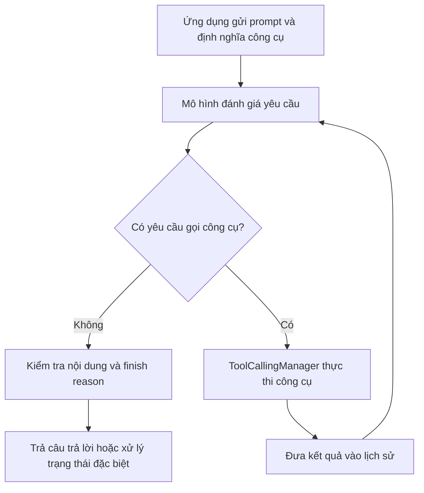

# Kiểm tra kết quả khi mô hình chọn không gọi công cụ

Khi ứng dụng cung cấp một hoặc nhiều công cụ cho mô hình, mô hình vẫn có quyền quyết định rằng câu hỏi hiện tại không cần gọi công cụ. Đây là hành vi bình thường của chế độ lựa chọn tự động: nếu có thể trả lời từ ngữ cảnh hội thoại hoặc kiến thức sẵn có, mô hình có thể tạo câu trả lời trực tiếp. Ứng dụng cần nhận biết đúng trường hợp này và không xem mọi phản hồi không có tool call là lỗi.

Với module `SPRING_AI_TOOL_CALLING`, việc kiểm tra kết quả không chỉ là xem người dùng có nhận được văn bản hay không. Cần xác định mô hình có yêu cầu công cụ không, công cụ có thực sự được thực thi không, phản hồi có kết thúc bình thường không và ứng dụng có đang dùng đúng cơ chế điều phối của Spring AI hay không. Các kiểm tra này giúp tránh gọi dịch vụ nghiệp vụ ngoài ý muốn và phát hiện trường hợp mô hình bỏ qua công cụ khi tác vụ thực sự cần dữ liệu bên ngoài.

## Không gọi công cụ có thể là kết quả đúng

Tool calling không phải lệnh bắt buộc cho mọi câu hỏi. Khi ứng dụng gửi định nghĩa công cụ cho mô hình, mô hình nhìn thấy tên, mô tả và schema đầu vào của các công cụ đó. Mô hình đánh giá yêu cầu hiện tại rồi có thể:

- Trả lời trực tiếp nếu câu hỏi chỉ cần kiến thức chung hoặc thông tin đã có trong hội thoại.
- Hỏi người dùng làm rõ nếu thiếu dữ liệu hoặc yêu cầu có nhiều cách hiểu.
- Yêu cầu gọi một công cụ nếu cần tra cứu dữ liệu mới, tính toán nghiệp vụ hoặc thực hiện thao tác trong hệ thống.
- Từ chối hoặc không tạo được câu trả lời nếu yêu cầu bị chính sách an toàn chặn, phản hồi bị cắt ngắn hoặc provider gặp vấn đề.

Ví dụ, ứng dụng có công cụ `lookupStock` để tra cứu tồn kho. Với câu hỏi “SKU là gì?”, mô hình có thể giải thích thuật ngữ mà không cần gọi dịch vụ kho. Với câu hỏi “SKU A-102 còn bao nhiêu sản phẩm trong kho?”, mô hình nên cân nhắc gọi công cụ vì số lượng tồn là dữ liệu thay đổi theo thời gian.

Do đó, **không có tool call không đồng nghĩa với lỗi**. Điều cần kiểm tra là phản hồi có phù hợp với yêu cầu hay không và việc không gọi công cụ có đúng với chính sách của ứng dụng hay không.

## Luồng xử lý trong Spring AI

Trong Spring AI 2.x, `ChatClient` tự đăng ký `ToolCallingAdvisor` theo mặc định. Advisor đưa định nghĩa công cụ vào request, nhận phản hồi của mô hình và kiểm tra phản hồi có tool call hay không. Nếu có, `ToolCallingManager` thực thi các `ToolCallback`, thêm kết quả vào lịch sử rồi gửi tiếp cho mô hình. Vòng lặp tiếp tục cho đến khi mô hình trả về phản hồi không còn tool call. Nếu phản hồi đầu tiên không có tool call, vòng lặp kết thúc ngay và nội dung được trả về cho ứng dụng.



Với cách gọi `ChatClient` tiêu chuẩn, Spring AI quản lý vòng lặp này. Nếu dùng `ChatModel` trực tiếp, ứng dụng nhận phản hồi thô từ model; Spring AI 2.x không tự thực thi tool call trong `ChatModel.call(Prompt)`. Ứng dụng phải kiểm tra `ChatResponse.hasToolCalls()` và tự điều phối việc gọi `ToolCallingManager` nếu muốn thực thi. Đây là khác biệt quan trọng khi chẩn đoán tình huống “mô hình có gọi nhưng công cụ không chạy”.

## Phân biệt ba trạng thái dễ nhầm lẫn

| Trạng thái | Dấu hiệu | Cách hiểu và xử lý |
|---|---|---|
| Mô hình không yêu cầu công cụ | Phản hồi thô có `hasToolCalls() == false`; nội dung assistant có thể là câu trả lời trực tiếp | Hợp lệ nếu câu hỏi không cần dữ liệu hoặc hành động bên ngoài |
| Mô hình có yêu cầu công cụ nhưng ứng dụng chưa thực thi | Phản hồi thô có `hasToolCalls() == true`, nhưng bộ đếm thực thi không tăng | Kiểm tra đang dùng `ChatModel` trực tiếp hay đã tắt `ToolCallingAdvisor`; ứng dụng phải tự điều phối |
| Phản hồi không có tool call nhưng không phải câu trả lời hoàn chỉnh | Nội dung rỗng, bị từ chối, bị lọc hoặc bị cắt ngắn | Kiểm tra finish reason, metadata, lỗi provider và chính sách an toàn trước khi trả kết quả |

Đặc biệt, khi `ChatClient` chạy với `ToolCallingAdvisor` mặc định, `chatResponse()` trả về phản hồi cuối cùng sau khi vòng lặp đã hoàn tất. Nếu mô hình đã gọi công cụ ở vòng trước rồi tạo câu trả lời cuối, phản hồi cuối thường không còn tool call. Vì vậy, `hasToolCalls() == false` trên phản hồi cuối của `ChatClient` không chứng minh rằng trong cả request chưa từng có công cụ được gọi. Muốn xác nhận công cụ không chạy, hãy quan sát chính lần thực thi, ví dụ bằng bộ đếm trong test, mock dịch vụ nghiệp vụ hoặc trace/observation.

## Kiểm tra nội dung và lý do kết thúc

Spring AI cung cấp `ChatResponse.hasToolCalls()` để kiểm tra phản hồi có yêu cầu gọi công cụ hay không. Khi dùng `ChatModel` trực tiếp hoặc tự điều khiển vòng lặp, đây là kiểm tra chính để quyết định có bước thực thi công cụ tiếp theo hay không.

```java
ChatResponse response = chatModel.call(prompt);

if (response.hasToolCalls()) {
    // Model đã yêu cầu công cụ; ứng dụng quyết định có thực thi hay không.
    ToolExecutionResult result = toolCallingManager.executeToolCalls(prompt, response);
    // Dùng result.conversationHistory() để tiếp tục theo vòng lặp của ứng dụng.
} else {
    // Model không yêu cầu công cụ trong phản hồi này.
    String answer = response.getResult().getOutput().getText();
}
```

Đoạn mã trên minh họa nhánh kiểm tra ở mức `ChatModel`; phần lặp tiếp theo được lược bỏ để tập trung vào điều kiện không có tool call. Nếu ứng dụng dùng `ChatClient`, thông thường không cần tự gọi `ToolCallingManager` vì `ToolCallingAdvisor` đã quản lý vòng lặp.

Không nên chỉ kiểm tra chuỗi nội dung có rỗng hay không. Hãy đọc thêm finish reason category của generation để phân biệt câu trả lời bình thường với các trạng thái khác:

| `FinishReasonCategory` | Ý nghĩa | Xử lý gợi ý |
|---|---|---|
| `COMPLETED` | Mô hình hoàn tất phản hồi | Có thể trả lời nếu nội dung đáp ứng yêu cầu |
| `TOOL_CALL` | Mô hình yêu cầu gọi công cụ | Kiểm tra tool call và chuyển sang bước thực thi |
| `TRUNCATED` | Phản hồi bị cắt do giới hạn độ dài hoặc token | Không coi nội dung dở dang là câu trả lời hoàn chỉnh; cân nhắc tiếp tục hoặc báo giới hạn |
| `FILTERED` | Bộ lọc an toàn chặn phản hồi hoặc mô hình từ chối | Xử lý theo chính sách an toàn; không diễn giải như trường hợp không cần công cụ |
| `OTHER` hoặc `UNSPECIFIED` | Provider trả lý do không thuộc nhóm chuẩn hoặc không cung cấp lý do | Kiểm tra raw finish reason và metadata của provider |

Ví dụ kiểm tra trạng thái:

```java
ChatResponse response = chatClient.prompt()
        .user("SKU là gì?")
        .tools(stockTools)
        .call()
        .chatResponse();

if (response.hasFinishReasonCategory(FinishReasonCategory.FILTERED)) {
    // Xử lý từ chối hoặc safety filter theo chính sách của ứng dụng.
}

String answer = response.getResult().getOutput().getText();
```

`ChatClient` trong ví dụ đã chạy vòng tool calling tự động. Vì thế, `response` là phản hồi cuối; hãy dùng số lần công cụ thực thi hoặc observation để kiểm tra có tool call ở vòng trước hay không. Với streaming, cần đánh giá phản hồi đã được tổng hợp. Một `ToolCallPart` từng phần chỉ chứa delta của tên hoặc đối số chưa phải một tool call hoàn chỉnh và không được xem là bằng chứng rằng công cụ đã được thực thi.

## Ví dụ công cụ và câu hỏi không cần gọi

Giả sử ứng dụng có một công cụ tra cứu tồn kho:

```java
import java.util.concurrent.atomic.AtomicInteger;

import org.springframework.ai.tool.annotation.Tool;
import org.springframework.ai.tool.annotation.ToolParam;

public class StockTools {

    private final StockService stockService;
    private final AtomicInteger invocationCount;

    public StockTools(StockService stockService, AtomicInteger invocationCount) {
        this.stockService = stockService;
        this.invocationCount = invocationCount;
    }

    @Tool(description = "Tra cứu số lượng tồn kho hiện tại theo mã SKU. Chỉ dùng khi câu hỏi cần số liệu tồn kho thực tế.")
    public StockInfo lookupStock(
            @ToolParam(description = "Mã SKU cần tra cứu") String sku) {
        invocationCount.incrementAndGet();
        return stockService.findStock(sku);
    }
}
```

Khi người dùng hỏi một khái niệm chung, câu trả lời có thể không cần truy cập dịch vụ kho:

```java
String answer = chatClient.prompt()
        .user("SKU là gì và được dùng để làm gì?")
        .tools(stockTools)
        .call()
        .content();
```

Nếu mô hình chọn trả lời trực tiếp, `lookupStock` không được thực thi và bộ đếm vẫn bằng 0. Với câu hỏi cần tồn kho hiện tại, mô hình có thể yêu cầu `lookupStock`; ứng dụng thực thi phương thức và gửi kết quả về mô hình để tổng hợp câu trả lời.

Mô tả công cụ có ảnh hưởng đến quyết định của mô hình. Mô tả nên nói rõ dữ liệu công cụ cung cấp, khi nào nên dùng và giới hạn quan trọng. Nếu mô tả quá chung chung, mô hình khó phân biệt một câu hỏi kiến thức với một yêu cầu cần dữ liệu nghiệp vụ. Cũng không nên mô tả công cụ theo cách buộc mô hình phải gọi nó cho mọi câu hỏi.

## Kiểm thử trường hợp mô hình không gọi công cụ

Một kiểm thử ổn định cần xác minh ít nhất ba điều:

1. Ứng dụng trả nội dung assistant hợp lệ.
2. Phương thức công cụ hoặc dịch vụ nghiệp vụ không bị gọi.
3. Mô hình chỉ được gọi một lần trong trường hợp không có tool call, thay vì đi vào một vòng lặp không cần thiết.

Có thể dùng một `ChatModel` mock để trả về phản hồi văn bản cố định. Cách này kiểm thử nhánh xử lý của ứng dụng mà không phụ thuộc vào xác suất lựa chọn của model thật:

```java
import static org.assertj.core.api.Assertions.assertThat;
import static org.mockito.ArgumentMatchers.any;
import static org.mockito.Mockito.mock;
import static org.mockito.Mockito.never;
import static org.mockito.Mockito.times;
import static org.mockito.Mockito.verify;
import static org.mockito.Mockito.when;

import java.util.List;
import java.util.concurrent.atomic.AtomicInteger;

import org.junit.jupiter.api.Test;
import org.springframework.ai.chat.messages.AssistantMessage;
import org.springframework.ai.chat.model.ChatModel;
import org.springframework.ai.chat.model.ChatResponse;
import org.springframework.ai.chat.model.Generation;
import org.springframework.ai.chat.prompt.Prompt;
import org.springframework.ai.chat.client.ChatClient;

class NoToolCallTests {

    @Test
    void doesNotExecuteToolWhenModelReturnsDirectAnswer() {
        ChatModel chatModel = mock(ChatModel.class);
        ChatResponse modelAnswer = new ChatResponse(List.of(
                new Generation(new AssistantMessage(
                        "SKU là mã định danh dùng để phân biệt từng sản phẩm trong hệ thống kho."))));

        when(chatModel.call(any(Prompt.class))).thenReturn(modelAnswer);

        AtomicInteger invocationCount = new AtomicInteger();
        StockService stockService = mock(StockService.class);
        StockTools stockTools = new StockTools(stockService, invocationCount);
        ChatClient chatClient = ChatClient.builder(chatModel).build();

        String answer = chatClient.prompt()
                .user("SKU là gì?")
                .tools(stockTools)
                .call()
                .content();

        assertThat(answer).contains("mã định danh");
        assertThat(invocationCount).hasValue(0);
        verify(stockService, never()).findStock(any());
        verify(chatModel, times(1)).call(any(Prompt.class));
    }
}
```

`StockService` và `StockInfo` là kiểu nghiệp vụ của ví dụ. Trong dự án thật, thay chúng bằng interface và DTO đang dùng; Mockito xác minh dịch vụ kho không bị gọi khi model trả lời trực tiếp.

Kiểm thử trên mô phỏng phản hồi không có tool call và xác nhận `ChatClient` không chạy công cụ. Nó không chứng minh model thật sẽ luôn chọn đúng. Để kiểm tra tích hợp, có thể thêm một test riêng với provider/model thật và câu hỏi rõ ràng không cần dữ liệu ngoài. Test tích hợp nên kiểm tra số lần thực thi công cụ và trạng thái phản hồi, tránh so sánh nguyên văn câu trả lời vì nội dung ngôn ngữ tự nhiên có thể thay đổi giữa các lần chạy.

## Khi mong đợi có công cụ nhưng mô hình không gọi

Nếu yêu cầu rõ ràng cần dữ liệu bên ngoài nhưng phản hồi không có tool call, hãy kiểm tra lần lượt các điểm sau:

1. **Công cụ có được đăng ký trong request không?** Với `ChatClient`, kiểm tra `.tools(...)` hoặc `.defaultTools(...)` và đảm bảo đúng instance hoặc `ToolCallback` được truyền vào. Công cụ không có trong request sẽ không xuất hiện trong định nghĩa gửi cho model.
2. **Tên và mô tả có rõ ràng không?** Mô tả cần phân biệt công cụ với khả năng trả lời thông thường, nêu đúng loại dữ liệu mà nó cung cấp và tránh mô tả mơ hồ.
3. **Schema có đủ thông tin không?** Tham số phải có tên, kiểu và mô tả rõ. Nếu câu hỏi không cung cấp dữ liệu bắt buộc, mô hình có thể hỏi lại thay vì gọi công cụ với đối số đoán mò.
4. **Provider và model có hỗ trợ tool calling không?** Khả năng này phụ thuộc cả tích hợp Spring AI lẫn model/endpoint cụ thể. Một model chỉ hỗ trợ chat text có thể bỏ qua hoặc không chấp nhận tool definitions.
5. **Tool choice có cho phép tự chọn không?** Chế độ `AUTO` thường để model quyết định. Chế độ `NONE` ngăn gọi công cụ; chế độ `ANY` hoặc chế độ bắt buộc tương đương buộc model chọn công cụ nếu provider hỗ trợ. Tên và hành vi option phụ thuộc provider, không nên giả định một API dùng chung cho tất cả.
6. **Có chỉ dẫn mâu thuẫn trong prompt không?** Nếu system instruction nói luôn trả lời từ kiến thức sẵn có hoặc không được dùng công cụ, mô hình có thể làm theo chỉ dẫn đó.
7. **Ứng dụng có dùng đúng đường thực thi không?** `ChatClient` mặc định có `ToolCallingAdvisor`; nếu tắt auto-registration thì tool definitions vẫn có thể được gửi nhưng tool call không được thực thi tự động. `ChatModel` trực tiếp trong Spring AI 2.x cũng trả tool call thô và để ứng dụng tự xử lý.
8. **Phản hồi có bị lọc hoặc cắt ngắn không?** Kiểm tra finish reason category và raw finish reason trước khi kết luận model đã chủ động chọn trả lời trực tiếp.

Trong Spring AI 2.x, `ToolCallingAdvisor` được tự đăng ký bởi `DefaultChatClient`. Có thể tắt toàn cục bằng `spring.ai.chat.client.tool-calling.enabled=false` hoặc tắt cho một request bằng `AdvisorParams.toolCallingAdvisorAutoRegister(false)`. Khi đó, ứng dụng phải tự kiểm tra và thực thi các tool call nếu muốn tiếp tục vòng lặp.

Không nên chuyển sang chế độ bắt buộc gọi công cụ chỉ để che một lỗi đăng ký hoặc mô tả tool. Chỉ dùng chế độ bắt buộc khi hợp đồng nghiệp vụ thực sự yêu cầu mọi phản hồi phải chọn một trong các công cụ được phép và provider hỗ trợ hành vi đó. Với yêu cầu thiếu thông tin, hỏi lại người dùng thường an toàn hơn việc ép mô hình tạo đối số.

## Ghi nhận và quan sát việc không gọi công cụ

Để phân tích hành vi trong môi trường thật, nên ghi nhận các dữ liệu sau theo mã tương quan của request:

- Danh sách tên công cụ đã cung cấp cho request, không cần ghi toàn bộ schema nếu schema có thông tin nhạy cảm.
- Model/provider và chế độ tool choice đã sử dụng.
- Trạng thái `hasToolCalls()` của phản hồi thô nếu ứng dụng tự điều khiển `ChatModel`.
- Finish reason category và raw finish reason.
- Số lần thực thi của từng công cụ, thời gian thực thi và kết quả thành công/thất bại.
- Request kết thúc bằng câu trả lời trực tiếp, tool result, refusal, filter, timeout hay lỗi.

Với `ChatClient` và `ToolCallingAdvisor` tự động, quan sát công cụ ở tầng thực thi là cách đáng tin cậy để biết có tool call ở vòng trước hay không. Spring AI cung cấp observation cho hoạt động tool; có thể bật log `DEBUG` của package Spring AI khi cần điều tra trong môi trường phát triển. Không ghi API key, dữ liệu cá nhân, toàn bộ đối số hoặc kết quả nhạy cảm vào log nếu không có nhu cầu và chính sách phù hợp.

## Các tình huống nên có trong bộ kiểm thử

| Tình huống | Kết quả mong đợi |
|---|---|
| Câu hỏi kiến thức chung, model trả lời trực tiếp | Nội dung hợp lệ; công cụ không được thực thi |
| Câu hỏi cần dữ liệu hiện tại, model yêu cầu tool call | Công cụ được thực thi đúng một lần và kết quả được gửi lại mô hình |
| Prompt thiếu tham số bắt buộc | Mô hình hỏi làm rõ hoặc ứng dụng từ chối đầu vào; không gọi công cụ với giá trị tự đoán |
| Công cụ không được đăng ký | Không giả định công cụ có thể chạy; ghi nhận cấu hình thiếu và xử lý lỗi phù hợp |
| Tool choice là `NONE` | Không có tool call theo cấu hình provider |
| `ToolCallingAdvisor` bị tắt | Có thể nhận tool call thô nhưng không có thực thi tự động; bộ điều phối riêng chịu trách nhiệm |
| Phản hồi bị `FILTERED` hoặc `TRUNCATED` | Không xem là câu trả lời trực tiếp hoàn chỉnh |
| Streaming chỉ phát delta từng phần | Chỉ xử lý tool call hoàn chỉnh sau khi tổng hợp; không thực thi từ JSON fragment |

Các test dùng mock nên chạy trong unit test hoặc slice test để kiểm tra logic nhanh và ổn định. Test với provider thật nên được tách riêng, có cấu hình thông tin xác thực qua secret, giới hạn chi phí và không phụ thuộc vào nội dung câu trả lời chính xác từng từ.

## Kết luận

Khi mô hình chọn không gọi công cụ, ứng dụng nên xem đó là một nhánh kết quả hợp lệ nếu phản hồi hoàn chỉnh và phù hợp với yêu cầu. Dùng `ChatResponse.hasToolCalls()` để kiểm tra phản hồi thô, finish reason để phân biệt hoàn tất với từ chối hoặc cắt ngắn, và bộ đếm/observation để xác minh công cụ có thực thi hay không. Với Spring AI 2.x, cần phân biệt vòng lặp tự động của `ChatClient` với đường gọi `ChatModel` trực tiếp hoặc request đã tắt `ToolCallingAdvisor`. Những phân biệt này giúp kiểm thử chính xác và giữ quyền thực thi ở ứng dụng.

## Tài liệu tham khảo

- [Spring AI — The Tool Calling Loop](https://docs.spring.io/spring-ai/reference/2.1-SNAPSHOT/tools/loop.html) — cách `ToolCallingAdvisor` xử lý tool call và kết thúc vòng lặp khi phản hồi không còn tool call.
- [Spring AI — ToolCallingAdvisor](https://docs.spring.io/spring-ai/reference/2.1-SNAPSHOT/tools/tool-calling-advisor.html) — điều kiện tiếp tục, cấu hình auto-registration và tùy biến advisor.
- [Spring AI — Tool Calling with ChatModel](https://docs.spring.io/spring-ai/reference/2.1-SNAPSHOT/tools/chatmodel.html) — kiểm tra `ChatResponse.hasToolCalls()` và tự điều khiển thực thi ở mức thấp.
- [Spring AI — Responses and Streaming](https://docs.spring.io/spring-ai/reference/2.1-SNAPSHOT/chatclient/responses.html) — `ChatResponse`, finish reason category và các dạng kết quả của `ChatClient`.
- [Spring AI — Defining Tools](https://docs.spring.io/spring-ai/reference/2.1-SNAPSHOT/tools/defining.html) — đăng ký công cụ bằng `@Tool`, `ToolCallback` và `ChatClient`.
