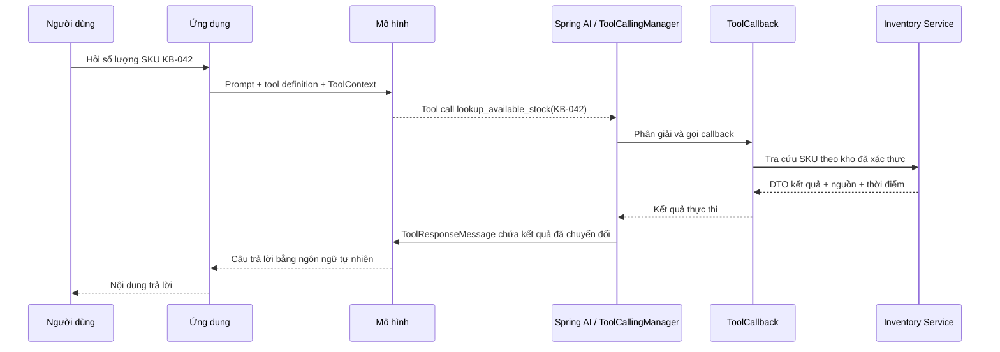

# Công cụ đầu tiên

## Phân biệt kết quả thực thi đã xác minh và nội dung mô hình diễn giải

Khi tích hợp tool calling vào Spring AI, một câu trả lời có thể chứa cả dữ liệu lấy từ hệ thống nghiệp vụ và phần ngôn ngữ do mô hình tạo ra. Hai phần này thường xuất hiện nối tiếp nhau nên dễ bị xem là một kết quả duy nhất. Tuy nhiên, chúng có nguồn gốc và mức độ kiểm chứng khác nhau.

Trong module `SPRING_AI_TOOL_CALLING`, ứng dụng công khai công cụ qua `@Tool`, `ToolCallback`, schema đầu vào và `ToolContext`. Mô hình có thể yêu cầu gọi công cụ; ứng dụng thực thi yêu cầu đó và nhận kết quả. Sau đó, tùy cách cấu hình, kết quả được gửi lại cho mô hình để diễn giải hoặc được trả thẳng cho caller. Hiểu ranh giới này giúp ứng dụng giữ được dữ liệu gốc, trình bày đúng trạng thái nghiệp vụ và không nhầm một câu văn trôi chảy với bằng chứng từ hệ thống.

### 1. Hai loại kết quả có vai trò khác nhau

**Kết quả thực thi đã xác minh** là dữ liệu mà ứng dụng nhận được sau khi callback thực sự chạy và service nghiệp vụ trả kết quả theo hợp đồng của nó. Ví dụ, dịch vụ tồn kho truy vấn kho `HN-01` và trả về số lượng có thể bán là 6 tại thời điểm 10:25. Ứng dụng có thể xác định nguồn dữ liệu, thời điểm truy vấn, mã yêu cầu và trạng thái xử lý để kiểm tra hoặc truy vết kết quả.

**Nội dung mô hình diễn giải** là văn bản hoặc cấu trúc được mô hình sinh ra sau khi nhận dữ liệu từ tool. Ví dụ: “Kho Hà Nội hiện còn 6 sản phẩm và có thể giao ngay.” Mô hình có thể tóm tắt đúng, nhưng cũng có thể bỏ qua điều kiện, nhầm đơn vị, diễn giải sai trạng thái hoặc thêm một kết luận mà tool không cung cấp.

Kết quả thực thi cũng cần được hiểu đúng phạm vi. Việc callback chạy thành công chỉ chứng minh rằng code đã thực thi và trả về một giá trị. Giá trị đó có đáng tin cậy hay không còn phụ thuộc service có truy vấn đúng nguồn dữ liệu, kiểm tra quyền, xử lý cache, đồng bộ và tính nhất quán hay không. Vì vậy, trong bài này, “đã xác minh” nghĩa là kết quả đã được ứng dụng kiểm tra theo hợp đồng và nguồn dữ liệu đã xác định; nó không phải lời bảo đảm rằng mọi hệ thống bên dưới luôn đúng tuyệt đối.

| Thuộc tính | Kết quả thực thi | Nội dung mô hình diễn giải |
| --- | --- | --- |
| Nguồn tạo ra | Tool callback và service nghiệp vụ | Mô hình ngôn ngữ |
| Nội dung điển hình | DTO, trạng thái, số lượng, thời điểm, mã nguồn | Câu trả lời tự nhiên, tóm tắt, giải thích, đề xuất |
| Có thể kiểm tra bằng | Quy tắc nghiệp vụ, truy vấn nguồn, log, request ID, dữ liệu gốc | So sánh với tool result và các ràng buộc của prompt |
| Rủi ro thường gặp | Dữ liệu cũ, truy vấn sai, thiếu quyền, lỗi nguồn | Bỏ sót, nhầm lẫn, suy diễn hoặc tạo chi tiết không có trong dữ liệu |
| Cách sử dụng | Làm căn cứ nghiệp vụ và lưu vết | Giúp người dùng hiểu kết quả |

### 2. Theo dấu một yêu cầu từ lúc gọi tool đến câu trả lời

Giả sử người dùng hỏi: “Kho Hà Nội còn bao nhiêu bàn phím mã `KB-042`?”. Ứng dụng cung cấp tool `lookup_available_stock`. Mô hình có thể phát ra tool call với SKU `KB-042`. Ứng dụng chạy callback, lấy kho mặc định từ ngữ cảnh đã xác thực, gọi `InventoryQueryService` và nhận DTO. Spring AI chuyển DTO thành chuỗi để tạo tool response. Theo luồng mặc định, mô hình nhận tool response và tạo câu trả lời cuối.



Trong luồng này có nhiều mốc khác nhau:

1. **Tool call request:** mô hình yêu cầu một thao tác. Đây mới là yêu cầu, chưa chứng minh thao tác đã chạy.
2. **Callback execution:** ứng dụng phân giải đúng `ToolCallback` và thực thi method. Cần biết callback đã hoàn tất hay phát sinh lỗi.
3. **Business result:** service trả dữ liệu theo hợp đồng. Đây là điểm ứng dụng kiểm tra trạng thái, nguồn, thời điểm và phạm vi quyền.
4. **Tool response:** Spring AI chuyển kết quả thành chuỗi và gắn vào lịch sử trao đổi để gửi cho mô hình. `ToolResponseMessage` là phần giao thức trao đổi, không phải một cơ chế kiểm định độc lập.
5. **Assistant answer:** mô hình tạo phần giải thích cuối. Đây là nội dung được sinh ra dựa trên ngữ cảnh, không phải bản sao có bảo đảm của DTO.

Không nên đánh dấu một yêu cầu là thành công chỉ vì log thấy mô hình đã yêu cầu tool. Cũng không nên coi việc nhận được một câu trả lời cuối là bằng chứng callback đã truy vấn đúng nguồn. Cần theo dõi kết quả ở đúng mốc.

### 3. Thiết kế DTO để giữ bằng chứng nghiệp vụ

Tool nên trả về một kiểu dữ liệu có cấu trúc, đủ nhỏ và có ý nghĩa rõ ràng. Đừng chỉ trả một câu như “Còn 6 sản phẩm”, vì câu này khó phân biệt số lượng, đơn vị, kho, thời điểm và nguồn dữ liệu. Một DTO có metadata giúp tầng ứng dụng kiểm tra kết quả và giúp mô hình diễn giải với ngữ cảnh đầy đủ.

Ví dụ kết quả tra cứu tồn kho:

```java
public record StockLookupResult(
        LookupStatus status,
        String sku,
        String warehouseId,
        Integer availableQuantity,
        Instant observedAt,
        String sourceSystem,
        String requestId) {
}

public enum LookupStatus {
    FOUND,
    NOT_FOUND
}
```

Các trường có mục đích riêng:

- `status` phân biệt tìm thấy bản ghi với trường hợp không có dữ liệu phù hợp. Không dùng số lượng `0` để đại diện cho cả “không tồn kho” lẫn “không tìm thấy SKU”.
- `sku` và `warehouseId` cho biết kết quả áp dụng với sản phẩm và kho nào.
- `availableQuantity` là số lượng có thể bán theo định nghĩa của service; cần ghi rõ nếu hệ thống có thêm số lượng vật lý, số lượng đã giữ hoặc số lượng đang chờ nhập.
- `observedAt` ghi thời điểm dữ liệu được đọc hoặc xác nhận. Dùng `Instant` hoặc thời điểm có offset để tránh nhập nhằng múi giờ.
- `sourceSystem` cho biết nguồn dữ liệu đã cung cấp kết quả.
- `requestId` giúp nối kết log của request, callback và truy vấn ở hệ thống nghiệp vụ.

Đây là ví dụ về hợp đồng dữ liệu. Trong hệ thống thực tế, tên trường, trạng thái và cách xác định `availableQuantity` phải khớp với quy tắc của dịch vụ tồn kho.

### 4. Viết tool đầu tiên và truyền ngữ cảnh tin cậy

Method được đánh dấu `@Tool` làm công cụ mà mô hình có thể yêu cầu gọi. Schema mô tả tham số mô hình cần cung cấp; `ToolContext` chuyển dữ liệu nội bộ do ứng dụng thiết lập. Trong ví dụ, mô hình cung cấp SKU, còn mã kho lấy từ request đã xác thực.

```java
import org.springframework.ai.chat.model.ToolContext;
import org.springframework.ai.tool.annotation.Tool;
import org.springframework.ai.tool.annotation.ToolParam;
import org.springframework.stereotype.Component;

@Component
public class InventoryTools {

    private final InventoryQueryService inventoryQueryService;

    public InventoryTools(InventoryQueryService inventoryQueryService) {
        this.inventoryQueryService = inventoryQueryService;
    }

    @Tool(
        name = "lookup_available_stock",
        description = "Tra cứu số lượng có thể bán của một SKU trong kho mà người dùng hiện tại được phép xem."
    )
    public StockLookupResult lookupAvailableStock(
            @ToolParam(description = "Mã SKU cần tra cứu, ví dụ KB-042") String sku,
            ToolContext toolContext) {

        Object value = toolContext.getContext().get("warehouseId");
        if (!(value instanceof String warehouseId) || warehouseId.isBlank()) {
            throw new IllegalStateException("Thiếu ngữ cảnh kho hợp lệ.");
        }

        return inventoryQueryService.lookupAvailableStock(sku, warehouseId);
    }
}
```

`InventoryQueryService` chịu trách nhiệm kiểm tra định dạng SKU, xác thực người dùng có quyền xem kho, truy vấn nguồn dữ liệu và tạo `StockLookupResult`. Tool adapter không nên tự chứa quy tắc tồn kho phức tạp; nó chuyển yêu cầu đã được mô hình cấu trúc hóa tới service nghiệp vụ.

Ứng dụng gọi tool qua `ChatClient`:

```java
String answer = ChatClient.create(chatModel)
    .prompt()
    .user("Kho Hà Nội còn bao nhiêu bàn phím mã KB-042?")
    .tools(new InventoryTools(inventoryQueryService))
    .toolContext(Map.of(
        "warehouseId", authenticatedUser.getAuthorizedWarehouseId()))
    .call()
    .content();
```

Trong luồng mặc định, Spring AI thực thi tool rồi đưa kết quả về mô hình. Mô hình dùng dữ liệu đó để tạo `answer`. `answer` là nội dung diễn giải cuối, không phải đối tượng `StockLookupResult` ban đầu.

`ToolContext` không được gửi cho mô hình như một phần schema đầu vào. Điều này giúp ứng dụng truyền `userId`, `tenantId` hoặc `warehouseId` mà mô hình không phải tự tạo. Tuy nhiên, context chỉ là phương tiện truyền dữ liệu; service vẫn phải kiểm tra quyền và phạm vi truy cập ở thời điểm thực thi.

### 5. Tool response được chuyển đổi như thế nào?

Method tool có thể trả về một object Java. Spring AI dùng `ToolCallResultConverter` để chuyển object đó thành `String`, vì tool response được gửi cho mô hình dưới dạng nội dung văn bản. `DefaultToolCallResultConverter` mặc định dùng Jackson để serialize kết quả thành JSON. Có thể cấu hình converter riêng trên `@Tool` hoặc `ToolMetadata` khi cần định dạng khác.

Ví dụ JSON được tạo từ `StockLookupResult`:

```json
{
  "status": "FOUND",
  "sku": "KB-042",
  "warehouseId": "HN-01",
  "availableQuantity": 6,
  "observedAt": "2026-11-27T03:25:00Z",
  "sourceSystem": "inventory-db",
  "requestId": "inv-7f31a2"
}
```

JSON này là kết quả đã chuyển đổi từ object của ứng dụng. Nó có thể giúp mô hình đọc đúng từng trường, nhưng việc serialize thành JSON không tự tạo ra tính đúng đắn. Nếu service trả số lượng sai hoặc dùng cache quá cũ, JSON vẫn biểu diễn sai dữ liệu đó một cách hợp lệ.

Schema đầu vào và schema kết quả cũng có vai trò khác nhau. JSON Schema của tool mô tả những đối số mô hình cần gửi khi gọi method. Nó không phải hợp đồng xác minh kết quả trả về. Hợp đồng kết quả cần được định nghĩa bằng DTO, validation và quy tắc của service.

### 6. Mô hình có thể diễn giải sai dù tool chạy đúng

Giả sử tool trả về:

```json
{
  "status": "FOUND",
  "sku": "KB-042",
  "warehouseId": "HN-01",
  "availableQuantity": 6,
  "observedAt": "2026-11-27T03:25:00Z",
  "sourceSystem": "inventory-db",
  "requestId": "inv-7f31a2"
}
```

Mô hình có thể tạo ra một trong các câu sau:

| Nội dung mô hình tạo | Đánh giá |
| --- | --- |
| “Kho HN-01 có 6 sản phẩm KB-042 có thể bán, theo dữ liệu lúc 10:25 giờ Việt Nam.” | Diễn giải phù hợp nếu thời điểm được đổi múi giờ chính xác |
| “Kho Hà Nội có 6 sản phẩm trong kho.” | Có thể thiếu điều kiện: DTO nói số lượng có thể bán, không nhất thiết là tổng số vật lý |
| “Kho HN-01 có 8 sản phẩm.” | Sai số lượng so với tool result |
| “Kho HN-01 chắc chắn giao trong ngày.” | Suy luận không được chứng minh bởi kết quả tồn kho |
| “SKU không tồn tại.” | Sai trạng thái vì tool trả `FOUND` |

Vì vậy, khi nhận câu trả lời cuối, ứng dụng không nên dùng text của mô hình làm nguồn dữ liệu để cập nhật tồn kho, tính tiền hoặc quyết định trạng thái đơn hàng. Nếu cần hiển thị kết quả chính xác, hãy lấy các trường từ DTO đã xác minh và trình bày chúng trực tiếp. Mô hình có thể bổ sung lời giải thích bên cạnh dữ liệu gốc.

### 7. Khi nào dùng `returnDirect`?

Mặc định, kết quả tool được gửi lại cho mô hình để nó tiếp tục hội thoại. Cách này phù hợp khi cần giải thích, tổng hợp nhiều nguồn, hoặc trả lời câu hỏi tự nhiên. Khi tool đã tạo ra kết quả cuối cùng và không cần mô hình xử lý thêm, có thể đặt `returnDirect = true` trên `@Tool`.

```java
@Tool(
    name = "lookup_available_stock",
    description = "Tra cứu số lượng có thể bán theo SKU và kho được cấp quyền.",
    returnDirect = true
)
public StockLookupResult lookupAvailableStock(
        @ToolParam(description = "Mã SKU cần tra cứu") String sku,
        ToolContext toolContext) {
    String warehouseId = requireWarehouseId(toolContext);
    return inventoryQueryService.lookupAvailableStock(sku, warehouseId);
}
```

Khi `returnDirect` được bật, Spring AI thực thi tool như bình thường, sau đó trả kết quả thực thi trực tiếp cho caller và kết thúc vòng lặp. Mô hình không nhận tool result và không tạo thêm một câu diễn giải cuối. Với kết quả object mặc định được serialize thành JSON, caller có thể đọc nội dung trực tiếp hoặc deserialize thành DTO:

```java
String rawResult = ChatClient.create(chatModel)
    .prompt()
    .user("Tra cứu tồn kho KB-042 trong kho của tôi.")
    .tools(new InventoryTools(inventoryQueryService))
    .toolContext(Map.of(
        "warehouseId", authenticatedUser.getAuthorizedWarehouseId()))
    .call()
    .content();

StockLookupResult result = objectMapper.readValue(
    rawResult, StockLookupResult.class);
```

Đoạn code minh họa đường direct với kết quả JSON từ converter mặc định. Ứng dụng vẫn cần kiểm tra dữ liệu sau deserialize và xử lý trạng thái `NOT_FOUND` theo hợp đồng API của mình. Nếu dùng custom result converter, định dạng trả về phải khớp với cách caller đọc dữ liệu.

Có một lưu ý khi mô hình yêu cầu nhiều tool trong cùng một lượt: `returnDirect` chỉ được áp dụng khi tất cả các tool call trong lượt đó đều có `returnDirect = true`. Nếu có ít nhất một tool không bật cờ, các kết quả sẽ được gửi về mô hình để tiếp tục hội thoại. Khi dùng nhiều tool, không giả định rằng một kết quả đã bật direct sẽ luôn được trả riêng ngay lập tức.

`returnDirect` chỉ quyết định có bỏ qua bước diễn giải của mô hình hay không. Nó không tự xác thực nguồn dữ liệu, không kiểm tra quyền và không làm dữ liệu trở nên mới hơn.

### 8. Xử lý trạng thái nghiệp vụ và lỗi thực thi

Một kết quả hợp lệ có thể thể hiện rằng không tìm thấy dữ liệu. Đây là trạng thái nghiệp vụ, không nhất thiết là lỗi kỹ thuật. Ví dụ `NOT_FOUND` có nghĩa service đã truy vấn thành công nhưng không có bản ghi phù hợp. Ngược lại, timeout, lỗi kết nối hoặc database unavailable có nghĩa ứng dụng chưa xác định được số lượng tồn kho.

Nên phân biệt tối thiểu các tình huống sau:

| Tình huống | Cách biểu diễn | Có thể kết luận gì? |
| --- | --- | --- |
| Tìm thấy bản ghi | `status=FOUND` và các trường dữ liệu | Có dữ liệu theo nguồn, phạm vi và thời điểm đã ghi nhận |
| Không có bản ghi | `status=NOT_FOUND` | Truy vấn hoàn tất nhưng không tìm thấy bản ghi phù hợp |
| Không đủ quyền | Lỗi phân quyền được xử lý ở tầng ứng dụng | Caller không được phép xem dữ liệu; không tiết lộ bản ghi bị từ chối |
| Nguồn quá thời gian hoặc không khả dụng | Lỗi thực thi được ghi nhận | Chưa có kết quả dữ liệu đáng tin cậy |
| Dữ liệu quá cũ | Trạng thái freshness hoặc metadata chỉ rõ thời điểm | Có dữ liệu nhưng không đáp ứng ngưỡng mới nhất của nghiệp vụ |
| Một phần thao tác thành công | Kết quả từng tool call được giữ riêng | Không được gộp thành một kết luận thành công toàn phần |

Spring AI bọc lỗi từ tool trong `ToolExecutionException` và chuyển đến `ToolExecutionExceptionProcessor`. Theo mặc định hiện tại, thông báo của `RuntimeException` có thể được gửi lại cho mô hình để mô hình giải thích hoặc thử cách khác; checked exception và `Error` được ném lại cho caller. Có thể cấu hình `spring.ai.tools.throw-exception-on-error=true` để đẩy lỗi tool về caller xử lý.

Điều này có ý nghĩa trực tiếp với độ tin cậy: nếu tool thất bại và lỗi được gửi lại mô hình, câu trả lời sau đó vẫn là nội dung do mô hình tạo. Một lời xin lỗi hoặc câu “không tìm thấy dữ liệu” không tự chứng minh database đã trả `NOT_FOUND`. Nếu ứng dụng cần phân biệt lỗi kỹ thuật với kết quả nghiệp vụ, hãy dùng exception processor phù hợp hoặc xử lý lỗi ở tầng gọi; không chuyển mọi lỗi thành chuỗi giống một kết quả hợp lệ.

Không đưa stack trace, câu SQL, thông tin kết nối, token hoặc dữ liệu nhạy cảm vào thông báo lỗi gửi mô hình. Dùng mã lỗi an toàn và request ID để người vận hành tra cứu log chi tiết ở hệ thống nội bộ.

### 9. Giữ provenance và liên kết giữa các tool call

Một câu trả lời có thể dựa trên nhiều tool. Ví dụ, mô hình gọi `lookup_available_stock` và `get_reorder_threshold`. Mỗi kết quả có nguồn, thời điểm và trạng thái riêng. Nếu chỉ lưu câu trả lời cuối “Tồn kho đủ đáp ứng nhu cầu”, ứng dụng sẽ khó biết mô hình đã so sánh đúng kho, đúng ngưỡng và đúng thời điểm hay chưa.

Hãy giữ lại các thông tin cần thiết để truy vết:

- Request ID của yêu cầu từ ứng dụng.
- Tool name và tool call ID để liên kết yêu cầu với đúng tool response.
- Người dùng, tenant và phạm vi dữ liệu đã được xác thực; không lấy các giá trị này từ lời mô hình.
- Nguồn dữ liệu, thời điểm quan sát, trạng thái nghiệp vụ và thời gian thực thi.
- Phiên bản hoặc dấu vết dữ liệu nếu hệ thống nguồn hỗ trợ.
- Kết quả cuối của mô hình và trạng thái xử lý, được lưu tách khỏi DTO gốc.

Với nhiều tool call trong một lượt, cần ghép response với đúng call ID. Không dựa vào thứ tự mảng hoặc thứ tự dòng log để đoán kết quả thuộc công cụ nào. Khi có tool chạy thành công và tool khác thất bại, giữ trạng thái từng kết quả để mô hình hoặc ứng dụng không kết luận rằng toàn bộ yêu cầu đã hoàn tất.

Spring AI cung cấp observability cho tool call, bao gồm tên tool, thời gian thực thi và tracing context khi có tracer. Việc xuất đối số và kết quả tool thành span attributes bị tắt mặc định do các giá trị này có thể nhạy cảm. Chỉ bật khi có chính sách bảo vệ dữ liệu phù hợp; log nghiệp vụ nên ưu tiên mã tham chiếu và trạng thái thay vì lưu toàn bộ payload.

### 10. Đừng nhầm JSON do mô hình tạo với dữ liệu gốc

Mô hình có thể trả lời bằng JSON hoặc một schema đầu ra cố định. Hình thức có cấu trúc giúp client parse dễ hơn, nhưng không chứng minh các giá trị bên trong đến trực tiếp từ tool. Mô hình vẫn có thể sao chép sai một con số, đổi trạng thái hoặc tự thêm trường.

Ví dụ, mô hình được yêu cầu trả về:

```json
{
  "sku": "KB-042",
  "availableQuantity": 8,
  "recommendation": "Có thể tiếp tục bán"
}
```

Nếu tool result ban đầu có `availableQuantity=6`, JSON này vẫn chỉ là nội dung mô hình sinh ra và có số lượng sai. Validation cấu trúc có thể xác nhận JSON đúng schema, nhưng không tự xác nhận con số khớp nguồn dữ liệu.

Khi cần đầu ra có cấu trúc, nên giữ DTO tool như dữ liệu gốc, dùng mã định danh hoặc tham chiếu để liên kết với phần giải thích của mô hình, rồi kiểm tra các trường quan trọng trước khi dùng. Với các trường như số tiền, số lượng, trạng thái thanh toán hoặc quyền truy cập, ứng dụng nên lấy giá trị từ service và kiểm tra bằng quy tắc nghiệp vụ.

### 11. Kiểm thử hai tầng riêng biệt

Kiểm thử tool calling cần chứng minh cả tính đúng của thực thi và tính đúng của phần diễn giải. Một integration test chỉ kiểm tra chuỗi cuối cùng có chứa “6 sản phẩm” sẽ không cho biết service đã truy vấn đúng kho hay mô hình chỉ đoán ra con số đó.

**Kiểm thử tầng thực thi:**

- Unit test `InventoryQueryService` với các trường hợp `FOUND`, `NOT_FOUND`, dữ liệu stale và lỗi nguồn.
- Kiểm tra tool nhận đúng SKU do mô hình cung cấp và đúng `warehouseId` từ `ToolContext`.
- Kiểm tra quyền theo tenant/kho, kể cả trường hợp người dùng cố yêu cầu một kho khác.
- Xác minh DTO có `observedAt`, `sourceSystem`, `requestId` và số lượng đúng theo fixture.
- Kiểm tra lỗi không bị chuyển thành kết quả nghiệp vụ thành công.

**Kiểm thử tầng điều phối và diễn giải:**

- Dùng mock model trả tool call có tên và đối số xác định; xác minh đúng callback được thực thi.
- Kiểm tra tool response được đưa vào lịch sử hội thoại với đúng tool call ID.
- Dùng response mô hình giả lập để kiểm tra ứng dụng giữ riêng tool result và câu trả lời cuối.
- Tạo trường hợp mô hình cố tình diễn giải sai số lượng; xác minh API nghiệp vụ vẫn trả dữ liệu từ DTO gốc hoặc phát hiện sai khác theo quy tắc.
- Kiểm tra `returnDirect=true` kết thúc vòng lặp và không phát sinh lượt gọi mô hình tiếp theo.
- Với nhiều tool call, kiểm tra trường hợp một tool direct và một tool không direct để xác nhận hành vi theo quy tắc của Spring AI.
- Kiểm tra timeout, retry, tool call lặp và giới hạn số lần gọi.

Ví dụ một test đơn vị cho service:

```java
@Test
void returnsVerifiedQuantityForRequestedWarehouse() {
    StockLookupResult result = inventoryQueryService.lookupAvailableStock(
        "KB-042", "HN-01");

    assertThat(result.status()).isEqualTo(LookupStatus.FOUND);
    assertThat(result.sku()).isEqualTo("KB-042");
    assertThat(result.warehouseId()).isEqualTo("HN-01");
    assertThat(result.availableQuantity()).isEqualTo(6);
    assertThat(result.sourceSystem()).isEqualTo("inventory-db");
    assertThat(result.observedAt()).isNotNull();
    assertThat(result.requestId()).isNotBlank();
}
```

Test này xác minh hợp đồng của service với dữ liệu kiểm thử. Một integration test riêng cần xác minh Spring AI gọi đúng tool và chuyển result về mô hình hoặc caller theo cấu hình. Không nên gộp hai mục tiêu thành một assertion trên văn bản cuối.

### 12. Chọn cách trả kết quả theo yêu cầu sản phẩm

| Nhu cầu | Cách triển khai phù hợp |
| --- | --- |
| Người dùng cần lời giải thích dễ hiểu từ dữ liệu | Để tool result quay lại mô hình, sau đó kiểm tra và trình bày dữ liệu quan trọng từ DTO |
| API cần trả số lượng, tiền hoặc trạng thái chính xác | Giữ DTO làm nguồn dữ liệu; dùng `returnDirect` hoặc gọi service trực tiếp ở tầng nghiệp vụ |
| Cần tổng hợp nhiều nguồn và nêu lý do | Gửi các tool result về mô hình, nhưng giữ riêng provenance và từng kết quả nguồn |
| Kết quả tool đã là câu trả lời cuối | Cân nhắc `returnDirect=true` để bỏ qua lượt diễn giải không cần thiết |
| Thao tác ghi dữ liệu hoặc có tác dụng phụ | Xác thực quyền, xác nhận ý định, kiểm tra điều kiện và audit trước khi thực thi; kết quả xác nhận từ service là căn cứ nghiệp vụ |
| Nguồn dữ liệu có thể chậm hoặc stale | Trả rõ thời điểm quan sát và trạng thái freshness; không trình bày như dữ liệu hiện tại nếu chưa đạt ngưỡng |

Với một giao diện hội thoại, cách trình bày tốt thường là kết hợp cả hai tầng: câu giải thích do mô hình tạo giúp người dùng hiểu vấn đề, còn các trường quan trọng như số lượng, thời điểm và trạng thái được lấy trực tiếp từ kết quả thực thi. Nếu phần giải thích mâu thuẫn với dữ liệu nguồn, ứng dụng cần ưu tiên dữ liệu đã xác minh và có thể yêu cầu mô hình diễn giải lại.

### 13. Quy tắc cần nhớ khi xây dựng tool đầu tiên

1. Tool call do mô hình phát ra chỉ là yêu cầu thực thi, chưa phải kết quả.
2. Callback hoàn tất chưa đủ để khẳng định dữ liệu đúng; service phải truy vấn đúng nguồn và kiểm tra quyền.
3. Trả DTO có cấu trúc, trạng thái rõ ràng, nguồn và thời điểm quan sát.
4. `ToolResponseMessage` mang kết quả đã chuyển đổi trở lại mô hình; nó không xác nhận tính đúng của dữ liệu.
5. Nội dung cuối của mô hình là phần diễn giải, có thể sai dù tool result đúng.
6. Dùng `returnDirect` khi kết quả tool là đầu ra cuối và cần bỏ qua bước diễn giải; nhớ quy tắc tất cả tool call trong cùng lượt đều phải bật direct.
7. Giữ dữ liệu gốc, request ID, tool call ID và provenance để kiểm toán và xử lý tranh chấp.
8. Kiểm thử service, callback, tool loop và câu trả lời mô hình thành các lớp riêng.

Trong Spring AI, mô hình giúp ứng dụng chọn công cụ và diễn đạt kết quả. Ứng dụng vẫn chịu trách nhiệm thực thi, xác minh dữ liệu theo hợp đồng nghiệp vụ và quyết định phần nào được phép dùng làm căn cứ cho hành động tiếp theo.

### Tài liệu tham khảo

- [Spring AI 2.1 Reference — Tool Calling](https://docs.spring.io/spring-ai/reference/api/tools.html)
- [Spring AI 2.1 Reference — ToolCallingAdvisor](https://docs.spring.io/spring-ai/reference/api/tools/tool-calling-advisor.html)
- [Spring AI 2.1 Reference — ChatModel Tool Calling](https://docs.spring.io/spring-ai/reference/api/tools/chatmodel-tool-calling.html)
- [Spring AI 1.0 Reference — Tool Calling and Result Conversion](https://docs.spring.io/spring-ai/reference/1.0/api/tools.html)

Các chi tiết `returnDirect`, result converter và exception processor cần được đối chiếu với đúng phiên bản Spring AI mà ứng dụng sử dụng. Bài viết dùng tài liệu Spring AI 2.1 cho API hiện hành và tài liệu 1.0 để minh họa cách xử lý đã có trong dòng 1.x.
