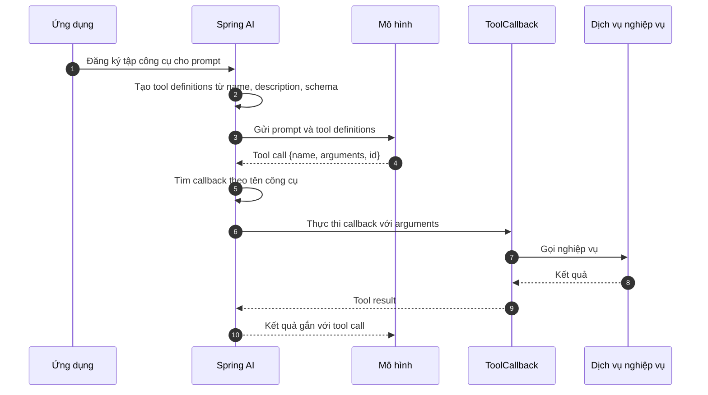

# Đặt tên công cụ rõ nghĩa và duy nhất trong tập được cung cấp

Tên công cụ là định danh mà mô hình nhìn thấy khi lựa chọn một thao tác. Trong Spring AI, tên này được đưa vào tool definition cùng mô tả và schema đầu vào. Khi mô hình yêu cầu gọi công cụ, ứng dụng dựa vào tên để tìm `ToolCallback` tương ứng rồi chuyển yêu cầu đến mã Java thực thi.

Vì vậy, tên công cụ cần diễn đạt được hành động và đối tượng nghiệp vụ, đồng thời phải duy nhất trong tập công cụ mà ứng dụng cung cấp cho một yêu cầu hội thoại. Nếu một prompt đồng thời công bố hai công cụ cùng tên như `getStatus`, mô hình không có cách đáng tin cậy để phân biệt trạng thái đơn hàng với trạng thái thanh toán. Tên rõ nghĩa giúp mô hình chọn đúng công cụ, giúp Spring AI ánh xạ callback chính xác và giúp người phát triển đọc log, kiểm thử cũng như theo dõi hành vi dễ dàng.

Trong module `SPRING_AI_TOOL_CALLING`, `@Tool` và `ToolCallback` là hai cách công bố khả năng thực thi. Dù dùng annotation hay tạo callback theo cách lập trình, tên công cụ vẫn là một phần của hợp đồng giữa ứng dụng và mô hình. Hãy thiết kế tên như một API công khai có chủ đích: ổn định, dễ hiểu, không phụ thuộc dữ liệu theo request và không mang ý nghĩa cấp quyền.

## 1. Tên công cụ được dùng ở đâu trong luồng tool calling?

Ứng dụng đăng ký một tập công cụ cho prompt. Spring AI tạo tool definition từ tên, mô tả và schema đầu vào, sau đó gửi định nghĩa này đến model provider. Mô hình chọn một công cụ và trả về tool call chứa tên cùng đối số. Spring AI dùng tên đó để tìm callback, thực thi mã Java và đưa kết quả trở lại lịch sử hội thoại.



Trong chuỗi này, tên công cụ có hai vai trò liên quan chặt chẽ:

- **Đối với mô hình:** tên là nhãn để lựa chọn khả năng phù hợp với ý định của người dùng.
- **Đối với ứng dụng:** tên là khóa định danh để ánh xạ yêu cầu gọi đến callback đã đăng ký.

Tên không phải tên hiển thị cho người dùng cuối. Nó là một phần của giao diện kỹ thuật mà mô hình sử dụng. Có thể dùng tên thân thiện với lập trình viên như `getOrderStatus`, trong khi câu trả lời cuối được mô hình diễn đạt bằng tiếng Việt tự nhiên.

## 2. Phạm vi cần bảo đảm tính duy nhất

Yêu cầu quan trọng là tên phải duy nhất trong **tập công cụ được cung cấp cùng một yêu cầu model**. Đây là tập mà mô hình có thể lựa chọn ở thời điểm đó.

Ví dụ, một ứng dụng có các lớp `OrderTools`, `PaymentTools` và `ShippingTools`. Mỗi lớp có thể có phương thức riêng để tra cứu trạng thái, nhưng nếu cả ba công cụ cùng được đăng ký cho một prompt thì tên chung `getStatus` tạo ra xung đột về ý nghĩa và ánh xạ.

| Tập công cụ được cung cấp | Tên | Đánh giá |
|---|---|---|
| `OrderTools` | `getStatus` | Có thể hiểu trong phạm vi chỉ có công cụ đơn hàng |
| `PaymentTools` | `getStatus` | Có thể hiểu trong phạm vi chỉ có công cụ thanh toán |
| Cả hai nhóm cùng một prompt | `getStatus` và `getStatus` | Trùng tên, không thể hiện rõ công cụ nào cần được chọn |
| Cả hai nhóm cùng một prompt | `getOrderStatus` và `getPaymentStatus` | Phân biệt rõ đối tượng nghiệp vụ |

Không nhất thiết mọi tên trong toàn bộ mã nguồn phải là duy nhất nếu các công cụ nằm ở những tập hoàn toàn tách biệt và không bao giờ được công bố đồng thời. Tuy nhiên, dùng một quy ước đặt tên nhất quán trên toàn ứng dụng sẽ giảm rủi ro khi các nhóm công cụ được kết hợp trong use case mới.

Không dựa vào thứ tự đăng ký callback để phân giải tên trùng. Việc một implementation ghi đè, từ chối đăng ký hay chọn một callback cụ thể có thể phụ thuộc cơ chế và phiên bản; trong mọi trường hợp, ứng dụng không nên để kết quả phụ thuộc vào hành vi đó. Hãy bảo đảm tính duy nhất trước khi gửi tool definitions cho mô hình.

## 3. Công thức đặt tên: hành động + đối tượng nghiệp vụ

Một quy tắc thực tế là đặt tên theo động từ chỉ hành động kết hợp với đối tượng mà hành động tác động đến. Khi cần, thêm phạm vi để phân biệt rõ hơn.

```text
<action><businessObject><scopeOptional>
```

Ví dụ:

| Tên nên dùng | Ý nghĩa |
|---|---|
| `getOrderStatus` | Lấy trạng thái đơn hàng |
| `findCustomerProfile` | Tìm hồ sơ khách hàng |
| `checkProductAvailability` | Kiểm tra khả năng cung ứng sản phẩm |
| `calculateShippingFee` | Tính phí vận chuyển |
| `requestOrderCancellation` | Gửi yêu cầu hủy đơn hàng |
| `listRecentInvoices` | Liệt kê hóa đơn gần đây |

Động từ nên phản ánh đúng tác động:

- `get`, `find`, `list`, `search` thường phù hợp với thao tác đọc hoặc tìm kiếm.
- `check`, `validate`, `calculate`, `estimate` diễn đạt thao tác kiểm tra hoặc tính toán.
- `create`, `submit`, `request`, `update`, `cancel` diễn đạt hành động có thể làm thay đổi trạng thái hoặc tạo tác động phụ.

Đây là quy ước ngữ nghĩa, không phải phân loại bảo mật tự động. Một hàm tên `getOrderStatus` vẫn phải kiểm tra quyền đọc dữ liệu; một hàm tên `requestOrderCancellation` vẫn phải có xác nhận và kiểm soát nghiệp vụ thích hợp.

Khi có nhiều miền cùng dùng một động từ, đưa đối tượng vào tên. `getOrderStatus` và `getPaymentStatus` rõ hơn hai hàm cùng tên `getStatus`. Nếu một đối tượng có nhiều loại dữ liệu, có thể nêu rõ phạm vi: `getCustomerBillingAddress`, `getCustomerSupportHistory`.

## 4. Các quy tắc đặt tên nên áp dụng

Một tên tốt nên đáp ứng những tiêu chí sau:

1. **Có nghĩa khi đọc độc lập:** người phát triển có thể đoán đúng hành động và đối tượng mà không phải mở phần thân hàm.
2. **Dùng một hành động cụ thể:** tránh các động từ mơ hồ như `handle`, `process`, `do` hoặc `execute` nếu không nêu rõ thao tác.
3. **Phân biệt với công cụ cùng tập:** tên không trùng và không gần giống đến mức gây nhầm lẫn.
4. **Ổn định:** không thay đổi tên theo từng người dùng, tenant, phiên hội thoại hoặc dữ liệu đầu vào.
5. **Ngắn vừa đủ:** không nhồi mô tả, điều kiện hay câu văn dài vào tên; phần chi tiết thuộc `description` và schema.
6. **Nhất quán:** dùng một kiểu viết, thường là lower camel case cho tên công cụ trong ví dụ Java.
7. **Phù hợp provider:** kiểm tra quy tắc ký tự và độ dài mà model provider đang sử dụng hỗ trợ. Các provider có thể đặt giới hạn khác nhau.

Nên tránh dấu cách, dấu tiếng Việt, câu văn tự nhiên, ký tự trang trí và các tên chỉ có nghĩa trong nội bộ một nhóm nhỏ. Các tên như `tra_cuu_don_hang_cua_toi_ngay_hom_nay` vừa dài vừa gắn với cách diễn đạt của một câu hỏi cụ thể. `getOrderStatus` là định danh ổn định hơn; thông tin thời gian hoặc người dùng cần thiết phải được biểu diễn ở tham số hoặc ngữ cảnh thích hợp.

Không đưa dữ liệu động vào tên. Ví dụ, đừng tạo tên `getOrderStatusForUser123` hoặc `getOrderStatusTenantA`. Người dùng và tenant được xác định từ phiên đã xác thực, thường truyền qua `ToolContext`; mã đơn hàng là đối số của tool call. Tên công cụ chỉ xác định loại thao tác.

## 5. Đặt tên rõ nghĩa trong `@Tool`

Spring AI cho phép đánh dấu phương thức Java bằng `@Tool`. Có thể chỉ rõ tên công cụ trong annotation để tách hợp đồng công khai với tên phương thức Java:

```java
import org.springframework.ai.tool.annotation.Tool;
import org.springframework.ai.tool.annotation.ToolParam;
import org.springframework.stereotype.Component;

@Component
public class OrderTools {

    @Tool(
            name = "getOrderStatus",
            description = "Tra cứu trạng thái hiện tại của một đơn hàng theo mã đơn hàng.")
    public OrderStatusView loadStatus(
            @ToolParam(description = "Mã đơn hàng cần tra cứu") String orderId) {
        return orderQueryService.findStatus(orderId);
    }
}
```

Trong ví dụ, tên Java là `loadStatus`, còn tên công cụ được công bố là `getOrderStatus`. Điều này hữu ích khi muốn giữ tên phương thức theo quy ước nội bộ hoặc thay đổi cách tổ chức mã mà không đổi định danh mà mô hình nhìn thấy. Nếu bỏ qua thuộc tính `name`, Spring AI có thể sử dụng tên phương thức làm tên công cụ mặc định; hãy xác nhận hành vi theo phiên bản đang dùng và đặt tên tường minh khi tên là một phần hợp đồng cần ổn định.

Ví dụ với hai nhóm công cụ:

```java
@Component
public class OrderTools {

    @Tool(name = "getOrderStatus",
          description = "Tra cứu trạng thái của đơn hàng theo mã đơn hàng.")
    public OrderStatusView getStatus(String orderId) {
        // Chuyển tiếp tới OrderQueryService
        return orderQueryService.findStatus(orderId);
    }
}

@Component
public class PaymentTools {

    @Tool(name = "getPaymentStatus",
          description = "Tra cứu trạng thái thanh toán của một đơn hàng.")
    public PaymentStatusView getStatus(String orderId) {
        // Chuyển tiếp tới PaymentQueryService
        return paymentQueryService.findStatusByOrderId(orderId);
    }
}
```

Hai phương thức Java cùng tên `getStatus` không gây vấn đề chỉ vì tên phương thức trùng nhau. Tên mà mô hình thấy là `getOrderStatus` và `getPaymentStatus`, nên chúng phân biệt được trong cùng tập công cụ.

## 6. Đặt tên khi tạo ToolCallback theo cách lập trình

Với callback tạo từ function, tên được truyền khi xây dựng callback. Tên này cũng phải tuân theo cùng quy ước như tên công cụ từ `@Tool`:

```java
ToolCallback availabilityCallback = FunctionToolCallback
        .builder("checkProductAvailability", inventoryService::checkAvailability)
        .description("Kiểm tra một sản phẩm còn khả dụng tại kho được chỉ định hay không.")
        .inputType(AvailabilityQuery.class)
        .build();
```

Đối với callback tạo từ method hoặc callback tùy chỉnh, hãy đặt tên ở bước tạo `ToolDefinition` hoặc builder tương ứng. Không dùng tên class Java, tên package hay tên bean Spring làm định danh mặc định nếu chúng không mô tả hành động nghiệp vụ.

Khi kết hợp nhiều nguồn callback, chẳng hạn callback từ `@Tool`, callback function và `ToolCallbackProvider`, hãy kiểm tra tên sau khi tập callback được lắp ghép. Mỗi callback cần một tên duy nhất trong tập cuối cùng được đăng ký cho prompt. Việc từng nhóm riêng lẻ không có trùng lặp không đảm bảo rằng tập hợp sau khi ghép cũng không trùng.

## 7. Tên, description và schema là ba phần khác nhau

Tên giúp nhận diện công cụ ở mức ngắn gọn. `description` giải thích mục đích và điều kiện sử dụng. Schema mô tả dữ liệu đầu vào. Ba phần này bổ sung cho nhau và không nên dùng một phần để thay thế phần còn lại.

| Thành phần | Trả lời câu hỏi | Ví dụ |
|---|---|---|
| Name | Đây là thao tác nào? | `getOrderStatus` |
| Description | Khi nào và để làm gì thì gọi? | Tra cứu trạng thái hiện tại theo mã đơn hàng |
| Input schema | Cần cung cấp dữ liệu nào? | `orderId: string` |

Một tên tốt không thể bù cho description quá mơ hồ. Ví dụ `searchCustomer` vẫn chưa cho biết tìm theo email, số điện thoại hay tên. Description có thể nói rõ tiêu chí được hỗ trợ, còn schema biểu diễn các trường đầu vào tương ứng.

Không nhồi toàn bộ quy tắc nghiệp vụ vào tên. Nếu công cụ chỉ tra cứu đơn hàng của người dùng hiện tại, description nên nêu rõ giới hạn đó. Danh tính người dùng vẫn phải đến từ ngữ cảnh server và service phải thực hiện authorization.

## 8. Viết description để mô hình chọn đúng công cụ

Description nên giải thích ngắn gọn nhưng cụ thể:

- Công cụ làm gì và trả về loại dữ liệu nào.
- Nên gọi trong tình huống nào.
- Nó cần dữ liệu gì hoặc có giới hạn quan trọng nào.
- Có tác động phụ hay chỉ đọc dữ liệu, nếu điều đó ảnh hưởng lựa chọn.

Ví dụ chưa tốt:

```java
@Tool(description = "Xử lý đơn hàng.")
public OrderResult processOrder(String value) { ... }
```

Mô tả và tên đều không nói rõ thao tác. Mô hình có thể chọn công cụ này cho tra cứu, cập nhật, hủy hoặc tạo đơn hàng.

Ví dụ rõ hơn:

```java
@Tool(
    name = "getOrderStatus",
    description = "Tra cứu trạng thái hiện tại của đơn hàng theo mã đơn hàng. "
            + "Dùng khi người dùng hỏi đơn hàng đang được xử lý, vận chuyển "
            + "hay đã giao. Công cụ chỉ đọc dữ liệu và không thay đổi đơn hàng.")
public OrderStatusView getOrderStatus(
        @ToolParam(description = "Mã đơn hàng, ví dụ ORD-2048") String orderId) {
    return orderQueryService.findStatus(orderId);
}
```

Description cần đúng với hành vi thực tế. Không mô tả công cụ là chỉ đọc nếu nó có thể thay đổi dữ liệu. Không hứa rằng công cụ trả về thông tin mà service không có. Không dùng description để che giấu tác động phụ hoặc yêu cầu mô hình tự quyết định quyền truy cập.

Nếu hai công cụ có mục đích gần nhau, hãy mô tả ranh giới rõ ràng. Ví dụ `getOrderStatus` trả trạng thái xử lý đơn, còn `getShipmentTracking` tra cứu hành trình vận chuyển từ nhà cung cấp logistics. Điều đó giúp mô hình chọn đúng nguồn dữ liệu.

## 9. Tên tham số phải khớp với ý nghĩa nghiệp vụ

Schema đầu vào là hợp đồng dữ liệu mà mô hình phải điền. Tên tham số cần dễ hiểu và nhất quán với tên công cụ. Tránh những tên quá chung như `value`, `data`, `input`, `arg1` hoặc `type` nếu có thể dùng tên miền cụ thể.

```java
@Tool(
    name = "calculateShippingFee",
    description = "Tính phí vận chuyển cho một đơn hàng theo địa chỉ nhận hàng.")
public ShippingFeeView calculateShippingFee(
        @ToolParam(description = "Mã đơn hàng cần tính phí") String orderId,
        @ToolParam(description = "Mã tỉnh hoặc thành phố nhận hàng") String destinationCode,
        @ToolParam(description = "Khối lượng hàng tính bằng gram") int weightGrams) {
    return shippingService.calculate(orderId, destinationCode, weightGrams);
}
```

Tên `orderId`, `destinationCode` và `weightGrams` cho biết ý nghĩa và đơn vị. Nếu chỉ dùng `id`, `location` và `weight`, mô hình có thể khó phân biệt các mã định danh hoặc đơn vị đo. Description của tham số nên làm rõ định dạng, đơn vị, phạm vi giá trị và ví dụ hợp lệ khi cần.

Không yêu cầu mô hình cung cấp dữ liệu mà ứng dụng đã có từ security context hoặc session. Các trường như `userId`, `tenantId`, `role`, `isAdmin` và access token thường không thuộc schema công cụ. Đưa chúng qua `ToolContext` hoặc cơ chế context đáng tin cậy khác, rồi kiểm tra tại service.

## 10. Tránh xung đột khi ghép các nhóm công cụ

Khi ứng dụng mở rộng, nhiều nhóm có thể cùng được đăng ký trong một prompt. Một số kiểu trùng tên thường gặp:

| Nhóm A | Nhóm B | Xung đột | Cách xử lý |
|---|---|---|---|
| `OrderTools.getStatus` | `PaymentTools.getStatus` | Cùng tên `getStatus` nếu dùng tên phương thức mặc định | Đặt `getOrderStatus` và `getPaymentStatus` |
| `CustomerTools.search` | `ProductTools.search` | Cùng tên `search` | Đặt `searchCustomers` và `searchProducts` |
| `ShippingTools.calculate` | `TaxTools.calculate` | Cùng tên `calculate` | Đặt `calculateShippingFee` và `calculateOrderTax` |
| Callback động cho tenant A | Callback động cho tenant B | Cùng tên trong một tập hợp callback | Chọn đúng callback theo request; không đăng ký hai bản cùng tên |

Một cách phòng ngừa là kiểm tra tên callback khi xây dựng danh sách công cụ:

```java
static void assertUniqueToolNames(List<ToolCallback> callbacks) {
    Set<String> names = new HashSet<>();

    for (ToolCallback callback : callbacks) {
        String name = callback.getToolDefinition().name();
        if (!names.add(name)) {
            throw new IllegalStateException(
                    "Tool name is duplicated in the current tool set: " + name);
        }
    }
}
```

Đây là đoạn kiểm tra minh họa; kiểu truy cập metadata có thể khác theo phiên bản Spring AI. Ý tưởng là kiểm tra tập tên sau khi tổng hợp tất cả callback và từ chối cấu hình trùng trước khi gửi yêu cầu đến mô hình.

Nếu ứng dụng chọn công cụ động theo vai trò hoặc tenant, hãy tạo tập callback từ allowlist đã xác định phía server. Không để mô hình tự gửi tên class hoặc tên method để yêu cầu ứng dụng tìm và gọi một bean bất kỳ.

## 11. Tên công cụ là hợp đồng ổn định, không phải cơ chế phân quyền

Đổi tên công cụ có thể ảnh hưởng đến cách mô hình lựa chọn và cách ứng dụng ánh xạ callback. Khi đổi tên, cần cập nhật definition, kiểm thử lựa chọn công cụ và theo dõi log để nhận biết luồng nào còn dùng tên cũ. Không nên đổi tên tùy tiện chỉ để làm đẹp mã nguồn.

Nếu cần thay đổi hành vi đáng kể, hãy xem đó là thay đổi hợp đồng. Có thể tạo tên công cụ mới trong giai đoạn chuyển tiếp, cung cấp tương thích có kiểm soát nếu cần, rồi bỏ tên cũ sau khi cập nhật các prompt và kiểm thử. Tránh công bố đồng thời hai công cụ gần như giống hệt nhau nếu mô hình không có tiêu chí rõ ràng để chọn.

Tên rõ nghĩa không tự cấp quyền cho mô hình. Một tool call với tên `getOrderStatus` vẫn là đầu vào không đáng tin cậy. Ứng dụng phải:

- Chỉ cung cấp công cụ phù hợp với use case hiện tại.
- Kiểm tra tên công cụ thuộc allowlist của request.
- Kiểm tra schema, định dạng và giới hạn đối số.
- Lấy danh tính và tenant từ nguồn server tin cậy.
- Kiểm tra quyền trên tài nguyên tại service nghiệp vụ.
- Áp dụng xác nhận, transaction và idempotency cho thao tác ghi.

Không mã hóa quyền vào tên, chẳng hạn `getAdminOrderStatus`, rồi xem việc mô hình chọn tên đó là bằng chứng người dùng có quyền admin. Quyền phải được xác minh từ principal và chính sách bảo mật.

## 12. Kiểm thử tên và hợp đồng công cụ

Tên công cụ cần được kiểm thử như một phần của API. Một số kiểm tra hữu ích:

1. Tên được công bố từ `@Tool` đúng với tên hợp đồng đã chọn, kể cả khi tên phương thức Java khác.
2. Callback được tạo từ function có đúng tên truyền vào builder.
3. Tập callback được đăng ký cho mỗi use case không có tên trùng.
4. Tên công cụ tuân theo giới hạn của model provider đang cấu hình.
5. Description phân biệt được các công cụ gần nhau và không mâu thuẫn với hành vi thực tế.
6. Tên tham số và schema có ý nghĩa, kiểu dữ liệu, trường bắt buộc và mô tả phù hợp.
7. Đổi tên công cụ làm các kiểm thử hợp đồng được cập nhật có chủ đích.
8. Callback ngoài allowlist không thể được gọi chỉ bằng cách mô hình tự tạo tên trong phản hồi.

Có thể kiểm thử metadata bằng cách lấy `ToolDefinition` từ callback hoặc provider đã xây dựng, sau đó so sánh tên, mô tả và schema với kỳ vọng. Với kiểm thử tích hợp, dùng model giả lập trả tool call để xác minh tên đó ánh xạ tới đúng callback và service. Kiểm thử với model thật bổ sung thông tin về chất lượng lựa chọn, nhưng không thay thế kiểm thử xác định tính duy nhất và phân quyền.

## 13. Checklist đặt tên trước khi công bố

- Tên bắt đầu bằng động từ mô tả đúng hành động và nêu rõ đối tượng nghiệp vụ.
- Tên không trùng với bất kỳ công cụ nào khác trong tập được đăng ký cho prompt.
- Tên không chứa dữ liệu theo người dùng, tenant, phiên hoặc giá trị đầu vào.
- Quy ước viết tên nhất quán và phù hợp với giới hạn của provider.
- `description` giải thích khi nào nên dùng, dữ liệu trả về và tác động đọc/ghi.
- Tên tham số có nghĩa rõ ràng; description làm rõ định dạng, đơn vị và giới hạn.
- `@Tool` hoặc builder của `ToolCallback` công bố đúng tên hợp đồng.
- Tập callback cuối cùng được kiểm tra trùng tên trước khi gửi cho mô hình.
- Đổi tên được xem là thay đổi hợp đồng và có kiểm thử đi kèm.
- Quyền truy cập vẫn được kiểm tra ở phía ứng dụng và dịch vụ nghiệp vụ.

Một tên công cụ tốt làm giảm sự mơ hồ trong lựa chọn của mô hình và tạo ra một điểm ánh xạ ổn định cho Spring AI. Kết hợp tên với description và schema rõ ràng giúp mô hình yêu cầu đúng thao tác; ứng dụng vẫn chịu trách nhiệm xác thực, phân quyền và quyết định có thực thi callback hay không.
