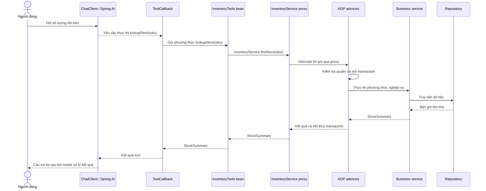

# Quan hệ giữa lời gọi qua bean, proxy Spring và xử lý nghiệp vụ

Một phương thức được đánh dấu `@Tool` có thể trở thành điểm vào để mô hình yêu cầu ứng dụng thực hiện một chức năng. Khi chức năng đó cần đọc cơ sở dữ liệu, kiểm tra quyền hoặc mở transaction, điều quan trọng là lời gọi phải đi qua đúng các bean do Spring quản lý. Nếu tạo đối tượng bằng `new`, giữ tham chiếu tới target chưa được proxy hoặc gọi nội bộ bằng `this`, các cơ chế như dependency injection, `@Transactional` và method security có thể không hoạt động như mong đợi.

Trong Spring AI, `@Tool` mô tả một phương thức mà mô hình có thể yêu cầu gọi; `@ToolParam` mô tả các tham số trong schema đầu vào. Spring AI chuyển phương thức thành `ToolCallback` để xử lý yêu cầu và gọi mã Java. Bản thân annotation không tạo transaction, không xác thực người dùng và không áp dụng quy tắc nghiệp vụ. Những trách nhiệm đó thuộc các bean service và cơ chế bảo vệ của ứng dụng.

## Nhìn toàn bộ đường đi của một tool call

Một thiết kế dễ kiểm soát thường có các lớp sau:

1. **ChatClient và Spring AI:** gửi câu hỏi cùng định nghĩa công cụ tới model, nhận yêu cầu gọi công cụ và điều phối việc thực thi.
2. **Tool adapter:** bean chứa phương thức `@Tool`, chuyển đối số từ model thành lời gọi phù hợp tới service.
3. **Spring service proxy:** nhận lời gọi từ tool adapter và áp dụng các interceptor như kiểm tra quyền, transaction, cache hoặc audit.
4. **Business service và repository:** thực hiện quy tắc miền, truy cập dữ liệu và trả về kết quả có cấu trúc.
5. **ToolCallback:** chuyển kết quả thực thi thành nội dung mà Spring AI có thể gửi lại model.



Trong ví dụ này, tool adapter giữ vai trò cổng vào mỏng. Quy tắc nghiệp vụ và các annotation AOP nằm ở service bean riêng. Khi `InventoryTools` gọi `inventoryService.findStock(...)`, biến `inventoryService` là tham chiếu Spring inject; nếu bean có proxy thì lời gọi đi qua proxy trước khi tới phương thức thật.

## `@Tool` và `@ToolParam` mô tả hợp đồng với mô hình

`@Tool` cho Spring AI biết phương thức nào có thể được công bố cho model. Một số thuộc tính thường dùng:

- `name`: tên công cụ trong tool definition. Nếu bỏ trống, Spring AI dùng tên phương thức. Tên phải duy nhất trong tập công cụ được cung cấp cho một request.
- `description`: mô tả công cụ làm gì và khi nào nên dùng. Đây là thông tin quan trọng giúp model chọn đúng công cụ.
- `returnDirect`: cho phép trả kết quả công cụ thẳng về caller thay vì gửi lại model.
- `requiresConfirmation`: khai báo công cụ cần được xác nhận trước khi thực thi trong luồng có hỗ trợ xác nhận.

`@ToolParam` mô tả từng tham số, ví dụ ý nghĩa, định dạng và việc tham số có bắt buộc hay không. Theo mặc định, tham số là bắt buộc; có thể đặt `required = false` hoặc dùng `@Nullable` cho tham số tùy chọn.

Schema được tạo từ khai báo phương thức giúp model biết cần cung cấp đối số nào. Tuy nhiên, schema chỉ là hợp đồng giao tiếp với model. Nó không thay thế việc kiểm tra đầu vào ở server. Model vẫn có thể gửi chuỗi rỗng, mã không tồn tại, giá trị vượt giới hạn hoặc một tham số không phù hợp với trạng thái nghiệp vụ. Tool adapter hoặc service phải xác thực lại trước khi thao tác.

## Đặt tool adapter trong Spring context

Khi phương thức cần dependency do Spring quản lý, hãy khai báo lớp chứa `@Tool` như một bean, thường dùng `@Component`, rồi inject bean đó vào nơi tạo lời gọi chat. Ví dụ:

```java
import org.springframework.ai.tool.annotation.Tool;
import org.springframework.ai.tool.annotation.ToolParam;
import org.springframework.stereotype.Component;

@Component
public class InventoryTools {

    private final InventoryService inventoryService;

    public InventoryTools(InventoryService inventoryService) {
        this.inventoryService = inventoryService;
    }

    @Tool(
            name = "lookupStock",
            description = "Tra cứu số lượng tồn kho hiện tại theo mã SKU. Dùng khi người dùng hỏi số lượng tồn thực tế.")
    public StockSummary lookupStock(
            @ToolParam(description = "Mã SKU của sản phẩm cần tra cứu") String sku) {

        if (sku == null || sku.isBlank()) {
            throw new IllegalArgumentException("Mã SKU không được để trống.");
        }

        return inventoryService.findStock(sku.trim());
    }
}
```

Spring tạo `InventoryTools` và inject `InventoryService` vào constructor. Khi cấu hình lời gọi, hãy truyền bean được inject:

```java
@Service
public class InventoryAssistant {

    private final ChatClient chatClient;
    private final InventoryTools inventoryTools;

    public InventoryAssistant(ChatClient chatClient, InventoryTools inventoryTools) {
        this.chatClient = chatClient;
        this.inventoryTools = inventoryTools;
    }

    public String answer(String question) {
        return chatClient.prompt()
                .user(question)
                .tools(inventoryTools)
                .call()
                .content();
    }
}
```

`ChatClient` chấp nhận các object có phương thức `@Tool` và các `ToolCallback`/`ToolCallbackProvider`. Spring AI tạo callback từ object được truyền vào và dùng callback để thực thi phương thức khi model yêu cầu. Không tạo `new InventoryTools(...)` ở nơi gọi chat: cách đó bỏ qua vòng đời bean, dependency injection và mọi proxy có thể được Spring áp dụng cho chính object đó.

## Vì sao nên đặt quy tắc nghiệp vụ ở service riêng?

Tool adapter là lớp giao tiếp giữa model và ứng dụng. Nó nên làm các việc ngắn gọn:

- Nhận và kiểm tra sơ bộ đối số.
- Chuyển đối số sang lời gọi service rõ nghĩa.
- Chuyển kết quả thành DTO phù hợp để gửi lại model.

Service nghiệp vụ chịu trách nhiệm kiểm tra trạng thái dữ liệu, quyền truy cập, quy tắc miền, transaction và các thao tác ghi. Thiết kế này cho phép cùng một service được gọi từ REST controller, batch job, message listener hoặc tool mà vẫn dùng chung quy tắc.

Ví dụ service tra cứu tồn kho:

```java
public interface InventoryService {

    StockSummary findStock(String sku);
}
```

```java
import org.springframework.security.access.prepost.PreAuthorize;
import org.springframework.stereotype.Service;
import org.springframework.transaction.annotation.Transactional;

@Service
public class DefaultInventoryService implements InventoryService {

    private final InventoryRepository inventoryRepository;

    public DefaultInventoryService(InventoryRepository inventoryRepository) {
        this.inventoryRepository = inventoryRepository;
    }

    @Override
    @PreAuthorize("hasAuthority('inventory:read')")
    @Transactional(readOnly = true)
    public StockSummary findStock(String sku) {
        InventoryItem item = inventoryRepository.findBySku(sku)
                .orElseThrow(() -> new InventoryNotFoundException(sku));

        return new StockSummary(item.getSku(), item.getAvailableQuantity());
    }
}
```

`InventoryRepository`, `InventoryItem`, `InventoryNotFoundException` và `StockSummary` là kiểu miền của ví dụ. `StockSummary` nên là DTO có các trường cần thiết, chẳng hạn mã SKU và số lượng khả dụng. Tránh trả thẳng JPA entity có thể chứa quan hệ lazy, dữ liệu nội bộ hoặc trường không nên đưa vào ngữ cảnh model.

Ví dụ DTO trả về có thể là một record đơn giản:

```java
public record StockSummary(String sku, int availableQuantity) {
}
```

Để `@PreAuthorize` hoạt động, ứng dụng cần bật method security:

```java
import org.springframework.context.annotation.Configuration;
import org.springframework.security.config.annotation.method.configuration.EnableMethodSecurity;

@Configuration
@EnableMethodSecurity
public class MethodSecurityConfiguration {
}
```

Spring Boot Starter Security không tự bật method-level authorization. `@EnableMethodSecurity` đăng ký cơ chế interceptor để các lời gọi qua bean proxy được kiểm tra theo `@PreAuthorize`, `@PostAuthorize` và các annotation liên quan. Transaction annotation cũng cần transaction infrastructure cùng `PlatformTransactionManager`; Spring Boot thường tự cấu hình khi ứng dụng có dependency và datasource phù hợp. Với cấu hình Spring thuần, bật transaction management tường minh.

## Proxy Spring làm gì khi service được gọi?

Spring AOP thường tạo một proxy bao quanh bean. Khi một bean khác gọi phương thức qua tham chiếu proxy, các advisor/interceptor phù hợp có thể chạy trước và sau phương thức đích. Ví dụ:

- Method security đọc `Authentication` hiện tại và đánh giá biểu thức `@PreAuthorize`.
- Transaction interceptor mở hoặc tham gia transaction trước khi phương thức nghiệp vụ chạy, sau đó commit hoặc rollback theo kết quả.
- Cache hoặc audit advisor có thể đọc tham số, kết quả và ghi nhận hoạt động theo cấu hình.

Proxy chỉ tham gia khi lời gọi thực sự đi qua proxy. Nếu ứng dụng giữ target object và gọi trực tiếp target, các interceptor sẽ bị bỏ qua. Vì vậy, việc inject service bean qua constructor quan trọng hơn việc chỉ đặt annotation lên một phương thức.

Spring AOP có hai kiểu proxy thường gặp:

| Kiểu proxy | Cách hoạt động | Điều cần lưu ý |
|---|---|---|
| JDK dynamic proxy | Tạo proxy triển khai các interface của bean | Client nên gọi qua interface được proxy công bố; phương thức không có trên interface không thể được gọi qua tham chiếu interface proxy |
| CGLIB class proxy | Tạo lớp con runtime của lớp đích | Không proxy được `final` class; không advise được `final` hoặc `private` method; method không nhìn thấy cũng có giới hạn |

Vì vậy, với các service cần transaction hoặc method security, hãy dùng phương thức public, không final, gọi qua bean được inject. Nếu service có interface, có thể inject và gọi qua interface. Đừng ép loại proxy chỉ để làm cho một thiết kế không rõ ràng hoạt động; trước hết xác minh kiểu proxy và chữ ký phương thức thực tế.

## Đừng nhầm khả năng đọc annotation với khả năng chạy AOP

Spring AI có thể phát hiện `@Tool` trên phương thức và tạo `MethodToolCallback` để gọi phương thức đó. Tài liệu Spring AI cho phép phương thức `@Tool` có nhiều mức visibility, kể cả private hoặc package-private. Đó là khả năng tìm và gọi phương thức bằng cơ chế reflection của Spring AI.

Spring AOP có quy tắc khác: proxy dựa trên lời gọi phương thức qua proxy và khả năng override/phơi bày của phương thức. Một phương thức private có thể được Spring AI tìm thấy, nhưng không thể được CGLIB advise như một public method. Tương tự, phương thức final không thể được CGLIB override để gắn advice.

Để tránh nhập nhằng, hãy dùng một public `@Tool` method mỏng làm adapter và đặt `@Transactional`, `@PreAuthorize` trên service bean riêng. Khi đó, Spring AI gọi tool method; tool method gọi service qua tham chiếu Spring inject; lời gọi service đi qua proxy và các interceptor chạy ở đúng ranh giới nghiệp vụ.

## Self-invocation có thể bỏ qua proxy

Một lỗi phổ biến là một phương thức trong cùng class gọi phương thức khác qua `this`:

```java
@Service
public class InventoryServiceImpl {

    private final InventoryRepository inventoryRepository;

    public InventoryServiceImpl(InventoryRepository inventoryRepository) {
        this.inventoryRepository = inventoryRepository;
    }

    public StockSummary refreshAndRead(String sku) {
        // Lời gọi này là this.findStock(...), không đi qua proxy.
        return this.findStock(sku);
    }

    @Transactional(readOnly = true)
    public StockSummary findStock(String sku) {
        InventoryItem item = inventoryRepository.findBySku(sku)
                .orElseThrow(() -> new InventoryNotFoundException(sku));
        return new StockSummary(item.getSku(), item.getAvailableQuantity());
    }
}
```

Nếu `refreshAndRead` được gọi qua proxy, lời gọi bên ngoài có thể được intercept. Nhưng lời gọi nội bộ `this.findStock(...)` chạy trực tiếp trên target object, vì vậy advice gắn với `findStock` không được kích hoạt trong proxy mode. Điều này áp dụng cho transaction và các cơ chế Spring AOP dựa trên proxy, bao gồm method security.

Giải pháp dễ bảo trì là tách thao tác cần advice sang một bean khác rồi inject bean đó. Self-injection hoặc `AopContext.currentProxy()` có thể giải quyết một số trường hợp đặc biệt, nhưng làm mã phụ thuộc chặt vào AOP và khó kiểm thử hơn. Chỉ dùng khi đã cân nhắc rõ trade-off.

## Đăng ký callback theo cách lập trình

Khi cần kiểm soát rõ tên, schema hoặc cách gọi, có thể tạo `FunctionToolCallback` từ method reference của service. Điểm quan trọng là method reference phải lấy từ bean được Spring inject, vì nó giữ lại chính tham chiếu đó:

```java
public record StockLookupRequest(String sku) {
}
```

```java
import org.springframework.ai.tool.ToolCallback;
import org.springframework.ai.tool.function.FunctionToolCallback;
import org.springframework.context.annotation.Bean;
import org.springframework.context.annotation.Configuration;

@Configuration(proxyBeanMethods = false)
public class InventoryToolConfiguration {

    @Bean
    ToolCallback lookupStockTool(InventoryService inventoryService) {
        return FunctionToolCallback.builder(
                        "lookupStock",
                        (StockLookupRequest request) -> inventoryService.findStock(request.sku()))
                .description("Tra cứu số lượng tồn kho hiện tại theo mã SKU.")
                .inputType(StockLookupRequest.class)
                .build();
    }
}
```

Sau đó inject callback và truyền cho ChatClient bằng `.tools(lookupStockTool)`. `FunctionToolCallback` phù hợp khi muốn dùng lambda, function hoặc method reference. Nếu lambda gọi phương thức của `inventoryService` được inject, lời gọi vẫn đi qua proxy của service. Nếu lambda đóng trên một target được tạo bằng `new`, transaction và method security có thể không được áp dụng.

Với Spring AI 2.x, nên đăng ký `ToolCallback` tường minh khi chọn kiểu function-based. Cách cũ dùng bare `Function` bean và `toolNames(...)` đã bị loại bỏ. Với phương thức Java có sẵn, `@Tool` thường ngắn gọn hơn; `MethodToolCallback` phù hợp khi cần cấu hình callback dựa trên `Method` và `toolObject` một cách tường minh.

## Quyền truy cập và ngữ cảnh người dùng

Model chỉ tạo tên công cụ và đối số. Model không phải nguồn đáng tin cậy cho danh tính hoặc quyền. Không cho phép model tự khai báo `userId`, `tenantId`, role hay authority rồi dùng các giá trị đó để quyết định truy cập.

Với một yêu cầu đến từ HTTP, ứng dụng xác thực người dùng ở security filter chain. Khi tool được thực thi đồng bộ trong cùng request, service có thể dùng `SecurityContext` hiện tại để áp dụng method security. Service cũng phải kiểm tra quyền trên chính tài nguyên cần truy cập, ví dụ người dùng có được xem SKU thuộc tenant của họ hay không.

Nếu luồng tool chạy bất đồng bộ, qua executor hoặc được tiếp tục từ một job nền, không mặc định rằng `SecurityContext` sẽ tự truyền sang thread khác. Cần thiết kế việc truyền context và danh tính đã xác thực một cách tường minh, hoặc tạo một service principal có quyền giới hạn cho job đó. Không lấy danh tính từ nội dung do model sinh.

Spring AI có `ToolContext` để chuyển dữ liệu do ứng dụng cung cấp tới lúc thực thi công cụ; dữ liệu này không được gửi cho model như tool schema. Có thể dùng nó cho correlation ID, tenant context đã được ứng dụng xác thực hoặc metadata request. Tuy nhiên, `ToolContext` không tự xác thực danh tính và không thay thế `SecurityContext`, method security hoặc kiểm tra quyền trong service.

## Transaction phải bao quanh thao tác nghiệp vụ

Một vòng tool calling có thể gồm nhiều lần gọi model và nhiều tool execution. Không nên mở một transaction cơ sở dữ liệu rồi giữ nó trong suốt vòng hội thoại, vì thời gian chờ model hoặc mạng có thể kéo dài và giữ connection/lock không cần thiết.

Hãy đặt transaction ở service method thực hiện một đơn vị công việc nhất quán:

- Tra cứu chỉ đọc có thể dùng `@Transactional(readOnly = true)` nếu cần transaction.
- Cập nhật một aggregate hoặc ghi nhiều bảng trong cùng nghiệp vụ nên nằm trong một service method có transaction rõ ràng.
- Không để model quyết định commit, rollback hoặc truyền đối tượng transaction.
- Nếu service ném exception, để transaction interceptor áp dụng chính sách rollback; nhớ rằng mặc định rollback thường áp dụng với unchecked exception và `Error`, còn checked exception cần cấu hình `rollbackFor` khi cần.

Nếu thao tác có tác động bên ngoài như gửi email hoặc gọi thanh toán, transaction cơ sở dữ liệu không thể tự rollback tác động đó. Dùng outbox, idempotency key, workflow hoặc cơ chế bù trừ phù hợp với nghiệp vụ thay vì giả định một transaction duy nhất bao trùm mọi hệ thống.

## Xử lý lỗi từ tool và service

Service nên ném exception nghiệp vụ có ý nghĩa cho ứng dụng, ví dụ `InventoryNotFoundException` hoặc `AccessDeniedException`. Tool layer và Spring AI sau đó cần xử lý theo chính sách đã chọn.

Spring AI có `ToolExecutionExceptionProcessor`. Theo cấu hình mặc định trong Spring AI 2.x, thông điệp của `RuntimeException` có thể được gửi lại model để model giải thích hoặc điều chỉnh; checked exception và `Error` được ném lại. Có thể đặt `spring.ai.tools.throw-exception-on-error=true` để chuyển lỗi về caller, hoặc cung cấp processor tùy chỉnh.

Không đưa SQL, stack trace, tên bảng, token, thông tin xác thực hoặc dữ liệu người dùng khác vào exception message có thể gửi cho model. Dùng mã lỗi và thông báo đã làm sạch, chẳng hạn “Không tìm thấy sản phẩm theo mã SKU đã cung cấp”. Với lỗi phân quyền, tránh tiết lộ tài nguyên có tồn tại hay không nếu chính sách yêu cầu che giấu thông tin đó.

Khi method security từ chối lời gọi, service body không nên chạy. Hãy bảo đảm exception được xử lý ở tầng chat/application để người dùng nhận được phản hồi phù hợp. Một tool call thất bại không nên được diễn giải thành thao tác nghiệp vụ thành công.

## Kiểm thử đường đi qua bean và proxy

Kiểm thử chỉ gọi trực tiếp `new InventoryTools(...)` không xác minh được Spring context, proxy hoặc transaction. Nên có kiểm thử tích hợp khởi tạo ApplicationContext thật và xác nhận đường đi qua các bean được quản lý.

Các nhóm kiểm thử nên có:

| Kiểm thử | Điều cần xác nhận |
|---|---|
| Tool registration | ChatClient nhận đúng bean hoặc ToolCallback và model thấy tên/schema dự kiến |
| Dependency injection | Tool adapter dùng service bean do Spring inject, không tự tạo target bằng `new` |
| Proxy invocation | Service bean được proxy khi có transaction/method security; lời gọi từ tool đi qua proxy |
| Authorization allow | Người dùng có authority phù hợp gọi được service và nhận DTO hợp lệ |
| Authorization deny | Người dùng thiếu authority bị từ chối trước khi repository thực hiện truy vấn/ghi dữ liệu |
| Transaction rollback | Khi thao tác nghiệp vụ thất bại, dữ liệu thay đổi trong transaction được rollback theo cấu hình |
| Self-invocation | Test phát hiện lời gọi nội bộ không kích hoạt advice; cấu trúc service được tách bean nếu cần |
| Input validation | SKU rỗng, sai định dạng hoặc không hợp lệ bị từ chối ở server dù model đã tạo JSON hợp lệ |
| Error conversion | Tool error được chuyển thành thông báo an toàn hoặc được ném về caller theo cấu hình |

Ví dụ kiểm tra proxy trong một integration test:

```java
import static org.assertj.core.api.Assertions.assertThat;

import org.springframework.aop.support.AopUtils;
import org.springframework.beans.factory.annotation.Autowired;
import org.springframework.boot.test.context.SpringBootTest;
import org.junit.jupiter.api.Test;

@SpringBootTest
class InventoryToolIntegrationTest {

    @Autowired
    InventoryService inventoryService;

    @Autowired
    InventoryTools inventoryTools;

    @Test
    void serviceIsManagedBySpringAndCanBeProxied() {
        assertThat(AopUtils.isAopProxy(inventoryService)).isTrue();
        assertThat(inventoryTools).isNotNull();
    }
}
```

Test này chỉ xác nhận bean service đang là proxy trong cấu hình test. Cần thêm test hành vi để xác minh quyền bị từ chối, transaction rollback và lời gọi repository. Một test chỉ assert `isAopProxy` không chứng minh mọi annotation đã được áp dụng đúng.

## Checklist khi thiết kế một tool nghiệp vụ

Trước khi cung cấp tool cho model, hãy tự kiểm tra:

1. `@Tool` có mô tả rõ mục đích và trường hợp nên dùng không?
2. `@ToolParam` có mô tả tên, kiểu và tính bắt buộc của từng tham số không?
3. Tool adapter có phải bean Spring được inject, và có tránh giữ state riêng theo người dùng trong singleton không?
4. Business service có được gọi qua tham chiếu bean/proxy do Spring quản lý không?
5. Quyền truy cập được kiểm tra ở service hoặc policy layer dựa trên danh tính đã xác thực không?
6. Transaction chỉ bao quanh một đơn vị nghiệp vụ và có rollback semantics phù hợp không?
7. Đầu vào có được xác thực ở server, kết quả có được giới hạn thành DTO an toàn không?
8. Exception gửi về model hoặc caller có được làm sạch, không lộ chi tiết nội bộ không?
9. Có test tích hợp xác minh đường đi qua proxy, quyền và transaction không?

## Kết luận

`@Tool` và `@ToolParam` tạo hợp đồng để model yêu cầu một chức năng Java với đối số có cấu trúc. Spring AI chuyển lời gọi thành `ToolCallback` và thực thi phương thức. Để transaction, method security và các cơ chế AOP hoạt động đúng, tool cần dùng bean do Spring quản lý và gọi business service qua tham chiếu proxy được inject. Đặt quy tắc nghiệp vụ ở service riêng, tránh tự tạo target hoặc self-invocation, xác thực lại mọi đối số và kiểm thử hành vi proxy trong ApplicationContext thật. Cách tổ chức này giữ phần tích hợp AI mỏng và duy trì các bảo đảm nghiệp vụ ở đúng tầng ứng dụng.

## Tài liệu tham khảo

- [Spring AI 2.1.0 — Tool Calling](https://docs.spring.io/spring-ai/reference/2.1/api/tools.html) — `@Tool`, `@ToolParam`, `MethodToolCallback`, `FunctionToolCallback`, `ToolCallback`, `ToolContext` và exception processing.
- [Spring Framework — Proxying Mechanisms](https://docs.spring.io/spring-framework/reference/core/aop/proxying.html) — JDK/CGLIB proxy, giới hạn final/private method và self-invocation.
- [Spring Framework — Using `@Transactional`](https://docs.spring.io/spring-framework/reference/data-access/transaction/declarative/annotations.html) — transaction annotation và proxy mode.
- [Spring Security — Method Security](https://docs.spring.io/spring-security/reference/servlet/authorization/method-security.html) — bật `@EnableMethodSecurity` và áp dụng `@PreAuthorize` trên service bean.
